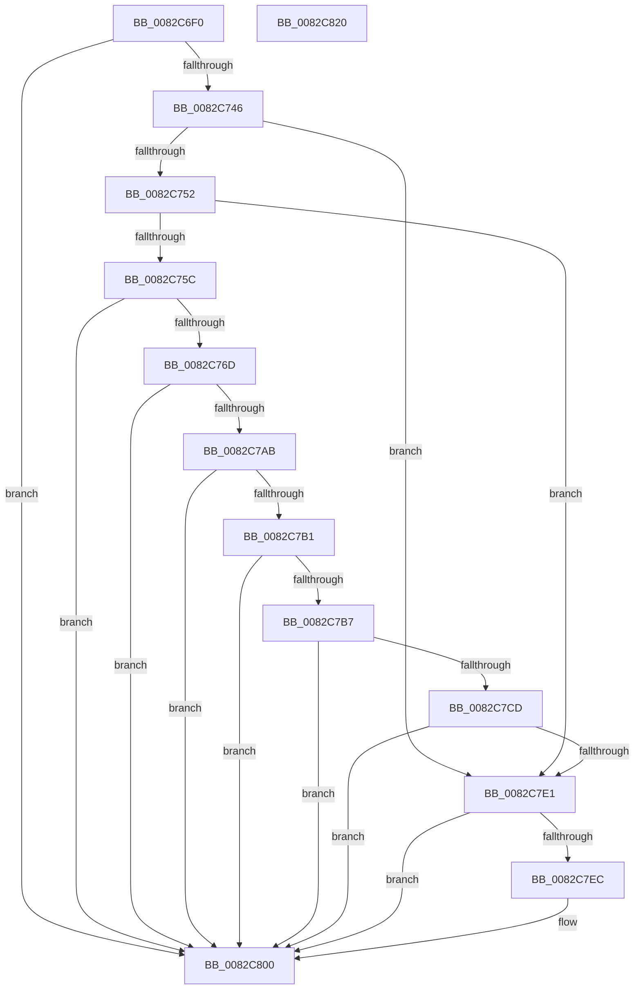

# CmClassFilterCallback

- RVA: `0x0082C6F0`–`0x0082C821` (길이 `305` bytes)
- VA: `0x000000014082C6F0`
- 실행 섹션: `PAGE`
- PDB 이름 있음: `예`; PDB Function 태그: `아니요`
- unwind 정보 RVA: `0x000C613C`
- 디코드: `90`개 명령, `305/305` bytes 표시
- 미해석 바이트: `0` (있으면 어셈블리에 `.byte`로 보존)

> 이 문서는 커널 이미지의 기계어와 PDB 기호를 분석해 생성했습니다. 4번과 5번은 함수 원형과 자료형을 바이너리 사용 방식에서 추정한 C 해석이며 원본 소스 복구 결과는 아닙니다.

## 1. Dependencies

- 직접 호출 지점: **6**; 고유 호출 대상: **5**
- 직접 호출자로 확인된 함수: **0**
- RIP 상대 이미지 참조: **1**

### Outgoing calls
- `0x0082C760` → [RtlInitUnicodeStringEx](../../text/46/RtlInitUnicodeStringEx_function_00463960.md) (function, `0x00463960`)
- `0x0082C7A2` → [CmGetDeviceRegProp](../8E/CmGetDeviceRegProp_function_008ED870.md) (function, `0x008ED870`)
- `0x0082C7C4` → [RtlInitUnicodeStringEx](../../text/46/RtlInitUnicodeStringEx_function_00463960.md) (function, `0x00463960`)
- `0x0082C7D8` → [RtlEqualUnicodeString](../93/RtlEqualUnicodeString_function_00932A20.md) (function, `0x00932A20`)
- `0x0082C7F9` → [guard_dispatch_icall](../../text/6B/guard_dispatch_icall_function_006BAAD0.md) (function, `0x006BAAD0`)
- `0x0082C809` → [_security_check_cookie](../../text/6A/_security_check_cookie_function_006AC640.md) (function, `0x006AC640`)

### Direct callers
- 이 함수 시작 RVA로 연결되는 직접 call은 확인되지 않았습니다. 간접 호출은 완전히 역산할 수 없습니다.

### Static image references
- `0x0082C707` → RVA `0x00E0A740` (`.data`; read)

## 2. Other-region calls and transfers

- 다른 실행 섹션으로 향하는 call: **4**
  - `0x0082C760` → [RtlInitUnicodeStringEx](../../text/46/RtlInitUnicodeStringEx_function_00463960.md) (`PAGE` → `.text`)
  - `0x0082C7C4` → [RtlInitUnicodeStringEx](../../text/46/RtlInitUnicodeStringEx_function_00463960.md) (`PAGE` → `.text`)
  - `0x0082C7F9` → [guard_dispatch_icall](../../text/6B/guard_dispatch_icall_function_006BAAD0.md) (`PAGE` → `.text`)
  - `0x0082C809` → [_security_check_cookie](../../text/6A/_security_check_cookie_function_006AC640.md) (`PAGE` → `.text`)
- 별도 외부 분기/꼬리 이동을 확인하지 못했습니다.

## 3. Assembly (complete function range)

```asm
0082C6F0  40 55                           push rbp
0082C6F2  53                              push rbx
0082C6F3  56                              push rsi
0082C6F4  57                              push rdi
0082C6F5  41 54                           push r12
0082C6F7  41 56                           push r14
0082C6F9  41 57                           push r15
0082C6FB  48 8D 6C 24 D9                  lea rbp, [rsp - 0x27]
0082C700  48 81 EC D0 00 00 00            sub rsp, 0xd0
0082C707  48 8B 05 32 E0 5D 00            mov rax, qword ptr [rip + 0x5de032]
0082C70E  48 33 C4                        xor rax, rsp
0082C711  48 89 45 17                     mov qword ptr [rbp + 0x17], rax
0082C715  45 33 E4                        xor r12d, r12d
0082C718  0F 57 C0                        xorps xmm0, xmm0
0082C71B  44 89 65 97                     mov dword ptr [rbp - 0x69], r12d
0082C71F  0F 57 C9                        xorps xmm1, xmm1
0082C722  44 89 65 9B                     mov dword ptr [rbp - 0x65], r12d
0082C726  49 8B F9                        mov rdi, r9
0082C729  45 8B F8                        mov r15d, r8d
0082C72C  4C 8B F2                        mov r14, rdx
0082C72F  48 8B F1                        mov rsi, rcx
0082C732  41 8A DC                        mov bl, r12b
0082C735  0F 11 45 AF                     movups xmmword ptr [rbp - 0x51], xmm0
0082C739  0F 11 4D 9F                     movups xmmword ptr [rbp - 0x61], xmm1
0082C73D  4D 85 C9                        test r9, r9
0082C740  0F 84 BA 00 00 00               je 0x14082c800
0082C746  49 8B 11                        mov rdx, qword ptr [r9]
0082C749  48 85 D2                        test rdx, rdx
0082C74C  0F 84 8F 00 00 00               je 0x14082c7e1
0082C752  66 44 39 22                     cmp word ptr [rdx], r12w
0082C756  0F 84 85 00 00 00               je 0x14082c7e1
0082C75C  48 8D 4D AF                     lea rcx, [rbp - 0x51]
0082C760  E8 FB 71 C3 FF                  call 0x140463960
0082C765  85 C0                           test eax, eax
0082C767  0F 88 93 00 00 00               js 0x14082c800
0082C76D  44 89 64 24 38                  mov dword ptr [rsp + 0x38], r12d
0082C772  48 8D 45 97                     lea rax, [rbp - 0x69]
0082C776  48 89 44 24 30                  mov qword ptr [rsp + 0x30], rax
0082C77B  45 8D 4C 24 09                  lea r9d, [r12 + 9]
0082C780  48 8D 45 C7                     lea rax, [rbp - 0x39]
0082C784  C7 45 97 4E 00 00 00            mov dword ptr [rbp - 0x69], 0x4e
0082C78B  48 89 44 24 28                  mov qword ptr [rsp + 0x28], rax
0082C790  45 33 C0                        xor r8d, r8d
0082C793  48 8D 45 9B                     lea rax, [rbp - 0x65]
0082C797  49 8B D6                        mov rdx, r14
0082C79A  48 8B CE                        mov rcx, rsi
0082C79D  48 89 44 24 20                  mov qword ptr [rsp + 0x20], rax
0082C7A2  E8 C9 10 0C 00                  call 0x1408ed870
0082C7A7  85 C0                           test eax, eax
0082C7A9  78 55                           js 0x14082c800
0082C7AB  83 7D 9B 01                     cmp dword ptr [rbp - 0x65], 1
0082C7AF  75 4F                           jne 0x14082c800
0082C7B1  83 7D 97 02                     cmp dword ptr [rbp - 0x69], 2
0082C7B5  72 49                           jb 0x14082c800
0082C7B7  48 8D 55 C7                     lea rdx, [rbp - 0x39]
0082C7BB  66 44 89 65 13                  mov word ptr [rbp + 0x13], r12w
0082C7C0  48 8D 4D 9F                     lea rcx, [rbp - 0x61]
0082C7C4  E8 97 71 C3 FF                  call 0x140463960
0082C7C9  85 C0                           test eax, eax
0082C7CB  78 33                           js 0x14082c800
0082C7CD  41 B0 01                        mov r8b, 1
0082C7D0  48 8D 55 9F                     lea rdx, [rbp - 0x61]
0082C7D4  48 8D 4D AF                     lea rcx, [rbp - 0x51]
0082C7D8  E8 43 62 10 00                  call 0x140932a20
0082C7DD  84 C0                           test al, al
0082C7DF  74 1F                           je 0x14082c800
0082C7E1  B3 01                           mov bl, 1
0082C7E3  48 8B 47 08                     mov rax, qword ptr [rdi + 8]
0082C7E7  48 85 C0                        test rax, rax
0082C7EA  74 14                           je 0x14082c800
0082C7EC  4C 8B 4F 10                     mov r9, qword ptr [rdi + 0x10]
0082C7F0  45 8B C7                        mov r8d, r15d
0082C7F3  49 8B D6                        mov rdx, r14
0082C7F6  48 8B CE                        mov rcx, rsi
0082C7F9  E8 D2 E2 E8 FF                  call 0x1406baad0
0082C7FE  8A D8                           mov bl, al
0082C800  8A C3                           mov al, bl
0082C802  48 8B 4D 17                     mov rcx, qword ptr [rbp + 0x17]
0082C806  48 33 CC                        xor rcx, rsp
0082C809  E8 32 FE E7 FF                  call 0x1406ac640
0082C80E  48 81 C4 D0 00 00 00            add rsp, 0xd0
0082C815  41 5F                           pop r15
0082C817  41 5E                           pop r14
0082C819  41 5C                           pop r12
0082C81B  5F                              pop rdi
0082C81C  5E                              pop rsi
0082C81D  5B                              pop rbx
0082C81E  5D                              pop rbp
0082C81F  C3                              ret
0082C820  CC                              int3
```

## 4. C-style interpretation (structured pseudocode)

```c
__int64 __fastcall CmClassFilterCallback(__int64 a1, __int64 a2, int a3, __int64 a4)
{
    __int64 result;
    __int64 v_r12;
    __int64 v_rbx;
    __int64 v_rsp;
    unsigned __int64 v_stack_m48;
    unsigned __int16 v_stack_m4C;
    unsigned __int64 v_stack_m5F;
    unsigned __int64 v_stack_m98;
    unsigned __int64 v_stack_mB0;
    unsigned __int64 v_stack_mC0;
    unsigned int v_stack_mC4;
    unsigned int v_stack_mC8;
    unsigned int v_stack_mD0;
    unsigned __int64 v_stack_mD8;
    unsigned __int64 v_stack_mE0;
    unsigned __int64 v_stack_mE8;

    v_rsp = (v_rsp) - (208);
    result = (*(unsigned __int64 *)(v_rip + 6152242)) ^ (v_rsp);
    v_stack_m48 = result;
    v_r12 = 0;
    v_stack_mC8 = 0;
    v_stack_mC4 = 0;
    v_stack_mB0 = v_xmm0;
    v_stack_mC0 = v_xmm1;
    if (a4 == 0) goto loc_0082C800;
    if (*(unsigned __int64 *)(a4) == 0) goto loc_0082C7E1;
    if ((*(unsigned __int16 *)(*(unsigned __int64 *)(a4))) == 0) goto loc_0082C7E1;
    result = RtlInitUnicodeStringEx(v_stack_mB0, *(unsigned __int64 *)(a4), a3, a4);
    if (sign_flag) goto loc_0082C800;
    v_stack_mD0 = 0;
    v_stack_mD8 = v_stack_mC8;
    v_stack_mC8 = 78;
    v_stack_mE0 = v_stack_m98;
    a3 = 0;
    v_stack_mE8 = v_stack_mC4;
    result = CmGetDeviceRegProp(a1, a2, a3, v_r12 + 9);
    if (sign_flag) goto loc_0082C800;
    if (v_stack_mC4 != 1) goto loc_0082C800;
    if (v_stack_mC8 < 2) goto loc_0082C800;
    v_stack_m4C = 0;
    result = RtlInitUnicodeStringEx(v_stack_mC0, v_stack_m98, a3, v_r12 + 9);
    if (sign_flag) goto loc_0082C800;
    result = RtlEqualUnicodeString(v_stack_mB0, v_stack_mC0, 1, v_r12 + 9);
    if ((unsigned __int8)(result) == 0) goto loc_0082C800;
loc_0082C7E1:
    result = *(unsigned __int64 *)(a4 + 8);
    v_rbx = 1;
    if (*(unsigned __int64 *)(a4 + 8) != 0) {
        a4 = *(unsigned __int64 *)(a4 + 16);
        a3 = (unsigned int)((unsigned int)(a3));
        a2 = a2;
        a1 = a1;
        result = guard_dispatch_icall(a1, a2, a3, a4);
        v_rbx = (unsigned __int8)(result);
    }
    a1 = (v_stack_m48) ^ (v_rsp);
    result = _security_check_cookie(a1, a2, a3, a4);
    v_rsp = (v_rsp) + (208);
    return result;
}
```

## 5. (Beta) C Style

```c
int64_t CmClassFilterCallback(int64_t Arg1, int64_t Arg2, int32_t Arg3, void *Arg4)
{
    uint8_t *arg4 = (uint8_t *)Arg4;

    int64_t result;
    int64_t local_r12;
    int64_t local_rbx;
    int64_t local_rsp;
    uint64_t v_stack_m48;
    uint16_t v_stack_m4C;
    uint64_t v_stack_m5F;
    uint64_t v_stack_m98;
    uint64_t v_stack_mB0;
    uint64_t v_stack_mC0;
    uint32_t v_stack_mC4;
    uint32_t v_stack_mC8;
    uint32_t v_stack_mD0;
    uint64_t v_stack_mD8;
    uint64_t v_stack_mE0;
    uint64_t v_stack_mE8;

    local_rsp = (local_rsp) - (208);
    result = (*(uint64_t *)(v_rip + 0x5DE032)) ^ (local_rsp);
    v_stack_m48 = result;
    local_r12 = 0;
    v_stack_mC8 = 0;
    v_stack_mC4 = 0;
    v_stack_mB0 = v_xmm0;
    v_stack_mC0 = v_xmm1;
    if (Arg4 == NULL) goto loc_0082C800;
    if (*(uint64_t *)(arg4) == 0) goto loc_0082C7E1;
    if ((*(uint16_t *)(*(uint64_t *)(arg4))) == 0) goto loc_0082C7E1;
    result = RtlInitUnicodeStringEx(v_stack_mB0, *(uint64_t *)(arg4), Arg3, Arg4);
    if (sign_flag) goto loc_0082C800;
    v_stack_mD0 = 0;
    v_stack_mD8 = v_stack_mC8;
    v_stack_mC8 = 78;
    v_stack_mE0 = v_stack_m98;
    Arg3 = 0;
    v_stack_mE8 = v_stack_mC4;
    result = CmGetDeviceRegProp(Arg1, Arg2, Arg3, local_r12 + 9);
    if (sign_flag) goto loc_0082C800;
    if (v_stack_mC4 != 1) goto loc_0082C800;
    if (v_stack_mC8 < 2) goto loc_0082C800;
    v_stack_m4C = 0;
    result = RtlInitUnicodeStringEx(v_stack_mC0, v_stack_m98, Arg3, local_r12 + 9);
    if (sign_flag) goto loc_0082C800;
    result = RtlEqualUnicodeString(v_stack_mB0, v_stack_mC0, 1, local_r12 + 9);
    if ((uint8_t)(result) == 0) goto loc_0082C800;
loc_0082C7E1:
    result = *(uint64_t *)(arg4 + 0x8);
    local_rbx = 1;
    if (*(uint64_t *)(arg4 + 0x8) != 0) {
        Arg4 = *(uint64_t *)(arg4 + 0x10);
        Arg3 = (uint32_t)((uint32_t)(Arg3));
        Arg2 = Arg2;
        Arg1 = Arg1;
        result = guard_dispatch_icall(Arg1, Arg2, Arg3, Arg4);
        local_rbx = (uint8_t)(result);
    }
    Arg1 = (v_stack_m48) ^ (local_rsp);
    result = _security_check_cookie(Arg1, Arg2, Arg3, Arg4);
    local_rsp = (local_rsp) + (208);
    return result;
}
```

### 관측된 메모리 오프셋

구조체 형식이 확인되지 않은 접근은 인자 기준의 오프셋으로만 기록했습니다.

| 기준 인자 | 오프셋 표현 | 폭 (bit) | 접근 |
|---|---:|---:|---|
| `Arg4` | `+ 0x8` | `64` | `R` |
| `Arg4` | `+ 0x10` | `64` | `R` |

## 6. Execution-region graph

[열기: 2D/3D 그래프와 함수 탐색 컨트롤 패널](../../../control-panel.html?section=page&rva=0x0082C6F0&view=graph)

- 2D 그래프는 위에서 아래로 흐르고, 3D 그래프는 빈 공간을 드래그해 회전합니다. Shift+드래그는 이동, 휠은 확대·축소, 함수 노드 선택은 대상 보고서 이동입니다.

### Static fallback


