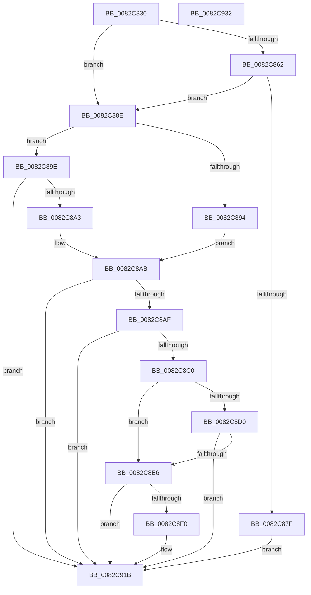

# CmClassSubkeyCallback

- RVA: `0x0082C830`–`0x0082C933` (길이 `259` bytes)
- VA: `0x000000014082C830`
- 실행 섹션: `PAGE`
- PDB 이름 있음: `예`; PDB Function 태그: `아니요`
- unwind 정보 RVA: `0x0007D3C0`
- 디코드: `77`개 명령, `259/259` bytes 표시
- 미해석 바이트: `0` (있으면 어셈블리에 `.byte`로 보존)

> 이 문서는 커널 이미지의 기계어와 PDB 기호를 분석해 생성했습니다. 4번과 5번은 함수 원형과 자료형을 바이너리 사용 방식에서 추정한 C 해석이며 원본 소스 복구 결과는 아닙니다.

## 1. Dependencies

- 직접 호출 지점: **7**; 고유 호출 대상: **6**
- 직접 호출자로 확인된 함수: **0**
- RIP 상대 이미지 참조: **0**

### Outgoing calls
- `0x0082C876` → [PnpCtxRegOpenKey](../8E/PnpCtxRegOpenKey_function_008EF7B8.md) (function, `0x008EF7B8`)
- `0x0082C884` → [ZwClose](../../text/6A/ZwClose_function_006AD2B0.md) (function, `0x006AD2B0`)
- `0x0082C897` → [CmValidateInstallerClassName](../8F/CmValidateInstallerClassName_function_008F4098.md) (function, `0x008F4098`)
- `0x0082C8A6` → [CmValidateInstallerClassName](../8F/CmValidateInstallerClassName_function_008F4098.md) (function, `0x008F4098`)
- `0x0082C8B7` → [RtlInitUnicodeStringEx](../../text/46/RtlInitUnicodeStringEx_function_00463960.md) (function, `0x00463960`)
- `0x0082C8DD` → [guard_dispatch_icall](../../text/6B/guard_dispatch_icall_function_006BAAD0.md) (function, `0x006BAAD0`)
- `0x0082C90A` → [RtlStringCchCopyExW](../../text/41/RtlStringCchCopyExW_function_0041E1C0.md) (function, `0x0041E1C0`)

### Direct callers
- 이 함수 시작 RVA로 연결되는 직접 call은 확인되지 않았습니다. 간접 호출은 완전히 역산할 수 없습니다.

### Static image references
- 디코드된 RIP-relative 메모리 참조가 없습니다.

## 2. Other-region calls and transfers

- 다른 실행 섹션으로 향하는 call: **4**
  - `0x0082C884` → [ZwClose](../../text/6A/ZwClose_function_006AD2B0.md) (`PAGE` → `.text`)
  - `0x0082C8B7` → [RtlInitUnicodeStringEx](../../text/46/RtlInitUnicodeStringEx_function_00463960.md) (`PAGE` → `.text`)
  - `0x0082C8DD` → [guard_dispatch_icall](../../text/6B/guard_dispatch_icall_function_006BAAD0.md) (`PAGE` → `.text`)
  - `0x0082C90A` → [RtlStringCchCopyExW](../../text/41/RtlStringCchCopyExW_function_0041E1C0.md) (`PAGE` → `.text`)
- 별도 외부 분기/꼬리 이동을 확인하지 못했습니다.

## 3. Assembly (complete function range)

```asm
0082C830  48 8B C4                        mov rax, rsp
0082C833  48 89 58 08                     mov qword ptr [rax + 8], rbx
0082C837  48 89 68 10                     mov qword ptr [rax + 0x10], rbp
0082C83B  48 89 70 18                     mov qword ptr [rax + 0x18], rsi
0082C83F  57                              push rdi
0082C840  48 83 EC 40                     sub rsp, 0x40
0082C844  48 83 60 20 00                  and qword ptr [rax + 0x20], 0
0082C849  0F 57 C0                        xorps xmm0, xmm0
0082C84C  49 8B 51 08                     mov rdx, qword ptr [r9 + 8]
0082C850  49 8B D9                        mov rbx, r9
0082C853  49 8B F0                        mov rsi, r8
0082C856  48 8B E9                        mov rbp, rcx
0082C859  0F 11 40 E8                     movups xmmword ptr [rax - 0x18], xmm0
0082C85D  48 85 D2                        test rdx, rdx
0082C860  74 2C                           je 0x14082c88e
0082C862  48 8D 40 20                     lea rax, [rax + 0x20]
0082C866  45 33 C9                        xor r9d, r9d
0082C869  48 89 44 24 28                  mov qword ptr [rsp + 0x28], rax
0082C86E  C7 44 24 20 19 00 02 00         mov dword ptr [rsp + 0x20], 0x20019
0082C876  E8 3D 2F 0C 00                  call 0x1408ef7b8
0082C87B  85 C0                           test eax, eax
0082C87D  78 0F                           js 0x14082c88e
0082C87F  48 8B 4C 24 68                  mov rcx, qword ptr [rsp + 0x68]
0082C884  E8 27 0A E8 FF                  call 0x1406ad2b0
0082C889  E9 8D 00 00 00                  jmp 0x14082c91b
0082C88E  8B 03                           mov eax, dword ptr [rbx]
0082C890  3C 02                           cmp al, 2
0082C892  75 0A                           jne 0x14082c89e
0082C894  48 8B D6                        mov rdx, rsi
0082C897  E8 FC 77 0C 00                  call 0x1408f4098
0082C89C  EB 0D                           jmp 0x14082c8ab
0082C89E  83 F8 04                        cmp eax, 4
0082C8A1  75 78                           jne 0x14082c91b
0082C8A3  48 8B D6                        mov rdx, rsi
0082C8A6  E8 ED 77 0C 00                  call 0x1408f4098
0082C8AB  85 C0                           test eax, eax
0082C8AD  78 6C                           js 0x14082c91b
0082C8AF  48 8B D6                        mov rdx, rsi
0082C8B2  48 8D 4C 24 30                  lea rcx, [rsp + 0x30]
0082C8B7  E8 A4 70 C3 FF                  call 0x140463960
0082C8BC  85 C0                           test eax, eax
0082C8BE  78 5B                           js 0x14082c91b
0082C8C0  0F B7 7C 24 32                  movzx edi, word ptr [rsp + 0x32]
0082C8C5  48 8B 43 10                     mov rax, qword ptr [rbx + 0x10]
0082C8C9  D1 EF                           shr edi, 1
0082C8CB  48 85 C0                        test rax, rax
0082C8CE  74 16                           je 0x14082c8e6
0082C8D0  4C 8B 4B 18                     mov r9, qword ptr [rbx + 0x18]
0082C8D4  48 8B D6                        mov rdx, rsi
0082C8D7  44 8B 03                        mov r8d, dword ptr [rbx]
0082C8DA  48 8B CD                        mov rcx, rbp
0082C8DD  E8 EE E1 E8 FF                  call 0x1406baad0
0082C8E2  84 C0                           test al, al
0082C8E4  74 35                           je 0x14082c91b
0082C8E6  01 7B 2C                        add dword ptr [rbx + 0x2c], edi
0082C8E9  8B 43 28                        mov eax, dword ptr [rbx + 0x28]
0082C8EC  3B C7                           cmp eax, edi
0082C8EE  76 2B                           jbe 0x14082c91b
0082C8F0  48 8B 4B 20                     mov rcx, qword ptr [rbx + 0x20]
0082C8F4  8B D0                           mov edx, eax
0082C8F6  C7 44 24 28 00 09 00 00         mov dword ptr [rsp + 0x28], 0x900
0082C8FE  45 33 C9                        xor r9d, r9d
0082C901  48 83 64 24 20 00               and qword ptr [rsp + 0x20], 0
0082C907  4C 8B C6                        mov r8, rsi
0082C90A  E8 B1 18 BF FF                  call 0x14041e1c0
0082C90F  8B C7                           mov eax, edi
0082C911  48 03 C0                        add rax, rax
0082C914  48 01 43 20                     add qword ptr [rbx + 0x20], rax
0082C918  29 7B 28                        sub dword ptr [rbx + 0x28], edi
0082C91B  48 8B 5C 24 50                  mov rbx, qword ptr [rsp + 0x50]
0082C920  33 C0                           xor eax, eax
0082C922  48 8B 6C 24 58                  mov rbp, qword ptr [rsp + 0x58]
0082C927  48 8B 74 24 60                  mov rsi, qword ptr [rsp + 0x60]
0082C92C  48 83 C4 40                     add rsp, 0x40
0082C930  5F                              pop rdi
0082C931  C3                              ret
0082C932  CC                              int3
```

## 4. C-style interpretation (structured pseudocode)

```c
__int64 __fastcall CmClassSubkeyCallback(__int64 a1, __int64 a2, __int64 a3, __int64 a4)
{
    __int64 result;
    __int64 v_rdi;
    __int64 v_rsp;
    unsigned __int16 v_stack_m16;
    unsigned __int64 v_stack_m18;
    unsigned __int64 v_stack_m20;
    unsigned int v_stack_m28;
    unsigned __int64 v_stack_p10;
    unsigned __int64 v_stack_p18;
    unsigned __int64 v_stack_p20;
    unsigned __int64 v_stack_p8;

    *(unsigned __int64 *)(v_rsp + 8) = v_rbx;
    *(unsigned __int64 *)(v_rsp + 16) = v_rbp;
    *(unsigned __int64 *)(v_rsp + 24) = v_rsi;
    v_rsp = (v_rsp) - (64);
    *(unsigned __int64 *)(v_rsp - 24) = v_xmm0;
    if (*(unsigned __int64 *)(a4 + 8) == 0) goto loc_0082C88E;
    a4 = 0;
    v_stack_m20 = v_rsp + 32;
    v_stack_m28 = 0x20019ULL;
    result = PnpCtxRegOpenKey(a1, *(unsigned __int64 *)(a4 + 8), a3, a4);
    if (sign_flag) goto loc_0082C88E;
    result = ZwClose(v_stack_p20, *(unsigned __int64 *)(a4 + 8), a3, a4);
    goto loc_0082C91B;
loc_0082C88E:
    if (((unsigned __int8)((unsigned int)(*(unsigned int *)(a4)))) != 2) goto loc_0082C89E;
    result = CmValidateInstallerClassName(v_stack_p20, a3, a3, a4);
    goto loc_0082C8AB;
loc_0082C89E:
    if (((unsigned int)(result)) != 4) goto loc_0082C91B;
    result = CmValidateInstallerClassName(v_stack_p20, a3, a3, a4);
loc_0082C8AB:
    if (sign_flag) goto loc_0082C91B;
    result = RtlInitUnicodeStringEx(v_stack_m18, a3, a3, a4);
    if (sign_flag) goto loc_0082C91B;
    v_rdi = (unsigned int)((v_stack_m16) >> (1));
    if (*(unsigned __int64 *)(a4 + 16) == 0) goto loc_0082C8E6;
    result = guard_dispatch_icall(a1, a3, (unsigned int)(*(unsigned int *)(a4)), *(unsigned __int64 *)(a4 + 24));
    if ((unsigned __int8)(result) == 0) goto loc_0082C91B;
loc_0082C8E6:
    result = (unsigned int)(*(unsigned int *)(a4 + 40));
    if (((unsigned int)((unsigned int)(*(unsigned int *)(a4 + 40)))) >= = ((unsigned int)(v_rdi))) {
        a1 = *(unsigned __int64 *)(a4 + 32);
        a2 = (unsigned int)((unsigned int)(*(unsigned int *)(a4 + 40)));
        v_stack_m20 = 0x900ULL;
        a4 = 0;
        a3 = a3;
        result = RtlStringCchCopyExW(a1, a2, a3, a4);
        result = (unsigned int)(v_rdi);
        result = (result) + (result);
    }
    result = 0;
    v_rsp = (v_rsp) + (64);
    return result;
}
```

## 5. (Beta) C Style

```c
int64_t CmClassSubkeyCallback(int64_t Arg1, int64_t Arg2, int64_t Arg3, void *Arg4)
{
    uint8_t *arg4 = (uint8_t *)Arg4;

    int64_t result;
    int64_t local_rdi;
    int64_t local_rsp;
    uint16_t v_stack_m16;
    uint64_t v_stack_m18;
    uint64_t v_stack_m20;
    uint32_t v_stack_m28;
    uint64_t v_stack_p10;
    uint64_t v_stack_p18;
    uint64_t v_stack_p20;
    uint64_t v_stack_p8;

    *(uint64_t *)(local_rsp + 0x8) = local_rbx;
    *(uint64_t *)(local_rsp + 0x10) = local_rbp;
    *(uint64_t *)(local_rsp + 0x18) = local_rsi;
    local_rsp = (local_rsp) - (64);
    *(uint64_t *)(local_rsp - 0x18) = v_xmm0;
    if (*(uint64_t *)(arg4 + 0x8) == 0) goto loc_0082C88E;
    Arg4 = 0;
    v_stack_m20 = local_rsp + 32;
    v_stack_m28 = 0x20019ULL;
    result = PnpCtxRegOpenKey(Arg1, *(uint64_t *)(arg4 + 0x8), Arg3, Arg4);
    if (sign_flag) goto loc_0082C88E;
    result = ZwClose(v_stack_p20, *(uint64_t *)(arg4 + 0x8), Arg3, Arg4);
    goto loc_0082C91B;
loc_0082C88E:
    if (((uint8_t)((uint32_t)(*(uint32_t *)(arg4)))) != 2) goto loc_0082C89E;
    result = CmValidateInstallerClassName(v_stack_p20, Arg3, Arg3, Arg4);
    goto loc_0082C8AB;
loc_0082C89E:
    if (((uint32_t)(result)) != 4) goto loc_0082C91B;
    result = CmValidateInstallerClassName(v_stack_p20, Arg3, Arg3, Arg4);
loc_0082C8AB:
    if (sign_flag) goto loc_0082C91B;
    result = RtlInitUnicodeStringEx(v_stack_m18, Arg3, Arg3, Arg4);
    if (sign_flag) goto loc_0082C91B;
    local_rdi = (uint32_t)((v_stack_m16) >> (1));
    if (*(uint64_t *)(arg4 + 0x10) == 0) goto loc_0082C8E6;
    result = guard_dispatch_icall(Arg1, Arg3, (uint32_t)(*(uint32_t *)(arg4)), *(uint64_t *)(arg4 + 0x18));
    if ((uint8_t)(result) == 0) goto loc_0082C91B;
loc_0082C8E6:
    result = (uint32_t)(*(uint32_t *)(arg4 + 0x28));
    if (((uint32_t)((uint32_t)(*(uint32_t *)(arg4 + 0x28)))) >= = ((uint32_t)(local_rdi))) {
        Arg1 = *(uint64_t *)(arg4 + 0x20);
        Arg2 = (uint32_t)((uint32_t)(*(uint32_t *)(arg4 + 0x28)));
        v_stack_m20 = 0x900ULL;
        Arg4 = 0;
        Arg3 = Arg3;
        result = RtlStringCchCopyExW(Arg1, Arg2, Arg3, Arg4);
        result = (uint32_t)(local_rdi);
        result = (result) + (result);
    }
    result = 0;
    local_rsp = (local_rsp) + (64);
    return result;
}
```

### 관측된 메모리 오프셋

구조체 형식이 확인되지 않은 접근은 인자 기준의 오프셋으로만 기록했습니다.

| 기준 인자 | 오프셋 표현 | 폭 (bit) | 접근 |
|---|---:|---:|---|
| `Arg4` | `+ 0x0` | `32` | `R` |
| `Arg4` | `+ 0x8` | `64` | `R` |
| `Arg4` | `+ 0x10` | `64` | `R` |
| `Arg4` | `+ 0x18` | `64` | `R` |
| `Arg4` | `+ 0x20` | `64` | `R` |
| `Arg4` | `+ 0x20` | `64` | `R/W` |
| `Arg4` | `+ 0x28` | `32` | `R` |
| `Arg4` | `+ 0x28` | `32` | `R/W` |
| `Arg4` | `+ 0x2C` | `32` | `R/W` |

## 6. Execution-region graph

[열기: 2D/3D 그래프와 함수 탐색 컨트롤 패널](../../../control-panel.html?section=page&rva=0x0082C830&view=graph)

- 2D 그래프는 위에서 아래로 흐르고, 3D 그래프는 빈 공간을 드래그해 회전합니다. Shift+드래그는 이동, 휠은 확대·축소, 함수 노드 선택은 대상 보고서 이동입니다.

### Static fallback


