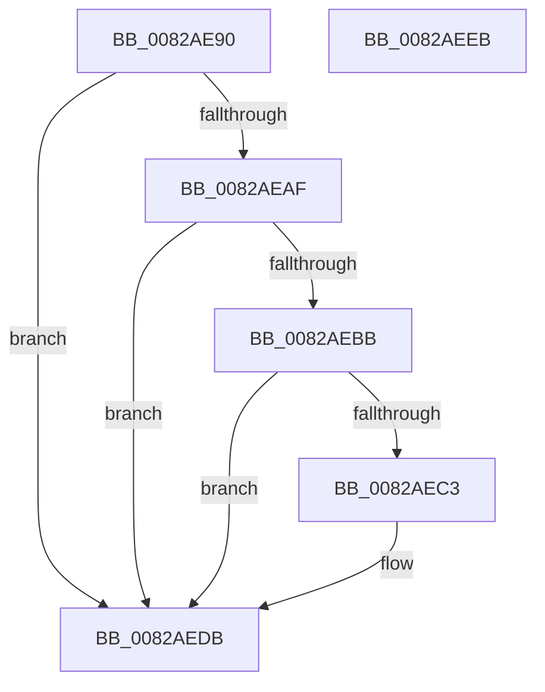

# CmContainerListGenericObjectCallback

- RVA: `0x0082AE90`–`0x0082AEEC` (길이 `92` bytes)
- VA: `0x000000014082AE90`
- 실행 섹션: `PAGE`
- PDB 이름 있음: `예`; PDB Function 태그: `아니요`
- unwind 정보 RVA: `0x000794E0`
- 디코드: `29`개 명령, `92/92` bytes 표시
- 미해석 바이트: `0` (있으면 어셈블리에 `.byte`로 보존)

> 이 문서는 커널 이미지의 기계어와 PDB 기호를 분석해 생성했습니다. 4번과 5번은 함수 원형과 자료형을 바이너리 사용 방식에서 추정한 C 해석이며 원본 소스 복구 결과는 아닙니다.

## 1. Dependencies

- 직접 호출 지점: **2**; 고유 호출 대상: **2**
- 직접 호출자로 확인된 함수: **0**
- RIP 상대 이미지 참조: **0**

### Outgoing calls
- `0x0082AEAF` → [CmValidateDeviceContainerName](../8F/CmValidateDeviceContainerName_function_008F48B8.md) (function, `0x008F48B8`)
- `0x0082AED6` → [guard_dispatch_icall](../../text/6B/guard_dispatch_icall_function_006BAAD0.md) (function, `0x006BAAD0`)

### Direct callers
- 이 함수 시작 RVA로 연결되는 직접 call은 확인되지 않았습니다. 간접 호출은 완전히 역산할 수 없습니다.

### Static image references
- 디코드된 RIP-relative 메모리 참조가 없습니다.

## 2. Other-region calls and transfers

- 다른 실행 섹션으로 향하는 call: **1**
  - `0x0082AED6` → [guard_dispatch_icall](../../text/6B/guard_dispatch_icall_function_006BAAD0.md) (`PAGE` → `.text`)
- 별도 외부 분기/꼬리 이동을 확인하지 못했습니다.

## 3. Assembly (complete function range)

```asm
0082AE90  48 89 5C 24 08                  mov qword ptr [rsp + 8], rbx
0082AE95  48 89 74 24 10                  mov qword ptr [rsp + 0x10], rsi
0082AE9A  57                              push rdi
0082AE9B  48 83 EC 30                     sub rsp, 0x30
0082AE9F  32 C0                           xor al, al
0082AEA1  49 8B D9                        mov rbx, r9
0082AEA4  48 8B FA                        mov rdi, rdx
0082AEA7  48 8B F1                        mov rsi, rcx
0082AEAA  4D 85 C9                        test r9, r9
0082AEAD  74 2C                           je 0x14082aedb
0082AEAF  E8 04 9A 0C 00                  call 0x1408f48b8
0082AEB4  C1 E8 1F                        shr eax, 0x1f
0082AEB7  34 01                           xor al, 1
0082AEB9  74 20                           je 0x14082aedb
0082AEBB  4C 8B 13                        mov r10, qword ptr [rbx]
0082AEBE  4D 85 D2                        test r10, r10
0082AEC1  74 18                           je 0x14082aedb
0082AEC3  4C 8B 4B 08                     mov r9, qword ptr [rbx + 8]
0082AEC7  41 B8 05 00 00 00               mov r8d, 5
0082AECD  48 8B D7                        mov rdx, rdi
0082AED0  48 8B CE                        mov rcx, rsi
0082AED3  49 8B C2                        mov rax, r10
0082AED6  E8 F5 FB E8 FF                  call 0x1406baad0
0082AEDB  48 8B 5C 24 40                  mov rbx, qword ptr [rsp + 0x40]
0082AEE0  48 8B 74 24 48                  mov rsi, qword ptr [rsp + 0x48]
0082AEE5  48 83 C4 30                     add rsp, 0x30
0082AEE9  5F                              pop rdi
0082AEEA  C3                              ret
0082AEEB  CC                              int3
```

## 4. C-style interpretation (structured pseudocode)

```c
__int64 __fastcall CmContainerListGenericObjectCallback(__int64 a1, __int64 a2, __int64 a3, __int64 a4)
{
    __int64 result;
    __int64 v_rsp;
    unsigned __int64 v_stack_p10;
    unsigned __int64 v_stack_p8;

    v_stack_p8 = v_rbx;
    v_stack_p10 = v_rsi;
    v_rsp = (v_rsp) - (48);
    result = 0;
    if (a4 == 0) goto loc_0082AEDB;
    result = CmValidateDeviceContainerName(a1, a2, a3, a4);
    result = (unsigned int)((result) >> (31));
    result = (unsigned __int8)((result) ^ (1));
    if (condition_is_equal) goto loc_0082AEDB;
    if (*(unsigned __int64 *)(a4) != 0) {
        a4 = *(unsigned __int64 *)(a4 + 8);
        a3 = 5;
        a2 = a2;
        a1 = a1;
        result = *(unsigned __int64 *)(a4);
        result = guard_dispatch_icall(a1, a2, a3, a4);
    }
    v_rsp = (v_rsp) + (48);
    return result;
}
```

## 5. (Beta) C Style

```c
int64_t CmContainerListGenericObjectCallback(int64_t Arg1, int64_t Arg2, int64_t Arg3, void *Arg4)
{
    uint8_t *arg4 = (uint8_t *)Arg4;

    int64_t result;
    int64_t local_rsp;
    uint64_t v_stack_p10;
    uint64_t v_stack_p8;

    v_stack_p8 = local_rbx;
    v_stack_p10 = local_rsi;
    local_rsp = (local_rsp) - (48);
    result = 0;
    if (Arg4 == NULL) goto loc_0082AEDB;
    result = CmValidateDeviceContainerName(Arg1, Arg2, Arg3, Arg4);
    result = (uint32_t)((result) >> (31));
    result = (uint8_t)((result) ^ (1));
    if (condition_is_equal) goto loc_0082AEDB;
    if (*(uint64_t *)(arg4) != 0) {
        Arg4 = *(uint64_t *)(arg4 + 0x8);
        Arg3 = 5;
        Arg2 = Arg2;
        Arg1 = Arg1;
        result = *(uint64_t *)(arg4);
        result = guard_dispatch_icall(Arg1, Arg2, Arg3, Arg4);
    }
    local_rsp = (local_rsp) + (48);
    return result;
}
```

### 관측된 메모리 오프셋

구조체 형식이 확인되지 않은 접근은 인자 기준의 오프셋으로만 기록했습니다.

| 기준 인자 | 오프셋 표현 | 폭 (bit) | 접근 |
|---|---:|---:|---|
| `Arg4` | `+ 0x0` | `64` | `R` |
| `Arg4` | `+ 0x8` | `64` | `R` |

## 6. Execution-region graph

[열기: 2D/3D 그래프와 함수 탐색 컨트롤 패널](../../../control-panel.html?section=page&rva=0x0082AE90&view=graph)

- 2D 그래프는 위에서 아래로 흐르고, 3D 그래프는 빈 공간을 드래그해 회전합니다. Shift+드래그는 이동, 휠은 확대·축소, 함수 노드 선택은 대상 보고서 이동입니다.

### Static fallback


