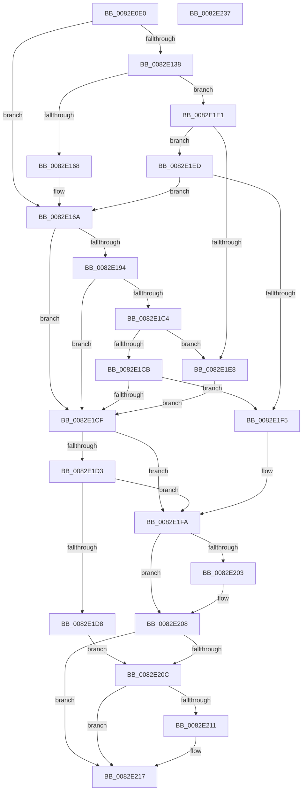

# CmCreateDevicePanel

- RVA: `0x0082E0E0`–`0x0082E238` (길이 `344` bytes)
- VA: `0x000000014082E0E0`
- 실행 섹션: `PAGE`
- PDB 이름 있음: `예`; PDB Function 태그: `아니요`
- unwind 정보 RVA: `0x00088628`
- 디코드: `103`개 명령, `344/344` bytes 표시
- 미해석 바이트: `0` (있으면 어셈블리에 `.byte`로 보존)

> 이 문서는 커널 이미지의 기계어와 PDB 기호를 분석해 생성했습니다. 4번과 5번은 함수 원형과 자료형을 바이너리 사용 방식에서 추정한 C 해석이며 원본 소스 복구 결과는 아닙니다.

## 1. Dependencies

- 직접 호출 지점: **6**; 고유 호출 대상: **5**
- 직접 호출자로 확인된 함수: **2**
- RIP 상대 이미지 참조: **1**

### Outgoing calls
- `0x0082E11C` → [memset](../../text/6C/memset_function_006C6C40.md) (function, `0x006C6C40`)
- `0x0082E15C` → [guard_dispatch_icall](../../text/6B/guard_dispatch_icall_function_006BAAD0.md) (function, `0x006BAAD0`)
- `0x0082E188` → [CmCreateDevicePanelWorker](CmCreateDevicePanelWorker_function_0082E240.md) (function, `0x0082E240`)
- `0x0082E1B8` → [guard_dispatch_icall](../../text/6B/guard_dispatch_icall_function_006BAAD0.md) (function, `0x006BAAD0`)
- `0x0082E203` → [ZwClose](../../text/6A/ZwClose_function_006AD2B0.md) (function, `0x006AD2B0`)
- `0x0082E220` → [_security_check_cookie](../../text/6A/_security_check_cookie_function_006AC640.md) (function, `0x006AC640`)

### Direct callers
- [CmAddPanelDeviceWorker](CmAddPanelDeviceWorker_function_0082DF30.md) at `0x0082DF79`
- [sub_00B34E9C](../B3/Unknown_function_00B34E9C.md) at `0x00B35725`

### Static image references
- `0x0082E0F7` → RVA `0x00E0A740` (`.data`; read)

## 2. Other-region calls and transfers

- 다른 실행 섹션으로 향하는 call: **5**
  - `0x0082E11C` → [memset](../../text/6C/memset_function_006C6C40.md) (`PAGE` → `.text`)
  - `0x0082E15C` → [guard_dispatch_icall](../../text/6B/guard_dispatch_icall_function_006BAAD0.md) (`PAGE` → `.text`)
  - `0x0082E1B8` → [guard_dispatch_icall](../../text/6B/guard_dispatch_icall_function_006BAAD0.md) (`PAGE` → `.text`)
  - `0x0082E203` → [ZwClose](../../text/6A/ZwClose_function_006AD2B0.md) (`PAGE` → `.text`)
  - `0x0082E220` → [_security_check_cookie](../../text/6A/_security_check_cookie_function_006AC640.md) (`PAGE` → `.text`)
- 별도 외부 분기/꼬리 이동을 확인하지 못했습니다.

## 3. Assembly (complete function range)

```asm
0082E0E0  40 55                           push rbp
0082E0E2  53                              push rbx
0082E0E3  56                              push rsi
0082E0E4  57                              push rdi
0082E0E5  41 54                           push r12
0082E0E7  41 56                           push r14
0082E0E9  41 57                           push r15
0082E0EB  48 8D 6C 24 E9                  lea rbp, [rsp - 0x17]
0082E0F0  48 81 EC B0 00 00 00            sub rsp, 0xb0
0082E0F7  48 8B 05 42 C6 5D 00            mov rax, qword ptr [rip + 0x5dc642]
0082E0FE  48 33 C4                        xor rax, rsp
0082E101  48 89 45 07                     mov qword ptr [rbp + 7], rax
0082E105  4C 8B 75 77                     mov r14, qword ptr [rbp + 0x77]
0082E109  4C 8B E2                        mov r12, rdx
0082E10C  33 D2                           xor edx, edx
0082E10E  4C 8B F9                        mov r15, rcx
0082E111  48 8D 4D A7                     lea rcx, [rbp - 0x59]
0082E115  49 8B F1                        mov rsi, r9
0082E118  44 8D 42 58                     lea r8d, [rdx + 0x58]
0082E11C  E8 1F 8B E9 FF                  call 0x1406c6c40
0082E121  49 8B BF F8 01 00 00            mov rdi, qword ptr [r15 + 0x1f8]
0082E128  83 65 CB 00                     and dword ptr [rbp - 0x35], 0
0082E12C  C7 45 B7 04 00 00 00            mov dword ptr [rbp - 0x49], 4
0082E133  48 85 FF                        test rdi, rdi
0082E136  74 32                           je 0x14082e16a
0082E138  41 B9 02 00 00 00               mov r9d, 2
0082E13E  48 8D 45 A7                     lea rax, [rbp - 0x59]
0082E142  48 89 44 24 28                  mov qword ptr [rsp + 0x28], rax
0082E147  49 8B D4                        mov rdx, r12
0082E14A  49 8B CF                        mov rcx, r15
0082E14D  C7 44 24 20 01 00 00 00         mov dword ptr [rsp + 0x20], 1
0082E155  48 8B C7                        mov rax, rdi
0082E158  45 8D 41 04                     lea r8d, [r9 + 4]
0082E15C  E8 6F C9 E8 FF                  call 0x1406baad0
0082E161  3D 02 00 00 C0                  cmp eax, 0xc0000002
0082E166  75 79                           jne 0x14082e1e1
0082E168  33 FF                           xor edi, edi
0082E16A  8B 45 CB                        mov eax, dword ptr [rbp - 0x35]
0082E16D  4C 8D 4D BF                     lea r9, [rbp - 0x41]
0082E171  44 8B 45 B7                     mov r8d, dword ptr [rbp - 0x49]
0082E175  49 8B D4                        mov rdx, r12
0082E178  89 44 24 28                     mov dword ptr [rsp + 0x28], eax
0082E17C  49 8B CF                        mov rcx, r15
0082E17F  48 8D 45 C7                     lea rax, [rbp - 0x39]
0082E183  48 89 44 24 20                  mov qword ptr [rsp + 0x20], rax
0082E188  E8 B3 00 00 00                  call 0x14082e240
0082E18D  8B D8                           mov ebx, eax
0082E18F  48 85 FF                        test rdi, rdi
0082E192  74 3B                           je 0x14082e1cf
0082E194  41 B9 02 00 00 00               mov r9d, 2
0082E19A  89 45 A7                        mov dword ptr [rbp - 0x59], eax
0082E19D  48 8D 45 A7                     lea rax, [rbp - 0x59]
0082E1A1  49 8B D4                        mov rdx, r12
0082E1A4  48 89 44 24 28                  mov qword ptr [rsp + 0x28], rax
0082E1A9  49 8B CF                        mov rcx, r15
0082E1AC  48 8B C7                        mov rax, rdi
0082E1AF  44 89 4C 24 20                  mov dword ptr [rsp + 0x20], r9d
0082E1B4  45 8D 41 04                     lea r8d, [r9 + 4]
0082E1B8  E8 13 C9 E8 FF                  call 0x1406baad0
0082E1BD  3D 02 00 00 C0                  cmp eax, 0xc0000002
0082E1C2  74 0B                           je 0x14082e1cf
0082E1C4  3D 20 01 00 C0                  cmp eax, 0xc0000120
0082E1C9  74 1D                           je 0x14082e1e8
0082E1CB  85 C0                           test eax, eax
0082E1CD  75 26                           jne 0x14082e1f5
0082E1CF  85 DB                           test ebx, ebx
0082E1D1  78 27                           js 0x14082e1fa
0082E1D3  48 85 F6                        test rsi, rsi
0082E1D6  74 22                           je 0x14082e1fa
0082E1D8  48 8B 45 BF                     mov rax, qword ptr [rbp - 0x41]
0082E1DC  48 89 06                        mov qword ptr [rsi], rax
0082E1DF  EB 2B                           jmp 0x14082e20c
0082E1E1  3D 20 01 00 C0                  cmp eax, 0xc0000120
0082E1E6  75 05                           jne 0x14082e1ed
0082E1E8  8B 5D A7                        mov ebx, dword ptr [rbp - 0x59]
0082E1EB  EB E2                           jmp 0x14082e1cf
0082E1ED  85 C0                           test eax, eax
0082E1EF  0F 84 75 FF FF FF               je 0x14082e16a
0082E1F5  BB E5 00 00 C0                  mov ebx, 0xc00000e5
0082E1FA  48 8B 4D BF                     mov rcx, qword ptr [rbp - 0x41]
0082E1FE  48 85 C9                        test rcx, rcx
0082E201  74 05                           je 0x14082e208
0082E203  E8 A8 F0 E7 FF                  call 0x1406ad2b0
0082E208  85 DB                           test ebx, ebx
0082E20A  78 0B                           js 0x14082e217
0082E20C  4D 85 F6                        test r14, r14
0082E20F  74 06                           je 0x14082e217
0082E211  8A 45 C7                        mov al, byte ptr [rbp - 0x39]
0082E214  41 88 06                        mov byte ptr [r14], al
0082E217  8B C3                           mov eax, ebx
0082E219  48 8B 4D 07                     mov rcx, qword ptr [rbp + 7]
0082E21D  48 33 CC                        xor rcx, rsp
0082E220  E8 1B E4 E7 FF                  call 0x1406ac640
0082E225  48 81 C4 B0 00 00 00            add rsp, 0xb0
0082E22C  41 5F                           pop r15
0082E22E  41 5E                           pop r14
0082E230  41 5C                           pop r12
0082E232  5F                              pop rdi
0082E233  5E                              pop rsi
0082E234  5B                              pop rbx
0082E235  5D                              pop rbp
0082E236  C3                              ret
0082E237  CC                              int3
```

## 4. C-style interpretation (structured pseudocode)

```c
__int64 __fastcall CmCreateDevicePanel(__int64 a1, __int64 a2, __int64 a3, __int64 a4, __int64 a5)
{
    __int64 result;
    __int64 v_rdi;
    __int64 v_rsp;
    unsigned __int64 v_stack_m48;
    unsigned __int64 v_stack_m4F;
    unsigned int v_stack_m84;
    unsigned __int64 v_stack_m88;
    unsigned __int64 v_stack_m90;
    unsigned int v_stack_m98;
    unsigned __int64 v_stack_mA8;
    unsigned __int64 v_stack_mC0;
    unsigned int v_stack_mC8;

    v_rsp = (v_rsp) - (176);
    result = (*(unsigned __int64 *)(v_rip + 6145602)) ^ (v_rsp);
    v_stack_m48 = result;
    a2 = 0;
    result = memset(v_stack_mA8, a2, a2 + 88, a4);
    v_stack_m98 = 4;
    if (*(unsigned __int64 *)(a1 + 504) == 0) goto loc_0082E16A;
    v_stack_mC0 = v_stack_mA8;
    v_stack_mC8 = 1;
    result = guard_dispatch_icall(a1, 0, 2 + 4, 2);
    if (((unsigned int)(result)) != 0xC0000002ULL) goto loc_0082E1E1;
    v_rdi = 0;
loc_0082E16A:
    v_stack_mC0 = (unsigned int)((unsigned int)(v_stack_m84));
    v_stack_mC8 = v_stack_m88;
    result = CmCreateDevicePanelWorker(a1, 0, (unsigned int)(v_stack_m98), v_stack_m90);
    if (0 == 0) goto loc_0082E1CF;
    v_stack_mA8 = (unsigned int)(result);
    v_stack_mC0 = v_stack_mA8;
    v_stack_mC8 = 2;
    result = guard_dispatch_icall(a1, 0, 2 + 4, 2);
    if (((unsigned int)(result)) == 0xC0000002ULL) goto loc_0082E1CF;
    if (((unsigned int)(result)) == 0xC0000120ULL) goto loc_0082E1E8;
    if ((unsigned int)(result) != 0) goto loc_0082E1F5;
loc_0082E1CF:
    if (sign_flag) goto loc_0082E1FA;
    if (a4 == 0) goto loc_0082E1FA;
    *(unsigned __int64 *)(a4) = v_stack_m90;
    goto loc_0082E20C;
loc_0082E1E1:
    if (((unsigned int)(v_stack_m90)) != 0xC0000120ULL) goto loc_0082E1ED;
loc_0082E1E8:
    goto loc_0082E1CF;
loc_0082E1ED:
    if ((unsigned int)(v_stack_m90) == 0) goto loc_0082E16A;
loc_0082E1F5:
loc_0082E1FA:
    result = v_stack_m90;
    if (v_stack_m90 != 0) {
        result = ZwClose(v_stack_m90, 0, 2 + 4, 2);
    }
    if (sign_flag) goto loc_0082E217;
loc_0082E20C:
    if (a5 != 0) {
        result = v_stack_m88;
        *(unsigned __int8 *)(a5) = (unsigned __int8)(result);
    }
    a1 = (v_stack_m48) ^ (v_rsp);
    result = _security_check_cookie(a1, 0, 2 + 4, 2);
    v_rsp = (v_rsp) + (176);
    return result;
}
```

## 5. (Beta) C Style

```c
int64_t CmCreateDevicePanel(void *Arg1, int64_t Arg2, int64_t Arg3, int64_t Arg4, int64_t Arg5)
{
    uint8_t *arg1 = (uint8_t *)Arg1;

    int64_t result;
    int64_t local_rdi;
    int64_t local_rsp;
    uint64_t v_stack_m48;
    uint64_t v_stack_m4F;
    uint32_t v_stack_m84;
    uint64_t v_stack_m88;
    uint64_t v_stack_m90;
    uint32_t v_stack_m98;
    uint64_t v_stack_mA8;
    uint64_t v_stack_mC0;
    uint32_t v_stack_mC8;

    local_rsp = (local_rsp) - (176);
    result = (*(uint64_t *)(v_rip + 0x5DC642)) ^ (local_rsp);
    v_stack_m48 = result;
    Arg2 = 0;
    result = memset(v_stack_mA8, Arg2, Arg2 + 88, Arg4);
    v_stack_m98 = 4;
    if (*(uint64_t *)(arg1 + 0x1F8) == 0) goto loc_0082E16A;
    v_stack_mC0 = v_stack_mA8;
    v_stack_mC8 = 1;
    result = guard_dispatch_icall(Arg1, 0, 2 + 4, 2);
    if (((uint32_t)(result)) != 0xC0000002ULL) goto loc_0082E1E1;
    local_rdi = 0;
loc_0082E16A:
    v_stack_mC0 = (uint32_t)((uint32_t)(v_stack_m84));
    v_stack_mC8 = v_stack_m88;
    result = CmCreateDevicePanelWorker(Arg1, 0, (uint32_t)(v_stack_m98), v_stack_m90);
    if (0 == 0) goto loc_0082E1CF;
    v_stack_mA8 = (uint32_t)(result);
    v_stack_mC0 = v_stack_mA8;
    v_stack_mC8 = 2;
    result = guard_dispatch_icall(Arg1, 0, 2 + 4, 2);
    if (((uint32_t)(result)) == 0xC0000002ULL) goto loc_0082E1CF;
    if (((uint32_t)(result)) == 0xC0000120ULL) goto loc_0082E1E8;
    if ((uint32_t)(result) != 0) goto loc_0082E1F5;
loc_0082E1CF:
    if (sign_flag) goto loc_0082E1FA;
    if (Arg4 == 0) goto loc_0082E1FA;
    *(uint64_t *)(Arg4) = v_stack_m90;
    goto loc_0082E20C;
loc_0082E1E1:
    if (((uint32_t)(v_stack_m90)) != 0xC0000120ULL) goto loc_0082E1ED;
loc_0082E1E8:
    goto loc_0082E1CF;
loc_0082E1ED:
    if ((uint32_t)(v_stack_m90) == 0) goto loc_0082E16A;
loc_0082E1F5:
loc_0082E1FA:
    result = v_stack_m90;
    if (v_stack_m90 != 0) {
        result = ZwClose(v_stack_m90, 0, 2 + 4, 2);
    }
    if (sign_flag) goto loc_0082E217;
loc_0082E20C:
    if (Arg5 != 0) {
        result = v_stack_m88;
        *(uint8_t *)(Arg5) = (uint8_t)(result);
    }
    Arg1 = (v_stack_m48) ^ (local_rsp);
    result = _security_check_cookie(Arg1, 0, 2 + 4, 2);
    local_rsp = (local_rsp) + (176);
    return result;
}
```

### 관측된 메모리 오프셋

구조체 형식이 확인되지 않은 접근은 인자 기준의 오프셋으로만 기록했습니다.

| 기준 인자 | 오프셋 표현 | 폭 (bit) | 접근 |
|---|---:|---:|---|
| `Arg1` | `+ 0x1F8` | `64` | `R` |

## 6. Execution-region graph

[열기: 2D/3D 그래프와 함수 탐색 컨트롤 패널](../../../control-panel.html?section=page&rva=0x0082E0E0&view=graph)

- 2D 그래프는 위에서 아래로 흐르고, 3D 그래프는 빈 공간을 드래그해 회전합니다. Shift+드래그는 이동, 휠은 확대·축소, 함수 노드 선택은 대상 보고서 이동입니다.

### Static fallback


