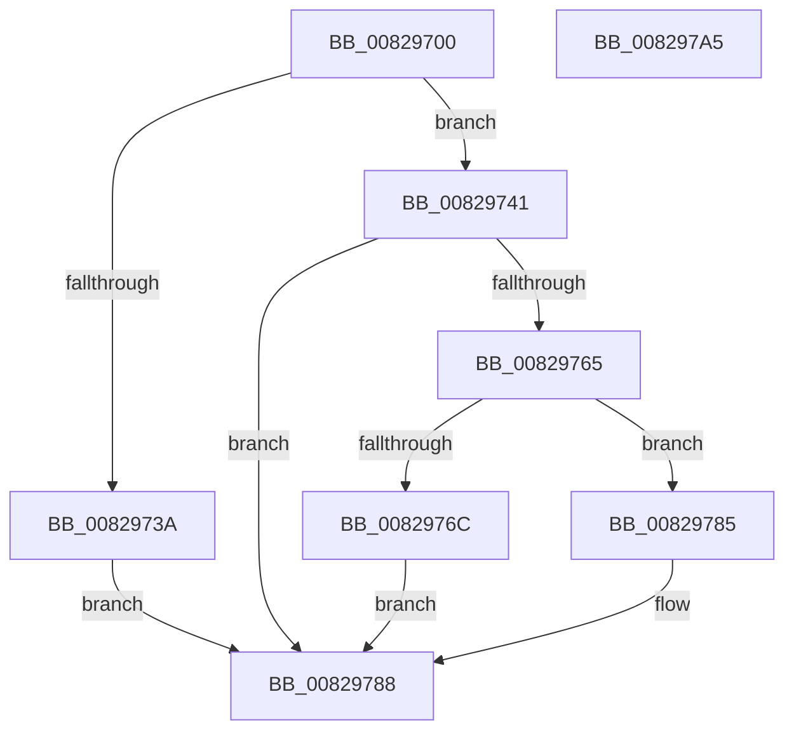

# CmCreateInstallerClassWorker

- RVA: `0x00829700`–`0x008297A6` (길이 `166` bytes)
- VA: `0x0000000140829700`
- 실행 섹션: `PAGE`
- PDB 이름 있음: `예`; PDB Function 태그: `아니요`
- unwind 정보 RVA: `0x00091ECC`
- 디코드: `45`개 명령, `166/166` bytes 표시
- 미해석 바이트: `0` (있으면 어셈블리에 `.byte`로 보존)

> 이 문서는 커널 이미지의 기계어와 PDB 기호를 분석해 생성했습니다. 4번과 5번은 함수 원형과 자료형을 바이너리 사용 방식에서 추정한 C 해석이며 원본 소스 복구 결과는 아닙니다.

## 1. Dependencies

- 직접 호출 지점: **2**; 고유 호출 대상: **2**
- 직접 호출자로 확인된 함수: **1**
- RIP 상대 이미지 참조: **0**

### Outgoing calls
- `0x0082975A` → [CmOpenInstallerClassRegKey](../9D/CmOpenInstallerClassRegKey_function_009D4474.md) (function, `0x009D4474`)
- `0x0082977E` → [CmRaiseCreateEvent](../8F/CmRaiseCreateEvent_function_008FF944.md) (function, `0x008FF944`)

### Direct callers
- [CmCreateInstallerClass](CmCreateInstallerClass_function_00829594.md) at `0x0082964B`

### Static image references
- 디코드된 RIP-relative 메모리 참조가 없습니다.

## 2. Other-region calls and transfers

- 다른 실행 섹션으로 향하는 call: **0**
- 별도 외부 분기/꼬리 이동을 확인하지 못했습니다.

## 3. Assembly (complete function range)

```asm
00829700  48 8B C4                        mov rax, rsp
00829703  48 89 58 08                     mov qword ptr [rax + 8], rbx
00829707  48 89 68 10                     mov qword ptr [rax + 0x10], rbp
0082970B  48 89 70 18                     mov qword ptr [rax + 0x18], rsi
0082970F  48 89 78 20                     mov qword ptr [rax + 0x20], rdi
00829713  41 56                           push r14
00829715  48 83 EC 50                     sub rsp, 0x50
00829719  83 60 E8 00                     and dword ptr [rax - 0x18], 0
0082971D  49 8B F1                        mov rsi, r9
00829720  0F B7 84 24 88 00 00 00         movzx eax, word ptr [rsp + 0x88]
00829728  48 8B EA                        mov rbp, rdx
0082972B  48 8B BC 24 80 00 00 00         mov rdi, qword ptr [rsp + 0x80]
00829733  4C 8B F1                        mov r14, rcx
00829736  85 C0                           test eax, eax
00829738  74 07                           je 0x140829741
0082973A  BB 0D 00 00 C0                  mov ebx, 0xc000000d
0082973F  EB 47                           jmp 0x140829788
00829741  48 8D 44 24 40                  lea rax, [rsp + 0x40]
00829746  48 89 44 24 38                  mov qword ptr [rsp + 0x38], rax
0082974B  48 89 74 24 30                  mov qword ptr [rsp + 0x30], rsi
00829750  C6 44 24 28 01                  mov byte ptr [rsp + 0x28], 1
00829755  44 89 44 24 20                  mov dword ptr [rsp + 0x20], r8d
0082975A  E8 15 AD 1A 00                  call 0x1409d4474
0082975F  8B D8                           mov ebx, eax
00829761  85 C0                           test eax, eax
00829763  78 23                           js 0x140829788
00829765  83 7C 24 40 01                  cmp dword ptr [rsp + 0x40], 1
0082976A  75 19                           jne 0x140829785
0082976C  C6 07 01                        mov byte ptr [rdi], 1
0082976F  41 B8 02 00 00 00               mov r8d, 2
00829775  4C 8B 0E                        mov r9, qword ptr [rsi]
00829778  48 8B D5                        mov rdx, rbp
0082977B  49 8B CE                        mov rcx, r14
0082977E  E8 C1 61 0D 00                  call 0x1408ff944
00829783  EB 03                           jmp 0x140829788
00829785  C6 07 00                        mov byte ptr [rdi], 0
00829788  48 8B 6C 24 68                  mov rbp, qword ptr [rsp + 0x68]
0082978D  8B C3                           mov eax, ebx
0082978F  48 8B 5C 24 60                  mov rbx, qword ptr [rsp + 0x60]
00829794  48 8B 74 24 70                  mov rsi, qword ptr [rsp + 0x70]
00829799  48 8B 7C 24 78                  mov rdi, qword ptr [rsp + 0x78]
0082979E  48 83 C4 50                     add rsp, 0x50
008297A2  41 5E                           pop r14
008297A4  C3                              ret
008297A5  CC                              int3
```

## 4. C-style interpretation (structured pseudocode)

```c
__int64 __fastcall CmCreateInstallerClassWorker(__int64 a1, __int64 a2, int a3, __int64 a4, __int64 a5, unsigned __int16 a6)
{
    __int64 result;
    __int64 v_rsp;
    unsigned __int64 v_stack_m18;
    unsigned __int64 v_stack_m20;
    unsigned __int64 v_stack_m28;
    unsigned __int8 v_stack_m30;
    unsigned int v_stack_m38;
    unsigned __int64 v_stack_p10;
    unsigned __int64 v_stack_p18;
    unsigned __int64 v_stack_p20;
    unsigned __int64 v_stack_p8;

    *(unsigned __int64 *)(v_rsp + 8) = v_rbx;
    *(unsigned __int64 *)(v_rsp + 16) = v_rbp;
    *(unsigned __int64 *)(v_rsp + 24) = v_rsi;
    *(unsigned __int64 *)(v_rsp + 32) = v_rdi;
    v_rsp = (v_rsp) - (80);
    if (a6 == 0) goto loc_00829741;
    goto loc_00829788;
loc_00829741:
    v_stack_m20 = v_stack_m18;
    v_stack_m28 = a4;
    v_stack_m30 = 1;
    v_stack_m38 = a3;
    result = CmOpenInstallerClassRegKey(a1, a2, a3, a4);
    if (sign_flag) goto loc_00829788;
    if (v_stack_m18 != 1) goto loc_00829785;
    *(unsigned __int8 *)(a5) = 1;
    result = CmRaiseCreateEvent(a1, a2, 2, *(unsigned __int64 *)(a4));
    goto loc_00829788;
loc_00829785:
    *(unsigned __int8 *)(a5) = 0;
loc_00829788:
    v_rsp = (v_rsp) + (80);
    return (unsigned int)((unsigned int)((unsigned int)((unsigned int)(result))));
}
```

## 5. (Beta) C Style

```c
int64_t CmCreateInstallerClassWorker(int64_t Arg1, int64_t Arg2, int32_t Arg3, void *Arg4, void *Arg5, uint16_t Arg6)
{
    uint8_t *arg4 = (uint8_t *)Arg4;
    uint8_t *arg5 = (uint8_t *)Arg5;

    int64_t result;
    int64_t local_rsp;
    uint64_t v_stack_m18;
    uint64_t v_stack_m20;
    uint64_t v_stack_m28;
    uint8_t v_stack_m30;
    uint32_t v_stack_m38;
    uint64_t v_stack_p10;
    uint64_t v_stack_p18;
    uint64_t v_stack_p20;
    uint64_t v_stack_p8;

    *(uint64_t *)(local_rsp + 0x8) = local_rbx;
    *(uint64_t *)(local_rsp + 0x10) = local_rbp;
    *(uint64_t *)(local_rsp + 0x18) = local_rsi;
    *(uint64_t *)(local_rsp + 0x20) = local_rdi;
    local_rsp = (local_rsp) - (80);
    if (Arg6 == 0) goto loc_00829741;
    goto loc_00829788;
loc_00829741:
    v_stack_m20 = v_stack_m18;
    v_stack_m28 = Arg4;
    v_stack_m30 = 1;
    v_stack_m38 = Arg3;
    result = CmOpenInstallerClassRegKey(Arg1, Arg2, Arg3, Arg4);
    if (sign_flag) goto loc_00829788;
    if (v_stack_m18 != 1) goto loc_00829785;
    *(uint8_t *)(arg5) = 1;
    result = CmRaiseCreateEvent(Arg1, Arg2, 2, *(uint64_t *)(arg4));
    goto loc_00829788;
loc_00829785:
    *(uint8_t *)(arg5) = 0;
loc_00829788:
    local_rsp = (local_rsp) + (80);
    return (uint32_t)((uint32_t)((uint32_t)((uint32_t)(result))));
}
```

### 관측된 메모리 오프셋

구조체 형식이 확인되지 않은 접근은 인자 기준의 오프셋으로만 기록했습니다.

| 기준 인자 | 오프셋 표현 | 폭 (bit) | 접근 |
|---|---:|---:|---|
| `Arg4` | `+ 0x0` | `64` | `R` |
| `Arg5` | `+ 0x0` | `8` | `W` |

## 6. Execution-region graph

[열기: 2D/3D 그래프와 함수 탐색 컨트롤 패널](../../../control-panel.html?section=page&rva=0x00829700&view=graph)

- 2D 그래프는 위에서 아래로 흐르고, 3D 그래프는 빈 공간을 드래그해 회전합니다. Shift+드래그는 이동, 휠은 확대·축소, 함수 노드 선택은 대상 보고서 이동입니다.

### Static fallback


