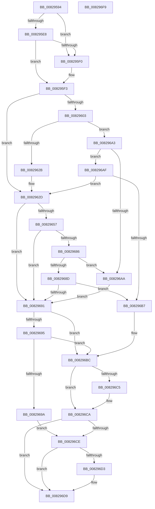

# CmCreateInstallerClass

- RVA: `0x00829594`–`0x008296FA` (길이 `358` bytes)
- VA: `0x0000000140829594`
- 실행 섹션: `PAGE`
- PDB 이름 있음: `예`; PDB Function 태그: `아니요`
- unwind 정보 RVA: `0x00088628`
- 디코드: `112`개 명령, `358/358` bytes 표시
- 미해석 바이트: `0` (있으면 어셈블리에 `.byte`로 보존)

> 이 문서는 커널 이미지의 기계어와 PDB 기호를 분석해 생성했습니다. 4번과 5번은 함수 원형과 자료형을 바이너리 사용 방식에서 추정한 C 해석이며 원본 소스 복구 결과는 아닙니다.

## 1. Dependencies

- 직접 호출 지점: **6**; 고유 호출 대상: **5**
- 직접 호출자로 확인된 함수: **2**
- RIP 상대 이미지 참조: **1**

### Outgoing calls
- `0x008295D3` → [memset](../../text/6C/memset_function_006C6C40.md) (function, `0x006C6C40`)
- `0x0082961F` → [guard_dispatch_icall](../../text/6B/guard_dispatch_icall_function_006BAAD0.md) (function, `0x006BAAD0`)
- `0x0082964B` → [CmCreateInstallerClassWorker](CmCreateInstallerClassWorker_function_00829700.md) (function, `0x00829700`)
- `0x0082967A` → [guard_dispatch_icall](../../text/6B/guard_dispatch_icall_function_006BAAD0.md) (function, `0x006BAAD0`)
- `0x008296C5` → [ZwClose](../../text/6A/ZwClose_function_006AD2B0.md) (function, `0x006AD2B0`)
- `0x008296E2` → [_security_check_cookie](../../text/6A/_security_check_cookie_function_006AC640.md) (function, `0x006AC640`)

### Direct callers
- [_PnpDispatchInstallerClass](../9D/_PnpDispatchInstallerClass_function_009D3580.md) at `0x009D374A`
- [sub_00B27EF4](../B2/Unknown_function_00B27EF4.md) at `0x00B27F1A`

### Static image references
- `0x008295AB` → RVA `0x00E0A740` (`.data`; read)

## 2. Other-region calls and transfers

- 다른 실행 섹션으로 향하는 call: **5**
  - `0x008295D3` → [memset](../../text/6C/memset_function_006C6C40.md) (`PAGE` → `.text`)
  - `0x0082961F` → [guard_dispatch_icall](../../text/6B/guard_dispatch_icall_function_006BAAD0.md) (`PAGE` → `.text`)
  - `0x0082967A` → [guard_dispatch_icall](../../text/6B/guard_dispatch_icall_function_006BAAD0.md) (`PAGE` → `.text`)
  - `0x008296C5` → [ZwClose](../../text/6A/ZwClose_function_006AD2B0.md) (`PAGE` → `.text`)
  - `0x008296E2` → [_security_check_cookie](../../text/6A/_security_check_cookie_function_006AC640.md) (`PAGE` → `.text`)
- 별도 외부 분기/꼬리 이동을 확인하지 못했습니다.

## 3. Assembly (complete function range)

```asm
00829594  40 55                           push rbp
00829596  53                              push rbx
00829597  56                              push rsi
00829598  57                              push rdi
00829599  41 54                           push r12
0082959B  41 56                           push r14
0082959D  41 57                           push r15
0082959F  48 8D 6C 24 E9                  lea rbp, [rsp - 0x17]
008295A4  48 81 EC B0 00 00 00            sub rsp, 0xb0
008295AB  48 8B 05 8E 11 5E 00            mov rax, qword ptr [rip + 0x5e118e]
008295B2  48 33 C4                        xor rax, rsp
008295B5  48 89 45 07                     mov qword ptr [rbp + 7], rax
008295B9  4C 8B 75 77                     mov r14, qword ptr [rbp + 0x77]
008295BD  4C 8B E2                        mov r12, rdx
008295C0  33 D2                           xor edx, edx
008295C2  41 8B D8                        mov ebx, r8d
008295C5  4C 8B F9                        mov r15, rcx
008295C8  49 8B F9                        mov rdi, r9
008295CB  48 8D 4D A7                     lea rcx, [rbp - 0x59]
008295CF  44 8D 42 58                     lea r8d, [rdx + 0x58]
008295D3  E8 68 D6 E9 FF                  call 0x1406c6c40
008295D8  49 8B B7 F8 01 00 00            mov rsi, qword ptr [r15 + 0x1f8]
008295DF  BA 01 00 00 00                  mov edx, 1
008295E4  85 DB                           test ebx, ebx
008295E6  75 08                           jne 0x1408295f0
008295E8  89 55 B7                        mov dword ptr [rbp - 0x49], edx
008295EB  48 85 FF                        test rdi, rdi
008295EE  74 03                           je 0x1408295f3
008295F0  89 5D B7                        mov dword ptr [rbp - 0x49], ebx
008295F3  8B 45 7F                        mov eax, dword ptr [rbp + 0x7f]
008295F6  B9 02 00 00 00                  mov ecx, 2
008295FB  89 45 CB                        mov dword ptr [rbp - 0x35], eax
008295FE  48 85 F6                        test rsi, rsi
00829601  74 2A                           je 0x14082962d
00829603  48 8D 45 A7                     lea rax, [rbp - 0x59]
00829607  44 8B C9                        mov r9d, ecx
0082960A  48 89 44 24 28                  mov qword ptr [rsp + 0x28], rax
0082960F  44 8B C1                        mov r8d, ecx
00829612  89 54 24 20                     mov dword ptr [rsp + 0x20], edx
00829616  49 8B CF                        mov rcx, r15
00829619  49 8B D4                        mov rdx, r12
0082961C  48 8B C6                        mov rax, rsi
0082961F  E8 AC 14 E9 FF                  call 0x1406baad0
00829624  3D 02 00 00 C0                  cmp eax, 0xc0000002
00829629  75 78                           jne 0x1408296a3
0082962B  33 F6                           xor esi, esi
0082962D  8B 45 CB                        mov eax, dword ptr [rbp - 0x35]
00829630  4C 8D 4D BF                     lea r9, [rbp - 0x41]
00829634  44 8B 45 B7                     mov r8d, dword ptr [rbp - 0x49]
00829638  49 8B D4                        mov rdx, r12
0082963B  89 44 24 28                     mov dword ptr [rsp + 0x28], eax
0082963F  49 8B CF                        mov rcx, r15
00829642  48 8D 45 C7                     lea rax, [rbp - 0x39]
00829646  48 89 44 24 20                  mov qword ptr [rsp + 0x20], rax
0082964B  E8 B0 00 00 00                  call 0x140829700
00829650  8B D8                           mov ebx, eax
00829652  48 85 F6                        test rsi, rsi
00829655  74 3A                           je 0x140829691
00829657  89 45 A7                        mov dword ptr [rbp - 0x59], eax
0082965A  41 B8 02 00 00 00               mov r8d, 2
00829660  48 8D 45 A7                     lea rax, [rbp - 0x59]
00829664  45 8B C8                        mov r9d, r8d
00829667  48 89 44 24 28                  mov qword ptr [rsp + 0x28], rax
0082966C  49 8B D4                        mov rdx, r12
0082966F  48 8B C6                        mov rax, rsi
00829672  44 89 44 24 20                  mov dword ptr [rsp + 0x20], r8d
00829677  49 8B CF                        mov rcx, r15
0082967A  E8 51 14 E9 FF                  call 0x1406baad0
0082967F  3D 02 00 00 C0                  cmp eax, 0xc0000002
00829684  74 0B                           je 0x140829691
00829686  3D 20 01 00 C0                  cmp eax, 0xc0000120
0082968B  74 1D                           je 0x1408296aa
0082968D  85 C0                           test eax, eax
0082968F  75 26                           jne 0x1408296b7
00829691  85 DB                           test ebx, ebx
00829693  78 27                           js 0x1408296bc
00829695  48 85 FF                        test rdi, rdi
00829698  74 22                           je 0x1408296bc
0082969A  48 8B 45 BF                     mov rax, qword ptr [rbp - 0x41]
0082969E  48 89 07                        mov qword ptr [rdi], rax
008296A1  EB 2B                           jmp 0x1408296ce
008296A3  3D 20 01 00 C0                  cmp eax, 0xc0000120
008296A8  75 05                           jne 0x1408296af
008296AA  8B 5D A7                        mov ebx, dword ptr [rbp - 0x59]
008296AD  EB E2                           jmp 0x140829691
008296AF  85 C0                           test eax, eax
008296B1  0F 84 76 FF FF FF               je 0x14082962d
008296B7  BB E5 00 00 C0                  mov ebx, 0xc00000e5
008296BC  48 8B 4D BF                     mov rcx, qword ptr [rbp - 0x41]
008296C0  48 85 C9                        test rcx, rcx
008296C3  74 05                           je 0x1408296ca
008296C5  E8 E6 3B E8 FF                  call 0x1406ad2b0
008296CA  85 DB                           test ebx, ebx
008296CC  78 0B                           js 0x1408296d9
008296CE  4D 85 F6                        test r14, r14
008296D1  74 06                           je 0x1408296d9
008296D3  8A 45 C7                        mov al, byte ptr [rbp - 0x39]
008296D6  41 88 06                        mov byte ptr [r14], al
008296D9  8B C3                           mov eax, ebx
008296DB  48 8B 4D 07                     mov rcx, qword ptr [rbp + 7]
008296DF  48 33 CC                        xor rcx, rsp
008296E2  E8 59 2F E8 FF                  call 0x1406ac640
008296E7  48 81 C4 B0 00 00 00            add rsp, 0xb0
008296EE  41 5F                           pop r15
008296F0  41 5E                           pop r14
008296F2  41 5C                           pop r12
008296F4  5F                              pop rdi
008296F5  5E                              pop rsi
008296F6  5B                              pop rbx
008296F7  5D                              pop rbp
008296F8  C3                              ret
008296F9  CC                              int3
```

## 4. C-style interpretation (structured pseudocode)

```c
__int64 __fastcall CmCreateInstallerClass(__int64 a1, __int64 a2, int a3, __int64 a4, __int64 a5, unsigned int a6)
{
    __int64 result;
    __int64 v_rsi;
    __int64 v_rsp;
    unsigned __int64 v_stack_m48;
    unsigned __int64 v_stack_m4F;
    unsigned int v_stack_m84;
    unsigned __int64 v_stack_m88;
    unsigned __int64 v_stack_m90;
    unsigned int v_stack_m98;
    unsigned __int64 v_stack_mA8;
    unsigned __int64 v_stack_mC0;
    unsigned int v_stack_mC8;

    v_rsp = (v_rsp) - (176);
    result = (*(unsigned __int64 *)(v_rip + 6164878)) ^ (v_rsp);
    v_stack_m48 = result;
    a2 = 0;
    result = memset(v_stack_mA8, a2, a2 + 88, a4);
    if ((unsigned int)((unsigned int)(a3)) != 0) goto loc_008295F0;
    v_stack_m98 = 1;
    if (a4 != 0) {
        v_stack_m98 = (unsigned int)((unsigned int)(a3));
    }
    v_stack_m84 = (unsigned int)((unsigned int)(a6));
    if (*(unsigned __int64 *)(a1 + 504) == 0) goto loc_0082962D;
    v_stack_mC0 = v_stack_mA8;
    v_stack_mC8 = 1;
    result = guard_dispatch_icall(a1, 0, 2, 2);
    if (((unsigned int)(result)) != 0xC0000002ULL) goto loc_008296A3;
    v_rsi = 0;
loc_0082962D:
    v_stack_mC0 = (unsigned int)((unsigned int)(v_stack_m84));
    v_stack_mC8 = v_stack_m88;
    result = CmCreateInstallerClassWorker(a1, 0, (unsigned int)(v_stack_m98), v_stack_m90);
    if (0 == 0) goto loc_00829691;
    v_stack_mA8 = (unsigned int)(result);
    v_stack_mC0 = v_stack_mA8;
    v_stack_mC8 = 2;
    result = guard_dispatch_icall(a1, 0, 2, 2);
    if (((unsigned int)(result)) == 0xC0000002ULL) goto loc_00829691;
    if (((unsigned int)(result)) == 0xC0000120ULL) goto loc_008296AA;
    if ((unsigned int)(result) != 0) goto loc_008296B7;
loc_00829691:
    if (sign_flag) goto loc_008296BC;
    if (a4 == 0) goto loc_008296BC;
    *(unsigned __int64 *)(a4) = v_stack_m90;
    goto loc_008296CE;
loc_008296A3:
    if (((unsigned int)(v_stack_m90)) != 0xC0000120ULL) goto loc_008296AF;
loc_008296AA:
    goto loc_00829691;
loc_008296AF:
    if ((unsigned int)(v_stack_m90) == 0) goto loc_0082962D;
loc_008296B7:
loc_008296BC:
    result = v_stack_m90;
    if (v_stack_m90 != 0) {
        result = ZwClose(v_stack_m90, 0, 2, 2);
    }
    if (sign_flag) goto loc_008296D9;
loc_008296CE:
    if (a5 != 0) {
        result = v_stack_m88;
        *(unsigned __int8 *)(a5) = (unsigned __int8)(result);
    }
    a1 = (v_stack_m48) ^ (v_rsp);
    result = _security_check_cookie(a1, 0, 2, 2);
    v_rsp = (v_rsp) + (176);
    return result;
}
```

## 5. (Beta) C Style

```c
int64_t CmCreateInstallerClass(void *Arg1, int64_t Arg2, int32_t Arg3, int64_t Arg4, int64_t Arg5, uint32_t Arg6)
{
    uint8_t *arg1 = (uint8_t *)Arg1;

    int64_t result;
    int64_t local_rsi;
    int64_t local_rsp;
    uint64_t v_stack_m48;
    uint64_t v_stack_m4F;
    uint32_t v_stack_m84;
    uint64_t v_stack_m88;
    uint64_t v_stack_m90;
    uint32_t v_stack_m98;
    uint64_t v_stack_mA8;
    uint64_t v_stack_mC0;
    uint32_t v_stack_mC8;

    local_rsp = (local_rsp) - (176);
    result = (*(uint64_t *)(v_rip + 0x5E118E)) ^ (local_rsp);
    v_stack_m48 = result;
    Arg2 = 0;
    result = memset(v_stack_mA8, Arg2, Arg2 + 88, Arg4);
    if ((uint32_t)((uint32_t)(Arg3)) != 0) goto loc_008295F0;
    v_stack_m98 = 1;
    if (Arg4 != 0) {
        v_stack_m98 = (uint32_t)((uint32_t)(Arg3));
    }
    v_stack_m84 = (uint32_t)((uint32_t)(Arg6));
    if (*(uint64_t *)(arg1 + 0x1F8) == 0) goto loc_0082962D;
    v_stack_mC0 = v_stack_mA8;
    v_stack_mC8 = 1;
    result = guard_dispatch_icall(Arg1, 0, 2, 2);
    if (((uint32_t)(result)) != 0xC0000002ULL) goto loc_008296A3;
    local_rsi = 0;
loc_0082962D:
    v_stack_mC0 = (uint32_t)((uint32_t)(v_stack_m84));
    v_stack_mC8 = v_stack_m88;
    result = CmCreateInstallerClassWorker(Arg1, 0, (uint32_t)(v_stack_m98), v_stack_m90);
    if (0 == 0) goto loc_00829691;
    v_stack_mA8 = (uint32_t)(result);
    v_stack_mC0 = v_stack_mA8;
    v_stack_mC8 = 2;
    result = guard_dispatch_icall(Arg1, 0, 2, 2);
    if (((uint32_t)(result)) == 0xC0000002ULL) goto loc_00829691;
    if (((uint32_t)(result)) == 0xC0000120ULL) goto loc_008296AA;
    if ((uint32_t)(result) != 0) goto loc_008296B7;
loc_00829691:
    if (sign_flag) goto loc_008296BC;
    if (Arg4 == 0) goto loc_008296BC;
    *(uint64_t *)(Arg4) = v_stack_m90;
    goto loc_008296CE;
loc_008296A3:
    if (((uint32_t)(v_stack_m90)) != 0xC0000120ULL) goto loc_008296AF;
loc_008296AA:
    goto loc_00829691;
loc_008296AF:
    if ((uint32_t)(v_stack_m90) == 0) goto loc_0082962D;
loc_008296B7:
loc_008296BC:
    result = v_stack_m90;
    if (v_stack_m90 != 0) {
        result = ZwClose(v_stack_m90, 0, 2, 2);
    }
    if (sign_flag) goto loc_008296D9;
loc_008296CE:
    if (Arg5 != 0) {
        result = v_stack_m88;
        *(uint8_t *)(Arg5) = (uint8_t)(result);
    }
    Arg1 = (v_stack_m48) ^ (local_rsp);
    result = _security_check_cookie(Arg1, 0, 2, 2);
    local_rsp = (local_rsp) + (176);
    return result;
}
```

### 관측된 메모리 오프셋

구조체 형식이 확인되지 않은 접근은 인자 기준의 오프셋으로만 기록했습니다.

| 기준 인자 | 오프셋 표현 | 폭 (bit) | 접근 |
|---|---:|---:|---|
| `Arg1` | `+ 0x1F8` | `64` | `R` |

## 6. Execution-region graph

[열기: 2D/3D 그래프와 함수 탐색 컨트롤 패널](../../../control-panel.html?section=page&rva=0x00829594&view=graph)

- 2D 그래프는 위에서 아래로 흐르고, 3D 그래프는 빈 공간을 드래그해 회전합니다. Shift+드래그는 이동, 휠은 확대·축소, 함수 노드 선택은 대상 보고서 이동입니다.

### Static fallback


