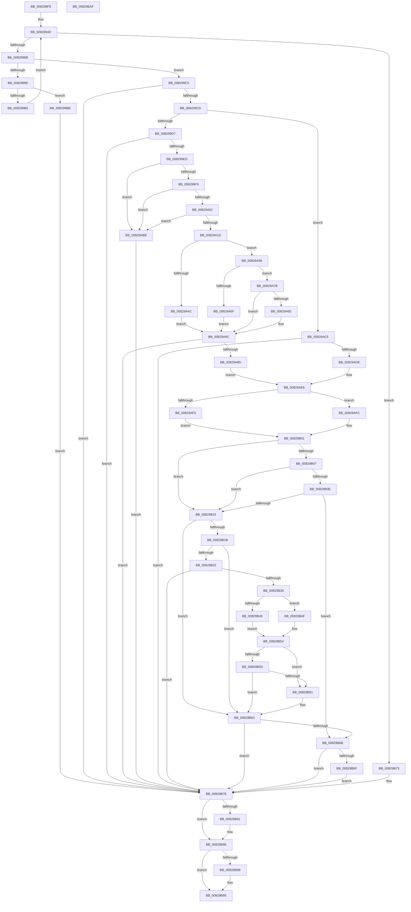

# CmDeleteCommonClassRegKeyWorker

- RVA: `0x008298F8`–`0x00829BB0` (길이 `696` bytes)
- VA: `0x00000001408298F8`
- 실행 섹션: `PAGE`
- PDB 이름 있음: `예`; PDB Function 태그: `아니요`
- unwind 정보 RVA: `0x000805A0`
- 디코드: `202`개 명령, `696/696` bytes 표시
- 미해석 바이트: `0` (있으면 어셈블리에 `.byte`로 보존)

> 이 문서는 커널 이미지의 기계어와 PDB 기호를 분석해 생성했습니다. 4번과 5번은 함수 원형과 자료형을 바이너리 사용 방식에서 추정한 C 해석이며 원본 소스 복구 결과는 아닙니다.

## 1. Dependencies

- 직접 호출 지점: **17**; 고유 호출 대상: **10**
- 직접 호출자로 확인된 함수: **1**
- RIP 상대 이미지 참조: **4**

### Outgoing calls
- `0x0082995A` → [ExAllocatePool2](../../poolcode/B8/ExAllocatePool2_function_00B820F0.md) (function, `0x00B820F0`)
- `0x0082998A` → [_CmGetCommonClassRegKeyPath](../8F/_CmGetCommonClassRegKeyPath_function_008F1CC0.md) (function, `0x008F1CC0`)
- `0x0082999D` → [ExFreePoolWithTag](../../poolcode/B8/ExFreePoolWithTag_function_00B82870.md) (function, `0x00B82870`)
- `0x008299DE` → [RtlInitUnicodeStringEx](../../text/46/RtlInitUnicodeStringEx_function_00463960.md) (function, `0x00463960`)
- `0x00829A10` → [RtlPrefixUnicodeString](../8F/RtlPrefixUnicodeString_function_008F4F70.md) (function, `0x008F4F70`)
- `0x00829A43` → [RtlPrefixUnicodeString](../8F/RtlPrefixUnicodeString_function_008F4F70.md) (function, `0x008F4F70`)
- `0x00829A66` → [RtlPrefixUnicodeString](../8F/RtlPrefixUnicodeString_function_008F4F70.md) (function, `0x008F4F70`)
- `0x00829A89` → [RtlPrefixUnicodeString](../8F/RtlPrefixUnicodeString_function_008F4F70.md) (function, `0x008F4F70`)
- `0x00829AA6` → [_PnpCtxGetCachedContextBaseKey](../8E/_PnpCtxGetCachedContextBaseKey_function_008EFB2C.md) (function, `0x008EFB2C`)
- `0x00829ACF` → [PnpCtxRegOpenCurrentUserKey](../AB/PnpCtxRegOpenCurrentUserKey_function_00AB5E40.md) (function, `0x00AB5E40`)
- `0x00829AF5` → [PnpCtxRegDeleteTree](../96/PnpCtxRegDeleteTree_function_00965CC8.md) (function, `0x00965CC8`)
- `0x00829AFC` → [PnpCtxRegDeleteKey](../96/PnpCtxRegDeleteKey_function_00965EC8.md) (function, `0x00965EC8`)
- `0x00829B2E` → [_PnpCtxGetCachedContextBaseKey](../8E/_PnpCtxGetCachedContextBaseKey_function_008EFB2C.md) (function, `0x008EFB2C`)
- `0x00829B48` → [PnpCtxRegDeleteTree](../96/PnpCtxRegDeleteTree_function_00965CC8.md) (function, `0x00965CC8`)
- `0x00829B4F` → [PnpCtxRegDeleteKey](../96/PnpCtxRegDeleteKey_function_00965EC8.md) (function, `0x00965EC8`)
- `0x00829B81` → [ZwClose](../../text/6A/ZwClose_function_006AD2B0.md) (function, `0x006AD2B0`)
- `0x00829B90` → [ExFreePoolWithTag](../../poolcode/B8/ExFreePoolWithTag_function_00B82870.md) (function, `0x00B82870`)

### Direct callers
- [CmDeleteCommonClassRegKey](CmDeleteCommonClassRegKey_function_008297AC.md) at `0x00829864`

### Static image references
- `0x00829A09` → RVA `0x00001A08` (`.rdata`; read)
- `0x00829A3C` → RVA `0x00001A48` (`.rdata`; read)
- `0x00829A5F` → RVA `0x00001A58` (`.rdata`; read)
- `0x00829A82` → RVA `0x00001B78` (`.rdata`; read)

## 2. Other-region calls and transfers

- 다른 실행 섹션으로 향하는 call: **5**
  - `0x0082995A` → [ExAllocatePool2](../../poolcode/B8/ExAllocatePool2_function_00B820F0.md) (`PAGE` → `POOLCODE`)
  - `0x0082999D` → [ExFreePoolWithTag](../../poolcode/B8/ExFreePoolWithTag_function_00B82870.md) (`PAGE` → `POOLCODE`)
  - `0x008299DE` → [RtlInitUnicodeStringEx](../../text/46/RtlInitUnicodeStringEx_function_00463960.md) (`PAGE` → `.text`)
  - `0x00829B81` → [ZwClose](../../text/6A/ZwClose_function_006AD2B0.md) (`PAGE` → `.text`)
  - `0x00829B90` → [ExFreePoolWithTag](../../poolcode/B8/ExFreePoolWithTag_function_00B82870.md) (`PAGE` → `POOLCODE`)
- 별도 외부 분기/꼬리 이동을 확인하지 못했습니다.

## 3. Assembly (complete function range)

```asm
008298F8  48 89 5C 24 08                  mov qword ptr [rsp + 8], rbx
008298FD  48 89 54 24 10                  mov qword ptr [rsp + 0x10], rdx
00829902  55                              push rbp
00829903  56                              push rsi
00829904  57                              push rdi
00829905  41 54                           push r12
00829907  41 55                           push r13
00829909  41 56                           push r14
0082990B  41 57                           push r15
0082990D  48 8B EC                        mov rbp, rsp
00829910  48 83 EC 60                     sub rsp, 0x60
00829914  33 C0                           xor eax, eax
00829916  0F 57 C0                        xorps xmm0, xmm0
00829919  89 45 50                        mov dword ptr [rbp + 0x50], eax
0082991C  45 8B E9                        mov r13d, r9d
0082991F  48 89 45 E0                     mov qword ptr [rbp - 0x20], rax
00829923  41 8B F0                        mov esi, r8d
00829926  48 89 45 E8                     mov qword ptr [rbp - 0x18], rax
0082992A  48 8B DA                        mov rbx, rdx
0082992D  44 8D 60 04                     lea r12d, [rax + 4]
00829931  4C 8B F9                        mov r15, rcx
00829934  41 8B C0                        mov eax, r8d
00829937  25 00 02 00 00                  and eax, 0x200
0082993C  F7 D8                           neg eax
0082993E  0F 11 45 F0                     movups xmmword ptr [rbp - 0x10], xmm0
00829942  1B FF                           sbb edi, edi
00829944  83 E7 78                        and edi, 0x78
00829947  81 C7 C8 00 00 00               add edi, 0xc8
0082994D  8B D7                           mov edx, edi
0082994F  B9 00 01 00 00                  mov ecx, 0x100
00829954  41 B8 50 4E 50 52               mov r8d, 0x52504e50
0082995A  E8 91 87 35 00                  call 0x140b820f0
0082995F  4C 8B F0                        mov r14, rax
00829962  48 85 C0                        test rax, rax
00829965  0F 84 08 02 00 00               je 0x140829b73
0082996B  8B CF                           mov ecx, edi
0082996D  48 8D 45 50                     lea rax, [rbp + 0x50]
00829971  48 89 44 24 38                  mov qword ptr [rsp + 0x38], rax
00829976  45 8B CD                        mov r9d, r13d
00829979  D1 E9                           shr ecx, 1
0082997B  44 8B C6                        mov r8d, esi
0082997E  89 4C 24 30                     mov dword ptr [rsp + 0x30], ecx
00829982  48 8B D3                        mov rdx, rbx
00829985  4C 89 74 24 28                  mov qword ptr [rsp + 0x28], r14
0082998A  E8 31 83 0C 00                  call 0x1408f1cc0
0082998F  8B D8                           mov ebx, eax
00829991  3D 23 00 00 C0                  cmp eax, 0xc0000023
00829996  75 2D                           jne 0x1408299c5
00829998  33 D2                           xor edx, edx
0082999A  49 8B CE                        mov rcx, r14
0082999D  E8 CE 8E 35 00                  call 0x140b82870
008299A2  8B 7D 50                        mov edi, dword ptr [rbp + 0x50]
008299A5  45 33 F6                        xor r14d, r14d
008299A8  48 03 FF                        add rdi, rdi
008299AB  B8 FF FF FF FF                  mov eax, 0xffffffff
008299B0  48 3B F8                        cmp rdi, rax
008299B3  77 06                           ja 0x1408299bb
008299B5  48 8B 5D 48                     mov rbx, qword ptr [rbp + 0x48]
008299B9  EB 92                           jmp 0x14082994d
008299BB  BB 95 00 00 C0                  mov ebx, 0xc0000095
008299C0  E9 B3 01 00 00                  jmp 0x140829b78
008299C5  85 C0                           test eax, eax
008299C7  0F 88 AB 01 00 00               js 0x140829b78
008299CD  0F BA E6 08                     bt esi, 8
008299D1  0F 82 EE 00 00 00               jb 0x140829ac5
008299D7  49 8B D6                        mov rdx, r14
008299DA  48 8D 4D F0                     lea rcx, [rbp - 0x10]
008299DE  E8 7D 9F C3 FF                  call 0x140463960
008299E3  8B D8                           mov ebx, eax
008299E5  85 C0                           test eax, eax
008299E7  0F 88 8B 01 00 00               js 0x140829b78
008299ED  0F B7 5D F0                     movzx ebx, word ptr [rbp - 0x10]
008299F1  3B DF                           cmp ebx, edi
008299F3  0F 83 C2 00 00 00               jae 0x140829abb
008299F9  83 FB 32                        cmp ebx, 0x32
008299FC  0F 86 B9 00 00 00               jbe 0x140829abb
00829A02  41 B0 01                        mov r8b, 1
00829A05  48 8D 55 F0                     lea rdx, [rbp - 0x10]
00829A09  48 8D 0D F8 7F 7D FF            lea rcx, [rip - 0x828008]
00829A10  E8 5B B5 0C 00                  call 0x1408f4f70
00829A15  84 C0                           test al, al
00829A17  0F 84 9E 00 00 00               je 0x140829abb
00829A1D  B8 CE FF 00 00                  mov eax, 0xffce
00829A22  49 8D 7E 32                     lea rdi, [r14 + 0x32]
00829A26  66 01 45 F2                     add word ptr [rbp - 0xe], ax
00829A2A  48 8D 55 F0                     lea rdx, [rbp - 0x10]
00829A2E  66 03 D8                        add bx, ax
00829A31  48 89 7D F8                     mov qword ptr [rbp - 8], rdi
00829A35  41 B0 01                        mov r8b, 1
00829A38  66 89 5D F0                     mov word ptr [rbp - 0x10], bx
00829A3C  48 8D 0D 05 80 7D FF            lea rcx, [rip - 0x827ffb]
00829A43  E8 28 B5 0C 00                  call 0x1408f4f70
00829A48  84 C0                           test al, al
00829A4A  74 0C                           je 0x140829a58
00829A4C  41 BC 07 00 00 00               mov r12d, 7
00829A52  48 83 C7 1C                     add rdi, 0x1c
00829A56  EB 44                           jmp 0x140829a9c
00829A58  41 B0 01                        mov r8b, 1
00829A5B  48 8D 55 F0                     lea rdx, [rbp - 0x10]
00829A5F  48 8D 0D F2 7F 7D FF            lea rcx, [rip - 0x82800e]
00829A66  E8 05 B5 0C 00                  call 0x1408f4f70
00829A6B  84 C0                           test al, al
00829A6D  74 0C                           je 0x140829a7b
00829A6F  41 BC 08 00 00 00               mov r12d, 8
00829A75  48 83 C7 2C                     add rdi, 0x2c
00829A79  EB 21                           jmp 0x140829a9c
00829A7B  41 B0 01                        mov r8b, 1
00829A7E  48 8D 55 F0                     lea rdx, [rbp - 0x10]
00829A82  48 8D 0D EF 80 7D FF            lea rcx, [rip - 0x827f11]
00829A89  E8 E2 B4 0C 00                  call 0x1408f4f70
00829A8E  84 C0                           test al, al
00829A90  74 0A                           je 0x140829a9c
00829A92  41 BC 0E 00 00 00               mov r12d, 0xe
00829A98  48 83 C7 24                     add rdi, 0x24
00829A9C  4C 8D 45 E0                     lea r8, [rbp - 0x20]
00829AA0  41 8B D4                        mov edx, r12d
00829AA3  49 8B CF                        mov rcx, r15
00829AA6  E8 81 60 0C 00                  call 0x1408efb2c
00829AAB  8B D8                           mov ebx, eax
00829AAD  85 C0                           test eax, eax
00829AAF  0F 88 C3 00 00 00               js 0x140829b78
00829AB5  48 8B 55 E0                     mov rdx, qword ptr [rbp - 0x20]
00829AB9  EB 2B                           jmp 0x140829ae6
00829ABB  BB 0D 00 00 C0                  mov ebx, 0xc000000d
00829AC0  E9 B3 00 00 00                  jmp 0x140829b78
00829AC5  4C 8D 4D E8                     lea r9, [rbp - 0x18]
00829AC9  49 8B CF                        mov rcx, r15
00829ACC  49 8B FE                        mov rdi, r14
00829ACF  E8 6C C3 28 00                  call 0x140ab5e40
00829AD4  8B D8                           mov ebx, eax
00829AD6  85 C0                           test eax, eax
00829AD8  0F 88 9A 00 00 00               js 0x140829b78
00829ADE  48 8B 55 E8                     mov rdx, qword ptr [rbp - 0x18]
00829AE2  48 89 55 E0                     mov qword ptr [rbp - 0x20], rdx
00829AE6  44 8A 6D 60                     mov r13b, byte ptr [rbp + 0x60]
00829AEA  4C 8B C7                        mov r8, rdi
00829AED  49 8B CF                        mov rcx, r15
00829AF0  45 84 ED                        test r13b, r13b
00829AF3  74 07                           je 0x140829afc
00829AF5  E8 CE C1 13 00                  call 0x140965cc8
00829AFA  EB 05                           jmp 0x140829b01
00829AFC  E8 C7 C3 13 00                  call 0x140965ec8
00829B01  8B F0                           mov esi, eax
00829B03  85 C0                           test eax, eax
00829B05  74 0E                           je 0x140829b15
00829B07  3D 7C 01 00 C0                  cmp eax, 0xc000017c
00829B0C  74 07                           je 0x140829b15
00829B0E  3D 34 00 00 C0                  cmp eax, 0xc0000034
00829B13  75 56                           jne 0x140829b6b
00829B15  41 83 FC 08                     cmp r12d, 8
00829B19  75 48                           jne 0x140829b63
00829B1B  41 80 7F 04 00                  cmp byte ptr [r15 + 4], 0
00829B20  74 41                           je 0x140829b63
00829B22  4C 8D 45 E0                     lea r8, [rbp - 0x20]
00829B26  49 8B CF                        mov rcx, r15
00829B29  41 8D 54 24 01                  lea edx, [r12 + 1]
00829B2E  E8 F9 5F 0C 00                  call 0x1408efb2c
00829B33  8B D8                           mov ebx, eax
00829B35  85 C0                           test eax, eax
00829B37  78 3F                           js 0x140829b78
00829B39  48 8B 55 E0                     mov rdx, qword ptr [rbp - 0x20]
00829B3D  4C 8B C7                        mov r8, rdi
00829B40  49 8B CF                        mov rcx, r15
00829B43  45 84 ED                        test r13b, r13b
00829B46  74 07                           je 0x140829b4f
00829B48  E8 7B C1 13 00                  call 0x140965cc8
00829B4D  EB 05                           jmp 0x140829b54
00829B4F  E8 74 C3 13 00                  call 0x140965ec8
00829B54  B9 34 00 00 C0                  mov ecx, 0xc0000034
00829B59  3B F1                           cmp esi, ecx
00829B5B  74 04                           je 0x140829b61
00829B5D  3B C1                           cmp eax, ecx
00829B5F  74 02                           je 0x140829b63
00829B61  8B F0                           mov esi, eax
00829B63  81 FE 7C 01 00 C0               cmp esi, 0xc000017c
00829B69  74 0D                           je 0x140829b78
00829B6B  85 F6                           test esi, esi
00829B6D  79 09                           jns 0x140829b78
00829B6F  8B DE                           mov ebx, esi
00829B71  EB 05                           jmp 0x140829b78
00829B73  BB 17 00 00 C0                  mov ebx, 0xc0000017
00829B78  48 8B 4D E8                     mov rcx, qword ptr [rbp - 0x18]
00829B7C  48 85 C9                        test rcx, rcx
00829B7F  74 05                           je 0x140829b86
00829B81  E8 2A 37 E8 FF                  call 0x1406ad2b0
00829B86  4D 85 F6                        test r14, r14
00829B89  74 0A                           je 0x140829b95
00829B8B  33 D2                           xor edx, edx
00829B8D  49 8B CE                        mov rcx, r14
00829B90  E8 DB 8C 35 00                  call 0x140b82870
00829B95  8B C3                           mov eax, ebx
00829B97  48 8B 9C 24 A0 00 00 00         mov rbx, qword ptr [rsp + 0xa0]
00829B9F  48 83 C4 60                     add rsp, 0x60
00829BA3  41 5F                           pop r15
00829BA5  41 5E                           pop r14
00829BA7  41 5D                           pop r13
00829BA9  41 5C                           pop r12
00829BAB  5F                              pop rdi
00829BAC  5E                              pop rsi
00829BAD  5D                              pop rbp
00829BAE  C3                              ret
00829BAF  CC                              int3
```

## 4. C-style interpretation (structured pseudocode)

```c
__int64 __fastcall CmDeleteCommonClassRegKeyWorker(__int64 a1, __int64 a2, int a3, int a4, unsigned __int8 a5)
{
    __int64 result;
    __int64 v_r12;
    __int64 v_r14;
    __int64 v_rbx;
    __int64 v_rdi;
    __int64 v_rsi;
    __int64 v_rsp;
    unsigned __int64 v_stack_m40;
    unsigned __int16 v_stack_m46;
    unsigned __int64 v_stack_m48;
    unsigned __int64 v_stack_m50;
    unsigned __int64 v_stack_m58;
    unsigned __int64 v_stack_m60;
    unsigned int v_stack_m68;
    unsigned __int64 v_stack_m70;
    unsigned __int64 v_stack_p10;
    unsigned int v_stack_p18;
    unsigned __int64 v_stack_p8;

    v_stack_p8 = v_rbx;
    v_stack_p10 = a2;
    v_rsp = (v_rsp) - (96);
    result = 0;
    v_stack_p18 = 0;
    v_stack_m58 = 0;
    v_stack_m50 = 0;
    result = (unsigned int)(((unsigned int)(a3)) & (512));
    result = (unsigned int)(-(result));
    v_stack_m48 = v_xmm0;
    v_rdi = (unsigned int)((v_rdi) & (120));
    v_rdi = (unsigned int)((v_rdi) + (200));
loc_0082994D:
    result = ExAllocatePool2(256, (unsigned int)((unsigned int)(v_rdi)), (unsigned int)(0x52504E50ULL), a4);
    if (result == 0) goto loc_00829B73;
    v_stack_m60 = v_stack_p18;
    a1 = (unsigned int)(((unsigned int)((unsigned int)(v_rdi))) >> (1));
    v_stack_m68 = (unsigned int)(a1);
    v_stack_m70 = result;
    result = _CmGetCommonClassRegKeyPath(a1, a2, (unsigned int)((unsigned int)((unsigned int)(a3))), (unsigned int)((unsigned int)((unsigned int)(a4))));
    if (((unsigned int)(result)) != 0xC0000023ULL) goto loc_008299C5;
    a2 = 0;
    result = ExFreePoolWithTag(result, a2, (unsigned int)((unsigned int)((unsigned int)(a3))), (unsigned int)((unsigned int)((unsigned int)(a4))));
    v_r14 = 0;
    v_rdi = ((unsigned int)(v_stack_p18)) + ((unsigned int)(v_stack_p18));
    if (v_rdi > ((unsigned int)(0xFFFFFFFFULL))) goto loc_008299BB;
    goto loc_0082994D;
loc_008299BB:
    goto loc_00829B78;
loc_008299C5:
    if (sign_flag) goto loc_00829B78;
    if (condition_is_below) goto loc_00829AC5;
    result = RtlInitUnicodeStringEx(v_stack_m48, 0, (unsigned int)((unsigned int)((unsigned int)(a3))), (unsigned int)((unsigned int)((unsigned int)(a4))));
    if (sign_flag) goto loc_00829B78;
    if (((unsigned int)(v_stack_m48)) >= ((unsigned int)(v_rdi))) goto loc_00829ABB;
    if (((unsigned int)(v_stack_m48)) <= 50) goto loc_00829ABB;
    result = RtlPrefixUnicodeString(v_rip - 8552456, v_stack_m48, 1, (unsigned int)((unsigned int)((unsigned int)(a4))));
    if ((unsigned __int8)(result) == 0) goto loc_00829ABB;
    v_rbx = (unsigned __int16)((v_stack_m48) + ((unsigned __int16)((unsigned int)(0xFFCEULL))));
    v_stack_m40 = v_r14 + 50;
    v_stack_m48 = (unsigned __int16)(v_rbx);
    result = RtlPrefixUnicodeString(v_rip - 8552443, v_stack_m48, 1, (unsigned int)((unsigned int)((unsigned int)(a4))));
    if ((unsigned __int8)(result) == 0) goto loc_00829A58;
    v_rdi = (v_r14 + 50) + (28);
    goto loc_00829A9C;
loc_00829A58:
    result = RtlPrefixUnicodeString(v_rip - 8552462, v_stack_m48, 1, (unsigned int)((unsigned int)((unsigned int)(a4))));
    if ((unsigned __int8)(result) == 0) goto loc_00829A7B;
    v_rdi = (v_rdi) + (44);
    goto loc_00829A9C;
loc_00829A7B:
    result = RtlPrefixUnicodeString(v_rip - 8552209, v_stack_m48, 1, (unsigned int)((unsigned int)((unsigned int)(a4))));
    v_r12 = 8;
    if ((unsigned __int8)(result) != 0) {
        v_r12 = 14;
        v_rdi = (v_rdi) + (36);
    }
    result = _PnpCtxGetCachedContextBaseKey(a1, (unsigned int)((unsigned int)(v_r12)), v_stack_m58, (unsigned int)((unsigned int)((unsigned int)(a4))));
    if (sign_flag) goto loc_00829B78;
    goto loc_00829AE6;
loc_00829ABB:
    goto loc_00829B78;
loc_00829AC5:
    result = PnpCtxRegOpenCurrentUserKey(a1, v_stack_m58, v_stack_m58, v_stack_m50);
    if (sign_flag) goto loc_00829B78;
    v_stack_m58 = v_stack_m50;
loc_00829AE6:
    if (a5 == 0) goto loc_00829AFC;
    result = PnpCtxRegDeleteTree(a1, v_stack_m50, 0, v_stack_m50);
    goto loc_00829B01;
loc_00829AFC:
    result = PnpCtxRegDeleteKey(a1, v_stack_m50, 0, v_stack_m50);
loc_00829B01:
    if ((unsigned int)(result) == 0) goto loc_00829B15;
    if (((unsigned int)(result)) == 0xC000017CULL) goto loc_00829B15;
    if (((unsigned int)(result)) != 0xC0000034ULL) goto loc_00829B6B;
loc_00829B15:
    if (((unsigned int)(v_r12)) != 8) goto loc_00829B63;
    if ((*(unsigned __int8 *)(a1 + 4)) == 0) goto loc_00829B63;
    result = _PnpCtxGetCachedContextBaseKey(a1, v_r12 + 1, v_stack_m58, v_stack_m50);
    if (sign_flag) goto loc_00829B78;
    if (a5 == 0) goto loc_00829B4F;
    result = PnpCtxRegDeleteTree(a1, v_stack_m58, 0, v_stack_m50);
    goto loc_00829B54;
loc_00829B4F:
    result = PnpCtxRegDeleteKey(a1, v_stack_m58, 0, v_stack_m50);
loc_00829B54:
    if (((unsigned int)((unsigned int)((unsigned int)(result)))) == ((unsigned int)((unsigned int)(0xC0000034ULL)))) goto loc_00829B61;
    v_rsi = (unsigned int)((unsigned int)(result));
    if (((unsigned int)(result)) != ((unsigned int)((unsigned int)(0xC0000034ULL)))) {
        v_rsi = (unsigned int)(result);
    }
    if (((unsigned int)(v_rsi)) == 0xC000017CULL) goto loc_00829B78;
loc_00829B6B:
    if (!sign_flag) goto loc_00829B78;
    goto loc_00829B78;
loc_00829B73:
loc_00829B78:
    if (v_stack_m50 != 0) {
        result = ZwClose(v_stack_m50, v_stack_m58, 0, v_stack_m50);
    }
    if (0 != 0) {
        a2 = 0;
        a1 = 0;
        result = ExFreePoolWithTag(a1, a2, 0, v_stack_m50);
    }
    v_rsp = (v_rsp) + (96);
    return (unsigned int)((unsigned int)((unsigned int)(0xC0000017ULL)));
}
```

## 5. (Beta) C Style

```c
int64_t CmDeleteCommonClassRegKeyWorker(void *Arg1, int64_t Arg2, int32_t Arg3, int32_t Arg4, uint8_t Arg5)
{
    uint8_t *arg1 = (uint8_t *)Arg1;

    int64_t result;
    int64_t local_r12;
    int64_t local_r14;
    int64_t local_rbx;
    int64_t local_rdi;
    int64_t local_rsi;
    int64_t local_rsp;
    uint64_t v_stack_m40;
    uint16_t v_stack_m46;
    uint64_t v_stack_m48;
    uint64_t v_stack_m50;
    uint64_t v_stack_m58;
    uint64_t v_stack_m60;
    uint32_t v_stack_m68;
    uint64_t v_stack_m70;
    uint64_t v_stack_p10;
    uint32_t v_stack_p18;
    uint64_t v_stack_p8;

    v_stack_p8 = local_rbx;
    v_stack_p10 = Arg2;
    local_rsp = (local_rsp) - (96);
    result = 0;
    v_stack_p18 = 0;
    v_stack_m58 = 0;
    v_stack_m50 = 0;
    result = (uint32_t)(((uint32_t)(Arg3)) & (512));
    result = (uint32_t)(-(result));
    v_stack_m48 = v_xmm0;
    local_rdi = (uint32_t)((local_rdi) & (120));
    local_rdi = (uint32_t)((local_rdi) + (200));
loc_0082994D:
    result = ExAllocatePool2(256, (uint32_t)((uint32_t)(local_rdi)), (uint32_t)(0x52504E50ULL), Arg4);
    if (result == 0) goto loc_00829B73;
    v_stack_m60 = v_stack_p18;
    Arg1 = (uint32_t)(((uint32_t)((uint32_t)(local_rdi))) >> (1));
    v_stack_m68 = (uint32_t)(Arg1);
    v_stack_m70 = result;
    result = _CmGetCommonClassRegKeyPath(Arg1, Arg2, (uint32_t)((uint32_t)((uint32_t)(Arg3))), (uint32_t)((uint32_t)((uint32_t)(Arg4))));
    if (((uint32_t)(result)) != 0xC0000023ULL) goto loc_008299C5;
    Arg2 = 0;
    result = ExFreePoolWithTag(result, Arg2, (uint32_t)((uint32_t)((uint32_t)(Arg3))), (uint32_t)((uint32_t)((uint32_t)(Arg4))));
    local_r14 = 0;
    local_rdi = ((uint32_t)(v_stack_p18)) + ((uint32_t)(v_stack_p18));
    if (local_rdi > ((uint32_t)(0xFFFFFFFFULL))) goto loc_008299BB;
    goto loc_0082994D;
loc_008299BB:
    goto loc_00829B78;
loc_008299C5:
    if (sign_flag) goto loc_00829B78;
    if (condition_is_below) goto loc_00829AC5;
    result = RtlInitUnicodeStringEx(v_stack_m48, 0, (uint32_t)((uint32_t)((uint32_t)(Arg3))), (uint32_t)((uint32_t)((uint32_t)(Arg4))));
    if (sign_flag) goto loc_00829B78;
    if (((uint32_t)(v_stack_m48)) >= ((uint32_t)(local_rdi))) goto loc_00829ABB;
    if (((uint32_t)(v_stack_m48)) <= 50) goto loc_00829ABB;
    result = RtlPrefixUnicodeString(v_rip - 8552456, v_stack_m48, 1, (uint32_t)((uint32_t)((uint32_t)(Arg4))));
    if ((uint8_t)(result) == 0) goto loc_00829ABB;
    local_rbx = (uint16_t)((v_stack_m48) + ((uint16_t)((uint32_t)(0xFFCEULL))));
    v_stack_m40 = local_r14 + 50;
    v_stack_m48 = (uint16_t)(local_rbx);
    result = RtlPrefixUnicodeString(v_rip - 8552443, v_stack_m48, 1, (uint32_t)((uint32_t)((uint32_t)(Arg4))));
    if ((uint8_t)(result) == 0) goto loc_00829A58;
    local_rdi = (local_r14 + 50) + (28);
    goto loc_00829A9C;
loc_00829A58:
    result = RtlPrefixUnicodeString(v_rip - 8552462, v_stack_m48, 1, (uint32_t)((uint32_t)((uint32_t)(Arg4))));
    if ((uint8_t)(result) == 0) goto loc_00829A7B;
    local_rdi = (local_rdi) + (44);
    goto loc_00829A9C;
loc_00829A7B:
    result = RtlPrefixUnicodeString(v_rip - 8552209, v_stack_m48, 1, (uint32_t)((uint32_t)((uint32_t)(Arg4))));
    local_r12 = 8;
    if ((uint8_t)(result) != 0) {
        local_r12 = 14;
        local_rdi = (local_rdi) + (36);
    }
    result = _PnpCtxGetCachedContextBaseKey(Arg1, (uint32_t)((uint32_t)(local_r12)), v_stack_m58, (uint32_t)((uint32_t)((uint32_t)(Arg4))));
    if (sign_flag) goto loc_00829B78;
    goto loc_00829AE6;
loc_00829ABB:
    goto loc_00829B78;
loc_00829AC5:
    result = PnpCtxRegOpenCurrentUserKey(Arg1, v_stack_m58, v_stack_m58, v_stack_m50);
    if (sign_flag) goto loc_00829B78;
    v_stack_m58 = v_stack_m50;
loc_00829AE6:
    if (Arg5 == 0) goto loc_00829AFC;
    result = PnpCtxRegDeleteTree(Arg1, v_stack_m50, 0, v_stack_m50);
    goto loc_00829B01;
loc_00829AFC:
    result = PnpCtxRegDeleteKey(Arg1, v_stack_m50, 0, v_stack_m50);
loc_00829B01:
    if ((uint32_t)(result) == 0) goto loc_00829B15;
    if (((uint32_t)(result)) == 0xC000017CULL) goto loc_00829B15;
    if (((uint32_t)(result)) != 0xC0000034ULL) goto loc_00829B6B;
loc_00829B15:
    if (((uint32_t)(local_r12)) != 8) goto loc_00829B63;
    if ((*(uint8_t *)(arg1 + 0x4)) == 0) goto loc_00829B63;
    result = _PnpCtxGetCachedContextBaseKey(Arg1, local_r12 + 1, v_stack_m58, v_stack_m50);
    if (sign_flag) goto loc_00829B78;
    if (Arg5 == 0) goto loc_00829B4F;
    result = PnpCtxRegDeleteTree(Arg1, v_stack_m58, 0, v_stack_m50);
    goto loc_00829B54;
loc_00829B4F:
    result = PnpCtxRegDeleteKey(Arg1, v_stack_m58, 0, v_stack_m50);
loc_00829B54:
    if (((uint32_t)((uint32_t)((uint32_t)(result)))) == ((uint32_t)((uint32_t)(0xC0000034ULL)))) goto loc_00829B61;
    local_rsi = (uint32_t)((uint32_t)(result));
    if (((uint32_t)(result)) != ((uint32_t)((uint32_t)(0xC0000034ULL)))) {
        local_rsi = (uint32_t)(result);
    }
    if (((uint32_t)(local_rsi)) == 0xC000017CULL) goto loc_00829B78;
loc_00829B6B:
    if (!sign_flag) goto loc_00829B78;
    goto loc_00829B78;
loc_00829B73:
loc_00829B78:
    if (v_stack_m50 != 0) {
        result = ZwClose(v_stack_m50, v_stack_m58, 0, v_stack_m50);
    }
    if (0 != 0) {
        Arg2 = 0;
        Arg1 = 0;
        result = ExFreePoolWithTag(Arg1, Arg2, 0, v_stack_m50);
    }
    local_rsp = (local_rsp) + (96);
    return (uint32_t)((uint32_t)((uint32_t)(0xC0000017ULL)));
}
```

### 관측된 메모리 오프셋

구조체 형식이 확인되지 않은 접근은 인자 기준의 오프셋으로만 기록했습니다.

| 기준 인자 | 오프셋 표현 | 폭 (bit) | 접근 |
|---|---:|---:|---|
| `Arg1` | `+ 0x4` | `8` | `R` |

## 6. Execution-region graph

[열기: 2D/3D 그래프와 함수 탐색 컨트롤 패널](../../../control-panel.html?section=page&rva=0x008298F8&view=graph)

- 2D 그래프는 위에서 아래로 흐르고, 3D 그래프는 빈 공간을 드래그해 회전합니다. Shift+드래그는 이동, 휠은 확대·축소, 함수 노드 선택은 대상 보고서 이동입니다.

### Static fallback


