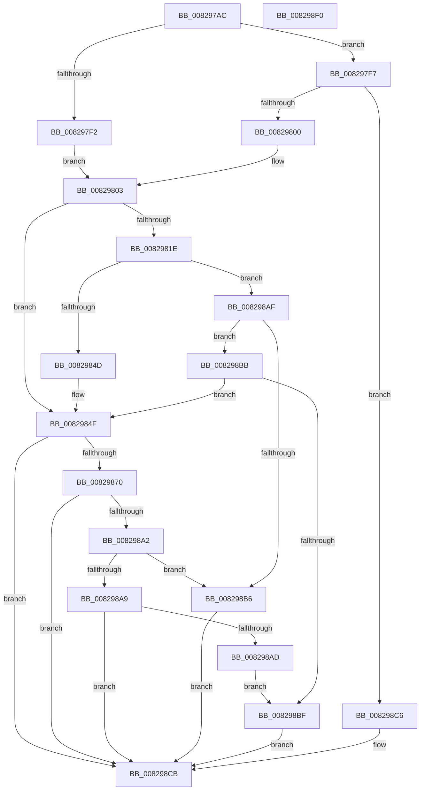

# CmDeleteCommonClassRegKey

- RVA: `0x008297AC`–`0x008298F1` (길이 `325` bytes)
- VA: `0x00000001408297AC`
- 실행 섹션: `PAGE`
- PDB 이름 있음: `예`; PDB Function 태그: `아니요`
- unwind 정보 RVA: `0x000C3E58`
- 디코드: `94`개 명령, `325/325` bytes 표시
- 미해석 바이트: `0` (있으면 어셈블리에 `.byte`로 보존)

> 이 문서는 커널 이미지의 기계어와 PDB 기호를 분석해 생성했습니다. 4번과 5번은 함수 원형과 자료형을 바이너리 사용 방식에서 추정한 C 해석이며 원본 소스 복구 결과는 아닙니다.

## 1. Dependencies

- 직접 호출 지점: **5**; 고유 호출 대상: **4**
- 직접 호출자로 확인된 함수: **2**
- RIP 상대 이미지 참조: **1**

### Outgoing calls
- `0x008297E5` → [memset](../../text/6C/memset_function_006C6C40.md) (function, `0x006C6C40`)
- `0x00829841` → [guard_dispatch_icall](../../text/6B/guard_dispatch_icall_function_006BAAD0.md) (function, `0x006BAAD0`)
- `0x00829864` → [CmDeleteCommonClassRegKeyWorker](CmDeleteCommonClassRegKeyWorker_function_008298F8.md) (function, `0x008298F8`)
- `0x00829896` → [guard_dispatch_icall](../../text/6B/guard_dispatch_icall_function_006BAAD0.md) (function, `0x006BAAD0`)
- `0x008298D4` → [_security_check_cookie](../../text/6A/_security_check_cookie_function_006AC640.md) (function, `0x006AC640`)

### Direct callers
- [CmDeleteInstallerClassRegKey](CmDeleteInstallerClassRegKey_function_0082A464.md) at `0x0082A476`
- [CmDeleteInterfaceClassRegKey](CmDeleteInterfaceClassRegKey_function_0082A80C.md) at `0x0082A81E`

### Static image references
- `0x008297C4` → RVA `0x00E0A740` (`.data`; read)

## 2. Other-region calls and transfers

- 다른 실행 섹션으로 향하는 call: **4**
  - `0x008297E5` → [memset](../../text/6C/memset_function_006C6C40.md) (`PAGE` → `.text`)
  - `0x00829841` → [guard_dispatch_icall](../../text/6B/guard_dispatch_icall_function_006BAAD0.md) (`PAGE` → `.text`)
  - `0x00829896` → [guard_dispatch_icall](../../text/6B/guard_dispatch_icall_function_006BAAD0.md) (`PAGE` → `.text`)
  - `0x008298D4` → [_security_check_cookie](../../text/6A/_security_check_cookie_function_006AC640.md) (`PAGE` → `.text`)
- 별도 외부 분기/꼬리 이동을 확인하지 못했습니다.

## 3. Assembly (complete function range)

```asm
008297AC  48 89 5C 24 20                  mov qword ptr [rsp + 0x20], rbx
008297B1  55                              push rbp
008297B2  56                              push rsi
008297B3  57                              push rdi
008297B4  41 56                           push r14
008297B6  41 57                           push r15
008297B8  48 8D 6C 24 D1                  lea rbp, [rsp - 0x2f]
008297BD  48 81 EC B0 00 00 00            sub rsp, 0xb0
008297C4  48 8B 05 75 0F 5E 00            mov rax, qword ptr [rip + 0x5e0f75]
008297CB  48 33 C4                        xor rax, rsp
008297CE  48 89 45 1F                     mov qword ptr [rbp + 0x1f], rax
008297D2  4C 8B FA                        mov r15, rdx
008297D5  41 8B D8                        mov ebx, r8d
008297D8  33 D2                           xor edx, edx
008297DA  4C 8B F1                        mov r14, rcx
008297DD  48 8D 4D BF                     lea rcx, [rbp - 0x41]
008297E1  44 8D 42 58                     lea r8d, [rdx + 0x58]
008297E5  E8 56 D4 E9 FF                  call 0x1406c6c40
008297EA  0F B6 C3                        movzx eax, bl
008297ED  83 F8 20                        cmp eax, 0x20
008297F0  75 05                           jne 0x1408297f7
008297F2  8D 70 E2                        lea esi, [rax - 0x1e]
008297F5  EB 0C                           jmp 0x140829803
008297F7  83 F8 40                        cmp eax, 0x40
008297FA  0F 85 C6 00 00 00               jne 0x1408298c6
00829800  8D 70 C4                        lea esi, [rax - 0x3c]
00829803  49 8B BE F8 01 00 00            mov rdi, qword ptr [r14 + 0x1f8]
0082980A  83 65 D3 00                     and dword ptr [rbp - 0x2d], 0
0082980E  83 65 DB 00                     and dword ptr [rbp - 0x25], 0
00829812  89 5D CF                        mov dword ptr [rbp - 0x31], ebx
00829815  C6 45 D7 01                     mov byte ptr [rbp - 0x29], 1
00829819  48 85 FF                        test rdi, rdi
0082981C  74 31                           je 0x14082984f
0082981E  48 8D 45 BF                     lea rax, [rbp - 0x41]
00829822  41 B9 0C 00 00 00               mov r9d, 0xc
00829828  48 89 44 24 28                  mov qword ptr [rsp + 0x28], rax
0082982D  44 8B C6                        mov r8d, esi
00829830  48 8B C7                        mov rax, rdi
00829833  C7 44 24 20 01 00 00 00         mov dword ptr [rsp + 0x20], 1
0082983B  49 8B D7                        mov rdx, r15
0082983E  49 8B CE                        mov rcx, r14
00829841  E8 8A 12 E9 FF                  call 0x1406baad0
00829846  3D 02 00 00 C0                  cmp eax, 0xc0000002
0082984B  75 62                           jne 0x1408298af
0082984D  33 FF                           xor edi, edi
0082984F  8A 45 D7                        mov al, byte ptr [rbp - 0x29]
00829852  49 8B D7                        mov rdx, r15
00829855  44 8B 4D D3                     mov r9d, dword ptr [rbp - 0x2d]
00829859  49 8B CE                        mov rcx, r14
0082985C  44 8B 45 CF                     mov r8d, dword ptr [rbp - 0x31]
00829860  88 44 24 20                     mov byte ptr [rsp + 0x20], al
00829864  E8 8F 00 00 00                  call 0x1408298f8
00829869  8B D8                           mov ebx, eax
0082986B  48 85 FF                        test rdi, rdi
0082986E  74 5B                           je 0x1408298cb
00829870  89 45 BF                        mov dword ptr [rbp - 0x41], eax
00829873  41 B9 0C 00 00 00               mov r9d, 0xc
00829879  48 8D 45 BF                     lea rax, [rbp - 0x41]
0082987D  44 8B C6                        mov r8d, esi
00829880  48 89 44 24 28                  mov qword ptr [rsp + 0x28], rax
00829885  49 8B D7                        mov rdx, r15
00829888  48 8B C7                        mov rax, rdi
0082988B  C7 44 24 20 02 00 00 00         mov dword ptr [rsp + 0x20], 2
00829893  49 8B CE                        mov rcx, r14
00829896  E8 35 12 E9 FF                  call 0x1406baad0
0082989B  3D 02 00 00 C0                  cmp eax, 0xc0000002
008298A0  74 29                           je 0x1408298cb
008298A2  3D 20 01 00 C0                  cmp eax, 0xc0000120
008298A7  74 0D                           je 0x1408298b6
008298A9  85 C0                           test eax, eax
008298AB  74 1E                           je 0x1408298cb
008298AD  EB 10                           jmp 0x1408298bf
008298AF  3D 20 01 00 C0                  cmp eax, 0xc0000120
008298B4  75 05                           jne 0x1408298bb
008298B6  8B 5D BF                        mov ebx, dword ptr [rbp - 0x41]
008298B9  EB 10                           jmp 0x1408298cb
008298BB  85 C0                           test eax, eax
008298BD  74 90                           je 0x14082984f
008298BF  BB E5 00 00 C0                  mov ebx, 0xc00000e5
008298C4  EB 05                           jmp 0x1408298cb
008298C6  BB 0D 00 00 C0                  mov ebx, 0xc000000d
008298CB  8B C3                           mov eax, ebx
008298CD  48 8B 4D 1F                     mov rcx, qword ptr [rbp + 0x1f]
008298D1  48 33 CC                        xor rcx, rsp
008298D4  E8 67 2D E8 FF                  call 0x1406ac640
008298D9  48 8B 9C 24 F8 00 00 00         mov rbx, qword ptr [rsp + 0xf8]
008298E1  48 81 C4 B0 00 00 00            add rsp, 0xb0
008298E8  41 5F                           pop r15
008298EA  41 5E                           pop r14
008298EC  5F                              pop rdi
008298ED  5E                              pop rsi
008298EE  5D                              pop rbp
008298EF  C3                              ret
008298F0  CC                              int3
```

## 4. C-style interpretation (structured pseudocode)

```c
__int64 __fastcall CmDeleteCommonClassRegKey(__int64 a1, __int64 a2, int a3)
{
    __int64 result;
    __int64 v_rdi;
    __int64 v_rsp;
    unsigned __int64 v_stack_m38;
    unsigned __int64 v_stack_m57;
    unsigned int v_stack_m7C;
    unsigned __int8 v_stack_m80;
    unsigned int v_stack_m84;
    unsigned int v_stack_m88;
    unsigned __int64 v_stack_m98;
    unsigned __int64 v_stack_mB0;
    unsigned int v_stack_mB8;
    unsigned __int64 v_stack_p20;

    v_stack_p20 = v_rbx;
    v_rsp = (v_rsp) - (176);
    result = (*(unsigned __int64 *)(v_rip + 6164341)) ^ (v_rsp);
    v_stack_m38 = result;
    a2 = 0;
    result = memset(v_stack_m98, a2, a2 + 88, a4);
    if (((unsigned int)((unsigned __int8)((unsigned int)(a3)))) != 32) goto loc_008297F7;
    goto loc_00829803;
loc_008297F7:
    if (((unsigned int)((unsigned __int8)((unsigned int)(a3)))) != 64) goto loc_008298C6;
loc_00829803:
    v_stack_m88 = (unsigned int)((unsigned int)(a3));
    v_stack_m80 = 1;
    if (*(unsigned __int64 *)(a1 + 504) == 0) goto loc_0082984F;
    v_stack_mB0 = v_stack_m98;
    v_stack_mB8 = 1;
    result = guard_dispatch_icall(a1, 0, (unsigned int)((unsigned int)((unsigned __int8)((unsigned int)(a3)) - 60)), 12);
    if (((unsigned int)(result)) != 0xC0000002ULL) goto loc_008298AF;
    v_rdi = 0;
loc_0082984F:
    v_stack_mB8 = (unsigned __int8)(v_stack_m80);
    result = CmDeleteCommonClassRegKeyWorker(a1, 0, (unsigned int)(v_stack_m88), (unsigned int)(v_stack_m84));
    if (0 == 0) goto loc_008298CB;
    v_stack_m98 = (unsigned int)(result);
    v_stack_mB0 = v_stack_m98;
    v_stack_mB8 = 2;
    result = guard_dispatch_icall(a1, 0, (unsigned int)((unsigned int)((unsigned __int8)((unsigned int)(a3)) - 60)), 12);
    if (((unsigned int)(result)) == 0xC0000002ULL) goto loc_008298CB;
    if (((unsigned int)(result)) == 0xC0000120ULL) goto loc_008298B6;
    if ((unsigned int)(result) == 0) goto loc_008298CB;
    goto loc_008298BF;
loc_008298AF:
    if (((unsigned int)(result)) != 0xC0000120ULL) goto loc_008298BB;
loc_008298B6:
    goto loc_008298CB;
loc_008298BB:
    if ((unsigned int)(result) == 0) goto loc_0082984F;
loc_008298BF:
    goto loc_008298CB;
loc_008298C6:
loc_008298CB:
    a1 = (v_stack_m38) ^ (v_rsp);
    result = _security_check_cookie(a1, 0, (unsigned int)((unsigned int)((unsigned __int8)((unsigned int)(a3)) - 60)), 12);
    v_rsp = (v_rsp) + (176);
    return result;
}
```

## 5. (Beta) C Style

```c
int64_t CmDeleteCommonClassRegKey(void *Arg1, int64_t Arg2, int32_t Arg3)
{
    uint8_t *arg1 = (uint8_t *)Arg1;

    int64_t result;
    int64_t local_rdi;
    int64_t local_rsp;
    uint64_t v_stack_m38;
    uint64_t v_stack_m57;
    uint32_t v_stack_m7C;
    uint8_t v_stack_m80;
    uint32_t v_stack_m84;
    uint32_t v_stack_m88;
    uint64_t v_stack_m98;
    uint64_t v_stack_mB0;
    uint32_t v_stack_mB8;
    uint64_t v_stack_p20;

    v_stack_p20 = local_rbx;
    local_rsp = (local_rsp) - (176);
    result = (*(uint64_t *)(v_rip + 0x5E0F75)) ^ (local_rsp);
    v_stack_m38 = result;
    Arg2 = 0;
    result = memset(v_stack_m98, Arg2, Arg2 + 88, a4);
    if (((uint32_t)((uint8_t)((uint32_t)(Arg3)))) != 32) goto loc_008297F7;
    goto loc_00829803;
loc_008297F7:
    if (((uint32_t)((uint8_t)((uint32_t)(Arg3)))) != 64) goto loc_008298C6;
loc_00829803:
    v_stack_m88 = (uint32_t)((uint32_t)(Arg3));
    v_stack_m80 = 1;
    if (*(uint64_t *)(arg1 + 0x1F8) == 0) goto loc_0082984F;
    v_stack_mB0 = v_stack_m98;
    v_stack_mB8 = 1;
    result = guard_dispatch_icall(Arg1, 0, (uint32_t)((uint32_t)((uint8_t)((uint32_t)(Arg3)) - 60)), 12);
    if (((uint32_t)(result)) != 0xC0000002ULL) goto loc_008298AF;
    local_rdi = 0;
loc_0082984F:
    v_stack_mB8 = (uint8_t)(v_stack_m80);
    result = CmDeleteCommonClassRegKeyWorker(Arg1, 0, (uint32_t)(v_stack_m88), (uint32_t)(v_stack_m84));
    if (0 == 0) goto loc_008298CB;
    v_stack_m98 = (uint32_t)(result);
    v_stack_mB0 = v_stack_m98;
    v_stack_mB8 = 2;
    result = guard_dispatch_icall(Arg1, 0, (uint32_t)((uint32_t)((uint8_t)((uint32_t)(Arg3)) - 60)), 12);
    if (((uint32_t)(result)) == 0xC0000002ULL) goto loc_008298CB;
    if (((uint32_t)(result)) == 0xC0000120ULL) goto loc_008298B6;
    if ((uint32_t)(result) == 0) goto loc_008298CB;
    goto loc_008298BF;
loc_008298AF:
    if (((uint32_t)(result)) != 0xC0000120ULL) goto loc_008298BB;
loc_008298B6:
    goto loc_008298CB;
loc_008298BB:
    if ((uint32_t)(result) == 0) goto loc_0082984F;
loc_008298BF:
    goto loc_008298CB;
loc_008298C6:
loc_008298CB:
    Arg1 = (v_stack_m38) ^ (local_rsp);
    result = _security_check_cookie(Arg1, 0, (uint32_t)((uint32_t)((uint8_t)((uint32_t)(Arg3)) - 60)), 12);
    local_rsp = (local_rsp) + (176);
    return result;
}
```

### 관측된 메모리 오프셋

구조체 형식이 확인되지 않은 접근은 인자 기준의 오프셋으로만 기록했습니다.

| 기준 인자 | 오프셋 표현 | 폭 (bit) | 접근 |
|---|---:|---:|---|
| `Arg1` | `+ 0x1F8` | `64` | `R` |

## 6. Execution-region graph

[열기: 2D/3D 그래프와 함수 탐색 컨트롤 패널](../../../control-panel.html?section=page&rva=0x008297AC&view=graph)

- 2D 그래프는 위에서 아래로 흐르고, 3D 그래프는 빈 공간을 드래그해 회전합니다. Shift+드래그는 이동, 휠은 확대·축소, 함수 노드 선택은 대상 보고서 이동입니다.

### Static fallback


