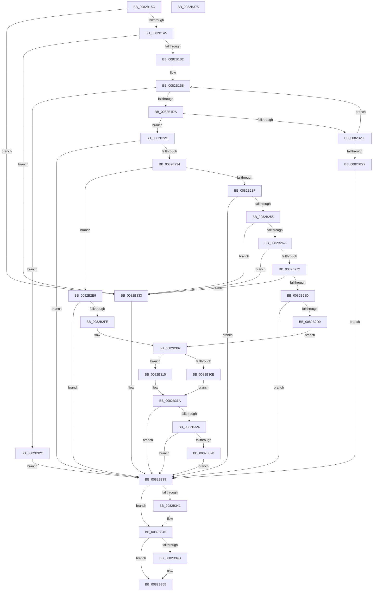

# CmDeleteDeviceContainerRegKeyWorker

- RVA: `0x0082B15C`–`0x0082B376` (길이 `538` bytes)
- VA: `0x000000014082B15C`
- 실행 섹션: `PAGE`
- PDB 이름 있음: `예`; PDB Function 태그: `아니요`
- unwind 정보 RVA: `0x000DA8CC`
- 디코드: `153`개 명령, `538/538` bytes 표시
- 미해석 바이트: `0` (있으면 어셈블리에 `.byte`로 보존)

> 이 문서는 커널 이미지의 기계어와 PDB 기호를 분석해 생성했습니다. 4번과 5번은 함수 원형과 자료형을 바이너리 사용 방식에서 추정한 C 해석이며 원본 소스 복구 결과는 아닙니다.

## 1. Dependencies

- 직접 호출 지점: **12**; 고유 호출 대상: **10**
- 직접 호출자로 확인된 함수: **1**
- RIP 상대 이미지 참조: **2**

### Outgoing calls
- `0x0082B1C6` → [ExAllocatePool2](../../poolcode/B8/ExAllocatePool2_function_00B820F0.md) (function, `0x00B820F0`)
- `0x0082B1F7` → [CmGetDeviceContainerRegKeyPath](../8F/CmGetDeviceContainerRegKeyPath_function_008F4804.md) (function, `0x008F4804`)
- `0x0082B20A` → [ExFreePoolWithTag](../../poolcode/B8/ExFreePoolWithTag_function_00B82870.md) (function, `0x00B82870`)
- `0x0082B246` → [RtlInitUnicodeStringEx](../../text/46/RtlInitUnicodeStringEx_function_00463960.md) (function, `0x00463960`)
- `0x0082B280` → [RtlPrefixUnicodeString](../8F/RtlPrefixUnicodeString_function_008F4F70.md) (function, `0x008F4F70`)
- `0x0082B2B3` → [RtlPrefixUnicodeString](../8F/RtlPrefixUnicodeString_function_008F4F70.md) (function, `0x008F4F70`)
- `0x0082B2CE` → [_PnpCtxGetCachedContextBaseKey](../8E/_PnpCtxGetCachedContextBaseKey_function_008EFB2C.md) (function, `0x008EFB2C`)
- `0x0082B2F3` → [PnpCtxRegOpenCurrentUserKey](../AB/PnpCtxRegOpenCurrentUserKey_function_00AB5E40.md) (function, `0x00AB5E40`)
- `0x0082B30E` → [PnpCtxRegDeleteTree](../96/PnpCtxRegDeleteTree_function_00965CC8.md) (function, `0x00965CC8`)
- `0x0082B315` → [PnpCtxRegDeleteKey](../96/PnpCtxRegDeleteKey_function_00965EC8.md) (function, `0x00965EC8`)
- `0x0082B341` → [ZwClose](../../text/6A/ZwClose_function_006AD2B0.md) (function, `0x006AD2B0`)
- `0x0082B350` → [ExFreePoolWithTag](../../poolcode/B8/ExFreePoolWithTag_function_00B82870.md) (function, `0x00B82870`)

### Direct callers
- [CmDeleteDeviceContainerRegKey](CmDeleteDeviceContainerRegKey_function_0082B01C.md) at `0x0082B0BA`

### Static image references
- `0x0082B279` → RVA `0x00001A08` (`.rdata`; read)
- `0x0082B2AC` → RVA `0x00001BD8` (`.rdata`; read)

## 2. Other-region calls and transfers

- 다른 실행 섹션으로 향하는 call: **5**
  - `0x0082B1C6` → [ExAllocatePool2](../../poolcode/B8/ExAllocatePool2_function_00B820F0.md) (`PAGE` → `POOLCODE`)
  - `0x0082B20A` → [ExFreePoolWithTag](../../poolcode/B8/ExFreePoolWithTag_function_00B82870.md) (`PAGE` → `POOLCODE`)
  - `0x0082B246` → [RtlInitUnicodeStringEx](../../text/46/RtlInitUnicodeStringEx_function_00463960.md) (`PAGE` → `.text`)
  - `0x0082B341` → [ZwClose](../../text/6A/ZwClose_function_006AD2B0.md) (`PAGE` → `.text`)
  - `0x0082B350` → [ExFreePoolWithTag](../../poolcode/B8/ExFreePoolWithTag_function_00B82870.md) (`PAGE` → `POOLCODE`)
- 별도 외부 분기/꼬리 이동을 확인하지 못했습니다.

## 3. Assembly (complete function range)

```asm
0082B15C  48 8B C4                        mov rax, rsp
0082B15F  48 89 58 08                     mov qword ptr [rax + 8], rbx
0082B163  48 89 70 10                     mov qword ptr [rax + 0x10], rsi
0082B167  48 89 78 18                     mov qword ptr [rax + 0x18], rdi
0082B16B  44 89 48 20                     mov dword ptr [rax + 0x20], r9d
0082B16F  55                              push rbp
0082B170  41 54                           push r12
0082B172  41 55                           push r13
0082B174  41 56                           push r14
0082B176  41 57                           push r15
0082B178  48 8B EC                        mov rbp, rsp
0082B17B  48 83 EC 60                     sub rsp, 0x60
0082B17F  33 FF                           xor edi, edi
0082B181  0F 57 C0                        xorps xmm0, xmm0
0082B184  21 7D 48                        and dword ptr [rbp + 0x48], edi
0082B187  45 8B F8                        mov r15d, r8d
0082B18A  48 21 7D E8                     and qword ptr [rbp - 0x18], rdi
0082B18E  4C 8B EA                        mov r13, rdx
0082B191  48 21 7D E0                     and qword ptr [rbp - 0x20], rdi
0082B195  4C 8B E1                        mov r12, rcx
0082B198  0F 11 45 F0                     movups xmmword ptr [rbp - 0x10], xmm0
0082B19C  45 85 C0                        test r8d, r8d
0082B19F  0F 84 8E 01 00 00               je 0x14082b333
0082B1A5  41 F7 C0 AF FE FF FF            test r8d, 0xfffffeaf
0082B1AC  0F 85 81 01 00 00               jne 0x14082b333
0082B1B2  41 BE 04 01 00 00               mov r14d, 0x104
0082B1B8  41 8B D6                        mov edx, r14d
0082B1BB  B9 00 01 00 00                  mov ecx, 0x100
0082B1C0  41 B8 50 4E 50 52               mov r8d, 0x52504e50
0082B1C6  E8 25 6F 35 00                  call 0x140b820f0
0082B1CB  48 8B F8                        mov rdi, rax
0082B1CE  48 8B F0                        mov rsi, rax
0082B1D1  48 85 C0                        test rax, rax
0082B1D4  0F 84 52 01 00 00               je 0x14082b32c
0082B1DA  41 8B CE                        mov ecx, r14d
0082B1DD  48 8D 45 48                     lea rax, [rbp + 0x48]
0082B1E1  48 89 44 24 38                  mov qword ptr [rsp + 0x38], rax
0082B1E6  45 8B C7                        mov r8d, r15d
0082B1E9  D1 E9                           shr ecx, 1
0082B1EB  49 8B D5                        mov rdx, r13
0082B1EE  89 4C 24 30                     mov dword ptr [rsp + 0x30], ecx
0082B1F2  48 89 74 24 28                  mov qword ptr [rsp + 0x28], rsi
0082B1F7  E8 08 96 0C 00                  call 0x1408f4804
0082B1FC  8B D8                           mov ebx, eax
0082B1FE  3D 23 00 00 C0                  cmp eax, 0xc0000023
0082B203  75 27                           jne 0x14082b22c
0082B205  33 D2                           xor edx, edx
0082B207  48 8B CE                        mov rcx, rsi
0082B20A  E8 61 76 35 00                  call 0x140b82870
0082B20F  44 8B 75 48                     mov r14d, dword ptr [rbp + 0x48]
0082B213  33 FF                           xor edi, edi
0082B215  4D 03 F6                        add r14, r14
0082B218  B8 FF FF FF FF                  mov eax, 0xffffffff
0082B21D  4C 3B F0                        cmp r14, rax
0082B220  76 96                           jbe 0x14082b1b8
0082B222  BB 95 00 00 C0                  mov ebx, 0xc0000095
0082B227  E9 0C 01 00 00                  jmp 0x14082b338
0082B22C  85 C0                           test eax, eax
0082B22E  0F 88 04 01 00 00               js 0x14082b338
0082B234  41 0F BA E7 08                  bt r15d, 8
0082B239  0F 82 AA 00 00 00               jb 0x14082b2e9
0082B23F  48 8B D6                        mov rdx, rsi
0082B242  48 8D 4D F0                     lea rcx, [rbp - 0x10]
0082B246  E8 15 87 C3 FF                  call 0x140463960
0082B24B  8B D8                           mov ebx, eax
0082B24D  85 C0                           test eax, eax
0082B24F  0F 88 E3 00 00 00               js 0x14082b338
0082B255  0F B7 5D F0                     movzx ebx, word ptr [rbp - 0x10]
0082B259  41 3B DE                        cmp ebx, r14d
0082B25C  0F 83 D1 00 00 00               jae 0x14082b333
0082B262  41 BD 32 00 00 00               mov r13d, 0x32
0082B268  66 41 3B DD                     cmp bx, r13w
0082B26C  0F 86 C1 00 00 00               jbe 0x14082b333
0082B272  41 B0 01                        mov r8b, 1
0082B275  48 8D 55 F0                     lea rdx, [rbp - 0x10]
0082B279  48 8D 0D 88 67 7D FF            lea rcx, [rip - 0x829878]
0082B280  E8 EB 9C 0C 00                  call 0x1408f4f70
0082B285  84 C0                           test al, al
0082B287  0F 84 A6 00 00 00               je 0x14082b333
0082B28D  B8 CE FF 00 00                  mov eax, 0xffce
0082B292  4C 8D 76 32                     lea r14, [rsi + 0x32]
0082B296  66 01 45 F2                     add word ptr [rbp - 0xe], ax
0082B29A  48 8D 55 F0                     lea rdx, [rbp - 0x10]
0082B29E  66 03 D8                        add bx, ax
0082B2A1  4C 89 75 F8                     mov qword ptr [rbp - 8], r14
0082B2A5  41 B0 01                        mov r8b, 1
0082B2A8  66 89 5D F0                     mov word ptr [rbp - 0x10], bx
0082B2AC  48 8D 0D 25 69 7D FF            lea rcx, [rip - 0x8296db]
0082B2B3  E8 B8 9C 0C 00                  call 0x1408f4f70
0082B2B8  8A C8                           mov cl, al
0082B2BA  4C 8D 45 E8                     lea r8, [rbp - 0x18]
0082B2BE  F6 D9                           neg cl
0082B2C0  44 8A F8                        mov r15b, al
0082B2C3  49 8B CC                        mov rcx, r12
0082B2C6  1B D2                           sbb edx, edx
0082B2C8  83 E2 06                        and edx, 6
0082B2CB  83 C2 04                        add edx, 4
0082B2CE  E8 59 48 0C 00                  call 0x1408efb2c
0082B2D3  8B D8                           mov ebx, eax
0082B2D5  85 C0                           test eax, eax
0082B2D7  78 5F                           js 0x14082b338
0082B2D9  48 8B 55 E8                     mov rdx, qword ptr [rbp - 0x18]
0082B2DD  45 84 FF                        test r15b, r15b
0082B2E0  4C 0F 44 F6                     cmove r14, rsi
0082B2E4  4D 03 F5                        add r14, r13
0082B2E7  EB 19                           jmp 0x14082b302
0082B2E9  4C 8D 4D E0                     lea r9, [rbp - 0x20]
0082B2ED  49 8B CC                        mov rcx, r12
0082B2F0  4C 8B F6                        mov r14, rsi
0082B2F3  E8 48 AB 28 00                  call 0x140ab5e40
0082B2F8  8B D8                           mov ebx, eax
0082B2FA  85 C0                           test eax, eax
0082B2FC  78 3A                           js 0x14082b338
0082B2FE  48 8B 55 E0                     mov rdx, qword ptr [rbp - 0x20]
0082B302  80 7D 50 00                     cmp byte ptr [rbp + 0x50], 0
0082B306  4D 8B C6                        mov r8, r14
0082B309  49 8B CC                        mov rcx, r12
0082B30C  74 07                           je 0x14082b315
0082B30E  E8 B5 A9 13 00                  call 0x140965cc8
0082B313  EB 05                           jmp 0x14082b31a
0082B315  E8 AE AB 13 00                  call 0x140965ec8
0082B31A  48 8B FE                        mov rdi, rsi
0082B31D  3D 7C 01 00 C0                  cmp eax, 0xc000017c
0082B322  74 14                           je 0x14082b338
0082B324  85 C0                           test eax, eax
0082B326  79 10                           jns 0x14082b338
0082B328  8B D8                           mov ebx, eax
0082B32A  EB 0C                           jmp 0x14082b338
0082B32C  BB 17 00 00 C0                  mov ebx, 0xc0000017
0082B331  EB 05                           jmp 0x14082b338
0082B333  BB 0D 00 00 C0                  mov ebx, 0xc000000d
0082B338  48 8B 4D E0                     mov rcx, qword ptr [rbp - 0x20]
0082B33C  48 85 C9                        test rcx, rcx
0082B33F  74 05                           je 0x14082b346
0082B341  E8 6A 1F E8 FF                  call 0x1406ad2b0
0082B346  48 85 FF                        test rdi, rdi
0082B349  74 0A                           je 0x14082b355
0082B34B  33 D2                           xor edx, edx
0082B34D  48 8B CF                        mov rcx, rdi
0082B350  E8 1B 75 35 00                  call 0x140b82870
0082B355  4C 8D 5C 24 60                  lea r11, [rsp + 0x60]
0082B35A  8B C3                           mov eax, ebx
0082B35C  49 8B 5B 30                     mov rbx, qword ptr [r11 + 0x30]
0082B360  49 8B 73 38                     mov rsi, qword ptr [r11 + 0x38]
0082B364  49 8B 7B 40                     mov rdi, qword ptr [r11 + 0x40]
0082B368  49 8B E3                        mov rsp, r11
0082B36B  41 5F                           pop r15
0082B36D  41 5E                           pop r14
0082B36F  41 5D                           pop r13
0082B371  41 5C                           pop r12
0082B373  5D                              pop rbp
0082B374  C3                              ret
0082B375  CC                              int3
```

## 4. C-style interpretation (structured pseudocode)

```c
__int64 __fastcall CmDeleteDeviceContainerRegKeyWorker(__int64 a1, __int64 a2, int a3, int a4, unsigned __int8 a5)
{
    __int64 result;
    __int64 v_r14;
    __int64 v_rbx;
    __int64 v_rdi;
    __int64 v_rsp;
    unsigned __int64 v_stack_m28;
    unsigned __int64 v_stack_m30;
    unsigned __int16 v_stack_m36;
    unsigned __int64 v_stack_m38;
    unsigned __int64 v_stack_m40;
    unsigned __int64 v_stack_m48;
    unsigned __int64 v_stack_m50;
    unsigned int v_stack_m58;
    unsigned __int64 v_stack_m60;
    unsigned int v_stack_p20;

    *(unsigned __int64 *)(v_rsp + 8) = v_rbx;
    *(unsigned __int64 *)(v_rsp + 16) = v_rsi;
    *(unsigned __int64 *)(v_rsp + 24) = v_rdi;
    *(unsigned int *)(v_rsp + 32) = a4;
    v_rsp = (v_rsp) - (96);
    v_rdi = 0;
    v_stack_m38 = v_xmm0;
    if (a3 == 0) goto loc_0082B333;
    if (((a3) & (0xFFFFFEAFULL)) != 0) goto loc_0082B333;
loc_0082B1B8:
    result = ExAllocatePool2(256, 260, (unsigned int)(0x52504E50ULL), a4);
    if (result == 0) goto loc_0082B32C;
    v_stack_m50 = v_stack_p20;
    a1 = (unsigned int)((260) >> (1));
    v_stack_m58 = (unsigned int)(a1);
    v_stack_m60 = result;
    result = CmGetDeviceContainerRegKeyPath(a1, a2, (unsigned int)((unsigned int)((unsigned int)(a3))), a4);
    if (((unsigned int)(result)) != 0xC0000023ULL) goto loc_0082B22C;
    a2 = 0;
    result = ExFreePoolWithTag(result, a2, (unsigned int)((unsigned int)((unsigned int)(a3))), a4);
    v_rdi = 0;
    v_r14 = ((unsigned int)(v_stack_p20)) + ((unsigned int)(v_stack_p20));
    if (v_r14 <= ((unsigned int)(0xFFFFFFFFULL))) goto loc_0082B1B8;
    goto loc_0082B338;
loc_0082B22C:
    if (sign_flag) goto loc_0082B338;
    if (condition_is_below) goto loc_0082B2E9;
    result = RtlInitUnicodeStringEx(v_stack_m38, result, (unsigned int)((unsigned int)((unsigned int)(a3))), a4);
    if (sign_flag) goto loc_0082B338;
    if (((unsigned int)(v_stack_m38)) >= ((unsigned int)(v_r14))) goto loc_0082B333;
    if (((unsigned __int16)(v_stack_m38)) <= 50) goto loc_0082B333;
    result = RtlPrefixUnicodeString(v_rip - 8558712, v_stack_m38, 1, a4);
    if ((unsigned __int8)(result) == 0) goto loc_0082B333;
    v_rbx = (unsigned __int16)((v_stack_m38) + ((unsigned __int16)((unsigned int)(0xFFCEULL))));
    v_stack_m30 = result + 50;
    v_stack_m38 = (unsigned __int16)(v_rbx);
    result = RtlPrefixUnicodeString(v_rip - 8558299, v_stack_m38, 1, a4);
    a1 = (unsigned __int8)(-((unsigned __int8)(result)));
    a2 = (unsigned int)((v_stack_m38) & (6));
    a2 = (unsigned int)((a2) + (4));
    result = _PnpCtxGetCachedContextBaseKey(a1, a2, v_stack_m40, a4);
    if (sign_flag) goto loc_0082B338;
    v_r14 = result + 50;
    if ((unsigned __int8)((unsigned __int8)(result)) == 0) { v_r14 = result; }
    v_r14 = (v_r14) + (50);
    goto loc_0082B302;
loc_0082B2E9:
    result = PnpCtxRegOpenCurrentUserKey(a1, v_stack_m40, v_stack_m40, v_stack_m48);
    if (sign_flag) goto loc_0082B338;
loc_0082B302:
    if (a5 == 0) goto loc_0082B315;
    result = PnpCtxRegDeleteTree(a1, v_stack_m48, result, v_stack_m48);
    goto loc_0082B31A;
loc_0082B315:
    result = PnpCtxRegDeleteKey(a1, v_stack_m48, result, v_stack_m48);
loc_0082B31A:
    if (((unsigned int)(result)) == 0xC000017CULL) goto loc_0082B338;
    if (!sign_flag) goto loc_0082B338;
    goto loc_0082B338;
loc_0082B32C:
    goto loc_0082B338;
loc_0082B333:
loc_0082B338:
    if (v_stack_m48 != 0) {
        result = ZwClose(v_stack_m48, v_stack_m48, result, v_stack_m48);
    }
    if (result != 0) {
        a2 = 0;
        a1 = result;
        result = ExFreePoolWithTag(a1, a2, result, v_stack_m48);
    }
    return (unsigned int)((unsigned int)((unsigned int)(0xC000000DULL)));
}
```

## 5. (Beta) C Style

```c
int64_t CmDeleteDeviceContainerRegKeyWorker(int64_t Arg1, int64_t Arg2, int32_t Arg3, int32_t Arg4, uint8_t Arg5)
{
    int64_t result;
    int64_t local_r14;
    int64_t local_rbx;
    int64_t local_rdi;
    int64_t local_rsp;
    uint64_t v_stack_m28;
    uint64_t v_stack_m30;
    uint16_t v_stack_m36;
    uint64_t v_stack_m38;
    uint64_t v_stack_m40;
    uint64_t v_stack_m48;
    uint64_t v_stack_m50;
    uint32_t v_stack_m58;
    uint64_t v_stack_m60;
    uint32_t v_stack_p20;

    *(uint64_t *)(local_rsp + 0x8) = local_rbx;
    *(uint64_t *)(local_rsp + 0x10) = local_rsi;
    *(uint64_t *)(local_rsp + 0x18) = local_rdi;
    *(uint32_t *)(local_rsp + 0x20) = Arg4;
    local_rsp = (local_rsp) - (96);
    local_rdi = 0;
    v_stack_m38 = v_xmm0;
    if (Arg3 == 0) goto loc_0082B333;
    if (((Arg3) & (0xFFFFFEAFULL)) != 0) goto loc_0082B333;
loc_0082B1B8:
    result = ExAllocatePool2(256, 260, (uint32_t)(0x52504E50ULL), Arg4);
    if (result == 0) goto loc_0082B32C;
    v_stack_m50 = v_stack_p20;
    Arg1 = (uint32_t)((260) >> (1));
    v_stack_m58 = (uint32_t)(Arg1);
    v_stack_m60 = result;
    result = CmGetDeviceContainerRegKeyPath(Arg1, Arg2, (uint32_t)((uint32_t)((uint32_t)(Arg3))), Arg4);
    if (((uint32_t)(result)) != 0xC0000023ULL) goto loc_0082B22C;
    Arg2 = 0;
    result = ExFreePoolWithTag(result, Arg2, (uint32_t)((uint32_t)((uint32_t)(Arg3))), Arg4);
    local_rdi = 0;
    local_r14 = ((uint32_t)(v_stack_p20)) + ((uint32_t)(v_stack_p20));
    if (local_r14 <= ((uint32_t)(0xFFFFFFFFULL))) goto loc_0082B1B8;
    goto loc_0082B338;
loc_0082B22C:
    if (sign_flag) goto loc_0082B338;
    if (condition_is_below) goto loc_0082B2E9;
    result = RtlInitUnicodeStringEx(v_stack_m38, result, (uint32_t)((uint32_t)((uint32_t)(Arg3))), Arg4);
    if (sign_flag) goto loc_0082B338;
    if (((uint32_t)(v_stack_m38)) >= ((uint32_t)(local_r14))) goto loc_0082B333;
    if (((uint16_t)(v_stack_m38)) <= 50) goto loc_0082B333;
    result = RtlPrefixUnicodeString(v_rip - 8558712, v_stack_m38, 1, Arg4);
    if ((uint8_t)(result) == 0) goto loc_0082B333;
    local_rbx = (uint16_t)((v_stack_m38) + ((uint16_t)((uint32_t)(0xFFCEULL))));
    v_stack_m30 = result + 50;
    v_stack_m38 = (uint16_t)(local_rbx);
    result = RtlPrefixUnicodeString(v_rip - 8558299, v_stack_m38, 1, Arg4);
    Arg1 = (uint8_t)(-((uint8_t)(result)));
    Arg2 = (uint32_t)((v_stack_m38) & (6));
    Arg2 = (uint32_t)((Arg2) + (4));
    result = _PnpCtxGetCachedContextBaseKey(Arg1, Arg2, v_stack_m40, Arg4);
    if (sign_flag) goto loc_0082B338;
    local_r14 = result + 50;
    if ((uint8_t)((uint8_t)(result)) == 0) { local_r14 = result; }
    local_r14 = (local_r14) + (50);
    goto loc_0082B302;
loc_0082B2E9:
    result = PnpCtxRegOpenCurrentUserKey(Arg1, v_stack_m40, v_stack_m40, v_stack_m48);
    if (sign_flag) goto loc_0082B338;
loc_0082B302:
    if (Arg5 == 0) goto loc_0082B315;
    result = PnpCtxRegDeleteTree(Arg1, v_stack_m48, result, v_stack_m48);
    goto loc_0082B31A;
loc_0082B315:
    result = PnpCtxRegDeleteKey(Arg1, v_stack_m48, result, v_stack_m48);
loc_0082B31A:
    if (((uint32_t)(result)) == 0xC000017CULL) goto loc_0082B338;
    if (!sign_flag) goto loc_0082B338;
    goto loc_0082B338;
loc_0082B32C:
    goto loc_0082B338;
loc_0082B333:
loc_0082B338:
    if (v_stack_m48 != 0) {
        result = ZwClose(v_stack_m48, v_stack_m48, result, v_stack_m48);
    }
    if (result != 0) {
        Arg2 = 0;
        Arg1 = result;
        result = ExFreePoolWithTag(Arg1, Arg2, result, v_stack_m48);
    }
    return (uint32_t)((uint32_t)((uint32_t)(0xC000000DULL)));
}
```

## 6. Execution-region graph

[열기: 2D/3D 그래프와 함수 탐색 컨트롤 패널](../../../control-panel.html?section=page&rva=0x0082B15C&view=graph)

- 2D 그래프는 위에서 아래로 흐르고, 3D 그래프는 빈 공간을 드래그해 회전합니다. Shift+드래그는 이동, 휠은 확대·축소, 함수 노드 선택은 대상 보고서 이동입니다.

### Static fallback


