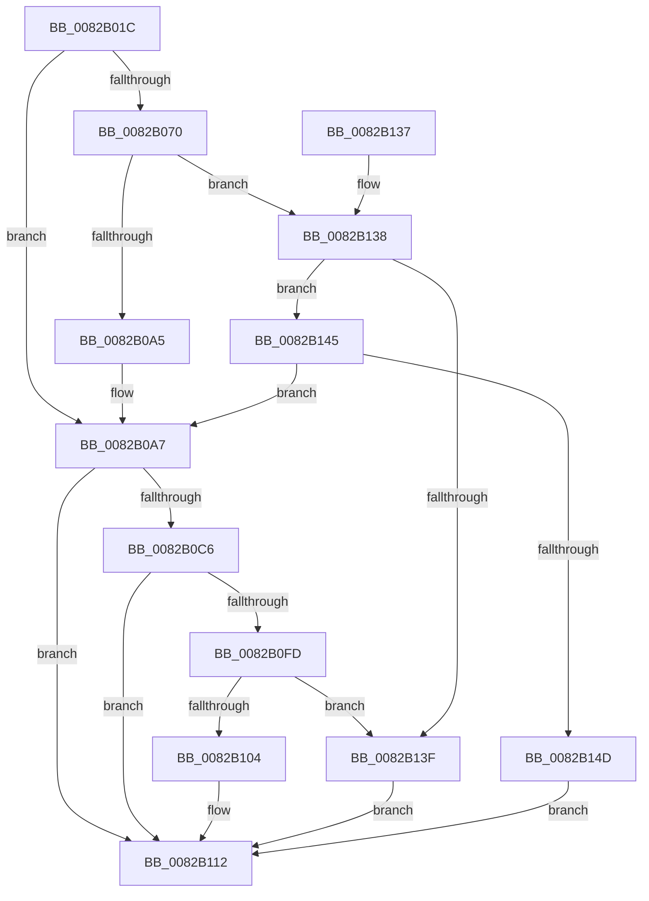

# CmDeleteDeviceContainerRegKey

- RVA: `0x0082B01C`–`0x0082B154` (길이 `312` bytes)
- VA: `0x000000014082B01C`
- 실행 섹션: `PAGE`
- PDB 이름 있음: `예`; PDB Function 태그: `아니요`
- unwind 정보 RVA: `0x000A88C0`
- 디코드: `81`개 명령, `312/312` bytes 표시
- 미해석 바이트: `0` (있으면 어셈블리에 `.byte`로 보존)

> 이 문서는 커널 이미지의 기계어와 PDB 기호를 분석해 생성했습니다. 4번과 5번은 함수 원형과 자료형을 바이너리 사용 방식에서 추정한 C 해석이며 원본 소스 복구 결과는 아닙니다.

## 1. Dependencies

- 직접 호출 지점: **5**; 고유 호출 대상: **4**
- 직접 호출자로 확인된 함수: **1**
- RIP 상대 이미지 참조: **1**

### Outgoing calls
- `0x0082B051` → [memset](../../text/6C/memset_function_006C6C40.md) (function, `0x006C6C40`)
- `0x0082B095` → [guard_dispatch_icall](../../text/6B/guard_dispatch_icall_function_006BAAD0.md) (function, `0x006BAAD0`)
- `0x0082B0BA` → [CmDeleteDeviceContainerRegKeyWorker](CmDeleteDeviceContainerRegKeyWorker_function_0082B15C.md) (function, `0x0082B15C`)
- `0x0082B0EF` → [guard_dispatch_icall](../../text/6B/guard_dispatch_icall_function_006BAAD0.md) (function, `0x006BAAD0`)
- `0x0082B11F` → [_security_check_cookie](../../text/6A/_security_check_cookie_function_006AC640.md) (function, `0x006AC640`)

### Direct callers
- [CmDeleteDeviceContainerWorker](CmDeleteDeviceContainerWorker_function_0082B37C.md) at `0x0082B3C8`
- [CmDeleteDeviceContainerWorker](CmDeleteDeviceContainerWorker_function_0082B37C.md) at `0x0082B4E4`

### Static image references
- `0x0082B02B` → RVA `0x00E0A740` (`.data`; read)

## 2. Other-region calls and transfers

- 다른 실행 섹션으로 향하는 call: **4**
  - `0x0082B051` → [memset](../../text/6C/memset_function_006C6C40.md) (`PAGE` → `.text`)
  - `0x0082B095` → [guard_dispatch_icall](../../text/6B/guard_dispatch_icall_function_006BAAD0.md) (`PAGE` → `.text`)
  - `0x0082B0EF` → [guard_dispatch_icall](../../text/6B/guard_dispatch_icall_function_006BAAD0.md) (`PAGE` → `.text`)
  - `0x0082B11F` → [_security_check_cookie](../../text/6A/_security_check_cookie_function_006AC640.md) (`PAGE` → `.text`)
- 별도 외부 분기/꼬리 이동을 확인하지 못했습니다.

## 3. Assembly (complete function range)

```asm
0082B01C  48 89 5C 24 20                  mov qword ptr [rsp + 0x20], rbx
0082B021  55                              push rbp
0082B022  56                              push rsi
0082B023  57                              push rdi
0082B024  48 81 EC B0 00 00 00            sub rsp, 0xb0
0082B02B  48 8B 05 0E F7 5D 00            mov rax, qword ptr [rip + 0x5df70e]
0082B032  48 33 C4                        xor rax, rsp
0082B035  48 89 84 24 A0 00 00 00         mov qword ptr [rsp + 0xa0], rax
0082B03D  48 8B EA                        mov rbp, rdx
0082B040  41 8B D8                        mov ebx, r8d
0082B043  33 D2                           xor edx, edx
0082B045  48 8B F1                        mov rsi, rcx
0082B048  48 8D 4C 24 40                  lea rcx, [rsp + 0x40]
0082B04D  44 8D 42 58                     lea r8d, [rdx + 0x58]
0082B051  E8 EA BB E9 FF                  call 0x1406c6c40
0082B056  48 8B BE F8 01 00 00            mov rdi, qword ptr [rsi + 0x1f8]
0082B05D  83 64 24 54 00                  and dword ptr [rsp + 0x54], 0
0082B062  89 5C 24 50                     mov dword ptr [rsp + 0x50], ebx
0082B066  C6 44 24 58 01                  mov byte ptr [rsp + 0x58], 1
0082B06B  48 85 FF                        test rdi, rdi
0082B06E  74 37                           je 0x14082b0a7
0082B070  41 B9 0C 00 00 00               mov r9d, 0xc
0082B076  48 8D 44 24 40                  lea rax, [rsp + 0x40]
0082B07B  48 89 44 24 28                  mov qword ptr [rsp + 0x28], rax
0082B080  48 8B D5                        mov rdx, rbp
0082B083  48 8B CE                        mov rcx, rsi
0082B086  C7 44 24 20 01 00 00 00         mov dword ptr [rsp + 0x20], 1
0082B08E  48 8B C7                        mov rax, rdi
0082B091  45 8D 41 F9                     lea r8d, [r9 - 7]
0082B095  E8 36 FA E8 FF                  call 0x1406baad0
0082B09A  3D 02 00 00 C0                  cmp eax, 0xc0000002
0082B09F  0F 85 93 00 00 00               jne 0x14082b138
0082B0A5  33 FF                           xor edi, edi
0082B0A7  8A 44 24 58                     mov al, byte ptr [rsp + 0x58]
0082B0AB  48 8B D5                        mov rdx, rbp
0082B0AE  44 8B 44 24 50                  mov r8d, dword ptr [rsp + 0x50]
0082B0B3  48 8B CE                        mov rcx, rsi
0082B0B6  88 44 24 20                     mov byte ptr [rsp + 0x20], al
0082B0BA  E8 9D 00 00 00                  call 0x14082b15c
0082B0BF  8B D8                           mov ebx, eax
0082B0C1  48 85 FF                        test rdi, rdi
0082B0C4  74 4C                           je 0x14082b112
0082B0C6  89 44 24 40                     mov dword ptr [rsp + 0x40], eax
0082B0CA  41 B9 0C 00 00 00               mov r9d, 0xc
0082B0D0  48 8D 44 24 40                  lea rax, [rsp + 0x40]
0082B0D5  48 8B D5                        mov rdx, rbp
0082B0D8  48 89 44 24 28                  mov qword ptr [rsp + 0x28], rax
0082B0DD  48 8B CE                        mov rcx, rsi
0082B0E0  48 8B C7                        mov rax, rdi
0082B0E3  C7 44 24 20 02 00 00 00         mov dword ptr [rsp + 0x20], 2
0082B0EB  45 8D 41 F9                     lea r8d, [r9 - 7]
0082B0EF  E8 DC F9 E8 FF                  call 0x1406baad0
0082B0F4  8B C8                           mov ecx, eax
0082B0F6  3D 02 00 00 C0                  cmp eax, 0xc0000002
0082B0FB  74 15                           je 0x14082b112
0082B0FD  3D 20 01 00 C0                  cmp eax, 0xc0000120
0082B102  74 3B                           je 0x14082b13f
0082B104  8B C3                           mov eax, ebx
0082B106  85 C9                           test ecx, ecx
0082B108  BB E5 00 00 C0                  mov ebx, 0xc00000e5
0082B10D  0F 45 C3                        cmovne eax, ebx
0082B110  8B D8                           mov ebx, eax
0082B112  8B C3                           mov eax, ebx
0082B114  48 8B 8C 24 A0 00 00 00         mov rcx, qword ptr [rsp + 0xa0]
0082B11C  48 33 CC                        xor rcx, rsp
0082B11F  E8 1C 15 E8 FF                  call 0x1406ac640
0082B124  48 8B 9C 24 E8 00 00 00         mov rbx, qword ptr [rsp + 0xe8]
0082B12C  48 81 C4 B0 00 00 00            add rsp, 0xb0
0082B133  5F                              pop rdi
0082B134  5E                              pop rsi
0082B135  5D                              pop rbp
0082B136  C3                              ret
0082B137  CC                              int3
0082B138  3D 20 01 00 C0                  cmp eax, 0xc0000120
0082B13D  75 06                           jne 0x14082b145
0082B13F  8B 5C 24 40                     mov ebx, dword ptr [rsp + 0x40]
0082B143  EB CD                           jmp 0x14082b112
0082B145  85 C0                           test eax, eax
0082B147  0F 84 5A FF FF FF               je 0x14082b0a7
0082B14D  BB E5 00 00 C0                  mov ebx, 0xc00000e5
0082B152  EB BE                           jmp 0x14082b112
```

## 4. C-style interpretation (structured pseudocode)

```c
__int64 __fastcall CmDeleteDeviceContainerRegKey(__int64 a1, __int64 a2, int a3)
{
    __int64 result;
    __int64 v_rdi;
    __int64 v_rsp;
    unsigned __int64 v_stack_m28;
    unsigned __int8 v_stack_m70;
    unsigned int v_stack_m74;
    unsigned int v_stack_m78;
    unsigned __int64 v_stack_m88;
    unsigned __int64 v_stack_mA0;
    unsigned int v_stack_mA8;
    unsigned __int64 v_stack_p20;
    unsigned int v_stack_p40;

    v_stack_p20 = v_rbx;
    v_rsp = (v_rsp) - (176);
    result = (*(unsigned __int64 *)(v_rip + 6158094)) ^ (v_rsp);
    v_stack_m28 = result;
    a2 = 0;
    result = memset(v_stack_m88, a2, a2 + 88, a4);
    v_stack_m78 = (unsigned int)((unsigned int)(a3));
    v_stack_m70 = 1;
    if (*(unsigned __int64 *)(a1 + 504) == 0) goto loc_0082B0A7;
    v_stack_mA0 = v_stack_m88;
    v_stack_mA8 = 1;
    result = guard_dispatch_icall(a1, 0, 12 - 7, 12);
    if (((unsigned int)(result)) != 0xC0000002ULL) goto loc_0082B138;
    v_rdi = 0;
loc_0082B0A7:
    v_stack_mA8 = (unsigned __int8)(v_stack_m70);
    result = CmDeleteDeviceContainerRegKeyWorker(a1, 0, (unsigned int)(v_stack_m78), 12);
    if (0 == 0) goto loc_0082B112;
    v_stack_m88 = (unsigned int)(result);
    v_stack_mA0 = v_stack_m88;
    v_stack_mA8 = 2;
    result = guard_dispatch_icall(a1, 0, 12 - 7, 12);
    if (((unsigned int)(result)) == 0xC0000002ULL) goto loc_0082B112;
    if (((unsigned int)(result)) == 0xC0000120ULL) goto loc_0082B13F;
    result = (unsigned int)((unsigned int)((unsigned int)((unsigned int)(result))));
    if ((unsigned int)((unsigned int)((unsigned int)(result))) != 0) { result = (unsigned int)((unsigned int)(0xC00000E5ULL)); }
loc_0082B112:
    a1 = (v_stack_m28) ^ (v_rsp);
    result = _security_check_cookie(a1, 0, 12 - 7, 12);
    v_rsp = (v_rsp) + (176);
    return result;
loc_0082B138:
    if (((unsigned int)(result)) != 0xC0000120ULL) goto loc_0082B145;
loc_0082B13F:
    goto loc_0082B112;
loc_0082B145:
    if ((unsigned int)(result) == 0) goto loc_0082B0A7;
    goto loc_0082B112;
}
```

## 5. (Beta) C Style

```c
int64_t CmDeleteDeviceContainerRegKey(void *Arg1, int64_t Arg2, int32_t Arg3)
{
    uint8_t *arg1 = (uint8_t *)Arg1;

    int64_t result;
    int64_t local_rdi;
    int64_t local_rsp;
    uint64_t v_stack_m28;
    uint8_t v_stack_m70;
    uint32_t v_stack_m74;
    uint32_t v_stack_m78;
    uint64_t v_stack_m88;
    uint64_t v_stack_mA0;
    uint32_t v_stack_mA8;
    uint64_t v_stack_p20;
    uint32_t v_stack_p40;

    v_stack_p20 = local_rbx;
    local_rsp = (local_rsp) - (176);
    result = (*(uint64_t *)(v_rip + 0x5DF70E)) ^ (local_rsp);
    v_stack_m28 = result;
    Arg2 = 0;
    result = memset(v_stack_m88, Arg2, Arg2 + 88, a4);
    v_stack_m78 = (uint32_t)((uint32_t)(Arg3));
    v_stack_m70 = 1;
    if (*(uint64_t *)(arg1 + 0x1F8) == 0) goto loc_0082B0A7;
    v_stack_mA0 = v_stack_m88;
    v_stack_mA8 = 1;
    result = guard_dispatch_icall(Arg1, 0, 12 - 7, 12);
    if (((uint32_t)(result)) != 0xC0000002ULL) goto loc_0082B138;
    local_rdi = 0;
loc_0082B0A7:
    v_stack_mA8 = (uint8_t)(v_stack_m70);
    result = CmDeleteDeviceContainerRegKeyWorker(Arg1, 0, (uint32_t)(v_stack_m78), 12);
    if (0 == 0) goto loc_0082B112;
    v_stack_m88 = (uint32_t)(result);
    v_stack_mA0 = v_stack_m88;
    v_stack_mA8 = 2;
    result = guard_dispatch_icall(Arg1, 0, 12 - 7, 12);
    if (((uint32_t)(result)) == 0xC0000002ULL) goto loc_0082B112;
    if (((uint32_t)(result)) == 0xC0000120ULL) goto loc_0082B13F;
    result = (uint32_t)((uint32_t)((uint32_t)((uint32_t)(result))));
    if ((uint32_t)((uint32_t)((uint32_t)(result))) != 0) { result = (uint32_t)((uint32_t)(0xC00000E5ULL)); }
loc_0082B112:
    Arg1 = (v_stack_m28) ^ (local_rsp);
    result = _security_check_cookie(Arg1, 0, 12 - 7, 12);
    local_rsp = (local_rsp) + (176);
    return result;
loc_0082B138:
    if (((uint32_t)(result)) != 0xC0000120ULL) goto loc_0082B145;
loc_0082B13F:
    goto loc_0082B112;
loc_0082B145:
    if ((uint32_t)(result) == 0) goto loc_0082B0A7;
    goto loc_0082B112;
}
```

### 관측된 메모리 오프셋

구조체 형식이 확인되지 않은 접근은 인자 기준의 오프셋으로만 기록했습니다.

| 기준 인자 | 오프셋 표현 | 폭 (bit) | 접근 |
|---|---:|---:|---|
| `Arg1` | `+ 0x1F8` | `64` | `R` |

## 6. Execution-region graph

[열기: 2D/3D 그래프와 함수 탐색 컨트롤 패널](../../../control-panel.html?section=page&rva=0x0082B01C&view=graph)

- 2D 그래프는 위에서 아래로 흐르고, 3D 그래프는 빈 공간을 드래그해 회전합니다. Shift+드래그는 이동, 휠은 확대·축소, 함수 노드 선택은 대상 보고서 이동입니다.

### Static fallback


