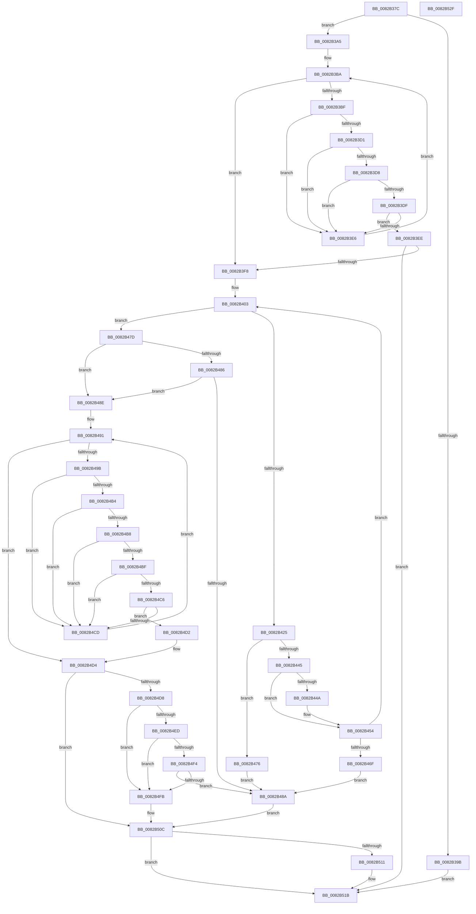

# CmDeleteDeviceContainerWorker

- RVA: `0x0082B37C`–`0x0082B530` (길이 `436` bytes)
- VA: `0x000000014082B37C`
- 실행 섹션: `PAGE`
- PDB 이름 있음: `예`; PDB Function 태그: `아니요`
- unwind 정보 RVA: `0x000DA90C`
- 디코드: `129`개 명령, `436/436` bytes 표시
- 미해석 바이트: `0` (있으면 어셈블리에 `.byte`로 보존)

> 이 문서는 커널 이미지의 기계어와 PDB 기호를 분석해 생성했습니다. 4번과 5번은 함수 원형과 자료형을 바이너리 사용 방식에서 추정한 C 해석이며 원본 소스 복구 결과는 아닙니다.

## 1. Dependencies

- 직접 호출 지점: **8**; 고유 호출 대상: **6**
- 직접 호출자로 확인된 함수: **1**
- RIP 상대 이미지 참조: **0**

### Outgoing calls
- `0x0082B3C8` → [CmDeleteDeviceContainerRegKey](CmDeleteDeviceContainerRegKey_function_0082B01C.md) (function, `0x0082B01C`)
- `0x0082B419` → [CmGetDeviceContainerMappedPropertyKeys](../AB/CmGetDeviceContainerMappedPropertyKeys_function_00AB3CC4.md) (function, `0x00AB3CC4`)
- `0x0082B44F` → [ExFreePoolWithTag](../../poolcode/B8/ExFreePoolWithTag_function_00B82870.md) (function, `0x00B82870`)
- `0x0082B462` → [ExAllocatePool2](../../poolcode/B8/ExAllocatePool2_function_00B820F0.md) (function, `0x00B820F0`)
- `0x0082B4AB` → [_CmSetDeviceContainerMappedProperty](../AB/_CmSetDeviceContainerMappedProperty_function_00AB07F4.md) (function, `0x00AB07F4`)
- `0x0082B4E4` → [CmDeleteDeviceContainerRegKey](CmDeleteDeviceContainerRegKey_function_0082B01C.md) (function, `0x0082B01C`)
- `0x0082B507` → [CmRaiseDeleteEvent](CmRaiseDeleteEvent_function_0082DBE0.md) (function, `0x0082DBE0`)
- `0x0082B516` → [ExFreePoolWithTag](../../poolcode/B8/ExFreePoolWithTag_function_00B82870.md) (function, `0x00B82870`)

### Direct callers
- [CmDeleteDeviceContainer](CmDeleteDeviceContainer_function_0082AEF4.md) at `0x0082AF79`

### Static image references
- 디코드된 RIP-relative 메모리 참조가 없습니다.

## 2. Other-region calls and transfers

- 다른 실행 섹션으로 향하는 call: **3**
  - `0x0082B44F` → [ExFreePoolWithTag](../../poolcode/B8/ExFreePoolWithTag_function_00B82870.md) (`PAGE` → `POOLCODE`)
  - `0x0082B462` → [ExAllocatePool2](../../poolcode/B8/ExAllocatePool2_function_00B820F0.md) (`PAGE` → `POOLCODE`)
  - `0x0082B516` → [ExFreePoolWithTag](../../poolcode/B8/ExFreePoolWithTag_function_00B82870.md) (`PAGE` → `POOLCODE`)
- 별도 외부 분기/꼬리 이동을 확인하지 못했습니다.

## 3. Assembly (complete function range)

```asm
0082B37C  48 89 5C 24 08                  mov qword ptr [rsp + 8], rbx
0082B381  55                              push rbp
0082B382  57                              push rdi
0082B383  41 54                           push r12
0082B385  41 56                           push r14
0082B387  41 57                           push r15
0082B389  48 83 EC 40                     sub rsp, 0x40
0082B38D  33 FF                           xor edi, edi
0082B38F  4C 8B FA                        mov r15, rdx
0082B392  4C 8B E1                        mov r12, rcx
0082B395  66 45 85 C0                     test r8w, r8w
0082B399  74 0A                           je 0x14082b3a5
0082B39B  BF 0D 00 00 C0                  mov edi, 0xc000000d
0082B3A0  E9 76 01 00 00                  jmp 0x14082b51b
0082B3A5  C7 84 24 80 00 00 00 50 01 00 00  mov dword ptr [rsp + 0x80], 0x150
0082B3B0  4C 8D B4 24 80 00 00 00         lea r14, [rsp + 0x80]
0082B3B8  33 DB                           xor ebx, ebx
0082B3BA  83 FB 01                        cmp ebx, 1
0082B3BD  73 39                           jae 0x14082b3f8
0082B3BF  45 8B 06                        mov r8d, dword ptr [r14]
0082B3C2  49 8B D7                        mov rdx, r15
0082B3C5  49 8B CC                        mov rcx, r12
0082B3C8  E8 4F FC FF FF                  call 0x14082b01c
0082B3CD  85 C0                           test eax, eax
0082B3CF  74 15                           je 0x14082b3e6
0082B3D1  3D 34 00 00 C0                  cmp eax, 0xc0000034
0082B3D6  74 0E                           je 0x14082b3e6
0082B3D8  3D 0D 00 00 C0                  cmp eax, 0xc000000d
0082B3DD  74 07                           je 0x14082b3e6
0082B3DF  3D BB 00 00 C0                  cmp eax, 0xc00000bb
0082B3E4  75 08                           jne 0x14082b3ee
0082B3E6  FF C3                           inc ebx
0082B3E8  49 83 C6 04                     add r14, 4
0082B3EC  EB CC                           jmp 0x14082b3ba
0082B3EE  8B F8                           mov edi, eax
0082B3F0  85 C0                           test eax, eax
0082B3F2  0F 88 23 01 00 00               js 0x14082b51b
0082B3F8  33 DB                           xor ebx, ebx
0082B3FA  33 ED                           xor ebp, ebp
0082B3FC  89 AC 24 80 00 00 00            mov dword ptr [rsp + 0x80], ebp
0082B403  48 8D 84 24 80 00 00 00         lea rax, [rsp + 0x80]
0082B40B  48 89 44 24 30                  mov qword ptr [rsp + 0x30], rax
0082B410  89 6C 24 28                     mov dword ptr [rsp + 0x28], ebp
0082B414  48 89 5C 24 20                  mov qword ptr [rsp + 0x20], rbx
0082B419  E8 A6 88 28 00                  call 0x140ab3cc4
0082B41E  3D 23 00 00 C0                  cmp eax, 0xc0000023
0082B423  75 58                           jne 0x14082b47d
0082B425  8B AC 24 80 00 00 00            mov ebp, dword ptr [rsp + 0x80]
0082B42C  B8 FF FF FF FF                  mov eax, 0xffffffff
0082B431  4C 8D 34 AD 00 00 00 00         lea r14, [rbp*4]
0082B439  4C 03 F5                        add r14, rbp
0082B43C  49 C1 E6 02                     shl r14, 2
0082B440  4C 3B F0                        cmp r14, rax
0082B443  77 31                           ja 0x14082b476
0082B445  48 85 DB                        test rbx, rbx
0082B448  74 0A                           je 0x14082b454
0082B44A  33 D2                           xor edx, edx
0082B44C  48 8B CB                        mov rcx, rbx
0082B44F  E8 1C 74 35 00                  call 0x140b82870
0082B454  41 8B D6                        mov edx, r14d
0082B457  B9 00 01 00 00                  mov ecx, 0x100
0082B45C  41 B8 50 4E 50 52               mov r8d, 0x52504e50
0082B462  E8 89 6C 35 00                  call 0x140b820f0
0082B467  48 8B D8                        mov rbx, rax
0082B46A  48 85 C0                        test rax, rax
0082B46D  75 94                           jne 0x14082b403
0082B46F  B8 17 00 00 C0                  mov eax, 0xc0000017
0082B474  EB 14                           jmp 0x14082b48a
0082B476  B8 0D 00 00 C0                  mov eax, 0xc000000d
0082B47B  EB 0D                           jmp 0x14082b48a
0082B47D  BD 25 02 00 C0                  mov ebp, 0xc0000225
0082B482  85 C0                           test eax, eax
0082B484  74 08                           je 0x14082b48e
0082B486  3B C5                           cmp eax, ebp
0082B488  74 04                           je 0x14082b48e
0082B48A  8B F8                           mov edi, eax
0082B48C  EB 7E                           jmp 0x14082b50c
0082B48E  45 33 DB                        xor r11d, r11d
0082B491  44 3B 9C 24 80 00 00 00         cmp r11d, dword ptr [rsp + 0x80]
0082B499  73 39                           jae 0x14082b4d4
0082B49B  4B 8D 0C 9B                     lea rcx, [r11 + r11*4]
0082B49F  45 33 C9                        xor r9d, r9d
0082B4A2  48 8D 04 8B                     lea rax, [rbx + rcx*4]
0082B4A6  48 89 44 24 20                  mov qword ptr [rsp + 0x20], rax
0082B4AB  E8 44 53 28 00                  call 0x140ab07f4
0082B4B0  85 C0                           test eax, eax
0082B4B2  74 19                           je 0x14082b4cd
0082B4B4  3B C5                           cmp eax, ebp
0082B4B6  74 15                           je 0x14082b4cd
0082B4B8  3D 22 00 00 C0                  cmp eax, 0xc0000022
0082B4BD  74 0E                           je 0x14082b4cd
0082B4BF  3D 16 00 00 C0                  cmp eax, 0xc0000016
0082B4C4  74 07                           je 0x14082b4cd
0082B4C6  3D BB 00 00 C0                  cmp eax, 0xc00000bb
0082B4CB  75 05                           jne 0x14082b4d2
0082B4CD  41 FF C3                        inc r11d
0082B4D0  EB BF                           jmp 0x14082b491
0082B4D2  8B F8                           mov edi, eax
0082B4D4  85 FF                           test edi, edi
0082B4D6  78 34                           js 0x14082b50c
0082B4D8  41 B8 50 00 00 00               mov r8d, 0x50
0082B4DE  49 8B D7                        mov rdx, r15
0082B4E1  49 8B CC                        mov rcx, r12
0082B4E4  E8 33 FB FF FF                  call 0x14082b01c
0082B4E9  85 C0                           test eax, eax
0082B4EB  74 0E                           je 0x14082b4fb
0082B4ED  3D 34 00 00 C0                  cmp eax, 0xc0000034
0082B4F2  74 07                           je 0x14082b4fb
0082B4F4  3D 0D 00 00 C0                  cmp eax, 0xc000000d
0082B4F9  75 8F                           jne 0x14082b48a
0082B4FB  41 B8 05 00 00 00               mov r8d, 5
0082B501  49 8B D7                        mov rdx, r15
0082B504  49 8B CC                        mov rcx, r12
0082B507  E8 D4 26 00 00                  call 0x14082dbe0
0082B50C  48 85 DB                        test rbx, rbx
0082B50F  74 0A                           je 0x14082b51b
0082B511  33 D2                           xor edx, edx
0082B513  48 8B CB                        mov rcx, rbx
0082B516  E8 55 73 35 00                  call 0x140b82870
0082B51B  48 8B 5C 24 70                  mov rbx, qword ptr [rsp + 0x70]
0082B520  8B C7                           mov eax, edi
0082B522  48 83 C4 40                     add rsp, 0x40
0082B526  41 5F                           pop r15
0082B528  41 5E                           pop r14
0082B52A  41 5C                           pop r12
0082B52C  5F                              pop rdi
0082B52D  5D                              pop rbp
0082B52E  C3                              ret
0082B52F  CC                              int3
```

## 4. C-style interpretation (structured pseudocode)

```c
__int64 __fastcall CmDeleteDeviceContainerWorker(__int64 a1, __int64 a2, unsigned __int16 a3, int a4)
{
    __int64 result;
    __int64 v_r11;
    __int64 v_r14;
    __int64 v_rbp;
    __int64 v_rbx;
    __int64 v_rdi;
    __int64 v_rsp;
    unsigned __int64 v_stack_m38;
    unsigned int v_stack_m40;
    unsigned __int64 v_stack_m48;
    unsigned int v_stack_p18;
    unsigned __int64 v_stack_p8;

    v_stack_p8 = v_rbx;
    v_rsp = (v_rsp) - (64);
    v_rdi = 0;
    if (a3 == 0) goto loc_0082B3A5;
    goto loc_0082B51B;
loc_0082B3A5:
    v_stack_p18 = 336;
    v_rbx = 0;
loc_0082B3BA:
    if (0 >= 1) goto loc_0082B3F8;
    result = CmDeleteDeviceContainerRegKey(a1, a2, (unsigned int)(*(unsigned int *)(v_stack_p18)), a4);
    if ((unsigned int)(result) == 0) goto loc_0082B3E6;
    if (((unsigned int)(result)) == 0xC0000034ULL) goto loc_0082B3E6;
    if (((unsigned int)(result)) == 0xC000000DULL) goto loc_0082B3E6;
    if (((unsigned int)(result)) != 0xC00000BBULL) goto loc_0082B3EE;
loc_0082B3E6:
    v_rbx = (unsigned int)((v_rbx) + 1);
    v_r14 = (v_stack_p18) + (4);
    goto loc_0082B3BA;
loc_0082B3EE:
    if (sign_flag) goto loc_0082B51B;
loc_0082B3F8:
    v_rbx = 0;
    v_rbp = 0;
    v_stack_p18 = 0;
loc_0082B403:
    v_stack_m38 = v_stack_p18;
    v_stack_m40 = 0;
    v_stack_m48 = 0;
    result = CmGetDeviceContainerMappedPropertyKeys(a1, a2, (unsigned int)(*(unsigned int *)(v_stack_p18)), a4);
    if (((unsigned int)(result)) != 0xC0000023ULL) goto loc_0082B47D;
    v_r14 = ((unsigned int)(v_stack_p18) * 4) + ((unsigned int)(v_stack_p18));
    v_r14 = (v_r14) << (2);
    if (v_r14 > ((unsigned int)(0xFFFFFFFFULL))) goto loc_0082B476;
    result = (unsigned int)(0xFFFFFFFFULL);
    if (0 != 0) {
        a2 = 0;
        a1 = 0;
        result = ExFreePoolWithTag(a1, a2, (unsigned int)(*(unsigned int *)(v_stack_p18)), a4);
    }
    result = ExAllocatePool2(256, (unsigned int)((unsigned int)(v_r14)), (unsigned int)(0x52504E50ULL), a4);
    if (result != 0) goto loc_0082B403;
    goto loc_0082B48A;
loc_0082B476:
    goto loc_0082B48A;
loc_0082B47D:
    if ((unsigned int)((unsigned int)(0xC000000DULL)) == 0) goto loc_0082B48E;
    if (((unsigned int)((unsigned int)(0xC000000DULL))) == ((unsigned int)((unsigned int)(0xC0000225ULL)))) goto loc_0082B48E;
loc_0082B48A:
    goto loc_0082B50C;
loc_0082B48E:
    v_r11 = 0;
loc_0082B491:
    if (0 >= v_stack_p18) goto loc_0082B4D4;
    a4 = 0;
    v_stack_m48 = result + v_r11 + v_r11 * 4 * 4;
    result = _CmSetDeviceContainerMappedProperty(v_r11 + v_r11 * 4, (unsigned int)((unsigned int)(v_r14)), (unsigned int)(0x52504E50ULL), a4);
    if ((unsigned int)(result) == 0) goto loc_0082B4CD;
    if (((unsigned int)(result)) == ((unsigned int)((unsigned int)(0xC0000225ULL)))) goto loc_0082B4CD;
    if (((unsigned int)(result)) == 0xC0000022ULL) goto loc_0082B4CD;
    if (((unsigned int)(result)) == 0xC0000016ULL) goto loc_0082B4CD;
    if (((unsigned int)(result)) != 0xC00000BBULL) goto loc_0082B4D2;
loc_0082B4CD:
    v_r11 = (unsigned int)((v_r11) + 1);
    goto loc_0082B491;
loc_0082B4D2:
loc_0082B4D4:
    if (sign_flag) goto loc_0082B50C;
    result = CmDeleteDeviceContainerRegKey(a1, 0, 80, a4);
    if ((unsigned int)(result) == 0) goto loc_0082B4FB;
    if (((unsigned int)(result)) == 0xC0000034ULL) goto loc_0082B4FB;
    if (((unsigned int)(result)) != 0xC000000DULL) goto loc_0082B48A;
loc_0082B4FB:
    result = CmRaiseDeleteEvent(a1, 0, 5, a4);
loc_0082B50C:
    if (result != 0) {
        a2 = 0;
        a1 = result;
        result = ExFreePoolWithTag(a1, a2, 5, a4);
    }
    v_rsp = (v_rsp) + (64);
    return (unsigned int)((unsigned int)((unsigned int)((unsigned int)(result))));
}
```

## 5. (Beta) C Style

```c
int64_t CmDeleteDeviceContainerWorker(int64_t Arg1, int64_t Arg2, uint16_t Arg3, int32_t Arg4)
{
    int64_t result;
    int64_t local_r11;
    int64_t local_r14;
    int64_t local_rbp;
    int64_t local_rbx;
    int64_t local_rdi;
    int64_t local_rsp;
    uint64_t v_stack_m38;
    uint32_t v_stack_m40;
    uint64_t v_stack_m48;
    uint32_t v_stack_p18;
    uint64_t v_stack_p8;

    v_stack_p8 = local_rbx;
    local_rsp = (local_rsp) - (64);
    local_rdi = 0;
    if (Arg3 == 0) goto loc_0082B3A5;
    goto loc_0082B51B;
loc_0082B3A5:
    v_stack_p18 = 336;
    local_rbx = 0;
loc_0082B3BA:
    if (0 >= 1) goto loc_0082B3F8;
    result = CmDeleteDeviceContainerRegKey(Arg1, Arg2, (uint32_t)(*(uint32_t *)(v_stack_p18)), Arg4);
    if ((uint32_t)(result) == 0) goto loc_0082B3E6;
    if (((uint32_t)(result)) == 0xC0000034ULL) goto loc_0082B3E6;
    if (((uint32_t)(result)) == 0xC000000DULL) goto loc_0082B3E6;
    if (((uint32_t)(result)) != 0xC00000BBULL) goto loc_0082B3EE;
loc_0082B3E6:
    local_rbx = (uint32_t)((local_rbx) + 1);
    local_r14 = (v_stack_p18) + (4);
    goto loc_0082B3BA;
loc_0082B3EE:
    if (sign_flag) goto loc_0082B51B;
loc_0082B3F8:
    local_rbx = 0;
    local_rbp = 0;
    v_stack_p18 = 0;
loc_0082B403:
    v_stack_m38 = v_stack_p18;
    v_stack_m40 = 0;
    v_stack_m48 = 0;
    result = CmGetDeviceContainerMappedPropertyKeys(Arg1, Arg2, (uint32_t)(*(uint32_t *)(v_stack_p18)), Arg4);
    if (((uint32_t)(result)) != 0xC0000023ULL) goto loc_0082B47D;
    local_r14 = ((uint32_t)(v_stack_p18) * 4) + ((uint32_t)(v_stack_p18));
    local_r14 = (local_r14) << (2);
    if (local_r14 > ((uint32_t)(0xFFFFFFFFULL))) goto loc_0082B476;
    result = (uint32_t)(0xFFFFFFFFULL);
    if (0 != 0) {
        Arg2 = 0;
        Arg1 = 0;
        result = ExFreePoolWithTag(Arg1, Arg2, (uint32_t)(*(uint32_t *)(v_stack_p18)), Arg4);
    }
    result = ExAllocatePool2(256, (uint32_t)((uint32_t)(local_r14)), (uint32_t)(0x52504E50ULL), Arg4);
    if (result != 0) goto loc_0082B403;
    goto loc_0082B48A;
loc_0082B476:
    goto loc_0082B48A;
loc_0082B47D:
    if ((uint32_t)((uint32_t)(0xC000000DULL)) == 0) goto loc_0082B48E;
    if (((uint32_t)((uint32_t)(0xC000000DULL))) == ((uint32_t)((uint32_t)(0xC0000225ULL)))) goto loc_0082B48E;
loc_0082B48A:
    goto loc_0082B50C;
loc_0082B48E:
    local_r11 = 0;
loc_0082B491:
    if (0 >= v_stack_p18) goto loc_0082B4D4;
    Arg4 = 0;
    v_stack_m48 = result + local_r11 + local_r11 * 4 * 4;
    result = _CmSetDeviceContainerMappedProperty(local_r11 + local_r11 * 4, (uint32_t)((uint32_t)(local_r14)), (uint32_t)(0x52504E50ULL), Arg4);
    if ((uint32_t)(result) == 0) goto loc_0082B4CD;
    if (((uint32_t)(result)) == ((uint32_t)((uint32_t)(0xC0000225ULL)))) goto loc_0082B4CD;
    if (((uint32_t)(result)) == 0xC0000022ULL) goto loc_0082B4CD;
    if (((uint32_t)(result)) == 0xC0000016ULL) goto loc_0082B4CD;
    if (((uint32_t)(result)) != 0xC00000BBULL) goto loc_0082B4D2;
loc_0082B4CD:
    local_r11 = (uint32_t)((local_r11) + 1);
    goto loc_0082B491;
loc_0082B4D2:
loc_0082B4D4:
    if (sign_flag) goto loc_0082B50C;
    result = CmDeleteDeviceContainerRegKey(Arg1, 0, 80, Arg4);
    if ((uint32_t)(result) == 0) goto loc_0082B4FB;
    if (((uint32_t)(result)) == 0xC0000034ULL) goto loc_0082B4FB;
    if (((uint32_t)(result)) != 0xC000000DULL) goto loc_0082B48A;
loc_0082B4FB:
    result = CmRaiseDeleteEvent(Arg1, 0, 5, Arg4);
loc_0082B50C:
    if (result != 0) {
        Arg2 = 0;
        Arg1 = result;
        result = ExFreePoolWithTag(Arg1, Arg2, 5, Arg4);
    }
    local_rsp = (local_rsp) + (64);
    return (uint32_t)((uint32_t)((uint32_t)((uint32_t)(result))));
}
```

## 6. Execution-region graph

[열기: 2D/3D 그래프와 함수 탐색 컨트롤 패널](../../../control-panel.html?section=page&rva=0x0082B37C&view=graph)

- 2D 그래프는 위에서 아래로 흐르고, 3D 그래프는 빈 공간을 드래그해 회전합니다. Shift+드래그는 이동, 휠은 확대·축소, 함수 노드 선택은 대상 보고서 이동입니다.

### Static fallback


