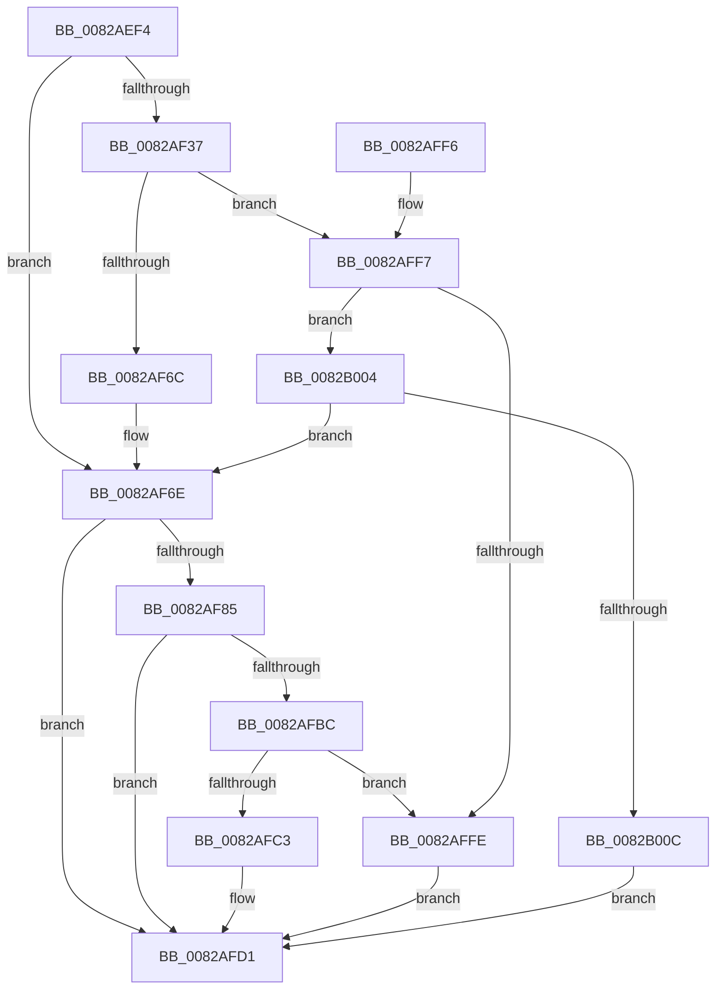

# CmDeleteDeviceContainer

- RVA: `0x0082AEF4`–`0x0082B013` (길이 `287` bytes)
- VA: `0x000000014082AEF4`
- 실행 섹션: `PAGE`
- PDB 이름 있음: `예`; PDB Function 태그: `아니요`
- unwind 정보 RVA: `0x000DA8EC`
- 디코드: `75`개 명령, `287/287` bytes 표시
- 미해석 바이트: `0` (있으면 어셈블리에 `.byte`로 보존)

> 이 문서는 커널 이미지의 기계어와 PDB 기호를 분석해 생성했습니다. 4번과 5번은 함수 원형과 자료형을 바이너리 사용 방식에서 추정한 C 해석이며 원본 소스 복구 결과는 아닙니다.

## 1. Dependencies

- 직접 호출 지점: **5**; 고유 호출 대상: **4**
- 직접 호출자로 확인된 함수: **2**
- RIP 상대 이미지 참조: **1**

### Outgoing calls
- `0x0082AF26` → [memset](../../text/6C/memset_function_006C6C40.md) (function, `0x006C6C40`)
- `0x0082AF5C` → [guard_dispatch_icall](../../text/6B/guard_dispatch_icall_function_006BAAD0.md) (function, `0x006BAAD0`)
- `0x0082AF79` → [CmDeleteDeviceContainerWorker](CmDeleteDeviceContainerWorker_function_0082B37C.md) (function, `0x0082B37C`)
- `0x0082AFAE` → [guard_dispatch_icall](../../text/6B/guard_dispatch_icall_function_006BAAD0.md) (function, `0x006BAAD0`)
- `0x0082AFDE` → [_security_check_cookie](../../text/6A/_security_check_cookie_function_006AC640.md) (function, `0x006AC640`)

### Direct callers
- [CmRemoveDeviceFromContainerWorker](CmRemoveDeviceFromContainerWorker_function_0082C080.md) at `0x0082C1E5`
- [sub_00B1FF8C](../B1/Unknown_function_00B1FF8C.md) at `0x00B1FFB2`

### Static image references
- `0x0082AF03` → RVA `0x00E0A740` (`.data`; read)

## 2. Other-region calls and transfers

- 다른 실행 섹션으로 향하는 call: **4**
  - `0x0082AF26` → [memset](../../text/6C/memset_function_006C6C40.md) (`PAGE` → `.text`)
  - `0x0082AF5C` → [guard_dispatch_icall](../../text/6B/guard_dispatch_icall_function_006BAAD0.md) (`PAGE` → `.text`)
  - `0x0082AFAE` → [guard_dispatch_icall](../../text/6B/guard_dispatch_icall_function_006BAAD0.md) (`PAGE` → `.text`)
  - `0x0082AFDE` → [_security_check_cookie](../../text/6A/_security_check_cookie_function_006AC640.md) (`PAGE` → `.text`)
- 별도 외부 분기/꼬리 이동을 확인하지 못했습니다.

## 3. Assembly (complete function range)

```asm
0082AEF4  48 89 5C 24 18                  mov qword ptr [rsp + 0x18], rbx
0082AEF9  55                              push rbp
0082AEFA  56                              push rsi
0082AEFB  57                              push rdi
0082AEFC  48 81 EC B0 00 00 00            sub rsp, 0xb0
0082AF03  48 8B 05 36 F8 5D 00            mov rax, qword ptr [rip + 0x5df836]
0082AF0A  48 33 C4                        xor rax, rsp
0082AF0D  48 89 84 24 A0 00 00 00         mov qword ptr [rsp + 0xa0], rax
0082AF15  48 8B EA                        mov rbp, rdx
0082AF18  48 8B F1                        mov rsi, rcx
0082AF1B  33 D2                           xor edx, edx
0082AF1D  48 8D 4C 24 40                  lea rcx, [rsp + 0x40]
0082AF22  44 8D 42 58                     lea r8d, [rdx + 0x58]
0082AF26  E8 15 BD E9 FF                  call 0x1406c6c40
0082AF2B  48 8B BE F8 01 00 00            mov rdi, qword ptr [rsi + 0x1f8]
0082AF32  48 85 FF                        test rdi, rdi
0082AF35  74 37                           je 0x14082af6e
0082AF37  41 B9 03 00 00 00               mov r9d, 3
0082AF3D  48 8D 44 24 40                  lea rax, [rsp + 0x40]
0082AF42  48 89 44 24 28                  mov qword ptr [rsp + 0x28], rax
0082AF47  48 8B D5                        mov rdx, rbp
0082AF4A  48 8B CE                        mov rcx, rsi
0082AF4D  C7 44 24 20 01 00 00 00         mov dword ptr [rsp + 0x20], 1
0082AF55  48 8B C7                        mov rax, rdi
0082AF58  45 8D 41 02                     lea r8d, [r9 + 2]
0082AF5C  E8 6F FB E8 FF                  call 0x1406baad0
0082AF61  3D 02 00 00 C0                  cmp eax, 0xc0000002
0082AF66  0F 85 8B 00 00 00               jne 0x14082aff7
0082AF6C  33 FF                           xor edi, edi
0082AF6E  44 8B 44 24 50                  mov r8d, dword ptr [rsp + 0x50]
0082AF73  48 8B D5                        mov rdx, rbp
0082AF76  48 8B CE                        mov rcx, rsi
0082AF79  E8 FE 03 00 00                  call 0x14082b37c
0082AF7E  8B D8                           mov ebx, eax
0082AF80  48 85 FF                        test rdi, rdi
0082AF83  74 4C                           je 0x14082afd1
0082AF85  89 44 24 40                     mov dword ptr [rsp + 0x40], eax
0082AF89  41 B9 03 00 00 00               mov r9d, 3
0082AF8F  48 8D 44 24 40                  lea rax, [rsp + 0x40]
0082AF94  48 8B D5                        mov rdx, rbp
0082AF97  48 89 44 24 28                  mov qword ptr [rsp + 0x28], rax
0082AF9C  48 8B CE                        mov rcx, rsi
0082AF9F  48 8B C7                        mov rax, rdi
0082AFA2  C7 44 24 20 02 00 00 00         mov dword ptr [rsp + 0x20], 2
0082AFAA  45 8D 41 02                     lea r8d, [r9 + 2]
0082AFAE  E8 1D FB E8 FF                  call 0x1406baad0
0082AFB3  8B C8                           mov ecx, eax
0082AFB5  3D 02 00 00 C0                  cmp eax, 0xc0000002
0082AFBA  74 15                           je 0x14082afd1
0082AFBC  3D 20 01 00 C0                  cmp eax, 0xc0000120
0082AFC1  74 3B                           je 0x14082affe
0082AFC3  8B C3                           mov eax, ebx
0082AFC5  85 C9                           test ecx, ecx
0082AFC7  BB E5 00 00 C0                  mov ebx, 0xc00000e5
0082AFCC  0F 45 C3                        cmovne eax, ebx
0082AFCF  8B D8                           mov ebx, eax
0082AFD1  8B C3                           mov eax, ebx
0082AFD3  48 8B 8C 24 A0 00 00 00         mov rcx, qword ptr [rsp + 0xa0]
0082AFDB  48 33 CC                        xor rcx, rsp
0082AFDE  E8 5D 16 E8 FF                  call 0x1406ac640
0082AFE3  48 8B 9C 24 E0 00 00 00         mov rbx, qword ptr [rsp + 0xe0]
0082AFEB  48 81 C4 B0 00 00 00            add rsp, 0xb0
0082AFF2  5F                              pop rdi
0082AFF3  5E                              pop rsi
0082AFF4  5D                              pop rbp
0082AFF5  C3                              ret
0082AFF6  CC                              int3
0082AFF7  3D 20 01 00 C0                  cmp eax, 0xc0000120
0082AFFC  75 06                           jne 0x14082b004
0082AFFE  8B 5C 24 40                     mov ebx, dword ptr [rsp + 0x40]
0082B002  EB CD                           jmp 0x14082afd1
0082B004  85 C0                           test eax, eax
0082B006  0F 84 62 FF FF FF               je 0x14082af6e
0082B00C  BB E5 00 00 C0                  mov ebx, 0xc00000e5
0082B011  EB BE                           jmp 0x14082afd1
```

## 4. C-style interpretation (structured pseudocode)

```c
__int64 __fastcall CmDeleteDeviceContainer(__int64 a1, __int64 a2)
{
    __int64 result;
    __int64 v_rdi;
    __int64 v_rsp;
    unsigned __int64 v_stack_m28;
    unsigned int v_stack_m78;
    unsigned __int64 v_stack_m88;
    unsigned __int64 v_stack_mA0;
    unsigned int v_stack_mA8;
    unsigned __int64 v_stack_p18;
    unsigned int v_stack_p40;

    v_stack_p18 = v_rbx;
    v_rsp = (v_rsp) - (176);
    result = (*(unsigned __int64 *)(v_rip + 6158390)) ^ (v_rsp);
    v_stack_m28 = result;
    a2 = 0;
    result = memset(v_stack_m88, a2, a2 + 88, a4);
    if (*(unsigned __int64 *)(a1 + 504) == 0) goto loc_0082AF6E;
    v_stack_mA0 = v_stack_m88;
    v_stack_mA8 = 1;
    result = guard_dispatch_icall(a1, 0, 3 + 2, 3);
    if (((unsigned int)(result)) != 0xC0000002ULL) goto loc_0082AFF7;
    v_rdi = 0;
loc_0082AF6E:
    result = CmDeleteDeviceContainerWorker(a1, 0, (unsigned int)(v_stack_m78), 3);
    if (0 == 0) goto loc_0082AFD1;
    v_stack_m88 = (unsigned int)(result);
    v_stack_mA0 = v_stack_m88;
    v_stack_mA8 = 2;
    result = guard_dispatch_icall(a1, 0, 3 + 2, 3);
    if (((unsigned int)(result)) == 0xC0000002ULL) goto loc_0082AFD1;
    if (((unsigned int)(result)) == 0xC0000120ULL) goto loc_0082AFFE;
    result = (unsigned int)((unsigned int)((unsigned int)((unsigned int)(result))));
    if ((unsigned int)((unsigned int)((unsigned int)(result))) != 0) { result = (unsigned int)((unsigned int)(0xC00000E5ULL)); }
loc_0082AFD1:
    a1 = (v_stack_m28) ^ (v_rsp);
    result = _security_check_cookie(a1, 0, 3 + 2, 3);
    v_rsp = (v_rsp) + (176);
    return result;
loc_0082AFF7:
    if (((unsigned int)(result)) != 0xC0000120ULL) goto loc_0082B004;
loc_0082AFFE:
    goto loc_0082AFD1;
loc_0082B004:
    if ((unsigned int)(result) == 0) goto loc_0082AF6E;
    goto loc_0082AFD1;
}
```

## 5. (Beta) C Style

```c
int64_t CmDeleteDeviceContainer(void *Arg1, int64_t Arg2)
{
    uint8_t *arg1 = (uint8_t *)Arg1;

    int64_t result;
    int64_t local_rdi;
    int64_t local_rsp;
    uint64_t v_stack_m28;
    uint32_t v_stack_m78;
    uint64_t v_stack_m88;
    uint64_t v_stack_mA0;
    uint32_t v_stack_mA8;
    uint64_t v_stack_p18;
    uint32_t v_stack_p40;

    v_stack_p18 = local_rbx;
    local_rsp = (local_rsp) - (176);
    result = (*(uint64_t *)(v_rip + 0x5DF836)) ^ (local_rsp);
    v_stack_m28 = result;
    Arg2 = 0;
    result = memset(v_stack_m88, Arg2, Arg2 + 88, a4);
    if (*(uint64_t *)(arg1 + 0x1F8) == 0) goto loc_0082AF6E;
    v_stack_mA0 = v_stack_m88;
    v_stack_mA8 = 1;
    result = guard_dispatch_icall(Arg1, 0, 3 + 2, 3);
    if (((uint32_t)(result)) != 0xC0000002ULL) goto loc_0082AFF7;
    local_rdi = 0;
loc_0082AF6E:
    result = CmDeleteDeviceContainerWorker(Arg1, 0, (uint32_t)(v_stack_m78), 3);
    if (0 == 0) goto loc_0082AFD1;
    v_stack_m88 = (uint32_t)(result);
    v_stack_mA0 = v_stack_m88;
    v_stack_mA8 = 2;
    result = guard_dispatch_icall(Arg1, 0, 3 + 2, 3);
    if (((uint32_t)(result)) == 0xC0000002ULL) goto loc_0082AFD1;
    if (((uint32_t)(result)) == 0xC0000120ULL) goto loc_0082AFFE;
    result = (uint32_t)((uint32_t)((uint32_t)((uint32_t)(result))));
    if ((uint32_t)((uint32_t)((uint32_t)(result))) != 0) { result = (uint32_t)((uint32_t)(0xC00000E5ULL)); }
loc_0082AFD1:
    Arg1 = (v_stack_m28) ^ (local_rsp);
    result = _security_check_cookie(Arg1, 0, 3 + 2, 3);
    local_rsp = (local_rsp) + (176);
    return result;
loc_0082AFF7:
    if (((uint32_t)(result)) != 0xC0000120ULL) goto loc_0082B004;
loc_0082AFFE:
    goto loc_0082AFD1;
loc_0082B004:
    if ((uint32_t)(result) == 0) goto loc_0082AF6E;
    goto loc_0082AFD1;
}
```

### 관측된 메모리 오프셋

구조체 형식이 확인되지 않은 접근은 인자 기준의 오프셋으로만 기록했습니다.

| 기준 인자 | 오프셋 표현 | 폭 (bit) | 접근 |
|---|---:|---:|---|
| `Arg1` | `+ 0x1F8` | `64` | `R` |

## 6. Execution-region graph

[열기: 2D/3D 그래프와 함수 탐색 컨트롤 패널](../../../control-panel.html?section=page&rva=0x0082AEF4&view=graph)

- 2D 그래프는 위에서 아래로 흐르고, 3D 그래프는 빈 공간을 드래그해 회전합니다. Shift+드래그는 이동, 휠은 확대·축소, 함수 노드 선택은 대상 보고서 이동입니다.

### Static fallback


