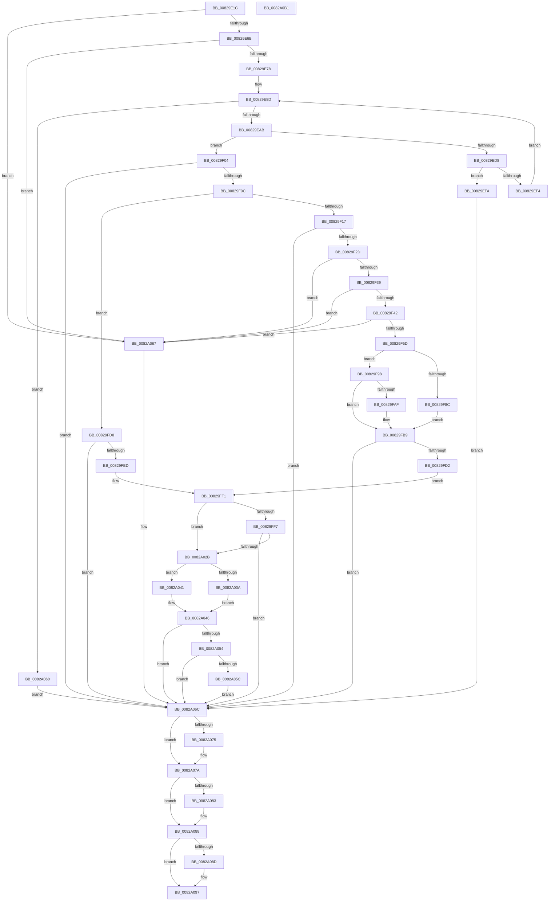

# CmDeleteDeviceInterfaceRegKeyWorker

- RVA: `0x00829E1C`–`0x0082A0B2` (길이 `662` bytes)
- VA: `0x0000000140829E1C`
- 실행 섹션: `PAGE`
- PDB 이름 있음: `예`; PDB Function 태그: `아니요`
- unwind 정보 RVA: `0x000C8FB4`
- 디코드: `187`개 명령, `662/662` bytes 표시
- 미해석 바이트: `0` (있으면 어셈블리에 `.byte`로 보존)

> 이 문서는 커널 이미지의 기계어와 PDB 기호를 분석해 생성했습니다. 4번과 5번은 함수 원형과 자료형을 바이너리 사용 방식에서 추정한 C 해석이며 원본 소스 복구 결과는 아닙니다.

## 1. Dependencies

- 직접 호출 지점: **15**; 고유 호출 대상: **11**
- 직접 호출자로 확인된 함수: **1**
- RIP 상대 이미지 참조: **3**

### Outgoing calls
- `0x00829E9A` → [ExAllocatePool2](../../poolcode/B8/ExAllocatePool2_function_00B820F0.md) (function, `0x00B820F0`)
- `0x00829ECA` → [_CmGetDeviceInterfaceRegKeyPath](../8F/_CmGetDeviceInterfaceRegKeyPath_function_008F2010.md) (function, `0x008F2010`)
- `0x00829EDD` → [ExFreePoolWithTag](../../poolcode/B8/ExFreePoolWithTag_function_00B82870.md) (function, `0x00B82870`)
- `0x00829F1E` → [RtlInitUnicodeStringEx](../../text/46/RtlInitUnicodeStringEx_function_00463960.md) (function, `0x00463960`)
- `0x00829F50` → [RtlPrefixUnicodeString](../8F/RtlPrefixUnicodeString_function_008F4F70.md) (function, `0x008F4F70`)
- `0x00829F83` → [RtlPrefixUnicodeString](../8F/RtlPrefixUnicodeString_function_008F4F70.md) (function, `0x008F4F70`)
- `0x00829FA6` → [RtlPrefixUnicodeString](../8F/RtlPrefixUnicodeString_function_008F4F70.md) (function, `0x008F4F70`)
- `0x00829FC3` → [_PnpCtxGetCachedContextBaseKey](../8E/_PnpCtxGetCachedContextBaseKey_function_008EFB2C.md) (function, `0x008EFB2C`)
- `0x00829FE2` → [PnpCtxRegOpenCurrentUserKey](../AB/PnpCtxRegOpenCurrentUserKey_function_00AB5E40.md) (function, `0x00AB5E40`)
- `0x0082A020` → [_CmOpenDeviceInterfaceRegKey](../8F/_CmOpenDeviceInterfaceRegKey_function_008F31F4.md) (function, `0x008F31F4`)
- `0x0082A03A` → [PnpCtxRegDeleteTree](../96/PnpCtxRegDeleteTree_function_00965CC8.md) (function, `0x00965CC8`)
- `0x0082A041` → [PnpCtxRegDeleteKey](../96/PnpCtxRegDeleteKey_function_00965EC8.md) (function, `0x00965EC8`)
- `0x0082A075` → [ZwClose](../../text/6A/ZwClose_function_006AD2B0.md) (function, `0x006AD2B0`)
- `0x0082A083` → [ZwClose](../../text/6A/ZwClose_function_006AD2B0.md) (function, `0x006AD2B0`)
- `0x0082A092` → [ExFreePoolWithTag](../../poolcode/B8/ExFreePoolWithTag_function_00B82870.md) (function, `0x00B82870`)

### Direct callers
- [CmDeleteDeviceInterfaceRegKey](CmDeleteDeviceInterfaceRegKey_function_00829CE4.md) at `0x00829D85`

### Static image references
- `0x00829F49` → RVA `0x00001A08` (`.rdata`; read)
- `0x00829F7C` → RVA `0x00001A58` (`.rdata`; read)
- `0x00829F9F` → RVA `0x00001B78` (`.rdata`; read)

## 2. Other-region calls and transfers

- 다른 실행 섹션으로 향하는 call: **6**
  - `0x00829E9A` → [ExAllocatePool2](../../poolcode/B8/ExAllocatePool2_function_00B820F0.md) (`PAGE` → `POOLCODE`)
  - `0x00829EDD` → [ExFreePoolWithTag](../../poolcode/B8/ExFreePoolWithTag_function_00B82870.md) (`PAGE` → `POOLCODE`)
  - `0x00829F1E` → [RtlInitUnicodeStringEx](../../text/46/RtlInitUnicodeStringEx_function_00463960.md) (`PAGE` → `.text`)
  - `0x0082A075` → [ZwClose](../../text/6A/ZwClose_function_006AD2B0.md) (`PAGE` → `.text`)
  - `0x0082A083` → [ZwClose](../../text/6A/ZwClose_function_006AD2B0.md) (`PAGE` → `.text`)
  - `0x0082A092` → [ExFreePoolWithTag](../../poolcode/B8/ExFreePoolWithTag_function_00B82870.md) (`PAGE` → `POOLCODE`)
- 별도 외부 분기/꼬리 이동을 확인하지 못했습니다.

## 3. Assembly (complete function range)

```asm
00829E1C  48 89 5C 24 08                  mov qword ptr [rsp + 8], rbx
00829E21  48 89 54 24 10                  mov qword ptr [rsp + 0x10], rdx
00829E26  55                              push rbp
00829E27  56                              push rsi
00829E28  57                              push rdi
00829E29  41 54                           push r12
00829E2B  41 55                           push r13
00829E2D  41 56                           push r14
00829E2F  41 57                           push r15
00829E31  48 8B EC                        mov rbp, rsp
00829E34  48 83 EC 70                     sub rsp, 0x70
00829E38  33 C0                           xor eax, eax
00829E3A  0F 57 C0                        xorps xmm0, xmm0
00829E3D  89 45 50                        mov dword ptr [rbp + 0x50], eax
00829E40  45 8B E9                        mov r13d, r9d
00829E43  48 89 45 D8                     mov qword ptr [rbp - 0x28], rax
00829E47  45 8B F0                        mov r14d, r8d
00829E4A  48 89 45 D0                     mov qword ptr [rbp - 0x30], rax
00829E4E  48 8B DA                        mov rbx, rdx
00829E51  48 89 45 E0                     mov qword ptr [rbp - 0x20], rax
00829E55  44 8D 78 04                     lea r15d, [rax + 4]
00829E59  4C 8B E1                        mov r12, rcx
00829E5C  8B F0                           mov esi, eax
00829E5E  0F 11 45 E8                     movups xmmword ptr [rbp - 0x18], xmm0
00829E62  45 85 C0                        test r8d, r8d
00829E65  0F 84 FC 01 00 00               je 0x14082a067
00829E6B  41 F7 C0 CC FC FF FF            test r8d, 0xfffffccc
00829E72  0F 85 EF 01 00 00               jne 0x14082a067
00829E78  41 8B C0                        mov eax, r8d
00829E7B  25 00 02 00 00                  and eax, 0x200
00829E80  F7 D8                           neg eax
00829E82  1B FF                           sbb edi, edi
00829E84  83 E7 78                        and edi, 0x78
00829E87  81 C7 E0 01 00 00               add edi, 0x1e0
00829E8D  8B D7                           mov edx, edi
00829E8F  B9 00 01 00 00                  mov ecx, 0x100
00829E94  41 B8 50 4E 50 52               mov r8d, 0x52504e50
00829E9A  E8 51 82 35 00                  call 0x140b820f0
00829E9F  48 8B F0                        mov rsi, rax
00829EA2  48 85 C0                        test rax, rax
00829EA5  0F 84 B5 01 00 00               je 0x14082a060
00829EAB  8B CF                           mov ecx, edi
00829EAD  48 8D 45 50                     lea rax, [rbp + 0x50]
00829EB1  48 89 44 24 38                  mov qword ptr [rsp + 0x38], rax
00829EB6  45 8B CD                        mov r9d, r13d
00829EB9  D1 E9                           shr ecx, 1
00829EBB  45 8B C6                        mov r8d, r14d
00829EBE  89 4C 24 30                     mov dword ptr [rsp + 0x30], ecx
00829EC2  48 8B D3                        mov rdx, rbx
00829EC5  48 89 74 24 28                  mov qword ptr [rsp + 0x28], rsi
00829ECA  E8 41 81 0C 00                  call 0x1408f2010
00829ECF  8B D8                           mov ebx, eax
00829ED1  3D 23 00 00 C0                  cmp eax, 0xc0000023
00829ED6  75 2C                           jne 0x140829f04
00829ED8  33 D2                           xor edx, edx
00829EDA  48 8B CE                        mov rcx, rsi
00829EDD  E8 8E 89 35 00                  call 0x140b82870
00829EE2  8B 7D 50                        mov edi, dword ptr [rbp + 0x50]
00829EE5  33 F6                           xor esi, esi
00829EE7  48 03 FF                        add rdi, rdi
00829EEA  B8 FF FF FF FF                  mov eax, 0xffffffff
00829EEF  48 3B F8                        cmp rdi, rax
00829EF2  77 06                           ja 0x140829efa
00829EF4  48 8B 5D 48                     mov rbx, qword ptr [rbp + 0x48]
00829EF8  EB 93                           jmp 0x140829e8d
00829EFA  BB 95 00 00 C0                  mov ebx, 0xc0000095
00829EFF  E9 68 01 00 00                  jmp 0x14082a06c
00829F04  85 C0                           test eax, eax
00829F06  0F 88 60 01 00 00               js 0x14082a06c
00829F0C  41 0F BA E6 08                  bt r14d, 8
00829F11  0F 82 C1 00 00 00               jb 0x140829fd8
00829F17  48 8B D6                        mov rdx, rsi
00829F1A  48 8D 4D E8                     lea rcx, [rbp - 0x18]
00829F1E  E8 3D 9A C3 FF                  call 0x140463960
00829F23  8B D8                           mov ebx, eax
00829F25  85 C0                           test eax, eax
00829F27  0F 88 3F 01 00 00               js 0x14082a06c
00829F2D  0F B7 5D E8                     movzx ebx, word ptr [rbp - 0x18]
00829F31  3B DF                           cmp ebx, edi
00829F33  0F 83 2E 01 00 00               jae 0x14082a067
00829F39  83 FB 32                        cmp ebx, 0x32
00829F3C  0F 86 25 01 00 00               jbe 0x14082a067
00829F42  41 B0 01                        mov r8b, 1
00829F45  48 8D 55 E8                     lea rdx, [rbp - 0x18]
00829F49  48 8D 0D B8 7A 7D FF            lea rcx, [rip - 0x828548]
00829F50  E8 1B B0 0C 00                  call 0x1408f4f70
00829F55  84 C0                           test al, al
00829F57  0F 84 0A 01 00 00               je 0x14082a067
00829F5D  B8 CE FF 00 00                  mov eax, 0xffce
00829F62  48 8D 7E 32                     lea rdi, [rsi + 0x32]
00829F66  66 01 45 EA                     add word ptr [rbp - 0x16], ax
00829F6A  48 8D 55 E8                     lea rdx, [rbp - 0x18]
00829F6E  66 03 D8                        add bx, ax
00829F71  48 89 7D F0                     mov qword ptr [rbp - 0x10], rdi
00829F75  41 B0 01                        mov r8b, 1
00829F78  66 89 5D E8                     mov word ptr [rbp - 0x18], bx
00829F7C  48 8D 0D D5 7A 7D FF            lea rcx, [rip - 0x82852b]
00829F83  E8 E8 AF 0C 00                  call 0x1408f4f70
00829F88  84 C0                           test al, al
00829F8A  74 0C                           je 0x140829f98
00829F8C  41 BF 09 00 00 00               mov r15d, 9
00829F92  48 83 C7 2C                     add rdi, 0x2c
00829F96  EB 21                           jmp 0x140829fb9
00829F98  41 B0 01                        mov r8b, 1
00829F9B  48 8D 55 E8                     lea rdx, [rbp - 0x18]
00829F9F  48 8D 0D D2 7B 7D FF            lea rcx, [rip - 0x82842e]
00829FA6  E8 C5 AF 0C 00                  call 0x1408f4f70
00829FAB  84 C0                           test al, al
00829FAD  74 0A                           je 0x140829fb9
00829FAF  41 BF 0E 00 00 00               mov r15d, 0xe
00829FB5  48 83 C7 24                     add rdi, 0x24
00829FB9  4C 8D 45 D8                     lea r8, [rbp - 0x28]
00829FBD  41 8B D7                        mov edx, r15d
00829FC0  49 8B CC                        mov rcx, r12
00829FC3  E8 64 5B 0C 00                  call 0x1408efb2c
00829FC8  8B D8                           mov ebx, eax
00829FCA  85 C0                           test eax, eax
00829FCC  0F 88 9A 00 00 00               js 0x14082a06c
00829FD2  4C 8B 7D D8                     mov r15, qword ptr [rbp - 0x28]
00829FD6  EB 19                           jmp 0x140829ff1
00829FD8  4C 8D 4D D0                     lea r9, [rbp - 0x30]
00829FDC  49 8B CC                        mov rcx, r12
00829FDF  48 8B FE                        mov rdi, rsi
00829FE2  E8 59 BE 28 00                  call 0x140ab5e40
00829FE7  8B D8                           mov ebx, eax
00829FE9  85 C0                           test eax, eax
00829FEB  78 7F                           js 0x14082a06c
00829FED  4C 8B 7D D0                     mov r15, qword ptr [rbp - 0x30]
00829FF1  41 83 FE 31                     cmp r14d, 0x31
00829FF5  74 34                           je 0x14082a02b
00829FF7  48 83 64 24 38 00               and qword ptr [rsp + 0x38], 0
00829FFD  48 8D 45 E0                     lea rax, [rbp - 0x20]
0082A001  48 8B 55 48                     mov rdx, qword ptr [rbp + 0x48]
0082A005  41 B8 30 00 00 00               mov r8d, 0x30
0082A00B  48 89 44 24 30                  mov qword ptr [rsp + 0x30], rax
0082A010  49 8B CC                        mov rcx, r12
0082A013  C6 44 24 28 00                  mov byte ptr [rsp + 0x28], 0
0082A018  C7 44 24 20 01 00 00 00         mov dword ptr [rsp + 0x20], 1
0082A020  E8 CF 91 0C 00                  call 0x1408f31f4
0082A025  8B D8                           mov ebx, eax
0082A027  85 C0                           test eax, eax
0082A029  78 41                           js 0x14082a06c
0082A02B  80 7D 60 00                     cmp byte ptr [rbp + 0x60], 0
0082A02F  4C 8B C7                        mov r8, rdi
0082A032  49 8B D7                        mov rdx, r15
0082A035  49 8B CC                        mov rcx, r12
0082A038  74 07                           je 0x14082a041
0082A03A  E8 89 BC 13 00                  call 0x140965cc8
0082A03F  EB 05                           jmp 0x14082a046
0082A041  E8 82 BE 13 00                  call 0x140965ec8
0082A046  BA 00 00 00 80                  mov edx, 0x80000000
0082A04B  8B C8                           mov ecx, eax
0082A04D  8D 04 10                        lea eax, [rax + rdx]
0082A050  85 C2                           test edx, eax
0082A052  75 18                           jne 0x14082a06c
0082A054  81 F9 7C 01 00 C0               cmp ecx, 0xc000017c
0082A05A  74 10                           je 0x14082a06c
0082A05C  8B D9                           mov ebx, ecx
0082A05E  EB 0C                           jmp 0x14082a06c
0082A060  BB 17 00 00 C0                  mov ebx, 0xc0000017
0082A065  EB 05                           jmp 0x14082a06c
0082A067  BB 0D 00 00 C0                  mov ebx, 0xc000000d
0082A06C  48 8B 4D E0                     mov rcx, qword ptr [rbp - 0x20]
0082A070  48 85 C9                        test rcx, rcx
0082A073  74 05                           je 0x14082a07a
0082A075  E8 36 32 E8 FF                  call 0x1406ad2b0
0082A07A  48 8B 4D D0                     mov rcx, qword ptr [rbp - 0x30]
0082A07E  48 85 C9                        test rcx, rcx
0082A081  74 05                           je 0x14082a088
0082A083  E8 28 32 E8 FF                  call 0x1406ad2b0
0082A088  48 85 F6                        test rsi, rsi
0082A08B  74 0A                           je 0x14082a097
0082A08D  33 D2                           xor edx, edx
0082A08F  48 8B CE                        mov rcx, rsi
0082A092  E8 D9 87 35 00                  call 0x140b82870
0082A097  8B C3                           mov eax, ebx
0082A099  48 8B 9C 24 B0 00 00 00         mov rbx, qword ptr [rsp + 0xb0]
0082A0A1  48 83 C4 70                     add rsp, 0x70
0082A0A5  41 5F                           pop r15
0082A0A7  41 5E                           pop r14
0082A0A9  41 5D                           pop r13
0082A0AB  41 5C                           pop r12
0082A0AD  5F                              pop rdi
0082A0AE  5E                              pop rsi
0082A0AF  5D                              pop rbp
0082A0B0  C3                              ret
0082A0B1  CC                              int3
```

## 4. C-style interpretation (structured pseudocode)

```c
__int64 __fastcall CmDeleteDeviceInterfaceRegKeyWorker(__int64 a1, __int64 a2, int a3, int a4, unsigned __int8 a5)
{
    __int64 result;
    __int64 v_r15;
    __int64 v_rbx;
    __int64 v_rdi;
    __int64 v_rsi;
    __int64 v_rsp;
    unsigned __int64 v_stack_m48;
    unsigned __int16 v_stack_m4E;
    unsigned __int64 v_stack_m50;
    unsigned __int64 v_stack_m58;
    unsigned __int64 v_stack_m60;
    unsigned __int64 v_stack_m68;
    unsigned __int64 v_stack_m70;
    unsigned int v_stack_m78;
    unsigned __int64 v_stack_m80;
    unsigned int v_stack_m88;
    unsigned __int64 v_stack_p10;
    unsigned int v_stack_p18;
    unsigned __int64 v_stack_p8;

    v_stack_p8 = v_rbx;
    v_stack_p10 = a2;
    v_rsp = (v_rsp) - (112);
    result = 0;
    v_stack_p18 = 0;
    v_stack_m60 = 0;
    v_stack_m68 = 0;
    v_stack_m58 = 0;
    v_stack_m50 = v_xmm0;
    if (a3 == 0) goto loc_0082A067;
    if (((a3) & (0xFFFFFCCCULL)) != 0) goto loc_0082A067;
    result = (unsigned int)(((unsigned int)(a3)) & (512));
    result = (unsigned int)(-(result));
    v_rdi = (unsigned int)((v_rdi) & (120));
    v_rdi = (unsigned int)((v_rdi) + (480));
loc_00829E8D:
    result = ExAllocatePool2(256, (unsigned int)((unsigned int)(v_rdi)), (unsigned int)(0x52504E50ULL), a4);
    if (result == 0) goto loc_0082A060;
    v_stack_m70 = v_stack_p18;
    a1 = (unsigned int)(((unsigned int)((unsigned int)(v_rdi))) >> (1));
    v_stack_m78 = (unsigned int)(a1);
    v_stack_m80 = result;
    result = _CmGetDeviceInterfaceRegKeyPath(a1, a2, (unsigned int)((unsigned int)((unsigned int)(a3))), (unsigned int)((unsigned int)((unsigned int)(a4))));
    if (((unsigned int)(result)) != 0xC0000023ULL) goto loc_00829F04;
    a2 = 0;
    result = ExFreePoolWithTag(result, a2, (unsigned int)((unsigned int)((unsigned int)(a3))), (unsigned int)((unsigned int)((unsigned int)(a4))));
    v_rsi = 0;
    v_rdi = ((unsigned int)(v_stack_p18)) + ((unsigned int)(v_stack_p18));
    if (v_rdi > ((unsigned int)(0xFFFFFFFFULL))) goto loc_00829EFA;
    goto loc_00829E8D;
loc_00829EFA:
    goto loc_0082A06C;
loc_00829F04:
    if (sign_flag) goto loc_0082A06C;
    if (condition_is_below) goto loc_00829FD8;
    result = RtlInitUnicodeStringEx(v_stack_m50, 0, (unsigned int)((unsigned int)((unsigned int)(a3))), (unsigned int)((unsigned int)((unsigned int)(a4))));
    if (sign_flag) goto loc_0082A06C;
    if (((unsigned int)(v_stack_m50)) >= ((unsigned int)(v_rdi))) goto loc_0082A067;
    if (((unsigned int)(v_stack_m50)) <= 50) goto loc_0082A067;
    result = RtlPrefixUnicodeString(v_rip - 8553800, v_stack_m50, 1, (unsigned int)((unsigned int)((unsigned int)(a4))));
    if ((unsigned __int8)(result) == 0) goto loc_0082A067;
    v_rbx = (unsigned __int16)((v_stack_m50) + ((unsigned __int16)((unsigned int)(0xFFCEULL))));
    v_stack_m48 = v_rsi + 50;
    v_stack_m50 = (unsigned __int16)(v_rbx);
    result = RtlPrefixUnicodeString(v_rip - 8553771, v_stack_m50, 1, (unsigned int)((unsigned int)((unsigned int)(a4))));
    if ((unsigned __int8)(result) == 0) goto loc_00829F98;
    v_rdi = (v_rsi + 50) + (44);
    goto loc_00829FB9;
loc_00829F98:
    result = RtlPrefixUnicodeString(v_rip - 8553518, v_stack_m50, 1, (unsigned int)((unsigned int)((unsigned int)(a4))));
    v_r15 = 9;
    if ((unsigned __int8)(result) != 0) {
        v_r15 = 14;
        v_rdi = (v_rdi) + (36);
    }
    result = _PnpCtxGetCachedContextBaseKey(a1, (unsigned int)((unsigned int)(v_r15)), v_stack_m60, (unsigned int)((unsigned int)((unsigned int)(a4))));
    if (sign_flag) goto loc_0082A06C;
    goto loc_00829FF1;
loc_00829FD8:
    result = PnpCtxRegOpenCurrentUserKey(a1, (unsigned int)((unsigned int)(v_r15)), v_stack_m60, v_stack_m68);
    if (sign_flag) goto loc_0082A06C;
loc_00829FF1:
    if (((unsigned int)((unsigned int)(a3))) == 49) goto loc_0082A02B;
    v_stack_m78 = v_stack_m58;
    v_stack_m80 = 0;
    v_stack_m88 = 1;
    result = _CmOpenDeviceInterfaceRegKey(a1, v_stack_p10, 48, v_stack_m68);
    if (sign_flag) goto loc_0082A06C;
loc_0082A02B:
    if (a5 == 0) goto loc_0082A041;
    result = PnpCtxRegDeleteTree(a1, v_stack_m68, 0, v_stack_m68);
    goto loc_0082A046;
loc_0082A041:
    result = PnpCtxRegDeleteKey(a1, v_stack_m68, 0, v_stack_m68);
loc_0082A046:
    if ((((unsigned int)((unsigned int)(0x80000000ULL))) & ((unsigned int)(result + (unsigned int)(0x80000000ULL) * 1))) != 0) goto loc_0082A06C;
    if (((unsigned int)((unsigned int)((unsigned int)(result)))) == 0xC000017CULL) goto loc_0082A06C;
    goto loc_0082A06C;
loc_0082A060:
    goto loc_0082A06C;
loc_0082A067:
loc_0082A06C:
    result = result + (unsigned int)(0x80000000ULL) * 1;
    if (v_stack_m58 != 0) {
        result = ZwClose(v_stack_m58, (unsigned int)(0x80000000ULL), 0, v_stack_m68);
    }
    if (v_stack_m68 != 0) {
        result = ZwClose(v_stack_m68, (unsigned int)(0x80000000ULL), 0, v_stack_m68);
    }
    if (0 != 0) {
        a2 = 0;
        a1 = 0;
        result = ExFreePoolWithTag(a1, a2, 0, v_stack_m68);
    }
    v_rsp = (v_rsp) + (112);
    return (unsigned int)((unsigned int)((unsigned int)(0xC000000DULL)));
}
```

## 5. (Beta) C Style

```c
int64_t CmDeleteDeviceInterfaceRegKeyWorker(int64_t Arg1, int64_t Arg2, int32_t Arg3, int32_t Arg4, uint8_t Arg5)
{
    int64_t result;
    int64_t local_r15;
    int64_t local_rbx;
    int64_t local_rdi;
    int64_t local_rsi;
    int64_t local_rsp;
    uint64_t v_stack_m48;
    uint16_t v_stack_m4E;
    uint64_t v_stack_m50;
    uint64_t v_stack_m58;
    uint64_t v_stack_m60;
    uint64_t v_stack_m68;
    uint64_t v_stack_m70;
    uint32_t v_stack_m78;
    uint64_t v_stack_m80;
    uint32_t v_stack_m88;
    uint64_t v_stack_p10;
    uint32_t v_stack_p18;
    uint64_t v_stack_p8;

    v_stack_p8 = local_rbx;
    v_stack_p10 = Arg2;
    local_rsp = (local_rsp) - (112);
    result = 0;
    v_stack_p18 = 0;
    v_stack_m60 = 0;
    v_stack_m68 = 0;
    v_stack_m58 = 0;
    v_stack_m50 = v_xmm0;
    if (Arg3 == 0) goto loc_0082A067;
    if (((Arg3) & (0xFFFFFCCCULL)) != 0) goto loc_0082A067;
    result = (uint32_t)(((uint32_t)(Arg3)) & (512));
    result = (uint32_t)(-(result));
    local_rdi = (uint32_t)((local_rdi) & (120));
    local_rdi = (uint32_t)((local_rdi) + (480));
loc_00829E8D:
    result = ExAllocatePool2(256, (uint32_t)((uint32_t)(local_rdi)), (uint32_t)(0x52504E50ULL), Arg4);
    if (result == 0) goto loc_0082A060;
    v_stack_m70 = v_stack_p18;
    Arg1 = (uint32_t)(((uint32_t)((uint32_t)(local_rdi))) >> (1));
    v_stack_m78 = (uint32_t)(Arg1);
    v_stack_m80 = result;
    result = _CmGetDeviceInterfaceRegKeyPath(Arg1, Arg2, (uint32_t)((uint32_t)((uint32_t)(Arg3))), (uint32_t)((uint32_t)((uint32_t)(Arg4))));
    if (((uint32_t)(result)) != 0xC0000023ULL) goto loc_00829F04;
    Arg2 = 0;
    result = ExFreePoolWithTag(result, Arg2, (uint32_t)((uint32_t)((uint32_t)(Arg3))), (uint32_t)((uint32_t)((uint32_t)(Arg4))));
    local_rsi = 0;
    local_rdi = ((uint32_t)(v_stack_p18)) + ((uint32_t)(v_stack_p18));
    if (local_rdi > ((uint32_t)(0xFFFFFFFFULL))) goto loc_00829EFA;
    goto loc_00829E8D;
loc_00829EFA:
    goto loc_0082A06C;
loc_00829F04:
    if (sign_flag) goto loc_0082A06C;
    if (condition_is_below) goto loc_00829FD8;
    result = RtlInitUnicodeStringEx(v_stack_m50, 0, (uint32_t)((uint32_t)((uint32_t)(Arg3))), (uint32_t)((uint32_t)((uint32_t)(Arg4))));
    if (sign_flag) goto loc_0082A06C;
    if (((uint32_t)(v_stack_m50)) >= ((uint32_t)(local_rdi))) goto loc_0082A067;
    if (((uint32_t)(v_stack_m50)) <= 50) goto loc_0082A067;
    result = RtlPrefixUnicodeString(v_rip - 8553800, v_stack_m50, 1, (uint32_t)((uint32_t)((uint32_t)(Arg4))));
    if ((uint8_t)(result) == 0) goto loc_0082A067;
    local_rbx = (uint16_t)((v_stack_m50) + ((uint16_t)((uint32_t)(0xFFCEULL))));
    v_stack_m48 = local_rsi + 50;
    v_stack_m50 = (uint16_t)(local_rbx);
    result = RtlPrefixUnicodeString(v_rip - 8553771, v_stack_m50, 1, (uint32_t)((uint32_t)((uint32_t)(Arg4))));
    if ((uint8_t)(result) == 0) goto loc_00829F98;
    local_rdi = (local_rsi + 50) + (44);
    goto loc_00829FB9;
loc_00829F98:
    result = RtlPrefixUnicodeString(v_rip - 8553518, v_stack_m50, 1, (uint32_t)((uint32_t)((uint32_t)(Arg4))));
    local_r15 = 9;
    if ((uint8_t)(result) != 0) {
        local_r15 = 14;
        local_rdi = (local_rdi) + (36);
    }
    result = _PnpCtxGetCachedContextBaseKey(Arg1, (uint32_t)((uint32_t)(local_r15)), v_stack_m60, (uint32_t)((uint32_t)((uint32_t)(Arg4))));
    if (sign_flag) goto loc_0082A06C;
    goto loc_00829FF1;
loc_00829FD8:
    result = PnpCtxRegOpenCurrentUserKey(Arg1, (uint32_t)((uint32_t)(local_r15)), v_stack_m60, v_stack_m68);
    if (sign_flag) goto loc_0082A06C;
loc_00829FF1:
    if (((uint32_t)((uint32_t)(Arg3))) == 49) goto loc_0082A02B;
    v_stack_m78 = v_stack_m58;
    v_stack_m80 = 0;
    v_stack_m88 = 1;
    result = _CmOpenDeviceInterfaceRegKey(Arg1, v_stack_p10, 48, v_stack_m68);
    if (sign_flag) goto loc_0082A06C;
loc_0082A02B:
    if (Arg5 == 0) goto loc_0082A041;
    result = PnpCtxRegDeleteTree(Arg1, v_stack_m68, 0, v_stack_m68);
    goto loc_0082A046;
loc_0082A041:
    result = PnpCtxRegDeleteKey(Arg1, v_stack_m68, 0, v_stack_m68);
loc_0082A046:
    if ((((uint32_t)((uint32_t)(0x80000000ULL))) & ((uint32_t)(result + (uint32_t)(0x80000000ULL) * 1))) != 0) goto loc_0082A06C;
    if (((uint32_t)((uint32_t)((uint32_t)(result)))) == 0xC000017CULL) goto loc_0082A06C;
    goto loc_0082A06C;
loc_0082A060:
    goto loc_0082A06C;
loc_0082A067:
loc_0082A06C:
    result = result + (uint32_t)(0x80000000ULL) * 1;
    if (v_stack_m58 != 0) {
        result = ZwClose(v_stack_m58, (uint32_t)(0x80000000ULL), 0, v_stack_m68);
    }
    if (v_stack_m68 != 0) {
        result = ZwClose(v_stack_m68, (uint32_t)(0x80000000ULL), 0, v_stack_m68);
    }
    if (0 != 0) {
        Arg2 = 0;
        Arg1 = 0;
        result = ExFreePoolWithTag(Arg1, Arg2, 0, v_stack_m68);
    }
    local_rsp = (local_rsp) + (112);
    return (uint32_t)((uint32_t)((uint32_t)(0xC000000DULL)));
}
```

## 6. Execution-region graph

[열기: 2D/3D 그래프와 함수 탐색 컨트롤 패널](../../../control-panel.html?section=page&rva=0x00829E1C&view=graph)

- 2D 그래프는 위에서 아래로 흐르고, 3D 그래프는 빈 공간을 드래그해 회전합니다. Shift+드래그는 이동, 휠은 확대·축소, 함수 노드 선택은 대상 보고서 이동입니다.

### Static fallback


