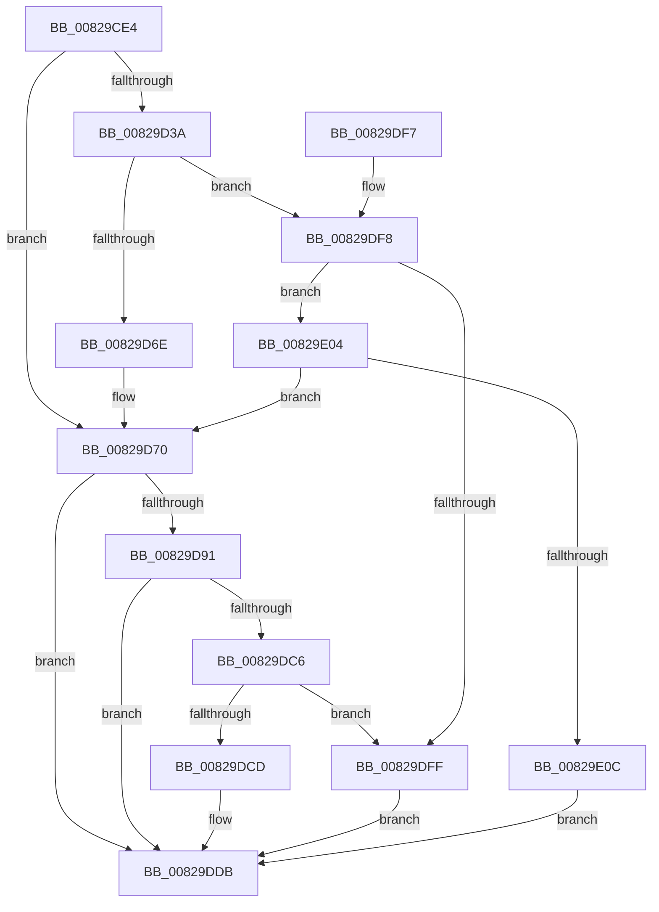

# CmDeleteDeviceInterfaceRegKey

- RVA: `0x00829CE4`–`0x00829E13` (길이 `303` bytes)
- VA: `0x0000000140829CE4`
- 실행 섹션: `PAGE`
- PDB 이름 있음: `예`; PDB Function 태그: `아니요`
- unwind 정보 RVA: `0x000DA888`
- 디코드: `87`개 명령, `303/303` bytes 표시
- 미해석 바이트: `0` (있으면 어셈블리에 `.byte`로 보존)

> 이 문서는 커널 이미지의 기계어와 PDB 기호를 분석해 생성했습니다. 4번과 5번은 함수 원형과 자료형을 바이너리 사용 방식에서 추정한 C 해석이며 원본 소스 복구 결과는 아닙니다.

## 1. Dependencies

- 직접 호출 지점: **5**; 고유 호출 대상: **4**
- 직접 호출자로 확인된 함수: **2**
- RIP 상대 이미지 참조: **1**

### Outgoing calls
- `0x00829D18` → [memset](../../text/6C/memset_function_006C6C40.md) (function, `0x006C6C40`)
- `0x00829D5E` → [guard_dispatch_icall](../../text/6B/guard_dispatch_icall_function_006BAAD0.md) (function, `0x006BAAD0`)
- `0x00829D85` → [CmDeleteDeviceInterfaceRegKeyWorker](CmDeleteDeviceInterfaceRegKeyWorker_function_00829E1C.md) (function, `0x00829E1C`)
- `0x00829DB8` → [guard_dispatch_icall](../../text/6B/guard_dispatch_icall_function_006BAAD0.md) (function, `0x006BAAD0`)
- `0x00829DE4` → [_security_check_cookie](../../text/6A/_security_check_cookie_function_006AC640.md) (function, `0x006AC640`)

### Direct callers
- [PiCMDeleteDeviceInterfaceKey](../70/PiCMDeleteDeviceInterfaceKey_function_007014E4.md) at `0x00701587`
- [CmDeleteDeviceInterfaceWorker](CmDeleteDeviceInterfaceWorker_function_0082A0B8.md) at `0x0082A133`
- [CmDeleteDeviceInterfaceWorker](CmDeleteDeviceInterfaceWorker_function_0082A0B8.md) at `0x0082A15E`
- [CmDeleteDeviceInterfaceWorker](CmDeleteDeviceInterfaceWorker_function_0082A0B8.md) at `0x0082A29F`
- [CmDeleteDeviceInterfaceWorker](CmDeleteDeviceInterfaceWorker_function_0082A0B8.md) at `0x0082A2C8`

### Static image references
- `0x00829CF7` → RVA `0x00E0A740` (`.data`; read)

## 2. Other-region calls and transfers

- 다른 실행 섹션으로 향하는 call: **4**
  - `0x00829D18` → [memset](../../text/6C/memset_function_006C6C40.md) (`PAGE` → `.text`)
  - `0x00829D5E` → [guard_dispatch_icall](../../text/6B/guard_dispatch_icall_function_006BAAD0.md) (`PAGE` → `.text`)
  - `0x00829DB8` → [guard_dispatch_icall](../../text/6B/guard_dispatch_icall_function_006BAAD0.md) (`PAGE` → `.text`)
  - `0x00829DE4` → [_security_check_cookie](../../text/6A/_security_check_cookie_function_006AC640.md) (`PAGE` → `.text`)
- 별도 외부 분기/꼬리 이동을 확인하지 못했습니다.

## 3. Assembly (complete function range)

```asm
00829CE4  40 55                           push rbp
00829CE6  53                              push rbx
00829CE7  56                              push rsi
00829CE8  57                              push rdi
00829CE9  41 56                           push r14
00829CEB  48 8D 6C 24 D1                  lea rbp, [rsp - 0x2f]
00829CF0  48 81 EC B0 00 00 00            sub rsp, 0xb0
00829CF7  48 8B 05 42 0A 5E 00            mov rax, qword ptr [rip + 0x5e0a42]
00829CFE  48 33 C4                        xor rax, rsp
00829D01  48 89 45 1F                     mov qword ptr [rbp + 0x1f], rax
00829D05  4C 8B F2                        mov r14, rdx
00829D08  41 8B D8                        mov ebx, r8d
00829D0B  33 D2                           xor edx, edx
00829D0D  48 8B F1                        mov rsi, rcx
00829D10  48 8D 4D BF                     lea rcx, [rbp - 0x41]
00829D14  44 8D 42 58                     lea r8d, [rdx + 0x58]
00829D18  E8 23 CF E9 FF                  call 0x1406c6c40
00829D1D  48 8B BE F8 01 00 00            mov rdi, qword ptr [rsi + 0x1f8]
00829D24  83 65 D3 00                     and dword ptr [rbp - 0x2d], 0
00829D28  83 65 DB 00                     and dword ptr [rbp - 0x25], 0
00829D2C  8A 45 7F                        mov al, byte ptr [rbp + 0x7f]
00829D2F  88 45 D7                        mov byte ptr [rbp - 0x29], al
00829D32  89 5D CF                        mov dword ptr [rbp - 0x31], ebx
00829D35  48 85 FF                        test rdi, rdi
00829D38  74 36                           je 0x140829d70
00829D3A  41 B9 0C 00 00 00               mov r9d, 0xc
00829D40  48 8D 45 BF                     lea rax, [rbp - 0x41]
00829D44  48 89 44 24 28                  mov qword ptr [rsp + 0x28], rax
00829D49  49 8B D6                        mov rdx, r14
00829D4C  48 8B CE                        mov rcx, rsi
00829D4F  C7 44 24 20 01 00 00 00         mov dword ptr [rsp + 0x20], 1
00829D57  48 8B C7                        mov rax, rdi
00829D5A  45 8D 41 F7                     lea r8d, [r9 - 9]
00829D5E  E8 6D 0D E9 FF                  call 0x1406baad0
00829D63  3D 02 00 00 C0                  cmp eax, 0xc0000002
00829D68  0F 85 8A 00 00 00               jne 0x140829df8
00829D6E  33 FF                           xor edi, edi
00829D70  8A 45 D7                        mov al, byte ptr [rbp - 0x29]
00829D73  49 8B D6                        mov rdx, r14
00829D76  44 8B 4D D3                     mov r9d, dword ptr [rbp - 0x2d]
00829D7A  48 8B CE                        mov rcx, rsi
00829D7D  44 8B 45 CF                     mov r8d, dword ptr [rbp - 0x31]
00829D81  88 44 24 20                     mov byte ptr [rsp + 0x20], al
00829D85  E8 92 00 00 00                  call 0x140829e1c
00829D8A  8B D8                           mov ebx, eax
00829D8C  48 85 FF                        test rdi, rdi
00829D8F  74 4A                           je 0x140829ddb
00829D91  89 45 BF                        mov dword ptr [rbp - 0x41], eax
00829D94  41 B9 0C 00 00 00               mov r9d, 0xc
00829D9A  48 8D 45 BF                     lea rax, [rbp - 0x41]
00829D9E  49 8B D6                        mov rdx, r14
00829DA1  48 89 44 24 28                  mov qword ptr [rsp + 0x28], rax
00829DA6  48 8B CE                        mov rcx, rsi
00829DA9  48 8B C7                        mov rax, rdi
00829DAC  C7 44 24 20 02 00 00 00         mov dword ptr [rsp + 0x20], 2
00829DB4  45 8D 41 F7                     lea r8d, [r9 - 9]
00829DB8  E8 13 0D E9 FF                  call 0x1406baad0
00829DBD  8B C8                           mov ecx, eax
00829DBF  3D 02 00 00 C0                  cmp eax, 0xc0000002
00829DC4  74 15                           je 0x140829ddb
00829DC6  3D 20 01 00 C0                  cmp eax, 0xc0000120
00829DCB  74 32                           je 0x140829dff
00829DCD  8B C3                           mov eax, ebx
00829DCF  85 C9                           test ecx, ecx
00829DD1  BB E5 00 00 C0                  mov ebx, 0xc00000e5
00829DD6  0F 45 C3                        cmovne eax, ebx
00829DD9  8B D8                           mov ebx, eax
00829DDB  8B C3                           mov eax, ebx
00829DDD  48 8B 4D 1F                     mov rcx, qword ptr [rbp + 0x1f]
00829DE1  48 33 CC                        xor rcx, rsp
00829DE4  E8 57 28 E8 FF                  call 0x1406ac640
00829DE9  48 81 C4 B0 00 00 00            add rsp, 0xb0
00829DF0  41 5E                           pop r14
00829DF2  5F                              pop rdi
00829DF3  5E                              pop rsi
00829DF4  5B                              pop rbx
00829DF5  5D                              pop rbp
00829DF6  C3                              ret
00829DF7  CC                              int3
00829DF8  3D 20 01 00 C0                  cmp eax, 0xc0000120
00829DFD  75 05                           jne 0x140829e04
00829DFF  8B 5D BF                        mov ebx, dword ptr [rbp - 0x41]
00829E02  EB D7                           jmp 0x140829ddb
00829E04  85 C0                           test eax, eax
00829E06  0F 84 64 FF FF FF               je 0x140829d70
00829E0C  BB E5 00 00 C0                  mov ebx, 0xc00000e5
00829E11  EB C8                           jmp 0x140829ddb
```

## 4. C-style interpretation (structured pseudocode)

```c
__int64 __fastcall CmDeleteDeviceInterfaceRegKey(__int64 a1, __int64 a2, int a3, __int64 a4, unsigned __int8 a5)
{
    __int64 result;
    __int64 v_rdi;
    __int64 v_rsp;
    unsigned __int64 v_stack_m38;
    unsigned __int64 v_stack_m57;
    unsigned int v_stack_m7C;
    unsigned __int8 v_stack_m80;
    unsigned int v_stack_m84;
    unsigned int v_stack_m88;
    unsigned __int64 v_stack_m98;
    unsigned __int64 v_stack_mB0;
    unsigned int v_stack_mB8;

    v_rsp = (v_rsp) - (176);
    result = (*(unsigned __int64 *)(v_rip + 6163010)) ^ (v_rsp);
    v_stack_m38 = result;
    a2 = 0;
    result = memset(v_stack_m98, a2, a2 + 88, a4);
    v_stack_m80 = a5;
    v_stack_m88 = (unsigned int)((unsigned int)(a3));
    if (*(unsigned __int64 *)(a1 + 504) == 0) goto loc_00829D70;
    v_stack_mB0 = v_stack_m98;
    v_stack_mB8 = 1;
    result = guard_dispatch_icall(a1, 0, 12 - 9, 12);
    if (((unsigned int)(result)) != 0xC0000002ULL) goto loc_00829DF8;
    v_rdi = 0;
loc_00829D70:
    v_stack_mB8 = (unsigned __int8)(v_stack_m80);
    result = CmDeleteDeviceInterfaceRegKeyWorker(a1, 0, (unsigned int)(v_stack_m88), (unsigned int)(v_stack_m84));
    if (0 == 0) goto loc_00829DDB;
    v_stack_m98 = (unsigned int)(result);
    v_stack_mB0 = v_stack_m98;
    v_stack_mB8 = 2;
    result = guard_dispatch_icall(a1, 0, 12 - 9, 12);
    if (((unsigned int)(result)) == 0xC0000002ULL) goto loc_00829DDB;
    if (((unsigned int)(result)) == 0xC0000120ULL) goto loc_00829DFF;
    result = (unsigned int)((unsigned int)((unsigned int)((unsigned int)(result))));
    if ((unsigned int)((unsigned int)((unsigned int)(result))) != 0) { result = (unsigned int)((unsigned int)(0xC00000E5ULL)); }
loc_00829DDB:
    a1 = (v_stack_m38) ^ (v_rsp);
    result = _security_check_cookie(a1, 0, 12 - 9, 12);
    v_rsp = (v_rsp) + (176);
    return result;
loc_00829DF8:
    if (((unsigned int)(result)) != 0xC0000120ULL) goto loc_00829E04;
loc_00829DFF:
    goto loc_00829DDB;
loc_00829E04:
    if ((unsigned int)(result) == 0) goto loc_00829D70;
    goto loc_00829DDB;
}
```

## 5. (Beta) C Style

```c
int64_t CmDeleteDeviceInterfaceRegKey(void *Arg1, int64_t Arg2, int32_t Arg3, int64_t Arg4, uint8_t Arg5)
{
    uint8_t *arg1 = (uint8_t *)Arg1;

    int64_t result;
    int64_t local_rdi;
    int64_t local_rsp;
    uint64_t v_stack_m38;
    uint64_t v_stack_m57;
    uint32_t v_stack_m7C;
    uint8_t v_stack_m80;
    uint32_t v_stack_m84;
    uint32_t v_stack_m88;
    uint64_t v_stack_m98;
    uint64_t v_stack_mB0;
    uint32_t v_stack_mB8;

    local_rsp = (local_rsp) - (176);
    result = (*(uint64_t *)(v_rip + 0x5E0A42)) ^ (local_rsp);
    v_stack_m38 = result;
    Arg2 = 0;
    result = memset(v_stack_m98, Arg2, Arg2 + 88, Arg4);
    v_stack_m80 = Arg5;
    v_stack_m88 = (uint32_t)((uint32_t)(Arg3));
    if (*(uint64_t *)(arg1 + 0x1F8) == 0) goto loc_00829D70;
    v_stack_mB0 = v_stack_m98;
    v_stack_mB8 = 1;
    result = guard_dispatch_icall(Arg1, 0, 12 - 9, 12);
    if (((uint32_t)(result)) != 0xC0000002ULL) goto loc_00829DF8;
    local_rdi = 0;
loc_00829D70:
    v_stack_mB8 = (uint8_t)(v_stack_m80);
    result = CmDeleteDeviceInterfaceRegKeyWorker(Arg1, 0, (uint32_t)(v_stack_m88), (uint32_t)(v_stack_m84));
    if (0 == 0) goto loc_00829DDB;
    v_stack_m98 = (uint32_t)(result);
    v_stack_mB0 = v_stack_m98;
    v_stack_mB8 = 2;
    result = guard_dispatch_icall(Arg1, 0, 12 - 9, 12);
    if (((uint32_t)(result)) == 0xC0000002ULL) goto loc_00829DDB;
    if (((uint32_t)(result)) == 0xC0000120ULL) goto loc_00829DFF;
    result = (uint32_t)((uint32_t)((uint32_t)((uint32_t)(result))));
    if ((uint32_t)((uint32_t)((uint32_t)(result))) != 0) { result = (uint32_t)((uint32_t)(0xC00000E5ULL)); }
loc_00829DDB:
    Arg1 = (v_stack_m38) ^ (local_rsp);
    result = _security_check_cookie(Arg1, 0, 12 - 9, 12);
    local_rsp = (local_rsp) + (176);
    return result;
loc_00829DF8:
    if (((uint32_t)(result)) != 0xC0000120ULL) goto loc_00829E04;
loc_00829DFF:
    goto loc_00829DDB;
loc_00829E04:
    if ((uint32_t)(result) == 0) goto loc_00829D70;
    goto loc_00829DDB;
}
```

### 관측된 메모리 오프셋

구조체 형식이 확인되지 않은 접근은 인자 기준의 오프셋으로만 기록했습니다.

| 기준 인자 | 오프셋 표현 | 폭 (bit) | 접근 |
|---|---:|---:|---|
| `Arg1` | `+ 0x1F8` | `64` | `R` |

## 6. Execution-region graph

[열기: 2D/3D 그래프와 함수 탐색 컨트롤 패널](../../../control-panel.html?section=page&rva=0x00829CE4&view=graph)

- 2D 그래프는 위에서 아래로 흐르고, 3D 그래프는 빈 공간을 드래그해 회전합니다. Shift+드래그는 이동, 휠은 확대·축소, 함수 노드 선택은 대상 보고서 이동입니다.

### Static fallback


