# CmDeleteDeviceInterfaceWorker

- RVA: `0x0082A0B8`–`0x0082A330` (길이 `632` bytes)
- VA: `0x000000014082A0B8`
- 실행 섹션: `PAGE`
- PDB 이름 있음: `예`; PDB Function 태그: `아니요`
- unwind 정보 RVA: `0x000DA820`
- 디코드: `184`개 명령, `632/632` bytes 표시
- 미해석 바이트: `0` (있으면 어셈블리에 `.byte`로 보존)

> 이 문서는 커널 이미지의 기계어와 PDB 기호를 분석해 생성했습니다. 4번과 5번은 함수 원형과 자료형을 바이너리 사용 방식에서 추정한 C 해석이며 원본 소스 복구 결과는 아닙니다.

## 1. Dependencies

- 직접 호출 지점: **11**; 고유 호출 대상: **7**
- 직접 호출자로 확인된 함수: **1**
- RIP 상대 이미지 참조: **1**

### Outgoing calls
- `0x0082A133` → [CmDeleteDeviceInterfaceRegKey](CmDeleteDeviceInterfaceRegKey_function_00829CE4.md) (function, `0x00829CE4`)
- `0x0082A15E` → [CmDeleteDeviceInterfaceRegKey](CmDeleteDeviceInterfaceRegKey_function_00829CE4.md) (function, `0x00829CE4`)
- `0x0082A1BC` → [CmGetDeviceInterfaceMappedPropertyKeys](../8F/CmGetDeviceInterfaceMappedPropertyKeys_function_008F50AC.md) (function, `0x008F50AC`)
- `0x0082A1E9` → [ExFreePoolWithTag](../../poolcode/B8/ExFreePoolWithTag_function_00B82870.md) (function, `0x00B82870`)
- `0x0082A1FB` → [ExAllocatePool2](../../poolcode/B8/ExAllocatePool2_function_00B820F0.md) (function, `0x00B820F0`)
- `0x0082A261` → [CmSetDeviceInterfaceMappedProperty](../A7/CmSetDeviceInterfaceMappedProperty_function_00A7287C.md) (function, `0x00A7287C`)
- `0x0082A29F` → [CmDeleteDeviceInterfaceRegKey](CmDeleteDeviceInterfaceRegKey_function_00829CE4.md) (function, `0x00829CE4`)
- `0x0082A2C8` → [CmDeleteDeviceInterfaceRegKey](CmDeleteDeviceInterfaceRegKey_function_00829CE4.md) (function, `0x00829CE4`)
- `0x0082A2F3` → [CmRaiseDeleteEvent](CmRaiseDeleteEvent_function_0082DBE0.md) (function, `0x0082DBE0`)
- `0x0082A302` → [ExFreePoolWithTag](../../poolcode/B8/ExFreePoolWithTag_function_00B82870.md) (function, `0x00B82870`)
- `0x0082A311` → [_security_check_cookie](../../text/6A/_security_check_cookie_function_006AC640.md) (function, `0x006AC640`)

### Direct callers
- [CmDeleteDeviceInterface](../A0/CmDeleteDeviceInterface_function_00A09E98.md) at `0x00A09F23`

### Static image references
- `0x0082A0CE` → RVA `0x00E0A740` (`.data`; read)

## 2. Other-region calls and transfers

- 다른 실행 섹션으로 향하는 call: **4**
  - `0x0082A1E9` → [ExFreePoolWithTag](../../poolcode/B8/ExFreePoolWithTag_function_00B82870.md) (`PAGE` → `POOLCODE`)
  - `0x0082A1FB` → [ExAllocatePool2](../../poolcode/B8/ExAllocatePool2_function_00B820F0.md) (`PAGE` → `POOLCODE`)
  - `0x0082A302` → [ExFreePoolWithTag](../../poolcode/B8/ExFreePoolWithTag_function_00B82870.md) (`PAGE` → `POOLCODE`)
  - `0x0082A311` → [_security_check_cookie](../../text/6A/_security_check_cookie_function_006AC640.md) (`PAGE` → `.text`)
- 별도 외부 분기/꼬리 이동을 확인하지 못했습니다.

## 3. Assembly (complete function range)

```asm
0082A0B8  48 89 5C 24 18                  mov qword ptr [rsp + 0x18], rbx
0082A0BD  48 89 6C 24 20                  mov qword ptr [rsp + 0x20], rbp
0082A0C2  56                              push rsi
0082A0C3  57                              push rdi
0082A0C4  41 54                           push r12
0082A0C6  41 56                           push r14
0082A0C8  41 57                           push r15
0082A0CA  48 83 EC 70                     sub rsp, 0x70
0082A0CE  48 8B 05 6B 06 5E 00            mov rax, qword ptr [rip + 0x5e066b]
0082A0D5  48 33 C4                        xor rax, rsp
0082A0D8  48 89 44 24 60                  mov qword ptr [rsp + 0x60], rax
0082A0DD  33 DB                           xor ebx, ebx
0082A0DF  4C 8B E2                        mov r12, rdx
0082A0E2  4C 8B F9                        mov r15, rcx
0082A0E5  66 45 85 C0                     test r8w, r8w
0082A0E9  74 0A                           je 0x14082a0f5
0082A0EB  BB 0D 00 00 C0                  mov ebx, 0xc000000d
0082A0F0  E9 12 02 00 00                  jmp 0x14082a307
0082A0F5  C7 44 24 50 00 03 00 00         mov dword ptr [rsp + 0x50], 0x300
0082A0FD  4C 8D 74 24 50                  lea r14, [rsp + 0x50]
0082A102  C7 44 24 54 00 02 00 00         mov dword ptr [rsp + 0x54], 0x200
0082A10A  33 FF                           xor edi, edi
0082A10C  C7 44 24 58 00 01 00 00         mov dword ptr [rsp + 0x58], 0x100
0082A114  BE 0D 00 00 C0                  mov esi, 0xc000000d
0082A119  83 FF 03                        cmp edi, 3
0082A11C  73 74                           jae 0x14082a192
0082A11E  41 8B 2E                        mov ebp, dword ptr [r14]
0082A121  49 8B D4                        mov rdx, r12
0082A124  44 8B C5                        mov r8d, ebp
0082A127  C6 44 24 20 01                  mov byte ptr [rsp + 0x20], 1
0082A12C  41 83 C8 30                     or r8d, 0x30
0082A130  49 8B CF                        mov rcx, r15
0082A133  E8 AC FB FF FF                  call 0x140829ce4
0082A138  85 C0                           test eax, eax
0082A13A  74 12                           je 0x14082a14e
0082A13C  3D 34 00 00 C0                  cmp eax, 0xc0000034
0082A141  74 0B                           je 0x14082a14e
0082A143  3B C6                           cmp eax, esi
0082A145  74 07                           je 0x14082a14e
0082A147  3D BB 00 00 C0                  cmp eax, 0xc00000bb
0082A14C  75 3A                           jne 0x14082a188
0082A14E  83 CD 31                        or ebp, 0x31
0082A151  88 5C 24 20                     mov byte ptr [rsp + 0x20], bl
0082A155  44 8B C5                        mov r8d, ebp
0082A158  49 8B D4                        mov rdx, r12
0082A15B  49 8B CF                        mov rcx, r15
0082A15E  E8 81 FB FF FF                  call 0x140829ce4
0082A163  85 C0                           test eax, eax
0082A165  74 19                           je 0x14082a180
0082A167  3D 34 00 00 C0                  cmp eax, 0xc0000034
0082A16C  74 12                           je 0x14082a180
0082A16E  3B C6                           cmp eax, esi
0082A170  74 0E                           je 0x14082a180
0082A172  3D BB 00 00 C0                  cmp eax, 0xc00000bb
0082A177  74 07                           je 0x14082a180
0082A179  3D 21 01 00 C0                  cmp eax, 0xc0000121
0082A17E  75 08                           jne 0x14082a188
0082A180  FF C7                           inc edi
0082A182  49 83 C6 04                     add r14, 4
0082A186  EB 91                           jmp 0x14082a119
0082A188  8B D8                           mov ebx, eax
0082A18A  85 C0                           test eax, eax
0082A18C  0F 88 75 01 00 00               js 0x14082a307
0082A192  33 FF                           xor edi, edi
0082A194  45 33 F6                        xor r14d, r14d
0082A197  44 89 74 24 40                  mov dword ptr [rsp + 0x40], r14d
0082A19C  48 8D 44 24 40                  lea rax, [rsp + 0x40]
0082A1A1  41 B1 01                        mov r9b, 1
0082A1A4  48 89 44 24 30                  mov qword ptr [rsp + 0x30], rax
0082A1A9  45 33 C0                        xor r8d, r8d
0082A1AC  44 89 74 24 28                  mov dword ptr [rsp + 0x28], r14d
0082A1B1  49 8B D4                        mov rdx, r12
0082A1B4  49 8B CF                        mov rcx, r15
0082A1B7  48 89 7C 24 20                  mov qword ptr [rsp + 0x20], rdi
0082A1BC  E8 EB AE 0C 00                  call 0x1408f50ac
0082A1C1  3D 23 00 00 C0                  cmp eax, 0xc0000023
0082A1C6  75 4B                           jne 0x14082a213
0082A1C8  44 8B 74 24 40                  mov r14d, dword ptr [rsp + 0x40]
0082A1CD  B8 FF FF FF FF                  mov eax, 0xffffffff
0082A1D2  4B 8D 2C B6                     lea rbp, [r14 + r14*4]
0082A1D6  48 C1 E5 02                     shl rbp, 2
0082A1DA  48 3B E8                        cmp rbp, rax
0082A1DD  77 30                           ja 0x14082a20f
0082A1DF  48 85 FF                        test rdi, rdi
0082A1E2  74 0A                           je 0x14082a1ee
0082A1E4  33 D2                           xor edx, edx
0082A1E6  48 8B CF                        mov rcx, rdi
0082A1E9  E8 82 86 35 00                  call 0x140b82870
0082A1EE  8B D5                           mov edx, ebp
0082A1F0  B9 00 01 00 00                  mov ecx, 0x100
0082A1F5  41 B8 50 4E 50 52               mov r8d, 0x52504e50
0082A1FB  E8 F0 7E 35 00                  call 0x140b820f0
0082A200  48 8B F8                        mov rdi, rax
0082A203  48 85 C0                        test rax, rax
0082A206  75 94                           jne 0x14082a19c
0082A208  B8 17 00 00 C0                  mov eax, 0xc0000017
0082A20D  EB 13                           jmp 0x14082a222
0082A20F  8B C6                           mov eax, esi
0082A211  EB 0F                           jmp 0x14082a222
0082A213  41 BE 25 02 00 C0               mov r14d, 0xc0000225
0082A219  85 C0                           test eax, eax
0082A21B  74 0C                           je 0x14082a229
0082A21D  41 3B C6                        cmp eax, r14d
0082A220  74 07                           je 0x14082a229
0082A222  8B D8                           mov ebx, eax
0082A224  E9 CF 00 00 00                  jmp 0x14082a2f8
0082A229  33 ED                           xor ebp, ebp
0082A22B  3B 6C 24 40                     cmp ebp, dword ptr [rsp + 0x40]
0082A22F  73 59                           jae 0x14082a28a
0082A231  83 64 24 38 00                  and dword ptr [rsp + 0x38], 0
0082A236  48 8D 0C AD 00 00 00 00         lea rcx, [rbp*4]
0082A23E  48 83 64 24 30 00               and qword ptr [rsp + 0x30], 0
0082A244  48 03 CD                        add rcx, rbp
0082A247  83 64 24 28 00                  and dword ptr [rsp + 0x28], 0
0082A24C  45 33 C9                        xor r9d, r9d
0082A24F  45 33 C0                        xor r8d, r8d
0082A252  49 8B D4                        mov rdx, r12
0082A255  48 8D 04 8F                     lea rax, [rdi + rcx*4]
0082A259  49 8B CF                        mov rcx, r15
0082A25C  48 89 44 24 20                  mov qword ptr [rsp + 0x20], rax
0082A261  E8 16 86 24 00                  call 0x140a7287c
0082A266  85 C0                           test eax, eax
0082A268  74 1A                           je 0x14082a284
0082A26A  41 3B C6                        cmp eax, r14d
0082A26D  74 15                           je 0x14082a284
0082A26F  3D 22 00 00 C0                  cmp eax, 0xc0000022
0082A274  74 0E                           je 0x14082a284
0082A276  3D 16 00 00 C0                  cmp eax, 0xc0000016
0082A27B  74 07                           je 0x14082a284
0082A27D  3D BB 00 00 C0                  cmp eax, 0xc00000bb
0082A282  75 04                           jne 0x14082a288
0082A284  FF C5                           inc ebp
0082A286  EB A3                           jmp 0x14082a22b
0082A288  8B D8                           mov ebx, eax
0082A28A  85 DB                           test ebx, ebx
0082A28C  78 6A                           js 0x14082a2f8
0082A28E  41 B8 30 00 00 00               mov r8d, 0x30
0082A294  C6 44 24 20 01                  mov byte ptr [rsp + 0x20], 1
0082A299  49 8B D4                        mov rdx, r12
0082A29C  49 8B CF                        mov rcx, r15
0082A29F  E8 40 FA FF FF                  call 0x140829ce4
0082A2A4  85 C0                           test eax, eax
0082A2A6  74 0F                           je 0x14082a2b7
0082A2A8  3D 34 00 00 C0                  cmp eax, 0xc0000034
0082A2AD  74 08                           je 0x14082a2b7
0082A2AF  3B C6                           cmp eax, esi
0082A2B1  0F 85 6B FF FF FF               jne 0x14082a222
0082A2B7  41 B8 31 00 00 00               mov r8d, 0x31
0082A2BD  C6 44 24 20 00                  mov byte ptr [rsp + 0x20], 0
0082A2C2  49 8B D4                        mov rdx, r12
0082A2C5  49 8B CF                        mov rcx, r15
0082A2C8  E8 17 FA FF FF                  call 0x140829ce4
0082A2CD  85 C0                           test eax, eax
0082A2CF  74 16                           je 0x14082a2e7
0082A2D1  3D 34 00 00 C0                  cmp eax, 0xc0000034
0082A2D6  74 0F                           je 0x14082a2e7
0082A2D8  3B C6                           cmp eax, esi
0082A2DA  74 0B                           je 0x14082a2e7
0082A2DC  3D 21 01 00 C0                  cmp eax, 0xc0000121
0082A2E1  0F 85 3B FF FF FF               jne 0x14082a222
0082A2E7  41 B8 03 00 00 00               mov r8d, 3
0082A2ED  49 8B D4                        mov rdx, r12
0082A2F0  49 8B CF                        mov rcx, r15
0082A2F3  E8 E8 38 00 00                  call 0x14082dbe0
0082A2F8  48 85 FF                        test rdi, rdi
0082A2FB  74 0A                           je 0x14082a307
0082A2FD  33 D2                           xor edx, edx
0082A2FF  48 8B CF                        mov rcx, rdi
0082A302  E8 69 85 35 00                  call 0x140b82870
0082A307  8B C3                           mov eax, ebx
0082A309  48 8B 4C 24 60                  mov rcx, qword ptr [rsp + 0x60]
0082A30E  48 33 CC                        xor rcx, rsp
0082A311  E8 2A 23 E8 FF                  call 0x1406ac640
0082A316  4C 8D 5C 24 70                  lea r11, [rsp + 0x70]
0082A31B  49 8B 5B 40                     mov rbx, qword ptr [r11 + 0x40]
0082A31F  49 8B 6B 48                     mov rbp, qword ptr [r11 + 0x48]
0082A323  49 8B E3                        mov rsp, r11
0082A326  41 5F                           pop r15
0082A328  41 5E                           pop r14
0082A32A  41 5C                           pop r12
0082A32C  5F                              pop rdi
0082A32D  5E                              pop rsi
0082A32E  C3                              ret
0082A32F  CC                              int3
```

## 4. C-style interpretation (structured pseudocode)

```c
__int64 __fastcall CmDeleteDeviceInterfaceWorker(__int64 a1, __int64 a2, unsigned __int16 a3)
{
    __int64 result;
    __int64 v_r14;
    __int64 v_rbp;
    __int64 v_rbx;
    __int64 v_rdi;
    __int64 v_rsp;
    unsigned __int64 v_stack_m28;
    unsigned __int64 v_stack_m38;
    unsigned int v_stack_m40;
    unsigned int v_stack_m44;
    unsigned int v_stack_m48;
    unsigned int v_stack_m58;
    unsigned int v_stack_m60;
    unsigned __int64 v_stack_m68;
    unsigned int v_stack_m70;
    unsigned __int8 v_stack_m78;
    unsigned __int64 v_stack_p18;
    unsigned __int64 v_stack_p20;

    v_stack_p18 = v_rbx;
    v_stack_p20 = v_rbp;
    v_rsp = (v_rsp) - (112);
    result = (*(unsigned __int64 *)(v_rip + 6162027)) ^ (v_rsp);
    v_stack_m38 = result;
    v_rbx = 0;
    if (a3 == 0) goto loc_0082A0F5;
    goto loc_0082A307;
loc_0082A0F5:
    v_stack_m48 = 768;
    v_stack_m44 = 512;
    v_rdi = 0;
    v_stack_m40 = 256;
loc_0082A119:
    if (0 >= 3) goto loc_0082A192;
    v_stack_m78 = 1;
    a3 = (unsigned int)(((unsigned int)((unsigned int)((unsigned int)(*(unsigned int *)(v_stack_m48))))) | (48));
    result = CmDeleteDeviceInterfaceRegKey(a1, a2, a3, a4);
    if ((unsigned int)(result) == 0) goto loc_0082A14E;
    if (((unsigned int)(result)) == 0xC0000034ULL) goto loc_0082A14E;
    if (((unsigned int)(result)) == ((unsigned int)((unsigned int)(0xC000000DULL)))) goto loc_0082A14E;
    if (((unsigned int)(result)) != 0xC00000BBULL) goto loc_0082A188;
loc_0082A14E:
    v_rbp = (unsigned int)(((unsigned int)(*(unsigned int *)(v_stack_m48))) | (49));
    v_stack_m78 = (unsigned __int8)((unsigned int)(0xC000000DULL));
    result = CmDeleteDeviceInterfaceRegKey(a1, a2, (unsigned int)((unsigned int)(v_rbp)), a4);
    if ((unsigned int)(result) == 0) goto loc_0082A180;
    if (((unsigned int)(result)) == 0xC0000034ULL) goto loc_0082A180;
    if (((unsigned int)(result)) == ((unsigned int)((unsigned int)(0xC000000DULL)))) goto loc_0082A180;
    if (((unsigned int)(result)) == 0xC00000BBULL) goto loc_0082A180;
    if (((unsigned int)(result)) != 0xC0000121ULL) goto loc_0082A188;
loc_0082A180:
    v_rdi = (unsigned int)((v_rdi) + 1);
    v_r14 = (v_stack_m48) + (4);
    goto loc_0082A119;
loc_0082A188:
    if (sign_flag) goto loc_0082A307;
loc_0082A192:
    v_rdi = 0;
    v_r14 = 0;
    v_stack_m58 = 0;
loc_0082A19C:
    v_stack_m68 = v_stack_m58;
    a3 = 0;
    v_stack_m70 = 0;
    v_stack_m78 = 0;
    result = CmGetDeviceInterfaceMappedPropertyKeys(a1, a2, a3, 1);
    if (((unsigned int)(result)) != 0xC0000023ULL) goto loc_0082A213;
    v_rbp = ((unsigned int)(v_stack_m58) + (unsigned int)(v_stack_m58) * 4) << (2);
    if (v_rbp > ((unsigned int)(0xFFFFFFFFULL))) goto loc_0082A20F;
    result = (unsigned int)(0xFFFFFFFFULL);
    if (0 != 0) {
        a2 = 0;
        a1 = 0;
        result = ExFreePoolWithTag(a1, a2, a3, 1);
    }
    result = ExAllocatePool2(256, (unsigned int)((unsigned int)(v_rbp)), (unsigned int)(0x52504E50ULL), 1);
    if (result != 0) goto loc_0082A19C;
    goto loc_0082A222;
loc_0082A20F:
    goto loc_0082A222;
loc_0082A213:
    if ((unsigned int)((unsigned int)((unsigned int)((unsigned int)(0xC000000DULL)))) == 0) goto loc_0082A229;
    if (((unsigned int)((unsigned int)((unsigned int)((unsigned int)(0xC000000DULL))))) == ((unsigned int)((unsigned int)(0xC0000225ULL)))) goto loc_0082A229;
loc_0082A222:
    goto loc_0082A2F8;
loc_0082A229:
    v_rbp = 0;
loc_0082A22B:
    if (0 >= v_stack_m58) goto loc_0082A28A;
    a1 = (v_rbp * 4) + (0);
    a4 = 0;
    a3 = 0;
    v_stack_m78 = result + a1 * 4;
    result = CmSetDeviceInterfaceMappedProperty(a1, 0, a3, a4);
    if ((unsigned int)(result) == 0) goto loc_0082A284;
    if (((unsigned int)(result)) == ((unsigned int)((unsigned int)(0xC0000225ULL)))) goto loc_0082A284;
    if (((unsigned int)(result)) == 0xC0000022ULL) goto loc_0082A284;
    if (((unsigned int)(result)) == 0xC0000016ULL) goto loc_0082A284;
    if (((unsigned int)(result)) != 0xC00000BBULL) goto loc_0082A288;
loc_0082A284:
    v_rbp = (unsigned int)((v_rbp) + 1);
    goto loc_0082A22B;
loc_0082A288:
loc_0082A28A:
    if (sign_flag) goto loc_0082A2F8;
    v_stack_m78 = 1;
    result = CmDeleteDeviceInterfaceRegKey(a1, 0, 48, a4);
    if ((unsigned int)(result) == 0) goto loc_0082A2B7;
    if (((unsigned int)(result)) == 0xC0000034ULL) goto loc_0082A2B7;
    if (((unsigned int)(result)) != ((unsigned int)((unsigned int)(0xC000000DULL)))) goto loc_0082A222;
loc_0082A2B7:
    v_stack_m78 = 0;
    result = CmDeleteDeviceInterfaceRegKey(a1, 0, 49, a4);
    if ((unsigned int)(result) == 0) goto loc_0082A2E7;
    if (((unsigned int)(result)) == 0xC0000034ULL) goto loc_0082A2E7;
    if (((unsigned int)(result)) == ((unsigned int)((unsigned int)(0xC000000DULL)))) goto loc_0082A2E7;
    if (((unsigned int)(result)) != 0xC0000121ULL) goto loc_0082A222;
loc_0082A2E7:
    result = CmRaiseDeleteEvent(a1, 0, 3, a4);
loc_0082A2F8:
    if (result != 0) {
        a2 = 0;
        a1 = result;
        result = ExFreePoolWithTag(a1, a2, 3, a4);
    }
    a1 = (v_stack_m38) ^ (v_rsp);
    result = _security_check_cookie(a1, a2, 3, a4);
    return result;
}
```

## 5. (Beta) C Style

```c
int64_t CmDeleteDeviceInterfaceWorker(int64_t Arg1, int64_t Arg2, uint16_t Arg3)
{
    int64_t result;
    int64_t local_r14;
    int64_t local_rbp;
    int64_t local_rbx;
    int64_t local_rdi;
    int64_t local_rsp;
    uint64_t v_stack_m28;
    uint64_t v_stack_m38;
    uint32_t v_stack_m40;
    uint32_t v_stack_m44;
    uint32_t v_stack_m48;
    uint32_t v_stack_m58;
    uint32_t v_stack_m60;
    uint64_t v_stack_m68;
    uint32_t v_stack_m70;
    uint8_t v_stack_m78;
    uint64_t v_stack_p18;
    uint64_t v_stack_p20;

    v_stack_p18 = local_rbx;
    v_stack_p20 = local_rbp;
    local_rsp = (local_rsp) - (112);
    result = (*(uint64_t *)(v_rip + 0x5E066B)) ^ (local_rsp);
    v_stack_m38 = result;
    local_rbx = 0;
    if (Arg3 == 0) goto loc_0082A0F5;
    goto loc_0082A307;
loc_0082A0F5:
    v_stack_m48 = 768;
    v_stack_m44 = 512;
    local_rdi = 0;
    v_stack_m40 = 256;
loc_0082A119:
    if (0 >= 3) goto loc_0082A192;
    v_stack_m78 = 1;
    Arg3 = (uint32_t)(((uint32_t)((uint32_t)((uint32_t)(*(uint32_t *)(v_stack_m48))))) | (48));
    result = CmDeleteDeviceInterfaceRegKey(Arg1, Arg2, Arg3, a4);
    if ((uint32_t)(result) == 0) goto loc_0082A14E;
    if (((uint32_t)(result)) == 0xC0000034ULL) goto loc_0082A14E;
    if (((uint32_t)(result)) == ((uint32_t)((uint32_t)(0xC000000DULL)))) goto loc_0082A14E;
    if (((uint32_t)(result)) != 0xC00000BBULL) goto loc_0082A188;
loc_0082A14E:
    local_rbp = (uint32_t)(((uint32_t)(*(uint32_t *)(v_stack_m48))) | (49));
    v_stack_m78 = (uint8_t)((uint32_t)(0xC000000DULL));
    result = CmDeleteDeviceInterfaceRegKey(Arg1, Arg2, (uint32_t)((uint32_t)(local_rbp)), a4);
    if ((uint32_t)(result) == 0) goto loc_0082A180;
    if (((uint32_t)(result)) == 0xC0000034ULL) goto loc_0082A180;
    if (((uint32_t)(result)) == ((uint32_t)((uint32_t)(0xC000000DULL)))) goto loc_0082A180;
    if (((uint32_t)(result)) == 0xC00000BBULL) goto loc_0082A180;
    if (((uint32_t)(result)) != 0xC0000121ULL) goto loc_0082A188;
loc_0082A180:
    local_rdi = (uint32_t)((local_rdi) + 1);
    local_r14 = (v_stack_m48) + (4);
    goto loc_0082A119;
loc_0082A188:
    if (sign_flag) goto loc_0082A307;
loc_0082A192:
    local_rdi = 0;
    local_r14 = 0;
    v_stack_m58 = 0;
loc_0082A19C:
    v_stack_m68 = v_stack_m58;
    Arg3 = 0;
    v_stack_m70 = 0;
    v_stack_m78 = 0;
    result = CmGetDeviceInterfaceMappedPropertyKeys(Arg1, Arg2, Arg3, 1);
    if (((uint32_t)(result)) != 0xC0000023ULL) goto loc_0082A213;
    local_rbp = ((uint32_t)(v_stack_m58) + (uint32_t)(v_stack_m58) * 4) << (2);
    if (local_rbp > ((uint32_t)(0xFFFFFFFFULL))) goto loc_0082A20F;
    result = (uint32_t)(0xFFFFFFFFULL);
    if (0 != 0) {
        Arg2 = 0;
        Arg1 = 0;
        result = ExFreePoolWithTag(Arg1, Arg2, Arg3, 1);
    }
    result = ExAllocatePool2(256, (uint32_t)((uint32_t)(local_rbp)), (uint32_t)(0x52504E50ULL), 1);
    if (result != 0) goto loc_0082A19C;
    goto loc_0082A222;
loc_0082A20F:
    goto loc_0082A222;
loc_0082A213:
    if ((uint32_t)((uint32_t)((uint32_t)((uint32_t)(0xC000000DULL)))) == 0) goto loc_0082A229;
    if (((uint32_t)((uint32_t)((uint32_t)((uint32_t)(0xC000000DULL))))) == ((uint32_t)((uint32_t)(0xC0000225ULL)))) goto loc_0082A229;
loc_0082A222:
    goto loc_0082A2F8;
loc_0082A229:
    local_rbp = 0;
loc_0082A22B:
    if (0 >= v_stack_m58) goto loc_0082A28A;
    Arg1 = (local_rbp * 4) + (0);
    a4 = 0;
    Arg3 = 0;
    v_stack_m78 = result + Arg1 * 4;
    result = CmSetDeviceInterfaceMappedProperty(Arg1, 0, Arg3, a4);
    if ((uint32_t)(result) == 0) goto loc_0082A284;
    if (((uint32_t)(result)) == ((uint32_t)((uint32_t)(0xC0000225ULL)))) goto loc_0082A284;
    if (((uint32_t)(result)) == 0xC0000022ULL) goto loc_0082A284;
    if (((uint32_t)(result)) == 0xC0000016ULL) goto loc_0082A284;
    if (((uint32_t)(result)) != 0xC00000BBULL) goto loc_0082A288;
loc_0082A284:
    local_rbp = (uint32_t)((local_rbp) + 1);
    goto loc_0082A22B;
loc_0082A288:
loc_0082A28A:
    if (sign_flag) goto loc_0082A2F8;
    v_stack_m78 = 1;
    result = CmDeleteDeviceInterfaceRegKey(Arg1, 0, 48, a4);
    if ((uint32_t)(result) == 0) goto loc_0082A2B7;
    if (((uint32_t)(result)) == 0xC0000034ULL) goto loc_0082A2B7;
    if (((uint32_t)(result)) != ((uint32_t)((uint32_t)(0xC000000DULL)))) goto loc_0082A222;
loc_0082A2B7:
    v_stack_m78 = 0;
    result = CmDeleteDeviceInterfaceRegKey(Arg1, 0, 49, a4);
    if ((uint32_t)(result) == 0) goto loc_0082A2E7;
    if (((uint32_t)(result)) == 0xC0000034ULL) goto loc_0082A2E7;
    if (((uint32_t)(result)) == ((uint32_t)((uint32_t)(0xC000000DULL)))) goto loc_0082A2E7;
    if (((uint32_t)(result)) != 0xC0000121ULL) goto loc_0082A222;
loc_0082A2E7:
    result = CmRaiseDeleteEvent(Arg1, 0, 3, a4);
loc_0082A2F8:
    if (result != 0) {
        Arg2 = 0;
        Arg1 = result;
        result = ExFreePoolWithTag(Arg1, Arg2, 3, a4);
    }
    Arg1 = (v_stack_m38) ^ (local_rsp);
    result = _security_check_cookie(Arg1, Arg2, 3, a4);
    return result;
}
```

## 6. Execution-region graph

[열기: 2D/3D 그래프와 함수 탐색 컨트롤 패널](../../../control-panel.html?section=page&rva=0x0082A0B8&view=graph)

- 2D 그래프는 위에서 아래로 흐르고, 3D 그래프는 빈 공간을 드래그해 회전합니다. Shift+드래그는 이동, 휠은 확대·축소, 함수 노드 선택은 대상 보고서 이동입니다.

### Static fallback

```mermaid
flowchart TD
  bb_0082A0B8[BB_0082A0B8]
  bb_0082A0EB[BB_0082A0EB]
  bb_0082A0F5[BB_0082A0F5]
  bb_0082A119[BB_0082A119]
  bb_0082A11E[BB_0082A11E]
  bb_0082A13C[BB_0082A13C]
  bb_0082A143[BB_0082A143]
  bb_0082A147[BB_0082A147]
  bb_0082A14E[BB_0082A14E]
  bb_0082A167[BB_0082A167]
  bb_0082A16E[BB_0082A16E]
  bb_0082A172[BB_0082A172]
  bb_0082A179[BB_0082A179]
  bb_0082A180[BB_0082A180]
  bb_0082A188[BB_0082A188]
  bb_0082A192[BB_0082A192]
  bb_0082A19C[BB_0082A19C]
  bb_0082A1C8[BB_0082A1C8]
  bb_0082A1DF[BB_0082A1DF]
  bb_0082A1E4[BB_0082A1E4]
  bb_0082A1EE[BB_0082A1EE]
  bb_0082A208[BB_0082A208]
  bb_0082A20F[BB_0082A20F]
  bb_0082A213[BB_0082A213]
  bb_0082A21D[BB_0082A21D]
  bb_0082A222[BB_0082A222]
  bb_0082A229[BB_0082A229]
  bb_0082A22B[BB_0082A22B]
  bb_0082A231[BB_0082A231]
  bb_0082A26A[BB_0082A26A]
  bb_0082A26F[BB_0082A26F]
  bb_0082A276[BB_0082A276]
  bb_0082A27D[BB_0082A27D]
  bb_0082A284[BB_0082A284]
  bb_0082A288[BB_0082A288]
  bb_0082A28A[BB_0082A28A]
  bb_0082A28E[BB_0082A28E]
  bb_0082A2A8[BB_0082A2A8]
  bb_0082A2AF[BB_0082A2AF]
  bb_0082A2B7[BB_0082A2B7]
  bb_0082A2D1[BB_0082A2D1]
  bb_0082A2D8[BB_0082A2D8]
  bb_0082A2DC[BB_0082A2DC]
  bb_0082A2E7[BB_0082A2E7]
  bb_0082A2F8[BB_0082A2F8]
  bb_0082A2FD[BB_0082A2FD]
  bb_0082A307[BB_0082A307]
  bb_0082A32F[BB_0082A32F]
  bb_0082A0B8 -->|branch| bb_0082A0F5
  bb_0082A0B8 -->|fallthrough| bb_0082A0EB
  bb_0082A0EB -->|branch| bb_0082A307
  bb_0082A0F5 -->|flow| bb_0082A119
  bb_0082A119 -->|branch| bb_0082A192
  bb_0082A119 -->|fallthrough| bb_0082A11E
  bb_0082A11E -->|branch| bb_0082A14E
  bb_0082A11E -->|fallthrough| bb_0082A13C
  bb_0082A13C -->|branch| bb_0082A14E
  bb_0082A13C -->|fallthrough| bb_0082A143
  bb_0082A143 -->|branch| bb_0082A14E
  bb_0082A143 -->|fallthrough| bb_0082A147
  bb_0082A147 -->|branch| bb_0082A188
  bb_0082A147 -->|fallthrough| bb_0082A14E
  bb_0082A14E -->|branch| bb_0082A180
  bb_0082A14E -->|fallthrough| bb_0082A167
  bb_0082A167 -->|branch| bb_0082A180
  bb_0082A167 -->|fallthrough| bb_0082A16E
  bb_0082A16E -->|branch| bb_0082A180
  bb_0082A16E -->|fallthrough| bb_0082A172
  bb_0082A172 -->|branch| bb_0082A180
  bb_0082A172 -->|fallthrough| bb_0082A179
  bb_0082A179 -->|branch| bb_0082A188
  bb_0082A179 -->|fallthrough| bb_0082A180
  bb_0082A180 -->|branch| bb_0082A119
  bb_0082A188 -->|branch| bb_0082A307
  bb_0082A188 -->|fallthrough| bb_0082A192
  bb_0082A192 -->|flow| bb_0082A19C
  bb_0082A19C -->|branch| bb_0082A213
  bb_0082A19C -->|fallthrough| bb_0082A1C8
  bb_0082A1C8 -->|branch| bb_0082A20F
  bb_0082A1C8 -->|fallthrough| bb_0082A1DF
  bb_0082A1DF -->|branch| bb_0082A1EE
  bb_0082A1DF -->|fallthrough| bb_0082A1E4
  bb_0082A1E4 -->|flow| bb_0082A1EE
  bb_0082A1EE -->|branch| bb_0082A19C
  bb_0082A1EE -->|fallthrough| bb_0082A208
  bb_0082A208 -->|branch| bb_0082A222
  bb_0082A20F -->|branch| bb_0082A222
  bb_0082A213 -->|branch| bb_0082A229
  bb_0082A213 -->|fallthrough| bb_0082A21D
  bb_0082A21D -->|branch| bb_0082A229
  bb_0082A21D -->|fallthrough| bb_0082A222
  bb_0082A222 -->|branch| bb_0082A2F8
  bb_0082A229 -->|flow| bb_0082A22B
  bb_0082A22B -->|branch| bb_0082A28A
  bb_0082A22B -->|fallthrough| bb_0082A231
  bb_0082A231 -->|branch| bb_0082A284
  bb_0082A231 -->|fallthrough| bb_0082A26A
  bb_0082A26A -->|branch| bb_0082A284
  bb_0082A26A -->|fallthrough| bb_0082A26F
  bb_0082A26F -->|branch| bb_0082A284
  bb_0082A26F -->|fallthrough| bb_0082A276
  bb_0082A276 -->|branch| bb_0082A284
  bb_0082A276 -->|fallthrough| bb_0082A27D
  bb_0082A27D -->|branch| bb_0082A288
  bb_0082A27D -->|fallthrough| bb_0082A284
  bb_0082A284 -->|branch| bb_0082A22B
  bb_0082A288 -->|flow| bb_0082A28A
  bb_0082A28A -->|branch| bb_0082A2F8
  bb_0082A28A -->|fallthrough| bb_0082A28E
  bb_0082A28E -->|branch| bb_0082A2B7
  bb_0082A28E -->|fallthrough| bb_0082A2A8
  bb_0082A2A8 -->|branch| bb_0082A2B7
  bb_0082A2A8 -->|fallthrough| bb_0082A2AF
  bb_0082A2AF -->|branch| bb_0082A222
  bb_0082A2AF -->|fallthrough| bb_0082A2B7
  bb_0082A2B7 -->|branch| bb_0082A2E7
  bb_0082A2B7 -->|fallthrough| bb_0082A2D1
  bb_0082A2D1 -->|branch| bb_0082A2E7
  bb_0082A2D1 -->|fallthrough| bb_0082A2D8
  bb_0082A2D8 -->|branch| bb_0082A2E7
  bb_0082A2D8 -->|fallthrough| bb_0082A2DC
  bb_0082A2DC -->|branch| bb_0082A222
  bb_0082A2DC -->|fallthrough| bb_0082A2E7
  bb_0082A2E7 -->|flow| bb_0082A2F8
  bb_0082A2F8 -->|branch| bb_0082A307
  bb_0082A2F8 -->|fallthrough| bb_0082A2FD
  bb_0082A2FD -->|flow| bb_0082A307
```


