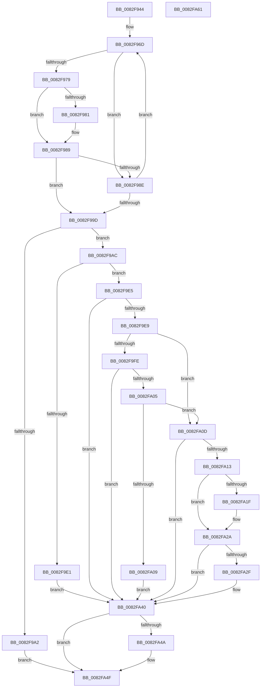

# CmDeleteDeviceMappedPropertyFromDriverKeyRegValue

- RVA: `0x0082F944`–`0x0082FA62` (길이 `286` bytes)
- VA: `0x000000014082F944`
- 실행 섹션: `PAGE`
- PDB 이름 있음: `예`; PDB Function 태그: `아니요`
- unwind 정보 RVA: `0x00086C28`
- 디코드: `80`개 명령, `286/286` bytes 표시
- 미해석 바이트: `0` (있으면 어셈블리에 `.byte`로 보존)

> 이 문서는 커널 이미지의 기계어와 PDB 기호를 분석해 생성했습니다. 4번과 5번은 함수 원형과 자료형을 바이너리 사용 방식에서 추정한 C 해석이며 원본 소스 복구 결과는 아닙니다.

## 1. Dependencies

- 직접 호출 지점: **4**; 고유 호출 대상: **3**
- 직접 호출자로 확인된 함수: **1**
- RIP 상대 이미지 참조: **4**

### Outgoing calls
- `0x0082F9D3` → [_CmOpenDeviceRegKey](../8E/_CmOpenDeviceRegKey_function_008EE540.md) (function, `0x008EE540`)
- `0x0082F9F2` → [PnpCtxRegDeleteValue](../8F/PnpCtxRegDeleteValue_function_008FE5E0.md) (function, `0x008FE5E0`)
- `0x0082FA3B` → [PnpCtxRegDeleteValue](../8F/PnpCtxRegDeleteValue_function_008FE5E0.md) (function, `0x008FE5E0`)
- `0x0082FA4A` → [ZwClose](../../text/6A/ZwClose_function_006AD2B0.md) (function, `0x006AD2B0`)

### Direct callers
- [_CmSetDeviceMappedProperty](../A0/_CmSetDeviceMappedProperty_function_00A0B098.md) at `0x00A0B2D8`

### Static image references
- `0x0082F966` → RVA `0x00B4E6D0` (`PAGE`; read)
- `0x0082FA16` → RVA `0x00012F58` (`.rdata`; read)
- `0x0082FA23` → RVA `0x00012F60` (`.rdata`; read)
- `0x0082FA34` → RVA `0x00AFEEF0` (` ?? ::NNGAKEGL::`string'`; read)

## 2. Other-region calls and transfers

- 다른 실행 섹션으로 향하는 call: **1**
  - `0x0082FA4A` → [ZwClose](../../text/6A/ZwClose_function_006AD2B0.md) (`PAGE` → `.text`)
- 별도 외부 분기/꼬리 이동을 확인하지 못했습니다.

## 3. Assembly (complete function range)

```asm
0082F944  48 89 5C 24 08                  mov qword ptr [rsp + 8], rbx
0082F949  48 89 74 24 10                  mov qword ptr [rsp + 0x10], rsi
0082F94E  57                              push rdi
0082F94F  48 83 EC 40                     sub rsp, 0x40
0082F953  48 83 64 24 68 00               and qword ptr [rsp + 0x68], 0
0082F959  49 8B F8                        mov rdi, r8
0082F95C  45 8B 58 10                     mov r11d, dword ptr [r8 + 0x10]
0082F960  45 33 C9                        xor r9d, r9d
0082F963  48 8B D9                        mov rbx, rcx
0082F966  4C 8D 05 63 ED 31 00            lea r8, [rip + 0x31ed63]
0082F96D  4D 8B 10                        mov r10, qword ptr [r8]
0082F970  49 8B F0                        mov rsi, r8
0082F973  45 3B 5A 10                     cmp r11d, dword ptr [r10 + 0x10]
0082F977  75 15                           jne 0x14082f98e
0082F979  48 8B 0F                        mov rcx, qword ptr [rdi]
0082F97C  49 2B 0A                        sub rcx, qword ptr [r10]
0082F97F  75 08                           jne 0x14082f989
0082F981  48 8B 4F 08                     mov rcx, qword ptr [rdi + 8]
0082F985  49 2B 4A 08                     sub rcx, qword ptr [r10 + 8]
0082F989  48 85 C9                        test rcx, rcx
0082F98C  74 0F                           je 0x14082f99d
0082F98E  33 F6                           xor esi, esi
0082F990  41 FF C1                        inc r9d
0082F993  49 83 C0 20                     add r8, 0x20
0082F997  41 83 F9 0D                     cmp r9d, 0xd
0082F99B  72 D0                           jb 0x14082f96d
0082F99D  48 85 F6                        test rsi, rsi
0082F9A0  75 0A                           jne 0x14082f9ac
0082F9A2  BB 16 00 00 C0                  mov ebx, 0xc0000016
0082F9A7  E9 A3 00 00 00                  jmp 0x14082fa4f
0082F9AC  48 83 64 24 38 00               and qword ptr [rsp + 0x38], 0
0082F9B2  48 8D 44 24 68                  lea rax, [rsp + 0x68]
0082F9B7  48 89 44 24 30                  mov qword ptr [rsp + 0x30], rax
0082F9BC  45 33 C9                        xor r9d, r9d
0082F9BF  C6 44 24 28 00                  mov byte ptr [rsp + 0x28], 0
0082F9C4  48 8B CB                        mov rcx, rbx
0082F9C7  C7 44 24 20 02 00 00 00         mov dword ptr [rsp + 0x20], 2
0082F9CF  45 8D 41 12                     lea r8d, [r9 + 0x12]
0082F9D3  E8 68 EB 0B 00                  call 0x1408ee540
0082F9D8  8B D8                           mov ebx, eax
0082F9DA  3D 34 00 00 C0                  cmp eax, 0xc0000034
0082F9DF  75 04                           jne 0x14082f9e5
0082F9E1  33 DB                           xor ebx, ebx
0082F9E3  EB 5B                           jmp 0x14082fa40
0082F9E5  85 C0                           test eax, eax
0082F9E7  78 57                           js 0x14082fa40
0082F9E9  4C 8B 46 10                     mov r8, qword ptr [rsi + 0x10]
0082F9ED  48 8B 54 24 68                  mov rdx, qword ptr [rsp + 0x68]
0082F9F2  E8 E9 EB 0C 00                  call 0x1408fe5e0
0082F9F7  3D 34 00 00 C0                  cmp eax, 0xc0000034
0082F9FC  74 0F                           je 0x14082fa0d
0082F9FE  3D 7C 01 00 C0                  cmp eax, 0xc000017c
0082FA03  74 3B                           je 0x14082fa40
0082FA05  85 C0                           test eax, eax
0082FA07  79 04                           jns 0x14082fa0d
0082FA09  8B D8                           mov ebx, eax
0082FA0B  EB 33                           jmp 0x14082fa40
0082FA0D  83 7F 10 02                     cmp dword ptr [rdi + 0x10], 2
0082FA11  75 2D                           jne 0x14082fa40
0082FA13  48 8B 07                        mov rax, qword ptr [rdi]
0082FA16  48 2B 05 3B 35 7E FF            sub rax, qword ptr [rip - 0x81cac5]
0082FA1D  75 0B                           jne 0x14082fa2a
0082FA1F  48 8B 47 08                     mov rax, qword ptr [rdi + 8]
0082FA23  48 2B 05 36 35 7E FF            sub rax, qword ptr [rip - 0x81caca]
0082FA2A  48 85 C0                        test rax, rax
0082FA2D  75 11                           jne 0x14082fa40
0082FA2F  48 8B 54 24 68                  mov rdx, qword ptr [rsp + 0x68]
0082FA34  4C 8D 05 B5 F4 2C 00            lea r8, [rip + 0x2cf4b5]
0082FA3B  E8 A0 EB 0C 00                  call 0x1408fe5e0
0082FA40  48 8B 4C 24 68                  mov rcx, qword ptr [rsp + 0x68]
0082FA45  48 85 C9                        test rcx, rcx
0082FA48  74 05                           je 0x14082fa4f
0082FA4A  E8 61 D8 E7 FF                  call 0x1406ad2b0
0082FA4F  48 8B 74 24 58                  mov rsi, qword ptr [rsp + 0x58]
0082FA54  8B C3                           mov eax, ebx
0082FA56  48 8B 5C 24 50                  mov rbx, qword ptr [rsp + 0x50]
0082FA5B  48 83 C4 40                     add rsp, 0x40
0082FA5F  5F                              pop rdi
0082FA60  C3                              ret
0082FA61  CC                              int3
```

## 4. C-style interpretation (structured pseudocode)

```c
__int64 __fastcall CmDeleteDeviceMappedPropertyFromDriverKeyRegValue(__int64 a1, __int64 a2, __int64 a3, int a4)
{
    __int64 result;
    __int64 v_rbx;
    __int64 v_rsi;
    __int64 v_rsp;
    unsigned __int64 v_stack_m10;
    unsigned __int64 v_stack_m18;
    unsigned __int8 v_stack_m20;
    unsigned int v_stack_m28;
    unsigned __int64 v_stack_p10;
    unsigned __int64 v_stack_p20;
    unsigned __int64 v_stack_p8;

    v_stack_p8 = v_rbx;
    v_stack_p10 = v_rsi;
    v_rsp = (v_rsp) - (64);
    a4 = 0;
loc_0082F96D:
    if (((unsigned int)((unsigned int)(*(unsigned int *)(a3 + 16)))) != (*(unsigned int *)(*(unsigned __int64 *)(v_rip + 3272035) + 16))) goto loc_0082F98E;
    a1 = (*(unsigned __int64 *)(a3)) - (*(unsigned __int64 *)(*(unsigned __int64 *)(v_rip + 3272035)));
    if (!(condition_is_not_equal)) {
        a1 = *(unsigned __int64 *)(a3 + 8);
        a1 = (a1) - (*(unsigned __int64 *)(*(unsigned __int64 *)(v_rip + 3272035) + 8));
    }
    if (a1 == 0) goto loc_0082F99D;
loc_0082F98E:
    v_rsi = 0;
    a4 = (unsigned int)((a4) + 1);
    a3 = (v_rip + 3272035) + (32);
    if (a4 < 13) goto loc_0082F96D;
loc_0082F99D:
    if (0 != 0) goto loc_0082F9AC;
    goto loc_0082FA4F;
loc_0082F9AC:
    v_stack_m18 = v_stack_p20;
    a4 = 0;
    v_stack_m20 = 0;
    v_stack_m28 = 2;
    result = _CmOpenDeviceRegKey((unsigned int)(0xC0000016ULL), a2, a4 + 18, a4);
    if (((unsigned int)(result)) != 0xC0000034ULL) goto loc_0082F9E5;
    v_rbx = 0;
    goto loc_0082FA40;
loc_0082F9E5:
    if (sign_flag) goto loc_0082FA40;
    result = PnpCtxRegDeleteValue((unsigned int)(0xC0000016ULL), v_stack_p20, *(unsigned __int64 *)(v_rsi + 16), a4);
    if (((unsigned int)(result)) == 0xC0000034ULL) goto loc_0082FA0D;
    if (((unsigned int)(result)) == 0xC000017CULL) goto loc_0082FA40;
    if (!sign_flag) goto loc_0082FA0D;
    goto loc_0082FA40;
loc_0082FA0D:
    if ((*(unsigned int *)(a3 + 16)) != 2) goto loc_0082FA40;
    result = (*(unsigned __int64 *)(a3)) - (*(unsigned __int64 *)(v_rip - 8506053));
    if (!(condition_is_not_equal)) {
        result = *(unsigned __int64 *)(a3 + 8);
        result = (result) - (*(unsigned __int64 *)(v_rip - 8506058));
    }
    if (result == 0) {
        a2 = v_stack_p20;
        a3 = v_rip + 2946229;
        result = PnpCtxRegDeleteValue((unsigned int)(0xC0000016ULL), a2, a3, a4);
    }
    if (v_stack_p20 != 0) {
        result = ZwClose(v_stack_p20, a2, a3, a4);
    }
    v_rsp = (v_rsp) + (64);
    return (unsigned int)((unsigned int)((unsigned int)((unsigned int)(result))));
}
```

## 5. (Beta) C Style

```c
int64_t CmDeleteDeviceMappedPropertyFromDriverKeyRegValue(int64_t Arg1, int64_t Arg2, void *Arg3, int32_t Arg4)
{
    uint8_t *arg3 = (uint8_t *)Arg3;

    int64_t result;
    int64_t local_rbx;
    int64_t local_rsi;
    int64_t local_rsp;
    uint64_t v_stack_m10;
    uint64_t v_stack_m18;
    uint8_t v_stack_m20;
    uint32_t v_stack_m28;
    uint64_t v_stack_p10;
    uint64_t v_stack_p20;
    uint64_t v_stack_p8;

    v_stack_p8 = local_rbx;
    v_stack_p10 = local_rsi;
    local_rsp = (local_rsp) - (64);
    Arg4 = 0;
loc_0082F96D:
    if (((uint32_t)((uint32_t)(*(uint32_t *)(arg3 + 0x10)))) != (*(uint32_t *)(*(uint64_t *)(v_rip + 0x31ED63) + 0x10))) goto loc_0082F98E;
    Arg1 = (*(uint64_t *)(arg3)) - (*(uint64_t *)(*(uint64_t *)(v_rip + 0x31ED63)));
    if (!(condition_is_not_equal)) {
        Arg1 = *(uint64_t *)(arg3 + 0x8);
        Arg1 = (Arg1) - (*(uint64_t *)(*(uint64_t *)(v_rip + 0x31ED63) + 0x8));
    }
    if (Arg1 == 0) goto loc_0082F99D;
loc_0082F98E:
    local_rsi = 0;
    Arg4 = (uint32_t)((Arg4) + 1);
    Arg3 = (v_rip + 3272035) + (32);
    if (Arg4 < 13) goto loc_0082F96D;
loc_0082F99D:
    if (0 != 0) goto loc_0082F9AC;
    goto loc_0082FA4F;
loc_0082F9AC:
    v_stack_m18 = v_stack_p20;
    Arg4 = 0;
    v_stack_m20 = 0;
    v_stack_m28 = 2;
    result = _CmOpenDeviceRegKey((uint32_t)(0xC0000016ULL), Arg2, Arg4 + 18, Arg4);
    if (((uint32_t)(result)) != 0xC0000034ULL) goto loc_0082F9E5;
    local_rbx = 0;
    goto loc_0082FA40;
loc_0082F9E5:
    if (sign_flag) goto loc_0082FA40;
    result = PnpCtxRegDeleteValue((uint32_t)(0xC0000016ULL), v_stack_p20, *(uint64_t *)(local_rsi + 0x10), Arg4);
    if (((uint32_t)(result)) == 0xC0000034ULL) goto loc_0082FA0D;
    if (((uint32_t)(result)) == 0xC000017CULL) goto loc_0082FA40;
    if (!sign_flag) goto loc_0082FA0D;
    goto loc_0082FA40;
loc_0082FA0D:
    if ((*(uint32_t *)(arg3 + 0x10)) != 2) goto loc_0082FA40;
    result = (*(uint64_t *)(arg3)) - (*(uint64_t *)(v_rip - 0x81CAC5));
    if (!(condition_is_not_equal)) {
        result = *(uint64_t *)(arg3 + 0x8);
        result = (result) - (*(uint64_t *)(v_rip - 0x81CACA));
    }
    if (result == 0) {
        Arg2 = v_stack_p20;
        Arg3 = v_rip + 2946229;
        result = PnpCtxRegDeleteValue((uint32_t)(0xC0000016ULL), Arg2, Arg3, Arg4);
    }
    if (v_stack_p20 != 0) {
        result = ZwClose(v_stack_p20, Arg2, Arg3, Arg4);
    }
    local_rsp = (local_rsp) + (64);
    return (uint32_t)((uint32_t)((uint32_t)((uint32_t)(result))));
}
```

### 관측된 메모리 오프셋

구조체 형식이 확인되지 않은 접근은 인자 기준의 오프셋으로만 기록했습니다.

| 기준 인자 | 오프셋 표현 | 폭 (bit) | 접근 |
|---|---:|---:|---|
| `Arg3` | `+ 0x0` | `64` | `R` |
| `Arg3` | `+ 0x8` | `64` | `R` |
| `Arg3` | `+ 0x10` | `32` | `R` |

## 6. Execution-region graph

[열기: 2D/3D 그래프와 함수 탐색 컨트롤 패널](../../../control-panel.html?section=page&rva=0x0082F944&view=graph)

- 2D 그래프는 위에서 아래로 흐르고, 3D 그래프는 빈 공간을 드래그해 회전합니다. Shift+드래그는 이동, 휠은 확대·축소, 함수 노드 선택은 대상 보고서 이동입니다.

### Static fallback


