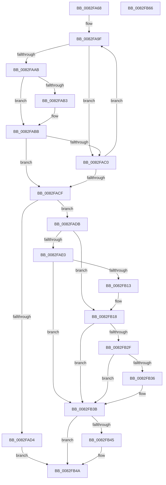

# CmDeleteDeviceMappedPropertyFromInstanceKeyRegValue

- RVA: `0x0082FA68`–`0x0082FB67` (길이 `255` bytes)
- VA: `0x000000014082FA68`
- 실행 섹션: `PAGE`
- PDB 이름 있음: `예`; PDB Function 태그: `아니요`
- unwind 정보 RVA: `0x0007EE78`
- 디코드: `78`개 명령, `255/255` bytes 표시
- 미해석 바이트: `0` (있으면 어셈블리에 `.byte`로 보존)

> 이 문서는 커널 이미지의 기계어와 PDB 기호를 분석해 생성했습니다. 4번과 5번은 함수 원형과 자료형을 바이너리 사용 방식에서 추정한 C 해석이며 원본 소스 복구 결과는 아닙니다.

## 1. Dependencies

- 직접 호출 지점: **3**; 고유 호출 대상: **3**
- 직접 호출자로 확인된 함수: **1**
- RIP 상대 이미지 참조: **1**

### Outgoing calls
- `0x0082FB08` → [_CmOpenDeviceRegKey](../8E/_CmOpenDeviceRegKey_function_008EE540.md) (function, `0x008EE540`)
- `0x0082FB23` → [PnpCtxRegDeleteValue](../8F/PnpCtxRegDeleteValue_function_008FE5E0.md) (function, `0x008FE5E0`)
- `0x0082FB45` → [ZwClose](../../text/6A/ZwClose_function_006AD2B0.md) (function, `0x006AD2B0`)

### Direct callers
- [sub_00B365E0](../B3/Unknown_function_00B365E0.md) at `0x00B365E0`

### Static image references
- `0x0082FA84` → RVA `0x00B4B720` (`PAGE`; read)

## 2. Other-region calls and transfers

- 다른 실행 섹션으로 향하는 call: **1**
  - `0x0082FB45` → [ZwClose](../../text/6A/ZwClose_function_006AD2B0.md) (`PAGE` → `.text`)
- 별도 외부 분기/꼬리 이동을 확인하지 못했습니다.

## 3. Assembly (complete function range)

```asm
0082FA68  48 8B C4                        mov rax, rsp
0082FA6B  48 89 58 08                     mov qword ptr [rax + 8], rbx
0082FA6F  48 89 68 10                     mov qword ptr [rax + 0x10], rbp
0082FA73  48 89 70 18                     mov qword ptr [rax + 0x18], rsi
0082FA77  57                              push rdi
0082FA78  41 56                           push r14
0082FA7A  41 57                           push r15
0082FA7C  48 83 EC 50                     sub rsp, 0x50
0082FA80  41 8B 69 10                     mov ebp, dword ptr [r9 + 0x10]
0082FA84  4C 8D 15 95 BC 31 00            lea r10, [rip + 0x31bc95]
0082FA8B  4C 8B F2                        mov r14, rdx
0082FA8E  33 DB                           xor ebx, ebx
0082FA90  33 D2                           xor edx, edx
0082FA92  49 8B F0                        mov rsi, r8
0082FA95  48 89 50 D8                     mov qword ptr [rax - 0x28], rdx
0082FA99  45 33 DB                        xor r11d, r11d
0082FA9C  4C 8B F9                        mov r15, rcx
0082FA9F  4D 8B 02                        mov r8, qword ptr [r10]
0082FAA2  49 8B FA                        mov rdi, r10
0082FAA5  41 3B 68 10                     cmp ebp, dword ptr [r8 + 0x10]
0082FAA9  75 15                           jne 0x14082fac0
0082FAAB  49 8B 09                        mov rcx, qword ptr [r9]
0082FAAE  49 2B 08                        sub rcx, qword ptr [r8]
0082FAB1  75 08                           jne 0x14082fabb
0082FAB3  49 8B 49 08                     mov rcx, qword ptr [r9 + 8]
0082FAB7  49 2B 48 08                     sub rcx, qword ptr [r8 + 8]
0082FABB  48 85 C9                        test rcx, rcx
0082FABE  74 0F                           je 0x14082facf
0082FAC0  33 FF                           xor edi, edi
0082FAC2  41 FF C3                        inc r11d
0082FAC5  49 83 C2 20                     add r10, 0x20
0082FAC9  41 83 FB 02                     cmp r11d, 2
0082FACD  72 D0                           jb 0x14082fa9f
0082FACF  48 85 FF                        test rdi, rdi
0082FAD2  75 07                           jne 0x14082fadb
0082FAD4  BB 30 02 00 C0                  mov ebx, 0xc0000230
0082FAD9  EB 6F                           jmp 0x14082fb4a
0082FADB  48 85 F6                        test rsi, rsi
0082FADE  75 38                           jne 0x14082fb18
0082FAE0  48 21 54 24 38                  and qword ptr [rsp + 0x38], rdx
0082FAE5  48 8D 44 24 40                  lea rax, [rsp + 0x40]
0082FAEA  48 89 44 24 30                  mov qword ptr [rsp + 0x30], rax
0082FAEF  44 8D 46 10                     lea r8d, [rsi + 0x10]
0082FAF3  88 54 24 28                     mov byte ptr [rsp + 0x28], dl
0082FAF7  45 33 C9                        xor r9d, r9d
0082FAFA  49 8B D6                        mov rdx, r14
0082FAFD  C7 44 24 20 02 00 00 00         mov dword ptr [rsp + 0x20], 2
0082FB05  49 8B CF                        mov rcx, r15
0082FB08  E8 33 EA 0B 00                  call 0x1408ee540
0082FB0D  8B D8                           mov ebx, eax
0082FB0F  85 C0                           test eax, eax
0082FB11  78 28                           js 0x14082fb3b
0082FB13  48 8B 54 24 40                  mov rdx, qword ptr [rsp + 0x40]
0082FB18  4C 8B 47 10                     mov r8, qword ptr [rdi + 0x10]
0082FB1C  48 85 F6                        test rsi, rsi
0082FB1F  48 0F 45 D6                     cmovne rdx, rsi
0082FB23  E8 B8 EA 0C 00                  call 0x1408fe5e0
0082FB28  3D 34 00 00 C0                  cmp eax, 0xc0000034
0082FB2D  74 0C                           je 0x14082fb3b
0082FB2F  3D 7C 01 00 C0                  cmp eax, 0xc000017c
0082FB34  74 05                           je 0x14082fb3b
0082FB36  85 C0                           test eax, eax
0082FB38  0F 48 D8                        cmovs ebx, eax
0082FB3B  48 8B 4C 24 40                  mov rcx, qword ptr [rsp + 0x40]
0082FB40  48 85 C9                        test rcx, rcx
0082FB43  74 05                           je 0x14082fb4a
0082FB45  E8 66 D7 E7 FF                  call 0x1406ad2b0
0082FB4A  4C 8D 5C 24 50                  lea r11, [rsp + 0x50]
0082FB4F  8B C3                           mov eax, ebx
0082FB51  49 8B 5B 20                     mov rbx, qword ptr [r11 + 0x20]
0082FB55  49 8B 6B 28                     mov rbp, qword ptr [r11 + 0x28]
0082FB59  49 8B 73 30                     mov rsi, qword ptr [r11 + 0x30]
0082FB5D  49 8B E3                        mov rsp, r11
0082FB60  41 5F                           pop r15
0082FB62  41 5E                           pop r14
0082FB64  5F                              pop rdi
0082FB65  C3                              ret
0082FB66  CC                              int3
```

## 4. C-style interpretation (structured pseudocode)

```c
__int64 __fastcall CmDeleteDeviceMappedPropertyFromInstanceKeyRegValue(__int64 a1, __int64 a2, __int64 a3, __int64 a4)
{
    __int64 result;
    __int64 v_r10;
    __int64 v_r11;
    __int64 v_rbx;
    __int64 v_rdi;
    __int64 v_rsp;
    unsigned __int64 v_stack_m18;
    unsigned __int64 v_stack_m28;
    unsigned __int64 v_stack_m30;
    unsigned __int64 v_stack_m38;
    unsigned __int8 v_stack_m40;
    unsigned int v_stack_m48;

    *(unsigned __int64 *)(v_rsp + 8) = v_rbx;
    *(unsigned __int64 *)(v_rsp + 16) = v_rbp;
    *(unsigned __int64 *)(v_rsp + 24) = v_rsi;
    v_rsp = (v_rsp) - (80);
    v_rbx = 0;
    a2 = 0;
    *(unsigned __int64 *)(v_rsp - 40) = 0;
    v_r11 = 0;
loc_0082FA9F:
    if (((unsigned int)((unsigned int)(*(unsigned int *)(a4 + 16)))) != (*(unsigned int *)(*(unsigned __int64 *)(v_rip + 3259541) + 16))) goto loc_0082FAC0;
    a1 = (*(unsigned __int64 *)(a4)) - (*(unsigned __int64 *)(*(unsigned __int64 *)(v_rip + 3259541)));
    if (!(condition_is_not_equal)) {
        a1 = *(unsigned __int64 *)(a4 + 8);
        a1 = (a1) - (*(unsigned __int64 *)(*(unsigned __int64 *)(v_rip + 3259541) + 8));
    }
    if (a1 == 0) goto loc_0082FACF;
loc_0082FAC0:
    v_rdi = 0;
    v_r11 = (unsigned int)((v_r11) + 1);
    v_r10 = (v_rip + 3259541) + (32);
    if (((unsigned int)(v_r11)) < 2) goto loc_0082FA9F;
loc_0082FACF:
    if (0 != 0) goto loc_0082FADB;
    goto loc_0082FB4A;
loc_0082FADB:
    if (a3 != 0) goto loc_0082FB18;
    v_stack_m38 = v_stack_m28;
    v_stack_m40 = 0;
    a4 = 0;
    v_stack_m48 = 2;
    result = _CmOpenDeviceRegKey(a1, 0, a3 + 16, a4);
    if (sign_flag) goto loc_0082FB3B;
loc_0082FB18:
    a2 = v_stack_m28;
    if (a3 != 0) { a2 = a3; }
    result = PnpCtxRegDeleteValue(a1, a2, *(unsigned __int64 *)(v_rdi + 16), a4);
    if (((unsigned int)(result)) == 0xC0000034ULL) goto loc_0082FB3B;
    v_rbx = (unsigned int)((unsigned int)(result));
    if (((unsigned int)(result)) != 0xC000017CULL) {
        v_rbx = (unsigned int)((unsigned int)(result));
        if (sign_flag) { v_rbx = (unsigned int)(result); }
    }
    if (v_stack_m28 != 0) {
        result = ZwClose(v_stack_m28, a2, *(unsigned __int64 *)(v_rdi + 16), a4);
    }
    return (unsigned int)((unsigned int)(v_rbx));
}
```

## 5. (Beta) C Style

```c
int64_t CmDeleteDeviceMappedPropertyFromInstanceKeyRegValue(int64_t Arg1, int64_t Arg2, int64_t Arg3, void *Arg4)
{
    uint8_t *arg4 = (uint8_t *)Arg4;

    int64_t result;
    int64_t local_r10;
    int64_t local_r11;
    int64_t local_rbx;
    int64_t local_rdi;
    int64_t local_rsp;
    uint64_t v_stack_m18;
    uint64_t v_stack_m28;
    uint64_t v_stack_m30;
    uint64_t v_stack_m38;
    uint8_t v_stack_m40;
    uint32_t v_stack_m48;

    *(uint64_t *)(local_rsp + 0x8) = local_rbx;
    *(uint64_t *)(local_rsp + 0x10) = local_rbp;
    *(uint64_t *)(local_rsp + 0x18) = local_rsi;
    local_rsp = (local_rsp) - (80);
    local_rbx = 0;
    Arg2 = 0;
    *(uint64_t *)(local_rsp - 0x28) = 0;
    local_r11 = 0;
loc_0082FA9F:
    if (((uint32_t)((uint32_t)(*(uint32_t *)(arg4 + 0x10)))) != (*(uint32_t *)(*(uint64_t *)(v_rip + 0x31BC95) + 0x10))) goto loc_0082FAC0;
    Arg1 = (*(uint64_t *)(arg4)) - (*(uint64_t *)(*(uint64_t *)(v_rip + 0x31BC95)));
    if (!(condition_is_not_equal)) {
        Arg1 = *(uint64_t *)(arg4 + 0x8);
        Arg1 = (Arg1) - (*(uint64_t *)(*(uint64_t *)(v_rip + 0x31BC95) + 0x8));
    }
    if (Arg1 == 0) goto loc_0082FACF;
loc_0082FAC0:
    local_rdi = 0;
    local_r11 = (uint32_t)((local_r11) + 1);
    local_r10 = (v_rip + 3259541) + (32);
    if (((uint32_t)(local_r11)) < 2) goto loc_0082FA9F;
loc_0082FACF:
    if (0 != 0) goto loc_0082FADB;
    goto loc_0082FB4A;
loc_0082FADB:
    if (Arg3 != 0) goto loc_0082FB18;
    v_stack_m38 = v_stack_m28;
    v_stack_m40 = 0;
    Arg4 = 0;
    v_stack_m48 = 2;
    result = _CmOpenDeviceRegKey(Arg1, 0, Arg3 + 16, Arg4);
    if (sign_flag) goto loc_0082FB3B;
loc_0082FB18:
    Arg2 = v_stack_m28;
    if (Arg3 != 0) { Arg2 = Arg3; }
    result = PnpCtxRegDeleteValue(Arg1, Arg2, *(uint64_t *)(local_rdi + 0x10), Arg4);
    if (((uint32_t)(result)) == 0xC0000034ULL) goto loc_0082FB3B;
    local_rbx = (uint32_t)((uint32_t)(result));
    if (((uint32_t)(result)) != 0xC000017CULL) {
        local_rbx = (uint32_t)((uint32_t)(result));
        if (sign_flag) { local_rbx = (uint32_t)(result); }
    }
    if (v_stack_m28 != 0) {
        result = ZwClose(v_stack_m28, Arg2, *(uint64_t *)(local_rdi + 0x10), Arg4);
    }
    return (uint32_t)((uint32_t)(local_rbx));
}
```

### 관측된 메모리 오프셋

구조체 형식이 확인되지 않은 접근은 인자 기준의 오프셋으로만 기록했습니다.

| 기준 인자 | 오프셋 표현 | 폭 (bit) | 접근 |
|---|---:|---:|---|
| `Arg4` | `+ 0x0` | `64` | `R` |
| `Arg4` | `+ 0x8` | `64` | `R` |
| `Arg4` | `+ 0x10` | `32` | `R` |

## 6. Execution-region graph

[열기: 2D/3D 그래프와 함수 탐색 컨트롤 패널](../../../control-panel.html?section=page&rva=0x0082FA68&view=graph)

- 2D 그래프는 위에서 아래로 흐르고, 3D 그래프는 빈 공간을 드래그해 회전합니다. Shift+드래그는 이동, 휠은 확대·축소, 함수 노드 선택은 대상 보고서 이동입니다.

### Static fallback


