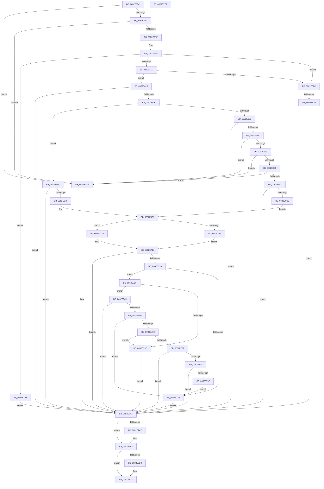

# CmDeleteDevicePanelRegKeyWorker

- RVA: `0x0082E554`–`0x0082E7E3` (길이 `655` bytes)
- VA: `0x000000014082E554`
- 실행 섹션: `PAGE`
- PDB 이름 있음: `예`; PDB Function 태그: `아니요`
- unwind 정보 RVA: `0x000DA8CC`
- 디코드: `186`개 명령, `655/655` bytes 표시
- 미해석 바이트: `0` (있으면 어셈블리에 `.byte`로 보존)

> 이 문서는 커널 이미지의 기계어와 PDB 기호를 분석해 생성했습니다. 4번과 5번은 함수 원형과 자료형을 바이너리 사용 방식에서 추정한 C 해석이며 원본 소스 복구 결과는 아닙니다.

## 1. Dependencies

- 직접 호출 지점: **16**; 고유 호출 대상: **11**
- 직접 호출자로 확인된 함수: **1**
- RIP 상대 이미지 참조: **2**

### Outgoing calls
- `0x0082E5C1` → [ExAllocatePool2](../../poolcode/B8/ExAllocatePool2_function_00B820F0.md) (function, `0x00B820F0`)
- `0x0082E5EE` → [CmGetDevicePanelRegKeyPath](CmGetDevicePanelRegKeyPath_function_0082EE7C.md) (function, `0x0082EE7C`)
- `0x0082E601` → [ExFreePoolWithTag](../../poolcode/B8/ExFreePoolWithTag_function_00B82870.md) (function, `0x00B82870`)
- `0x0082E63D` → [RtlInitUnicodeStringEx](../../text/46/RtlInitUnicodeStringEx_function_00463960.md) (function, `0x00463960`)
- `0x0082E66F` → [RtlPrefixUnicodeString](../8F/RtlPrefixUnicodeString_function_008F4F70.md) (function, `0x008F4F70`)
- `0x0082E6A2` → [RtlPrefixUnicodeString](../8F/RtlPrefixUnicodeString_function_008F4F70.md) (function, `0x008F4F70`)
- `0x0082E6BD` → [_PnpCtxGetCachedContextBaseKey](../8E/_PnpCtxGetCachedContextBaseKey_function_008EFB2C.md) (function, `0x008EFB2C`)
- `0x0082E6E7` → [PnpCtxRegOpenCurrentUserKey](../AB/PnpCtxRegOpenCurrentUserKey_function_00AB5E40.md) (function, `0x00AB5E40`)
- `0x0082E709` → [PnpCtxRegDeleteTree](../96/PnpCtxRegDeleteTree_function_00965CC8.md) (function, `0x00965CC8`)
- `0x0082E710` → [PnpCtxRegDeleteKey](../96/PnpCtxRegDeleteKey_function_00965EC8.md) (function, `0x00965EC8`)
- `0x0082E734` → [wcsrchr](../../text/50/wcsrchr_function_00501E50.md) (function, `0x00501E50`)
- `0x0082E752` → [PnpCtxRegDeleteKey](../96/PnpCtxRegDeleteKey_function_00965EC8.md) (function, `0x00965EC8`)
- `0x0082E768` → [wcsrchr](../../text/50/wcsrchr_function_00501E50.md) (function, `0x00501E50`)
- `0x0082E77F` → [PnpCtxRegDeleteKey](../96/PnpCtxRegDeleteKey_function_00965EC8.md) (function, `0x00965EC8`)
- `0x0082E7AE` → [ZwClose](../../text/6A/ZwClose_function_006AD2B0.md) (function, `0x006AD2B0`)
- `0x0082E7BD` → [ExFreePoolWithTag](../../poolcode/B8/ExFreePoolWithTag_function_00B82870.md) (function, `0x00B82870`)

### Direct callers
- [CmDeleteDevicePanelRegKey](CmDeleteDevicePanelRegKey_function_0082E414.md) at `0x0082E4B2`

### Static image references
- `0x0082E668` → RVA `0x00001A08` (`.rdata`; read)
- `0x0082E69B` → RVA `0x00003A80` (`.rdata`; read)

## 2. Other-region calls and transfers

- 다른 실행 섹션으로 향하는 call: **7**
  - `0x0082E5C1` → [ExAllocatePool2](../../poolcode/B8/ExAllocatePool2_function_00B820F0.md) (`PAGE` → `POOLCODE`)
  - `0x0082E601` → [ExFreePoolWithTag](../../poolcode/B8/ExFreePoolWithTag_function_00B82870.md) (`PAGE` → `POOLCODE`)
  - `0x0082E63D` → [RtlInitUnicodeStringEx](../../text/46/RtlInitUnicodeStringEx_function_00463960.md) (`PAGE` → `.text`)
  - `0x0082E734` → [wcsrchr](../../text/50/wcsrchr_function_00501E50.md) (`PAGE` → `.text`)
  - `0x0082E768` → [wcsrchr](../../text/50/wcsrchr_function_00501E50.md) (`PAGE` → `.text`)
  - `0x0082E7AE` → [ZwClose](../../text/6A/ZwClose_function_006AD2B0.md) (`PAGE` → `.text`)
  - `0x0082E7BD` → [ExFreePoolWithTag](../../poolcode/B8/ExFreePoolWithTag_function_00B82870.md) (`PAGE` → `POOLCODE`)
- 별도 외부 분기/꼬리 이동을 확인하지 못했습니다.

## 3. Assembly (complete function range)

```asm
0082E554  48 8B C4                        mov rax, rsp
0082E557  48 89 58 08                     mov qword ptr [rax + 8], rbx
0082E55B  48 89 70 10                     mov qword ptr [rax + 0x10], rsi
0082E55F  48 89 78 18                     mov qword ptr [rax + 0x18], rdi
0082E563  44 89 48 20                     mov dword ptr [rax + 0x20], r9d
0082E567  55                              push rbp
0082E568  41 54                           push r12
0082E56A  41 55                           push r13
0082E56C  41 56                           push r14
0082E56E  41 57                           push r15
0082E570  48 8B EC                        mov rbp, rsp
0082E573  48 83 EC 60                     sub rsp, 0x60
0082E577  45 33 ED                        xor r13d, r13d
0082E57A  0F 57 C0                        xorps xmm0, xmm0
0082E57D  44 89 6D 48                     mov dword ptr [rbp + 0x48], r13d
0082E581  45 8B F0                        mov r14d, r8d
0082E584  4C 89 6D E8                     mov qword ptr [rbp - 0x18], r13
0082E588  4C 8B E2                        mov r12, rdx
0082E58B  4C 89 6D E0                     mov qword ptr [rbp - 0x20], r13
0082E58F  4C 8B F9                        mov r15, rcx
0082E592  41 8B FD                        mov edi, r13d
0082E595  0F 11 45 F0                     movups xmmword ptr [rbp - 0x10], xmm0
0082E599  45 85 C0                        test r8d, r8d
0082E59C  0F 84 FE 01 00 00               je 0x14082e7a0
0082E5A2  41 F7 C0 9F FE FF FF            test r8d, 0xfffffe9f
0082E5A9  0F 85 F1 01 00 00               jne 0x14082e7a0
0082E5AF  BE 3D 01 00 00                  mov esi, 0x13d
0082E5B4  8B D6                           mov edx, esi
0082E5B6  B9 00 01 00 00                  mov ecx, 0x100
0082E5BB  41 B8 50 4E 50 52               mov r8d, 0x52504e50
0082E5C1  E8 2A 3B 35 00                  call 0x140b820f0
0082E5C6  48 8B F8                        mov rdi, rax
0082E5C9  48 85 C0                        test rax, rax
0082E5CC  0F 84 C7 01 00 00               je 0x14082e799
0082E5D2  8B CE                           mov ecx, esi
0082E5D4  48 8D 45 48                     lea rax, [rbp + 0x48]
0082E5D8  48 89 44 24 38                  mov qword ptr [rsp + 0x38], rax
0082E5DD  45 8B C6                        mov r8d, r14d
0082E5E0  D1 E9                           shr ecx, 1
0082E5E2  49 8B D4                        mov rdx, r12
0082E5E5  89 4C 24 30                     mov dword ptr [rsp + 0x30], ecx
0082E5E9  48 89 7C 24 28                  mov qword ptr [rsp + 0x28], rdi
0082E5EE  E8 89 08 00 00                  call 0x14082ee7c
0082E5F3  8B D8                           mov ebx, eax
0082E5F5  3D 23 00 00 C0                  cmp eax, 0xc0000023
0082E5FA  75 27                           jne 0x14082e623
0082E5FC  33 D2                           xor edx, edx
0082E5FE  48 8B CF                        mov rcx, rdi
0082E601  E8 6A 42 35 00                  call 0x140b82870
0082E606  8B 75 48                        mov esi, dword ptr [rbp + 0x48]
0082E609  B8 FF FF FF FF                  mov eax, 0xffffffff
0082E60E  48 03 F6                        add rsi, rsi
0082E611  49 8B FD                        mov rdi, r13
0082E614  48 3B F0                        cmp rsi, rax
0082E617  76 9B                           jbe 0x14082e5b4
0082E619  BB 95 00 00 C0                  mov ebx, 0xc0000095
0082E61E  E9 82 01 00 00                  jmp 0x14082e7a5
0082E623  85 C0                           test eax, eax
0082E625  0F 88 7A 01 00 00               js 0x14082e7a5
0082E62B  41 0F BA E6 08                  bt r14d, 8
0082E630  0F 82 A7 00 00 00               jb 0x14082e6dd
0082E636  48 8B D7                        mov rdx, rdi
0082E639  48 8D 4D F0                     lea rcx, [rbp - 0x10]
0082E63D  E8 1E 53 C3 FF                  call 0x140463960
0082E642  8B D8                           mov ebx, eax
0082E644  85 C0                           test eax, eax
0082E646  0F 88 59 01 00 00               js 0x14082e7a5
0082E64C  0F B7 5D F0                     movzx ebx, word ptr [rbp - 0x10]
0082E650  3B DE                           cmp ebx, esi
0082E652  0F 83 48 01 00 00               jae 0x14082e7a0
0082E658  83 FB 32                        cmp ebx, 0x32
0082E65B  0F 86 3F 01 00 00               jbe 0x14082e7a0
0082E661  41 B0 01                        mov r8b, 1
0082E664  48 8D 55 F0                     lea rdx, [rbp - 0x10]
0082E668  48 8D 0D 99 33 7D FF            lea rcx, [rip - 0x82cc67]
0082E66F  E8 FC 68 0C 00                  call 0x1408f4f70
0082E674  84 C0                           test al, al
0082E676  0F 84 24 01 00 00               je 0x14082e7a0
0082E67C  B8 CE FF 00 00                  mov eax, 0xffce
0082E681  4C 8D 77 32                     lea r14, [rdi + 0x32]
0082E685  66 01 45 F2                     add word ptr [rbp - 0xe], ax
0082E689  48 8D 55 F0                     lea rdx, [rbp - 0x10]
0082E68D  66 03 D8                        add bx, ax
0082E690  4C 89 75 F8                     mov qword ptr [rbp - 8], r14
0082E694  41 B0 01                        mov r8b, 1
0082E697  66 89 5D F0                     mov word ptr [rbp - 0x10], bx
0082E69B  48 8D 0D DE 53 7D FF            lea rcx, [rip - 0x82ac22]
0082E6A2  E8 C9 68 0C 00                  call 0x1408f4f70
0082E6A7  8A C8                           mov cl, al
0082E6A9  4C 8D 45 E8                     lea r8, [rbp - 0x18]
0082E6AD  F6 D9                           neg cl
0082E6AF  44 8A E0                        mov r12b, al
0082E6B2  49 8B CF                        mov rcx, r15
0082E6B5  1B D2                           sbb edx, edx
0082E6B7  83 E2 07                        and edx, 7
0082E6BA  83 C2 04                        add edx, 4
0082E6BD  E8 6A 14 0C 00                  call 0x1408efb2c
0082E6C2  8B D8                           mov ebx, eax
0082E6C4  85 C0                           test eax, eax
0082E6C6  0F 88 D9 00 00 00               js 0x14082e7a5
0082E6CC  49 8D 76 2A                     lea rsi, [r14 + 0x2a]
0082E6D0  45 84 E4                        test r12b, r12b
0082E6D3  49 0F 44 F6                     cmove rsi, r14
0082E6D7  4C 8B 75 E8                     mov r14, qword ptr [rbp - 0x18]
0082E6DB  EB 1D                           jmp 0x14082e6fa
0082E6DD  4C 8D 4D E0                     lea r9, [rbp - 0x20]
0082E6E1  49 8B CF                        mov rcx, r15
0082E6E4  48 8B F7                        mov rsi, rdi
0082E6E7  E8 54 77 28 00                  call 0x140ab5e40
0082E6EC  8B D8                           mov ebx, eax
0082E6EE  85 C0                           test eax, eax
0082E6F0  0F 88 AF 00 00 00               js 0x14082e7a5
0082E6F6  4C 8B 75 E0                     mov r14, qword ptr [rbp - 0x20]
0082E6FA  4C 8B C6                        mov r8, rsi
0082E6FD  49 8B D6                        mov rdx, r14
0082E700  49 8B CF                        mov rcx, r15
0082E703  44 38 6D 50                     cmp byte ptr [rbp + 0x50], r13b
0082E707  74 07                           je 0x14082e710
0082E709  E8 BA 75 13 00                  call 0x140965cc8
0082E70E  EB 05                           jmp 0x14082e715
0082E710  E8 B3 77 13 00                  call 0x140965ec8
0082E715  3D 7C 01 00 C0                  cmp eax, 0xc000017c
0082E71A  0F 84 85 00 00 00               je 0x14082e7a5
0082E720  85 C0                           test eax, eax
0082E722  79 04                           jns 0x14082e728
0082E724  8B D8                           mov ebx, eax
0082E726  EB 7D                           jmp 0x14082e7a5
0082E728  41 BC 5C 00 00 00               mov r12d, 0x5c
0082E72E  48 8B CE                        mov rcx, rsi
0082E731  41 8B D4                        mov edx, r12d
0082E734  E8 17 37 CD FF                  call 0x140501e50
0082E739  48 85 C0                        test rax, rax
0082E73C  75 07                           jne 0x14082e745
0082E73E  BB E5 00 00 C0                  mov ebx, 0xc00000e5
0082E743  EB 60                           jmp 0x14082e7a5
0082E745  4C 8B C6                        mov r8, rsi
0082E748  66 44 89 28                     mov word ptr [rax], r13w
0082E74C  49 8B D6                        mov rdx, r14
0082E74F  49 8B CF                        mov rcx, r15
0082E752  E8 71 77 13 00                  call 0x140965ec8
0082E757  3D 21 01 00 C0                  cmp eax, 0xc0000121
0082E75C  74 47                           je 0x14082e7a5
0082E75E  85 C0                           test eax, eax
0082E760  78 C2                           js 0x14082e724
0082E762  41 8B D4                        mov edx, r12d
0082E765  48 8B CE                        mov rcx, rsi
0082E768  E8 E3 36 CD FF                  call 0x140501e50
0082E76D  48 85 C0                        test rax, rax
0082E770  74 CC                           je 0x14082e73e
0082E772  4C 8B C6                        mov r8, rsi
0082E775  66 44 89 28                     mov word ptr [rax], r13w
0082E779  49 8B D6                        mov rdx, r14
0082E77C  49 8B CF                        mov rcx, r15
0082E77F  E8 44 77 13 00                  call 0x140965ec8
0082E784  BA 00 00 00 80                  mov edx, 0x80000000
0082E789  8D 0C 10                        lea ecx, [rax + rdx]
0082E78C  85 CA                           test edx, ecx
0082E78E  75 15                           jne 0x14082e7a5
0082E790  3D 21 01 00 C0                  cmp eax, 0xc0000121
0082E795  74 0E                           je 0x14082e7a5
0082E797  EB 8B                           jmp 0x14082e724
0082E799  BB 17 00 00 C0                  mov ebx, 0xc0000017
0082E79E  EB 05                           jmp 0x14082e7a5
0082E7A0  BB 0D 00 00 C0                  mov ebx, 0xc000000d
0082E7A5  48 8B 4D E0                     mov rcx, qword ptr [rbp - 0x20]
0082E7A9  48 85 C9                        test rcx, rcx
0082E7AC  74 05                           je 0x14082e7b3
0082E7AE  E8 FD EA E7 FF                  call 0x1406ad2b0
0082E7B3  48 85 FF                        test rdi, rdi
0082E7B6  74 0A                           je 0x14082e7c2
0082E7B8  33 D2                           xor edx, edx
0082E7BA  48 8B CF                        mov rcx, rdi
0082E7BD  E8 AE 40 35 00                  call 0x140b82870
0082E7C2  4C 8D 5C 24 60                  lea r11, [rsp + 0x60]
0082E7C7  8B C3                           mov eax, ebx
0082E7C9  49 8B 5B 30                     mov rbx, qword ptr [r11 + 0x30]
0082E7CD  49 8B 73 38                     mov rsi, qword ptr [r11 + 0x38]
0082E7D1  49 8B 7B 40                     mov rdi, qword ptr [r11 + 0x40]
0082E7D5  49 8B E3                        mov rsp, r11
0082E7D8  41 5F                           pop r15
0082E7DA  41 5E                           pop r14
0082E7DC  41 5D                           pop r13
0082E7DE  41 5C                           pop r12
0082E7E0  5D                              pop rbp
0082E7E1  C3                              ret
0082E7E2  CC                              int3
```

## 4. C-style interpretation (structured pseudocode)

```c
__int64 __fastcall CmDeleteDevicePanelRegKeyWorker(__int64 a1, __int64 a2, int a3, int a4, unsigned __int8 a5)
{
    __int64 result;
    __int64 v_r13;
    __int64 v_rbx;
    __int64 v_rsi;
    __int64 v_rsp;
    unsigned __int64 v_stack_m28;
    unsigned __int64 v_stack_m30;
    unsigned __int16 v_stack_m36;
    unsigned __int64 v_stack_m38;
    unsigned __int64 v_stack_m40;
    unsigned __int64 v_stack_m48;
    unsigned __int64 v_stack_m50;
    unsigned int v_stack_m58;
    unsigned __int64 v_stack_m60;
    unsigned int v_stack_p20;

    *(unsigned __int64 *)(v_rsp + 8) = v_rbx;
    *(unsigned __int64 *)(v_rsp + 16) = v_rsi;
    *(unsigned __int64 *)(v_rsp + 24) = v_rdi;
    *(unsigned int *)(v_rsp + 32) = a4;
    v_rsp = (v_rsp) - (96);
    v_r13 = 0;
    v_stack_p20 = 0;
    v_stack_m40 = 0;
    v_stack_m48 = 0;
    v_stack_m38 = v_xmm0;
    if (a3 == 0) goto loc_0082E7A0;
    if (((a3) & (0xFFFFFE9FULL)) != 0) goto loc_0082E7A0;
loc_0082E5B4:
    result = ExAllocatePool2(256, 317, (unsigned int)(0x52504E50ULL), a4);
    if (result == 0) goto loc_0082E799;
    v_stack_m50 = v_stack_p20;
    a1 = (unsigned int)((317) >> (1));
    v_stack_m58 = (unsigned int)(a1);
    v_stack_m60 = result;
    result = CmGetDevicePanelRegKeyPath(a1, a2, (unsigned int)((unsigned int)((unsigned int)(a3))), a4);
    if (((unsigned int)(result)) != 0xC0000023ULL) goto loc_0082E623;
    a2 = 0;
    result = ExFreePoolWithTag(result, a2, (unsigned int)((unsigned int)((unsigned int)(a3))), a4);
    v_rsi = ((unsigned int)(v_stack_p20)) + ((unsigned int)(v_stack_p20));
    if (v_rsi <= ((unsigned int)(0xFFFFFFFFULL))) goto loc_0082E5B4;
    goto loc_0082E7A5;
loc_0082E623:
    if (sign_flag) goto loc_0082E7A5;
    if (condition_is_below) goto loc_0082E6DD;
    result = RtlInitUnicodeStringEx(v_stack_m38, 0, (unsigned int)((unsigned int)((unsigned int)(a3))), a4);
    if (sign_flag) goto loc_0082E7A5;
    if (((unsigned int)(v_stack_m38)) >= ((unsigned int)(v_rsi))) goto loc_0082E7A0;
    if (((unsigned int)(v_stack_m38)) <= 50) goto loc_0082E7A0;
    result = RtlPrefixUnicodeString(v_rip - 8572007, v_stack_m38, 1, a4);
    if ((unsigned __int8)(result) == 0) goto loc_0082E7A0;
    v_rbx = (unsigned __int16)((v_stack_m38) + ((unsigned __int16)((unsigned int)(0xFFCEULL))));
    v_stack_m30 = 0 + 50;
    v_stack_m38 = (unsigned __int16)(v_rbx);
    result = RtlPrefixUnicodeString(v_rip - 8563746, v_stack_m38, 1, a4);
    a1 = (unsigned __int8)(-((unsigned __int8)(result)));
    a2 = (unsigned int)((v_stack_m38) & (7));
    a2 = (unsigned int)((a2) + (4));
    result = _PnpCtxGetCachedContextBaseKey(a1, a2, v_stack_m40, a4);
    if (sign_flag) goto loc_0082E7A5;
    v_rsi = 0 + 50 + 42;
    if ((unsigned __int8)((unsigned __int8)(result)) == 0) { v_rsi = 0 + 50; }
    goto loc_0082E6FA;
loc_0082E6DD:
    result = PnpCtxRegOpenCurrentUserKey(a1, a2, v_stack_m40, v_stack_m48);
    if (sign_flag) goto loc_0082E7A5;
loc_0082E6FA:
    if (a5 == 0) goto loc_0082E710;
    result = PnpCtxRegDeleteTree(a1, v_stack_m48, 0, v_stack_m48);
    goto loc_0082E715;
loc_0082E710:
    result = PnpCtxRegDeleteKey(a1, v_stack_m48, 0, v_stack_m48);
loc_0082E715:
    if (((unsigned int)(result)) == 0xC000017CULL) goto loc_0082E7A5;
    if (!sign_flag) goto loc_0082E728;
loc_0082E724:
    goto loc_0082E7A5;
loc_0082E728:
    result = wcsrchr(0, 92, 0, v_stack_m48);
    if (result != 0) goto loc_0082E745;
loc_0082E73E:
    goto loc_0082E7A5;
loc_0082E745:
    *(unsigned __int16 *)(result) = 0;
    result = PnpCtxRegDeleteKey(a1, v_stack_m48, 0, v_stack_m48);
    if (((unsigned int)(result)) == 0xC0000121ULL) goto loc_0082E7A5;
    if (sign_flag) goto loc_0082E724;
    result = wcsrchr(0, 92, 0, v_stack_m48);
    if (result == 0) goto loc_0082E73E;
    *(unsigned __int16 *)(result) = 0;
    result = PnpCtxRegDeleteKey(a1, v_stack_m48, 0, v_stack_m48);
    if ((((unsigned int)((unsigned int)(0x80000000ULL))) & ((unsigned int)(result + (unsigned int)(0x80000000ULL) * 1))) != 0) goto loc_0082E7A5;
    if (((unsigned int)(result)) == 0xC0000121ULL) goto loc_0082E7A5;
    goto loc_0082E724;
loc_0082E799:
    goto loc_0082E7A5;
loc_0082E7A0:
loc_0082E7A5:
    if (v_stack_m48 != 0) {
        result = ZwClose(v_stack_m48, (unsigned int)(0x80000000ULL), 0, v_stack_m48);
    }
    if (0 != 0) {
        a2 = 0;
        a1 = 0;
        result = ExFreePoolWithTag(a1, a2, 0, v_stack_m48);
    }
    return (unsigned int)((unsigned int)((unsigned int)(0xC000000DULL)));
}
```

## 5. (Beta) C Style

```c
int64_t CmDeleteDevicePanelRegKeyWorker(int64_t Arg1, int64_t Arg2, int32_t Arg3, int32_t Arg4, uint8_t Arg5)
{
    int64_t result;
    int64_t local_r13;
    int64_t local_rbx;
    int64_t local_rsi;
    int64_t local_rsp;
    uint64_t v_stack_m28;
    uint64_t v_stack_m30;
    uint16_t v_stack_m36;
    uint64_t v_stack_m38;
    uint64_t v_stack_m40;
    uint64_t v_stack_m48;
    uint64_t v_stack_m50;
    uint32_t v_stack_m58;
    uint64_t v_stack_m60;
    uint32_t v_stack_p20;

    *(uint64_t *)(local_rsp + 0x8) = local_rbx;
    *(uint64_t *)(local_rsp + 0x10) = local_rsi;
    *(uint64_t *)(local_rsp + 0x18) = local_rdi;
    *(uint32_t *)(local_rsp + 0x20) = Arg4;
    local_rsp = (local_rsp) - (96);
    local_r13 = 0;
    v_stack_p20 = 0;
    v_stack_m40 = 0;
    v_stack_m48 = 0;
    v_stack_m38 = v_xmm0;
    if (Arg3 == 0) goto loc_0082E7A0;
    if (((Arg3) & (0xFFFFFE9FULL)) != 0) goto loc_0082E7A0;
loc_0082E5B4:
    result = ExAllocatePool2(256, 317, (uint32_t)(0x52504E50ULL), Arg4);
    if (result == 0) goto loc_0082E799;
    v_stack_m50 = v_stack_p20;
    Arg1 = (uint32_t)((317) >> (1));
    v_stack_m58 = (uint32_t)(Arg1);
    v_stack_m60 = result;
    result = CmGetDevicePanelRegKeyPath(Arg1, Arg2, (uint32_t)((uint32_t)((uint32_t)(Arg3))), Arg4);
    if (((uint32_t)(result)) != 0xC0000023ULL) goto loc_0082E623;
    Arg2 = 0;
    result = ExFreePoolWithTag(result, Arg2, (uint32_t)((uint32_t)((uint32_t)(Arg3))), Arg4);
    local_rsi = ((uint32_t)(v_stack_p20)) + ((uint32_t)(v_stack_p20));
    if (local_rsi <= ((uint32_t)(0xFFFFFFFFULL))) goto loc_0082E5B4;
    goto loc_0082E7A5;
loc_0082E623:
    if (sign_flag) goto loc_0082E7A5;
    if (condition_is_below) goto loc_0082E6DD;
    result = RtlInitUnicodeStringEx(v_stack_m38, 0, (uint32_t)((uint32_t)((uint32_t)(Arg3))), Arg4);
    if (sign_flag) goto loc_0082E7A5;
    if (((uint32_t)(v_stack_m38)) >= ((uint32_t)(local_rsi))) goto loc_0082E7A0;
    if (((uint32_t)(v_stack_m38)) <= 50) goto loc_0082E7A0;
    result = RtlPrefixUnicodeString(v_rip - 8572007, v_stack_m38, 1, Arg4);
    if ((uint8_t)(result) == 0) goto loc_0082E7A0;
    local_rbx = (uint16_t)((v_stack_m38) + ((uint16_t)((uint32_t)(0xFFCEULL))));
    v_stack_m30 = 0 + 50;
    v_stack_m38 = (uint16_t)(local_rbx);
    result = RtlPrefixUnicodeString(v_rip - 8563746, v_stack_m38, 1, Arg4);
    Arg1 = (uint8_t)(-((uint8_t)(result)));
    Arg2 = (uint32_t)((v_stack_m38) & (7));
    Arg2 = (uint32_t)((Arg2) + (4));
    result = _PnpCtxGetCachedContextBaseKey(Arg1, Arg2, v_stack_m40, Arg4);
    if (sign_flag) goto loc_0082E7A5;
    local_rsi = 0 + 50 + 42;
    if ((uint8_t)((uint8_t)(result)) == 0) { local_rsi = 0 + 50; }
    goto loc_0082E6FA;
loc_0082E6DD:
    result = PnpCtxRegOpenCurrentUserKey(Arg1, Arg2, v_stack_m40, v_stack_m48);
    if (sign_flag) goto loc_0082E7A5;
loc_0082E6FA:
    if (Arg5 == 0) goto loc_0082E710;
    result = PnpCtxRegDeleteTree(Arg1, v_stack_m48, 0, v_stack_m48);
    goto loc_0082E715;
loc_0082E710:
    result = PnpCtxRegDeleteKey(Arg1, v_stack_m48, 0, v_stack_m48);
loc_0082E715:
    if (((uint32_t)(result)) == 0xC000017CULL) goto loc_0082E7A5;
    if (!sign_flag) goto loc_0082E728;
loc_0082E724:
    goto loc_0082E7A5;
loc_0082E728:
    result = wcsrchr(0, 92, 0, v_stack_m48);
    if (result != 0) goto loc_0082E745;
loc_0082E73E:
    goto loc_0082E7A5;
loc_0082E745:
    *(uint16_t *)(result) = 0;
    result = PnpCtxRegDeleteKey(Arg1, v_stack_m48, 0, v_stack_m48);
    if (((uint32_t)(result)) == 0xC0000121ULL) goto loc_0082E7A5;
    if (sign_flag) goto loc_0082E724;
    result = wcsrchr(0, 92, 0, v_stack_m48);
    if (result == 0) goto loc_0082E73E;
    *(uint16_t *)(result) = 0;
    result = PnpCtxRegDeleteKey(Arg1, v_stack_m48, 0, v_stack_m48);
    if ((((uint32_t)((uint32_t)(0x80000000ULL))) & ((uint32_t)(result + (uint32_t)(0x80000000ULL) * 1))) != 0) goto loc_0082E7A5;
    if (((uint32_t)(result)) == 0xC0000121ULL) goto loc_0082E7A5;
    goto loc_0082E724;
loc_0082E799:
    goto loc_0082E7A5;
loc_0082E7A0:
loc_0082E7A5:
    if (v_stack_m48 != 0) {
        result = ZwClose(v_stack_m48, (uint32_t)(0x80000000ULL), 0, v_stack_m48);
    }
    if (0 != 0) {
        Arg2 = 0;
        Arg1 = 0;
        result = ExFreePoolWithTag(Arg1, Arg2, 0, v_stack_m48);
    }
    return (uint32_t)((uint32_t)((uint32_t)(0xC000000DULL)));
}
```

## 6. Execution-region graph

[열기: 2D/3D 그래프와 함수 탐색 컨트롤 패널](../../../control-panel.html?section=page&rva=0x0082E554&view=graph)

- 2D 그래프는 위에서 아래로 흐르고, 3D 그래프는 빈 공간을 드래그해 회전합니다. Shift+드래그는 이동, 휠은 확대·축소, 함수 노드 선택은 대상 보고서 이동입니다.

### Static fallback


