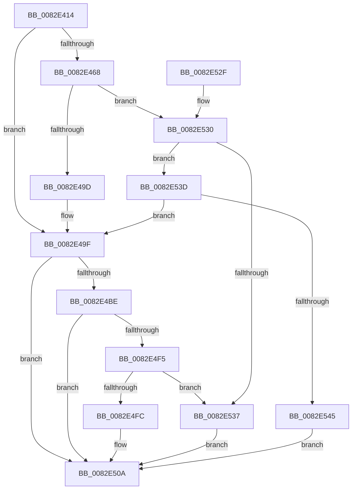

# CmDeleteDevicePanelRegKey

- RVA: `0x0082E414`–`0x0082E54C` (길이 `312` bytes)
- VA: `0x000000014082E414`
- 실행 섹션: `PAGE`
- PDB 이름 있음: `예`; PDB Function 태그: `아니요`
- unwind 정보 RVA: `0x000A88C0`
- 디코드: `81`개 명령, `312/312` bytes 표시
- 미해석 바이트: `0` (있으면 어셈블리에 `.byte`로 보존)

> 이 문서는 커널 이미지의 기계어와 PDB 기호를 분석해 생성했습니다. 4번과 5번은 함수 원형과 자료형을 바이너리 사용 방식에서 추정한 C 해석이며 원본 소스 복구 결과는 아닙니다.

## 1. Dependencies

- 직접 호출 지점: **5**; 고유 호출 대상: **4**
- 직접 호출자로 확인된 함수: **1**
- RIP 상대 이미지 참조: **1**

### Outgoing calls
- `0x0082E449` → [memset](../../text/6C/memset_function_006C6C40.md) (function, `0x006C6C40`)
- `0x0082E48D` → [guard_dispatch_icall](../../text/6B/guard_dispatch_icall_function_006BAAD0.md) (function, `0x006BAAD0`)
- `0x0082E4B2` → [CmDeleteDevicePanelRegKeyWorker](CmDeleteDevicePanelRegKeyWorker_function_0082E554.md) (function, `0x0082E554`)
- `0x0082E4E7` → [guard_dispatch_icall](../../text/6B/guard_dispatch_icall_function_006BAAD0.md) (function, `0x006BAAD0`)
- `0x0082E517` → [_security_check_cookie](../../text/6A/_security_check_cookie_function_006AC640.md) (function, `0x006AC640`)

### Direct callers
- [CmDeleteDevicePanelWorker](CmDeleteDevicePanelWorker_function_0082E7EC.md) at `0x0082E838`
- [CmDeleteDevicePanelWorker](CmDeleteDevicePanelWorker_function_0082E7EC.md) at `0x0082E954`

### Static image references
- `0x0082E423` → RVA `0x00E0A740` (`.data`; read)

## 2. Other-region calls and transfers

- 다른 실행 섹션으로 향하는 call: **4**
  - `0x0082E449` → [memset](../../text/6C/memset_function_006C6C40.md) (`PAGE` → `.text`)
  - `0x0082E48D` → [guard_dispatch_icall](../../text/6B/guard_dispatch_icall_function_006BAAD0.md) (`PAGE` → `.text`)
  - `0x0082E4E7` → [guard_dispatch_icall](../../text/6B/guard_dispatch_icall_function_006BAAD0.md) (`PAGE` → `.text`)
  - `0x0082E517` → [_security_check_cookie](../../text/6A/_security_check_cookie_function_006AC640.md) (`PAGE` → `.text`)
- 별도 외부 분기/꼬리 이동을 확인하지 못했습니다.

## 3. Assembly (complete function range)

```asm
0082E414  48 89 5C 24 20                  mov qword ptr [rsp + 0x20], rbx
0082E419  55                              push rbp
0082E41A  56                              push rsi
0082E41B  57                              push rdi
0082E41C  48 81 EC B0 00 00 00            sub rsp, 0xb0
0082E423  48 8B 05 16 C3 5D 00            mov rax, qword ptr [rip + 0x5dc316]
0082E42A  48 33 C4                        xor rax, rsp
0082E42D  48 89 84 24 A0 00 00 00         mov qword ptr [rsp + 0xa0], rax
0082E435  48 8B EA                        mov rbp, rdx
0082E438  41 8B D8                        mov ebx, r8d
0082E43B  33 D2                           xor edx, edx
0082E43D  48 8B F1                        mov rsi, rcx
0082E440  48 8D 4C 24 40                  lea rcx, [rsp + 0x40]
0082E445  44 8D 42 58                     lea r8d, [rdx + 0x58]
0082E449  E8 F2 87 E9 FF                  call 0x1406c6c40
0082E44E  48 8B BE F8 01 00 00            mov rdi, qword ptr [rsi + 0x1f8]
0082E455  83 64 24 54 00                  and dword ptr [rsp + 0x54], 0
0082E45A  89 5C 24 50                     mov dword ptr [rsp + 0x50], ebx
0082E45E  C6 44 24 58 01                  mov byte ptr [rsp + 0x58], 1
0082E463  48 85 FF                        test rdi, rdi
0082E466  74 37                           je 0x14082e49f
0082E468  41 B9 0C 00 00 00               mov r9d, 0xc
0082E46E  48 8D 44 24 40                  lea rax, [rsp + 0x40]
0082E473  48 89 44 24 28                  mov qword ptr [rsp + 0x28], rax
0082E478  48 8B D5                        mov rdx, rbp
0082E47B  48 8B CE                        mov rcx, rsi
0082E47E  C7 44 24 20 01 00 00 00         mov dword ptr [rsp + 0x20], 1
0082E486  48 8B C7                        mov rax, rdi
0082E489  45 8D 41 FA                     lea r8d, [r9 - 6]
0082E48D  E8 3E C6 E8 FF                  call 0x1406baad0
0082E492  3D 02 00 00 C0                  cmp eax, 0xc0000002
0082E497  0F 85 93 00 00 00               jne 0x14082e530
0082E49D  33 FF                           xor edi, edi
0082E49F  8A 44 24 58                     mov al, byte ptr [rsp + 0x58]
0082E4A3  48 8B D5                        mov rdx, rbp
0082E4A6  44 8B 44 24 50                  mov r8d, dword ptr [rsp + 0x50]
0082E4AB  48 8B CE                        mov rcx, rsi
0082E4AE  88 44 24 20                     mov byte ptr [rsp + 0x20], al
0082E4B2  E8 9D 00 00 00                  call 0x14082e554
0082E4B7  8B D8                           mov ebx, eax
0082E4B9  48 85 FF                        test rdi, rdi
0082E4BC  74 4C                           je 0x14082e50a
0082E4BE  89 44 24 40                     mov dword ptr [rsp + 0x40], eax
0082E4C2  41 B9 0C 00 00 00               mov r9d, 0xc
0082E4C8  48 8D 44 24 40                  lea rax, [rsp + 0x40]
0082E4CD  48 8B D5                        mov rdx, rbp
0082E4D0  48 89 44 24 28                  mov qword ptr [rsp + 0x28], rax
0082E4D5  48 8B CE                        mov rcx, rsi
0082E4D8  48 8B C7                        mov rax, rdi
0082E4DB  C7 44 24 20 02 00 00 00         mov dword ptr [rsp + 0x20], 2
0082E4E3  45 8D 41 FA                     lea r8d, [r9 - 6]
0082E4E7  E8 E4 C5 E8 FF                  call 0x1406baad0
0082E4EC  8B C8                           mov ecx, eax
0082E4EE  3D 02 00 00 C0                  cmp eax, 0xc0000002
0082E4F3  74 15                           je 0x14082e50a
0082E4F5  3D 20 01 00 C0                  cmp eax, 0xc0000120
0082E4FA  74 3B                           je 0x14082e537
0082E4FC  8B C3                           mov eax, ebx
0082E4FE  85 C9                           test ecx, ecx
0082E500  BB E5 00 00 C0                  mov ebx, 0xc00000e5
0082E505  0F 45 C3                        cmovne eax, ebx
0082E508  8B D8                           mov ebx, eax
0082E50A  8B C3                           mov eax, ebx
0082E50C  48 8B 8C 24 A0 00 00 00         mov rcx, qword ptr [rsp + 0xa0]
0082E514  48 33 CC                        xor rcx, rsp
0082E517  E8 24 E1 E7 FF                  call 0x1406ac640
0082E51C  48 8B 9C 24 E8 00 00 00         mov rbx, qword ptr [rsp + 0xe8]
0082E524  48 81 C4 B0 00 00 00            add rsp, 0xb0
0082E52B  5F                              pop rdi
0082E52C  5E                              pop rsi
0082E52D  5D                              pop rbp
0082E52E  C3                              ret
0082E52F  CC                              int3
0082E530  3D 20 01 00 C0                  cmp eax, 0xc0000120
0082E535  75 06                           jne 0x14082e53d
0082E537  8B 5C 24 40                     mov ebx, dword ptr [rsp + 0x40]
0082E53B  EB CD                           jmp 0x14082e50a
0082E53D  85 C0                           test eax, eax
0082E53F  0F 84 5A FF FF FF               je 0x14082e49f
0082E545  BB E5 00 00 C0                  mov ebx, 0xc00000e5
0082E54A  EB BE                           jmp 0x14082e50a
```

## 4. C-style interpretation (structured pseudocode)

```c
__int64 __fastcall CmDeleteDevicePanelRegKey(__int64 a1, __int64 a2, int a3)
{
    __int64 result;
    __int64 v_rdi;
    __int64 v_rsp;
    unsigned __int64 v_stack_m28;
    unsigned __int8 v_stack_m70;
    unsigned int v_stack_m74;
    unsigned int v_stack_m78;
    unsigned __int64 v_stack_m88;
    unsigned __int64 v_stack_mA0;
    unsigned int v_stack_mA8;
    unsigned __int64 v_stack_p20;
    unsigned int v_stack_p40;

    v_stack_p20 = v_rbx;
    v_rsp = (v_rsp) - (176);
    result = (*(unsigned __int64 *)(v_rip + 6144790)) ^ (v_rsp);
    v_stack_m28 = result;
    a2 = 0;
    result = memset(v_stack_m88, a2, a2 + 88, a4);
    v_stack_m78 = (unsigned int)((unsigned int)(a3));
    v_stack_m70 = 1;
    if (*(unsigned __int64 *)(a1 + 504) == 0) goto loc_0082E49F;
    v_stack_mA0 = v_stack_m88;
    v_stack_mA8 = 1;
    result = guard_dispatch_icall(a1, 0, 12 - 6, 12);
    if (((unsigned int)(result)) != 0xC0000002ULL) goto loc_0082E530;
    v_rdi = 0;
loc_0082E49F:
    v_stack_mA8 = (unsigned __int8)(v_stack_m70);
    result = CmDeleteDevicePanelRegKeyWorker(a1, 0, (unsigned int)(v_stack_m78), 12);
    if (0 == 0) goto loc_0082E50A;
    v_stack_m88 = (unsigned int)(result);
    v_stack_mA0 = v_stack_m88;
    v_stack_mA8 = 2;
    result = guard_dispatch_icall(a1, 0, 12 - 6, 12);
    if (((unsigned int)(result)) == 0xC0000002ULL) goto loc_0082E50A;
    if (((unsigned int)(result)) == 0xC0000120ULL) goto loc_0082E537;
    result = (unsigned int)((unsigned int)((unsigned int)((unsigned int)(result))));
    if ((unsigned int)((unsigned int)((unsigned int)(result))) != 0) { result = (unsigned int)((unsigned int)(0xC00000E5ULL)); }
loc_0082E50A:
    a1 = (v_stack_m28) ^ (v_rsp);
    result = _security_check_cookie(a1, 0, 12 - 6, 12);
    v_rsp = (v_rsp) + (176);
    return result;
loc_0082E530:
    if (((unsigned int)(result)) != 0xC0000120ULL) goto loc_0082E53D;
loc_0082E537:
    goto loc_0082E50A;
loc_0082E53D:
    if ((unsigned int)(result) == 0) goto loc_0082E49F;
    goto loc_0082E50A;
}
```

## 5. (Beta) C Style

```c
int64_t CmDeleteDevicePanelRegKey(void *Arg1, int64_t Arg2, int32_t Arg3)
{
    uint8_t *arg1 = (uint8_t *)Arg1;

    int64_t result;
    int64_t local_rdi;
    int64_t local_rsp;
    uint64_t v_stack_m28;
    uint8_t v_stack_m70;
    uint32_t v_stack_m74;
    uint32_t v_stack_m78;
    uint64_t v_stack_m88;
    uint64_t v_stack_mA0;
    uint32_t v_stack_mA8;
    uint64_t v_stack_p20;
    uint32_t v_stack_p40;

    v_stack_p20 = local_rbx;
    local_rsp = (local_rsp) - (176);
    result = (*(uint64_t *)(v_rip + 0x5DC316)) ^ (local_rsp);
    v_stack_m28 = result;
    Arg2 = 0;
    result = memset(v_stack_m88, Arg2, Arg2 + 88, a4);
    v_stack_m78 = (uint32_t)((uint32_t)(Arg3));
    v_stack_m70 = 1;
    if (*(uint64_t *)(arg1 + 0x1F8) == 0) goto loc_0082E49F;
    v_stack_mA0 = v_stack_m88;
    v_stack_mA8 = 1;
    result = guard_dispatch_icall(Arg1, 0, 12 - 6, 12);
    if (((uint32_t)(result)) != 0xC0000002ULL) goto loc_0082E530;
    local_rdi = 0;
loc_0082E49F:
    v_stack_mA8 = (uint8_t)(v_stack_m70);
    result = CmDeleteDevicePanelRegKeyWorker(Arg1, 0, (uint32_t)(v_stack_m78), 12);
    if (0 == 0) goto loc_0082E50A;
    v_stack_m88 = (uint32_t)(result);
    v_stack_mA0 = v_stack_m88;
    v_stack_mA8 = 2;
    result = guard_dispatch_icall(Arg1, 0, 12 - 6, 12);
    if (((uint32_t)(result)) == 0xC0000002ULL) goto loc_0082E50A;
    if (((uint32_t)(result)) == 0xC0000120ULL) goto loc_0082E537;
    result = (uint32_t)((uint32_t)((uint32_t)((uint32_t)(result))));
    if ((uint32_t)((uint32_t)((uint32_t)(result))) != 0) { result = (uint32_t)((uint32_t)(0xC00000E5ULL)); }
loc_0082E50A:
    Arg1 = (v_stack_m28) ^ (local_rsp);
    result = _security_check_cookie(Arg1, 0, 12 - 6, 12);
    local_rsp = (local_rsp) + (176);
    return result;
loc_0082E530:
    if (((uint32_t)(result)) != 0xC0000120ULL) goto loc_0082E53D;
loc_0082E537:
    goto loc_0082E50A;
loc_0082E53D:
    if ((uint32_t)(result) == 0) goto loc_0082E49F;
    goto loc_0082E50A;
}
```

### 관측된 메모리 오프셋

구조체 형식이 확인되지 않은 접근은 인자 기준의 오프셋으로만 기록했습니다.

| 기준 인자 | 오프셋 표현 | 폭 (bit) | 접근 |
|---|---:|---:|---|
| `Arg1` | `+ 0x1F8` | `64` | `R` |

## 6. Execution-region graph

[열기: 2D/3D 그래프와 함수 탐색 컨트롤 패널](../../../control-panel.html?section=page&rva=0x0082E414&view=graph)

- 2D 그래프는 위에서 아래로 흐르고, 3D 그래프는 빈 공간을 드래그해 회전합니다. Shift+드래그는 이동, 휠은 확대·축소, 함수 노드 선택은 대상 보고서 이동입니다.

### Static fallback


