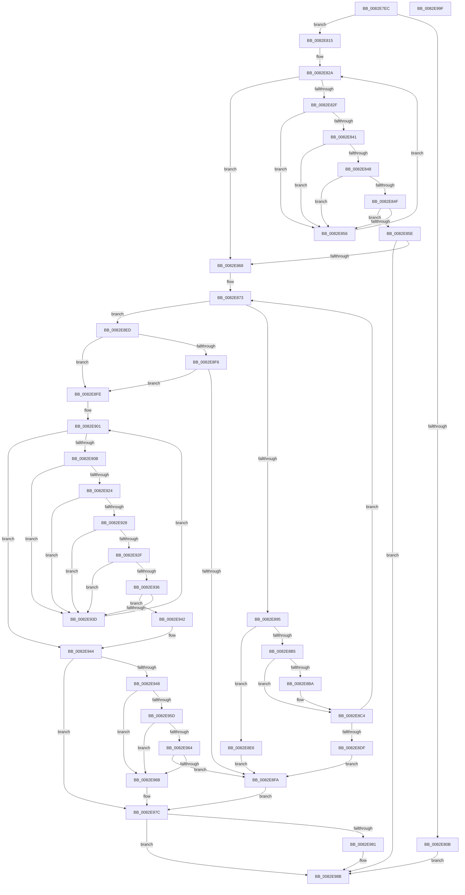

# CmDeleteDevicePanelWorker

- RVA: `0x0082E7EC`–`0x0082E9A0` (길이 `436` bytes)
- VA: `0x000000014082E7EC`
- 실행 섹션: `PAGE`
- PDB 이름 있음: `예`; PDB Function 태그: `아니요`
- unwind 정보 RVA: `0x000DA90C`
- 디코드: `129`개 명령, `436/436` bytes 표시
- 미해석 바이트: `0` (있으면 어셈블리에 `.byte`로 보존)

> 이 문서는 커널 이미지의 기계어와 PDB 기호를 분석해 생성했습니다. 4번과 5번은 함수 원형과 자료형을 바이너리 사용 방식에서 추정한 C 해석이며 원본 소스 복구 결과는 아닙니다.

## 1. Dependencies

- 직접 호출 지점: **8**; 고유 호출 대상: **6**
- 직접 호출자로 확인된 함수: **1**
- RIP 상대 이미지 참조: **0**

### Outgoing calls
- `0x0082E838` → [CmDeleteDevicePanelRegKey](CmDeleteDevicePanelRegKey_function_0082E414.md) (function, `0x0082E414`)
- `0x0082E889` → [CmGetDevicePanelMappedPropertyKeys](CmGetDevicePanelMappedPropertyKeys_function_0082EDF0.md) (function, `0x0082EDF0`)
- `0x0082E8BF` → [ExFreePoolWithTag](../../poolcode/B8/ExFreePoolWithTag_function_00B82870.md) (function, `0x00B82870`)
- `0x0082E8D2` → [ExAllocatePool2](../../poolcode/B8/ExAllocatePool2_function_00B820F0.md) (function, `0x00B820F0`)
- `0x0082E91B` → [CmSetDevicePanelMappedProperty](CmSetDevicePanelMappedProperty_function_0082F600.md) (function, `0x0082F600`)
- `0x0082E954` → [CmDeleteDevicePanelRegKey](CmDeleteDevicePanelRegKey_function_0082E414.md) (function, `0x0082E414`)
- `0x0082E977` → [CmRaiseDeleteEvent](CmRaiseDeleteEvent_function_0082DBE0.md) (function, `0x0082DBE0`)
- `0x0082E986` → [ExFreePoolWithTag](../../poolcode/B8/ExFreePoolWithTag_function_00B82870.md) (function, `0x00B82870`)

### Direct callers
- [CmDeleteDevicePanel](CmDeleteDevicePanel_function_0082E2EC.md) at `0x0082E371`

### Static image references
- 디코드된 RIP-relative 메모리 참조가 없습니다.

## 2. Other-region calls and transfers

- 다른 실행 섹션으로 향하는 call: **3**
  - `0x0082E8BF` → [ExFreePoolWithTag](../../poolcode/B8/ExFreePoolWithTag_function_00B82870.md) (`PAGE` → `POOLCODE`)
  - `0x0082E8D2` → [ExAllocatePool2](../../poolcode/B8/ExAllocatePool2_function_00B820F0.md) (`PAGE` → `POOLCODE`)
  - `0x0082E986` → [ExFreePoolWithTag](../../poolcode/B8/ExFreePoolWithTag_function_00B82870.md) (`PAGE` → `POOLCODE`)
- 별도 외부 분기/꼬리 이동을 확인하지 못했습니다.

## 3. Assembly (complete function range)

```asm
0082E7EC  48 89 5C 24 08                  mov qword ptr [rsp + 8], rbx
0082E7F1  55                              push rbp
0082E7F2  57                              push rdi
0082E7F3  41 54                           push r12
0082E7F5  41 56                           push r14
0082E7F7  41 57                           push r15
0082E7F9  48 83 EC 40                     sub rsp, 0x40
0082E7FD  33 FF                           xor edi, edi
0082E7FF  4C 8B FA                        mov r15, rdx
0082E802  4C 8B E1                        mov r12, rcx
0082E805  66 45 85 C0                     test r8w, r8w
0082E809  74 0A                           je 0x14082e815
0082E80B  BF 0D 00 00 C0                  mov edi, 0xc000000d
0082E810  E9 76 01 00 00                  jmp 0x14082e98b
0082E815  C7 84 24 80 00 00 00 60 01 00 00  mov dword ptr [rsp + 0x80], 0x160
0082E820  4C 8D B4 24 80 00 00 00         lea r14, [rsp + 0x80]
0082E828  33 DB                           xor ebx, ebx
0082E82A  83 FB 01                        cmp ebx, 1
0082E82D  73 39                           jae 0x14082e868
0082E82F  45 8B 06                        mov r8d, dword ptr [r14]
0082E832  49 8B D7                        mov rdx, r15
0082E835  49 8B CC                        mov rcx, r12
0082E838  E8 D7 FB FF FF                  call 0x14082e414
0082E83D  85 C0                           test eax, eax
0082E83F  74 15                           je 0x14082e856
0082E841  3D 34 00 00 C0                  cmp eax, 0xc0000034
0082E846  74 0E                           je 0x14082e856
0082E848  3D 0D 00 00 C0                  cmp eax, 0xc000000d
0082E84D  74 07                           je 0x14082e856
0082E84F  3D BB 00 00 C0                  cmp eax, 0xc00000bb
0082E854  75 08                           jne 0x14082e85e
0082E856  FF C3                           inc ebx
0082E858  49 83 C6 04                     add r14, 4
0082E85C  EB CC                           jmp 0x14082e82a
0082E85E  8B F8                           mov edi, eax
0082E860  85 C0                           test eax, eax
0082E862  0F 88 23 01 00 00               js 0x14082e98b
0082E868  33 DB                           xor ebx, ebx
0082E86A  33 ED                           xor ebp, ebp
0082E86C  89 AC 24 80 00 00 00            mov dword ptr [rsp + 0x80], ebp
0082E873  48 8D 84 24 80 00 00 00         lea rax, [rsp + 0x80]
0082E87B  48 89 44 24 30                  mov qword ptr [rsp + 0x30], rax
0082E880  89 6C 24 28                     mov dword ptr [rsp + 0x28], ebp
0082E884  48 89 5C 24 20                  mov qword ptr [rsp + 0x20], rbx
0082E889  E8 62 05 00 00                  call 0x14082edf0
0082E88E  3D 23 00 00 C0                  cmp eax, 0xc0000023
0082E893  75 58                           jne 0x14082e8ed
0082E895  8B AC 24 80 00 00 00            mov ebp, dword ptr [rsp + 0x80]
0082E89C  B8 FF FF FF FF                  mov eax, 0xffffffff
0082E8A1  4C 8D 34 AD 00 00 00 00         lea r14, [rbp*4]
0082E8A9  4C 03 F5                        add r14, rbp
0082E8AC  49 C1 E6 02                     shl r14, 2
0082E8B0  4C 3B F0                        cmp r14, rax
0082E8B3  77 31                           ja 0x14082e8e6
0082E8B5  48 85 DB                        test rbx, rbx
0082E8B8  74 0A                           je 0x14082e8c4
0082E8BA  33 D2                           xor edx, edx
0082E8BC  48 8B CB                        mov rcx, rbx
0082E8BF  E8 AC 3F 35 00                  call 0x140b82870
0082E8C4  41 8B D6                        mov edx, r14d
0082E8C7  B9 00 01 00 00                  mov ecx, 0x100
0082E8CC  41 B8 50 4E 50 52               mov r8d, 0x52504e50
0082E8D2  E8 19 38 35 00                  call 0x140b820f0
0082E8D7  48 8B D8                        mov rbx, rax
0082E8DA  48 85 C0                        test rax, rax
0082E8DD  75 94                           jne 0x14082e873
0082E8DF  B8 17 00 00 C0                  mov eax, 0xc0000017
0082E8E4  EB 14                           jmp 0x14082e8fa
0082E8E6  B8 0D 00 00 C0                  mov eax, 0xc000000d
0082E8EB  EB 0D                           jmp 0x14082e8fa
0082E8ED  BD 25 02 00 C0                  mov ebp, 0xc0000225
0082E8F2  85 C0                           test eax, eax
0082E8F4  74 08                           je 0x14082e8fe
0082E8F6  3B C5                           cmp eax, ebp
0082E8F8  74 04                           je 0x14082e8fe
0082E8FA  8B F8                           mov edi, eax
0082E8FC  EB 7E                           jmp 0x14082e97c
0082E8FE  45 33 DB                        xor r11d, r11d
0082E901  44 3B 9C 24 80 00 00 00         cmp r11d, dword ptr [rsp + 0x80]
0082E909  73 39                           jae 0x14082e944
0082E90B  4B 8D 0C 9B                     lea rcx, [r11 + r11*4]
0082E90F  45 33 C9                        xor r9d, r9d
0082E912  48 8D 04 8B                     lea rax, [rbx + rcx*4]
0082E916  48 89 44 24 20                  mov qword ptr [rsp + 0x20], rax
0082E91B  E8 E0 0C 00 00                  call 0x14082f600
0082E920  85 C0                           test eax, eax
0082E922  74 19                           je 0x14082e93d
0082E924  3B C5                           cmp eax, ebp
0082E926  74 15                           je 0x14082e93d
0082E928  3D 22 00 00 C0                  cmp eax, 0xc0000022
0082E92D  74 0E                           je 0x14082e93d
0082E92F  3D 16 00 00 C0                  cmp eax, 0xc0000016
0082E934  74 07                           je 0x14082e93d
0082E936  3D BB 00 00 C0                  cmp eax, 0xc00000bb
0082E93B  75 05                           jne 0x14082e942
0082E93D  41 FF C3                        inc r11d
0082E940  EB BF                           jmp 0x14082e901
0082E942  8B F8                           mov edi, eax
0082E944  85 FF                           test edi, edi
0082E946  78 34                           js 0x14082e97c
0082E948  41 B8 60 00 00 00               mov r8d, 0x60
0082E94E  49 8B D7                        mov rdx, r15
0082E951  49 8B CC                        mov rcx, r12
0082E954  E8 BB FA FF FF                  call 0x14082e414
0082E959  85 C0                           test eax, eax
0082E95B  74 0E                           je 0x14082e96b
0082E95D  3D 34 00 00 C0                  cmp eax, 0xc0000034
0082E962  74 07                           je 0x14082e96b
0082E964  3D 0D 00 00 C0                  cmp eax, 0xc000000d
0082E969  75 8F                           jne 0x14082e8fa
0082E96B  41 B8 06 00 00 00               mov r8d, 6
0082E971  49 8B D7                        mov rdx, r15
0082E974  49 8B CC                        mov rcx, r12
0082E977  E8 64 F2 FF FF                  call 0x14082dbe0
0082E97C  48 85 DB                        test rbx, rbx
0082E97F  74 0A                           je 0x14082e98b
0082E981  33 D2                           xor edx, edx
0082E983  48 8B CB                        mov rcx, rbx
0082E986  E8 E5 3E 35 00                  call 0x140b82870
0082E98B  48 8B 5C 24 70                  mov rbx, qword ptr [rsp + 0x70]
0082E990  8B C7                           mov eax, edi
0082E992  48 83 C4 40                     add rsp, 0x40
0082E996  41 5F                           pop r15
0082E998  41 5E                           pop r14
0082E99A  41 5C                           pop r12
0082E99C  5F                              pop rdi
0082E99D  5D                              pop rbp
0082E99E  C3                              ret
0082E99F  CC                              int3
```

## 4. C-style interpretation (structured pseudocode)

```c
__int64 __fastcall CmDeleteDevicePanelWorker(__int64 a1, __int64 a2, unsigned __int16 a3, int a4)
{
    __int64 result;
    __int64 v_r11;
    __int64 v_r14;
    __int64 v_rbp;
    __int64 v_rbx;
    __int64 v_rdi;
    __int64 v_rsp;
    unsigned __int64 v_stack_m38;
    unsigned int v_stack_m40;
    unsigned __int64 v_stack_m48;
    unsigned int v_stack_p18;
    unsigned __int64 v_stack_p8;

    v_stack_p8 = v_rbx;
    v_rsp = (v_rsp) - (64);
    v_rdi = 0;
    if (a3 == 0) goto loc_0082E815;
    goto loc_0082E98B;
loc_0082E815:
    v_stack_p18 = 352;
    v_rbx = 0;
loc_0082E82A:
    if (0 >= 1) goto loc_0082E868;
    result = CmDeleteDevicePanelRegKey(a1, a2, (unsigned int)(*(unsigned int *)(v_stack_p18)), a4);
    if ((unsigned int)(result) == 0) goto loc_0082E856;
    if (((unsigned int)(result)) == 0xC0000034ULL) goto loc_0082E856;
    if (((unsigned int)(result)) == 0xC000000DULL) goto loc_0082E856;
    if (((unsigned int)(result)) != 0xC00000BBULL) goto loc_0082E85E;
loc_0082E856:
    v_rbx = (unsigned int)((v_rbx) + 1);
    v_r14 = (v_stack_p18) + (4);
    goto loc_0082E82A;
loc_0082E85E:
    if (sign_flag) goto loc_0082E98B;
loc_0082E868:
    v_rbx = 0;
    v_rbp = 0;
    v_stack_p18 = 0;
loc_0082E873:
    v_stack_m38 = v_stack_p18;
    v_stack_m40 = 0;
    v_stack_m48 = 0;
    result = CmGetDevicePanelMappedPropertyKeys(a1, a2, (unsigned int)(*(unsigned int *)(v_stack_p18)), a4);
    if (((unsigned int)(result)) != 0xC0000023ULL) goto loc_0082E8ED;
    v_r14 = ((unsigned int)(v_stack_p18) * 4) + ((unsigned int)(v_stack_p18));
    v_r14 = (v_r14) << (2);
    if (v_r14 > ((unsigned int)(0xFFFFFFFFULL))) goto loc_0082E8E6;
    result = (unsigned int)(0xFFFFFFFFULL);
    if (0 != 0) {
        a2 = 0;
        a1 = 0;
        result = ExFreePoolWithTag(a1, a2, (unsigned int)(*(unsigned int *)(v_stack_p18)), a4);
    }
    result = ExAllocatePool2(256, (unsigned int)((unsigned int)(v_r14)), (unsigned int)(0x52504E50ULL), a4);
    if (result != 0) goto loc_0082E873;
    goto loc_0082E8FA;
loc_0082E8E6:
    goto loc_0082E8FA;
loc_0082E8ED:
    if ((unsigned int)((unsigned int)(0xC000000DULL)) == 0) goto loc_0082E8FE;
    if (((unsigned int)((unsigned int)(0xC000000DULL))) == ((unsigned int)((unsigned int)(0xC0000225ULL)))) goto loc_0082E8FE;
loc_0082E8FA:
    goto loc_0082E97C;
loc_0082E8FE:
    v_r11 = 0;
loc_0082E901:
    if (0 >= v_stack_p18) goto loc_0082E944;
    a4 = 0;
    v_stack_m48 = result + v_r11 + v_r11 * 4 * 4;
    result = CmSetDevicePanelMappedProperty(v_r11 + v_r11 * 4, (unsigned int)((unsigned int)(v_r14)), (unsigned int)(0x52504E50ULL), a4);
    if ((unsigned int)(result) == 0) goto loc_0082E93D;
    if (((unsigned int)(result)) == ((unsigned int)((unsigned int)(0xC0000225ULL)))) goto loc_0082E93D;
    if (((unsigned int)(result)) == 0xC0000022ULL) goto loc_0082E93D;
    if (((unsigned int)(result)) == 0xC0000016ULL) goto loc_0082E93D;
    if (((unsigned int)(result)) != 0xC00000BBULL) goto loc_0082E942;
loc_0082E93D:
    v_r11 = (unsigned int)((v_r11) + 1);
    goto loc_0082E901;
loc_0082E942:
loc_0082E944:
    if (sign_flag) goto loc_0082E97C;
    result = CmDeleteDevicePanelRegKey(a1, 0, 96, a4);
    if ((unsigned int)(result) == 0) goto loc_0082E96B;
    if (((unsigned int)(result)) == 0xC0000034ULL) goto loc_0082E96B;
    if (((unsigned int)(result)) != 0xC000000DULL) goto loc_0082E8FA;
loc_0082E96B:
    result = CmRaiseDeleteEvent(a1, 0, 6, a4);
loc_0082E97C:
    if (result != 0) {
        a2 = 0;
        a1 = result;
        result = ExFreePoolWithTag(a1, a2, 6, a4);
    }
    v_rsp = (v_rsp) + (64);
    return (unsigned int)((unsigned int)((unsigned int)((unsigned int)(result))));
}
```

## 5. (Beta) C Style

```c
int64_t CmDeleteDevicePanelWorker(int64_t Arg1, int64_t Arg2, uint16_t Arg3, int32_t Arg4)
{
    int64_t result;
    int64_t local_r11;
    int64_t local_r14;
    int64_t local_rbp;
    int64_t local_rbx;
    int64_t local_rdi;
    int64_t local_rsp;
    uint64_t v_stack_m38;
    uint32_t v_stack_m40;
    uint64_t v_stack_m48;
    uint32_t v_stack_p18;
    uint64_t v_stack_p8;

    v_stack_p8 = local_rbx;
    local_rsp = (local_rsp) - (64);
    local_rdi = 0;
    if (Arg3 == 0) goto loc_0082E815;
    goto loc_0082E98B;
loc_0082E815:
    v_stack_p18 = 352;
    local_rbx = 0;
loc_0082E82A:
    if (0 >= 1) goto loc_0082E868;
    result = CmDeleteDevicePanelRegKey(Arg1, Arg2, (uint32_t)(*(uint32_t *)(v_stack_p18)), Arg4);
    if ((uint32_t)(result) == 0) goto loc_0082E856;
    if (((uint32_t)(result)) == 0xC0000034ULL) goto loc_0082E856;
    if (((uint32_t)(result)) == 0xC000000DULL) goto loc_0082E856;
    if (((uint32_t)(result)) != 0xC00000BBULL) goto loc_0082E85E;
loc_0082E856:
    local_rbx = (uint32_t)((local_rbx) + 1);
    local_r14 = (v_stack_p18) + (4);
    goto loc_0082E82A;
loc_0082E85E:
    if (sign_flag) goto loc_0082E98B;
loc_0082E868:
    local_rbx = 0;
    local_rbp = 0;
    v_stack_p18 = 0;
loc_0082E873:
    v_stack_m38 = v_stack_p18;
    v_stack_m40 = 0;
    v_stack_m48 = 0;
    result = CmGetDevicePanelMappedPropertyKeys(Arg1, Arg2, (uint32_t)(*(uint32_t *)(v_stack_p18)), Arg4);
    if (((uint32_t)(result)) != 0xC0000023ULL) goto loc_0082E8ED;
    local_r14 = ((uint32_t)(v_stack_p18) * 4) + ((uint32_t)(v_stack_p18));
    local_r14 = (local_r14) << (2);
    if (local_r14 > ((uint32_t)(0xFFFFFFFFULL))) goto loc_0082E8E6;
    result = (uint32_t)(0xFFFFFFFFULL);
    if (0 != 0) {
        Arg2 = 0;
        Arg1 = 0;
        result = ExFreePoolWithTag(Arg1, Arg2, (uint32_t)(*(uint32_t *)(v_stack_p18)), Arg4);
    }
    result = ExAllocatePool2(256, (uint32_t)((uint32_t)(local_r14)), (uint32_t)(0x52504E50ULL), Arg4);
    if (result != 0) goto loc_0082E873;
    goto loc_0082E8FA;
loc_0082E8E6:
    goto loc_0082E8FA;
loc_0082E8ED:
    if ((uint32_t)((uint32_t)(0xC000000DULL)) == 0) goto loc_0082E8FE;
    if (((uint32_t)((uint32_t)(0xC000000DULL))) == ((uint32_t)((uint32_t)(0xC0000225ULL)))) goto loc_0082E8FE;
loc_0082E8FA:
    goto loc_0082E97C;
loc_0082E8FE:
    local_r11 = 0;
loc_0082E901:
    if (0 >= v_stack_p18) goto loc_0082E944;
    Arg4 = 0;
    v_stack_m48 = result + local_r11 + local_r11 * 4 * 4;
    result = CmSetDevicePanelMappedProperty(local_r11 + local_r11 * 4, (uint32_t)((uint32_t)(local_r14)), (uint32_t)(0x52504E50ULL), Arg4);
    if ((uint32_t)(result) == 0) goto loc_0082E93D;
    if (((uint32_t)(result)) == ((uint32_t)((uint32_t)(0xC0000225ULL)))) goto loc_0082E93D;
    if (((uint32_t)(result)) == 0xC0000022ULL) goto loc_0082E93D;
    if (((uint32_t)(result)) == 0xC0000016ULL) goto loc_0082E93D;
    if (((uint32_t)(result)) != 0xC00000BBULL) goto loc_0082E942;
loc_0082E93D:
    local_r11 = (uint32_t)((local_r11) + 1);
    goto loc_0082E901;
loc_0082E942:
loc_0082E944:
    if (sign_flag) goto loc_0082E97C;
    result = CmDeleteDevicePanelRegKey(Arg1, 0, 96, Arg4);
    if ((uint32_t)(result) == 0) goto loc_0082E96B;
    if (((uint32_t)(result)) == 0xC0000034ULL) goto loc_0082E96B;
    if (((uint32_t)(result)) != 0xC000000DULL) goto loc_0082E8FA;
loc_0082E96B:
    result = CmRaiseDeleteEvent(Arg1, 0, 6, Arg4);
loc_0082E97C:
    if (result != 0) {
        Arg2 = 0;
        Arg1 = result;
        result = ExFreePoolWithTag(Arg1, Arg2, 6, Arg4);
    }
    local_rsp = (local_rsp) + (64);
    return (uint32_t)((uint32_t)((uint32_t)((uint32_t)(result))));
}
```

## 6. Execution-region graph

[열기: 2D/3D 그래프와 함수 탐색 컨트롤 패널](../../../control-panel.html?section=page&rva=0x0082E7EC&view=graph)

- 2D 그래프는 위에서 아래로 흐르고, 3D 그래프는 빈 공간을 드래그해 회전합니다. Shift+드래그는 이동, 휠은 확대·축소, 함수 노드 선택은 대상 보고서 이동입니다.

### Static fallback


