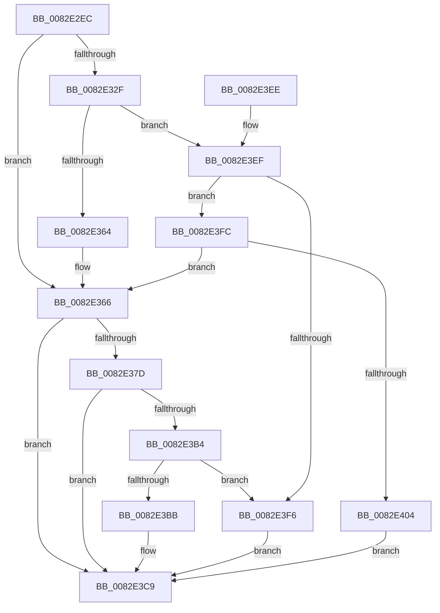

# CmDeleteDevicePanel

- RVA: `0x0082E2EC`–`0x0082E40B` (길이 `287` bytes)
- VA: `0x000000014082E2EC`
- 실행 섹션: `PAGE`
- PDB 이름 있음: `예`; PDB Function 태그: `아니요`
- unwind 정보 RVA: `0x000DA8EC`
- 디코드: `75`개 명령, `287/287` bytes 표시
- 미해석 바이트: `0` (있으면 어셈블리에 `.byte`로 보존)

> 이 문서는 커널 이미지의 기계어와 PDB 기호를 분석해 생성했습니다. 4번과 5번은 함수 원형과 자료형을 바이너리 사용 방식에서 추정한 C 해석이며 원본 소스 복구 결과는 아닙니다.

## 1. Dependencies

- 직접 호출 지점: **5**; 고유 호출 대상: **4**
- 직접 호출자로 확인된 함수: **1**
- RIP 상대 이미지 참조: **1**

### Outgoing calls
- `0x0082E31E` → [memset](../../text/6C/memset_function_006C6C40.md) (function, `0x006C6C40`)
- `0x0082E354` → [guard_dispatch_icall](../../text/6B/guard_dispatch_icall_function_006BAAD0.md) (function, `0x006BAAD0`)
- `0x0082E371` → [CmDeleteDevicePanelWorker](CmDeleteDevicePanelWorker_function_0082E7EC.md) (function, `0x0082E7EC`)
- `0x0082E3A6` → [guard_dispatch_icall](../../text/6B/guard_dispatch_icall_function_006BAAD0.md) (function, `0x006BAAD0`)
- `0x0082E3D6` → [_security_check_cookie](../../text/6A/_security_check_cookie_function_006AC640.md) (function, `0x006AC640`)

### Direct callers
- [CmAddPanelDeviceWorker](CmAddPanelDeviceWorker_function_0082DF30.md) at `0x0082E033`

### Static image references
- `0x0082E2FB` → RVA `0x00E0A740` (`.data`; read)

## 2. Other-region calls and transfers

- 다른 실행 섹션으로 향하는 call: **4**
  - `0x0082E31E` → [memset](../../text/6C/memset_function_006C6C40.md) (`PAGE` → `.text`)
  - `0x0082E354` → [guard_dispatch_icall](../../text/6B/guard_dispatch_icall_function_006BAAD0.md) (`PAGE` → `.text`)
  - `0x0082E3A6` → [guard_dispatch_icall](../../text/6B/guard_dispatch_icall_function_006BAAD0.md) (`PAGE` → `.text`)
  - `0x0082E3D6` → [_security_check_cookie](../../text/6A/_security_check_cookie_function_006AC640.md) (`PAGE` → `.text`)
- 별도 외부 분기/꼬리 이동을 확인하지 못했습니다.

## 3. Assembly (complete function range)

```asm
0082E2EC  48 89 5C 24 18                  mov qword ptr [rsp + 0x18], rbx
0082E2F1  55                              push rbp
0082E2F2  56                              push rsi
0082E2F3  57                              push rdi
0082E2F4  48 81 EC B0 00 00 00            sub rsp, 0xb0
0082E2FB  48 8B 05 3E C4 5D 00            mov rax, qword ptr [rip + 0x5dc43e]
0082E302  48 33 C4                        xor rax, rsp
0082E305  48 89 84 24 A0 00 00 00         mov qword ptr [rsp + 0xa0], rax
0082E30D  48 8B EA                        mov rbp, rdx
0082E310  48 8B F1                        mov rsi, rcx
0082E313  33 D2                           xor edx, edx
0082E315  48 8D 4C 24 40                  lea rcx, [rsp + 0x40]
0082E31A  44 8D 42 58                     lea r8d, [rdx + 0x58]
0082E31E  E8 1D 89 E9 FF                  call 0x1406c6c40
0082E323  48 8B BE F8 01 00 00            mov rdi, qword ptr [rsi + 0x1f8]
0082E32A  48 85 FF                        test rdi, rdi
0082E32D  74 37                           je 0x14082e366
0082E32F  41 B9 03 00 00 00               mov r9d, 3
0082E335  48 8D 44 24 40                  lea rax, [rsp + 0x40]
0082E33A  48 89 44 24 28                  mov qword ptr [rsp + 0x28], rax
0082E33F  48 8B D5                        mov rdx, rbp
0082E342  48 8B CE                        mov rcx, rsi
0082E345  C7 44 24 20 01 00 00 00         mov dword ptr [rsp + 0x20], 1
0082E34D  48 8B C7                        mov rax, rdi
0082E350  45 8D 41 03                     lea r8d, [r9 + 3]
0082E354  E8 77 C7 E8 FF                  call 0x1406baad0
0082E359  3D 02 00 00 C0                  cmp eax, 0xc0000002
0082E35E  0F 85 8B 00 00 00               jne 0x14082e3ef
0082E364  33 FF                           xor edi, edi
0082E366  44 8B 44 24 50                  mov r8d, dword ptr [rsp + 0x50]
0082E36B  48 8B D5                        mov rdx, rbp
0082E36E  48 8B CE                        mov rcx, rsi
0082E371  E8 76 04 00 00                  call 0x14082e7ec
0082E376  8B D8                           mov ebx, eax
0082E378  48 85 FF                        test rdi, rdi
0082E37B  74 4C                           je 0x14082e3c9
0082E37D  89 44 24 40                     mov dword ptr [rsp + 0x40], eax
0082E381  41 B9 03 00 00 00               mov r9d, 3
0082E387  48 8D 44 24 40                  lea rax, [rsp + 0x40]
0082E38C  48 8B D5                        mov rdx, rbp
0082E38F  48 89 44 24 28                  mov qword ptr [rsp + 0x28], rax
0082E394  48 8B CE                        mov rcx, rsi
0082E397  48 8B C7                        mov rax, rdi
0082E39A  C7 44 24 20 02 00 00 00         mov dword ptr [rsp + 0x20], 2
0082E3A2  45 8D 41 03                     lea r8d, [r9 + 3]
0082E3A6  E8 25 C7 E8 FF                  call 0x1406baad0
0082E3AB  8B C8                           mov ecx, eax
0082E3AD  3D 02 00 00 C0                  cmp eax, 0xc0000002
0082E3B2  74 15                           je 0x14082e3c9
0082E3B4  3D 20 01 00 C0                  cmp eax, 0xc0000120
0082E3B9  74 3B                           je 0x14082e3f6
0082E3BB  8B C3                           mov eax, ebx
0082E3BD  85 C9                           test ecx, ecx
0082E3BF  BB E5 00 00 C0                  mov ebx, 0xc00000e5
0082E3C4  0F 45 C3                        cmovne eax, ebx
0082E3C7  8B D8                           mov ebx, eax
0082E3C9  8B C3                           mov eax, ebx
0082E3CB  48 8B 8C 24 A0 00 00 00         mov rcx, qword ptr [rsp + 0xa0]
0082E3D3  48 33 CC                        xor rcx, rsp
0082E3D6  E8 65 E2 E7 FF                  call 0x1406ac640
0082E3DB  48 8B 9C 24 E0 00 00 00         mov rbx, qword ptr [rsp + 0xe0]
0082E3E3  48 81 C4 B0 00 00 00            add rsp, 0xb0
0082E3EA  5F                              pop rdi
0082E3EB  5E                              pop rsi
0082E3EC  5D                              pop rbp
0082E3ED  C3                              ret
0082E3EE  CC                              int3
0082E3EF  3D 20 01 00 C0                  cmp eax, 0xc0000120
0082E3F4  75 06                           jne 0x14082e3fc
0082E3F6  8B 5C 24 40                     mov ebx, dword ptr [rsp + 0x40]
0082E3FA  EB CD                           jmp 0x14082e3c9
0082E3FC  85 C0                           test eax, eax
0082E3FE  0F 84 62 FF FF FF               je 0x14082e366
0082E404  BB E5 00 00 C0                  mov ebx, 0xc00000e5
0082E409  EB BE                           jmp 0x14082e3c9
```

## 4. C-style interpretation (structured pseudocode)

```c
__int64 __fastcall CmDeleteDevicePanel(__int64 a1, __int64 a2)
{
    __int64 result;
    __int64 v_rdi;
    __int64 v_rsp;
    unsigned __int64 v_stack_m28;
    unsigned int v_stack_m78;
    unsigned __int64 v_stack_m88;
    unsigned __int64 v_stack_mA0;
    unsigned int v_stack_mA8;
    unsigned __int64 v_stack_p18;
    unsigned int v_stack_p40;

    v_stack_p18 = v_rbx;
    v_rsp = (v_rsp) - (176);
    result = (*(unsigned __int64 *)(v_rip + 6145086)) ^ (v_rsp);
    v_stack_m28 = result;
    a2 = 0;
    result = memset(v_stack_m88, a2, a2 + 88, a4);
    if (*(unsigned __int64 *)(a1 + 504) == 0) goto loc_0082E366;
    v_stack_mA0 = v_stack_m88;
    v_stack_mA8 = 1;
    result = guard_dispatch_icall(a1, 0, 3 + 3, 3);
    if (((unsigned int)(result)) != 0xC0000002ULL) goto loc_0082E3EF;
    v_rdi = 0;
loc_0082E366:
    result = CmDeleteDevicePanelWorker(a1, 0, (unsigned int)(v_stack_m78), 3);
    if (0 == 0) goto loc_0082E3C9;
    v_stack_m88 = (unsigned int)(result);
    v_stack_mA0 = v_stack_m88;
    v_stack_mA8 = 2;
    result = guard_dispatch_icall(a1, 0, 3 + 3, 3);
    if (((unsigned int)(result)) == 0xC0000002ULL) goto loc_0082E3C9;
    if (((unsigned int)(result)) == 0xC0000120ULL) goto loc_0082E3F6;
    result = (unsigned int)((unsigned int)((unsigned int)((unsigned int)(result))));
    if ((unsigned int)((unsigned int)((unsigned int)(result))) != 0) { result = (unsigned int)((unsigned int)(0xC00000E5ULL)); }
loc_0082E3C9:
    a1 = (v_stack_m28) ^ (v_rsp);
    result = _security_check_cookie(a1, 0, 3 + 3, 3);
    v_rsp = (v_rsp) + (176);
    return result;
loc_0082E3EF:
    if (((unsigned int)(result)) != 0xC0000120ULL) goto loc_0082E3FC;
loc_0082E3F6:
    goto loc_0082E3C9;
loc_0082E3FC:
    if ((unsigned int)(result) == 0) goto loc_0082E366;
    goto loc_0082E3C9;
}
```

## 5. (Beta) C Style

```c
int64_t CmDeleteDevicePanel(void *Arg1, int64_t Arg2)
{
    uint8_t *arg1 = (uint8_t *)Arg1;

    int64_t result;
    int64_t local_rdi;
    int64_t local_rsp;
    uint64_t v_stack_m28;
    uint32_t v_stack_m78;
    uint64_t v_stack_m88;
    uint64_t v_stack_mA0;
    uint32_t v_stack_mA8;
    uint64_t v_stack_p18;
    uint32_t v_stack_p40;

    v_stack_p18 = local_rbx;
    local_rsp = (local_rsp) - (176);
    result = (*(uint64_t *)(v_rip + 0x5DC43E)) ^ (local_rsp);
    v_stack_m28 = result;
    Arg2 = 0;
    result = memset(v_stack_m88, Arg2, Arg2 + 88, a4);
    if (*(uint64_t *)(arg1 + 0x1F8) == 0) goto loc_0082E366;
    v_stack_mA0 = v_stack_m88;
    v_stack_mA8 = 1;
    result = guard_dispatch_icall(Arg1, 0, 3 + 3, 3);
    if (((uint32_t)(result)) != 0xC0000002ULL) goto loc_0082E3EF;
    local_rdi = 0;
loc_0082E366:
    result = CmDeleteDevicePanelWorker(Arg1, 0, (uint32_t)(v_stack_m78), 3);
    if (0 == 0) goto loc_0082E3C9;
    v_stack_m88 = (uint32_t)(result);
    v_stack_mA0 = v_stack_m88;
    v_stack_mA8 = 2;
    result = guard_dispatch_icall(Arg1, 0, 3 + 3, 3);
    if (((uint32_t)(result)) == 0xC0000002ULL) goto loc_0082E3C9;
    if (((uint32_t)(result)) == 0xC0000120ULL) goto loc_0082E3F6;
    result = (uint32_t)((uint32_t)((uint32_t)((uint32_t)(result))));
    if ((uint32_t)((uint32_t)((uint32_t)(result))) != 0) { result = (uint32_t)((uint32_t)(0xC00000E5ULL)); }
loc_0082E3C9:
    Arg1 = (v_stack_m28) ^ (local_rsp);
    result = _security_check_cookie(Arg1, 0, 3 + 3, 3);
    local_rsp = (local_rsp) + (176);
    return result;
loc_0082E3EF:
    if (((uint32_t)(result)) != 0xC0000120ULL) goto loc_0082E3FC;
loc_0082E3F6:
    goto loc_0082E3C9;
loc_0082E3FC:
    if ((uint32_t)(result) == 0) goto loc_0082E366;
    goto loc_0082E3C9;
}
```

### 관측된 메모리 오프셋

구조체 형식이 확인되지 않은 접근은 인자 기준의 오프셋으로만 기록했습니다.

| 기준 인자 | 오프셋 표현 | 폭 (bit) | 접근 |
|---|---:|---:|---|
| `Arg1` | `+ 0x1F8` | `64` | `R` |

## 6. Execution-region graph

[열기: 2D/3D 그래프와 함수 탐색 컨트롤 패널](../../../control-panel.html?section=page&rva=0x0082E2EC&view=graph)

- 2D 그래프는 위에서 아래로 흐르고, 3D 그래프는 빈 공간을 드래그해 회전합니다. Shift+드래그는 이동, 휠은 확대·축소, 함수 노드 선택은 대상 보고서 이동입니다.

### Static fallback


