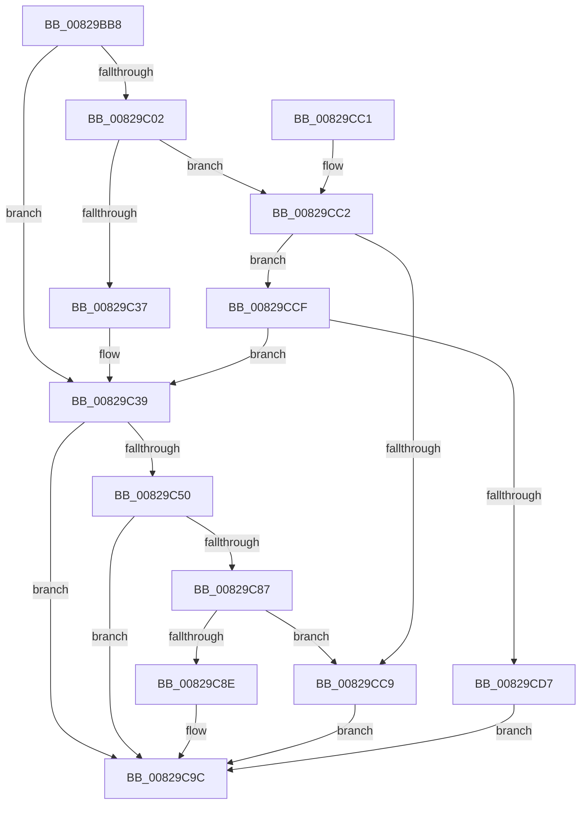

# CmDeleteDevice

- RVA: `0x00829BB8`–`0x00829CDE` (길이 `294` bytes)
- VA: `0x0000000140829BB8`
- 실행 섹션: `PAGE`
- PDB 이름 있음: `예`; PDB Function 태그: `아니요`
- unwind 정보 RVA: `0x000A88C0`
- 디코드: `77`개 명령, `294/294` bytes 표시
- 미해석 바이트: `0` (있으면 어셈블리에 `.byte`로 보존)

> 이 문서는 커널 이미지의 기계어와 PDB 기호를 분석해 생성했습니다. 4번과 5번은 함수 원형과 자료형을 바이너리 사용 방식에서 추정한 C 해석이며 원본 소스 복구 결과는 아닙니다.

## 1. Dependencies

- 직접 호출 지점: **5**; 고유 호출 대상: **4**
- 직접 호출자로 확인된 함수: **7**
- RIP 상대 이미지 참조: **1**

### Outgoing calls
- `0x00829BED` → [memset](../../text/6C/memset_function_006C6C40.md) (function, `0x006C6C40`)
- `0x00829C27` → [guard_dispatch_icall](../../text/6B/guard_dispatch_icall_function_006BAAD0.md) (function, `0x006BAAD0`)
- `0x00829C44` → [_CmDeleteDeviceWorker](../A0/_CmDeleteDeviceWorker_function_00A08F48.md) (function, `0x00A08F48`)
- `0x00829C79` → [guard_dispatch_icall](../../text/6B/guard_dispatch_icall_function_006BAAD0.md) (function, `0x006BAAD0`)
- `0x00829CA9` → [_security_check_cookie](../../text/6A/_security_check_cookie_function_006AC640.md) (function, `0x006AC640`)

### Direct callers
- [IoReportRootDevice](../72/IoReportRootDevice_function_00726780.md) at `0x00726AC5`
- [PiDevCfgInitDriverDatabaseCallback](../73/PiDevCfgInitDriverDatabaseCallback_function_00733958.md) at `0x00733B43`
- [PpDevCfgProcessDevices](../73/PpDevCfgProcessDevices_function_007373C0.md) at `0x007374DB`
- [PiCMDeleteDeviceWorker](../73/PiCMDeleteDeviceWorker_function_0073B420.md) at `0x0073B543`
- [PiCMDeleteDeviceWorker](../73/PiCMDeleteDeviceWorker_function_0073B420.md) at `0x0073B604`
- [PiCMGenerateDeviceInstance](../73/PiCMGenerateDeviceInstance_function_0073B69C.md) at `0x0073B97E`
- [sub_008E200E](../8E/Unknown_function_008E200E.md) at `0x008E20FC`
- [PipResetDevice](../../init/C3/PipResetDevice_function_00C31F90.md) at `0x00C32090`

### Static image references
- `0x00829BC7` → RVA `0x00E0A740` (`.data`; read)

## 2. Other-region calls and transfers

- 다른 실행 섹션으로 향하는 call: **4**
  - `0x00829BED` → [memset](../../text/6C/memset_function_006C6C40.md) (`PAGE` → `.text`)
  - `0x00829C27` → [guard_dispatch_icall](../../text/6B/guard_dispatch_icall_function_006BAAD0.md) (`PAGE` → `.text`)
  - `0x00829C79` → [guard_dispatch_icall](../../text/6B/guard_dispatch_icall_function_006BAAD0.md) (`PAGE` → `.text`)
  - `0x00829CA9` → [_security_check_cookie](../../text/6A/_security_check_cookie_function_006AC640.md) (`PAGE` → `.text`)
- 별도 외부 분기/꼬리 이동을 확인하지 못했습니다.

## 3. Assembly (complete function range)

```asm
00829BB8  48 89 5C 24 20                  mov qword ptr [rsp + 0x20], rbx
00829BBD  55                              push rbp
00829BBE  56                              push rsi
00829BBF  57                              push rdi
00829BC0  48 81 EC B0 00 00 00            sub rsp, 0xb0
00829BC7  48 8B 05 72 0B 5E 00            mov rax, qword ptr [rip + 0x5e0b72]
00829BCE  48 33 C4                        xor rax, rsp
00829BD1  48 89 84 24 A0 00 00 00         mov qword ptr [rsp + 0xa0], rax
00829BD9  48 8B EA                        mov rbp, rdx
00829BDC  41 8B D8                        mov ebx, r8d
00829BDF  33 D2                           xor edx, edx
00829BE1  48 8B F1                        mov rsi, rcx
00829BE4  48 8D 4C 24 40                  lea rcx, [rsp + 0x40]
00829BE9  44 8D 42 58                     lea r8d, [rdx + 0x58]
00829BED  E8 4E D0 E9 FF                  call 0x1406c6c40
00829BF2  48 8B BE F8 01 00 00            mov rdi, qword ptr [rsi + 0x1f8]
00829BF9  89 5C 24 50                     mov dword ptr [rsp + 0x50], ebx
00829BFD  48 85 FF                        test rdi, rdi
00829C00  74 37                           je 0x140829c39
00829C02  41 B9 03 00 00 00               mov r9d, 3
00829C08  48 8D 44 24 40                  lea rax, [rsp + 0x40]
00829C0D  48 89 44 24 28                  mov qword ptr [rsp + 0x28], rax
00829C12  48 8B D5                        mov rdx, rbp
00829C15  48 8B CE                        mov rcx, rsi
00829C18  C7 44 24 20 01 00 00 00         mov dword ptr [rsp + 0x20], 1
00829C20  48 8B C7                        mov rax, rdi
00829C23  45 8D 41 FE                     lea r8d, [r9 - 2]
00829C27  E8 A4 0E E9 FF                  call 0x1406baad0
00829C2C  3D 02 00 00 C0                  cmp eax, 0xc0000002
00829C31  0F 85 8B 00 00 00               jne 0x140829cc2
00829C37  33 FF                           xor edi, edi
00829C39  44 8B 44 24 50                  mov r8d, dword ptr [rsp + 0x50]
00829C3E  48 8B D5                        mov rdx, rbp
00829C41  48 8B CE                        mov rcx, rsi
00829C44  E8 FF F2 1D 00                  call 0x140a08f48
00829C49  8B D8                           mov ebx, eax
00829C4B  48 85 FF                        test rdi, rdi
00829C4E  74 4C                           je 0x140829c9c
00829C50  89 44 24 40                     mov dword ptr [rsp + 0x40], eax
00829C54  41 B9 03 00 00 00               mov r9d, 3
00829C5A  48 8D 44 24 40                  lea rax, [rsp + 0x40]
00829C5F  48 8B D5                        mov rdx, rbp
00829C62  48 89 44 24 28                  mov qword ptr [rsp + 0x28], rax
00829C67  48 8B CE                        mov rcx, rsi
00829C6A  48 8B C7                        mov rax, rdi
00829C6D  C7 44 24 20 02 00 00 00         mov dword ptr [rsp + 0x20], 2
00829C75  45 8D 41 FE                     lea r8d, [r9 - 2]
00829C79  E8 52 0E E9 FF                  call 0x1406baad0
00829C7E  8B C8                           mov ecx, eax
00829C80  3D 02 00 00 C0                  cmp eax, 0xc0000002
00829C85  74 15                           je 0x140829c9c
00829C87  3D 20 01 00 C0                  cmp eax, 0xc0000120
00829C8C  74 3B                           je 0x140829cc9
00829C8E  8B C3                           mov eax, ebx
00829C90  85 C9                           test ecx, ecx
00829C92  BB E5 00 00 C0                  mov ebx, 0xc00000e5
00829C97  0F 45 C3                        cmovne eax, ebx
00829C9A  8B D8                           mov ebx, eax
00829C9C  8B C3                           mov eax, ebx
00829C9E  48 8B 8C 24 A0 00 00 00         mov rcx, qword ptr [rsp + 0xa0]
00829CA6  48 33 CC                        xor rcx, rsp
00829CA9  E8 92 29 E8 FF                  call 0x1406ac640
00829CAE  48 8B 9C 24 E8 00 00 00         mov rbx, qword ptr [rsp + 0xe8]
00829CB6  48 81 C4 B0 00 00 00            add rsp, 0xb0
00829CBD  5F                              pop rdi
00829CBE  5E                              pop rsi
00829CBF  5D                              pop rbp
00829CC0  C3                              ret
00829CC1  CC                              int3
00829CC2  3D 20 01 00 C0                  cmp eax, 0xc0000120
00829CC7  75 06                           jne 0x140829ccf
00829CC9  8B 5C 24 40                     mov ebx, dword ptr [rsp + 0x40]
00829CCD  EB CD                           jmp 0x140829c9c
00829CCF  85 C0                           test eax, eax
00829CD1  0F 84 62 FF FF FF               je 0x140829c39
00829CD7  BB E5 00 00 C0                  mov ebx, 0xc00000e5
00829CDC  EB BE                           jmp 0x140829c9c
```

## 4. C-style interpretation (structured pseudocode)

```c
__int64 __fastcall CmDeleteDevice(__int64 a1, __int64 a2, int a3)
{
    __int64 result;
    __int64 v_rdi;
    __int64 v_rsp;
    unsigned __int64 v_stack_m28;
    unsigned int v_stack_m78;
    unsigned __int64 v_stack_m88;
    unsigned __int64 v_stack_mA0;
    unsigned int v_stack_mA8;
    unsigned __int64 v_stack_p20;
    unsigned int v_stack_p40;

    v_stack_p20 = v_rbx;
    v_rsp = (v_rsp) - (176);
    result = (*(unsigned __int64 *)(v_rip + 6163314)) ^ (v_rsp);
    v_stack_m28 = result;
    a2 = 0;
    result = memset(v_stack_m88, a2, a2 + 88, a4);
    v_stack_m78 = (unsigned int)((unsigned int)(a3));
    if (*(unsigned __int64 *)(a1 + 504) == 0) goto loc_00829C39;
    v_stack_mA0 = v_stack_m88;
    v_stack_mA8 = 1;
    result = guard_dispatch_icall(a1, 0, 3 - 2, 3);
    if (((unsigned int)(result)) != 0xC0000002ULL) goto loc_00829CC2;
    v_rdi = 0;
loc_00829C39:
    result = _CmDeleteDeviceWorker(a1, 0, (unsigned int)(v_stack_m78), 3);
    if (0 == 0) goto loc_00829C9C;
    v_stack_m88 = (unsigned int)(result);
    v_stack_mA0 = v_stack_m88;
    v_stack_mA8 = 2;
    result = guard_dispatch_icall(a1, 0, 3 - 2, 3);
    if (((unsigned int)(result)) == 0xC0000002ULL) goto loc_00829C9C;
    if (((unsigned int)(result)) == 0xC0000120ULL) goto loc_00829CC9;
    result = (unsigned int)((unsigned int)((unsigned int)((unsigned int)(result))));
    if ((unsigned int)((unsigned int)((unsigned int)(result))) != 0) { result = (unsigned int)((unsigned int)(0xC00000E5ULL)); }
loc_00829C9C:
    a1 = (v_stack_m28) ^ (v_rsp);
    result = _security_check_cookie(a1, 0, 3 - 2, 3);
    v_rsp = (v_rsp) + (176);
    return result;
loc_00829CC2:
    if (((unsigned int)(result)) != 0xC0000120ULL) goto loc_00829CCF;
loc_00829CC9:
    goto loc_00829C9C;
loc_00829CCF:
    if ((unsigned int)(result) == 0) goto loc_00829C39;
    goto loc_00829C9C;
}
```

## 5. (Beta) C Style

```c
int64_t CmDeleteDevice(void *Arg1, int64_t Arg2, int32_t Arg3)
{
    uint8_t *arg1 = (uint8_t *)Arg1;

    int64_t result;
    int64_t local_rdi;
    int64_t local_rsp;
    uint64_t v_stack_m28;
    uint32_t v_stack_m78;
    uint64_t v_stack_m88;
    uint64_t v_stack_mA0;
    uint32_t v_stack_mA8;
    uint64_t v_stack_p20;
    uint32_t v_stack_p40;

    v_stack_p20 = local_rbx;
    local_rsp = (local_rsp) - (176);
    result = (*(uint64_t *)(v_rip + 0x5E0B72)) ^ (local_rsp);
    v_stack_m28 = result;
    Arg2 = 0;
    result = memset(v_stack_m88, Arg2, Arg2 + 88, a4);
    v_stack_m78 = (uint32_t)((uint32_t)(Arg3));
    if (*(uint64_t *)(arg1 + 0x1F8) == 0) goto loc_00829C39;
    v_stack_mA0 = v_stack_m88;
    v_stack_mA8 = 1;
    result = guard_dispatch_icall(Arg1, 0, 3 - 2, 3);
    if (((uint32_t)(result)) != 0xC0000002ULL) goto loc_00829CC2;
    local_rdi = 0;
loc_00829C39:
    result = _CmDeleteDeviceWorker(Arg1, 0, (uint32_t)(v_stack_m78), 3);
    if (0 == 0) goto loc_00829C9C;
    v_stack_m88 = (uint32_t)(result);
    v_stack_mA0 = v_stack_m88;
    v_stack_mA8 = 2;
    result = guard_dispatch_icall(Arg1, 0, 3 - 2, 3);
    if (((uint32_t)(result)) == 0xC0000002ULL) goto loc_00829C9C;
    if (((uint32_t)(result)) == 0xC0000120ULL) goto loc_00829CC9;
    result = (uint32_t)((uint32_t)((uint32_t)((uint32_t)(result))));
    if ((uint32_t)((uint32_t)((uint32_t)(result))) != 0) { result = (uint32_t)((uint32_t)(0xC00000E5ULL)); }
loc_00829C9C:
    Arg1 = (v_stack_m28) ^ (local_rsp);
    result = _security_check_cookie(Arg1, 0, 3 - 2, 3);
    local_rsp = (local_rsp) + (176);
    return result;
loc_00829CC2:
    if (((uint32_t)(result)) != 0xC0000120ULL) goto loc_00829CCF;
loc_00829CC9:
    goto loc_00829C9C;
loc_00829CCF:
    if ((uint32_t)(result) == 0) goto loc_00829C39;
    goto loc_00829C9C;
}
```

### 관측된 메모리 오프셋

구조체 형식이 확인되지 않은 접근은 인자 기준의 오프셋으로만 기록했습니다.

| 기준 인자 | 오프셋 표현 | 폭 (bit) | 접근 |
|---|---:|---:|---|
| `Arg1` | `+ 0x1F8` | `64` | `R` |

## 6. Execution-region graph

[열기: 2D/3D 그래프와 함수 탐색 컨트롤 패널](../../../control-panel.html?section=page&rva=0x00829BB8&view=graph)

- 2D 그래프는 위에서 아래로 흐르고, 3D 그래프는 빈 공간을 드래그해 회전합니다. Shift+드래그는 이동, 휠은 확대·축소, 함수 노드 선택은 대상 보고서 이동입니다.

### Static fallback


