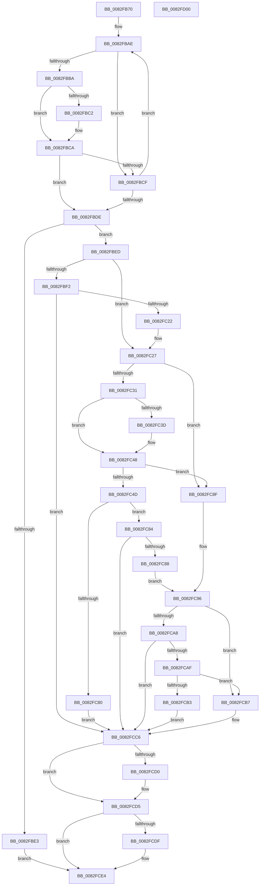

# CmDeleteInstallerClassMappedPropertyFromRegValue

- RVA: `0x0082FB70`–`0x0082FD01` (길이 `401` bytes)
- VA: `0x000000014082FB70`
- 실행 섹션: `PAGE`
- PDB 이름 있음: `예`; PDB Function 태그: `아니요`
- unwind 정보 RVA: `0x0007EE78`
- 디코드: `117`개 명령, `401/401` bytes 표시
- 미해석 바이트: `0` (있으면 어셈블리에 `.byte`로 보존)

> 이 문서는 커널 이미지의 기계어와 PDB 기호를 분석해 생성했습니다. 4번과 5번은 함수 원형과 자료형을 바이너리 사용 방식에서 추정한 C 해석이며 원본 소스 복구 결과는 아닙니다.

## 1. Dependencies

- 직접 호출 지점: **6**; 고유 호출 대상: **4**
- 직접 호출자로 확인된 함수: **1**
- RIP 상대 이미지 참조: **4**

### Outgoing calls
- `0x0082FC13` → [CmOpenInstallerClassRegKey](../9D/CmOpenInstallerClassRegKey_function_009D4474.md) (function, `0x009D4474`)
- `0x0082FC72` → [_PnpOpenPropertiesKey](../99/_PnpOpenPropertiesKey_function_009938A0.md) (function, `0x009938A0`)
- `0x0082FC9C` → [PnpCtxRegDeleteValue](../8F/PnpCtxRegDeleteValue_function_008FE5E0.md) (function, `0x008FE5E0`)
- `0x0082FCC1` → [PnpCtxRegDeleteValue](../8F/PnpCtxRegDeleteValue_function_008FE5E0.md) (function, `0x008FE5E0`)
- `0x0082FCD0` → [ZwClose](../../text/6A/ZwClose_function_006AD2B0.md) (function, `0x006AD2B0`)
- `0x0082FCDF` → [ZwClose](../../text/6A/ZwClose_function_006AD2B0.md) (function, `0x006AD2B0`)

### Direct callers
- [CmSetInstallerClassMappedProperty](../83/CmSetInstallerClassMappedProperty_function_008310E8.md) at `0x00831211`

### Static image references
- `0x0082FB9E` → RVA `0x00B4D320` (`PAGE`; read)
- `0x0082FC34` → RVA `0x00027CC8` (`.rdata`; read)
- `0x0082FC41` → RVA `0x00027CD0` (`.rdata`; read)
- `0x0082FCB7` → RVA `0x00AFCAD0` (` ?? ::NNGAKEGL::`string'`; read)

## 2. Other-region calls and transfers

- 다른 실행 섹션으로 향하는 call: **2**
  - `0x0082FCD0` → [ZwClose](../../text/6A/ZwClose_function_006AD2B0.md) (`PAGE` → `.text`)
  - `0x0082FCDF` → [ZwClose](../../text/6A/ZwClose_function_006AD2B0.md) (`PAGE` → `.text`)
- 별도 외부 분기/꼬리 이동을 확인하지 못했습니다.

## 3. Assembly (complete function range)

```asm
0082FB70  48 8B C4                        mov rax, rsp
0082FB73  48 89 58 08                     mov qword ptr [rax + 8], rbx
0082FB77  48 89 68 10                     mov qword ptr [rax + 0x10], rbp
0082FB7B  48 89 70 18                     mov qword ptr [rax + 0x18], rsi
0082FB7F  57                              push rdi
0082FB80  41 56                           push r14
0082FB82  41 57                           push r15
0082FB84  48 83 EC 50                     sub rsp, 0x50
0082FB88  45 8B 51 10                     mov r10d, dword ptr [r9 + 0x10]
0082FB8C  33 DB                           xor ebx, ebx
0082FB8E  48 21 58 D8                     and qword ptr [rax - 0x28], rbx
0082FB92  33 FF                           xor edi, edi
0082FB94  49 8B F1                        mov rsi, r9
0082FB97  48 89 58 E0                     mov qword ptr [rax - 0x20], rbx
0082FB9B  4D 8B F0                        mov r14, r8
0082FB9E  4C 8D 0D 7B D7 31 00            lea r9, [rip + 0x31d77b]
0082FBA5  45 33 C0                        xor r8d, r8d
0082FBA8  4C 8B DA                        mov r11, rdx
0082FBAB  4C 8B F9                        mov r15, rcx
0082FBAE  49 8B 11                        mov rdx, qword ptr [r9]
0082FBB1  49 8B E9                        mov rbp, r9
0082FBB4  44 3B 52 10                     cmp r10d, dword ptr [rdx + 0x10]
0082FBB8  75 15                           jne 0x14082fbcf
0082FBBA  48 8B 0E                        mov rcx, qword ptr [rsi]
0082FBBD  48 2B 0A                        sub rcx, qword ptr [rdx]
0082FBC0  75 08                           jne 0x14082fbca
0082FBC2  48 8B 4E 08                     mov rcx, qword ptr [rsi + 8]
0082FBC6  48 2B 4A 08                     sub rcx, qword ptr [rdx + 8]
0082FBCA  48 85 C9                        test rcx, rcx
0082FBCD  74 0F                           je 0x14082fbde
0082FBCF  33 ED                           xor ebp, ebp
0082FBD1  41 FF C0                        inc r8d
0082FBD4  49 83 C1 20                     add r9, 0x20
0082FBD8  41 83 F8 0D                     cmp r8d, 0xd
0082FBDC  72 D0                           jb 0x14082fbae
0082FBDE  48 85 ED                        test rbp, rbp
0082FBE1  75 0A                           jne 0x14082fbed
0082FBE3  BF 16 00 00 C0                  mov edi, 0xc0000016
0082FBE8  E9 F7 00 00 00                  jmp 0x14082fce4
0082FBED  4D 85 F6                        test r14, r14
0082FBF0  75 35                           jne 0x14082fc27
0082FBF2  48 21 5C 24 38                  and qword ptr [rsp + 0x38], rbx
0082FBF7  48 8D 44 24 48                  lea rax, [rsp + 0x48]
0082FBFC  48 89 44 24 30                  mov qword ptr [rsp + 0x30], rax
0082FC01  49 8B D3                        mov rdx, r11
0082FC04  88 5C 24 28                     mov byte ptr [rsp + 0x28], bl
0082FC08  49 8B CF                        mov rcx, r15
0082FC0B  C7 44 24 20 02 00 00 00         mov dword ptr [rsp + 0x20], 2
0082FC13  E8 5C 48 1A 00                  call 0x1409d4474
0082FC18  8B F8                           mov edi, eax
0082FC1A  85 C0                           test eax, eax
0082FC1C  0F 88 A4 00 00 00               js 0x14082fcc6
0082FC22  48 8B 5C 24 48                  mov rbx, qword ptr [rsp + 0x48]
0082FC27  83 7E 10 02                     cmp dword ptr [rsi + 0x10], 2
0082FC2B  48 8B 6D 10                     mov rbp, qword ptr [rbp + 0x10]
0082FC2F  75 5E                           jne 0x14082fc8f
0082FC31  48 8B 06                        mov rax, qword ptr [rsi]
0082FC34  48 2B 05 8D 80 7F FF            sub rax, qword ptr [rip - 0x807f73]
0082FC3B  75 0B                           jne 0x14082fc48
0082FC3D  48 8B 46 08                     mov rax, qword ptr [rsi + 8]
0082FC41  48 2B 05 88 80 7F FF            sub rax, qword ptr [rip - 0x807f78]
0082FC48  48 85 C0                        test rax, rax
0082FC4B  75 42                           jne 0x14082fc8f
0082FC4D  48 8D 44 24 40                  lea rax, [rsp + 0x40]
0082FC52  4D 85 F6                        test r14, r14
0082FC55  48 89 44 24 30                  mov qword ptr [rsp + 0x30], rax
0082FC5A  41 B9 02 00 00 00               mov r9d, 2
0082FC60  49 0F 45 DE                     cmovne rbx, r14
0082FC64  C6 44 24 20 00                  mov byte ptr [rsp + 0x20], 0
0082FC69  48 8B D3                        mov rdx, rbx
0082FC6C  45 33 C0                        xor r8d, r8d
0082FC6F  49 8B CF                        mov rcx, r15
0082FC72  E8 29 3C 16 00                  call 0x1409938a0
0082FC77  8B F8                           mov edi, eax
0082FC79  3D 34 00 00 C0                  cmp eax, 0xc0000034
0082FC7E  75 04                           jne 0x14082fc84
0082FC80  33 FF                           xor edi, edi
0082FC82  EB 42                           jmp 0x14082fcc6
0082FC84  85 C0                           test eax, eax
0082FC86  78 3E                           js 0x14082fcc6
0082FC88  48 8B 5C 24 40                  mov rbx, qword ptr [rsp + 0x40]
0082FC8D  EB 07                           jmp 0x14082fc96
0082FC8F  4D 85 F6                        test r14, r14
0082FC92  49 0F 45 DE                     cmovne rbx, r14
0082FC96  4C 8B C5                        mov r8, rbp
0082FC99  48 8B D3                        mov rdx, rbx
0082FC9C  E8 3F E9 0C 00                  call 0x1408fe5e0
0082FCA1  3D 34 00 00 C0                  cmp eax, 0xc0000034
0082FCA6  74 0F                           je 0x14082fcb7
0082FCA8  3D 7C 01 00 C0                  cmp eax, 0xc000017c
0082FCAD  74 17                           je 0x14082fcc6
0082FCAF  85 C0                           test eax, eax
0082FCB1  79 04                           jns 0x14082fcb7
0082FCB3  8B F8                           mov edi, eax
0082FCB5  EB 0F                           jmp 0x14082fcc6
0082FCB7  4C 8D 05 12 CE 2C 00            lea r8, [rip + 0x2cce12]
0082FCBE  48 8B D3                        mov rdx, rbx
0082FCC1  E8 1A E9 0C 00                  call 0x1408fe5e0
0082FCC6  48 8B 4C 24 40                  mov rcx, qword ptr [rsp + 0x40]
0082FCCB  48 85 C9                        test rcx, rcx
0082FCCE  74 05                           je 0x14082fcd5
0082FCD0  E8 DB D5 E7 FF                  call 0x1406ad2b0
0082FCD5  48 8B 4C 24 48                  mov rcx, qword ptr [rsp + 0x48]
0082FCDA  48 85 C9                        test rcx, rcx
0082FCDD  74 05                           je 0x14082fce4
0082FCDF  E8 CC D5 E7 FF                  call 0x1406ad2b0
0082FCE4  4C 8D 5C 24 50                  lea r11, [rsp + 0x50]
0082FCE9  8B C7                           mov eax, edi
0082FCEB  49 8B 5B 20                     mov rbx, qword ptr [r11 + 0x20]
0082FCEF  49 8B 6B 28                     mov rbp, qword ptr [r11 + 0x28]
0082FCF3  49 8B 73 30                     mov rsi, qword ptr [r11 + 0x30]
0082FCF7  49 8B E3                        mov rsp, r11
0082FCFA  41 5F                           pop r15
0082FCFC  41 5E                           pop r14
0082FCFE  5F                              pop rdi
0082FCFF  C3                              ret
0082FD00  CC                              int3
```

## 4. C-style interpretation (structured pseudocode)

```c
__int64 __fastcall CmDeleteInstallerClassMappedPropertyFromRegValue(__int64 a1, __int64 a2, __int64 a3, __int64 a4)
{
    __int64 result;
    __int64 v_rbp;
    __int64 v_rbx;
    __int64 v_rdi;
    __int64 v_rsp;
    unsigned __int64 v_stack_m18;
    unsigned __int64 v_stack_m20;
    unsigned __int64 v_stack_m28;
    unsigned __int64 v_stack_m30;
    unsigned __int64 v_stack_m38;
    unsigned __int8 v_stack_m40;
    unsigned int v_stack_m48;

    *(unsigned __int64 *)(v_rsp + 8) = v_rbx;
    *(unsigned __int64 *)(v_rsp + 16) = v_rbp;
    *(unsigned __int64 *)(v_rsp + 24) = v_rsi;
    v_rsp = (v_rsp) - (80);
    v_rbx = 0;
    v_rdi = 0;
    *(unsigned __int64 *)(v_rsp - 32) = 0;
    a3 = 0;
loc_0082FBAE:
    if (((unsigned int)((unsigned int)(*(unsigned int *)(a4 + 16)))) != (*(unsigned int *)(*(unsigned __int64 *)(v_rip + 3266427) + 16))) goto loc_0082FBCF;
    a1 = (*(unsigned __int64 *)(a4)) - (*(unsigned __int64 *)(*(unsigned __int64 *)(v_rip + 3266427)));
    if (!(condition_is_not_equal)) {
        a1 = *(unsigned __int64 *)(a4 + 8);
        a1 = (a1) - (*(unsigned __int64 *)(*(unsigned __int64 *)(v_rip + 3266427) + 8));
    }
    if (a1 == 0) goto loc_0082FBDE;
loc_0082FBCF:
    v_rbp = 0;
    a3 = (unsigned int)((a3) + 1);
    a4 = (v_rip + 3266427) + (32);
    if (((unsigned int)(a3)) < 13) goto loc_0082FBAE;
loc_0082FBDE:
    if (0 != 0) goto loc_0082FBED;
    goto loc_0082FCE4;
loc_0082FBED:
    if (a3 != 0) goto loc_0082FC27;
    v_stack_m38 = v_stack_m20;
    v_stack_m40 = 0;
    v_stack_m48 = 2;
    result = CmOpenInstallerClassRegKey(a1, a2, a3, a4);
    if (sign_flag) goto loc_0082FCC6;
loc_0082FC27:
    if ((*(unsigned int *)(a4 + 16)) != 2) goto loc_0082FC8F;
    result = (*(unsigned __int64 *)(a4)) - (*(unsigned __int64 *)(v_rip - 8421235));
    if (!(condition_is_not_equal)) {
        result = *(unsigned __int64 *)(a4 + 8);
        result = (result) - (*(unsigned __int64 *)(v_rip - 8421240));
    }
    if (result != 0) goto loc_0082FC8F;
    v_stack_m38 = v_stack_m28;
    v_rbx = v_stack_m20;
    if (a3 != 0) { v_rbx = a3; }
    v_stack_m48 = 0;
    a3 = 0;
    result = _PnpOpenPropertiesKey(a1, v_rbx, a3, 2);
    if (((unsigned int)(result)) != 0xC0000034ULL) goto loc_0082FC84;
    v_rdi = 0;
    goto loc_0082FCC6;
loc_0082FC84:
    if (sign_flag) goto loc_0082FCC6;
    goto loc_0082FC96;
loc_0082FC8F:
    v_rbx = v_stack_m28;
    if (0 != 0) { v_rbx = 0; }
loc_0082FC96:
    result = PnpCtxRegDeleteValue(a1, v_rbx, *(unsigned __int64 *)(v_rbp + 16), 2);
    if (((unsigned int)(result)) == 0xC0000034ULL) goto loc_0082FCB7;
    if (((unsigned int)(result)) == 0xC000017CULL) goto loc_0082FCC6;
    if (!sign_flag) goto loc_0082FCB7;
    goto loc_0082FCC6;
loc_0082FCB7:
    result = PnpCtxRegDeleteValue(a1, v_rbx, v_rip + 2936338, 2);
loc_0082FCC6:
    if (v_stack_m28 != 0) {
        result = ZwClose(v_stack_m28, v_rbx, v_rip + 2936338, 2);
    }
    if (v_stack_m20 != 0) {
        result = ZwClose(v_stack_m20, v_rbx, v_rip + 2936338, 2);
    }
    return (unsigned int)((unsigned int)((unsigned int)((unsigned int)(result))));
}
```

## 5. (Beta) C Style

```c
int64_t CmDeleteInstallerClassMappedPropertyFromRegValue(int64_t Arg1, int64_t Arg2, int64_t Arg3, void *Arg4)
{
    uint8_t *arg4 = (uint8_t *)Arg4;

    int64_t result;
    int64_t local_rbp;
    int64_t local_rbx;
    int64_t local_rdi;
    int64_t local_rsp;
    uint64_t v_stack_m18;
    uint64_t v_stack_m20;
    uint64_t v_stack_m28;
    uint64_t v_stack_m30;
    uint64_t v_stack_m38;
    uint8_t v_stack_m40;
    uint32_t v_stack_m48;

    *(uint64_t *)(local_rsp + 0x8) = local_rbx;
    *(uint64_t *)(local_rsp + 0x10) = local_rbp;
    *(uint64_t *)(local_rsp + 0x18) = local_rsi;
    local_rsp = (local_rsp) - (80);
    local_rbx = 0;
    local_rdi = 0;
    *(uint64_t *)(local_rsp - 0x20) = 0;
    Arg3 = 0;
loc_0082FBAE:
    if (((uint32_t)((uint32_t)(*(uint32_t *)(arg4 + 0x10)))) != (*(uint32_t *)(*(uint64_t *)(v_rip + 0x31D77B) + 0x10))) goto loc_0082FBCF;
    Arg1 = (*(uint64_t *)(arg4)) - (*(uint64_t *)(*(uint64_t *)(v_rip + 0x31D77B)));
    if (!(condition_is_not_equal)) {
        Arg1 = *(uint64_t *)(arg4 + 0x8);
        Arg1 = (Arg1) - (*(uint64_t *)(*(uint64_t *)(v_rip + 0x31D77B) + 0x8));
    }
    if (Arg1 == 0) goto loc_0082FBDE;
loc_0082FBCF:
    local_rbp = 0;
    Arg3 = (uint32_t)((Arg3) + 1);
    Arg4 = (v_rip + 3266427) + (32);
    if (((uint32_t)(Arg3)) < 13) goto loc_0082FBAE;
loc_0082FBDE:
    if (0 != 0) goto loc_0082FBED;
    goto loc_0082FCE4;
loc_0082FBED:
    if (Arg3 != 0) goto loc_0082FC27;
    v_stack_m38 = v_stack_m20;
    v_stack_m40 = 0;
    v_stack_m48 = 2;
    result = CmOpenInstallerClassRegKey(Arg1, Arg2, Arg3, Arg4);
    if (sign_flag) goto loc_0082FCC6;
loc_0082FC27:
    if ((*(uint32_t *)(arg4 + 0x10)) != 2) goto loc_0082FC8F;
    result = (*(uint64_t *)(arg4)) - (*(uint64_t *)(v_rip - 0x807F73));
    if (!(condition_is_not_equal)) {
        result = *(uint64_t *)(arg4 + 0x8);
        result = (result) - (*(uint64_t *)(v_rip - 0x807F78));
    }
    if (result != 0) goto loc_0082FC8F;
    v_stack_m38 = v_stack_m28;
    local_rbx = v_stack_m20;
    if (Arg3 != 0) { local_rbx = Arg3; }
    v_stack_m48 = 0;
    Arg3 = 0;
    result = _PnpOpenPropertiesKey(Arg1, local_rbx, Arg3, 2);
    if (((uint32_t)(result)) != 0xC0000034ULL) goto loc_0082FC84;
    local_rdi = 0;
    goto loc_0082FCC6;
loc_0082FC84:
    if (sign_flag) goto loc_0082FCC6;
    goto loc_0082FC96;
loc_0082FC8F:
    local_rbx = v_stack_m28;
    if (0 != 0) { local_rbx = 0; }
loc_0082FC96:
    result = PnpCtxRegDeleteValue(Arg1, local_rbx, *(uint64_t *)(local_rbp + 0x10), 2);
    if (((uint32_t)(result)) == 0xC0000034ULL) goto loc_0082FCB7;
    if (((uint32_t)(result)) == 0xC000017CULL) goto loc_0082FCC6;
    if (!sign_flag) goto loc_0082FCB7;
    goto loc_0082FCC6;
loc_0082FCB7:
    result = PnpCtxRegDeleteValue(Arg1, local_rbx, v_rip + 2936338, 2);
loc_0082FCC6:
    if (v_stack_m28 != 0) {
        result = ZwClose(v_stack_m28, local_rbx, v_rip + 2936338, 2);
    }
    if (v_stack_m20 != 0) {
        result = ZwClose(v_stack_m20, local_rbx, v_rip + 2936338, 2);
    }
    return (uint32_t)((uint32_t)((uint32_t)((uint32_t)(result))));
}
```

### 관측된 메모리 오프셋

구조체 형식이 확인되지 않은 접근은 인자 기준의 오프셋으로만 기록했습니다.

| 기준 인자 | 오프셋 표현 | 폭 (bit) | 접근 |
|---|---:|---:|---|
| `Arg4` | `+ 0x0` | `64` | `R` |
| `Arg4` | `+ 0x8` | `64` | `R` |
| `Arg4` | `+ 0x10` | `32` | `R` |

## 6. Execution-region graph

[열기: 2D/3D 그래프와 함수 탐색 컨트롤 패널](../../../control-panel.html?section=page&rva=0x0082FB70&view=graph)

- 2D 그래프는 위에서 아래로 흐르고, 3D 그래프는 빈 공간을 드래그해 회전합니다. Shift+드래그는 이동, 휠은 확대·축소, 함수 노드 선택은 대상 보고서 이동입니다.

### Static fallback


