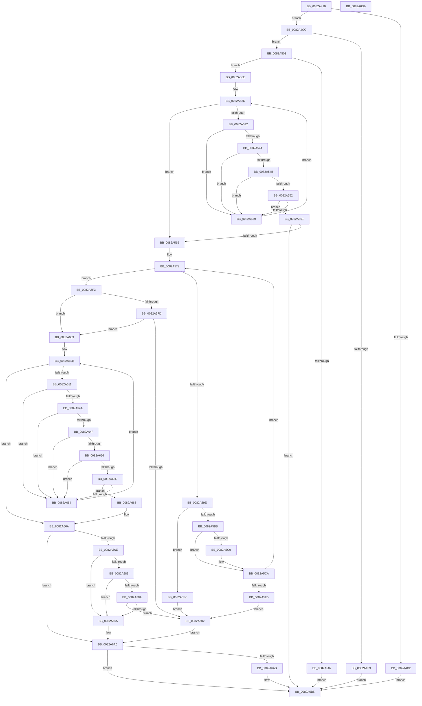

# CmDeleteInstallerClassWorker

- RVA: `0x0082A490`–`0x0082A6DA` (길이 `586` bytes)
- VA: `0x000000014082A490`
- 실행 섹션: `PAGE`
- PDB 이름 있음: `예`; PDB Function 태그: `아니요`
- unwind 정보 RVA: `0x000DA844`
- 디코드: `165`개 명령, `586/586` bytes 표시
- 미해석 바이트: `0` (있으면 어셈블리에 `.byte`로 보존)

> 이 문서는 커널 이미지의 기계어와 PDB 기호를 분석해 생성했습니다. 4번과 5번은 함수 원형과 자료형을 바이너리 사용 방식에서 추정한 C 해석이며 원본 소스 복구 결과는 아닙니다.

## 1. Dependencies

- 직접 호출 지점: **10**; 고유 호출 대상: **8**
- 직접 호출자로 확인된 함수: **1**
- RIP 상대 이미지 참조: **1**

### Outgoing calls
- `0x0082A4ED` → [CmGetMatchingFilteredDeviceList](../A2/CmGetMatchingFilteredDeviceList_function_00A2C11C.md) (function, `0x00A2C11C`)
- `0x0082A53B` → [CmDeleteInstallerClassRegKey](CmDeleteInstallerClassRegKey_function_0082A464.md) (function, `0x0082A464`)
- `0x0082A592` → [CmGetInstallerClassMappedPropertyKeys](../83/CmGetInstallerClassMappedPropertyKeys_function_00830704.md) (function, `0x00830704`)
- `0x0082A5C5` → [ExFreePoolWithTag](../../poolcode/B8/ExFreePoolWithTag_function_00B82870.md) (function, `0x00B82870`)
- `0x0082A5D8` → [ExAllocatePool2](../../poolcode/B8/ExAllocatePool2_function_00B820F0.md) (function, `0x00B820F0`)
- `0x0082A641` → [CmSetInstallerClassMappedProperty](../83/CmSetInstallerClassMappedProperty_function_008310E8.md) (function, `0x008310E8`)
- `0x0082A67A` → [CmDeleteInstallerClassRegKey](CmDeleteInstallerClassRegKey_function_0082A464.md) (function, `0x0082A464`)
- `0x0082A6A1` → [CmRaiseDeleteEvent](CmRaiseDeleteEvent_function_0082DBE0.md) (function, `0x0082DBE0`)
- `0x0082A6B0` → [ExFreePoolWithTag](../../poolcode/B8/ExFreePoolWithTag_function_00B82870.md) (function, `0x00B82870`)
- `0x0082A6BF` → [_security_check_cookie](../../text/6A/_security_check_cookie_function_006AC640.md) (function, `0x006AC640`)

### Direct callers
- [CmDeleteInstallerClass](CmDeleteInstallerClass_function_0082A338.md) at `0x0082A3C4`

### Static image references
- `0x0082A4A1` → RVA `0x00E0A740` (`.data`; read)

## 2. Other-region calls and transfers

- 다른 실행 섹션으로 향하는 call: **4**
  - `0x0082A5C5` → [ExFreePoolWithTag](../../poolcode/B8/ExFreePoolWithTag_function_00B82870.md) (`PAGE` → `POOLCODE`)
  - `0x0082A5D8` → [ExAllocatePool2](../../poolcode/B8/ExAllocatePool2_function_00B820F0.md) (`PAGE` → `POOLCODE`)
  - `0x0082A6B0` → [ExFreePoolWithTag](../../poolcode/B8/ExFreePoolWithTag_function_00B82870.md) (`PAGE` → `POOLCODE`)
  - `0x0082A6BF` → [_security_check_cookie](../../text/6A/_security_check_cookie_function_006AC640.md) (`PAGE` → `.text`)
- 별도 외부 분기/꼬리 이동을 확인하지 못했습니다.

## 3. Assembly (complete function range)

```asm
0082A490  48 89 5C 24 18                  mov qword ptr [rsp + 0x18], rbx
0082A495  55                              push rbp
0082A496  57                              push rdi
0082A497  41 54                           push r12
0082A499  41 56                           push r14
0082A49B  41 57                           push r15
0082A49D  48 83 EC 70                     sub rsp, 0x70
0082A4A1  48 8B 05 98 02 5E 00            mov rax, qword ptr [rip + 0x5e0298]
0082A4A8  48 33 C4                        xor rax, rsp
0082A4AB  48 89 44 24 68                  mov qword ptr [rsp + 0x68], rax
0082A4B0  33 FF                           xor edi, edi
0082A4B2  4C 8B E2                        mov r12, rdx
0082A4B5  21 7C 24 54                     and dword ptr [rsp + 0x54], edi
0082A4B9  4C 8B F9                        mov r15, rcx
0082A4BC  66 45 85 C0                     test r8w, r8w
0082A4C0  74 0A                           je 0x14082a4cc
0082A4C2  BF 0D 00 00 C0                  mov edi, 0xc000000d
0082A4C7  E9 E9 01 00 00                  jmp 0x14082a6b5
0082A4CC  48 8D 44 24 54                  lea rax, [rsp + 0x54]
0082A4D1  45 33 C9                        xor r9d, r9d
0082A4D4  48 89 44 24 38                  mov qword ptr [rsp + 0x38], rax
0082A4D9  41 B8 80 00 00 00               mov r8d, 0x80
0082A4DF  21 7C 24 30                     and dword ptr [rsp + 0x30], edi
0082A4E3  48 21 7C 24 28                  and qword ptr [rsp + 0x28], rdi
0082A4E8  48 21 7C 24 20                  and qword ptr [rsp + 0x20], rdi
0082A4ED  E8 2A 1C 20 00                  call 0x140a2c11c
0082A4F2  3D 23 00 00 C0                  cmp eax, 0xc0000023
0082A4F7  75 0A                           jne 0x14082a503
0082A4F9  BF 21 01 00 C0                  mov edi, 0xc0000121
0082A4FE  E9 B2 01 00 00                  jmp 0x14082a6b5
0082A503  85 C0                           test eax, eax
0082A505  74 07                           je 0x14082a50e
0082A507  8B F8                           mov edi, eax
0082A509  E9 A7 01 00 00                  jmp 0x14082a6b5
0082A50E  C7 44 24 58 20 03 00 00         mov dword ptr [rsp + 0x58], 0x320
0082A516  4C 8D 74 24 58                  lea r14, [rsp + 0x58]
0082A51B  C7 44 24 5C 20 02 00 00         mov dword ptr [rsp + 0x5c], 0x220
0082A523  33 DB                           xor ebx, ebx
0082A525  C7 44 24 60 20 01 00 00         mov dword ptr [rsp + 0x60], 0x120
0082A52D  83 FB 03                        cmp ebx, 3
0082A530  73 39                           jae 0x14082a56b
0082A532  45 8B 06                        mov r8d, dword ptr [r14]
0082A535  49 8B D4                        mov rdx, r12
0082A538  49 8B CF                        mov rcx, r15
0082A53B  E8 24 FF FF FF                  call 0x14082a464
0082A540  85 C0                           test eax, eax
0082A542  74 15                           je 0x14082a559
0082A544  3D 34 00 00 C0                  cmp eax, 0xc0000034
0082A549  74 0E                           je 0x14082a559
0082A54B  3D 0D 00 00 C0                  cmp eax, 0xc000000d
0082A550  74 07                           je 0x14082a559
0082A552  3D BB 00 00 C0                  cmp eax, 0xc00000bb
0082A557  75 08                           jne 0x14082a561
0082A559  FF C3                           inc ebx
0082A55B  49 83 C6 04                     add r14, 4
0082A55F  EB CC                           jmp 0x14082a52d
0082A561  8B F8                           mov edi, eax
0082A563  85 C0                           test eax, eax
0082A565  0F 88 4A 01 00 00               js 0x14082a6b5
0082A56B  33 DB                           xor ebx, ebx
0082A56D  33 ED                           xor ebp, ebp
0082A56F  89 6C 24 50                     mov dword ptr [rsp + 0x50], ebp
0082A573  48 8D 44 24 50                  lea rax, [rsp + 0x50]
0082A578  41 B1 01                        mov r9b, 1
0082A57B  48 89 44 24 30                  mov qword ptr [rsp + 0x30], rax
0082A580  45 33 C0                        xor r8d, r8d
0082A583  89 6C 24 28                     mov dword ptr [rsp + 0x28], ebp
0082A587  49 8B D4                        mov rdx, r12
0082A58A  49 8B CF                        mov rcx, r15
0082A58D  48 89 5C 24 20                  mov qword ptr [rsp + 0x20], rbx
0082A592  E8 6D 61 00 00                  call 0x140830704
0082A597  3D 23 00 00 C0                  cmp eax, 0xc0000023
0082A59C  75 55                           jne 0x14082a5f3
0082A59E  8B 6C 24 50                     mov ebp, dword ptr [rsp + 0x50]
0082A5A2  B8 FF FF FF FF                  mov eax, 0xffffffff
0082A5A7  4C 8D 34 AD 00 00 00 00         lea r14, [rbp*4]
0082A5AF  4C 03 F5                        add r14, rbp
0082A5B2  49 C1 E6 02                     shl r14, 2
0082A5B6  4C 3B F0                        cmp r14, rax
0082A5B9  77 31                           ja 0x14082a5ec
0082A5BB  48 85 DB                        test rbx, rbx
0082A5BE  74 0A                           je 0x14082a5ca
0082A5C0  33 D2                           xor edx, edx
0082A5C2  48 8B CB                        mov rcx, rbx
0082A5C5  E8 A6 82 35 00                  call 0x140b82870
0082A5CA  41 8B D6                        mov edx, r14d
0082A5CD  B9 00 01 00 00                  mov ecx, 0x100
0082A5D2  41 B8 50 4E 50 52               mov r8d, 0x52504e50
0082A5D8  E8 13 7B 35 00                  call 0x140b820f0
0082A5DD  48 8B D8                        mov rbx, rax
0082A5E0  48 85 C0                        test rax, rax
0082A5E3  75 8E                           jne 0x14082a573
0082A5E5  B8 17 00 00 C0                  mov eax, 0xc0000017
0082A5EA  EB 16                           jmp 0x14082a602
0082A5EC  B8 0D 00 00 C0                  mov eax, 0xc000000d
0082A5F1  EB 0F                           jmp 0x14082a602
0082A5F3  41 BE 25 02 00 C0               mov r14d, 0xc0000225
0082A5F9  85 C0                           test eax, eax
0082A5FB  74 0C                           je 0x14082a609
0082A5FD  41 3B C6                        cmp eax, r14d
0082A600  74 07                           je 0x14082a609
0082A602  8B F8                           mov edi, eax
0082A604  E9 9D 00 00 00                  jmp 0x14082a6a6
0082A609  33 ED                           xor ebp, ebp
0082A60B  3B 6C 24 50                     cmp ebp, dword ptr [rsp + 0x50]
0082A60F  73 59                           jae 0x14082a66a
0082A611  83 64 24 38 00                  and dword ptr [rsp + 0x38], 0
0082A616  48 8D 0C AD 00 00 00 00         lea rcx, [rbp*4]
0082A61E  48 83 64 24 30 00               and qword ptr [rsp + 0x30], 0
0082A624  48 03 CD                        add rcx, rbp
0082A627  83 64 24 28 00                  and dword ptr [rsp + 0x28], 0
0082A62C  45 33 C9                        xor r9d, r9d
0082A62F  45 33 C0                        xor r8d, r8d
0082A632  49 8B D4                        mov rdx, r12
0082A635  48 8D 04 8B                     lea rax, [rbx + rcx*4]
0082A639  49 8B CF                        mov rcx, r15
0082A63C  48 89 44 24 20                  mov qword ptr [rsp + 0x20], rax
0082A641  E8 A2 6A 00 00                  call 0x1408310e8
0082A646  85 C0                           test eax, eax
0082A648  74 1A                           je 0x14082a664
0082A64A  41 3B C6                        cmp eax, r14d
0082A64D  74 15                           je 0x14082a664
0082A64F  3D 22 00 00 C0                  cmp eax, 0xc0000022
0082A654  74 0E                           je 0x14082a664
0082A656  3D 16 00 00 C0                  cmp eax, 0xc0000016
0082A65B  74 07                           je 0x14082a664
0082A65D  3D BB 00 00 C0                  cmp eax, 0xc00000bb
0082A662  75 04                           jne 0x14082a668
0082A664  FF C5                           inc ebp
0082A666  EB A3                           jmp 0x14082a60b
0082A668  8B F8                           mov edi, eax
0082A66A  85 FF                           test edi, edi
0082A66C  78 38                           js 0x14082a6a6
0082A66E  41 B8 20 00 00 00               mov r8d, 0x20
0082A674  49 8B D4                        mov rdx, r12
0082A677  49 8B CF                        mov rcx, r15
0082A67A  E8 E5 FD FF FF                  call 0x14082a464
0082A67F  85 C0                           test eax, eax
0082A681  74 12                           je 0x14082a695
0082A683  3D 34 00 00 C0                  cmp eax, 0xc0000034
0082A688  74 0B                           je 0x14082a695
0082A68A  3D 0D 00 00 C0                  cmp eax, 0xc000000d
0082A68F  0F 85 6D FF FF FF               jne 0x14082a602
0082A695  41 B8 02 00 00 00               mov r8d, 2
0082A69B  49 8B D4                        mov rdx, r12
0082A69E  49 8B CF                        mov rcx, r15
0082A6A1  E8 3A 35 00 00                  call 0x14082dbe0
0082A6A6  48 85 DB                        test rbx, rbx
0082A6A9  74 0A                           je 0x14082a6b5
0082A6AB  33 D2                           xor edx, edx
0082A6AD  48 8B CB                        mov rcx, rbx
0082A6B0  E8 BB 81 35 00                  call 0x140b82870
0082A6B5  8B C7                           mov eax, edi
0082A6B7  48 8B 4C 24 68                  mov rcx, qword ptr [rsp + 0x68]
0082A6BC  48 33 CC                        xor rcx, rsp
0082A6BF  E8 7C 1F E8 FF                  call 0x1406ac640
0082A6C4  48 8B 9C 24 B0 00 00 00         mov rbx, qword ptr [rsp + 0xb0]
0082A6CC  48 83 C4 70                     add rsp, 0x70
0082A6D0  41 5F                           pop r15
0082A6D2  41 5E                           pop r14
0082A6D4  41 5C                           pop r12
0082A6D6  5F                              pop rdi
0082A6D7  5D                              pop rbp
0082A6D8  C3                              ret
0082A6D9  CC                              int3
```

## 4. C-style interpretation (structured pseudocode)

```c
__int64 __fastcall CmDeleteInstallerClassWorker(__int64 a1, __int64 a2, unsigned __int16 a3, int a4)
{
    __int64 result;
    __int64 v_r14;
    __int64 v_rbp;
    __int64 v_rbx;
    __int64 v_rdi;
    __int64 v_rsp;
    unsigned __int64 v_stack_m30;
    unsigned int v_stack_m38;
    unsigned int v_stack_m3C;
    unsigned int v_stack_m40;
    unsigned int v_stack_m44;
    unsigned int v_stack_m48;
    unsigned __int64 v_stack_m60;
    unsigned int v_stack_m68;
    unsigned __int64 v_stack_m70;
    unsigned __int64 v_stack_m78;
    unsigned __int64 v_stack_p18;

    v_stack_p18 = v_rbx;
    v_rsp = (v_rsp) - (112);
    result = (*(unsigned __int64 *)(v_rip + 6161048)) ^ (v_rsp);
    v_stack_m30 = result;
    v_rdi = 0;
    if (a3 == 0) goto loc_0082A4CC;
    goto loc_0082A6B5;
loc_0082A4CC:
    a4 = 0;
    v_stack_m60 = v_stack_m44;
    result = CmGetMatchingFilteredDeviceList(a1, a2, 128, a4);
    if (((unsigned int)(result)) != 0xC0000023ULL) goto loc_0082A503;
    goto loc_0082A6B5;
loc_0082A503:
    if ((unsigned int)(result) == 0) goto loc_0082A50E;
    goto loc_0082A6B5;
loc_0082A50E:
    v_stack_m40 = 800;
    v_stack_m3C = 544;
    v_rbx = 0;
    v_stack_m38 = 288;
loc_0082A52D:
    if (0 >= 3) goto loc_0082A56B;
    result = CmDeleteInstallerClassRegKey(a1, a2, (unsigned int)(*(unsigned int *)(v_stack_m40)), a4);
    if ((unsigned int)(result) == 0) goto loc_0082A559;
    if (((unsigned int)(result)) == 0xC0000034ULL) goto loc_0082A559;
    if (((unsigned int)(result)) == 0xC000000DULL) goto loc_0082A559;
    if (((unsigned int)(result)) != 0xC00000BBULL) goto loc_0082A561;
loc_0082A559:
    v_rbx = (unsigned int)((v_rbx) + 1);
    v_r14 = (v_stack_m40) + (4);
    goto loc_0082A52D;
loc_0082A561:
    if (sign_flag) goto loc_0082A6B5;
loc_0082A56B:
    v_rbx = 0;
    v_rbp = 0;
    v_stack_m48 = 0;
loc_0082A573:
    v_stack_m68 = v_stack_m48;
    a3 = 0;
    v_stack_m70 = 0;
    v_stack_m78 = 0;
    result = CmGetInstallerClassMappedPropertyKeys(a1, a2, a3, 1);
    if (((unsigned int)(result)) != 0xC0000023ULL) goto loc_0082A5F3;
    v_r14 = ((unsigned int)(v_stack_m48) * 4) + ((unsigned int)(v_stack_m48));
    v_r14 = (v_r14) << (2);
    if (v_r14 > ((unsigned int)(0xFFFFFFFFULL))) goto loc_0082A5EC;
    result = (unsigned int)(0xFFFFFFFFULL);
    if (0 != 0) {
        a2 = 0;
        a1 = 0;
        result = ExFreePoolWithTag(a1, a2, a3, 1);
    }
    result = ExAllocatePool2(256, (unsigned int)((unsigned int)(v_r14)), (unsigned int)(0x52504E50ULL), 1);
    if (result != 0) goto loc_0082A573;
    goto loc_0082A602;
loc_0082A5EC:
    goto loc_0082A602;
loc_0082A5F3:
    if ((unsigned int)((unsigned int)(0xC000000DULL)) == 0) goto loc_0082A609;
    if (((unsigned int)((unsigned int)(0xC000000DULL))) == ((unsigned int)((unsigned int)(0xC0000225ULL)))) goto loc_0082A609;
loc_0082A602:
    goto loc_0082A6A6;
loc_0082A609:
    v_rbp = 0;
loc_0082A60B:
    if (0 >= v_stack_m48) goto loc_0082A66A;
    a1 = (v_rbp * 4) + (0);
    a4 = 0;
    a3 = 0;
    v_stack_m78 = result + a1 * 4;
    result = CmSetInstallerClassMappedProperty(a1, 0, a3, a4);
    if ((unsigned int)(result) == 0) goto loc_0082A664;
    if (((unsigned int)(result)) == ((unsigned int)((unsigned int)(0xC0000225ULL)))) goto loc_0082A664;
    if (((unsigned int)(result)) == 0xC0000022ULL) goto loc_0082A664;
    if (((unsigned int)(result)) == 0xC0000016ULL) goto loc_0082A664;
    if (((unsigned int)(result)) != 0xC00000BBULL) goto loc_0082A668;
loc_0082A664:
    v_rbp = (unsigned int)((v_rbp) + 1);
    goto loc_0082A60B;
loc_0082A668:
loc_0082A66A:
    if (sign_flag) goto loc_0082A6A6;
    result = CmDeleteInstallerClassRegKey(a1, 0, 32, a4);
    if ((unsigned int)(result) == 0) goto loc_0082A695;
    if (((unsigned int)(result)) == 0xC0000034ULL) goto loc_0082A695;
    if (((unsigned int)(result)) != 0xC000000DULL) goto loc_0082A602;
loc_0082A695:
    result = CmRaiseDeleteEvent(a1, 0, 2, a4);
loc_0082A6A6:
    if (result != 0) {
        a2 = 0;
        a1 = result;
        result = ExFreePoolWithTag(a1, a2, 2, a4);
    }
    a1 = (v_stack_m30) ^ (v_rsp);
    result = _security_check_cookie(a1, a2, 2, a4);
    v_rsp = (v_rsp) + (112);
    return result;
}
```

## 5. (Beta) C Style

```c
int64_t CmDeleteInstallerClassWorker(int64_t Arg1, int64_t Arg2, uint16_t Arg3, int32_t Arg4)
{
    int64_t result;
    int64_t local_r14;
    int64_t local_rbp;
    int64_t local_rbx;
    int64_t local_rdi;
    int64_t local_rsp;
    uint64_t v_stack_m30;
    uint32_t v_stack_m38;
    uint32_t v_stack_m3C;
    uint32_t v_stack_m40;
    uint32_t v_stack_m44;
    uint32_t v_stack_m48;
    uint64_t v_stack_m60;
    uint32_t v_stack_m68;
    uint64_t v_stack_m70;
    uint64_t v_stack_m78;
    uint64_t v_stack_p18;

    v_stack_p18 = local_rbx;
    local_rsp = (local_rsp) - (112);
    result = (*(uint64_t *)(v_rip + 0x5E0298)) ^ (local_rsp);
    v_stack_m30 = result;
    local_rdi = 0;
    if (Arg3 == 0) goto loc_0082A4CC;
    goto loc_0082A6B5;
loc_0082A4CC:
    Arg4 = 0;
    v_stack_m60 = v_stack_m44;
    result = CmGetMatchingFilteredDeviceList(Arg1, Arg2, 128, Arg4);
    if (((uint32_t)(result)) != 0xC0000023ULL) goto loc_0082A503;
    goto loc_0082A6B5;
loc_0082A503:
    if ((uint32_t)(result) == 0) goto loc_0082A50E;
    goto loc_0082A6B5;
loc_0082A50E:
    v_stack_m40 = 800;
    v_stack_m3C = 544;
    local_rbx = 0;
    v_stack_m38 = 288;
loc_0082A52D:
    if (0 >= 3) goto loc_0082A56B;
    result = CmDeleteInstallerClassRegKey(Arg1, Arg2, (uint32_t)(*(uint32_t *)(v_stack_m40)), Arg4);
    if ((uint32_t)(result) == 0) goto loc_0082A559;
    if (((uint32_t)(result)) == 0xC0000034ULL) goto loc_0082A559;
    if (((uint32_t)(result)) == 0xC000000DULL) goto loc_0082A559;
    if (((uint32_t)(result)) != 0xC00000BBULL) goto loc_0082A561;
loc_0082A559:
    local_rbx = (uint32_t)((local_rbx) + 1);
    local_r14 = (v_stack_m40) + (4);
    goto loc_0082A52D;
loc_0082A561:
    if (sign_flag) goto loc_0082A6B5;
loc_0082A56B:
    local_rbx = 0;
    local_rbp = 0;
    v_stack_m48 = 0;
loc_0082A573:
    v_stack_m68 = v_stack_m48;
    Arg3 = 0;
    v_stack_m70 = 0;
    v_stack_m78 = 0;
    result = CmGetInstallerClassMappedPropertyKeys(Arg1, Arg2, Arg3, 1);
    if (((uint32_t)(result)) != 0xC0000023ULL) goto loc_0082A5F3;
    local_r14 = ((uint32_t)(v_stack_m48) * 4) + ((uint32_t)(v_stack_m48));
    local_r14 = (local_r14) << (2);
    if (local_r14 > ((uint32_t)(0xFFFFFFFFULL))) goto loc_0082A5EC;
    result = (uint32_t)(0xFFFFFFFFULL);
    if (0 != 0) {
        Arg2 = 0;
        Arg1 = 0;
        result = ExFreePoolWithTag(Arg1, Arg2, Arg3, 1);
    }
    result = ExAllocatePool2(256, (uint32_t)((uint32_t)(local_r14)), (uint32_t)(0x52504E50ULL), 1);
    if (result != 0) goto loc_0082A573;
    goto loc_0082A602;
loc_0082A5EC:
    goto loc_0082A602;
loc_0082A5F3:
    if ((uint32_t)((uint32_t)(0xC000000DULL)) == 0) goto loc_0082A609;
    if (((uint32_t)((uint32_t)(0xC000000DULL))) == ((uint32_t)((uint32_t)(0xC0000225ULL)))) goto loc_0082A609;
loc_0082A602:
    goto loc_0082A6A6;
loc_0082A609:
    local_rbp = 0;
loc_0082A60B:
    if (0 >= v_stack_m48) goto loc_0082A66A;
    Arg1 = (local_rbp * 4) + (0);
    Arg4 = 0;
    Arg3 = 0;
    v_stack_m78 = result + Arg1 * 4;
    result = CmSetInstallerClassMappedProperty(Arg1, 0, Arg3, Arg4);
    if ((uint32_t)(result) == 0) goto loc_0082A664;
    if (((uint32_t)(result)) == ((uint32_t)((uint32_t)(0xC0000225ULL)))) goto loc_0082A664;
    if (((uint32_t)(result)) == 0xC0000022ULL) goto loc_0082A664;
    if (((uint32_t)(result)) == 0xC0000016ULL) goto loc_0082A664;
    if (((uint32_t)(result)) != 0xC00000BBULL) goto loc_0082A668;
loc_0082A664:
    local_rbp = (uint32_t)((local_rbp) + 1);
    goto loc_0082A60B;
loc_0082A668:
loc_0082A66A:
    if (sign_flag) goto loc_0082A6A6;
    result = CmDeleteInstallerClassRegKey(Arg1, 0, 32, Arg4);
    if ((uint32_t)(result) == 0) goto loc_0082A695;
    if (((uint32_t)(result)) == 0xC0000034ULL) goto loc_0082A695;
    if (((uint32_t)(result)) != 0xC000000DULL) goto loc_0082A602;
loc_0082A695:
    result = CmRaiseDeleteEvent(Arg1, 0, 2, Arg4);
loc_0082A6A6:
    if (result != 0) {
        Arg2 = 0;
        Arg1 = result;
        result = ExFreePoolWithTag(Arg1, Arg2, 2, Arg4);
    }
    Arg1 = (v_stack_m30) ^ (local_rsp);
    result = _security_check_cookie(Arg1, Arg2, 2, Arg4);
    local_rsp = (local_rsp) + (112);
    return result;
}
```

## 6. Execution-region graph

[열기: 2D/3D 그래프와 함수 탐색 컨트롤 패널](../../../control-panel.html?section=page&rva=0x0082A490&view=graph)

- 2D 그래프는 위에서 아래로 흐르고, 3D 그래프는 빈 공간을 드래그해 회전합니다. Shift+드래그는 이동, 휠은 확대·축소, 함수 노드 선택은 대상 보고서 이동입니다.

### Static fallback


