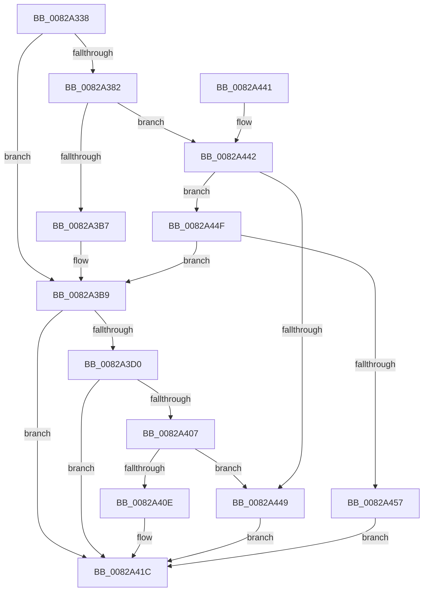

# CmDeleteInstallerClass

- RVA: `0x0082A338`–`0x0082A45E` (길이 `294` bytes)
- VA: `0x000000014082A338`
- 실행 섹션: `PAGE`
- PDB 이름 있음: `예`; PDB Function 태그: `아니요`
- unwind 정보 RVA: `0x000A88C0`
- 디코드: `77`개 명령, `294/294` bytes 표시
- 미해석 바이트: `0` (있으면 어셈블리에 `.byte`로 보존)

> 이 문서는 커널 이미지의 기계어와 PDB 기호를 분석해 생성했습니다. 4번과 5번은 함수 원형과 자료형을 바이너리 사용 방식에서 추정한 C 해석이며 원본 소스 복구 결과는 아닙니다.

## 1. Dependencies

- 직접 호출 지점: **5**; 고유 호출 대상: **4**
- 직접 호출자로 확인된 함수: **2**
- RIP 상대 이미지 참조: **1**

### Outgoing calls
- `0x0082A36D` → [memset](../../text/6C/memset_function_006C6C40.md) (function, `0x006C6C40`)
- `0x0082A3A7` → [guard_dispatch_icall](../../text/6B/guard_dispatch_icall_function_006BAAD0.md) (function, `0x006BAAD0`)
- `0x0082A3C4` → [CmDeleteInstallerClassWorker](CmDeleteInstallerClassWorker_function_0082A490.md) (function, `0x0082A490`)
- `0x0082A3F9` → [guard_dispatch_icall](../../text/6B/guard_dispatch_icall_function_006BAAD0.md) (function, `0x006BAAD0`)
- `0x0082A429` → [_security_check_cookie](../../text/6A/_security_check_cookie_function_006AC640.md) (function, `0x006AC640`)

### Direct callers
- [_PnpDispatchInstallerClass](../9D/_PnpDispatchInstallerClass_function_009D3580.md) at `0x009D3717`
- [PiCMDeleteClassKey](../AD/PiCMDeleteClassKey_function_00AD9EB4.md) at `0x00AD9F71`

### Static image references
- `0x0082A347` → RVA `0x00E0A740` (`.data`; read)

## 2. Other-region calls and transfers

- 다른 실행 섹션으로 향하는 call: **4**
  - `0x0082A36D` → [memset](../../text/6C/memset_function_006C6C40.md) (`PAGE` → `.text`)
  - `0x0082A3A7` → [guard_dispatch_icall](../../text/6B/guard_dispatch_icall_function_006BAAD0.md) (`PAGE` → `.text`)
  - `0x0082A3F9` → [guard_dispatch_icall](../../text/6B/guard_dispatch_icall_function_006BAAD0.md) (`PAGE` → `.text`)
  - `0x0082A429` → [_security_check_cookie](../../text/6A/_security_check_cookie_function_006AC640.md) (`PAGE` → `.text`)
- 별도 외부 분기/꼬리 이동을 확인하지 못했습니다.

## 3. Assembly (complete function range)

```asm
0082A338  48 89 5C 24 20                  mov qword ptr [rsp + 0x20], rbx
0082A33D  55                              push rbp
0082A33E  56                              push rsi
0082A33F  57                              push rdi
0082A340  48 81 EC B0 00 00 00            sub rsp, 0xb0
0082A347  48 8B 05 F2 03 5E 00            mov rax, qword ptr [rip + 0x5e03f2]
0082A34E  48 33 C4                        xor rax, rsp
0082A351  48 89 84 24 A0 00 00 00         mov qword ptr [rsp + 0xa0], rax
0082A359  48 8B EA                        mov rbp, rdx
0082A35C  41 8B D8                        mov ebx, r8d
0082A35F  33 D2                           xor edx, edx
0082A361  48 8B F1                        mov rsi, rcx
0082A364  48 8D 4C 24 40                  lea rcx, [rsp + 0x40]
0082A369  44 8D 42 58                     lea r8d, [rdx + 0x58]
0082A36D  E8 CE C8 E9 FF                  call 0x1406c6c40
0082A372  48 8B BE F8 01 00 00            mov rdi, qword ptr [rsi + 0x1f8]
0082A379  89 5C 24 50                     mov dword ptr [rsp + 0x50], ebx
0082A37D  48 85 FF                        test rdi, rdi
0082A380  74 37                           je 0x14082a3b9
0082A382  41 B9 03 00 00 00               mov r9d, 3
0082A388  48 8D 44 24 40                  lea rax, [rsp + 0x40]
0082A38D  48 89 44 24 28                  mov qword ptr [rsp + 0x28], rax
0082A392  48 8B D5                        mov rdx, rbp
0082A395  48 8B CE                        mov rcx, rsi
0082A398  C7 44 24 20 01 00 00 00         mov dword ptr [rsp + 0x20], 1
0082A3A0  48 8B C7                        mov rax, rdi
0082A3A3  45 8D 41 FF                     lea r8d, [r9 - 1]
0082A3A7  E8 24 07 E9 FF                  call 0x1406baad0
0082A3AC  3D 02 00 00 C0                  cmp eax, 0xc0000002
0082A3B1  0F 85 8B 00 00 00               jne 0x14082a442
0082A3B7  33 FF                           xor edi, edi
0082A3B9  44 8B 44 24 50                  mov r8d, dword ptr [rsp + 0x50]
0082A3BE  48 8B D5                        mov rdx, rbp
0082A3C1  48 8B CE                        mov rcx, rsi
0082A3C4  E8 C7 00 00 00                  call 0x14082a490
0082A3C9  8B D8                           mov ebx, eax
0082A3CB  48 85 FF                        test rdi, rdi
0082A3CE  74 4C                           je 0x14082a41c
0082A3D0  89 44 24 40                     mov dword ptr [rsp + 0x40], eax
0082A3D4  41 B9 03 00 00 00               mov r9d, 3
0082A3DA  48 8D 44 24 40                  lea rax, [rsp + 0x40]
0082A3DF  48 8B D5                        mov rdx, rbp
0082A3E2  48 89 44 24 28                  mov qword ptr [rsp + 0x28], rax
0082A3E7  48 8B CE                        mov rcx, rsi
0082A3EA  48 8B C7                        mov rax, rdi
0082A3ED  C7 44 24 20 02 00 00 00         mov dword ptr [rsp + 0x20], 2
0082A3F5  45 8D 41 FF                     lea r8d, [r9 - 1]
0082A3F9  E8 D2 06 E9 FF                  call 0x1406baad0
0082A3FE  8B C8                           mov ecx, eax
0082A400  3D 02 00 00 C0                  cmp eax, 0xc0000002
0082A405  74 15                           je 0x14082a41c
0082A407  3D 20 01 00 C0                  cmp eax, 0xc0000120
0082A40C  74 3B                           je 0x14082a449
0082A40E  8B C3                           mov eax, ebx
0082A410  85 C9                           test ecx, ecx
0082A412  BB E5 00 00 C0                  mov ebx, 0xc00000e5
0082A417  0F 45 C3                        cmovne eax, ebx
0082A41A  8B D8                           mov ebx, eax
0082A41C  8B C3                           mov eax, ebx
0082A41E  48 8B 8C 24 A0 00 00 00         mov rcx, qword ptr [rsp + 0xa0]
0082A426  48 33 CC                        xor rcx, rsp
0082A429  E8 12 22 E8 FF                  call 0x1406ac640
0082A42E  48 8B 9C 24 E8 00 00 00         mov rbx, qword ptr [rsp + 0xe8]
0082A436  48 81 C4 B0 00 00 00            add rsp, 0xb0
0082A43D  5F                              pop rdi
0082A43E  5E                              pop rsi
0082A43F  5D                              pop rbp
0082A440  C3                              ret
0082A441  CC                              int3
0082A442  3D 20 01 00 C0                  cmp eax, 0xc0000120
0082A447  75 06                           jne 0x14082a44f
0082A449  8B 5C 24 40                     mov ebx, dword ptr [rsp + 0x40]
0082A44D  EB CD                           jmp 0x14082a41c
0082A44F  85 C0                           test eax, eax
0082A451  0F 84 62 FF FF FF               je 0x14082a3b9
0082A457  BB E5 00 00 C0                  mov ebx, 0xc00000e5
0082A45C  EB BE                           jmp 0x14082a41c
```

## 4. C-style interpretation (structured pseudocode)

```c
__int64 __fastcall CmDeleteInstallerClass(__int64 a1, __int64 a2, int a3)
{
    __int64 result;
    __int64 v_rdi;
    __int64 v_rsp;
    unsigned __int64 v_stack_m28;
    unsigned int v_stack_m78;
    unsigned __int64 v_stack_m88;
    unsigned __int64 v_stack_mA0;
    unsigned int v_stack_mA8;
    unsigned __int64 v_stack_p20;
    unsigned int v_stack_p40;

    v_stack_p20 = v_rbx;
    v_rsp = (v_rsp) - (176);
    result = (*(unsigned __int64 *)(v_rip + 6161394)) ^ (v_rsp);
    v_stack_m28 = result;
    a2 = 0;
    result = memset(v_stack_m88, a2, a2 + 88, a4);
    v_stack_m78 = (unsigned int)((unsigned int)(a3));
    if (*(unsigned __int64 *)(a1 + 504) == 0) goto loc_0082A3B9;
    v_stack_mA0 = v_stack_m88;
    v_stack_mA8 = 1;
    result = guard_dispatch_icall(a1, 0, 3 - 1, 3);
    if (((unsigned int)(result)) != 0xC0000002ULL) goto loc_0082A442;
    v_rdi = 0;
loc_0082A3B9:
    result = CmDeleteInstallerClassWorker(a1, 0, (unsigned int)(v_stack_m78), 3);
    if (0 == 0) goto loc_0082A41C;
    v_stack_m88 = (unsigned int)(result);
    v_stack_mA0 = v_stack_m88;
    v_stack_mA8 = 2;
    result = guard_dispatch_icall(a1, 0, 3 - 1, 3);
    if (((unsigned int)(result)) == 0xC0000002ULL) goto loc_0082A41C;
    if (((unsigned int)(result)) == 0xC0000120ULL) goto loc_0082A449;
    result = (unsigned int)((unsigned int)((unsigned int)((unsigned int)(result))));
    if ((unsigned int)((unsigned int)((unsigned int)(result))) != 0) { result = (unsigned int)((unsigned int)(0xC00000E5ULL)); }
loc_0082A41C:
    a1 = (v_stack_m28) ^ (v_rsp);
    result = _security_check_cookie(a1, 0, 3 - 1, 3);
    v_rsp = (v_rsp) + (176);
    return result;
loc_0082A442:
    if (((unsigned int)(result)) != 0xC0000120ULL) goto loc_0082A44F;
loc_0082A449:
    goto loc_0082A41C;
loc_0082A44F:
    if ((unsigned int)(result) == 0) goto loc_0082A3B9;
    goto loc_0082A41C;
}
```

## 5. (Beta) C Style

```c
int64_t CmDeleteInstallerClass(void *Arg1, int64_t Arg2, int32_t Arg3)
{
    uint8_t *arg1 = (uint8_t *)Arg1;

    int64_t result;
    int64_t local_rdi;
    int64_t local_rsp;
    uint64_t v_stack_m28;
    uint32_t v_stack_m78;
    uint64_t v_stack_m88;
    uint64_t v_stack_mA0;
    uint32_t v_stack_mA8;
    uint64_t v_stack_p20;
    uint32_t v_stack_p40;

    v_stack_p20 = local_rbx;
    local_rsp = (local_rsp) - (176);
    result = (*(uint64_t *)(v_rip + 0x5E03F2)) ^ (local_rsp);
    v_stack_m28 = result;
    Arg2 = 0;
    result = memset(v_stack_m88, Arg2, Arg2 + 88, a4);
    v_stack_m78 = (uint32_t)((uint32_t)(Arg3));
    if (*(uint64_t *)(arg1 + 0x1F8) == 0) goto loc_0082A3B9;
    v_stack_mA0 = v_stack_m88;
    v_stack_mA8 = 1;
    result = guard_dispatch_icall(Arg1, 0, 3 - 1, 3);
    if (((uint32_t)(result)) != 0xC0000002ULL) goto loc_0082A442;
    local_rdi = 0;
loc_0082A3B9:
    result = CmDeleteInstallerClassWorker(Arg1, 0, (uint32_t)(v_stack_m78), 3);
    if (0 == 0) goto loc_0082A41C;
    v_stack_m88 = (uint32_t)(result);
    v_stack_mA0 = v_stack_m88;
    v_stack_mA8 = 2;
    result = guard_dispatch_icall(Arg1, 0, 3 - 1, 3);
    if (((uint32_t)(result)) == 0xC0000002ULL) goto loc_0082A41C;
    if (((uint32_t)(result)) == 0xC0000120ULL) goto loc_0082A449;
    result = (uint32_t)((uint32_t)((uint32_t)((uint32_t)(result))));
    if ((uint32_t)((uint32_t)((uint32_t)(result))) != 0) { result = (uint32_t)((uint32_t)(0xC00000E5ULL)); }
loc_0082A41C:
    Arg1 = (v_stack_m28) ^ (local_rsp);
    result = _security_check_cookie(Arg1, 0, 3 - 1, 3);
    local_rsp = (local_rsp) + (176);
    return result;
loc_0082A442:
    if (((uint32_t)(result)) != 0xC0000120ULL) goto loc_0082A44F;
loc_0082A449:
    goto loc_0082A41C;
loc_0082A44F:
    if ((uint32_t)(result) == 0) goto loc_0082A3B9;
    goto loc_0082A41C;
}
```

### 관측된 메모리 오프셋

구조체 형식이 확인되지 않은 접근은 인자 기준의 오프셋으로만 기록했습니다.

| 기준 인자 | 오프셋 표현 | 폭 (bit) | 접근 |
|---|---:|---:|---|
| `Arg1` | `+ 0x1F8` | `64` | `R` |

## 6. Execution-region graph

[열기: 2D/3D 그래프와 함수 탐색 컨트롤 패널](../../../control-panel.html?section=page&rva=0x0082A338&view=graph)

- 2D 그래프는 위에서 아래로 흐르고, 3D 그래프는 빈 공간을 드래그해 회전합니다. Shift+드래그는 이동, 휠은 확대·축소, 함수 노드 선택은 대상 보고서 이동입니다.

### Static fallback


