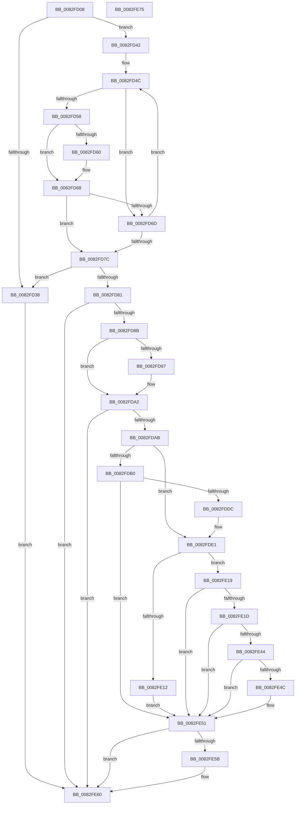

# CmDeleteInterfaceClassMappedPropertyFromRegValue

- RVA: `0x0082FD08`–`0x0082FE76` (길이 `366` bytes)
- VA: `0x000000014082FD08`
- 실행 섹션: `PAGE`
- PDB 이름 있음: `예`; PDB Function 태그: `아니요`
- unwind 정보 RVA: `0x000B5608`
- 디코드: `102`개 명령, `366/366` bytes 표시
- 미해석 바이트: `0` (있으면 어셈블리에 `.byte`로 보존)

> 이 문서는 커널 이미지의 기계어와 PDB 기호를 분석해 생성했습니다. 4번과 5번은 함수 원형과 자료형을 바이너리 사용 방식에서 추정한 C 해석이며 원본 소스 복구 결과는 아닙니다.

## 1. Dependencies

- 직접 호출 지점: **5**; 고유 호출 대상: **4**
- 직접 호출자로 확인된 함수: **1**
- RIP 상대 이미지 참조: **4**

### Outgoing calls
- `0x0082FDD1` → [CmOpenInterfaceClassRegKey](../A3/CmOpenInterfaceClassRegKey_function_00A304F8.md) (function, `0x00A304F8`)
- `0x0082FE02` → [_PnpOpenPropertiesKey](../99/_PnpOpenPropertiesKey_function_009938A0.md) (function, `0x009938A0`)
- `0x0082FE2C` → [PnpCtxRegDeleteValue](../8F/PnpCtxRegDeleteValue_function_008FE5E0.md) (function, `0x008FE5E0`)
- `0x0082FE3B` → [ZwClose](../../text/6A/ZwClose_function_006AD2B0.md) (function, `0x006AD2B0`)
- `0x0082FE5B` → [ZwClose](../../text/6A/ZwClose_function_006AD2B0.md) (function, `0x006AD2B0`)

### Direct callers
- [CmSetInterfaceClassMappedProperty](../83/CmSetInterfaceClassMappedProperty_function_00831500.md) at `0x008315B8`

### Static image references
- `0x0082FD45` → RVA `0x00B4AE80` (`PAGE`; read)
- `0x0082FD8E` → RVA `0x00013348` (`.rdata`; read)
- `0x0082FD9B` → RVA `0x00013350` (`.rdata`; read)
- `0x0082FE25` → RVA `0x00AFF600` (` ?? ::NNGAKEGL::`string'`; read)

## 2. Other-region calls and transfers

- 다른 실행 섹션으로 향하는 call: **2**
  - `0x0082FE3B` → [ZwClose](../../text/6A/ZwClose_function_006AD2B0.md) (`PAGE` → `.text`)
  - `0x0082FE5B` → [ZwClose](../../text/6A/ZwClose_function_006AD2B0.md) (`PAGE` → `.text`)
- 별도 외부 분기/꼬리 이동을 확인하지 못했습니다.

## 3. Assembly (complete function range)

```asm
0082FD08  48 8B C4                        mov rax, rsp
0082FD0B  48 89 58 08                     mov qword ptr [rax + 8], rbx
0082FD0F  48 89 68 10                     mov qword ptr [rax + 0x10], rbp
0082FD13  56                              push rsi
0082FD14  57                              push rdi
0082FD15  41 56                           push r14
0082FD17  48 83 EC 50                     sub rsp, 0x50
0082FD1B  45 8B 59 10                     mov r11d, dword ptr [r9 + 0x10]
0082FD1F  33 DB                           xor ebx, ebx
0082FD21  48 21 58 D8                     and qword ptr [rax - 0x28], rbx
0082FD25  4D 8B D0                        mov r10, r8
0082FD28  48 21 58 20                     and qword ptr [rax + 0x20], rbx
0082FD2C  4C 8B F2                        mov r14, rdx
0082FD2F  48 8B E9                        mov rbp, rcx
0082FD32  41 83 FB 02                     cmp r11d, 2
0082FD36  73 0A                           jae 0x14082fd42
0082FD38  BB 30 02 00 C0                  mov ebx, 0xc0000230
0082FD3D  E9 1E 01 00 00                  jmp 0x14082fe60
0082FD42  45 33 C0                        xor r8d, r8d
0082FD45  48 8D 0D 34 B1 31 00            lea rcx, [rip + 0x31b134]
0082FD4C  48 8B 39                        mov rdi, qword ptr [rcx]
0082FD4F  48 8B F1                        mov rsi, rcx
0082FD52  44 3B 5F 10                     cmp r11d, dword ptr [rdi + 0x10]
0082FD56  75 15                           jne 0x14082fd6d
0082FD58  49 8B 11                        mov rdx, qword ptr [r9]
0082FD5B  48 2B 17                        sub rdx, qword ptr [rdi]
0082FD5E  75 08                           jne 0x14082fd68
0082FD60  49 8B 51 08                     mov rdx, qword ptr [r9 + 8]
0082FD64  48 2B 57 08                     sub rdx, qword ptr [rdi + 8]
0082FD68  48 85 D2                        test rdx, rdx
0082FD6B  74 0F                           je 0x14082fd7c
0082FD6D  33 F6                           xor esi, esi
0082FD6F  41 FF C0                        inc r8d
0082FD72  48 83 C1 10                     add rcx, 0x10
0082FD76  41 83 F8 01                     cmp r8d, 1
0082FD7A  72 D0                           jb 0x14082fd4c
0082FD7C  48 85 F6                        test rsi, rsi
0082FD7F  74 B7                           je 0x14082fd38
0082FD81  41 83 FB 02                     cmp r11d, 2
0082FD85  0F 85 D5 00 00 00               jne 0x14082fe60
0082FD8B  49 8B 01                        mov rax, qword ptr [r9]
0082FD8E  48 2B 05 B3 35 7E FF            sub rax, qword ptr [rip - 0x81ca4d]
0082FD95  75 0B                           jne 0x14082fda2
0082FD97  49 8B 41 08                     mov rax, qword ptr [r9 + 8]
0082FD9B  48 2B 05 AE 35 7E FF            sub rax, qword ptr [rip - 0x81ca52]
0082FDA2  48 85 C0                        test rax, rax
0082FDA5  0F 85 B5 00 00 00               jne 0x14082fe60
0082FDAB  4D 85 D2                        test r10, r10
0082FDAE  75 31                           jne 0x14082fde1
0082FDB0  48 21 5C 24 38                  and qword ptr [rsp + 0x38], rbx
0082FDB5  48 8D 44 24 40                  lea rax, [rsp + 0x40]
0082FDBA  48 89 44 24 30                  mov qword ptr [rsp + 0x30], rax
0082FDBF  49 8B D6                        mov rdx, r14
0082FDC2  88 5C 24 28                     mov byte ptr [rsp + 0x28], bl
0082FDC6  48 8B CD                        mov rcx, rbp
0082FDC9  C7 44 24 20 01 00 00 00         mov dword ptr [rsp + 0x20], 1
0082FDD1  E8 22 07 20 00                  call 0x140a304f8
0082FDD6  8B D8                           mov ebx, eax
0082FDD8  85 C0                           test eax, eax
0082FDDA  78 75                           js 0x14082fe51
0082FDDC  4C 8B 54 24 40                  mov r10, qword ptr [rsp + 0x40]
0082FDE1  48 8D 84 24 88 00 00 00         lea rax, [rsp + 0x88]
0082FDE9  41 B9 02 00 00 00               mov r9d, 2
0082FDEF  48 89 44 24 30                  mov qword ptr [rsp + 0x30], rax
0082FDF4  45 33 C0                        xor r8d, r8d
0082FDF7  49 8B D2                        mov rdx, r10
0082FDFA  C6 44 24 20 00                  mov byte ptr [rsp + 0x20], 0
0082FDFF  48 8B CD                        mov rcx, rbp
0082FE02  E8 99 3A 16 00                  call 0x1409938a0
0082FE07  BE 34 00 00 C0                  mov esi, 0xc0000034
0082FE0C  8B D8                           mov ebx, eax
0082FE0E  3B C6                           cmp eax, esi
0082FE10  75 07                           jne 0x14082fe19
0082FE12  BB 25 02 00 C0                  mov ebx, 0xc0000225
0082FE17  EB 38                           jmp 0x14082fe51
0082FE19  85 DB                           test ebx, ebx
0082FE1B  78 34                           js 0x14082fe51
0082FE1D  48 8B 94 24 88 00 00 00         mov rdx, qword ptr [rsp + 0x88]
0082FE25  4C 8D 05 D4 F7 2C 00            lea r8, [rip + 0x2cf7d4]
0082FE2C  E8 AF E7 0C 00                  call 0x1408fe5e0
0082FE31  48 8B 8C 24 88 00 00 00         mov rcx, qword ptr [rsp + 0x88]
0082FE39  8B F8                           mov edi, eax
0082FE3B  E8 70 D4 E7 FF                  call 0x1406ad2b0
0082FE40  3B FE                           cmp edi, esi
0082FE42  74 0D                           je 0x14082fe51
0082FE44  81 FF 7C 01 00 C0               cmp edi, 0xc000017c
0082FE4A  74 05                           je 0x14082fe51
0082FE4C  85 FF                           test edi, edi
0082FE4E  0F 48 DF                        cmovs ebx, edi
0082FE51  48 8B 4C 24 40                  mov rcx, qword ptr [rsp + 0x40]
0082FE56  48 85 C9                        test rcx, rcx
0082FE59  74 05                           je 0x14082fe60
0082FE5B  E8 50 D4 E7 FF                  call 0x1406ad2b0
0082FE60  48 8B 6C 24 78                  mov rbp, qword ptr [rsp + 0x78]
0082FE65  8B C3                           mov eax, ebx
0082FE67  48 8B 5C 24 70                  mov rbx, qword ptr [rsp + 0x70]
0082FE6C  48 83 C4 50                     add rsp, 0x50
0082FE70  41 5E                           pop r14
0082FE72  5F                              pop rdi
0082FE73  5E                              pop rsi
0082FE74  C3                              ret
0082FE75  CC                              int3
```

## 4. C-style interpretation (structured pseudocode)

```c
__int64 __fastcall CmDeleteInterfaceClassMappedPropertyFromRegValue(__int64 a1, __int64 a2, __int64 a3, __int64 a4)
{
    __int64 result;
    __int64 v_rbx;
    __int64 v_rsi;
    __int64 v_rsp;
    unsigned __int64 v_stack_m28;
    unsigned __int64 v_stack_m30;
    unsigned __int64 v_stack_m38;
    unsigned __int8 v_stack_m40;
    unsigned int v_stack_m48;
    unsigned __int64 v_stack_p10;
    unsigned __int64 v_stack_p20;
    unsigned __int64 v_stack_p8;

    *(unsigned __int64 *)(v_rsp + 8) = v_rbx;
    *(unsigned __int64 *)(v_rsp + 16) = v_rbp;
    v_rsp = (v_rsp) - (80);
    v_rbx = 0;
    if (((unsigned int)((unsigned int)(*(unsigned int *)(a4 + 16)))) >= 2) goto loc_0082FD42;
loc_0082FD38:
    goto loc_0082FE60;
loc_0082FD42:
    a3 = 0;
loc_0082FD4C:
    if (((unsigned int)((unsigned int)(*(unsigned int *)(a4 + 16)))) != (*(unsigned int *)(*(unsigned __int64 *)(v_rip + 3256628) + 16))) goto loc_0082FD6D;
    a2 = (*(unsigned __int64 *)(a4)) - (*(unsigned __int64 *)(*(unsigned __int64 *)(v_rip + 3256628)));
    if (!(condition_is_not_equal)) {
        a2 = *(unsigned __int64 *)(a4 + 8);
        a2 = (a2) - (*(unsigned __int64 *)(*(unsigned __int64 *)(v_rip + 3256628) + 8));
    }
    if (a2 == 0) goto loc_0082FD7C;
loc_0082FD6D:
    v_rsi = 0;
    a3 = (unsigned int)((a3) + 1);
    a1 = (v_rip + 3256628) + (16);
    if (((unsigned int)(a3)) < 1) goto loc_0082FD4C;
loc_0082FD7C:
    if (0 == 0) goto loc_0082FD38;
    if (((unsigned int)((unsigned int)(*(unsigned int *)(a4 + 16)))) != 2) goto loc_0082FE60;
    result = (*(unsigned __int64 *)(a4)) - (*(unsigned __int64 *)(v_rip - 8505933));
    if (!(condition_is_not_equal)) {
        result = *(unsigned __int64 *)(a4 + 8);
        result = (result) - (*(unsigned __int64 *)(v_rip - 8505938));
    }
    if (result != 0) goto loc_0082FE60;
    if (a3 != 0) goto loc_0082FDE1;
    v_stack_m38 = v_stack_m28;
    v_stack_m40 = (unsigned __int8)((unsigned int)(0xC0000230ULL));
    v_stack_m48 = 1;
    result = CmOpenInterfaceClassRegKey(a1, a2, a3, a4);
    if (sign_flag) goto loc_0082FE51;
loc_0082FDE1:
    v_stack_m38 = v_stack_p20;
    a3 = 0;
    v_stack_m48 = 0;
    result = _PnpOpenPropertiesKey(a1, v_stack_m28, a3, 2);
    if (((unsigned int)(result)) != ((unsigned int)((unsigned int)(0xC0000034ULL)))) goto loc_0082FE19;
    goto loc_0082FE51;
loc_0082FE19:
    if (sign_flag) goto loc_0082FE51;
    result = PnpCtxRegDeleteValue(a1, v_stack_p20, v_rip + 2947028, 2);
    result = ZwClose(v_stack_p20, v_stack_p20, v_rip + 2947028, 2);
    if (((unsigned int)((unsigned int)((unsigned int)(result)))) == ((unsigned int)((unsigned int)(0xC0000034ULL)))) goto loc_0082FE51;
    v_rbx = (unsigned int)(0xC0000225ULL);
    if (((unsigned int)((unsigned int)((unsigned int)(result)))) != 0xC000017CULL) {
        v_rbx = (unsigned int)(0xC0000225ULL);
        if (sign_flag) { v_rbx = (unsigned int)((unsigned int)((unsigned int)(result))); }
    }
    if (v_stack_m28 != 0) {
        result = ZwClose(v_stack_m28, v_stack_p20, v_rip + 2947028, 2);
    }
    v_rsp = (v_rsp) + (80);
    return (unsigned int)((unsigned int)(v_rbx));
}
```

## 5. (Beta) C Style

```c
int64_t CmDeleteInterfaceClassMappedPropertyFromRegValue(int64_t Arg1, int64_t Arg2, int64_t Arg3, void *Arg4)
{
    uint8_t *arg4 = (uint8_t *)Arg4;

    int64_t result;
    int64_t local_rbx;
    int64_t local_rsi;
    int64_t local_rsp;
    uint64_t v_stack_m28;
    uint64_t v_stack_m30;
    uint64_t v_stack_m38;
    uint8_t v_stack_m40;
    uint32_t v_stack_m48;
    uint64_t v_stack_p10;
    uint64_t v_stack_p20;
    uint64_t v_stack_p8;

    *(uint64_t *)(local_rsp + 0x8) = local_rbx;
    *(uint64_t *)(local_rsp + 0x10) = local_rbp;
    local_rsp = (local_rsp) - (80);
    local_rbx = 0;
    if (((uint32_t)((uint32_t)(*(uint32_t *)(arg4 + 0x10)))) >= 2) goto loc_0082FD42;
loc_0082FD38:
    goto loc_0082FE60;
loc_0082FD42:
    Arg3 = 0;
loc_0082FD4C:
    if (((uint32_t)((uint32_t)(*(uint32_t *)(arg4 + 0x10)))) != (*(uint32_t *)(*(uint64_t *)(v_rip + 0x31B134) + 0x10))) goto loc_0082FD6D;
    Arg2 = (*(uint64_t *)(arg4)) - (*(uint64_t *)(*(uint64_t *)(v_rip + 0x31B134)));
    if (!(condition_is_not_equal)) {
        Arg2 = *(uint64_t *)(arg4 + 0x8);
        Arg2 = (Arg2) - (*(uint64_t *)(*(uint64_t *)(v_rip + 0x31B134) + 0x8));
    }
    if (Arg2 == 0) goto loc_0082FD7C;
loc_0082FD6D:
    local_rsi = 0;
    Arg3 = (uint32_t)((Arg3) + 1);
    Arg1 = (v_rip + 3256628) + (16);
    if (((uint32_t)(Arg3)) < 1) goto loc_0082FD4C;
loc_0082FD7C:
    if (0 == 0) goto loc_0082FD38;
    if (((uint32_t)((uint32_t)(*(uint32_t *)(arg4 + 0x10)))) != 2) goto loc_0082FE60;
    result = (*(uint64_t *)(arg4)) - (*(uint64_t *)(v_rip - 0x81CA4D));
    if (!(condition_is_not_equal)) {
        result = *(uint64_t *)(arg4 + 0x8);
        result = (result) - (*(uint64_t *)(v_rip - 0x81CA52));
    }
    if (result != 0) goto loc_0082FE60;
    if (Arg3 != 0) goto loc_0082FDE1;
    v_stack_m38 = v_stack_m28;
    v_stack_m40 = (uint8_t)((uint32_t)(0xC0000230ULL));
    v_stack_m48 = 1;
    result = CmOpenInterfaceClassRegKey(Arg1, Arg2, Arg3, Arg4);
    if (sign_flag) goto loc_0082FE51;
loc_0082FDE1:
    v_stack_m38 = v_stack_p20;
    Arg3 = 0;
    v_stack_m48 = 0;
    result = _PnpOpenPropertiesKey(Arg1, v_stack_m28, Arg3, 2);
    if (((uint32_t)(result)) != ((uint32_t)((uint32_t)(0xC0000034ULL)))) goto loc_0082FE19;
    goto loc_0082FE51;
loc_0082FE19:
    if (sign_flag) goto loc_0082FE51;
    result = PnpCtxRegDeleteValue(Arg1, v_stack_p20, v_rip + 2947028, 2);
    result = ZwClose(v_stack_p20, v_stack_p20, v_rip + 2947028, 2);
    if (((uint32_t)((uint32_t)((uint32_t)(result)))) == ((uint32_t)((uint32_t)(0xC0000034ULL)))) goto loc_0082FE51;
    local_rbx = (uint32_t)(0xC0000225ULL);
    if (((uint32_t)((uint32_t)((uint32_t)(result)))) != 0xC000017CULL) {
        local_rbx = (uint32_t)(0xC0000225ULL);
        if (sign_flag) { local_rbx = (uint32_t)((uint32_t)((uint32_t)(result))); }
    }
    if (v_stack_m28 != 0) {
        result = ZwClose(v_stack_m28, v_stack_p20, v_rip + 2947028, 2);
    }
    local_rsp = (local_rsp) + (80);
    return (uint32_t)((uint32_t)(local_rbx));
}
```

### 관측된 메모리 오프셋

구조체 형식이 확인되지 않은 접근은 인자 기준의 오프셋으로만 기록했습니다.

| 기준 인자 | 오프셋 표현 | 폭 (bit) | 접근 |
|---|---:|---:|---|
| `Arg4` | `+ 0x0` | `64` | `R` |
| `Arg4` | `+ 0x8` | `64` | `R` |
| `Arg4` | `+ 0x10` | `32` | `R` |

## 6. Execution-region graph

[열기: 2D/3D 그래프와 함수 탐색 컨트롤 패널](../../../control-panel.html?section=page&rva=0x0082FD08&view=graph)

- 2D 그래프는 위에서 아래로 흐르고, 3D 그래프는 빈 공간을 드래그해 회전합니다. Shift+드래그는 이동, 휠은 확대·축소, 함수 노드 선택은 대상 보고서 이동입니다.

### Static fallback


