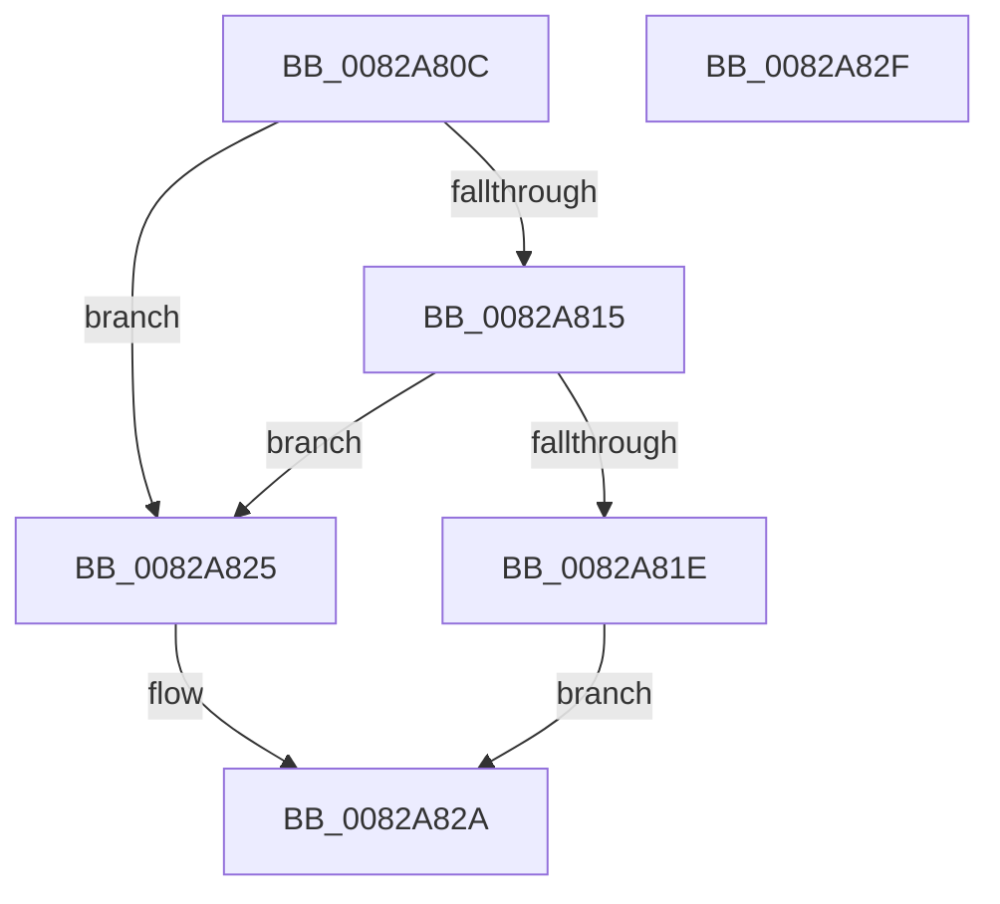

# CmDeleteInterfaceClassRegKey

- RVA: `0x0082A80C`–`0x0082A830` (길이 `36` bytes)
- VA: `0x000000014082A80C`
- 실행 섹션: `PAGE`
- PDB 이름 있음: `예`; PDB Function 태그: `아니요`
- unwind 정보 RVA: `0x0005D2F4`
- 디코드: `11`개 명령, `36/36` bytes 표시
- 미해석 바이트: `0` (있으면 어셈블리에 `.byte`로 보존)

> 이 문서는 커널 이미지의 기계어와 PDB 기호를 분석해 생성했습니다. 4번과 5번은 함수 원형과 자료형을 바이너리 사용 방식에서 추정한 C 해석이며 원본 소스 복구 결과는 아닙니다.

## 1. Dependencies

- 직접 호출 지점: **1**; 고유 호출 대상: **1**
- 직접 호출자로 확인된 함수: **1**
- RIP 상대 이미지 참조: **0**

### Outgoing calls
- `0x0082A81E` → [CmDeleteCommonClassRegKey](CmDeleteCommonClassRegKey_function_008297AC.md) (function, `0x008297AC`)

### Direct callers
- [CmDeleteInterfaceClassWorker](CmDeleteInterfaceClassWorker_function_0082A838.md) at `0x0082A8E9`
- [CmDeleteInterfaceClassWorker](CmDeleteInterfaceClassWorker_function_0082A838.md) at `0x0082AA28`

### Static image references
- 디코드된 RIP-relative 메모리 참조가 없습니다.

## 2. Other-region calls and transfers

- 다른 실행 섹션으로 향하는 call: **0**
- 별도 외부 분기/꼬리 이동을 확인하지 못했습니다.

## 3. Assembly (complete function range)

```asm
0082A80C  48 83 EC 38                     sub rsp, 0x38
0082A810  45 85 C0                        test r8d, r8d
0082A813  74 10                           je 0x14082a825
0082A815  41 F7 C0 BF FC FF FF            test r8d, 0xfffffcbf
0082A81C  75 07                           jne 0x14082a825
0082A81E  E8 89 EF FF FF                  call 0x1408297ac
0082A823  EB 05                           jmp 0x14082a82a
0082A825  B8 0D 00 00 C0                  mov eax, 0xc000000d
0082A82A  48 83 C4 38                     add rsp, 0x38
0082A82E  C3                              ret
0082A82F  CC                              int3
```

## 4. C-style interpretation (structured pseudocode)

```c
__int64 __fastcall CmDeleteInterfaceClassRegKey(__int64 a1, __int64 a2, int a3)
{
    __int64 result;
    __int64 v_rsp;

    v_rsp = (v_rsp) - (56);
    if (a3 == 0) goto loc_0082A825;
    if (((a3) & (0xFFFFFCBFULL)) != 0) goto loc_0082A825;
    result = CmDeleteCommonClassRegKey(a1, a2, a3, a4);
    goto loc_0082A82A;
loc_0082A825:
loc_0082A82A:
    v_rsp = (v_rsp) + (56);
    return (unsigned int)(0xC000000DULL);
}
```

## 5. (Beta) C Style

```c
int64_t CmDeleteInterfaceClassRegKey(int64_t Arg1, int64_t Arg2, int32_t Arg3)
{
    int64_t result;
    int64_t local_rsp;

    local_rsp = (local_rsp) - (56);
    if (Arg3 == 0) goto loc_0082A825;
    if (((Arg3) & (0xFFFFFCBFULL)) != 0) goto loc_0082A825;
    result = CmDeleteCommonClassRegKey(Arg1, Arg2, Arg3, a4);
    goto loc_0082A82A;
loc_0082A825:
loc_0082A82A:
    local_rsp = (local_rsp) + (56);
    return (uint32_t)(0xC000000DULL);
}
```

## 6. Execution-region graph

[열기: 2D/3D 그래프와 함수 탐색 컨트롤 패널](../../../control-panel.html?section=page&rva=0x0082A80C&view=graph)

- 2D 그래프는 위에서 아래로 흐르고, 3D 그래프는 빈 공간을 드래그해 회전합니다. Shift+드래그는 이동, 휠은 확대·축소, 함수 노드 선택은 대상 보고서 이동입니다.

### Static fallback


