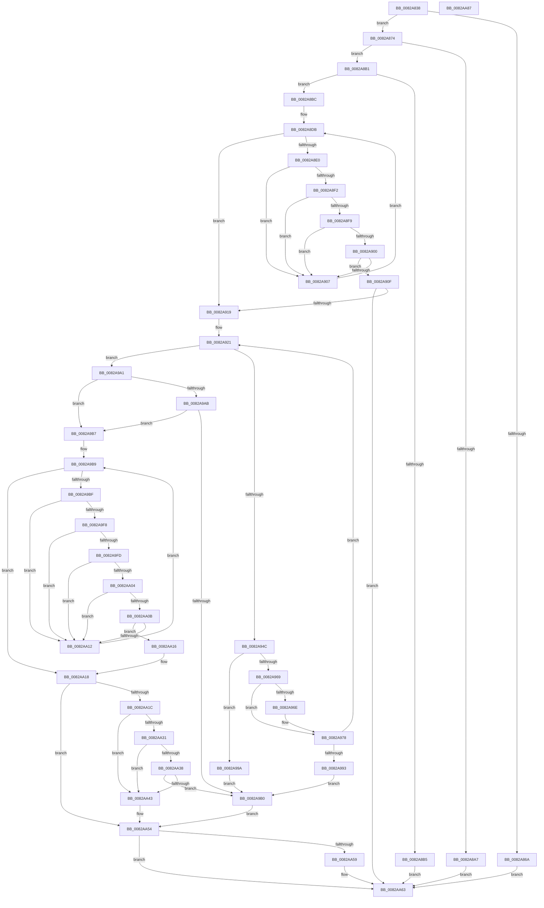

# CmDeleteInterfaceClassWorker

- RVA: `0x0082A838`–`0x0082AA88` (길이 `592` bytes)
- VA: `0x000000014082A838`
- 실행 섹션: `PAGE`
- PDB 이름 있음: `예`; PDB Function 태그: `아니요`
- unwind 정보 RVA: `0x000DA844`
- 디코드: `167`개 명령, `592/592` bytes 표시
- 미해석 바이트: `0` (있으면 어셈블리에 `.byte`로 보존)

> 이 문서는 커널 이미지의 기계어와 PDB 기호를 분석해 생성했습니다. 4번과 5번은 함수 원형과 자료형을 바이너리 사용 방식에서 추정한 C 해석이며 원본 소스 복구 결과는 아닙니다.

## 1. Dependencies

- 직접 호출 지점: **10**; 고유 호출 대상: **8**
- 직접 호출자로 확인된 함수: **1**
- RIP 상대 이미지 참조: **1**

### Outgoing calls
- `0x0082A89B` → [_CmGetMatchingFilteredDeviceInterfaceList](../A0/_CmGetMatchingFilteredDeviceInterfaceList_function_00A09610.md) (function, `0x00A09610`)
- `0x0082A8E9` → [CmDeleteInterfaceClassRegKey](CmDeleteInterfaceClassRegKey_function_0082A80C.md) (function, `0x0082A80C`)
- `0x0082A940` → [CmGetInterfaceClassMappedPropertyKeys](../83/CmGetInterfaceClassMappedPropertyKeys_function_00830C70.md) (function, `0x00830C70`)
- `0x0082A973` → [ExFreePoolWithTag](../../poolcode/B8/ExFreePoolWithTag_function_00B82870.md) (function, `0x00B82870`)
- `0x0082A986` → [ExAllocatePool2](../../poolcode/B8/ExAllocatePool2_function_00B820F0.md) (function, `0x00B820F0`)
- `0x0082A9EF` → [CmSetInterfaceClassMappedProperty](../83/CmSetInterfaceClassMappedProperty_function_00831500.md) (function, `0x00831500`)
- `0x0082AA28` → [CmDeleteInterfaceClassRegKey](CmDeleteInterfaceClassRegKey_function_0082A80C.md) (function, `0x0082A80C`)
- `0x0082AA4F` → [CmRaiseDeleteEvent](CmRaiseDeleteEvent_function_0082DBE0.md) (function, `0x0082DBE0`)
- `0x0082AA5E` → [ExFreePoolWithTag](../../poolcode/B8/ExFreePoolWithTag_function_00B82870.md) (function, `0x00B82870`)
- `0x0082AA6D` → [_security_check_cookie](../../text/6A/_security_check_cookie_function_006AC640.md) (function, `0x006AC640`)

### Direct callers
- [CmDeleteInterfaceClass](CmDeleteInterfaceClass_function_0082A6E0.md) at `0x0082A76C`

### Static image references
- `0x0082A849` → RVA `0x00E0A740` (`.data`; read)

## 2. Other-region calls and transfers

- 다른 실행 섹션으로 향하는 call: **4**
  - `0x0082A973` → [ExFreePoolWithTag](../../poolcode/B8/ExFreePoolWithTag_function_00B82870.md) (`PAGE` → `POOLCODE`)
  - `0x0082A986` → [ExAllocatePool2](../../poolcode/B8/ExAllocatePool2_function_00B820F0.md) (`PAGE` → `POOLCODE`)
  - `0x0082AA5E` → [ExFreePoolWithTag](../../poolcode/B8/ExFreePoolWithTag_function_00B82870.md) (`PAGE` → `POOLCODE`)
  - `0x0082AA6D` → [_security_check_cookie](../../text/6A/_security_check_cookie_function_006AC640.md) (`PAGE` → `.text`)
- 별도 외부 분기/꼬리 이동을 확인하지 못했습니다.

## 3. Assembly (complete function range)

```asm
0082A838  48 89 5C 24 18                  mov qword ptr [rsp + 0x18], rbx
0082A83D  55                              push rbp
0082A83E  57                              push rdi
0082A83F  41 54                           push r12
0082A841  41 56                           push r14
0082A843  41 57                           push r15
0082A845  48 83 EC 70                     sub rsp, 0x70
0082A849  48 8B 05 F0 FE 5D 00            mov rax, qword ptr [rip + 0x5dfef0]
0082A850  48 33 C4                        xor rax, rsp
0082A853  48 89 44 24 68                  mov qword ptr [rsp + 0x68], rax
0082A858  33 DB                           xor ebx, ebx
0082A85A  4C 8B E2                        mov r12, rdx
0082A85D  21 5C 24 54                     and dword ptr [rsp + 0x54], ebx
0082A861  4C 8B F9                        mov r15, rcx
0082A864  66 45 85 C0                     test r8w, r8w
0082A868  74 0A                           je 0x14082a874
0082A86A  BB 0D 00 00 C0                  mov ebx, 0xc000000d
0082A86F  E9 EF 01 00 00                  jmp 0x14082aa63
0082A874  21 5C 24 48                     and dword ptr [rsp + 0x48], ebx
0082A878  48 8D 44 24 54                  lea rax, [rsp + 0x54]
0082A87D  48 89 44 24 40                  mov qword ptr [rsp + 0x40], rax
0082A882  45 33 C9                        xor r9d, r9d
0082A885  21 5C 24 38                     and dword ptr [rsp + 0x38], ebx
0082A889  45 33 C0                        xor r8d, r8d
0082A88C  48 21 5C 24 30                  and qword ptr [rsp + 0x30], rbx
0082A891  48 21 5C 24 28                  and qword ptr [rsp + 0x28], rbx
0082A896  48 21 5C 24 20                  and qword ptr [rsp + 0x20], rbx
0082A89B  E8 70 ED 1D 00                  call 0x140a09610
0082A8A0  3D 23 00 00 C0                  cmp eax, 0xc0000023
0082A8A5  75 0A                           jne 0x14082a8b1
0082A8A7  BB 21 01 00 C0                  mov ebx, 0xc0000121
0082A8AC  E9 B2 01 00 00                  jmp 0x14082aa63
0082A8B1  85 C0                           test eax, eax
0082A8B3  74 07                           je 0x14082a8bc
0082A8B5  8B D8                           mov ebx, eax
0082A8B7  E9 A7 01 00 00                  jmp 0x14082aa63
0082A8BC  C7 44 24 58 40 03 00 00         mov dword ptr [rsp + 0x58], 0x340
0082A8C4  4C 8D 74 24 58                  lea r14, [rsp + 0x58]
0082A8C9  C7 44 24 5C 40 02 00 00         mov dword ptr [rsp + 0x5c], 0x240
0082A8D1  33 FF                           xor edi, edi
0082A8D3  C7 44 24 60 40 01 00 00         mov dword ptr [rsp + 0x60], 0x140
0082A8DB  83 FF 03                        cmp edi, 3
0082A8DE  73 39                           jae 0x14082a919
0082A8E0  45 8B 06                        mov r8d, dword ptr [r14]
0082A8E3  49 8B D4                        mov rdx, r12
0082A8E6  49 8B CF                        mov rcx, r15
0082A8E9  E8 1E FF FF FF                  call 0x14082a80c
0082A8EE  85 C0                           test eax, eax
0082A8F0  74 15                           je 0x14082a907
0082A8F2  3D 34 00 00 C0                  cmp eax, 0xc0000034
0082A8F7  74 0E                           je 0x14082a907
0082A8F9  3D 0D 00 00 C0                  cmp eax, 0xc000000d
0082A8FE  74 07                           je 0x14082a907
0082A900  3D BB 00 00 C0                  cmp eax, 0xc00000bb
0082A905  75 08                           jne 0x14082a90f
0082A907  FF C7                           inc edi
0082A909  49 83 C6 04                     add r14, 4
0082A90D  EB CC                           jmp 0x14082a8db
0082A90F  8B D8                           mov ebx, eax
0082A911  85 C0                           test eax, eax
0082A913  0F 88 4A 01 00 00               js 0x14082aa63
0082A919  33 FF                           xor edi, edi
0082A91B  33 ED                           xor ebp, ebp
0082A91D  89 6C 24 50                     mov dword ptr [rsp + 0x50], ebp
0082A921  48 8D 44 24 50                  lea rax, [rsp + 0x50]
0082A926  41 B1 01                        mov r9b, 1
0082A929  48 89 44 24 30                  mov qword ptr [rsp + 0x30], rax
0082A92E  45 33 C0                        xor r8d, r8d
0082A931  89 6C 24 28                     mov dword ptr [rsp + 0x28], ebp
0082A935  49 8B D4                        mov rdx, r12
0082A938  49 8B CF                        mov rcx, r15
0082A93B  48 89 7C 24 20                  mov qword ptr [rsp + 0x20], rdi
0082A940  E8 2B 63 00 00                  call 0x140830c70
0082A945  3D 23 00 00 C0                  cmp eax, 0xc0000023
0082A94A  75 55                           jne 0x14082a9a1
0082A94C  8B 6C 24 50                     mov ebp, dword ptr [rsp + 0x50]
0082A950  B8 FF FF FF FF                  mov eax, 0xffffffff
0082A955  4C 8D 34 AD 00 00 00 00         lea r14, [rbp*4]
0082A95D  4C 03 F5                        add r14, rbp
0082A960  49 C1 E6 02                     shl r14, 2
0082A964  4C 3B F0                        cmp r14, rax
0082A967  77 31                           ja 0x14082a99a
0082A969  48 85 FF                        test rdi, rdi
0082A96C  74 0A                           je 0x14082a978
0082A96E  33 D2                           xor edx, edx
0082A970  48 8B CF                        mov rcx, rdi
0082A973  E8 F8 7E 35 00                  call 0x140b82870
0082A978  41 8B D6                        mov edx, r14d
0082A97B  B9 00 01 00 00                  mov ecx, 0x100
0082A980  41 B8 50 4E 50 52               mov r8d, 0x52504e50
0082A986  E8 65 77 35 00                  call 0x140b820f0
0082A98B  48 8B F8                        mov rdi, rax
0082A98E  48 85 C0                        test rax, rax
0082A991  75 8E                           jne 0x14082a921
0082A993  B8 17 00 00 C0                  mov eax, 0xc0000017
0082A998  EB 16                           jmp 0x14082a9b0
0082A99A  B8 0D 00 00 C0                  mov eax, 0xc000000d
0082A99F  EB 0F                           jmp 0x14082a9b0
0082A9A1  41 BE 25 02 00 C0               mov r14d, 0xc0000225
0082A9A7  85 C0                           test eax, eax
0082A9A9  74 0C                           je 0x14082a9b7
0082A9AB  41 3B C6                        cmp eax, r14d
0082A9AE  74 07                           je 0x14082a9b7
0082A9B0  8B D8                           mov ebx, eax
0082A9B2  E9 9D 00 00 00                  jmp 0x14082aa54
0082A9B7  33 ED                           xor ebp, ebp
0082A9B9  3B 6C 24 50                     cmp ebp, dword ptr [rsp + 0x50]
0082A9BD  73 59                           jae 0x14082aa18
0082A9BF  83 64 24 38 00                  and dword ptr [rsp + 0x38], 0
0082A9C4  48 8D 0C AD 00 00 00 00         lea rcx, [rbp*4]
0082A9CC  48 83 64 24 30 00               and qword ptr [rsp + 0x30], 0
0082A9D2  48 03 CD                        add rcx, rbp
0082A9D5  83 64 24 28 00                  and dword ptr [rsp + 0x28], 0
0082A9DA  45 33 C9                        xor r9d, r9d
0082A9DD  45 33 C0                        xor r8d, r8d
0082A9E0  49 8B D4                        mov rdx, r12
0082A9E3  48 8D 04 8F                     lea rax, [rdi + rcx*4]
0082A9E7  49 8B CF                        mov rcx, r15
0082A9EA  48 89 44 24 20                  mov qword ptr [rsp + 0x20], rax
0082A9EF  E8 0C 6B 00 00                  call 0x140831500
0082A9F4  85 C0                           test eax, eax
0082A9F6  74 1A                           je 0x14082aa12
0082A9F8  41 3B C6                        cmp eax, r14d
0082A9FB  74 15                           je 0x14082aa12
0082A9FD  3D 22 00 00 C0                  cmp eax, 0xc0000022
0082AA02  74 0E                           je 0x14082aa12
0082AA04  3D 16 00 00 C0                  cmp eax, 0xc0000016
0082AA09  74 07                           je 0x14082aa12
0082AA0B  3D BB 00 00 C0                  cmp eax, 0xc00000bb
0082AA10  75 04                           jne 0x14082aa16
0082AA12  FF C5                           inc ebp
0082AA14  EB A3                           jmp 0x14082a9b9
0082AA16  8B D8                           mov ebx, eax
0082AA18  85 DB                           test ebx, ebx
0082AA1A  78 38                           js 0x14082aa54
0082AA1C  41 B8 40 00 00 00               mov r8d, 0x40
0082AA22  49 8B D4                        mov rdx, r12
0082AA25  49 8B CF                        mov rcx, r15
0082AA28  E8 DF FD FF FF                  call 0x14082a80c
0082AA2D  85 C0                           test eax, eax
0082AA2F  74 12                           je 0x14082aa43
0082AA31  3D 34 00 00 C0                  cmp eax, 0xc0000034
0082AA36  74 0B                           je 0x14082aa43
0082AA38  3D 0D 00 00 C0                  cmp eax, 0xc000000d
0082AA3D  0F 85 6D FF FF FF               jne 0x14082a9b0
0082AA43  41 B8 04 00 00 00               mov r8d, 4
0082AA49  49 8B D4                        mov rdx, r12
0082AA4C  49 8B CF                        mov rcx, r15
0082AA4F  E8 8C 31 00 00                  call 0x14082dbe0
0082AA54  48 85 FF                        test rdi, rdi
0082AA57  74 0A                           je 0x14082aa63
0082AA59  33 D2                           xor edx, edx
0082AA5B  48 8B CF                        mov rcx, rdi
0082AA5E  E8 0D 7E 35 00                  call 0x140b82870
0082AA63  8B C3                           mov eax, ebx
0082AA65  48 8B 4C 24 68                  mov rcx, qword ptr [rsp + 0x68]
0082AA6A  48 33 CC                        xor rcx, rsp
0082AA6D  E8 CE 1B E8 FF                  call 0x1406ac640
0082AA72  48 8B 9C 24 B0 00 00 00         mov rbx, qword ptr [rsp + 0xb0]
0082AA7A  48 83 C4 70                     add rsp, 0x70
0082AA7E  41 5F                           pop r15
0082AA80  41 5E                           pop r14
0082AA82  41 5C                           pop r12
0082AA84  5F                              pop rdi
0082AA85  5D                              pop rbp
0082AA86  C3                              ret
0082AA87  CC                              int3
```

## 4. C-style interpretation (structured pseudocode)

```c
__int64 __fastcall CmDeleteInterfaceClassWorker(__int64 a1, __int64 a2, int a3, int a4)
{
    __int64 result;
    __int64 v_r14;
    __int64 v_rbp;
    __int64 v_rbx;
    __int64 v_rdi;
    __int64 v_rsp;
    unsigned __int64 v_stack_m30;
    unsigned int v_stack_m38;
    unsigned int v_stack_m3C;
    unsigned int v_stack_m40;
    unsigned int v_stack_m44;
    unsigned int v_stack_m48;
    unsigned int v_stack_m50;
    unsigned __int64 v_stack_m58;
    unsigned int v_stack_m60;
    unsigned __int64 v_stack_m68;
    unsigned __int64 v_stack_m70;
    unsigned __int64 v_stack_m78;
    unsigned __int64 v_stack_p18;

    v_stack_p18 = v_rbx;
    v_rsp = (v_rsp) - (112);
    result = (*(unsigned __int64 *)(v_rip + 6160112)) ^ (v_rsp);
    v_stack_m30 = result;
    v_rbx = 0;
    if ((unsigned __int16)(a3) == 0) goto loc_0082A874;
    goto loc_0082AA63;
loc_0082A874:
    v_stack_m58 = v_stack_m44;
    a4 = 0;
    a3 = 0;
    result = _CmGetMatchingFilteredDeviceInterfaceList(a1, a2, a3, a4);
    if (((unsigned int)(result)) != 0xC0000023ULL) goto loc_0082A8B1;
    goto loc_0082AA63;
loc_0082A8B1:
    if ((unsigned int)(result) == 0) goto loc_0082A8BC;
    goto loc_0082AA63;
loc_0082A8BC:
    v_stack_m40 = 832;
    v_stack_m3C = 576;
    v_rdi = 0;
    v_stack_m38 = 320;
loc_0082A8DB:
    if (0 >= 3) goto loc_0082A919;
    result = CmDeleteInterfaceClassRegKey(a1, a2, (unsigned int)(*(unsigned int *)(v_stack_m40)), a4);
    if ((unsigned int)(result) == 0) goto loc_0082A907;
    if (((unsigned int)(result)) == 0xC0000034ULL) goto loc_0082A907;
    if (((unsigned int)(result)) == 0xC000000DULL) goto loc_0082A907;
    if (((unsigned int)(result)) != 0xC00000BBULL) goto loc_0082A90F;
loc_0082A907:
    v_rdi = (unsigned int)((v_rdi) + 1);
    v_r14 = (v_stack_m40) + (4);
    goto loc_0082A8DB;
loc_0082A90F:
    if (sign_flag) goto loc_0082AA63;
loc_0082A919:
    v_rdi = 0;
    v_rbp = 0;
    v_stack_m48 = 0;
loc_0082A921:
    v_stack_m68 = v_stack_m48;
    a3 = 0;
    v_stack_m70 = 0;
    v_stack_m78 = 0;
    result = CmGetInterfaceClassMappedPropertyKeys(a1, a2, a3, 1);
    if (((unsigned int)(result)) != 0xC0000023ULL) goto loc_0082A9A1;
    v_r14 = ((unsigned int)(v_stack_m48) * 4) + ((unsigned int)(v_stack_m48));
    v_r14 = (v_r14) << (2);
    if (v_r14 > ((unsigned int)(0xFFFFFFFFULL))) goto loc_0082A99A;
    result = (unsigned int)(0xFFFFFFFFULL);
    if (0 != 0) {
        a2 = 0;
        a1 = 0;
        result = ExFreePoolWithTag(a1, a2, a3, 1);
    }
    result = ExAllocatePool2(256, (unsigned int)((unsigned int)(v_r14)), (unsigned int)(0x52504E50ULL), 1);
    if (result != 0) goto loc_0082A921;
    goto loc_0082A9B0;
loc_0082A99A:
    goto loc_0082A9B0;
loc_0082A9A1:
    if ((unsigned int)((unsigned int)(0xC000000DULL)) == 0) goto loc_0082A9B7;
    if (((unsigned int)((unsigned int)(0xC000000DULL))) == ((unsigned int)((unsigned int)(0xC0000225ULL)))) goto loc_0082A9B7;
loc_0082A9B0:
    goto loc_0082AA54;
loc_0082A9B7:
    v_rbp = 0;
loc_0082A9B9:
    if (0 >= v_stack_m48) goto loc_0082AA18;
    a1 = (v_rbp * 4) + (0);
    a4 = 0;
    a3 = 0;
    v_stack_m78 = result + a1 * 4;
    result = CmSetInterfaceClassMappedProperty(a1, 0, a3, a4);
    if ((unsigned int)(result) == 0) goto loc_0082AA12;
    if (((unsigned int)(result)) == ((unsigned int)((unsigned int)(0xC0000225ULL)))) goto loc_0082AA12;
    if (((unsigned int)(result)) == 0xC0000022ULL) goto loc_0082AA12;
    if (((unsigned int)(result)) == 0xC0000016ULL) goto loc_0082AA12;
    if (((unsigned int)(result)) != 0xC00000BBULL) goto loc_0082AA16;
loc_0082AA12:
    v_rbp = (unsigned int)((v_rbp) + 1);
    goto loc_0082A9B9;
loc_0082AA16:
loc_0082AA18:
    if (sign_flag) goto loc_0082AA54;
    result = CmDeleteInterfaceClassRegKey(a1, 0, 64, a4);
    if ((unsigned int)(result) == 0) goto loc_0082AA43;
    if (((unsigned int)(result)) == 0xC0000034ULL) goto loc_0082AA43;
    if (((unsigned int)(result)) != 0xC000000DULL) goto loc_0082A9B0;
loc_0082AA43:
    result = CmRaiseDeleteEvent(a1, 0, 4, a4);
loc_0082AA54:
    if (result != 0) {
        a2 = 0;
        a1 = result;
        result = ExFreePoolWithTag(a1, a2, 4, a4);
    }
    a1 = (v_stack_m30) ^ (v_rsp);
    result = _security_check_cookie(a1, a2, 4, a4);
    v_rsp = (v_rsp) + (112);
    return result;
}
```

## 5. (Beta) C Style

```c
int64_t CmDeleteInterfaceClassWorker(int64_t Arg1, int64_t Arg2, int32_t Arg3, int32_t Arg4)
{
    int64_t result;
    int64_t local_r14;
    int64_t local_rbp;
    int64_t local_rbx;
    int64_t local_rdi;
    int64_t local_rsp;
    uint64_t v_stack_m30;
    uint32_t v_stack_m38;
    uint32_t v_stack_m3C;
    uint32_t v_stack_m40;
    uint32_t v_stack_m44;
    uint32_t v_stack_m48;
    uint32_t v_stack_m50;
    uint64_t v_stack_m58;
    uint32_t v_stack_m60;
    uint64_t v_stack_m68;
    uint64_t v_stack_m70;
    uint64_t v_stack_m78;
    uint64_t v_stack_p18;

    v_stack_p18 = local_rbx;
    local_rsp = (local_rsp) - (112);
    result = (*(uint64_t *)(v_rip + 0x5DFEF0)) ^ (local_rsp);
    v_stack_m30 = result;
    local_rbx = 0;
    if ((uint16_t)(Arg3) == 0) goto loc_0082A874;
    goto loc_0082AA63;
loc_0082A874:
    v_stack_m58 = v_stack_m44;
    Arg4 = 0;
    Arg3 = 0;
    result = _CmGetMatchingFilteredDeviceInterfaceList(Arg1, Arg2, Arg3, Arg4);
    if (((uint32_t)(result)) != 0xC0000023ULL) goto loc_0082A8B1;
    goto loc_0082AA63;
loc_0082A8B1:
    if ((uint32_t)(result) == 0) goto loc_0082A8BC;
    goto loc_0082AA63;
loc_0082A8BC:
    v_stack_m40 = 832;
    v_stack_m3C = 576;
    local_rdi = 0;
    v_stack_m38 = 320;
loc_0082A8DB:
    if (0 >= 3) goto loc_0082A919;
    result = CmDeleteInterfaceClassRegKey(Arg1, Arg2, (uint32_t)(*(uint32_t *)(v_stack_m40)), Arg4);
    if ((uint32_t)(result) == 0) goto loc_0082A907;
    if (((uint32_t)(result)) == 0xC0000034ULL) goto loc_0082A907;
    if (((uint32_t)(result)) == 0xC000000DULL) goto loc_0082A907;
    if (((uint32_t)(result)) != 0xC00000BBULL) goto loc_0082A90F;
loc_0082A907:
    local_rdi = (uint32_t)((local_rdi) + 1);
    local_r14 = (v_stack_m40) + (4);
    goto loc_0082A8DB;
loc_0082A90F:
    if (sign_flag) goto loc_0082AA63;
loc_0082A919:
    local_rdi = 0;
    local_rbp = 0;
    v_stack_m48 = 0;
loc_0082A921:
    v_stack_m68 = v_stack_m48;
    Arg3 = 0;
    v_stack_m70 = 0;
    v_stack_m78 = 0;
    result = CmGetInterfaceClassMappedPropertyKeys(Arg1, Arg2, Arg3, 1);
    if (((uint32_t)(result)) != 0xC0000023ULL) goto loc_0082A9A1;
    local_r14 = ((uint32_t)(v_stack_m48) * 4) + ((uint32_t)(v_stack_m48));
    local_r14 = (local_r14) << (2);
    if (local_r14 > ((uint32_t)(0xFFFFFFFFULL))) goto loc_0082A99A;
    result = (uint32_t)(0xFFFFFFFFULL);
    if (0 != 0) {
        Arg2 = 0;
        Arg1 = 0;
        result = ExFreePoolWithTag(Arg1, Arg2, Arg3, 1);
    }
    result = ExAllocatePool2(256, (uint32_t)((uint32_t)(local_r14)), (uint32_t)(0x52504E50ULL), 1);
    if (result != 0) goto loc_0082A921;
    goto loc_0082A9B0;
loc_0082A99A:
    goto loc_0082A9B0;
loc_0082A9A1:
    if ((uint32_t)((uint32_t)(0xC000000DULL)) == 0) goto loc_0082A9B7;
    if (((uint32_t)((uint32_t)(0xC000000DULL))) == ((uint32_t)((uint32_t)(0xC0000225ULL)))) goto loc_0082A9B7;
loc_0082A9B0:
    goto loc_0082AA54;
loc_0082A9B7:
    local_rbp = 0;
loc_0082A9B9:
    if (0 >= v_stack_m48) goto loc_0082AA18;
    Arg1 = (local_rbp * 4) + (0);
    Arg4 = 0;
    Arg3 = 0;
    v_stack_m78 = result + Arg1 * 4;
    result = CmSetInterfaceClassMappedProperty(Arg1, 0, Arg3, Arg4);
    if ((uint32_t)(result) == 0) goto loc_0082AA12;
    if (((uint32_t)(result)) == ((uint32_t)((uint32_t)(0xC0000225ULL)))) goto loc_0082AA12;
    if (((uint32_t)(result)) == 0xC0000022ULL) goto loc_0082AA12;
    if (((uint32_t)(result)) == 0xC0000016ULL) goto loc_0082AA12;
    if (((uint32_t)(result)) != 0xC00000BBULL) goto loc_0082AA16;
loc_0082AA12:
    local_rbp = (uint32_t)((local_rbp) + 1);
    goto loc_0082A9B9;
loc_0082AA16:
loc_0082AA18:
    if (sign_flag) goto loc_0082AA54;
    result = CmDeleteInterfaceClassRegKey(Arg1, 0, 64, Arg4);
    if ((uint32_t)(result) == 0) goto loc_0082AA43;
    if (((uint32_t)(result)) == 0xC0000034ULL) goto loc_0082AA43;
    if (((uint32_t)(result)) != 0xC000000DULL) goto loc_0082A9B0;
loc_0082AA43:
    result = CmRaiseDeleteEvent(Arg1, 0, 4, Arg4);
loc_0082AA54:
    if (result != 0) {
        Arg2 = 0;
        Arg1 = result;
        result = ExFreePoolWithTag(Arg1, Arg2, 4, Arg4);
    }
    Arg1 = (v_stack_m30) ^ (local_rsp);
    result = _security_check_cookie(Arg1, Arg2, 4, Arg4);
    local_rsp = (local_rsp) + (112);
    return result;
}
```

## 6. Execution-region graph

[열기: 2D/3D 그래프와 함수 탐색 컨트롤 패널](../../../control-panel.html?section=page&rva=0x0082A838&view=graph)

- 2D 그래프는 위에서 아래로 흐르고, 3D 그래프는 빈 공간을 드래그해 회전합니다. Shift+드래그는 이동, 휠은 확대·축소, 함수 노드 선택은 대상 보고서 이동입니다.

### Static fallback


