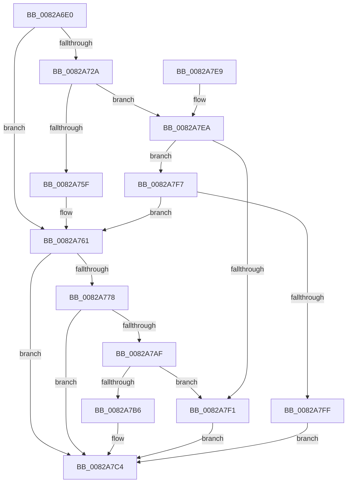

# CmDeleteInterfaceClass

- RVA: `0x0082A6E0`–`0x0082A806` (길이 `294` bytes)
- VA: `0x000000014082A6E0`
- 실행 섹션: `PAGE`
- PDB 이름 있음: `예`; PDB Function 태그: `아니요`
- unwind 정보 RVA: `0x000A88C0`
- 디코드: `77`개 명령, `294/294` bytes 표시
- 미해석 바이트: `0` (있으면 어셈블리에 `.byte`로 보존)

> 이 문서는 커널 이미지의 기계어와 PDB 기호를 분석해 생성했습니다. 4번과 5번은 함수 원형과 자료형을 바이너리 사용 방식에서 추정한 C 해석이며 원본 소스 복구 결과는 아닙니다.

## 1. Dependencies

- 직접 호출 지점: **5**; 고유 호출 대상: **4**
- 직접 호출자로 확인된 함수: **2**
- RIP 상대 이미지 참조: **1**

### Outgoing calls
- `0x0082A715` → [memset](../../text/6C/memset_function_006C6C40.md) (function, `0x006C6C40`)
- `0x0082A74F` → [guard_dispatch_icall](../../text/6B/guard_dispatch_icall_function_006BAAD0.md) (function, `0x006BAAD0`)
- `0x0082A76C` → [CmDeleteInterfaceClassWorker](CmDeleteInterfaceClassWorker_function_0082A838.md) (function, `0x0082A838`)
- `0x0082A7A1` → [guard_dispatch_icall](../../text/6B/guard_dispatch_icall_function_006BAAD0.md) (function, `0x006BAAD0`)
- `0x0082A7D1` → [_security_check_cookie](../../text/6A/_security_check_cookie_function_006AC640.md) (function, `0x006AC640`)

### Direct callers
- [_PnpDispatchInterfaceClass](../99/_PnpDispatchInterfaceClass_function_00993BD0.md) at `0x00993E3F`
- [PiCMDeleteClassKey](../AD/PiCMDeleteClassKey_function_00AD9EB4.md) at `0x00AD9F6A`

### Static image references
- `0x0082A6EF` → RVA `0x00E0A740` (`.data`; read)

## 2. Other-region calls and transfers

- 다른 실행 섹션으로 향하는 call: **4**
  - `0x0082A715` → [memset](../../text/6C/memset_function_006C6C40.md) (`PAGE` → `.text`)
  - `0x0082A74F` → [guard_dispatch_icall](../../text/6B/guard_dispatch_icall_function_006BAAD0.md) (`PAGE` → `.text`)
  - `0x0082A7A1` → [guard_dispatch_icall](../../text/6B/guard_dispatch_icall_function_006BAAD0.md) (`PAGE` → `.text`)
  - `0x0082A7D1` → [_security_check_cookie](../../text/6A/_security_check_cookie_function_006AC640.md) (`PAGE` → `.text`)
- 별도 외부 분기/꼬리 이동을 확인하지 못했습니다.

## 3. Assembly (complete function range)

```asm
0082A6E0  48 89 5C 24 20                  mov qword ptr [rsp + 0x20], rbx
0082A6E5  55                              push rbp
0082A6E6  56                              push rsi
0082A6E7  57                              push rdi
0082A6E8  48 81 EC B0 00 00 00            sub rsp, 0xb0
0082A6EF  48 8B 05 4A 00 5E 00            mov rax, qword ptr [rip + 0x5e004a]
0082A6F6  48 33 C4                        xor rax, rsp
0082A6F9  48 89 84 24 A0 00 00 00         mov qword ptr [rsp + 0xa0], rax
0082A701  48 8B EA                        mov rbp, rdx
0082A704  41 8B D8                        mov ebx, r8d
0082A707  33 D2                           xor edx, edx
0082A709  48 8B F1                        mov rsi, rcx
0082A70C  48 8D 4C 24 40                  lea rcx, [rsp + 0x40]
0082A711  44 8D 42 58                     lea r8d, [rdx + 0x58]
0082A715  E8 26 C5 E9 FF                  call 0x1406c6c40
0082A71A  48 8B BE F8 01 00 00            mov rdi, qword ptr [rsi + 0x1f8]
0082A721  89 5C 24 50                     mov dword ptr [rsp + 0x50], ebx
0082A725  48 85 FF                        test rdi, rdi
0082A728  74 37                           je 0x14082a761
0082A72A  41 B9 03 00 00 00               mov r9d, 3
0082A730  48 8D 44 24 40                  lea rax, [rsp + 0x40]
0082A735  48 89 44 24 28                  mov qword ptr [rsp + 0x28], rax
0082A73A  48 8B D5                        mov rdx, rbp
0082A73D  48 8B CE                        mov rcx, rsi
0082A740  C7 44 24 20 01 00 00 00         mov dword ptr [rsp + 0x20], 1
0082A748  48 8B C7                        mov rax, rdi
0082A74B  45 8D 41 01                     lea r8d, [r9 + 1]
0082A74F  E8 7C 03 E9 FF                  call 0x1406baad0
0082A754  3D 02 00 00 C0                  cmp eax, 0xc0000002
0082A759  0F 85 8B 00 00 00               jne 0x14082a7ea
0082A75F  33 FF                           xor edi, edi
0082A761  44 8B 44 24 50                  mov r8d, dword ptr [rsp + 0x50]
0082A766  48 8B D5                        mov rdx, rbp
0082A769  48 8B CE                        mov rcx, rsi
0082A76C  E8 C7 00 00 00                  call 0x14082a838
0082A771  8B D8                           mov ebx, eax
0082A773  48 85 FF                        test rdi, rdi
0082A776  74 4C                           je 0x14082a7c4
0082A778  89 44 24 40                     mov dword ptr [rsp + 0x40], eax
0082A77C  41 B9 03 00 00 00               mov r9d, 3
0082A782  48 8D 44 24 40                  lea rax, [rsp + 0x40]
0082A787  48 8B D5                        mov rdx, rbp
0082A78A  48 89 44 24 28                  mov qword ptr [rsp + 0x28], rax
0082A78F  48 8B CE                        mov rcx, rsi
0082A792  48 8B C7                        mov rax, rdi
0082A795  C7 44 24 20 02 00 00 00         mov dword ptr [rsp + 0x20], 2
0082A79D  45 8D 41 01                     lea r8d, [r9 + 1]
0082A7A1  E8 2A 03 E9 FF                  call 0x1406baad0
0082A7A6  8B C8                           mov ecx, eax
0082A7A8  3D 02 00 00 C0                  cmp eax, 0xc0000002
0082A7AD  74 15                           je 0x14082a7c4
0082A7AF  3D 20 01 00 C0                  cmp eax, 0xc0000120
0082A7B4  74 3B                           je 0x14082a7f1
0082A7B6  8B C3                           mov eax, ebx
0082A7B8  85 C9                           test ecx, ecx
0082A7BA  BB E5 00 00 C0                  mov ebx, 0xc00000e5
0082A7BF  0F 45 C3                        cmovne eax, ebx
0082A7C2  8B D8                           mov ebx, eax
0082A7C4  8B C3                           mov eax, ebx
0082A7C6  48 8B 8C 24 A0 00 00 00         mov rcx, qword ptr [rsp + 0xa0]
0082A7CE  48 33 CC                        xor rcx, rsp
0082A7D1  E8 6A 1E E8 FF                  call 0x1406ac640
0082A7D6  48 8B 9C 24 E8 00 00 00         mov rbx, qword ptr [rsp + 0xe8]
0082A7DE  48 81 C4 B0 00 00 00            add rsp, 0xb0
0082A7E5  5F                              pop rdi
0082A7E6  5E                              pop rsi
0082A7E7  5D                              pop rbp
0082A7E8  C3                              ret
0082A7E9  CC                              int3
0082A7EA  3D 20 01 00 C0                  cmp eax, 0xc0000120
0082A7EF  75 06                           jne 0x14082a7f7
0082A7F1  8B 5C 24 40                     mov ebx, dword ptr [rsp + 0x40]
0082A7F5  EB CD                           jmp 0x14082a7c4
0082A7F7  85 C0                           test eax, eax
0082A7F9  0F 84 62 FF FF FF               je 0x14082a761
0082A7FF  BB E5 00 00 C0                  mov ebx, 0xc00000e5
0082A804  EB BE                           jmp 0x14082a7c4
```

## 4. C-style interpretation (structured pseudocode)

```c
__int64 __fastcall CmDeleteInterfaceClass(__int64 a1, __int64 a2, int a3)
{
    __int64 result;
    __int64 v_rdi;
    __int64 v_rsp;
    unsigned __int64 v_stack_m28;
    unsigned int v_stack_m78;
    unsigned __int64 v_stack_m88;
    unsigned __int64 v_stack_mA0;
    unsigned int v_stack_mA8;
    unsigned __int64 v_stack_p20;
    unsigned int v_stack_p40;

    v_stack_p20 = v_rbx;
    v_rsp = (v_rsp) - (176);
    result = (*(unsigned __int64 *)(v_rip + 6160458)) ^ (v_rsp);
    v_stack_m28 = result;
    a2 = 0;
    result = memset(v_stack_m88, a2, a2 + 88, a4);
    v_stack_m78 = (unsigned int)((unsigned int)(a3));
    if (*(unsigned __int64 *)(a1 + 504) == 0) goto loc_0082A761;
    v_stack_mA0 = v_stack_m88;
    v_stack_mA8 = 1;
    result = guard_dispatch_icall(a1, 0, 3 + 1, 3);
    if (((unsigned int)(result)) != 0xC0000002ULL) goto loc_0082A7EA;
    v_rdi = 0;
loc_0082A761:
    result = CmDeleteInterfaceClassWorker(a1, 0, (unsigned int)(v_stack_m78), 3);
    if (0 == 0) goto loc_0082A7C4;
    v_stack_m88 = (unsigned int)(result);
    v_stack_mA0 = v_stack_m88;
    v_stack_mA8 = 2;
    result = guard_dispatch_icall(a1, 0, 3 + 1, 3);
    if (((unsigned int)(result)) == 0xC0000002ULL) goto loc_0082A7C4;
    if (((unsigned int)(result)) == 0xC0000120ULL) goto loc_0082A7F1;
    result = (unsigned int)((unsigned int)((unsigned int)((unsigned int)(result))));
    if ((unsigned int)((unsigned int)((unsigned int)(result))) != 0) { result = (unsigned int)((unsigned int)(0xC00000E5ULL)); }
loc_0082A7C4:
    a1 = (v_stack_m28) ^ (v_rsp);
    result = _security_check_cookie(a1, 0, 3 + 1, 3);
    v_rsp = (v_rsp) + (176);
    return result;
loc_0082A7EA:
    if (((unsigned int)(result)) != 0xC0000120ULL) goto loc_0082A7F7;
loc_0082A7F1:
    goto loc_0082A7C4;
loc_0082A7F7:
    if ((unsigned int)(result) == 0) goto loc_0082A761;
    goto loc_0082A7C4;
}
```

## 5. (Beta) C Style

```c
int64_t CmDeleteInterfaceClass(void *Arg1, int64_t Arg2, int32_t Arg3)
{
    uint8_t *arg1 = (uint8_t *)Arg1;

    int64_t result;
    int64_t local_rdi;
    int64_t local_rsp;
    uint64_t v_stack_m28;
    uint32_t v_stack_m78;
    uint64_t v_stack_m88;
    uint64_t v_stack_mA0;
    uint32_t v_stack_mA8;
    uint64_t v_stack_p20;
    uint32_t v_stack_p40;

    v_stack_p20 = local_rbx;
    local_rsp = (local_rsp) - (176);
    result = (*(uint64_t *)(v_rip + 0x5E004A)) ^ (local_rsp);
    v_stack_m28 = result;
    Arg2 = 0;
    result = memset(v_stack_m88, Arg2, Arg2 + 88, a4);
    v_stack_m78 = (uint32_t)((uint32_t)(Arg3));
    if (*(uint64_t *)(arg1 + 0x1F8) == 0) goto loc_0082A761;
    v_stack_mA0 = v_stack_m88;
    v_stack_mA8 = 1;
    result = guard_dispatch_icall(Arg1, 0, 3 + 1, 3);
    if (((uint32_t)(result)) != 0xC0000002ULL) goto loc_0082A7EA;
    local_rdi = 0;
loc_0082A761:
    result = CmDeleteInterfaceClassWorker(Arg1, 0, (uint32_t)(v_stack_m78), 3);
    if (0 == 0) goto loc_0082A7C4;
    v_stack_m88 = (uint32_t)(result);
    v_stack_mA0 = v_stack_m88;
    v_stack_mA8 = 2;
    result = guard_dispatch_icall(Arg1, 0, 3 + 1, 3);
    if (((uint32_t)(result)) == 0xC0000002ULL) goto loc_0082A7C4;
    if (((uint32_t)(result)) == 0xC0000120ULL) goto loc_0082A7F1;
    result = (uint32_t)((uint32_t)((uint32_t)((uint32_t)(result))));
    if ((uint32_t)((uint32_t)((uint32_t)(result))) != 0) { result = (uint32_t)((uint32_t)(0xC00000E5ULL)); }
loc_0082A7C4:
    Arg1 = (v_stack_m28) ^ (local_rsp);
    result = _security_check_cookie(Arg1, 0, 3 + 1, 3);
    local_rsp = (local_rsp) + (176);
    return result;
loc_0082A7EA:
    if (((uint32_t)(result)) != 0xC0000120ULL) goto loc_0082A7F7;
loc_0082A7F1:
    goto loc_0082A7C4;
loc_0082A7F7:
    if ((uint32_t)(result) == 0) goto loc_0082A761;
    goto loc_0082A7C4;
}
```

### 관측된 메모리 오프셋

구조체 형식이 확인되지 않은 접근은 인자 기준의 오프셋으로만 기록했습니다.

| 기준 인자 | 오프셋 표현 | 폭 (bit) | 접근 |
|---|---:|---:|---|
| `Arg1` | `+ 0x1F8` | `64` | `R` |

## 6. Execution-region graph

[열기: 2D/3D 그래프와 함수 탐색 컨트롤 패널](../../../control-panel.html?section=page&rva=0x0082A6E0&view=graph)

- 2D 그래프는 위에서 아래로 흐르고, 3D 그래프는 빈 공간을 드래그해 회전합니다. Shift+드래그는 이동, 휠은 확대·축소, 함수 노드 선택은 대상 보고서 이동입니다.

### Static fallback


