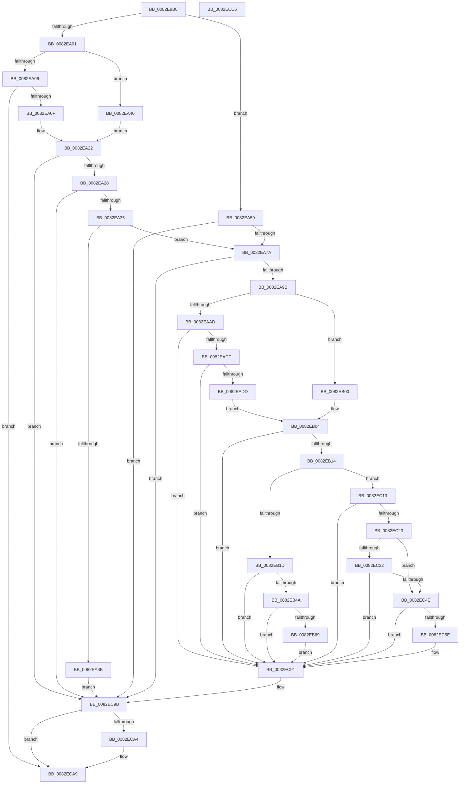

# CmDevicePanelEnumSubkeyCallback

- RVA: `0x0082E9B0`–`0x0082ECC7` (길이 `791` bytes)
- VA: `0x000000014082E9B0`
- 실행 섹션: `PAGE`
- PDB 이름 있음: `예`; PDB Function 태그: `아니요`
- unwind 정보 RVA: `0x000DAA2C`
- 디코드: `200`개 명령, `791/791` bytes 표시
- 미해석 바이트: `0` (있으면 어셈블리에 `.byte`로 보존)

> 이 문서는 커널 이미지의 기계어와 PDB 기호를 분석해 생성했습니다. 4번과 5번은 함수 원형과 자료형을 바이너리 사용 방식에서 추정한 C 해석이며 원본 소스 복구 결과는 아닙니다.

## 1. Dependencies

- 직접 호출 지점: **18**; 고유 호출 대상: **13**
- 직접 호출자로 확인된 함수: **0**
- RIP 상대 이미지 참조: **2**

### Outgoing calls
- `0x0082EA1A` → [wcstoul](../../text/50/wcstoul_function_005024A0.md) (function, `0x005024A0`)
- `0x0082EA4D` → [wcstoul](../../text/50/wcstoul_function_005024A0.md) (function, `0x005024A0`)
- `0x0082EA60` → [RtlInitUnicodeString](../../text/42/RtlInitUnicodeString_function_0042A780.md) (function, `0x0042A780`)
- `0x0082EA6D` → [RtlGUIDFromString](../8F/RtlGUIDFromString_function_008F1EF0.md) (function, `0x008F1EF0`)
- `0x0082EA8A` → [ExAllocatePool2](../../poolcode/B8/ExAllocatePool2_function_00B820F0.md) (function, `0x00B820F0`)
- `0x0082EAC2` → [RtlStringCchCopyExW](../../text/41/RtlStringCchCopyExW_function_0041E1C0.md) (function, `0x0041E1C0`)
- `0x0082EB07` → [RtlStringCchCopyW](../../text/26/RtlStringCchCopyW_function_0026E9A4.md) (function, `0x0026E9A4`)
- `0x0082EB3D` → [PnpCtxRegOpenKey](../8E/PnpCtxRegOpenKey_function_008EF7B8.md) (function, `0x008EF7B8`)
- `0x0082EB58` → [ExAllocatePool2](../../poolcode/B8/ExAllocatePool2_function_00B820F0.md) (function, `0x00B820F0`)
- `0x0082EB8A` → [RtlStringCchCopyExW](../../text/41/RtlStringCchCopyExW_function_0041E1C0.md) (function, `0x0041E1C0`)
- `0x0082EBDC` → [PnpCtxRegEnumKeyWithCallback](../AA/PnpCtxRegEnumKeyWithCallback_function_00AA146C.md) (function, `0x00AA146C`)
- `0x0082EC0C` → [ExFreePoolWithTag](../../poolcode/B8/ExFreePoolWithTag_function_00B82870.md) (function, `0x00B82870`)
- `0x0082EC1A` → [RtlInitUnicodeStringEx](../../text/46/RtlInitUnicodeStringEx_function_00463960.md) (function, `0x00463960`)
- `0x0082EC45` → [guard_dispatch_icall](../../text/6B/guard_dispatch_icall_function_006BAAD0.md) (function, `0x006BAAD0`)
- `0x0082EC7A` → [RtlStringCchCopyExW](../../text/41/RtlStringCchCopyExW_function_0041E1C0.md) (function, `0x0041E1C0`)
- `0x0082EC96` → [ExFreePoolWithTag](../../poolcode/B8/ExFreePoolWithTag_function_00B82870.md) (function, `0x00B82870`)
- `0x0082ECA4` → [ZwClose](../../text/6A/ZwClose_function_006AD2B0.md) (function, `0x006AD2B0`)
- `0x0082ECB2` → [_security_check_cookie](../../text/6A/_security_check_cookie_function_006AC640.md) (function, `0x006AC640`)

### Direct callers
- 이 함수 시작 RVA로 연결되는 직접 call은 확인되지 않았습니다. 간접 호출은 완전히 역산할 수 없습니다.

### Static image references
- `0x0082E9C2` → RVA `0x00E0A740` (`.data`; read)
- `0x0082EB93` → RVA `0x0082E9B0` (`CmDevicePanelEnumSubkeyCallback`; read)

## 2. Other-region calls and transfers

- 다른 실행 섹션으로 향하는 call: **15**
  - `0x0082EA1A` → [wcstoul](../../text/50/wcstoul_function_005024A0.md) (`PAGE` → `.text`)
  - `0x0082EA4D` → [wcstoul](../../text/50/wcstoul_function_005024A0.md) (`PAGE` → `.text`)
  - `0x0082EA60` → [RtlInitUnicodeString](../../text/42/RtlInitUnicodeString_function_0042A780.md) (`PAGE` → `.text`)
  - `0x0082EA8A` → [ExAllocatePool2](../../poolcode/B8/ExAllocatePool2_function_00B820F0.md) (`PAGE` → `POOLCODE`)
  - `0x0082EAC2` → [RtlStringCchCopyExW](../../text/41/RtlStringCchCopyExW_function_0041E1C0.md) (`PAGE` → `.text`)
  - `0x0082EB07` → [RtlStringCchCopyW](../../text/26/RtlStringCchCopyW_function_0026E9A4.md) (`PAGE` → `.text`)
  - `0x0082EB58` → [ExAllocatePool2](../../poolcode/B8/ExAllocatePool2_function_00B820F0.md) (`PAGE` → `POOLCODE`)
  - `0x0082EB8A` → [RtlStringCchCopyExW](../../text/41/RtlStringCchCopyExW_function_0041E1C0.md) (`PAGE` → `.text`)
  - `0x0082EC0C` → [ExFreePoolWithTag](../../poolcode/B8/ExFreePoolWithTag_function_00B82870.md) (`PAGE` → `POOLCODE`)
  - `0x0082EC1A` → [RtlInitUnicodeStringEx](../../text/46/RtlInitUnicodeStringEx_function_00463960.md) (`PAGE` → `.text`)
  - `0x0082EC45` → [guard_dispatch_icall](../../text/6B/guard_dispatch_icall_function_006BAAD0.md) (`PAGE` → `.text`)
  - `0x0082EC7A` → [RtlStringCchCopyExW](../../text/41/RtlStringCchCopyExW_function_0041E1C0.md) (`PAGE` → `.text`)
  - `0x0082EC96` → [ExFreePoolWithTag](../../poolcode/B8/ExFreePoolWithTag_function_00B82870.md) (`PAGE` → `POOLCODE`)
  - `0x0082ECA4` → [ZwClose](../../text/6A/ZwClose_function_006AD2B0.md) (`PAGE` → `.text`)
  - `0x0082ECB2` → [_security_check_cookie](../../text/6A/_security_check_cookie_function_006AC640.md) (`PAGE` → `.text`)
- 별도 외부 분기/꼬리 이동을 확인하지 못했습니다.

## 3. Assembly (complete function range)

```asm
0082E9B0  40 55                           push rbp
0082E9B2  53                              push rbx
0082E9B3  56                              push rsi
0082E9B4  57                              push rdi
0082E9B5  41 54                           push r12
0082E9B7  41 55                           push r13
0082E9B9  41 57                           push r15
0082E9BB  48 8B EC                        mov rbp, rsp
0082E9BE  48 83 EC 70                     sub rsp, 0x70
0082E9C2  48 8B 05 77 BD 5D 00            mov rax, qword ptr [rip + 0x5dbd77]
0082E9C9  48 33 C4                        xor rax, rsp
0082E9CC  48 89 45 F8                     mov qword ptr [rbp - 8], rax
0082E9D0  45 33 ED                        xor r13d, r13d
0082E9D3  4C 8B F9                        mov r15, rcx
0082E9D6  41 8B 09                        mov ecx, dword ptr [r9]
0082E9D9  0F 57 C0                        xorps xmm0, xmm0
0082E9DC  4C 89 6D C0                     mov qword ptr [rbp - 0x40], r13
0082E9E0  0F 57 C9                        xorps xmm1, xmm1
0082E9E3  4C 89 6D D0                     mov qword ptr [rbp - 0x30], r13
0082E9E7  49 8B D9                        mov rbx, r9
0082E9EA  4C 89 6D C8                     mov qword ptr [rbp - 0x38], r13
0082E9EE  49 8B F0                        mov rsi, r8
0082E9F1  4C 8B E2                        mov r12, rdx
0082E9F4  0F 11 45 D8                     movups xmmword ptr [rbp - 0x28], xmm0
0082E9F8  0F 11 4D E8                     movups xmmword ptr [rbp - 0x18], xmm1
0082E9FC  83 E9 01                        sub ecx, 1
0082E9FF  74 58                           je 0x14082ea59
0082EA01  83 E9 01                        sub ecx, 1
0082EA04  74 3A                           je 0x14082ea40
0082EA06  83 F9 01                        cmp ecx, 1
0082EA09  0F 85 9A 02 00 00               jne 0x14082eca9
0082EA0F  45 8D 45 10                     lea r8d, [r13 + 0x10]
0082EA13  48 8B CE                        mov rcx, rsi
0082EA16  48 8D 55 C0                     lea rdx, [rbp - 0x40]
0082EA1A  E8 81 3A CD FF                  call 0x1405024a0
0082EA1F  83 F8 07                        cmp eax, 7
0082EA22  0F 87 73 02 00 00               ja 0x14082ec9b
0082EA28  48 8B 45 C0                     mov rax, qword ptr [rbp - 0x40]
0082EA2C  48 85 C0                        test rax, rax
0082EA2F  0F 84 66 02 00 00               je 0x14082ec9b
0082EA35  66 44 39 28                     cmp word ptr [rax], r13w
0082EA39  74 3F                           je 0x14082ea7a
0082EA3B  E9 5B 02 00 00                  jmp 0x14082ec9b
0082EA40  41 B8 10 00 00 00               mov r8d, 0x10
0082EA46  48 8D 55 C0                     lea rdx, [rbp - 0x40]
0082EA4A  48 8B CE                        mov rcx, rsi
0082EA4D  E8 4E 3A CD FF                  call 0x1405024a0
0082EA52  3D FF FF 00 00                  cmp eax, 0xffff
0082EA57  EB C9                           jmp 0x14082ea22
0082EA59  48 8B D6                        mov rdx, rsi
0082EA5C  48 8D 4D D8                     lea rcx, [rbp - 0x28]
0082EA60  E8 1B BD BF FF                  call 0x14042a780
0082EA65  48 8D 55 E8                     lea rdx, [rbp - 0x18]
0082EA69  48 8D 4D D8                     lea rcx, [rbp - 0x28]
0082EA6D  E8 7E 34 0C 00                  call 0x1408f1ef0
0082EA72  85 C0                           test eax, eax
0082EA74  0F 88 21 02 00 00               js 0x14082ec9b
0082EA7A  BA 72 00 00 00                  mov edx, 0x72
0082EA7F  B9 00 01 00 00                  mov ecx, 0x100
0082EA84  41 B8 50 4E 50 52               mov r8d, 0x52504e50
0082EA8A  E8 61 36 35 00                  call 0x140b820f0
0082EA8F  48 8B F8                        mov rdi, rax
0082EA92  48 85 C0                        test rax, rax
0082EA95  0F 84 00 02 00 00               je 0x14082ec9b
0082EA9B  4C 8D 43 04                     lea r8, [rbx + 4]
0082EA9F  BA 39 00 00 00                  mov edx, 0x39
0082EAA4  48 8B C8                        mov rcx, rax
0082EAA7  66 45 39 28                     cmp word ptr [r8], r13w
0082EAAB  74 53                           je 0x14082eb00
0082EAAD  48 8D 45 D0                     lea rax, [rbp - 0x30]
0082EAB1  C7 44 24 28 00 09 00 00         mov dword ptr [rsp + 0x28], 0x900
0082EAB9  4C 8D 4D C0                     lea r9, [rbp - 0x40]
0082EABD  48 89 44 24 20                  mov qword ptr [rsp + 0x20], rax
0082EAC2  E8 F9 F6 BE FF                  call 0x14041e1c0
0082EAC7  85 C0                           test eax, eax
0082EAC9  0F 88 C2 01 00 00               js 0x14082ec91
0082EACF  48 8B 4D D0                     mov rcx, qword ptr [rbp - 0x30]
0082EAD3  48 83 F9 02                     cmp rcx, 2
0082EAD7  0F 82 B4 01 00 00               jb 0x14082ec91
0082EADD  48 8B 45 C0                     mov rax, qword ptr [rbp - 0x40]
0082EAE1  48 8D 51 FE                     lea rdx, [rcx - 2]
0082EAE5  66 C7 00 5C 00                  mov word ptr [rax], 0x5c
0082EAEA  48 8B 45 C0                     mov rax, qword ptr [rbp - 0x40]
0082EAEE  48 83 C0 02                     add rax, 2
0082EAF2  48 89 45 C0                     mov qword ptr [rbp - 0x40], rax
0082EAF6  66 44 89 28                     mov word ptr [rax], r13w
0082EAFA  48 8B 4D C0                     mov rcx, qword ptr [rbp - 0x40]
0082EAFE  EB 04                           jmp 0x14082eb04
0082EB00  48 89 4D C0                     mov qword ptr [rbp - 0x40], rcx
0082EB04  4C 8B C6                        mov r8, rsi
0082EB07  E8 98 FE A3 FF                  call 0x14026e9a4
0082EB0C  85 C0                           test eax, eax
0082EB0E  0F 88 7D 01 00 00               js 0x14082ec91
0082EB14  83 3B 03                        cmp dword ptr [rbx], 3
0082EB17  0F 83 F6 00 00 00               jae 0x14082ec13
0082EB1D  48 8D 45 C8                     lea rax, [rbp - 0x38]
0082EB21  41 B9 08 00 00 00               mov r9d, 8
0082EB27  48 89 44 24 28                  mov qword ptr [rsp + 0x28], rax
0082EB2C  4C 8B C6                        mov r8, rsi
0082EB2F  49 8B D4                        mov rdx, r12
0082EB32  C7 44 24 20 19 00 02 00         mov dword ptr [rsp + 0x20], 0x20019
0082EB3A  49 8B CF                        mov rcx, r15
0082EB3D  E8 76 0C 0C 00                  call 0x1408ef7b8
0082EB42  85 C0                           test eax, eax
0082EB44  0F 88 47 01 00 00               js 0x14082ec91
0082EB4A  BA A0 00 00 00                  mov edx, 0xa0
0082EB4F  41 B8 50 4E 50 52               mov r8d, 0x52504e50
0082EB55  8D 4A 60                        lea ecx, [rdx + 0x60]
0082EB58  E8 93 35 35 00                  call 0x140b820f0
0082EB5D  48 8B F0                        mov rsi, rax
0082EB60  48 85 C0                        test rax, rax
0082EB63  0F 84 28 01 00 00               je 0x14082ec91
0082EB69  8B 0B                           mov ecx, dword ptr [rbx]
0082EB6B  45 33 C9                        xor r9d, r9d
0082EB6E  FF C1                           inc ecx
0082EB70  C7 44 24 28 00 09 00 00         mov dword ptr [rsp + 0x28], 0x900
0082EB78  89 08                           mov dword ptr [rax], ecx
0082EB7A  4C 8B C7                        mov r8, rdi
0082EB7D  48 8D 48 04                     lea rcx, [rax + 4]
0082EB81  4C 89 6C 24 20                  mov qword ptr [rsp + 0x20], r13
0082EB86  41 8D 51 39                     lea edx, [r9 + 0x39]
0082EB8A  E8 31 F6 BE FF                  call 0x14041e1c0
0082EB8F  48 8B 43 78                     mov rax, qword ptr [rbx + 0x78]
0082EB93  4C 8D 05 16 FE FF FF            lea r8, [rip - 0x1ea]
0082EB9A  48 89 46 78                     mov qword ptr [rsi + 0x78], rax
0082EB9E  4C 8B CE                        mov r9, rsi
0082EBA1  48 8B 83 80 00 00 00            mov rax, qword ptr [rbx + 0x80]
0082EBA8  49 8B CF                        mov rcx, r15
0082EBAB  48 89 86 80 00 00 00            mov qword ptr [rsi + 0x80], rax
0082EBB2  48 8B 83 88 00 00 00            mov rax, qword ptr [rbx + 0x88]
0082EBB9  48 89 86 88 00 00 00            mov qword ptr [rsi + 0x88], rax
0082EBC0  8B 83 90 00 00 00               mov eax, dword ptr [rbx + 0x90]
0082EBC6  89 86 90 00 00 00               mov dword ptr [rsi + 0x90], eax
0082EBCC  8B 83 94 00 00 00               mov eax, dword ptr [rbx + 0x94]
0082EBD2  89 86 94 00 00 00               mov dword ptr [rsi + 0x94], eax
0082EBD8  48 8B 55 C8                     mov rdx, qword ptr [rbp - 0x38]
0082EBDC  E8 8B 28 27 00                  call 0x140aa146c
0082EBE1  8B 86 94 00 00 00               mov eax, dword ptr [rsi + 0x94]
0082EBE7  33 D2                           xor edx, edx
0082EBE9  89 83 94 00 00 00               mov dword ptr [rbx + 0x94], eax
0082EBEF  48 8B CE                        mov rcx, rsi
0082EBF2  48 8B 86 88 00 00 00            mov rax, qword ptr [rsi + 0x88]
0082EBF9  48 89 83 88 00 00 00            mov qword ptr [rbx + 0x88], rax
0082EC00  8B 86 90 00 00 00               mov eax, dword ptr [rsi + 0x90]
0082EC06  89 83 90 00 00 00               mov dword ptr [rbx + 0x90], eax
0082EC0C  E8 5F 3C 35 00                  call 0x140b82870
0082EC11  EB 7E                           jmp 0x14082ec91
0082EC13  48 8B D7                        mov rdx, rdi
0082EC16  48 8D 4D D8                     lea rcx, [rbp - 0x28]
0082EC1A  E8 41 4D C3 FF                  call 0x140463960
0082EC1F  85 C0                           test eax, eax
0082EC21  78 6E                           js 0x14082ec91
0082EC23  0F B7 75 DA                     movzx esi, word ptr [rbp - 0x26]
0082EC27  48 8B 43 78                     mov rax, qword ptr [rbx + 0x78]
0082EC2B  D1 EE                           shr esi, 1
0082EC2D  48 85 C0                        test rax, rax
0082EC30  74 1C                           je 0x14082ec4e
0082EC32  4C 8B 8B 80 00 00 00            mov r9, qword ptr [rbx + 0x80]
0082EC39  41 B8 06 00 00 00               mov r8d, 6
0082EC3F  48 8B D7                        mov rdx, rdi
0082EC42  49 8B CF                        mov rcx, r15
0082EC45  E8 86 BE E8 FF                  call 0x1406baad0
0082EC4A  84 C0                           test al, al
0082EC4C  74 43                           je 0x14082ec91
0082EC4E  01 B3 94 00 00 00               add dword ptr [rbx + 0x94], esi
0082EC54  8B 83 90 00 00 00               mov eax, dword ptr [rbx + 0x90]
0082EC5A  3B C6                           cmp eax, esi
0082EC5C  76 33                           jbe 0x14082ec91
0082EC5E  48 8B 8B 88 00 00 00            mov rcx, qword ptr [rbx + 0x88]
0082EC65  8B D0                           mov edx, eax
0082EC67  C7 44 24 28 00 09 00 00         mov dword ptr [rsp + 0x28], 0x900
0082EC6F  45 33 C9                        xor r9d, r9d
0082EC72  4C 8B C7                        mov r8, rdi
0082EC75  4C 89 6C 24 20                  mov qword ptr [rsp + 0x20], r13
0082EC7A  E8 41 F5 BE FF                  call 0x14041e1c0
0082EC7F  8B C6                           mov eax, esi
0082EC81  48 03 C0                        add rax, rax
0082EC84  48 01 83 88 00 00 00            add qword ptr [rbx + 0x88], rax
0082EC8B  29 B3 90 00 00 00               sub dword ptr [rbx + 0x90], esi
0082EC91  33 D2                           xor edx, edx
0082EC93  48 8B CF                        mov rcx, rdi
0082EC96  E8 D5 3B 35 00                  call 0x140b82870
0082EC9B  48 8B 4D C8                     mov rcx, qword ptr [rbp - 0x38]
0082EC9F  48 85 C9                        test rcx, rcx
0082ECA2  74 05                           je 0x14082eca9
0082ECA4  E8 07 E6 E7 FF                  call 0x1406ad2b0
0082ECA9  33 C0                           xor eax, eax
0082ECAB  48 8B 4D F8                     mov rcx, qword ptr [rbp - 8]
0082ECAF  48 33 CC                        xor rcx, rsp
0082ECB2  E8 89 D9 E7 FF                  call 0x1406ac640
0082ECB7  48 83 C4 70                     add rsp, 0x70
0082ECBB  41 5F                           pop r15
0082ECBD  41 5D                           pop r13
0082ECBF  41 5C                           pop r12
0082ECC1  5F                              pop rdi
0082ECC2  5E                              pop rsi
0082ECC3  5B                              pop rbx
0082ECC4  5D                              pop rbp
0082ECC5  C3                              ret
0082ECC6  CC                              int3
```

## 4. C-style interpretation (structured pseudocode)

```c
__int64 __fastcall CmDevicePanelEnumSubkeyCallback(__int64 a1, __int64 a2, __int64 a3, __int64 a4)
{
    __int64 result;
    __int64 v_r13;
    __int64 v_rsi;
    __int64 v_rsp;
    unsigned __int64 v_stack_m40;
    unsigned __int64 v_stack_m50;
    unsigned __int16 v_stack_m5E;
    unsigned __int64 v_stack_m60;
    unsigned __int64 v_stack_m68;
    unsigned __int64 v_stack_m70;
    unsigned __int64 v_stack_m78;
    unsigned int v_stack_m80;
    unsigned __int64 v_stack_m88;

    v_rsp = (v_rsp) - (112);
    result = (*(unsigned __int64 *)(v_rip + 6143351)) ^ (v_rsp);
    v_stack_m40 = result;
    v_r13 = 0;
    v_stack_m78 = 0;
    v_stack_m68 = 0;
    v_stack_m70 = 0;
    v_stack_m60 = v_xmm0;
    v_stack_m50 = v_xmm1;
    a1 = (unsigned int)(((unsigned int)(*(unsigned int *)(a4))) - (1));
    if (condition_is_equal) goto loc_0082EA59;
    a1 = (unsigned int)((a1) - (1));
    if (condition_is_equal) goto loc_0082EA40;
    if (((unsigned int)(a1)) != 1) goto loc_0082ECA9;
    result = wcstoul(a3, v_stack_m78, v_r13 + 16, a4);
loc_0082EA22:
    if (((unsigned int)(result)) > 7) goto loc_0082EC9B;
    if (v_stack_m78 == 0) goto loc_0082EC9B;
    if ((*(unsigned __int16 *)(v_stack_m78)) == 0) goto loc_0082EA7A;
    goto loc_0082EC9B;
loc_0082EA40:
    result = wcstoul(a3, v_stack_m78, 16, a4);
    goto loc_0082EA22;
loc_0082EA59:
    result = RtlInitUnicodeString(v_stack_m60, a3, 16, a4);
    result = RtlGUIDFromString(v_stack_m60, v_stack_m50, 16, a4);
    if (sign_flag) goto loc_0082EC9B;
loc_0082EA7A:
    result = ExAllocatePool2(256, 114, (unsigned int)(0x52504E50ULL), a4);
    if (result == 0) goto loc_0082EC9B;
    if ((*(unsigned __int16 *)(a4 + 4)) == 0) goto loc_0082EB00;
    v_stack_m80 = 0x900ULL;
    v_stack_m88 = v_stack_m68;
    result = RtlStringCchCopyExW(result, 57, a4 + 4, v_stack_m78);
    if (sign_flag) goto loc_0082EC91;
    if (v_stack_m68 < 2) goto loc_0082EC91;
    *(unsigned __int16 *)(v_stack_m78) = 92;
    result = (v_stack_m78) + (2);
    v_stack_m78 = result;
    *(unsigned __int16 *)(result) = 0;
    goto loc_0082EB04;
loc_0082EB00:
    v_stack_m78 = v_stack_m78;
loc_0082EB04:
    result = RtlStringCchCopyW(v_stack_m78, v_stack_m68 - 2, a3, v_stack_m78);
    if (sign_flag) goto loc_0082EC91;
    if ((*(unsigned int *)(a4)) >= 3) goto loc_0082EC13;
    v_stack_m80 = v_stack_m70;
    v_stack_m88 = 0x20019ULL;
    result = PnpCtxRegOpenKey(a1, a2, a3, 8);
    if (sign_flag) goto loc_0082EC91;
    result = ExAllocatePool2(160 + 96, 160, (unsigned int)(0x52504E50ULL), 8);
    if (result == 0) goto loc_0082EC91;
    a4 = 0;
    a1 = (unsigned int)(((unsigned int)(*(unsigned int *)(a4))) + 1);
    v_stack_m80 = 0x900ULL;
    *(unsigned int *)(result) = (unsigned int)(a1);
    v_stack_m88 = 0;
    result = RtlStringCchCopyExW(result + 4, a4 + 57, result, a4);
    *(unsigned __int64 *)(result + 120) = *(unsigned __int64 *)(a4 + 120);
    *(unsigned __int64 *)(result + 128) = *(unsigned __int64 *)(a4 + 128);
    *(unsigned __int64 *)(result + 136) = *(unsigned __int64 *)(a4 + 136);
    *(unsigned int *)(result + 144) = (unsigned int)((unsigned int)(*(unsigned int *)(a4 + 144)));
    *(unsigned int *)(result + 148) = (unsigned int)((unsigned int)(*(unsigned int *)(a4 + 148)));
    result = PnpCtxRegEnumKeyWithCallback(a1, v_stack_m70, v_rip - 490, result);
    a2 = 0;
    *(unsigned int *)(a4 + 148) = (unsigned int)((unsigned int)(*(unsigned int *)(result + 148)));
    *(unsigned __int64 *)(a4 + 136) = *(unsigned __int64 *)(result + 136);
    *(unsigned int *)(a4 + 144) = (unsigned int)((unsigned int)(*(unsigned int *)(result + 144)));
    result = ExFreePoolWithTag(result, a2, v_rip - 490, result);
    goto loc_0082EC91;
loc_0082EC13:
    result = RtlInitUnicodeStringEx(v_stack_m60, result, v_rip - 490, result);
    if (sign_flag) goto loc_0082EC91;
    v_rsi = (unsigned int)((v_stack_m5E) >> (1));
    if (*(unsigned __int64 *)(a4 + 120) == 0) goto loc_0082EC4E;
    result = guard_dispatch_icall(a1, result, 6, *(unsigned __int64 *)(a4 + 128));
    if ((unsigned __int8)(result) == 0) goto loc_0082EC91;
loc_0082EC4E:
    result = (unsigned int)(*(unsigned int *)(a4 + 144));
    if (((unsigned int)((unsigned int)(*(unsigned int *)(a4 + 144)))) >= = ((unsigned int)(v_rsi))) {
        a1 = *(unsigned __int64 *)(a4 + 136);
        a2 = (unsigned int)((unsigned int)(*(unsigned int *)(a4 + 144)));
        v_stack_m80 = 0x900ULL;
        a4 = 0;
        a3 = result;
        v_stack_m88 = 0;
        result = RtlStringCchCopyExW(a1, a2, a3, a4);
        result = (unsigned int)(v_rsi);
        result = (result) + (result);
    }
    a2 = 0;
    result = ExFreePoolWithTag(result, a2, a3, a4);
loc_0082EC9B:
    if (v_stack_m70 != 0) {
        result = ZwClose(v_stack_m70, a2, a3, a4);
    }
    result = 0;
    a1 = (v_stack_m40) ^ (v_rsp);
    result = _security_check_cookie(a1, a2, a3, a4);
    v_rsp = (v_rsp) + (112);
    return result;
}
```

## 5. (Beta) C Style

```c
int64_t CmDevicePanelEnumSubkeyCallback(int64_t Arg1, int64_t Arg2, int64_t Arg3, void *Arg4)
{
    uint8_t *arg4 = (uint8_t *)Arg4;

    int64_t result;
    int64_t local_r13;
    int64_t local_rsi;
    int64_t local_rsp;
    uint64_t v_stack_m40;
    uint64_t v_stack_m50;
    uint16_t v_stack_m5E;
    uint64_t v_stack_m60;
    uint64_t v_stack_m68;
    uint64_t v_stack_m70;
    uint64_t v_stack_m78;
    uint32_t v_stack_m80;
    uint64_t v_stack_m88;

    local_rsp = (local_rsp) - (112);
    result = (*(uint64_t *)(v_rip + 0x5DBD77)) ^ (local_rsp);
    v_stack_m40 = result;
    local_r13 = 0;
    v_stack_m78 = 0;
    v_stack_m68 = 0;
    v_stack_m70 = 0;
    v_stack_m60 = v_xmm0;
    v_stack_m50 = v_xmm1;
    Arg1 = (uint32_t)(((uint32_t)(*(uint32_t *)(arg4))) - (1));
    if (condition_is_equal) goto loc_0082EA59;
    Arg1 = (uint32_t)((Arg1) - (1));
    if (condition_is_equal) goto loc_0082EA40;
    if (((uint32_t)(Arg1)) != 1) goto loc_0082ECA9;
    result = wcstoul(Arg3, v_stack_m78, local_r13 + 16, Arg4);
loc_0082EA22:
    if (((uint32_t)(result)) > 7) goto loc_0082EC9B;
    if (v_stack_m78 == 0) goto loc_0082EC9B;
    if ((*(uint16_t *)(v_stack_m78)) == 0) goto loc_0082EA7A;
    goto loc_0082EC9B;
loc_0082EA40:
    result = wcstoul(Arg3, v_stack_m78, 16, Arg4);
    goto loc_0082EA22;
loc_0082EA59:
    result = RtlInitUnicodeString(v_stack_m60, Arg3, 16, Arg4);
    result = RtlGUIDFromString(v_stack_m60, v_stack_m50, 16, Arg4);
    if (sign_flag) goto loc_0082EC9B;
loc_0082EA7A:
    result = ExAllocatePool2(256, 114, (uint32_t)(0x52504E50ULL), Arg4);
    if (result == 0) goto loc_0082EC9B;
    if ((*(uint16_t *)(arg4 + 0x4)) == 0) goto loc_0082EB00;
    v_stack_m80 = 0x900ULL;
    v_stack_m88 = v_stack_m68;
    result = RtlStringCchCopyExW(result, 57, Arg4 + 4, v_stack_m78);
    if (sign_flag) goto loc_0082EC91;
    if (v_stack_m68 < 2) goto loc_0082EC91;
    *(uint16_t *)(v_stack_m78) = 92;
    result = (v_stack_m78) + (2);
    v_stack_m78 = result;
    *(uint16_t *)(result) = 0;
    goto loc_0082EB04;
loc_0082EB00:
    v_stack_m78 = v_stack_m78;
loc_0082EB04:
    result = RtlStringCchCopyW(v_stack_m78, v_stack_m68 - 2, Arg3, v_stack_m78);
    if (sign_flag) goto loc_0082EC91;
    if ((*(uint32_t *)(arg4)) >= 3) goto loc_0082EC13;
    v_stack_m80 = v_stack_m70;
    v_stack_m88 = 0x20019ULL;
    result = PnpCtxRegOpenKey(Arg1, Arg2, Arg3, 8);
    if (sign_flag) goto loc_0082EC91;
    result = ExAllocatePool2(160 + 96, 160, (uint32_t)(0x52504E50ULL), 8);
    if (result == 0) goto loc_0082EC91;
    Arg4 = 0;
    Arg1 = (uint32_t)(((uint32_t)(*(uint32_t *)(arg4))) + 1);
    v_stack_m80 = 0x900ULL;
    *(uint32_t *)(result) = (uint32_t)(Arg1);
    v_stack_m88 = 0;
    result = RtlStringCchCopyExW(result + 4, Arg4 + 57, result, Arg4);
    *(uint64_t *)(result + 0x78) = *(uint64_t *)(arg4 + 0x78);
    *(uint64_t *)(result + 0x80) = *(uint64_t *)(arg4 + 0x80);
    *(uint64_t *)(result + 0x88) = *(uint64_t *)(arg4 + 0x88);
    *(uint32_t *)(result + 0x90) = (uint32_t)((uint32_t)(*(uint32_t *)(arg4 + 0x90)));
    *(uint32_t *)(result + 0x94) = (uint32_t)((uint32_t)(*(uint32_t *)(arg4 + 0x94)));
    result = PnpCtxRegEnumKeyWithCallback(Arg1, v_stack_m70, v_rip - 490, result);
    Arg2 = 0;
    *(uint32_t *)(arg4 + 0x94) = (uint32_t)((uint32_t)(*(uint32_t *)(result + 0x94)));
    *(uint64_t *)(arg4 + 0x88) = *(uint64_t *)(result + 0x88);
    *(uint32_t *)(arg4 + 0x90) = (uint32_t)((uint32_t)(*(uint32_t *)(result + 0x90)));
    result = ExFreePoolWithTag(result, Arg2, v_rip - 490, result);
    goto loc_0082EC91;
loc_0082EC13:
    result = RtlInitUnicodeStringEx(v_stack_m60, result, v_rip - 490, result);
    if (sign_flag) goto loc_0082EC91;
    local_rsi = (uint32_t)((v_stack_m5E) >> (1));
    if (*(uint64_t *)(arg4 + 0x78) == 0) goto loc_0082EC4E;
    result = guard_dispatch_icall(Arg1, result, 6, *(uint64_t *)(arg4 + 0x80));
    if ((uint8_t)(result) == 0) goto loc_0082EC91;
loc_0082EC4E:
    result = (uint32_t)(*(uint32_t *)(arg4 + 0x90));
    if (((uint32_t)((uint32_t)(*(uint32_t *)(arg4 + 0x90)))) >= = ((uint32_t)(local_rsi))) {
        Arg1 = *(uint64_t *)(arg4 + 0x88);
        Arg2 = (uint32_t)((uint32_t)(*(uint32_t *)(arg4 + 0x90)));
        v_stack_m80 = 0x900ULL;
        Arg4 = 0;
        Arg3 = result;
        v_stack_m88 = 0;
        result = RtlStringCchCopyExW(Arg1, Arg2, Arg3, Arg4);
        result = (uint32_t)(local_rsi);
        result = (result) + (result);
    }
    Arg2 = 0;
    result = ExFreePoolWithTag(result, Arg2, Arg3, Arg4);
loc_0082EC9B:
    if (v_stack_m70 != 0) {
        result = ZwClose(v_stack_m70, Arg2, Arg3, Arg4);
    }
    result = 0;
    Arg1 = (v_stack_m40) ^ (local_rsp);
    result = _security_check_cookie(Arg1, Arg2, Arg3, Arg4);
    local_rsp = (local_rsp) + (112);
    return result;
}
```

### 관측된 메모리 오프셋

구조체 형식이 확인되지 않은 접근은 인자 기준의 오프셋으로만 기록했습니다.

| 기준 인자 | 오프셋 표현 | 폭 (bit) | 접근 |
|---|---:|---:|---|
| `Arg4` | `+ 0x0` | `16` | `R` |
| `Arg4` | `+ 0x0` | `32` | `R` |
| `Arg4` | `+ 0x4` | `64` | `R` |
| `Arg4` | `+ 0x78` | `64` | `R` |
| `Arg4` | `+ 0x80` | `64` | `R` |
| `Arg4` | `+ 0x88` | `64` | `R` |
| `Arg4` | `+ 0x88` | `64` | `R/W` |
| `Arg4` | `+ 0x88` | `64` | `W` |
| `Arg4` | `+ 0x90` | `32` | `R` |
| `Arg4` | `+ 0x90` | `32` | `R/W` |
| `Arg4` | `+ 0x90` | `32` | `W` |
| `Arg4` | `+ 0x94` | `32` | `R` |
| `Arg4` | `+ 0x94` | `32` | `R/W` |
| `Arg4` | `+ 0x94` | `32` | `W` |

## 6. Execution-region graph

[열기: 2D/3D 그래프와 함수 탐색 컨트롤 패널](../../../control-panel.html?section=page&rva=0x0082E9B0&view=graph)

- 2D 그래프는 위에서 아래로 흐르고, 3D 그래프는 빈 공간을 드래그해 회전합니다. Shift+드래그는 이동, 휠은 확대·축소, 함수 노드 선택은 대상 보고서 이동입니다.

### Static fallback


