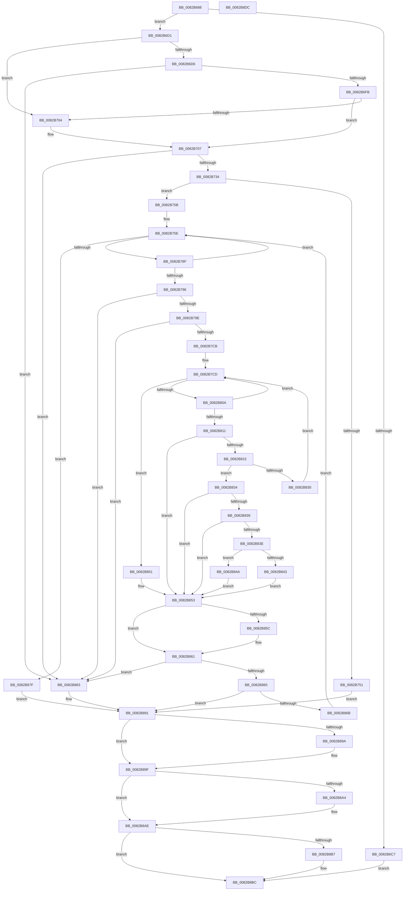

# CmEnumDevicesInContainerWithCallbackWorker

- RVA: `0x0082B688`–`0x0082B8DD` (길이 `597` bytes)
- VA: `0x000000014082B688`
- 실행 섹션: `PAGE`
- PDB 이름 있음: `예`; PDB Function 태그: `아니요`
- unwind 정보 RVA: `0x000BE68C`
- 디코드: `168`개 명령, `597/597` bytes 표시
- 미해석 바이트: `0` (있으면 어셈블리에 `.byte`로 보존)

> 이 문서는 커널 이미지의 기계어와 PDB 기호를 분석해 생성했습니다. 4번과 5번은 함수 원형과 자료형을 바이너리 사용 방식에서 추정한 C 해석이며 원본 소스 복구 결과는 아닙니다.

## 1. Dependencies

- 직접 호출 지점: **11**; 고유 호출 대상: **8**
- 직접 호출자로 확인된 함수: **1**
- RIP 상대 이미지 참조: **1**

### Outgoing calls
- `0x0082B6EC` → [PnpOpenObjectRegKey](../8E/PnpOpenObjectRegKey_function_008E15E8.md) (function, `0x008E15E8`)
- `0x0082B725` → [PnpCtxRegOpenKey](../8E/PnpCtxRegOpenKey_function_008EF7B8.md) (function, `0x008EF7B8`)
- `0x0082B744` → [ExAllocatePool2](../../poolcode/B8/ExAllocatePool2_function_00B820F0.md) (function, `0x00B820F0`)
- `0x0082B77D` → [PnpCtxRegEnumKey](../99/PnpCtxRegEnumKey_function_009929C0.md) (function, `0x009929C0`)
- `0x0082B7BC` → [PnpCtxRegOpenKey](../8E/PnpCtxRegOpenKey_function_008EF7B8.md) (function, `0x008EF7B8`)
- `0x0082B7FC` → [PnpCtxRegEnumValue](../99/PnpCtxRegEnumValue_function_0099364C.md) (function, `0x0099364C`)
- `0x0082B822` → [guard_dispatch_icall](../../text/6B/guard_dispatch_icall_function_006BAAD0.md) (function, `0x006BAAD0`)
- `0x0082B85C` → [ZwClose](../../text/6A/ZwClose_function_006AD2B0.md) (function, `0x006AD2B0`)
- `0x0082B89A` → [ZwClose](../../text/6A/ZwClose_function_006AD2B0.md) (function, `0x006AD2B0`)
- `0x0082B8A9` → [ExFreePoolWithTag](../../poolcode/B8/ExFreePoolWithTag_function_00B82870.md) (function, `0x00B82870`)
- `0x0082B8B7` → [ZwClose](../../text/6A/ZwClose_function_006AD2B0.md) (function, `0x006AD2B0`)

### Direct callers
- [CmEnumDevicesInContainerWithCallback](CmEnumDevicesInContainerWithCallback_function_0082B538.md) at `0x0082B5F4`

### Static image references
- `0x0082B713` → RVA `0x00B0D7D0` (` ?? ::NNGAKEGL::`string'`; read)

## 2. Other-region calls and transfers

- 다른 실행 섹션으로 향하는 call: **6**
  - `0x0082B744` → [ExAllocatePool2](../../poolcode/B8/ExAllocatePool2_function_00B820F0.md) (`PAGE` → `POOLCODE`)
  - `0x0082B822` → [guard_dispatch_icall](../../text/6B/guard_dispatch_icall_function_006BAAD0.md) (`PAGE` → `.text`)
  - `0x0082B85C` → [ZwClose](../../text/6A/ZwClose_function_006AD2B0.md) (`PAGE` → `.text`)
  - `0x0082B89A` → [ZwClose](../../text/6A/ZwClose_function_006AD2B0.md) (`PAGE` → `.text`)
  - `0x0082B8A9` → [ExFreePoolWithTag](../../poolcode/B8/ExFreePoolWithTag_function_00B82870.md) (`PAGE` → `POOLCODE`)
  - `0x0082B8B7` → [ZwClose](../../text/6A/ZwClose_function_006AD2B0.md) (`PAGE` → `.text`)
- 별도 외부 분기/꼬리 이동을 확인하지 못했습니다.

## 3. Assembly (complete function range)

```asm
0082B688  48 89 5C 24 08                  mov qword ptr [rsp + 8], rbx
0082B68D  48 89 74 24 10                  mov qword ptr [rsp + 0x10], rsi
0082B692  48 89 7C 24 18                  mov qword ptr [rsp + 0x18], rdi
0082B697  55                              push rbp
0082B698  41 54                           push r12
0082B69A  41 55                           push r13
0082B69C  41 56                           push r14
0082B69E  41 57                           push r15
0082B6A0  48 8B EC                        mov rbp, rsp
0082B6A3  48 83 EC 60                     sub rsp, 0x60
0082B6A7  48 83 65 F8 00                  and qword ptr [rbp - 8], 0
0082B6AC  33 FF                           xor edi, edi
0082B6AE  48 83 65 E8 00                  and qword ptr [rbp - 0x18], 0
0082B6B3  45 33 FF                        xor r15d, r15d
0082B6B6  0F B7 45 58                     movzx eax, word ptr [rbp + 0x58]
0082B6BA  4D 8B E9                        mov r13, r9
0082B6BD  49 8B F0                        mov rsi, r8
0082B6C0  4C 8B E1                        mov r12, rcx
0082B6C3  85 C0                           test eax, eax
0082B6C5  74 0A                           je 0x14082b6d1
0082B6C7  BB 0D 00 00 C0                  mov ebx, 0xc000000d
0082B6CC  E9 EB 01 00 00                  jmp 0x14082b8bc
0082B6D1  48 85 F6                        test rsi, rsi
0082B6D4  75 2E                           jne 0x14082b704
0082B6D6  48 8D 45 F8                     lea rax, [rbp - 8]
0082B6DA  48 89 44 24 28                  mov qword ptr [rsp + 0x28], rax
0082B6DF  44 8D 4E 01                     lea r9d, [rsi + 1]
0082B6E3  44 8D 46 05                     lea r8d, [rsi + 5]
0082B6E7  40 88 7C 24 20                  mov byte ptr [rsp + 0x20], dil
0082B6EC  E8 F7 5E 0B 00                  call 0x1408e15e8
0082B6F1  8B D8                           mov ebx, eax
0082B6F3  85 C0                           test eax, eax
0082B6F5  0F 88 88 01 00 00               js 0x14082b883
0082B6FB  48 8B 55 F8                     mov rdx, qword ptr [rbp - 8]
0082B6FF  48 85 D2                        test rdx, rdx
0082B702  75 03                           jne 0x14082b707
0082B704  48 8B D6                        mov rdx, rsi
0082B707  48 8D 45 E8                     lea rax, [rbp - 0x18]
0082B70B  45 33 C9                        xor r9d, r9d
0082B70E  48 89 44 24 28                  mov qword ptr [rsp + 0x28], rax
0082B713  4C 8D 05 B6 20 2E 00            lea r8, [rip + 0x2e20b6]
0082B71A  49 8B CC                        mov rcx, r12
0082B71D  C7 44 24 20 08 00 00 00         mov dword ptr [rsp + 0x20], 8
0082B725  E8 8E 40 0C 00                  call 0x1408ef7b8
0082B72A  8B D8                           mov ebx, eax
0082B72C  85 C0                           test eax, eax
0082B72E  0F 88 4F 01 00 00               js 0x14082b883
0082B734  BA 90 01 00 00                  mov edx, 0x190
0082B739  B9 00 01 00 00                  mov ecx, 0x100
0082B73E  41 B8 50 4E 50 52               mov r8d, 0x52504e50
0082B744  E8 A7 69 35 00                  call 0x140b820f0
0082B749  48 8B F8                        mov rdi, rax
0082B74C  48 85 C0                        test rax, rax
0082B74F  75 0A                           jne 0x14082b75b
0082B751  BB 17 00 00 C0                  mov ebx, 0xc0000017
0082B756  E9 36 01 00 00                  jmp 0x14082b891
0082B75B  45 33 F6                        xor r14d, r14d
0082B75E  48 8B 55 E8                     mov rdx, qword ptr [rbp - 0x18]
0082B762  48 8D 45 58                     lea rax, [rbp + 0x58]
0082B766  48 83 65 F0 00                  and qword ptr [rbp - 0x10], 0
0082B76B  4C 8B CF                        mov r9, rdi
0082B76E  45 8B C6                        mov r8d, r14d
0082B771  48 89 44 24 20                  mov qword ptr [rsp + 0x20], rax
0082B776  C7 45 58 C8 00 00 00            mov dword ptr [rbp + 0x58], 0xc8
0082B77D  E8 3E 72 16 00                  call 0x1409929c0
0082B782  8B D8                           mov ebx, eax
0082B784  3D 1A 00 00 80                  cmp eax, 0x8000001a
0082B789  0F 84 F0 00 00 00               je 0x14082b87f
0082B78F  3D 23 00 00 C0                  cmp eax, 0xc0000023
0082B794  74 C8                           je 0x14082b75e
0082B796  85 C0                           test eax, eax
0082B798  0F 88 E5 00 00 00               js 0x14082b883
0082B79E  48 8B 55 E8                     mov rdx, qword ptr [rbp - 0x18]
0082B7A2  48 8D 45 F0                     lea rax, [rbp - 0x10]
0082B7A6  48 89 44 24 28                  mov qword ptr [rsp + 0x28], rax
0082B7AB  45 33 C9                        xor r9d, r9d
0082B7AE  4C 8B C7                        mov r8, rdi
0082B7B1  C7 44 24 20 01 00 00 00         mov dword ptr [rsp + 0x20], 1
0082B7B9  49 8B CC                        mov rcx, r12
0082B7BC  E8 F7 3F 0C 00                  call 0x1408ef7b8
0082B7C1  8B D8                           mov ebx, eax
0082B7C3  85 C0                           test eax, eax
0082B7C5  0F 88 B8 00 00 00               js 0x14082b883
0082B7CB  33 F6                           xor esi, esi
0082B7CD  48 83 64 24 38 00               and qword ptr [rsp + 0x38], 0
0082B7D3  48 8D 45 E0                     lea rax, [rbp - 0x20]
0082B7D7  48 83 64 24 30 00               and qword ptr [rsp + 0x30], 0
0082B7DD  4C 8B CF                        mov r9, rdi
0082B7E0  48 8B 55 F0                     mov rdx, qword ptr [rbp - 0x10]
0082B7E4  44 8B C6                        mov r8d, esi
0082B7E7  48 89 44 24 28                  mov qword ptr [rsp + 0x28], rax
0082B7EC  48 8D 45 58                     lea rax, [rbp + 0x58]
0082B7F0  48 89 44 24 20                  mov qword ptr [rsp + 0x20], rax
0082B7F5  C7 45 58 C8 00 00 00            mov dword ptr [rbp + 0x58], 0xc8
0082B7FC  E8 4B 7E 16 00                  call 0x14099364c
0082B801  8B D8                           mov ebx, eax
0082B803  3D 1A 00 00 80                  cmp eax, 0x8000001a
0082B808  74 47                           je 0x14082b851
0082B80A  3D 23 00 00 C0                  cmp eax, 0xc0000023
0082B80F  74 BC                           je 0x14082b7cd
0082B811  85 C0                           test eax, eax
0082B813  78 3E                           js 0x14082b853
0082B815  4C 8B 45 50                     mov r8, qword ptr [rbp + 0x50]
0082B819  48 8B D7                        mov rdx, rdi
0082B81C  49 8B CC                        mov rcx, r12
0082B81F  49 8B C5                        mov rax, r13
0082B822  E8 A9 F2 E8 FF                  call 0x1406baad0
0082B827  44 8B F8                        mov r15d, eax
0082B82A  8B D0                           mov edx, eax
0082B82C  85 C0                           test eax, eax
0082B82E  75 04                           jne 0x14082b834
0082B830  FF C6                           inc esi
0082B832  EB 99                           jmp 0x14082b7cd
0082B834  83 EA 01                        sub edx, 1
0082B837  74 1A                           je 0x14082b853
0082B839  83 EA 01                        sub edx, 1
0082B83C  74 15                           je 0x14082b853
0082B83E  83 FA 01                        cmp edx, 1
0082B841  74 07                           je 0x14082b84a
0082B843  BB E5 00 00 C0                  mov ebx, 0xc00000e5
0082B848  EB 09                           jmp 0x14082b853
0082B84A  BB 40 02 00 C0                  mov ebx, 0xc0000240
0082B84F  EB 02                           jmp 0x14082b853
0082B851  33 DB                           xor ebx, ebx
0082B853  48 8B 4D F0                     mov rcx, qword ptr [rbp - 0x10]
0082B857  48 85 C9                        test rcx, rcx
0082B85A  74 05                           je 0x14082b861
0082B85C  E8 4F 1A E8 FF                  call 0x1406ad2b0
0082B861  85 DB                           test ebx, ebx
0082B863  78 1E                           js 0x14082b883
0082B865  41 83 FF 02                     cmp r15d, 2
0082B869  74 26                           je 0x14082b891
0082B86B  41 8D 46 01                     lea eax, [r14 + 1]
0082B86F  45 33 F6                        xor r14d, r14d
0082B872  41 83 FF 01                     cmp r15d, 1
0082B876  44 0F 45 F0                     cmovne r14d, eax
0082B87A  E9 DF FE FF FF                  jmp 0x14082b75e
0082B87F  33 DB                           xor ebx, ebx
0082B881  EB 0E                           jmp 0x14082b891
0082B883  81 FB 7C 01 00 C0               cmp ebx, 0xc000017c
0082B889  B8 34 00 00 C0                  mov eax, 0xc0000034
0082B88E  0F 44 D8                        cmove ebx, eax
0082B891  48 8B 4D E8                     mov rcx, qword ptr [rbp - 0x18]
0082B895  48 85 C9                        test rcx, rcx
0082B898  74 05                           je 0x14082b89f
0082B89A  E8 11 1A E8 FF                  call 0x1406ad2b0
0082B89F  48 85 FF                        test rdi, rdi
0082B8A2  74 0A                           je 0x14082b8ae
0082B8A4  33 D2                           xor edx, edx
0082B8A6  48 8B CF                        mov rcx, rdi
0082B8A9  E8 C2 6F 35 00                  call 0x140b82870
0082B8AE  48 8B 4D F8                     mov rcx, qword ptr [rbp - 8]
0082B8B2  48 85 C9                        test rcx, rcx
0082B8B5  74 05                           je 0x14082b8bc
0082B8B7  E8 F4 19 E8 FF                  call 0x1406ad2b0
0082B8BC  4C 8D 5C 24 60                  lea r11, [rsp + 0x60]
0082B8C1  8B C3                           mov eax, ebx
0082B8C3  49 8B 5B 30                     mov rbx, qword ptr [r11 + 0x30]
0082B8C7  49 8B 73 38                     mov rsi, qword ptr [r11 + 0x38]
0082B8CB  49 8B 7B 40                     mov rdi, qword ptr [r11 + 0x40]
0082B8CF  49 8B E3                        mov rsp, r11
0082B8D2  41 5F                           pop r15
0082B8D4  41 5E                           pop r14
0082B8D6  41 5D                           pop r13
0082B8D8  41 5C                           pop r12
0082B8DA  5D                              pop rbp
0082B8DB  C3                              ret
0082B8DC  CC                              int3
```

## 4. C-style interpretation (structured pseudocode)

```c
__int64 __fastcall CmEnumDevicesInContainerWithCallbackWorker(__int64 a1, __int64 a2, __int64 a3, __int64 a4, __int64 a5, unsigned __int16 a6)
{
    __int64 result;
    __int64 v_r14;
    __int64 v_r15;
    __int64 v_rbx;
    __int64 v_rdi;
    __int64 v_rsi;
    __int64 v_rsp;
    unsigned __int64 v_stack_m28;
    unsigned __int64 v_stack_m30;
    unsigned __int64 v_stack_m38;
    unsigned __int64 v_stack_m40;
    unsigned __int64 v_stack_m48;
    unsigned __int64 v_stack_m50;
    unsigned __int64 v_stack_m58;
    unsigned __int64 v_stack_m60;
    unsigned __int8 v_stack_m68;
    unsigned __int64 v_stack_p10;
    unsigned __int64 v_stack_p18;
    unsigned int v_stack_p30;
    unsigned __int64 v_stack_p8;

    v_stack_p8 = v_rbx;
    v_stack_p10 = v_rsi;
    v_stack_p18 = v_rdi;
    v_rsp = (v_rsp) - (96);
    v_rdi = 0;
    v_r15 = 0;
    if (a6 == 0) goto loc_0082B6D1;
    goto loc_0082B8BC;
loc_0082B6D1:
    if (a3 != 0) goto loc_0082B704;
    v_stack_m60 = v_stack_m30;
    v_stack_m68 = 0;
    result = PnpOpenObjectRegKey(a1, a2, a3 + 5, a3 + 1);
    if (sign_flag) goto loc_0082B883;
    if (v_stack_m30 == 0) {
        a2 = a3;
    }
    a4 = 0;
    v_stack_m60 = v_stack_m40;
    v_stack_m68 = 8;
    result = PnpCtxRegOpenKey(a1, a2, v_rip + 3023030, a4);
    if (sign_flag) goto loc_0082B883;
    result = ExAllocatePool2(256, 400, (unsigned int)(0x52504E50ULL), a4);
    if (result != 0) goto loc_0082B75B;
    goto loc_0082B891;
loc_0082B75B:
    v_r14 = 0;
loc_0082B75E:
    v_stack_m68 = a6;
    v_stack_p30 = 200;
    result = PnpCtxRegEnumKey(256, v_stack_m40, 0, result);
    if (((unsigned int)(result)) == 0x8000001AULL) goto loc_0082B87F;
    if (((unsigned int)(result)) == 0xC0000023ULL) goto loc_0082B75E;
    if (sign_flag) goto loc_0082B883;
    v_stack_m60 = v_stack_m38;
    a4 = 0;
    v_stack_m68 = 1;
    result = PnpCtxRegOpenKey(a1, v_stack_m40, result, a4);
    if (sign_flag) goto loc_0082B883;
    v_rsi = 0;
loc_0082B7CD:
    v_stack_m60 = v_stack_m48;
    v_stack_m68 = a6;
    v_stack_p30 = 200;
    result = PnpCtxRegEnumValue(a1, v_stack_m38, 0, result);
    if (((unsigned int)(result)) == 0x8000001AULL) goto loc_0082B851;
    if (((unsigned int)(result)) == 0xC0000023ULL) goto loc_0082B7CD;
    if (sign_flag) goto loc_0082B853;
    result = guard_dispatch_icall(a1, result, a5, result);
    if ((unsigned int)(result) != 0) goto loc_0082B834;
    v_rsi = (unsigned int)((v_rsi) + 1);
    goto loc_0082B7CD;
loc_0082B834:
    a2 = (unsigned int)(((unsigned int)((unsigned int)(result))) - (1));
    if (condition_is_equal) goto loc_0082B853;
    a2 = (unsigned int)((a2) - (1));
    if (condition_is_equal) goto loc_0082B853;
    if (((unsigned int)(a2)) == 1) goto loc_0082B84A;
    goto loc_0082B853;
loc_0082B84A:
    goto loc_0082B853;
loc_0082B851:
    v_rbx = 0;
loc_0082B853:
    if (v_stack_m38 != 0) {
        result = ZwClose(v_stack_m38, a2, a5, result);
    }
    if (sign_flag) goto loc_0082B883;
    if (((unsigned int)((unsigned int)((unsigned int)(result)))) == 2) goto loc_0082B891;
    v_r14 = 0;
    if (((unsigned int)((unsigned int)((unsigned int)(result)))) != 1) { v_r14 = (unsigned int)(v_r14 + 1); }
    goto loc_0082B75E;
loc_0082B87F:
    v_rbx = 0;
    goto loc_0082B891;
loc_0082B883:
    if (0 == 0xC000017CULL) { v_rbx = (unsigned int)((unsigned int)(0xC0000034ULL)); }
loc_0082B891:
    result = (unsigned int)(0xC0000034ULL);
    if (v_stack_m40 != 0) {
        result = ZwClose(v_stack_m40, a2, a5, result);
    }
    if (result != 0) {
        a2 = 0;
        a1 = result;
        result = ExFreePoolWithTag(a1, a2, a5, result);
    }
    if (v_stack_m30 != 0) {
        result = ZwClose(v_stack_m30, a2, a5, result);
    }
    return (unsigned int)((unsigned int)(v_rbx));
}
```

## 5. (Beta) C Style

```c
int64_t CmEnumDevicesInContainerWithCallbackWorker(int64_t Arg1, int64_t Arg2, int64_t Arg3, int64_t Arg4, int64_t Arg5, uint16_t Arg6)
{
    int64_t result;
    int64_t local_r14;
    int64_t local_r15;
    int64_t local_rbx;
    int64_t local_rdi;
    int64_t local_rsi;
    int64_t local_rsp;
    uint64_t v_stack_m28;
    uint64_t v_stack_m30;
    uint64_t v_stack_m38;
    uint64_t v_stack_m40;
    uint64_t v_stack_m48;
    uint64_t v_stack_m50;
    uint64_t v_stack_m58;
    uint64_t v_stack_m60;
    uint8_t v_stack_m68;
    uint64_t v_stack_p10;
    uint64_t v_stack_p18;
    uint32_t v_stack_p30;
    uint64_t v_stack_p8;

    v_stack_p8 = local_rbx;
    v_stack_p10 = local_rsi;
    v_stack_p18 = local_rdi;
    local_rsp = (local_rsp) - (96);
    local_rdi = 0;
    local_r15 = 0;
    if (Arg6 == 0) goto loc_0082B6D1;
    goto loc_0082B8BC;
loc_0082B6D1:
    if (Arg3 != 0) goto loc_0082B704;
    v_stack_m60 = v_stack_m30;
    v_stack_m68 = 0;
    result = PnpOpenObjectRegKey(Arg1, Arg2, Arg3 + 5, Arg3 + 1);
    if (sign_flag) goto loc_0082B883;
    if (v_stack_m30 == 0) {
        Arg2 = Arg3;
    }
    Arg4 = 0;
    v_stack_m60 = v_stack_m40;
    v_stack_m68 = 8;
    result = PnpCtxRegOpenKey(Arg1, Arg2, v_rip + 3023030, Arg4);
    if (sign_flag) goto loc_0082B883;
    result = ExAllocatePool2(256, 400, (uint32_t)(0x52504E50ULL), Arg4);
    if (result != 0) goto loc_0082B75B;
    goto loc_0082B891;
loc_0082B75B:
    local_r14 = 0;
loc_0082B75E:
    v_stack_m68 = Arg6;
    v_stack_p30 = 200;
    result = PnpCtxRegEnumKey(256, v_stack_m40, 0, result);
    if (((uint32_t)(result)) == 0x8000001AULL) goto loc_0082B87F;
    if (((uint32_t)(result)) == 0xC0000023ULL) goto loc_0082B75E;
    if (sign_flag) goto loc_0082B883;
    v_stack_m60 = v_stack_m38;
    Arg4 = 0;
    v_stack_m68 = 1;
    result = PnpCtxRegOpenKey(Arg1, v_stack_m40, result, Arg4);
    if (sign_flag) goto loc_0082B883;
    local_rsi = 0;
loc_0082B7CD:
    v_stack_m60 = v_stack_m48;
    v_stack_m68 = Arg6;
    v_stack_p30 = 200;
    result = PnpCtxRegEnumValue(Arg1, v_stack_m38, 0, result);
    if (((uint32_t)(result)) == 0x8000001AULL) goto loc_0082B851;
    if (((uint32_t)(result)) == 0xC0000023ULL) goto loc_0082B7CD;
    if (sign_flag) goto loc_0082B853;
    result = guard_dispatch_icall(Arg1, result, Arg5, result);
    if ((uint32_t)(result) != 0) goto loc_0082B834;
    local_rsi = (uint32_t)((local_rsi) + 1);
    goto loc_0082B7CD;
loc_0082B834:
    Arg2 = (uint32_t)(((uint32_t)((uint32_t)(result))) - (1));
    if (condition_is_equal) goto loc_0082B853;
    Arg2 = (uint32_t)((Arg2) - (1));
    if (condition_is_equal) goto loc_0082B853;
    if (((uint32_t)(Arg2)) == 1) goto loc_0082B84A;
    goto loc_0082B853;
loc_0082B84A:
    goto loc_0082B853;
loc_0082B851:
    local_rbx = 0;
loc_0082B853:
    if (v_stack_m38 != 0) {
        result = ZwClose(v_stack_m38, Arg2, Arg5, result);
    }
    if (sign_flag) goto loc_0082B883;
    if (((uint32_t)((uint32_t)((uint32_t)(result)))) == 2) goto loc_0082B891;
    local_r14 = 0;
    if (((uint32_t)((uint32_t)((uint32_t)(result)))) != 1) { local_r14 = (uint32_t)(local_r14 + 1); }
    goto loc_0082B75E;
loc_0082B87F:
    local_rbx = 0;
    goto loc_0082B891;
loc_0082B883:
    if (0 == 0xC000017CULL) { local_rbx = (uint32_t)((uint32_t)(0xC0000034ULL)); }
loc_0082B891:
    result = (uint32_t)(0xC0000034ULL);
    if (v_stack_m40 != 0) {
        result = ZwClose(v_stack_m40, Arg2, Arg5, result);
    }
    if (result != 0) {
        Arg2 = 0;
        Arg1 = result;
        result = ExFreePoolWithTag(Arg1, Arg2, Arg5, result);
    }
    if (v_stack_m30 != 0) {
        result = ZwClose(v_stack_m30, Arg2, Arg5, result);
    }
    return (uint32_t)((uint32_t)(local_rbx));
}
```

## 6. Execution-region graph

[열기: 2D/3D 그래프와 함수 탐색 컨트롤 패널](../../../control-panel.html?section=page&rva=0x0082B688&view=graph)

- 2D 그래프는 위에서 아래로 흐르고, 3D 그래프는 빈 공간을 드래그해 회전합니다. Shift+드래그는 이동, 휠은 확대·축소, 함수 노드 선택은 대상 보고서 이동입니다.

### Static fallback


