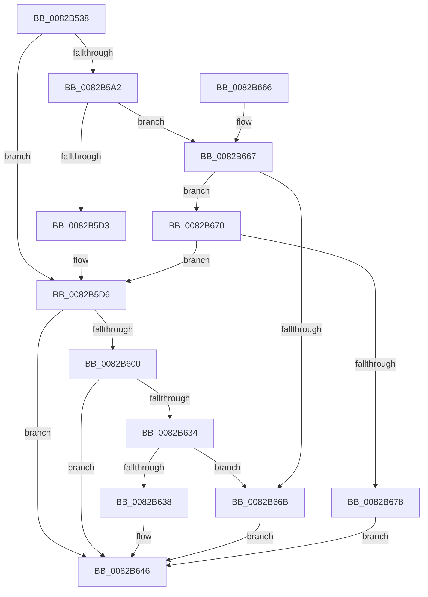

# CmEnumDevicesInContainerWithCallback

- RVA: `0x0082B538`–`0x0082B67F` (길이 `327` bytes)
- VA: `0x000000014082B538`
- 실행 섹션: `PAGE`
- PDB 이름 있음: `예`; PDB Function 태그: `아니요`
- unwind 정보 RVA: `0x000DA864`
- 디코드: `96`개 명령, `327/327` bytes 표시
- 미해석 바이트: `0` (있으면 어셈블리에 `.byte`로 보존)

> 이 문서는 커널 이미지의 기계어와 PDB 기호를 분석해 생성했습니다. 4번과 5번은 함수 원형과 자료형을 바이너리 사용 방식에서 추정한 C 해석이며 원본 소스 복구 결과는 아닙니다.

## 1. Dependencies

- 직접 호출 지점: **5**; 고유 호출 대상: **4**
- 직접 호출자로 확인된 함수: **2**
- RIP 상대 이미지 참조: **1**

### Outgoing calls
- `0x0082B577` → [memset](../../text/6C/memset_function_006C6C40.md) (function, `0x006C6C40`)
- `0x0082B5C3` → [guard_dispatch_icall](../../text/6B/guard_dispatch_icall_function_006BAAD0.md) (function, `0x006BAAD0`)
- `0x0082B5F4` → [CmEnumDevicesInContainerWithCallbackWorker](CmEnumDevicesInContainerWithCallbackWorker_function_0082B688.md) (function, `0x0082B688`)
- `0x0082B626` → [guard_dispatch_icall](../../text/6B/guard_dispatch_icall_function_006BAAD0.md) (function, `0x006BAAD0`)
- `0x0082B64F` → [_security_check_cookie](../../text/6A/_security_check_cookie_function_006AC640.md) (function, `0x006AC640`)

### Direct callers
- [PiDcResetChildDeviceContainers](../73/PiDcResetChildDeviceContainers_function_00731030.md) at `0x007310AF`
- [CmGetContainerBooleanProperty](CmGetContainerBooleanProperty_function_0082B8E4.md) at `0x0082B935`

### Static image references
- `0x0082B54F` → RVA `0x00E0A740` (`.data`; read)

## 2. Other-region calls and transfers

- 다른 실행 섹션으로 향하는 call: **4**
  - `0x0082B577` → [memset](../../text/6C/memset_function_006C6C40.md) (`PAGE` → `.text`)
  - `0x0082B5C3` → [guard_dispatch_icall](../../text/6B/guard_dispatch_icall_function_006BAAD0.md) (`PAGE` → `.text`)
  - `0x0082B626` → [guard_dispatch_icall](../../text/6B/guard_dispatch_icall_function_006BAAD0.md) (`PAGE` → `.text`)
  - `0x0082B64F` → [_security_check_cookie](../../text/6A/_security_check_cookie_function_006AC640.md) (`PAGE` → `.text`)
- 별도 외부 분기/꼬리 이동을 확인하지 못했습니다.

## 3. Assembly (complete function range)

```asm
0082B538  40 55                           push rbp
0082B53A  53                              push rbx
0082B53B  56                              push rsi
0082B53C  57                              push rdi
0082B53D  41 54                           push r12
0082B53F  41 56                           push r14
0082B541  41 57                           push r15
0082B543  48 8D 6C 24 E9                  lea rbp, [rsp - 0x17]
0082B548  48 81 EC B0 00 00 00            sub rsp, 0xb0
0082B54F  48 8B 05 EA F1 5D 00            mov rax, qword ptr [rip + 0x5df1ea]
0082B556  48 33 C4                        xor rax, rsp
0082B559  48 89 45 07                     mov qword ptr [rbp + 7], rax
0082B55D  48 8B 5D 77                     mov rbx, qword ptr [rbp + 0x77]
0082B561  4C 8B E2                        mov r12, rdx
0082B564  33 D2                           xor edx, edx
0082B566  49 8B F8                        mov rdi, r8
0082B569  4C 8B F9                        mov r15, rcx
0082B56C  49 8B F1                        mov rsi, r9
0082B56F  48 8D 4D A7                     lea rcx, [rbp - 0x59]
0082B573  44 8D 42 58                     lea r8d, [rdx + 0x58]
0082B577  E8 C4 B6 E9 FF                  call 0x1406c6c40
0082B57C  4D 8B B7 F8 01 00 00            mov r14, qword ptr [r15 + 0x1f8]
0082B583  83 65 CF 00                     and dword ptr [rbp - 0x31], 0
0082B587  48 89 7D B7                     mov qword ptr [rbp - 0x49], rdi
0082B58B  BF 20 01 00 C0                  mov edi, 0xc0000120
0082B590  48 89 75 BF                     mov qword ptr [rbp - 0x41], rsi
0082B594  BE 0F 00 00 00                  mov esi, 0xf
0082B599  48 89 5D C7                     mov qword ptr [rbp - 0x39], rbx
0082B59D  4D 85 F6                        test r14, r14
0082B5A0  74 34                           je 0x14082b5d6
0082B5A2  48 8D 45 A7                     lea rax, [rbp - 0x59]
0082B5A6  44 8B CE                        mov r9d, esi
0082B5A9  48 89 44 24 28                  mov qword ptr [rsp + 0x28], rax
0082B5AE  44 8D 46 F6                     lea r8d, [rsi - 0xa]
0082B5B2  49 8B C6                        mov rax, r14
0082B5B5  C7 44 24 20 01 00 00 00         mov dword ptr [rsp + 0x20], 1
0082B5BD  49 8B D4                        mov rdx, r12
0082B5C0  49 8B CF                        mov rcx, r15
0082B5C3  E8 08 F5 E8 FF                  call 0x1406baad0
0082B5C8  3D 02 00 00 C0                  cmp eax, 0xc0000002
0082B5CD  0F 85 94 00 00 00               jne 0x14082b667
0082B5D3  45 33 F6                        xor r14d, r14d
0082B5D6  8B 45 CF                        mov eax, dword ptr [rbp - 0x31]
0082B5D9  49 8B D4                        mov rdx, r12
0082B5DC  4C 8B 4D BF                     mov r9, qword ptr [rbp - 0x41]
0082B5E0  49 8B CF                        mov rcx, r15
0082B5E3  4C 8B 45 B7                     mov r8, qword ptr [rbp - 0x49]
0082B5E7  89 44 24 28                     mov dword ptr [rsp + 0x28], eax
0082B5EB  48 8B 45 C7                     mov rax, qword ptr [rbp - 0x39]
0082B5EF  48 89 44 24 20                  mov qword ptr [rsp + 0x20], rax
0082B5F4  E8 8F 00 00 00                  call 0x14082b688
0082B5F9  8B D8                           mov ebx, eax
0082B5FB  4D 85 F6                        test r14, r14
0082B5FE  74 46                           je 0x14082b646
0082B600  89 45 A7                        mov dword ptr [rbp - 0x59], eax
0082B603  44 8B CE                        mov r9d, esi
0082B606  48 8D 45 A7                     lea rax, [rbp - 0x59]
0082B60A  41 B8 05 00 00 00               mov r8d, 5
0082B610  48 89 44 24 28                  mov qword ptr [rsp + 0x28], rax
0082B615  49 8B D4                        mov rdx, r12
0082B618  49 8B C6                        mov rax, r14
0082B61B  C7 44 24 20 02 00 00 00         mov dword ptr [rsp + 0x20], 2
0082B623  49 8B CF                        mov rcx, r15
0082B626  E8 A5 F4 E8 FF                  call 0x1406baad0
0082B62B  8B C8                           mov ecx, eax
0082B62D  3D 02 00 00 C0                  cmp eax, 0xc0000002
0082B632  74 12                           je 0x14082b646
0082B634  3B C7                           cmp eax, edi
0082B636  74 33                           je 0x14082b66b
0082B638  8B C3                           mov eax, ebx
0082B63A  85 C9                           test ecx, ecx
0082B63C  BB E5 00 00 C0                  mov ebx, 0xc00000e5
0082B641  0F 45 C3                        cmovne eax, ebx
0082B644  8B D8                           mov ebx, eax
0082B646  8B C3                           mov eax, ebx
0082B648  48 8B 4D 07                     mov rcx, qword ptr [rbp + 7]
0082B64C  48 33 CC                        xor rcx, rsp
0082B64F  E8 EC 0F E8 FF                  call 0x1406ac640
0082B654  48 81 C4 B0 00 00 00            add rsp, 0xb0
0082B65B  41 5F                           pop r15
0082B65D  41 5E                           pop r14
0082B65F  41 5C                           pop r12
0082B661  5F                              pop rdi
0082B662  5E                              pop rsi
0082B663  5B                              pop rbx
0082B664  5D                              pop rbp
0082B665  C3                              ret
0082B666  CC                              int3
0082B667  3B C7                           cmp eax, edi
0082B669  75 05                           jne 0x14082b670
0082B66B  8B 5D A7                        mov ebx, dword ptr [rbp - 0x59]
0082B66E  EB D6                           jmp 0x14082b646
0082B670  85 C0                           test eax, eax
0082B672  0F 84 5E FF FF FF               je 0x14082b5d6
0082B678  BB E5 00 00 C0                  mov ebx, 0xc00000e5
0082B67D  EB C7                           jmp 0x14082b646
```

## 4. C-style interpretation (structured pseudocode)

```c
__int64 __fastcall CmEnumDevicesInContainerWithCallback(__int64 a1, __int64 a2, __int64 a3, __int64 a4, __int64 a5)
{
    __int64 result;
    __int64 v_r14;
    __int64 v_rsp;
    unsigned __int64 v_stack_m48;
    unsigned __int64 v_stack_m4F;
    unsigned int v_stack_m80;
    unsigned __int64 v_stack_m88;
    unsigned __int64 v_stack_m90;
    unsigned __int64 v_stack_m98;
    unsigned __int64 v_stack_mA8;
    unsigned __int64 v_stack_mC0;
    unsigned int v_stack_mC8;

    v_rsp = (v_rsp) - (176);
    result = (*(unsigned __int64 *)(v_rip + 6156778)) ^ (v_rsp);
    v_stack_m48 = result;
    a2 = 0;
    result = memset(v_stack_mA8, a2, a2 + 88, a4);
    v_stack_m98 = a3;
    v_stack_m90 = a4;
    v_stack_m88 = a5;
    if (*(unsigned __int64 *)(a1 + 504) == 0) goto loc_0082B5D6;
    v_stack_mC0 = v_stack_mA8;
    v_stack_mC8 = 1;
    result = guard_dispatch_icall(a1, 0, 15 - 10, 15);
    if (((unsigned int)(result)) != 0xC0000002ULL) goto loc_0082B667;
    v_r14 = 0;
loc_0082B5D6:
    v_stack_mC0 = (unsigned int)((unsigned int)(v_stack_m80));
    v_stack_mC8 = v_stack_m88;
    result = CmEnumDevicesInContainerWithCallbackWorker(a1, 0, v_stack_m98, v_stack_m90);
    if (0 == 0) goto loc_0082B646;
    v_stack_mA8 = (unsigned int)(result);
    v_stack_mC0 = v_stack_mA8;
    v_stack_mC8 = 2;
    result = guard_dispatch_icall(a1, 0, 5, 15);
    if (((unsigned int)(result)) == 0xC0000002ULL) goto loc_0082B646;
    if (((unsigned int)(result)) == ((unsigned int)((unsigned int)(0xC0000120ULL)))) goto loc_0082B66B;
    result = (unsigned int)((unsigned int)((unsigned int)((unsigned int)(result))));
    if ((unsigned int)((unsigned int)((unsigned int)(result))) != 0) { result = (unsigned int)((unsigned int)(0xC00000E5ULL)); }
loc_0082B646:
    a1 = (v_stack_m48) ^ (v_rsp);
    result = _security_check_cookie(a1, 0, 5, 15);
    v_rsp = (v_rsp) + (176);
    return result;
loc_0082B667:
    if (((unsigned int)(result)) != ((unsigned int)((unsigned int)(0xC0000120ULL)))) goto loc_0082B670;
loc_0082B66B:
    goto loc_0082B646;
loc_0082B670:
    if ((unsigned int)(result) == 0) goto loc_0082B5D6;
    goto loc_0082B646;
}
```

## 5. (Beta) C Style

```c
int64_t CmEnumDevicesInContainerWithCallback(void *Arg1, int64_t Arg2, int64_t Arg3, int64_t Arg4, int64_t Arg5)
{
    uint8_t *arg1 = (uint8_t *)Arg1;

    int64_t result;
    int64_t local_r14;
    int64_t local_rsp;
    uint64_t v_stack_m48;
    uint64_t v_stack_m4F;
    uint32_t v_stack_m80;
    uint64_t v_stack_m88;
    uint64_t v_stack_m90;
    uint64_t v_stack_m98;
    uint64_t v_stack_mA8;
    uint64_t v_stack_mC0;
    uint32_t v_stack_mC8;

    local_rsp = (local_rsp) - (176);
    result = (*(uint64_t *)(v_rip + 0x5DF1EA)) ^ (local_rsp);
    v_stack_m48 = result;
    Arg2 = 0;
    result = memset(v_stack_mA8, Arg2, Arg2 + 88, Arg4);
    v_stack_m98 = Arg3;
    v_stack_m90 = Arg4;
    v_stack_m88 = Arg5;
    if (*(uint64_t *)(arg1 + 0x1F8) == 0) goto loc_0082B5D6;
    v_stack_mC0 = v_stack_mA8;
    v_stack_mC8 = 1;
    result = guard_dispatch_icall(Arg1, 0, 15 - 10, 15);
    if (((uint32_t)(result)) != 0xC0000002ULL) goto loc_0082B667;
    local_r14 = 0;
loc_0082B5D6:
    v_stack_mC0 = (uint32_t)((uint32_t)(v_stack_m80));
    v_stack_mC8 = v_stack_m88;
    result = CmEnumDevicesInContainerWithCallbackWorker(Arg1, 0, v_stack_m98, v_stack_m90);
    if (0 == 0) goto loc_0082B646;
    v_stack_mA8 = (uint32_t)(result);
    v_stack_mC0 = v_stack_mA8;
    v_stack_mC8 = 2;
    result = guard_dispatch_icall(Arg1, 0, 5, 15);
    if (((uint32_t)(result)) == 0xC0000002ULL) goto loc_0082B646;
    if (((uint32_t)(result)) == ((uint32_t)((uint32_t)(0xC0000120ULL)))) goto loc_0082B66B;
    result = (uint32_t)((uint32_t)((uint32_t)((uint32_t)(result))));
    if ((uint32_t)((uint32_t)((uint32_t)(result))) != 0) { result = (uint32_t)((uint32_t)(0xC00000E5ULL)); }
loc_0082B646:
    Arg1 = (v_stack_m48) ^ (local_rsp);
    result = _security_check_cookie(Arg1, 0, 5, 15);
    local_rsp = (local_rsp) + (176);
    return result;
loc_0082B667:
    if (((uint32_t)(result)) != ((uint32_t)((uint32_t)(0xC0000120ULL)))) goto loc_0082B670;
loc_0082B66B:
    goto loc_0082B646;
loc_0082B670:
    if ((uint32_t)(result) == 0) goto loc_0082B5D6;
    goto loc_0082B646;
}
```

### 관측된 메모리 오프셋

구조체 형식이 확인되지 않은 접근은 인자 기준의 오프셋으로만 기록했습니다.

| 기준 인자 | 오프셋 표현 | 폭 (bit) | 접근 |
|---|---:|---:|---|
| `Arg1` | `+ 0x1F8` | `64` | `R` |

## 6. Execution-region graph

[열기: 2D/3D 그래프와 함수 탐색 컨트롤 패널](../../../control-panel.html?section=page&rva=0x0082B538&view=graph)

- 2D 그래프는 위에서 아래로 흐르고, 3D 그래프는 빈 공간을 드래그해 회전합니다. Shift+드래그는 이동, 휠은 확대·축소, 함수 노드 선택은 대상 보고서 이동입니다.

### Static fallback


