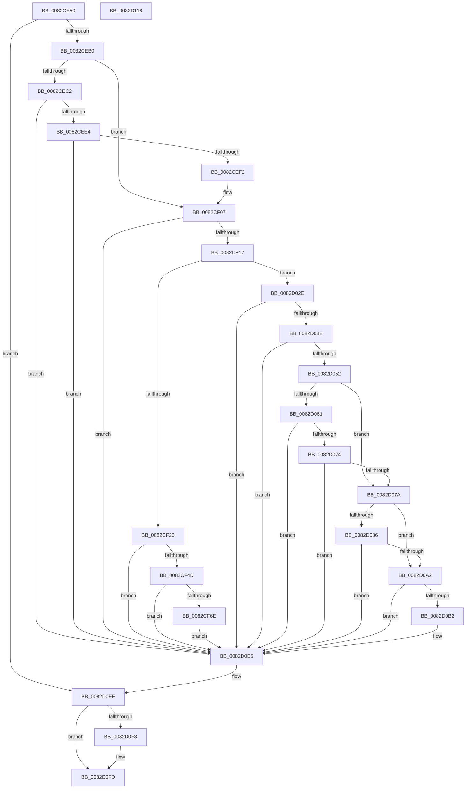

# CmEnumSubkeyCallback

- RVA: `0x0082CE50`–`0x0082D119` (길이 `713` bytes)
- VA: `0x000000014082CE50`
- 실행 섹션: `PAGE`
- PDB 이름 있음: `예`; PDB Function 태그: `아니요`
- unwind 정보 RVA: `0x000DA9D0`
- 디코드: `172`개 명령, `713/713` bytes 표시
- 미해석 바이트: `0` (있으면 어셈블리에 `.byte`로 보존)

> 이 문서는 커널 이미지의 기계어와 PDB 기호를 분석해 생성했습니다. 4번과 5번은 함수 원형과 자료형을 바이너리 사용 방식에서 추정한 C 해석이며 원본 소스 복구 결과는 아닙니다.

## 1. Dependencies

- 직접 호출 지점: **15**; 고유 호출 대상: **11**
- 직접 호출자로 확인된 함수: **0**
- RIP 상대 이미지 참조: **1**

### Outgoing calls
- `0x0082CE9F` → [ExAllocatePool2](../../poolcode/B8/ExAllocatePool2_function_00B820F0.md) (function, `0x00B820F0`)
- `0x0082CED7` → [RtlStringCchCopyExW](../../text/41/RtlStringCchCopyExW_function_0041E1C0.md) (function, `0x0041E1C0`)
- `0x0082CF0A` → [RtlStringCchCopyW](../../text/26/RtlStringCchCopyW_function_0026E9A4.md) (function, `0x0026E9A4`)
- `0x0082CF40` → [PnpCtxRegOpenKey](../8E/PnpCtxRegOpenKey_function_008EF7B8.md) (function, `0x008EF7B8`)
- `0x0082CF5D` → [ExAllocatePool2](../../poolcode/B8/ExAllocatePool2_function_00B820F0.md) (function, `0x00B820F0`)
- `0x0082CF90` → [RtlStringCchCopyExW](../../text/41/RtlStringCchCopyExW_function_0041E1C0.md) (function, `0x0041E1C0`)
- `0x0082CFF4` → [PnpCtxRegEnumKeyWithCallback](../AA/PnpCtxRegEnumKeyWithCallback_function_00AA146C.md) (function, `0x00AA146C`)
- `0x0082D024` → [ExFreePoolWithTag](../../poolcode/B8/ExFreePoolWithTag_function_00B82870.md) (function, `0x00B82870`)
- `0x0082D031` → [CmValidateDeviceName](../8F/CmValidateDeviceName_function_008F3CF0.md) (function, `0x008F3CF0`)
- `0x0082D045` → [RtlInitUnicodeStringEx](../../text/46/RtlInitUnicodeStringEx_function_00463960.md) (function, `0x00463960`)
- `0x0082D06B` → [CmIsDevicePresent](../A0/CmIsDevicePresent_function_00A0DF7C.md) (function, `0x00A0DF7C`)
- `0x0082D099` → [guard_dispatch_icall](../../text/6B/guard_dispatch_icall_function_006BAAD0.md) (function, `0x006BAAD0`)
- `0x0082D0CE` → [RtlStringCchCopyExW](../../text/41/RtlStringCchCopyExW_function_0041E1C0.md) (function, `0x0041E1C0`)
- `0x0082D0EA` → [ExFreePoolWithTag](../../poolcode/B8/ExFreePoolWithTag_function_00B82870.md) (function, `0x00B82870`)
- `0x0082D0F8` → [ZwClose](../../text/6A/ZwClose_function_006AD2B0.md) (function, `0x006AD2B0`)

### Direct callers
- 이 함수 시작 RVA로 연결되는 직접 call은 확인되지 않았습니다. 간접 호출은 완전히 역산할 수 없습니다.

### Static image references
- `0x0082CF9B` → RVA `0x0082CE50` (`CmEnumSubkeyCallback`; read)

## 2. Other-region calls and transfers

- 다른 실행 섹션으로 향하는 call: **11**
  - `0x0082CE9F` → [ExAllocatePool2](../../poolcode/B8/ExAllocatePool2_function_00B820F0.md) (`PAGE` → `POOLCODE`)
  - `0x0082CED7` → [RtlStringCchCopyExW](../../text/41/RtlStringCchCopyExW_function_0041E1C0.md) (`PAGE` → `.text`)
  - `0x0082CF0A` → [RtlStringCchCopyW](../../text/26/RtlStringCchCopyW_function_0026E9A4.md) (`PAGE` → `.text`)
  - `0x0082CF5D` → [ExAllocatePool2](../../poolcode/B8/ExAllocatePool2_function_00B820F0.md) (`PAGE` → `POOLCODE`)
  - `0x0082CF90` → [RtlStringCchCopyExW](../../text/41/RtlStringCchCopyExW_function_0041E1C0.md) (`PAGE` → `.text`)
  - `0x0082D024` → [ExFreePoolWithTag](../../poolcode/B8/ExFreePoolWithTag_function_00B82870.md) (`PAGE` → `POOLCODE`)
  - `0x0082D045` → [RtlInitUnicodeStringEx](../../text/46/RtlInitUnicodeStringEx_function_00463960.md) (`PAGE` → `.text`)
  - `0x0082D099` → [guard_dispatch_icall](../../text/6B/guard_dispatch_icall_function_006BAAD0.md) (`PAGE` → `.text`)
  - `0x0082D0CE` → [RtlStringCchCopyExW](../../text/41/RtlStringCchCopyExW_function_0041E1C0.md) (`PAGE` → `.text`)
  - `0x0082D0EA` → [ExFreePoolWithTag](../../poolcode/B8/ExFreePoolWithTag_function_00B82870.md) (`PAGE` → `POOLCODE`)
  - `0x0082D0F8` → [ZwClose](../../text/6A/ZwClose_function_006AD2B0.md) (`PAGE` → `.text`)
- 별도 외부 분기/꼬리 이동을 확인하지 못했습니다.

## 3. Assembly (complete function range)

```asm
0082CE50  48 89 5C 24 08                  mov qword ptr [rsp + 8], rbx
0082CE55  48 89 74 24 10                  mov qword ptr [rsp + 0x10], rsi
0082CE5A  55                              push rbp
0082CE5B  57                              push rdi
0082CE5C  41 54                           push r12
0082CE5E  41 55                           push r13
0082CE60  41 57                           push r15
0082CE62  48 8B EC                        mov rbp, rsp
0082CE65  48 83 EC 60                     sub rsp, 0x60
0082CE69  45 33 ED                        xor r13d, r13d
0082CE6C  49 8B F0                        mov rsi, r8
0082CE6F  4C 8B E2                        mov r12, rdx
0082CE72  4C 89 6D D0                     mov qword ptr [rbp - 0x30], r13
0082CE76  4C 8B F9                        mov r15, rcx
0082CE79  4C 89 6D E0                     mov qword ptr [rbp - 0x20], r13
0082CE7D  0F 57 C0                        xorps xmm0, xmm0
0082CE80  4C 89 6D D8                     mov qword ptr [rbp - 0x28], r13
0082CE84  BA 90 01 00 00                  mov edx, 0x190
0082CE89  44 88 6D 48                     mov byte ptr [rbp + 0x48], r13b
0082CE8D  B9 00 01 00 00                  mov ecx, 0x100
0082CE92  41 B8 50 4E 50 52               mov r8d, 0x52504e50
0082CE98  0F 11 45 E8                     movups xmmword ptr [rbp - 0x18], xmm0
0082CE9C  49 8B D9                        mov rbx, r9
0082CE9F  E8 4C 52 35 00                  call 0x140b820f0
0082CEA4  48 8B F8                        mov rdi, rax
0082CEA7  48 85 C0                        test rax, rax
0082CEAA  0F 84 3F 02 00 00               je 0x14082d0ef
0082CEB0  4C 8D 43 04                     lea r8, [rbx + 4]
0082CEB4  BA C8 00 00 00                  mov edx, 0xc8
0082CEB9  48 8B C8                        mov rcx, rax
0082CEBC  66 45 39 28                     cmp word ptr [r8], r13w
0082CEC0  74 45                           je 0x14082cf07
0082CEC2  48 8D 45 D8                     lea rax, [rbp - 0x28]
0082CEC6  C7 44 24 28 00 09 00 00         mov dword ptr [rsp + 0x28], 0x900
0082CECE  4C 8D 4D E0                     lea r9, [rbp - 0x20]
0082CED2  48 89 44 24 20                  mov qword ptr [rsp + 0x20], rax
0082CED7  E8 E4 12 BF FF                  call 0x14041e1c0
0082CEDC  85 C0                           test eax, eax
0082CEDE  0F 88 01 02 00 00               js 0x14082d0e5
0082CEE4  48 8B 45 D8                     mov rax, qword ptr [rbp - 0x28]
0082CEE8  48 83 F8 02                     cmp rax, 2
0082CEEC  0F 82 F3 01 00 00               jb 0x14082d0e5
0082CEF2  48 8B 4D E0                     mov rcx, qword ptr [rbp - 0x20]
0082CEF6  48 8D 50 FE                     lea rdx, [rax - 2]
0082CEFA  66 C7 01 5C 00                  mov word ptr [rcx], 0x5c
0082CEFF  48 83 C1 02                     add rcx, 2
0082CF03  66 44 89 29                     mov word ptr [rcx], r13w
0082CF07  4C 8B C6                        mov r8, rsi
0082CF0A  E8 95 1A A4 FF                  call 0x14026e9a4
0082CF0F  85 C0                           test eax, eax
0082CF11  0F 88 CE 01 00 00               js 0x14082d0e5
0082CF17  83 3B 03                        cmp dword ptr [rbx], 3
0082CF1A  0F 83 0E 01 00 00               jae 0x14082d02e
0082CF20  48 8D 45 D0                     lea rax, [rbp - 0x30]
0082CF24  41 B9 08 00 00 00               mov r9d, 8
0082CF2A  48 89 44 24 28                  mov qword ptr [rsp + 0x28], rax
0082CF2F  4C 8B C6                        mov r8, rsi
0082CF32  49 8B D4                        mov rdx, r12
0082CF35  C7 44 24 20 19 00 02 00         mov dword ptr [rsp + 0x20], 0x20019
0082CF3D  49 8B CF                        mov rcx, r15
0082CF40  E8 73 28 0C 00                  call 0x1408ef7b8
0082CF45  85 C0                           test eax, eax
0082CF47  0F 88 98 01 00 00               js 0x14082d0e5
0082CF4D  BA B8 01 00 00                  mov edx, 0x1b8
0082CF52  B9 00 01 00 00                  mov ecx, 0x100
0082CF57  41 B8 50 4E 50 52               mov r8d, 0x52504e50
0082CF5D  E8 8E 51 35 00                  call 0x140b820f0
0082CF62  48 8B F0                        mov rsi, rax
0082CF65  48 85 C0                        test rax, rax
0082CF68  0F 84 77 01 00 00               je 0x14082d0e5
0082CF6E  8B 0B                           mov ecx, dword ptr [rbx]
0082CF70  45 33 C9                        xor r9d, r9d
0082CF73  FF C1                           inc ecx
0082CF75  C7 44 24 28 00 09 00 00         mov dword ptr [rsp + 0x28], 0x900
0082CF7D  89 08                           mov dword ptr [rax], ecx
0082CF7F  4C 8B C7                        mov r8, rdi
0082CF82  48 8D 48 04                     lea rcx, [rax + 4]
0082CF86  4C 89 6C 24 20                  mov qword ptr [rsp + 0x20], r13
0082CF8B  BA C8 00 00 00                  mov edx, 0xc8
0082CF90  E8 2B 12 BF FF                  call 0x14041e1c0
0082CF95  8A 83 94 01 00 00               mov al, byte ptr [rbx + 0x194]
0082CF9B  4C 8D 05 AE FE FF FF            lea r8, [rip - 0x152]
0082CFA2  88 86 94 01 00 00               mov byte ptr [rsi + 0x194], al
0082CFA8  4C 8B CE                        mov r9, rsi
0082CFAB  48 8B 83 98 01 00 00            mov rax, qword ptr [rbx + 0x198]
0082CFB2  49 8B CF                        mov rcx, r15
0082CFB5  48 89 86 98 01 00 00            mov qword ptr [rsi + 0x198], rax
0082CFBC  48 8B 83 A0 01 00 00            mov rax, qword ptr [rbx + 0x1a0]
0082CFC3  48 89 86 A0 01 00 00            mov qword ptr [rsi + 0x1a0], rax
0082CFCA  48 8B 83 A8 01 00 00            mov rax, qword ptr [rbx + 0x1a8]
0082CFD1  48 89 86 A8 01 00 00            mov qword ptr [rsi + 0x1a8], rax
0082CFD8  8B 83 B0 01 00 00               mov eax, dword ptr [rbx + 0x1b0]
0082CFDE  89 86 B0 01 00 00               mov dword ptr [rsi + 0x1b0], eax
0082CFE4  8B 83 B4 01 00 00               mov eax, dword ptr [rbx + 0x1b4]
0082CFEA  89 86 B4 01 00 00               mov dword ptr [rsi + 0x1b4], eax
0082CFF0  48 8B 55 D0                     mov rdx, qword ptr [rbp - 0x30]
0082CFF4  E8 73 44 27 00                  call 0x140aa146c
0082CFF9  8B 86 B4 01 00 00               mov eax, dword ptr [rsi + 0x1b4]
0082CFFF  33 D2                           xor edx, edx
0082D001  89 83 B4 01 00 00               mov dword ptr [rbx + 0x1b4], eax
0082D007  48 8B CE                        mov rcx, rsi
0082D00A  48 8B 86 A8 01 00 00            mov rax, qword ptr [rsi + 0x1a8]
0082D011  48 89 83 A8 01 00 00            mov qword ptr [rbx + 0x1a8], rax
0082D018  8B 86 B0 01 00 00               mov eax, dword ptr [rsi + 0x1b0]
0082D01E  89 83 B0 01 00 00               mov dword ptr [rbx + 0x1b0], eax
0082D024  E8 47 58 35 00                  call 0x140b82870
0082D029  E9 B7 00 00 00                  jmp 0x14082d0e5
0082D02E  48 8B D7                        mov rdx, rdi
0082D031  E8 BA 6C 0C 00                  call 0x1408f3cf0
0082D036  85 C0                           test eax, eax
0082D038  0F 88 A7 00 00 00               js 0x14082d0e5
0082D03E  48 8B D7                        mov rdx, rdi
0082D041  48 8D 4D E8                     lea rcx, [rbp - 0x18]
0082D045  E8 16 69 C3 FF                  call 0x140463960
0082D04A  85 C0                           test eax, eax
0082D04C  0F 88 93 00 00 00               js 0x14082d0e5
0082D052  0F B7 75 EA                     movzx esi, word ptr [rbp - 0x16]
0082D056  D1 EE                           shr esi, 1
0082D058  44 38 AB 94 01 00 00            cmp byte ptr [rbx + 0x194], r13b
0082D05F  74 19                           je 0x14082d07a
0082D061  4C 8D 45 48                     lea r8, [rbp + 0x48]
0082D065  48 8B D7                        mov rdx, rdi
0082D068  49 8B CF                        mov rcx, r15
0082D06B  E8 0C 0F 1E 00                  call 0x140a0df7c
0082D070  85 C0                           test eax, eax
0082D072  78 71                           js 0x14082d0e5
0082D074  44 38 6D 48                     cmp byte ptr [rbp + 0x48], r13b
0082D078  74 6B                           je 0x14082d0e5
0082D07A  48 8B 83 98 01 00 00            mov rax, qword ptr [rbx + 0x198]
0082D081  48 85 C0                        test rax, rax
0082D084  74 1C                           je 0x14082d0a2
0082D086  4C 8B 8B A0 01 00 00            mov r9, qword ptr [rbx + 0x1a0]
0082D08D  41 B8 01 00 00 00               mov r8d, 1
0082D093  48 8B D7                        mov rdx, rdi
0082D096  49 8B CF                        mov rcx, r15
0082D099  E8 32 DA E8 FF                  call 0x1406baad0
0082D09E  84 C0                           test al, al
0082D0A0  74 43                           je 0x14082d0e5
0082D0A2  01 B3 B4 01 00 00               add dword ptr [rbx + 0x1b4], esi
0082D0A8  8B 83 B0 01 00 00               mov eax, dword ptr [rbx + 0x1b0]
0082D0AE  3B C6                           cmp eax, esi
0082D0B0  76 33                           jbe 0x14082d0e5
0082D0B2  48 8B 8B A8 01 00 00            mov rcx, qword ptr [rbx + 0x1a8]
0082D0B9  8B D0                           mov edx, eax
0082D0BB  C7 44 24 28 00 09 00 00         mov dword ptr [rsp + 0x28], 0x900
0082D0C3  45 33 C9                        xor r9d, r9d
0082D0C6  4C 8B C7                        mov r8, rdi
0082D0C9  4C 89 6C 24 20                  mov qword ptr [rsp + 0x20], r13
0082D0CE  E8 ED 10 BF FF                  call 0x14041e1c0
0082D0D3  8B C6                           mov eax, esi
0082D0D5  48 03 C0                        add rax, rax
0082D0D8  48 01 83 A8 01 00 00            add qword ptr [rbx + 0x1a8], rax
0082D0DF  29 B3 B0 01 00 00               sub dword ptr [rbx + 0x1b0], esi
0082D0E5  33 D2                           xor edx, edx
0082D0E7  48 8B CF                        mov rcx, rdi
0082D0EA  E8 81 57 35 00                  call 0x140b82870
0082D0EF  48 8B 4D D0                     mov rcx, qword ptr [rbp - 0x30]
0082D0F3  48 85 C9                        test rcx, rcx
0082D0F6  74 05                           je 0x14082d0fd
0082D0F8  E8 B3 01 E8 FF                  call 0x1406ad2b0
0082D0FD  4C 8D 5C 24 60                  lea r11, [rsp + 0x60]
0082D102  33 C0                           xor eax, eax
0082D104  49 8B 5B 30                     mov rbx, qword ptr [r11 + 0x30]
0082D108  49 8B 73 38                     mov rsi, qword ptr [r11 + 0x38]
0082D10C  49 8B E3                        mov rsp, r11
0082D10F  41 5F                           pop r15
0082D111  41 5D                           pop r13
0082D113  41 5C                           pop r12
0082D115  5F                              pop rdi
0082D116  5D                              pop rbp
0082D117  C3                              ret
0082D118  CC                              int3
```

## 4. C-style interpretation (structured pseudocode)

```c
__int64 __fastcall CmEnumSubkeyCallback(__int64 a1, __int64 a2, __int64 a3, __int64 a4)
{
    __int64 result;
    __int64 v_r13;
    __int64 v_rsi;
    __int64 v_rsp;
    unsigned __int64 v_stack_m28;
    unsigned __int16 v_stack_m3E;
    unsigned __int64 v_stack_m40;
    unsigned __int64 v_stack_m48;
    unsigned __int64 v_stack_m50;
    unsigned __int64 v_stack_m58;
    unsigned int v_stack_m60;
    unsigned __int64 v_stack_m68;
    unsigned __int64 v_stack_p10;
    unsigned __int8 v_stack_p20;
    unsigned __int64 v_stack_p8;

    v_stack_p8 = v_rbx;
    v_stack_p10 = v_rsi;
    v_rsp = (v_rsp) - (96);
    v_r13 = 0;
    v_stack_m58 = 0;
    v_stack_m48 = 0;
    v_stack_m50 = 0;
    v_stack_p20 = 0;
    v_stack_m40 = v_xmm0;
    result = ExAllocatePool2(256, 400, (unsigned int)(0x52504E50ULL), a4);
    if (result == 0) goto loc_0082D0EF;
    if ((*(unsigned __int16 *)(a4 + 4)) == 0) goto loc_0082CF07;
    v_stack_m60 = 0x900ULL;
    v_stack_m68 = v_stack_m50;
    result = RtlStringCchCopyExW(result, 200, a4 + 4, v_stack_m48);
    if (sign_flag) goto loc_0082D0E5;
    if (v_stack_m50 < 2) goto loc_0082D0E5;
    *(unsigned __int16 *)(v_stack_m48) = 92;
    a1 = (v_stack_m48) + (2);
    *(unsigned __int16 *)(a1) = 0;
loc_0082CF07:
    result = RtlStringCchCopyW(a1, v_stack_m50 - 2, a3, v_stack_m48);
    if (sign_flag) goto loc_0082D0E5;
    if ((*(unsigned int *)(a4)) >= 3) goto loc_0082D02E;
    v_stack_m60 = v_stack_m58;
    v_stack_m68 = 0x20019ULL;
    result = PnpCtxRegOpenKey(a1, a2, a3, 8);
    if (sign_flag) goto loc_0082D0E5;
    result = ExAllocatePool2(256, 440, (unsigned int)(0x52504E50ULL), 8);
    if (result == 0) goto loc_0082D0E5;
    a4 = 0;
    a1 = (unsigned int)(((unsigned int)(*(unsigned int *)(a4))) + 1);
    v_stack_m60 = 0x900ULL;
    *(unsigned int *)(result) = (unsigned int)(a1);
    v_stack_m68 = 0;
    result = RtlStringCchCopyExW(result + 4, 200, result, a4);
    *(unsigned __int8 *)(result + 404) = (unsigned __int8)(*(unsigned __int8 *)(a4 + 404));
    *(unsigned __int64 *)(result + 408) = *(unsigned __int64 *)(a4 + 408);
    *(unsigned __int64 *)(result + 416) = *(unsigned __int64 *)(a4 + 416);
    *(unsigned __int64 *)(result + 424) = *(unsigned __int64 *)(a4 + 424);
    *(unsigned int *)(result + 432) = (unsigned int)((unsigned int)(*(unsigned int *)(a4 + 432)));
    *(unsigned int *)(result + 436) = (unsigned int)((unsigned int)(*(unsigned int *)(a4 + 436)));
    result = PnpCtxRegEnumKeyWithCallback(a1, v_stack_m58, v_rip - 338, result);
    a2 = 0;
    *(unsigned int *)(a4 + 436) = (unsigned int)((unsigned int)(*(unsigned int *)(result + 436)));
    *(unsigned __int64 *)(a4 + 424) = *(unsigned __int64 *)(result + 424);
    *(unsigned int *)(a4 + 432) = (unsigned int)((unsigned int)(*(unsigned int *)(result + 432)));
    result = ExFreePoolWithTag(result, a2, v_rip - 338, result);
    goto loc_0082D0E5;
loc_0082D02E:
    result = CmValidateDeviceName(result, result, v_rip - 338, result);
    if (sign_flag) goto loc_0082D0E5;
    result = RtlInitUnicodeStringEx(v_stack_m40, result, v_rip - 338, result);
    if (sign_flag) goto loc_0082D0E5;
    v_rsi = (unsigned int)((v_stack_m3E) >> (1));
    if ((*(unsigned __int8 *)(a4 + 404)) == 0) goto loc_0082D07A;
    result = CmIsDevicePresent(a1, result, v_stack_p20, result);
    if (sign_flag) goto loc_0082D0E5;
    if (v_stack_p20 == 0) goto loc_0082D0E5;
loc_0082D07A:
    if (*(unsigned __int64 *)(a4 + 408) == 0) goto loc_0082D0A2;
    result = guard_dispatch_icall(a1, result, 1, *(unsigned __int64 *)(a4 + 416));
    if ((unsigned __int8)(result) == 0) goto loc_0082D0E5;
loc_0082D0A2:
    result = (unsigned int)(*(unsigned int *)(a4 + 432));
    if (((unsigned int)((unsigned int)(*(unsigned int *)(a4 + 432)))) >= = ((unsigned int)(v_rsi))) {
        a1 = *(unsigned __int64 *)(a4 + 424);
        a2 = (unsigned int)((unsigned int)(*(unsigned int *)(a4 + 432)));
        v_stack_m60 = 0x900ULL;
        a4 = 0;
        a3 = result;
        v_stack_m68 = 0;
        result = RtlStringCchCopyExW(a1, a2, a3, a4);
        result = (unsigned int)(v_rsi);
        result = (result) + (result);
    }
    a2 = 0;
    result = ExFreePoolWithTag(result, a2, a3, a4);
loc_0082D0EF:
    if (v_stack_m58 != 0) {
        result = ZwClose(v_stack_m58, a2, a3, a4);
    }
    result = 0;
    return result;
}
```

## 5. (Beta) C Style

```c
int64_t CmEnumSubkeyCallback(int64_t Arg1, int64_t Arg2, int64_t Arg3, void *Arg4)
{
    uint8_t *arg4 = (uint8_t *)Arg4;

    int64_t result;
    int64_t local_r13;
    int64_t local_rsi;
    int64_t local_rsp;
    uint64_t v_stack_m28;
    uint16_t v_stack_m3E;
    uint64_t v_stack_m40;
    uint64_t v_stack_m48;
    uint64_t v_stack_m50;
    uint64_t v_stack_m58;
    uint32_t v_stack_m60;
    uint64_t v_stack_m68;
    uint64_t v_stack_p10;
    uint8_t v_stack_p20;
    uint64_t v_stack_p8;

    v_stack_p8 = local_rbx;
    v_stack_p10 = local_rsi;
    local_rsp = (local_rsp) - (96);
    local_r13 = 0;
    v_stack_m58 = 0;
    v_stack_m48 = 0;
    v_stack_m50 = 0;
    v_stack_p20 = 0;
    v_stack_m40 = v_xmm0;
    result = ExAllocatePool2(256, 400, (uint32_t)(0x52504E50ULL), Arg4);
    if (result == 0) goto loc_0082D0EF;
    if ((*(uint16_t *)(arg4 + 0x4)) == 0) goto loc_0082CF07;
    v_stack_m60 = 0x900ULL;
    v_stack_m68 = v_stack_m50;
    result = RtlStringCchCopyExW(result, 200, Arg4 + 4, v_stack_m48);
    if (sign_flag) goto loc_0082D0E5;
    if (v_stack_m50 < 2) goto loc_0082D0E5;
    *(uint16_t *)(v_stack_m48) = 92;
    Arg1 = (v_stack_m48) + (2);
    *(uint16_t *)(Arg1) = 0;
loc_0082CF07:
    result = RtlStringCchCopyW(Arg1, v_stack_m50 - 2, Arg3, v_stack_m48);
    if (sign_flag) goto loc_0082D0E5;
    if ((*(uint32_t *)(arg4)) >= 3) goto loc_0082D02E;
    v_stack_m60 = v_stack_m58;
    v_stack_m68 = 0x20019ULL;
    result = PnpCtxRegOpenKey(Arg1, Arg2, Arg3, 8);
    if (sign_flag) goto loc_0082D0E5;
    result = ExAllocatePool2(256, 440, (uint32_t)(0x52504E50ULL), 8);
    if (result == 0) goto loc_0082D0E5;
    Arg4 = 0;
    Arg1 = (uint32_t)(((uint32_t)(*(uint32_t *)(arg4))) + 1);
    v_stack_m60 = 0x900ULL;
    *(uint32_t *)(result) = (uint32_t)(Arg1);
    v_stack_m68 = 0;
    result = RtlStringCchCopyExW(result + 4, 200, result, Arg4);
    *(uint8_t *)(result + 0x194) = (uint8_t)(*(uint8_t *)(arg4 + 0x194));
    *(uint64_t *)(result + 0x198) = *(uint64_t *)(arg4 + 0x198);
    *(uint64_t *)(result + 0x1A0) = *(uint64_t *)(arg4 + 0x1A0);
    *(uint64_t *)(result + 0x1A8) = *(uint64_t *)(arg4 + 0x1A8);
    *(uint32_t *)(result + 0x1B0) = (uint32_t)((uint32_t)(*(uint32_t *)(arg4 + 0x1B0)));
    *(uint32_t *)(result + 0x1B4) = (uint32_t)((uint32_t)(*(uint32_t *)(arg4 + 0x1B4)));
    result = PnpCtxRegEnumKeyWithCallback(Arg1, v_stack_m58, v_rip - 338, result);
    Arg2 = 0;
    *(uint32_t *)(arg4 + 0x1B4) = (uint32_t)((uint32_t)(*(uint32_t *)(result + 0x1B4)));
    *(uint64_t *)(arg4 + 0x1A8) = *(uint64_t *)(result + 0x1A8);
    *(uint32_t *)(arg4 + 0x1B0) = (uint32_t)((uint32_t)(*(uint32_t *)(result + 0x1B0)));
    result = ExFreePoolWithTag(result, Arg2, v_rip - 338, result);
    goto loc_0082D0E5;
loc_0082D02E:
    result = CmValidateDeviceName(result, result, v_rip - 338, result);
    if (sign_flag) goto loc_0082D0E5;
    result = RtlInitUnicodeStringEx(v_stack_m40, result, v_rip - 338, result);
    if (sign_flag) goto loc_0082D0E5;
    local_rsi = (uint32_t)((v_stack_m3E) >> (1));
    if ((*(uint8_t *)(arg4 + 0x194)) == 0) goto loc_0082D07A;
    result = CmIsDevicePresent(Arg1, result, v_stack_p20, result);
    if (sign_flag) goto loc_0082D0E5;
    if (v_stack_p20 == 0) goto loc_0082D0E5;
loc_0082D07A:
    if (*(uint64_t *)(arg4 + 0x198) == 0) goto loc_0082D0A2;
    result = guard_dispatch_icall(Arg1, result, 1, *(uint64_t *)(arg4 + 0x1A0));
    if ((uint8_t)(result) == 0) goto loc_0082D0E5;
loc_0082D0A2:
    result = (uint32_t)(*(uint32_t *)(arg4 + 0x1B0));
    if (((uint32_t)((uint32_t)(*(uint32_t *)(arg4 + 0x1B0)))) >= = ((uint32_t)(local_rsi))) {
        Arg1 = *(uint64_t *)(arg4 + 0x1A8);
        Arg2 = (uint32_t)((uint32_t)(*(uint32_t *)(arg4 + 0x1B0)));
        v_stack_m60 = 0x900ULL;
        Arg4 = 0;
        Arg3 = result;
        v_stack_m68 = 0;
        result = RtlStringCchCopyExW(Arg1, Arg2, Arg3, Arg4);
        result = (uint32_t)(local_rsi);
        result = (result) + (result);
    }
    Arg2 = 0;
    result = ExFreePoolWithTag(result, Arg2, Arg3, Arg4);
loc_0082D0EF:
    if (v_stack_m58 != 0) {
        result = ZwClose(v_stack_m58, Arg2, Arg3, Arg4);
    }
    result = 0;
    return result;
}
```

### 관측된 메모리 오프셋

구조체 형식이 확인되지 않은 접근은 인자 기준의 오프셋으로만 기록했습니다.

| 기준 인자 | 오프셋 표현 | 폭 (bit) | 접근 |
|---|---:|---:|---|
| `Arg4` | `+ 0x0` | `16` | `R` |
| `Arg4` | `+ 0x0` | `32` | `R` |
| `Arg4` | `+ 0x4` | `64` | `R` |
| `Arg4` | `+ 0x194` | `8` | `R` |
| `Arg4` | `+ 0x198` | `64` | `R` |
| `Arg4` | `+ 0x1A0` | `64` | `R` |
| `Arg4` | `+ 0x1A8` | `64` | `R` |
| `Arg4` | `+ 0x1A8` | `64` | `R/W` |
| `Arg4` | `+ 0x1A8` | `64` | `W` |
| `Arg4` | `+ 0x1B0` | `32` | `R` |
| `Arg4` | `+ 0x1B0` | `32` | `R/W` |
| `Arg4` | `+ 0x1B0` | `32` | `W` |
| `Arg4` | `+ 0x1B4` | `32` | `R` |
| `Arg4` | `+ 0x1B4` | `32` | `R/W` |
| `Arg4` | `+ 0x1B4` | `32` | `W` |

## 6. Execution-region graph

[열기: 2D/3D 그래프와 함수 탐색 컨트롤 패널](../../../control-panel.html?section=page&rva=0x0082CE50&view=graph)

- 2D 그래프는 위에서 아래로 흐르고, 3D 그래프는 빈 공간을 드래그해 회전합니다. Shift+드래그는 이동, 휠은 확대·축소, 함수 노드 선택은 대상 보고서 이동입니다.

### Static fallback


