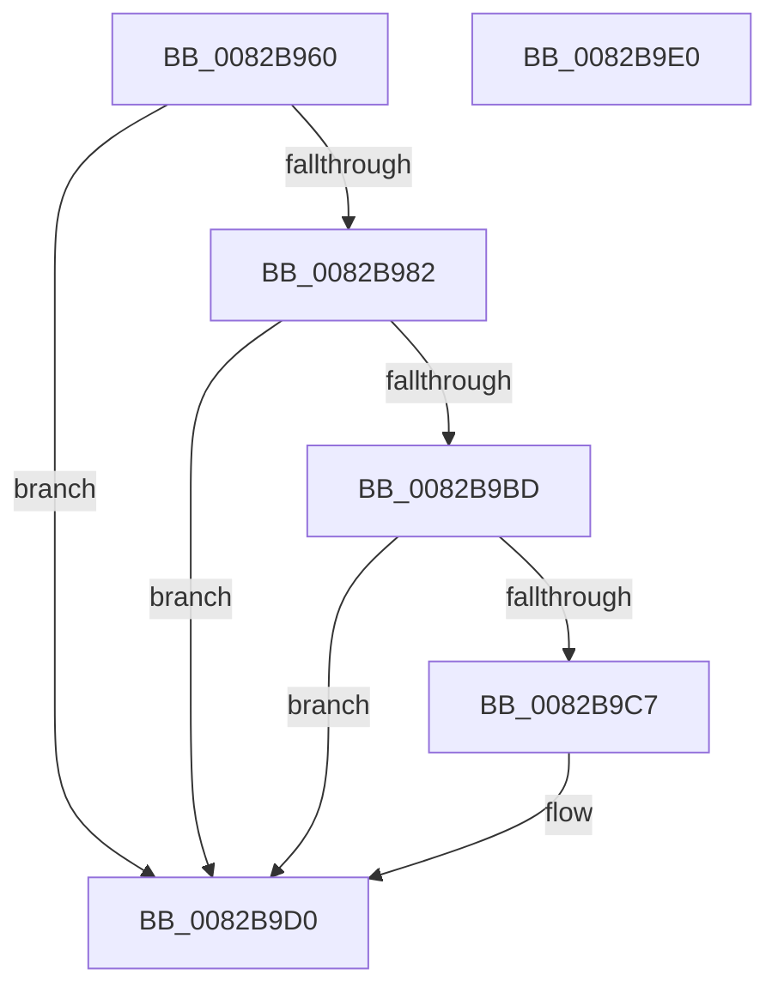

# CmGetContainerBooleanPropertyCallback

- RVA: `0x0082B960`–`0x0082B9E1` (길이 `129` bytes)
- VA: `0x000000014082B960`
- 실행 섹션: `PAGE`
- PDB 이름 있음: `예`; PDB Function 태그: `아니요`
- unwind 정보 RVA: `0x000D29B0`
- 디코드: `37`개 명령, `129/129` bytes 표시
- 미해석 바이트: `0` (있으면 어셈블리에 `.byte`로 보존)

> 이 문서는 커널 이미지의 기계어와 PDB 기호를 분석해 생성했습니다. 4번과 5번은 함수 원형과 자료형을 바이너리 사용 방식에서 추정한 C 해석이며 원본 소스 복구 결과는 아닙니다.

## 1. Dependencies

- 직접 호출 지점: **1**; 고유 호출 대상: **1**
- 직접 호출자로 확인된 함수: **0**
- RIP 상대 이미지 참조: **0**

### Outgoing calls
- `0x0082B9B4` → [PnpGetObjectProperty](../8E/PnpGetObjectProperty_function_008E2180.md) (function, `0x008E2180`)

### Direct callers
- 이 함수 시작 RVA로 연결되는 직접 call은 확인되지 않았습니다. 간접 호출은 완전히 역산할 수 없습니다.

### Static image references
- 디코드된 RIP-relative 메모리 참조가 없습니다.

## 2. Other-region calls and transfers

- 다른 실행 섹션으로 향하는 call: **0**
- 별도 외부 분기/꼬리 이동을 확인하지 못했습니다.

## 3. Assembly (complete function range)

```asm
0082B960  4C 8B DC                        mov r11, rsp
0082B963  49 89 5B 08                     mov qword ptr [r11 + 8], rbx
0082B967  57                              push rdi
0082B968  48 83 EC 70                     sub rsp, 0x70
0082B96C  33 DB                           xor ebx, ebx
0082B96E  49 8B F8                        mov rdi, r8
0082B971  89 5C 24 60                     mov dword ptr [rsp + 0x60], ebx
0082B975  41 89 5B 20                     mov dword ptr [r11 + 0x20], ebx
0082B979  41 88 5B 18                     mov byte ptr [r11 + 0x18], bl
0082B97D  4D 85 C0                        test r8, r8
0082B980  74 4E                           je 0x14082b9d0
0082B982  89 5C 24 50                     mov dword ptr [rsp + 0x50], ebx
0082B986  49 8D 43 20                     lea rax, [r11 + 0x20]
0082B98A  49 89 43 D0                     mov qword ptr [r11 - 0x30], rax
0082B98E  44 8D 43 01                     lea r8d, [rbx + 1]
0082B992  45 89 43 C8                     mov dword ptr [r11 - 0x38], r8d
0082B996  49 8D 43 18                     lea rax, [r11 + 0x18]
0082B99A  49 89 43 C0                     mov qword ptr [r11 - 0x40], rax
0082B99E  45 33 C9                        xor r9d, r9d
0082B9A1  49 8D 43 E8                     lea rax, [r11 - 0x18]
0082B9A5  49 89 43 B8                     mov qword ptr [r11 - 0x48], rax
0082B9A9  48 8B 07                        mov rax, qword ptr [rdi]
0082B9AC  49 89 43 B0                     mov qword ptr [r11 - 0x50], rax
0082B9B0  49 89 5B A8                     mov qword ptr [r11 - 0x58], rbx
0082B9B4  E8 C7 67 0B 00                  call 0x1408e2180
0082B9B9  85 C0                           test eax, eax
0082B9BB  78 13                           js 0x14082b9d0
0082B9BD  80 BC 24 90 00 00 00 FF         cmp byte ptr [rsp + 0x90], 0xff
0082B9C5  75 09                           jne 0x14082b9d0
0082B9C7  C6 47 08 FF                     mov byte ptr [rdi + 8], 0xff
0082B9CB  BB 02 00 00 00                  mov ebx, 2
0082B9D0  8B C3                           mov eax, ebx
0082B9D2  48 8B 9C 24 80 00 00 00         mov rbx, qword ptr [rsp + 0x80]
0082B9DA  48 83 C4 70                     add rsp, 0x70
0082B9DE  5F                              pop rdi
0082B9DF  C3                              ret
0082B9E0  CC                              int3
```

## 4. C-style interpretation (structured pseudocode)

```c
__int64 __fastcall CmGetContainerBooleanPropertyCallback(__int64 a1, __int64 a2, __int64 a3, int a4)
{
    __int64 result;
    __int64 v_rbx;
    __int64 v_rsp;
    unsigned int v_stack_m18;
    unsigned int v_stack_m28;
    unsigned __int8 v_stack_p18;
    unsigned __int64 v_stack_p8;

    *(unsigned __int64 *)(v_rsp + 8) = v_rbx;
    v_rsp = (v_rsp) - (112);
    v_rbx = 0;
    v_stack_m18 = 0;
    *(unsigned int *)(v_rsp + 32) = 0;
    *(unsigned __int8 *)(v_rsp + 24) = 0;
    if (a3 == 0) goto loc_0082B9D0;
    v_stack_m28 = 0;
    *(unsigned __int64 *)(v_rsp - 48) = v_rsp + 32;
    *(unsigned int *)(v_rsp - 56) = (unsigned int)(v_rbx + 1);
    *(unsigned __int64 *)(v_rsp - 64) = v_rsp + 24;
    a4 = 0;
    *(unsigned __int64 *)(v_rsp - 72) = v_rsp - 24;
    *(unsigned __int64 *)(v_rsp - 80) = *(unsigned __int64 *)(a3);
    *(unsigned __int64 *)(v_rsp - 88) = 0;
    result = PnpGetObjectProperty(a1, a2, v_rbx + 1, a4);
    if (sign_flag) goto loc_0082B9D0;
    if (v_stack_p18 == 255) {
        *(unsigned __int8 *)(a3 + 8) = 255;
        v_rbx = 2;
    }
    v_rsp = (v_rsp) + (112);
    return (unsigned int)((unsigned int)(v_rbx));
}
```

## 5. (Beta) C Style

```c
int64_t CmGetContainerBooleanPropertyCallback(int64_t Arg1, int64_t Arg2, void *Arg3, int32_t Arg4)
{
    uint8_t *arg3 = (uint8_t *)Arg3;

    int64_t result;
    int64_t local_rbx;
    int64_t local_rsp;
    uint32_t v_stack_m18;
    uint32_t v_stack_m28;
    uint8_t v_stack_p18;
    uint64_t v_stack_p8;

    *(uint64_t *)(local_rsp + 0x8) = local_rbx;
    local_rsp = (local_rsp) - (112);
    local_rbx = 0;
    v_stack_m18 = 0;
    *(uint32_t *)(local_rsp + 0x20) = 0;
    *(uint8_t *)(local_rsp + 0x18) = 0;
    if (Arg3 == NULL) goto loc_0082B9D0;
    v_stack_m28 = 0;
    *(uint64_t *)(local_rsp - 0x30) = local_rsp + 32;
    *(uint32_t *)(local_rsp - 0x38) = (uint32_t)(local_rbx + 1);
    *(uint64_t *)(local_rsp - 0x40) = local_rsp + 24;
    Arg4 = 0;
    *(uint64_t *)(local_rsp - 0x48) = local_rsp - 24;
    *(uint64_t *)(local_rsp - 0x50) = *(uint64_t *)(arg3);
    *(uint64_t *)(local_rsp - 0x58) = 0;
    result = PnpGetObjectProperty(Arg1, Arg2, local_rbx + 1, Arg4);
    if (sign_flag) goto loc_0082B9D0;
    if (v_stack_p18 == 255) {
        *(uint8_t *)(arg3 + 0x8) = 255;
        local_rbx = 2;
    }
    local_rsp = (local_rsp) + (112);
    return (uint32_t)((uint32_t)(local_rbx));
}
```

### 관측된 메모리 오프셋

구조체 형식이 확인되지 않은 접근은 인자 기준의 오프셋으로만 기록했습니다.

| 기준 인자 | 오프셋 표현 | 폭 (bit) | 접근 |
|---|---:|---:|---|
| `Arg3` | `+ 0x0` | `64` | `R` |
| `Arg3` | `+ 0x8` | `8` | `W` |

## 6. Execution-region graph

[열기: 2D/3D 그래프와 함수 탐색 컨트롤 패널](../../../control-panel.html?section=page&rva=0x0082B960&view=graph)

- 2D 그래프는 위에서 아래로 흐르고, 3D 그래프는 빈 공간을 드래그해 회전합니다. Shift+드래그는 이동, 휠은 확대·축소, 함수 노드 선택은 대상 보고서 이동입니다.

### Static fallback


