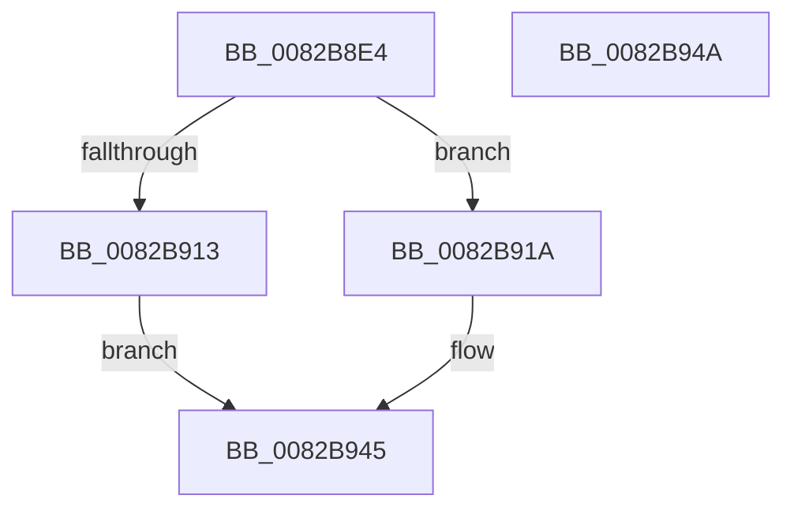

# CmGetContainerBooleanProperty

- RVA: `0x0082B8E4`–`0x0082B94B` (길이 `103` bytes)
- VA: `0x000000014082B8E4`
- 실행 섹션: `PAGE`
- PDB 이름 있음: `예`; PDB Function 태그: `아니요`
- unwind 정보 RVA: `0x00063458`
- 디코드: `23`개 명령, `103/103` bytes 표시
- 미해석 바이트: `0` (있으면 어셈블리에 `.byte`로 보존)

> 이 문서는 커널 이미지의 기계어와 PDB 기호를 분석해 생성했습니다. 4번과 5번은 함수 원형과 자료형을 바이너리 사용 방식에서 추정한 C 해석이며 원본 소스 복구 결과는 아닙니다.

## 1. Dependencies

- 직접 호출 지점: **1**; 고유 호출 대상: **1**
- 직접 호출자로 확인된 함수: **1**
- RIP 상대 이미지 참조: **1**

### Outgoing calls
- `0x0082B935` → [CmEnumDevicesInContainerWithCallback](CmEnumDevicesInContainerWithCallback_function_0082B538.md) (function, `0x0082B538`)

### Direct callers
- [sub_00B1EF30](../B1/Unknown_function_00B1EF30.md) at `0x00B1EF8E`

### Static image references
- `0x0082B924` → RVA `0x0082B960` (`CmGetContainerBooleanPropertyCallback`; read)

## 2. Other-region calls and transfers

- 다른 실행 섹션으로 향하는 call: **0**
- 별도 외부 분기/꼬리 이동을 확인하지 못했습니다.

## 3. Assembly (complete function range)

```asm
0082B8E4  48 83 EC 48                     sub rsp, 0x48
0082B8E8  83 BC 24 80 00 00 00 01         cmp dword ptr [rsp + 0x80], 1
0082B8F0  0F 57 C0                        xorps xmm0, xmm0
0082B8F3  48 8B 84 24 88 00 00 00         mov rax, qword ptr [rsp + 0x88]
0082B8FB  0F 11 44 24 30                  movups xmmword ptr [rsp + 0x30], xmm0
0082B900  C7 00 01 00 00 00               mov dword ptr [rax], 1
0082B906  48 8B 44 24 70                  mov rax, qword ptr [rsp + 0x70]
0082B90B  C7 00 11 00 00 00               mov dword ptr [rax], 0x11
0082B911  73 07                           jae 0x14082b91a
0082B913  B8 23 00 00 C0                  mov eax, 0xc0000023
0082B918  EB 2B                           jmp 0x14082b945
0082B91A  4C 89 4C 24 30                  mov qword ptr [rsp + 0x30], r9
0082B91F  48 8D 44 24 30                  lea rax, [rsp + 0x30]
0082B924  4C 8D 0D 35 00 00 00            lea r9, [rip + 0x35]
0082B92B  48 89 44 24 20                  mov qword ptr [rsp + 0x20], rax
0082B930  C6 44 24 38 00                  mov byte ptr [rsp + 0x38], 0
0082B935  E8 FE FB FF FF                  call 0x14082b538
0082B93A  48 8B 54 24 78                  mov rdx, qword ptr [rsp + 0x78]
0082B93F  8A 4C 24 38                     mov cl, byte ptr [rsp + 0x38]
0082B943  88 0A                           mov byte ptr [rdx], cl
0082B945  48 83 C4 48                     add rsp, 0x48
0082B949  C3                              ret
0082B94A  CC                              int3
```

## 4. C-style interpretation (structured pseudocode)

```c
__int64 __fastcall CmGetContainerBooleanProperty(__int64 a1, __int64 a2, __int64 a3, __int64 a4, __int64 a5, __int64 a6, unsigned int a7, __int64 a8)
{
    __int64 result;
    __int64 v_rsp;
    unsigned __int8 v_stack_m10;
    unsigned __int64 v_stack_m18;
    unsigned __int64 v_stack_m28;

    v_rsp = (v_rsp) - (72);
    v_stack_m18 = v_xmm0;
    *(unsigned int *)(a8) = 1;
    *(unsigned int *)(a5) = 17;
    if (a7 >= 1) goto loc_0082B91A;
    goto loc_0082B945;
loc_0082B91A:
    v_stack_m18 = a4;
    v_stack_m28 = v_stack_m18;
    v_stack_m10 = 0;
    result = CmEnumDevicesInContainerWithCallback(a1, a2, a3, v_rip + 53);
    *(unsigned __int8 *)(a6) = (unsigned __int8)(v_stack_m10);
loc_0082B945:
    v_rsp = (v_rsp) + (72);
    return result;
}
```

## 5. (Beta) C Style

```c
int64_t CmGetContainerBooleanProperty(int64_t Arg1, int64_t Arg2, int64_t Arg3, int64_t Arg4, void *Arg5, void *Arg6, uint32_t Arg7, void *Arg8)
{
    uint8_t *arg5 = (uint8_t *)Arg5;
    uint8_t *arg6 = (uint8_t *)Arg6;
    uint8_t *arg8 = (uint8_t *)Arg8;

    int64_t result;
    int64_t local_rsp;
    uint8_t v_stack_m10;
    uint64_t v_stack_m18;
    uint64_t v_stack_m28;

    local_rsp = (local_rsp) - (72);
    v_stack_m18 = v_xmm0;
    *(uint32_t *)(arg8) = 1;
    *(uint32_t *)(arg5) = 17;
    if (Arg7 >= 1) goto loc_0082B91A;
    goto loc_0082B945;
loc_0082B91A:
    v_stack_m18 = Arg4;
    v_stack_m28 = v_stack_m18;
    v_stack_m10 = 0;
    result = CmEnumDevicesInContainerWithCallback(Arg1, Arg2, Arg3, v_rip + 53);
    *(uint8_t *)(arg6) = (uint8_t)(v_stack_m10);
loc_0082B945:
    local_rsp = (local_rsp) + (72);
    return result;
}
```

### 관측된 메모리 오프셋

구조체 형식이 확인되지 않은 접근은 인자 기준의 오프셋으로만 기록했습니다.

| 기준 인자 | 오프셋 표현 | 폭 (bit) | 접근 |
|---|---:|---:|---|
| `Arg5` | `+ 0x0` | `32` | `W` |
| `Arg6` | `+ 0x0` | `8` | `W` |
| `Arg8` | `+ 0x0` | `32` | `W` |

## 6. Execution-region graph

[열기: 2D/3D 그래프와 함수 탐색 컨트롤 패널](../../../control-panel.html?section=page&rva=0x0082B8E4&view=graph)

- 2D 그래프는 위에서 아래로 흐르고, 3D 그래프는 빈 공간을 드래그해 회전합니다. Shift+드래그는 이동, 휠은 확대·축소, 함수 노드 선택은 대상 보고서 이동입니다.

### Static fallback


