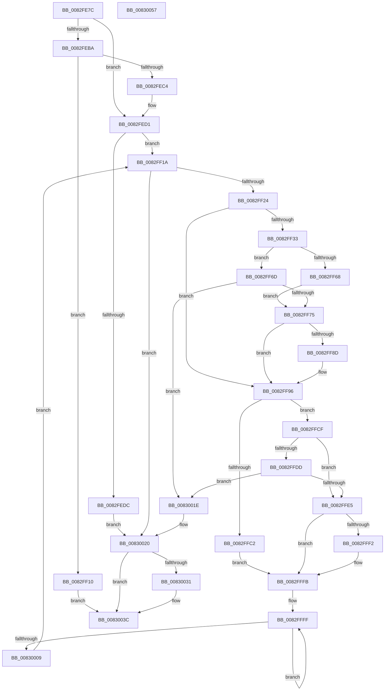

# CmGetDeclarativeFilterList

- RVA: `0x0082FE7C`–`0x00830058` (길이 `476` bytes)
- VA: `0x000000014082FE7C`
- 실행 섹션: `PAGE`
- PDB 이름 있음: `예`; PDB Function 태그: `아니요`
- unwind 정보 RVA: `0x000DAA90`
- 디코드: `137`개 명령, `476/476` bytes 표시
- 미해석 바이트: `0` (있으면 어셈블리에 `.byte`로 보존)

> 이 문서는 커널 이미지의 기계어와 PDB 기호를 분석해 생성했습니다. 4번과 5번은 함수 원형과 자료형을 바이너리 사용 방식에서 추정한 C 해석이며 원본 소스 복구 결과는 아닙니다.

## 1. Dependencies

- 직접 호출 지점: **4**; 고유 호출 대상: **3**
- 직접 호출자로 확인된 함수: **2**
- RIP 상대 이미지 참조: **0**

### Outgoing calls
- `0x0082FEFA` → [CmAppendDeclarativeDefaultFilters](CmAppendDeclarativeDefaultFilters_function_0082F6BC.md) (function, `0x0082F6BC`)
- `0x0082FF2A` → [wcsicmp](../../text/50/wcsicmp_function_00500080.md) (function, `0x00500080`)
- `0x0082FF54` → [CmAppendDeclarativeDefaultFilters](CmAppendDeclarativeDefaultFilters_function_0082F6BC.md) (function, `0x0082F6BC`)
- `0x0082FFB0` → [CmAppendDeclarativeFilterLevel](CmAppendDeclarativeFilterLevel_function_0082F7A4.md) (function, `0x0082F7A4`)

### Direct callers
- [CmGetInstallerClassCompoundFiltersWorker](../83/CmGetInstallerClassCompoundFiltersWorker_function_00830130.md) at `0x008304B0`
- [CmGetInstallerClassCompoundFiltersWorker](../83/CmGetInstallerClassCompoundFiltersWorker_function_00830130.md) at `0x00830530`
- [CmGetDeviceCompoundFiltersWorker](../AF/CmGetDeviceCompoundFiltersWorker_function_00AF9CE8.md) at `0x00AFA0AE`
- [CmGetDeviceCompoundFiltersWorker](../AF/CmGetDeviceCompoundFiltersWorker_function_00AF9CE8.md) at `0x00AFA12E`

### Static image references
- 디코드된 RIP-relative 메모리 참조가 없습니다.

## 2. Other-region calls and transfers

- 다른 실행 섹션으로 향하는 call: **1**
  - `0x0082FF2A` → [wcsicmp](../../text/50/wcsicmp_function_00500080.md) (`PAGE` → `.text`)
- 별도 외부 분기/꼬리 이동을 확인하지 못했습니다.

## 3. Assembly (complete function range)

```asm
0082FE7C  48 8B C4                        mov rax, rsp
0082FE7F  48 89 58 08                     mov qword ptr [rax + 8], rbx
0082FE83  48 89 68 10                     mov qword ptr [rax + 0x10], rbp
0082FE87  4C 89 48 20                     mov qword ptr [rax + 0x20], r9
0082FE8B  56                              push rsi
0082FE8C  57                              push rdi
0082FE8D  41 54                           push r12
0082FE8F  41 55                           push r13
0082FE91  41 56                           push r14
0082FE93  48 83 EC 50                     sub rsp, 0x50
0082FE97  4C 8B E2                        mov r12, rdx
0082FE9A  4D 8B F0                        mov r14, r8
0082FE9D  33 D2                           xor edx, edx
0082FE9F  4C 8B E9                        mov r13, rcx
0082FEA2  89 50 C8                        mov dword ptr [rax - 0x38], edx
0082FEA5  8B DA                           mov ebx, edx
0082FEA7  48 8B 84 24 A8 00 00 00         mov rax, qword ptr [rsp + 0xa8]
0082FEAF  8B FA                           mov edi, edx
0082FEB1  8B F2                           mov esi, edx
0082FEB3  8B EA                           mov ebp, edx
0082FEB5  48 85 C0                        test rax, rax
0082FEB8  74 17                           je 0x14082fed1
0082FEBA  83 BC 24 B0 00 00 00 02         cmp dword ptr [rsp + 0xb0], 2
0082FEC2  72 4C                           jb 0x14082ff10
0082FEC4  8B AC 24 B0 00 00 00            mov ebp, dword ptr [rsp + 0xb0]
0082FECB  48 8B F8                        mov rdi, rax
0082FECE  66 89 10                        mov word ptr [rax], dx
0082FED1  41 B8 23 00 00 C0               mov r8d, 0xc0000023
0082FED7  4D 85 F6                        test r14, r14
0082FEDA  75 3E                           jne 0x14082ff1a
0082FEDC  4C 8B 84 24 A0 00 00 00         mov r8, qword ptr [rsp + 0xa0]
0082FEE4  48 8D 44 24 40                  lea rax, [rsp + 0x40]
0082FEE9  48 89 44 24 30                  mov qword ptr [rsp + 0x30], rax
0082FEEE  49 8B D4                        mov rdx, r12
0082FEF1  89 6C 24 28                     mov dword ptr [rsp + 0x28], ebp
0082FEF5  48 89 7C 24 20                  mov qword ptr [rsp + 0x20], rdi
0082FEFA  E8 BD F7 FF FF                  call 0x14082f6bc
0082FEFF  8B 74 24 40                     mov esi, dword ptr [rsp + 0x40]
0082FF03  8B D8                           mov ebx, eax
0082FF05  41 B8 23 00 00 C0               mov r8d, 0xc0000023
0082FF0B  E9 10 01 00 00                  jmp 0x140830020
0082FF10  BB 0D 00 00 C0                  mov ebx, 0xc000000d
0082FF15  E9 22 01 00 00                  jmp 0x14083003c
0082FF1A  66 41 39 16                     cmp word ptr [r14], dx
0082FF1E  0F 84 FC 00 00 00               je 0x140830020
0082FF24  49 8B D1                        mov rdx, r9
0082FF27  49 8B CE                        mov rcx, r14
0082FF2A  E8 51 01 CD FF                  call 0x140500080
0082FF2F  85 C0                           test eax, eax
0082FF31  75 63                           jne 0x14082ff96
0082FF33  4C 8B 84 24 A0 00 00 00         mov r8, qword ptr [rsp + 0xa0]
0082FF3B  48 8D 44 24 40                  lea rax, [rsp + 0x40]
0082FF40  48 89 44 24 30                  mov qword ptr [rsp + 0x30], rax
0082FF45  49 8B D4                        mov rdx, r12
0082FF48  89 6C 24 28                     mov dword ptr [rsp + 0x28], ebp
0082FF4C  49 8B CD                        mov rcx, r13
0082FF4F  48 89 7C 24 20                  mov qword ptr [rsp + 0x20], rdi
0082FF54  E8 63 F7 FF FF                  call 0x14082f6bc
0082FF59  41 B8 23 00 00 C0               mov r8d, 0xc0000023
0082FF5F  33 D2                           xor edx, edx
0082FF61  8B C8                           mov ecx, eax
0082FF63  41 3B C0                        cmp eax, r8d
0082FF66  75 05                           jne 0x14082ff6d
0082FF68  41 8B D8                        mov ebx, r8d
0082FF6B  EB 08                           jmp 0x14082ff75
0082FF6D  85 C9                           test ecx, ecx
0082FF6F  0F 88 A9 00 00 00               js 0x14083001e
0082FF75  41 3B C8                        cmp ecx, r8d
0082FF78  48 8B C2                        mov rax, rdx
0082FF7B  48 0F 45 C7                     cmovne rax, rdi
0082FF7F  48 8B F8                        mov rdi, rax
0082FF82  8B 44 24 40                     mov eax, dword ptr [rsp + 0x40]
0082FF86  03 F0                           add esi, eax
0082FF88  48 85 FF                        test rdi, rdi
0082FF8B  74 09                           je 0x14082ff96
0082FF8D  2B E8                           sub ebp, eax
0082FF8F  48 D1 E8                        shr rax, 1
0082FF92  48 8D 3C 47                     lea rdi, [rdi + rax*2]
0082FF96  48 8D 44 24 40                  lea rax, [rsp + 0x40]
0082FF9B  4C 8B CF                        mov r9, rdi
0082FF9E  48 89 44 24 28                  mov qword ptr [rsp + 0x28], rax
0082FFA3  4D 8B C6                        mov r8, r14
0082FFA6  49 8B D4                        mov rdx, r12
0082FFA9  89 6C 24 20                     mov dword ptr [rsp + 0x20], ebp
0082FFAD  49 8B CD                        mov rcx, r13
0082FFB0  E8 EF F7 FF FF                  call 0x14082f7a4
0082FFB5  41 B8 23 00 00 C0               mov r8d, 0xc0000023
0082FFBB  8B C8                           mov ecx, eax
0082FFBD  41 3B C0                        cmp eax, r8d
0082FFC0  75 0D                           jne 0x14082ffcf
0082FFC2  33 D2                           xor edx, edx
0082FFC4  41 8B D8                        mov ebx, r8d
0082FFC7  03 74 24 40                     add esi, dword ptr [rsp + 0x40]
0082FFCB  8B FA                           mov edi, edx
0082FFCD  EB 2C                           jmp 0x14082fffb
0082FFCF  41 BA 00 00 00 80               mov r10d, 0x80000000
0082FFD5  41 03 C2                        add eax, r10d
0082FFD8  41 85 C2                        test r10d, eax
0082FFDB  75 08                           jne 0x14082ffe5
0082FFDD  81 F9 34 00 00 C0               cmp ecx, 0xc0000034
0082FFE3  75 39                           jne 0x14083001e
0082FFE5  8B 44 24 40                     mov eax, dword ptr [rsp + 0x40]
0082FFE9  33 D2                           xor edx, edx
0082FFEB  03 F0                           add esi, eax
0082FFED  48 85 FF                        test rdi, rdi
0082FFF0  74 09                           je 0x14082fffb
0082FFF2  2B E8                           sub ebp, eax
0082FFF4  48 D1 E8                        shr rax, 1
0082FFF7  48 8D 3C 47                     lea rdi, [rdi + rax*2]
0082FFFB  48 83 C8 FF                     or rax, 0xffffffffffffffff
0082FFFF  48 FF C0                        inc rax
00830002  66 41 39 14 46                  cmp word ptr [r14 + rax*2], dx
00830007  75 F6                           jne 0x14082ffff
00830009  4C 8B 8C 24 98 00 00 00         mov r9, qword ptr [rsp + 0x98]
00830011  4D 8D 34 46                     lea r14, [r14 + rax*2]
00830015  49 83 C6 02                     add r14, 2
00830019  E9 FC FE FF FF                  jmp 0x14082ff1a
0083001E  8B D9                           mov ebx, ecx
00830020  48 8B 84 24 B8 00 00 00         mov rax, qword ptr [rsp + 0xb8]
00830028  83 C6 02                        add esi, 2
0083002B  89 30                           mov dword ptr [rax], esi
0083002D  85 DB                           test ebx, ebx
0083002F  78 0B                           js 0x14083003c
00830031  3B B4 24 B0 00 00 00            cmp esi, dword ptr [rsp + 0xb0]
00830038  41 0F 47 D8                     cmova ebx, r8d
0083003C  4C 8D 5C 24 50                  lea r11, [rsp + 0x50]
00830041  8B C3                           mov eax, ebx
00830043  49 8B 5B 30                     mov rbx, qword ptr [r11 + 0x30]
00830047  49 8B 6B 38                     mov rbp, qword ptr [r11 + 0x38]
0083004B  49 8B E3                        mov rsp, r11
0083004E  41 5E                           pop r14
00830050  41 5D                           pop r13
00830052  41 5C                           pop r12
00830054  5F                              pop rdi
00830055  5E                              pop rsi
00830056  C3                              ret
00830057  CC                              int3
```

## 4. C-style interpretation (structured pseudocode)

```c
__int64 __fastcall CmGetDeclarativeFilterList(__int64 a1, __int64 a2, __int64 a3, __int64 a4, __int64 a5, __int64 a6, unsigned int a7, __int64 a8)
{
    __int64 result;
    __int64 v_r14;
    __int64 v_rbp;
    __int64 v_rbx;
    __int64 v_rdi;
    __int64 v_rsi;
    __int64 v_rsp;
    unsigned __int64 v_stack_m28;
    unsigned __int64 v_stack_m38;
    unsigned __int64 v_stack_m48;
    unsigned int v_stack_m50;
    unsigned __int64 v_stack_m58;
    unsigned __int64 v_stack_p20;

    *(unsigned __int64 *)(v_rsp + 8) = v_rbx;
    *(unsigned __int64 *)(v_rsp + 16) = v_rbp;
    *(unsigned __int64 *)(v_rsp + 32) = a4;
    v_rsp = (v_rsp) - (80);
    a2 = 0;
    *(unsigned int *)(v_rsp - 56) = 0;
    if (a6 == 0) goto loc_0082FED1;
    if (a7 < 2) goto loc_0082FF10;
    *(unsigned __int16 *)(a6) = 0;
loc_0082FED1:
    if (a3 != 0) goto loc_0082FF1A;
    v_stack_m48 = v_stack_m38;
    v_stack_m50 = (unsigned int)((unsigned int)(a7));
    v_stack_m58 = a6;
    result = CmAppendDeclarativeDefaultFilters(a1, 0, a5, a4);
    goto loc_00830020;
loc_0082FF10:
    goto loc_0083003C;
loc_0082FF1A:
    if ((*(unsigned __int16 *)(a3)) == 0) goto loc_00830020;
    result = wcsicmp(a3, a4, (unsigned int)(0xC0000023ULL), a4);
    if ((unsigned int)(result) != 0) goto loc_0082FF96;
    v_stack_m48 = v_stack_m38;
    v_stack_m50 = (unsigned int)((unsigned int)(a7));
    v_stack_m58 = a6;
    result = CmAppendDeclarativeDefaultFilters(a1, 0, a5, a4);
    a2 = 0;
    if (((unsigned int)(result)) != ((unsigned int)((unsigned int)(0xC0000023ULL)))) goto loc_0082FF6D;
    goto loc_0082FF75;
loc_0082FF6D:
    if (sign_flag) goto loc_0083001E;
loc_0082FF75:
    result = 0;
    if (((unsigned int)((unsigned int)((unsigned int)(result)))) != ((unsigned int)((unsigned int)(0xC0000023ULL)))) { result = a6; }
    v_rsi = (unsigned int)(((unsigned int)(v_stack_m38)) + ((unsigned int)((unsigned int)(v_stack_m38))));
    result = (unsigned int)(v_stack_m38);
    v_rdi = result;
    v_rbp = (unsigned int)(a7);
    if (result != 0) {
        v_rbp = (unsigned int)(((unsigned int)(a7)) - ((unsigned int)((unsigned int)(v_stack_m38))));
        result = ((unsigned int)(v_stack_m38)) >> (1);
        v_rdi = result + result * 2;
    }
    v_stack_m50 = v_stack_m38;
    v_stack_m58 = (unsigned int)(v_rbp);
    result = CmAppendDeclarativeFilterLevel(a1, 0, a3, v_rdi);
    if (((unsigned int)(result)) != ((unsigned int)((unsigned int)(0xC0000023ULL)))) goto loc_0082FFCF;
    a2 = 0;
    v_rsi = (unsigned int)((v_rsi) + (v_stack_m38));
    goto loc_0082FFFB;
loc_0082FFCF:
    result = (unsigned int)((result) + ((unsigned int)((unsigned int)(0x80000000ULL))));
    if ((((unsigned int)((unsigned int)(0x80000000ULL))) & ((unsigned int)(result))) != 0) goto loc_0082FFE5;
    if (((unsigned int)((unsigned int)((unsigned int)(result)))) != 0xC0000034ULL) goto loc_0083001E;
loc_0082FFE5:
    a2 = 0;
    v_rsi = (unsigned int)((v_rsi) + ((unsigned int)((unsigned int)(v_stack_m38))));
    result = (unsigned int)(v_stack_m38);
    v_rdi = 0;
    if (0 != 0) {
        v_rbp = (unsigned int)((v_rbp) - ((unsigned int)((unsigned int)(v_stack_m38))));
        result = ((unsigned int)(v_stack_m38)) >> (1);
        v_rdi = 0 + result * 2;
    }
    result = (result) | (-1);
loc_0082FFFF:
    result = (result) + 1;
    if ((*(unsigned __int16 *)(a3 + result * 2)) != 0) goto loc_0082FFFF;
    v_r14 = (a3 + result * 2) + (2);
    goto loc_0082FF1A;
loc_0083001E:
loc_00830020:
    v_rsi = (unsigned int)((v_rsi) + (2));
    *(unsigned int *)(a8) = (unsigned int)(v_rsi);
    v_rbx = (unsigned int)((unsigned int)((unsigned int)((unsigned int)(result))));
    if (!(sign_flag)) {
        v_rbx = (unsigned int)((unsigned int)((unsigned int)((unsigned int)(result))));
        if (((unsigned int)(v_rsi)) > a7) { v_rbx = (unsigned int)((unsigned int)(0xC0000023ULL)); }
    }
    return (unsigned int)((unsigned int)(v_rbx));
}
```

## 5. (Beta) C Style

```c
int64_t CmGetDeclarativeFilterList(int64_t Arg1, int64_t Arg2, int64_t Arg3, int64_t Arg4, int64_t Arg5, int64_t Arg6, uint32_t Arg7, void *Arg8)
{
    uint8_t *arg8 = (uint8_t *)Arg8;

    int64_t result;
    int64_t local_r14;
    int64_t local_rbp;
    int64_t local_rbx;
    int64_t local_rdi;
    int64_t local_rsi;
    int64_t local_rsp;
    uint64_t v_stack_m28;
    uint64_t v_stack_m38;
    uint64_t v_stack_m48;
    uint32_t v_stack_m50;
    uint64_t v_stack_m58;
    uint64_t v_stack_p20;

    *(uint64_t *)(local_rsp + 0x8) = local_rbx;
    *(uint64_t *)(local_rsp + 0x10) = local_rbp;
    *(uint64_t *)(local_rsp + 0x20) = Arg4;
    local_rsp = (local_rsp) - (80);
    Arg2 = 0;
    *(uint32_t *)(local_rsp - 0x38) = 0;
    if (Arg6 == 0) goto loc_0082FED1;
    if (Arg7 < 2) goto loc_0082FF10;
    *(uint16_t *)(Arg6) = 0;
loc_0082FED1:
    if (Arg3 != 0) goto loc_0082FF1A;
    v_stack_m48 = v_stack_m38;
    v_stack_m50 = (uint32_t)((uint32_t)(Arg7));
    v_stack_m58 = Arg6;
    result = CmAppendDeclarativeDefaultFilters(Arg1, 0, Arg5, Arg4);
    goto loc_00830020;
loc_0082FF10:
    goto loc_0083003C;
loc_0082FF1A:
    if ((*(uint16_t *)(Arg3)) == 0) goto loc_00830020;
    result = wcsicmp(Arg3, Arg4, (uint32_t)(0xC0000023ULL), Arg4);
    if ((uint32_t)(result) != 0) goto loc_0082FF96;
    v_stack_m48 = v_stack_m38;
    v_stack_m50 = (uint32_t)((uint32_t)(Arg7));
    v_stack_m58 = Arg6;
    result = CmAppendDeclarativeDefaultFilters(Arg1, 0, Arg5, Arg4);
    Arg2 = 0;
    if (((uint32_t)(result)) != ((uint32_t)((uint32_t)(0xC0000023ULL)))) goto loc_0082FF6D;
    goto loc_0082FF75;
loc_0082FF6D:
    if (sign_flag) goto loc_0083001E;
loc_0082FF75:
    result = 0;
    if (((uint32_t)((uint32_t)((uint32_t)(result)))) != ((uint32_t)((uint32_t)(0xC0000023ULL)))) { result = Arg6; }
    local_rsi = (uint32_t)(((uint32_t)(v_stack_m38)) + ((uint32_t)((uint32_t)(v_stack_m38))));
    result = (uint32_t)(v_stack_m38);
    local_rdi = result;
    local_rbp = (uint32_t)(Arg7);
    if (result != 0) {
        local_rbp = (uint32_t)(((uint32_t)(Arg7)) - ((uint32_t)((uint32_t)(v_stack_m38))));
        result = ((uint32_t)(v_stack_m38)) >> (1);
        local_rdi = result + result * 2;
    }
    v_stack_m50 = v_stack_m38;
    v_stack_m58 = (uint32_t)(local_rbp);
    result = CmAppendDeclarativeFilterLevel(Arg1, 0, Arg3, local_rdi);
    if (((uint32_t)(result)) != ((uint32_t)((uint32_t)(0xC0000023ULL)))) goto loc_0082FFCF;
    Arg2 = 0;
    local_rsi = (uint32_t)((local_rsi) + (v_stack_m38));
    goto loc_0082FFFB;
loc_0082FFCF:
    result = (uint32_t)((result) + ((uint32_t)((uint32_t)(0x80000000ULL))));
    if ((((uint32_t)((uint32_t)(0x80000000ULL))) & ((uint32_t)(result))) != 0) goto loc_0082FFE5;
    if (((uint32_t)((uint32_t)((uint32_t)(result)))) != 0xC0000034ULL) goto loc_0083001E;
loc_0082FFE5:
    Arg2 = 0;
    local_rsi = (uint32_t)((local_rsi) + ((uint32_t)((uint32_t)(v_stack_m38))));
    result = (uint32_t)(v_stack_m38);
    local_rdi = 0;
    if (0 != 0) {
        local_rbp = (uint32_t)((local_rbp) - ((uint32_t)((uint32_t)(v_stack_m38))));
        result = ((uint32_t)(v_stack_m38)) >> (1);
        local_rdi = 0 + result * 2;
    }
    result = (result) | (-1);
loc_0082FFFF:
    result = (result) + 1;
    if ((*(uint16_t *)(Arg3 + result * 2)) != 0) goto loc_0082FFFF;
    local_r14 = (Arg3 + result * 2) + (2);
    goto loc_0082FF1A;
loc_0083001E:
loc_00830020:
    local_rsi = (uint32_t)((local_rsi) + (2));
    *(uint32_t *)(arg8) = (uint32_t)(local_rsi);
    local_rbx = (uint32_t)((uint32_t)((uint32_t)((uint32_t)(result))));
    if (!(sign_flag)) {
        local_rbx = (uint32_t)((uint32_t)((uint32_t)((uint32_t)(result))));
        if (((uint32_t)(local_rsi)) > Arg7) { local_rbx = (uint32_t)((uint32_t)(0xC0000023ULL)); }
    }
    return (uint32_t)((uint32_t)(local_rbx));
}
```

### 관측된 메모리 오프셋

구조체 형식이 확인되지 않은 접근은 인자 기준의 오프셋으로만 기록했습니다.

| 기준 인자 | 오프셋 표현 | 폭 (bit) | 접근 |
|---|---:|---:|---|
| `Arg8` | `+ 0x0` | `32` | `W` |

## 6. Execution-region graph

[열기: 2D/3D 그래프와 함수 탐색 컨트롤 패널](../../../control-panel.html?section=page&rva=0x0082FE7C&view=graph)

- 2D 그래프는 위에서 아래로 흐르고, 3D 그래프는 빈 공간을 드래그해 회전합니다. Shift+드래그는 이동, 휠은 확대·축소, 함수 노드 선택은 대상 보고서 이동입니다.

### Static fallback


