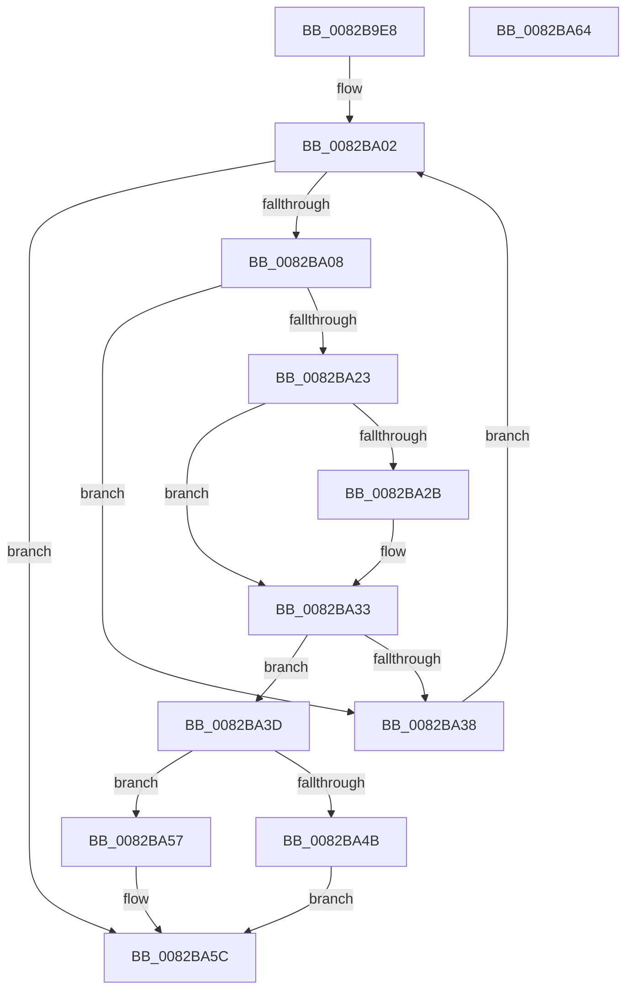

# CmGetDeviceContainerMappedPropertyLocales

- RVA: `0x0082B9E8`–`0x0082BA65` (길이 `125` bytes)
- VA: `0x000000014082B9E8`
- 실행 섹션: `PAGE`
- PDB 이름 있음: `예`; PDB Function 태그: `아니요`
- unwind 정보 RVA: `0x00071750`
- 디코드: `37`개 명령, `125/125` bytes 표시
- 미해석 바이트: `0` (있으면 어셈블리에 `.byte`로 보존)

> 이 문서는 커널 이미지의 기계어와 PDB 기호를 분석해 생성했습니다. 4번과 5번은 함수 원형과 자료형을 바이너리 사용 방식에서 추정한 C 해석이며 원본 소스 복구 결과는 아닙니다.

## 1. Dependencies

- 직접 호출 지점: **0**; 고유 호출 대상: **0**
- 직접 호출자로 확인된 함수: **1**
- RIP 상대 이미지 참조: **1**

### Outgoing calls
- 직접 디코드된 call 명령이 없습니다.

### Direct callers
- [_PnpDispatchDeviceContainer](../8F/_PnpDispatchDeviceContainer_function_008F6880.md) at `0x008F69EB`

### Static image references
- `0x0082BA0B` → RVA `0x000055D0` (`.rdata`; read)

## 2. Other-region calls and transfers

- 다른 실행 섹션으로 향하는 call: **0**
- 별도 외부 분기/꼬리 이동을 확인하지 못했습니다.

## 3. Assembly (complete function range)

```asm
0082B9E8  48 89 5C 24 08                  mov qword ptr [rsp + 8], rbx
0082B9ED  4C 8B 5C 24 38                  mov r11, qword ptr [rsp + 0x38]
0082B9F2  33 DB                           xor ebx, ebx
0082B9F4  4D 8B D1                        mov r10, r9
0082B9F7  B9 16 00 00 C0                  mov ecx, 0xc0000016
0082B9FC  44 8B C3                        mov r8d, ebx
0082B9FF  41 89 1B                        mov dword ptr [r11], ebx
0082BA02  41 83 F8 04                     cmp r8d, 4
0082BA06  73 54                           jae 0x14082ba5c
0082BA08  41 8B C0                        mov eax, r8d
0082BA0B  4C 8D 0D BE 9B 7D FF            lea r9, [rip - 0x826442]
0082BA12  48 03 C0                        add rax, rax
0082BA15  4D 8B 0C C1                     mov r9, qword ptr [r9 + rax*8]
0082BA19  41 8B 41 10                     mov eax, dword ptr [r9 + 0x10]
0082BA1D  41 39 42 10                     cmp dword ptr [r10 + 0x10], eax
0082BA21  75 15                           jne 0x14082ba38
0082BA23  49 8B 12                        mov rdx, qword ptr [r10]
0082BA26  49 2B 11                        sub rdx, qword ptr [r9]
0082BA29  75 08                           jne 0x14082ba33
0082BA2B  49 8B 52 08                     mov rdx, qword ptr [r10 + 8]
0082BA2F  49 2B 51 08                     sub rdx, qword ptr [r9 + 8]
0082BA33  48 85 D2                        test rdx, rdx
0082BA36  74 05                           je 0x14082ba3d
0082BA38  41 FF C0                        inc r8d
0082BA3B  EB C5                           jmp 0x14082ba02
0082BA3D  83 7C 24 30 01                  cmp dword ptr [rsp + 0x30], 1
0082BA42  41 C7 03 01 00 00 00            mov dword ptr [r11], 1
0082BA49  72 0C                           jb 0x14082ba57
0082BA4B  48 8B 44 24 28                  mov rax, qword ptr [rsp + 0x28]
0082BA50  8B CB                           mov ecx, ebx
0082BA52  66 89 18                        mov word ptr [rax], bx
0082BA55  EB 05                           jmp 0x14082ba5c
0082BA57  B9 23 00 00 C0                  mov ecx, 0xc0000023
0082BA5C  48 8B 5C 24 08                  mov rbx, qword ptr [rsp + 8]
0082BA61  8B C1                           mov eax, ecx
0082BA63  C3                              ret
0082BA64  CC                              int3
```

## 4. C-style interpretation (structured pseudocode)

```c
__int64 __fastcall CmGetDeviceContainerMappedPropertyLocales(__int64 a1, __int64 a2, __int64 a3, __int64 a4, __int64 a5, unsigned int a6, __int64 a7)
{
    __int64 result;
    __int64 v_rbx;
    unsigned __int64 v_stack_p8;

    v_stack_p8 = v_rbx;
    v_rbx = 0;
    *(unsigned int *)(a7) = 0;
loc_0082BA02:
    if (0 >= 4) goto loc_0082BA5C;
    result = (0) + (0);
    if ((*(unsigned int *)(a4 + 16)) != ((unsigned int)((unsigned int)(*(unsigned int *)(*(unsigned __int64 *)(v_rip - 8545346 + result * 8) + 16))))) goto loc_0082BA38;
    a2 = (*(unsigned __int64 *)(a4)) - (*(unsigned __int64 *)(*(unsigned __int64 *)(v_rip - 8545346 + result * 8)));
    if (!(condition_is_not_equal)) {
        a2 = *(unsigned __int64 *)(a4 + 8);
        a2 = (a2) - (*(unsigned __int64 *)(*(unsigned __int64 *)(v_rip - 8545346 + result * 8) + 8));
    }
    if (a2 == 0) goto loc_0082BA3D;
loc_0082BA38:
    a3 = (unsigned int)((0) + 1);
    goto loc_0082BA02;
loc_0082BA3D:
    *(unsigned int *)(a7) = 1;
    if (a6 < 1) goto loc_0082BA57;
    *(unsigned __int16 *)(a5) = 0;
    goto loc_0082BA5C;
loc_0082BA57:
loc_0082BA5C:
    return (unsigned int)((unsigned int)((unsigned int)(0xC0000023ULL)));
}
```

## 5. (Beta) C Style

```c
int64_t CmGetDeviceContainerMappedPropertyLocales(int64_t Arg1, int64_t Arg2, int64_t Arg3, void *Arg4, void *Arg5, uint32_t Arg6, void *Arg7)
{
    uint8_t *arg4 = (uint8_t *)Arg4;
    uint8_t *arg5 = (uint8_t *)Arg5;
    uint8_t *arg7 = (uint8_t *)Arg7;

    int64_t result;
    int64_t local_rbx;
    uint64_t v_stack_p8;

    v_stack_p8 = local_rbx;
    local_rbx = 0;
    *(uint32_t *)(arg7) = 0;
loc_0082BA02:
    if (0 >= 4) goto loc_0082BA5C;
    result = (0) + (0);
    if ((*(uint32_t *)(arg4 + 0x10)) != ((uint32_t)((uint32_t)(*(uint32_t *)(*(uint64_t *)(v_rip - 0x826442 + result * 8) + 0x10))))) goto loc_0082BA38;
    Arg2 = (*(uint64_t *)(arg4)) - (*(uint64_t *)(*(uint64_t *)(v_rip - 0x826442 + result * 8)));
    if (!(condition_is_not_equal)) {
        Arg2 = *(uint64_t *)(arg4 + 0x8);
        Arg2 = (Arg2) - (*(uint64_t *)(*(uint64_t *)(v_rip - 0x826442 + result * 8) + 0x8));
    }
    if (Arg2 == 0) goto loc_0082BA3D;
loc_0082BA38:
    Arg3 = (uint32_t)((0) + 1);
    goto loc_0082BA02;
loc_0082BA3D:
    *(uint32_t *)(arg7) = 1;
    if (Arg6 < 1) goto loc_0082BA57;
    *(uint16_t *)(arg5) = 0;
    goto loc_0082BA5C;
loc_0082BA57:
loc_0082BA5C:
    return (uint32_t)((uint32_t)((uint32_t)(0xC0000023ULL)));
}
```

### 관측된 메모리 오프셋

구조체 형식이 확인되지 않은 접근은 인자 기준의 오프셋으로만 기록했습니다.

| 기준 인자 | 오프셋 표현 | 폭 (bit) | 접근 |
|---|---:|---:|---|
| `Arg4` | `+ 0x0` | `64` | `R` |
| `Arg4` | `+ 0x8` | `64` | `R` |
| `Arg4` | `+ 0x10` | `32` | `R` |
| `Arg5` | `+ 0x0` | `16` | `W` |
| `Arg7` | `+ 0x0` | `32` | `W` |

## 6. Execution-region graph

[열기: 2D/3D 그래프와 함수 탐색 컨트롤 패널](../../../control-panel.html?section=page&rva=0x0082B9E8&view=graph)

- 2D 그래프는 위에서 아래로 흐르고, 3D 그래프는 빈 공간을 드래그해 회전합니다. Shift+드래그는 이동, 휠은 확대·축소, 함수 노드 선택은 대상 보고서 이동입니다.

### Static fallback


