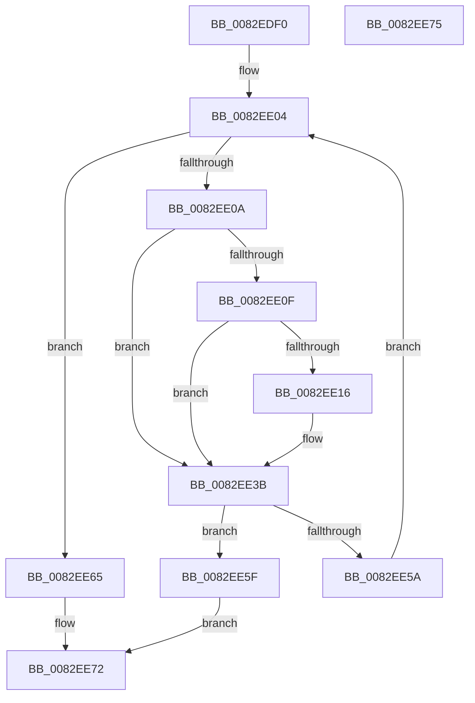

# CmGetDevicePanelMappedPropertyKeys

- RVA: `0x0082EDF0`–`0x0082EE76` (길이 `134` bytes)
- VA: `0x000000014082EDF0`
- 실행 섹션: `PAGE`
- PDB 이름 있음: `예`; PDB Function 태그: `아니요`
- unwind 정보 RVA: `0x000DB714`
- 디코드: `40`개 명령, `134/134` bytes 표시
- 미해석 바이트: `0` (있으면 어셈블리에 `.byte`로 보존)

> 이 문서는 커널 이미지의 기계어와 PDB 기호를 분석해 생성했습니다. 4번과 5번은 함수 원형과 자료형을 바이너리 사용 방식에서 추정한 C 해석이며 원본 소스 복구 결과는 아닙니다.

## 1. Dependencies

- 직접 호출 지점: **0**; 고유 호출 대상: **0**
- 직접 호출자로 확인된 함수: **2**
- RIP 상대 이미지 참조: **1**

### Outgoing calls
- 직접 디코드된 call 명령이 없습니다.

### Direct callers
- [CmDeleteDevicePanelWorker](CmDeleteDevicePanelWorker_function_0082E7EC.md) at `0x0082E889`
- [PnpDispatchDevicePanel](../83/PnpDispatchDevicePanel_function_00831830.md) at `0x008319AF`

### Static image references
- `0x0082EE20` → RVA `0x0000C578` (`.rdata`; read)

## 2. Other-region calls and transfers

- 다른 실행 섹션으로 향하는 call: **0**
- 별도 외부 분기/꼬리 이동을 확인하지 못했습니다.

## 3. Assembly (complete function range)

```asm
0082EDF0  4C 8B 54 24 38                  mov r10, qword ptr [rsp + 0x38]
0082EDF5  45 33 C9                        xor r9d, r9d
0082EDF8  4C 8B 5C 24 28                  mov r11, qword ptr [rsp + 0x28]
0082EDFD  41 83 22 00                     and dword ptr [r10], 0
0082EE01  45 33 C0                        xor r8d, r8d
0082EE04  41 83 F9 03                     cmp r9d, 3
0082EE08  73 5B                           jae 0x14082ee65
0082EE0A  4D 85 DB                        test r11, r11
0082EE0D  74 2C                           je 0x14082ee3b
0082EE0F  44 3B 44 24 30                  cmp r8d, dword ptr [rsp + 0x30]
0082EE14  73 25                           jae 0x14082ee3b
0082EE16  4B 8D 0C 80                     lea rcx, [r8 + r8*4]
0082EE1A  41 8B C1                        mov eax, r9d
0082EE1D  48 03 C0                        add rax, rax
0082EE20  48 8D 15 51 D7 7D FF            lea rdx, [rip - 0x8228af]
0082EE27  48 8B 14 C2                     mov rdx, qword ptr [rdx + rax*8]
0082EE2B  0F 10 02                        movups xmm0, xmmword ptr [rdx]
0082EE2E  41 0F 11 04 8B                  movups xmmword ptr [r11 + rcx*4], xmm0
0082EE33  8B 42 10                        mov eax, dword ptr [rdx + 0x10]
0082EE36  41 89 44 8B 10                  mov dword ptr [r11 + rcx*4 + 0x10], eax
0082EE3B  41 8B 0A                        mov ecx, dword ptr [r10]
0082EE3E  41 83 C8 FF                     or r8d, 0xffffffff
0082EE42  8D 41 01                        lea eax, [rcx + 1]
0082EE45  3B C1                           cmp eax, ecx
0082EE47  44 0F 43 C0                     cmovae r8d, eax
0082EE4B  1B D2                           sbb edx, edx
0082EE4D  81 E2 95 00 00 C0               and edx, 0xc0000095
0082EE53  45 89 02                        mov dword ptr [r10], r8d
0082EE56  3B C1                           cmp eax, ecx
0082EE58  72 05                           jb 0x14082ee5f
0082EE5A  41 FF C1                        inc r9d
0082EE5D  EB A5                           jmp 0x14082ee04
0082EE5F  41 83 22 00                     and dword ptr [r10], 0
0082EE63  EB 0D                           jmp 0x14082ee72
0082EE65  44 39 44 24 30                  cmp dword ptr [rsp + 0x30], r8d
0082EE6A  1B D2                           sbb edx, edx
0082EE6C  81 E2 23 00 00 C0               and edx, 0xc0000023
0082EE72  8B C2                           mov eax, edx
0082EE74  C3                              ret
0082EE75  CC                              int3
```

## 4. C-style interpretation (structured pseudocode)

```c
__int64 __fastcall CmGetDevicePanelMappedPropertyKeys(__int64 a1, __int64 a2, int a3, int a4, __int64 a5, unsigned int a6, __int64 a7)
{
    __int64 result;

    a4 = 0;
    a3 = 0;
loc_0082EE04:
    if (0 >= 3) goto loc_0082EE65;
    if (a5 == 0) goto loc_0082EE3B;
    if (0 < a6) {
        a1 = a3 + a3 * 4;
        result = 0;
        result = (result) + (result);
        a2 = v_rip - 8530095;
        a2 = *(unsigned __int64 *)(a2 + result * 8);
        *(unsigned __int64 *)(a5 + a1 * 4) = v_xmm0;
        result = *(unsigned int *)(a2 + 16);
        *(unsigned int *)(a5 + a1 * 4 + 16) = (unsigned int)(result);
    }
    a3 = (unsigned int)((a3) | (0xFFFFFFFFULL));
    if (((unsigned int)((unsigned int)(*(unsigned int *)(a7)) + 1)) >= ((unsigned int)((unsigned int)(*(unsigned int *)(a7))))) { a3 = (unsigned int)((unsigned int)(*(unsigned int *)(a7)) + 1); }
    a2 = (unsigned int)((a2) & (0xC0000095ULL));
    *(unsigned int *)(a7) = a3;
    if (((unsigned int)((unsigned int)(*(unsigned int *)(a7)) + 1)) < ((unsigned int)((unsigned int)(*(unsigned int *)(a7))))) goto loc_0082EE5F;
    a4 = (unsigned int)((a4) + 1);
    goto loc_0082EE04;
loc_0082EE5F:
    goto loc_0082EE72;
loc_0082EE65:
    a2 = (unsigned int)((a2) & (0xC0000023ULL));
loc_0082EE72:
    return (unsigned int)((unsigned int)(a2));
}
```

## 5. (Beta) C Style

```c
int64_t CmGetDevicePanelMappedPropertyKeys(int64_t Arg1, int64_t Arg2, int32_t Arg3, int32_t Arg4, int64_t Arg5, uint32_t Arg6, void *Arg7)
{
    uint8_t *arg7 = (uint8_t *)Arg7;

    int64_t result;

    Arg4 = 0;
    Arg3 = 0;
loc_0082EE04:
    if (0 >= 3) goto loc_0082EE65;
    if (Arg5 == 0) goto loc_0082EE3B;
    if (0 < Arg6) {
        Arg1 = Arg3 + Arg3 * 4;
        result = 0;
        result = (result) + (result);
        Arg2 = v_rip - 8530095;
        Arg2 = *(uint64_t *)(Arg2 + result * 8);
        *(uint64_t *)(Arg5 + Arg1 * 4) = v_xmm0;
        result = *(uint32_t *)(Arg2 + 0x10);
        *(uint32_t *)(Arg5 + Arg1 * 4 + 0x10) = (uint32_t)(result);
    }
    Arg3 = (uint32_t)((Arg3) | (0xFFFFFFFFULL));
    if (((uint32_t)((uint32_t)(*(uint32_t *)(arg7)) + 1)) >= ((uint32_t)((uint32_t)(*(uint32_t *)(arg7))))) { Arg3 = (uint32_t)((uint32_t)(*(uint32_t *)(arg7)) + 1); }
    Arg2 = (uint32_t)((Arg2) & (0xC0000095ULL));
    *(uint32_t *)(arg7) = Arg3;
    if (((uint32_t)((uint32_t)(*(uint32_t *)(arg7)) + 1)) < ((uint32_t)((uint32_t)(*(uint32_t *)(arg7))))) goto loc_0082EE5F;
    Arg4 = (uint32_t)((Arg4) + 1);
    goto loc_0082EE04;
loc_0082EE5F:
    goto loc_0082EE72;
loc_0082EE65:
    Arg2 = (uint32_t)((Arg2) & (0xC0000023ULL));
loc_0082EE72:
    return (uint32_t)((uint32_t)(Arg2));
}
```

### 관측된 메모리 오프셋

구조체 형식이 확인되지 않은 접근은 인자 기준의 오프셋으로만 기록했습니다.

| 기준 인자 | 오프셋 표현 | 폭 (bit) | 접근 |
|---|---:|---:|---|
| `Arg7` | `+ 0x0` | `32` | `R` |
| `Arg7` | `+ 0x0` | `32` | `R/W` |
| `Arg7` | `+ 0x0` | `32` | `W` |

## 6. Execution-region graph

[열기: 2D/3D 그래프와 함수 탐색 컨트롤 패널](../../../control-panel.html?section=page&rva=0x0082EDF0&view=graph)

- 2D 그래프는 위에서 아래로 흐르고, 3D 그래프는 빈 공간을 드래그해 회전합니다. Shift+드래그는 이동, 휠은 확대·축소, 함수 노드 선택은 대상 보고서 이동입니다.

### Static fallback


