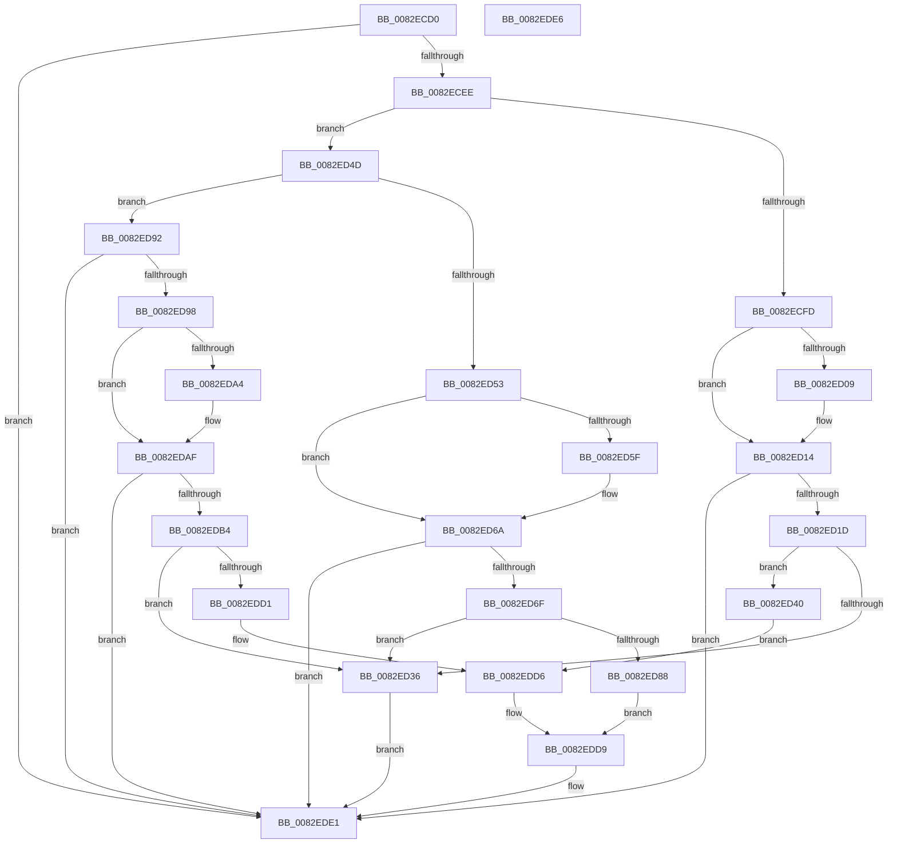

# CmGetDevicePanelMappedProperty

- RVA: `0x0082ECD0`–`0x0082EDE7` (길이 `279` bytes)
- VA: `0x000000014082ECD0`
- 실행 섹션: `PAGE`
- PDB 이름 있음: `예`; PDB Function 태그: `아니요`
- unwind 정보 RVA: `0x0005C788`
- 디코드: `66`개 명령, `279/279` bytes 표시
- 미해석 바이트: `0` (있으면 어셈블리에 `.byte`로 보존)

> 이 문서는 커널 이미지의 기계어와 PDB 기호를 분석해 생성했습니다. 4번과 5번은 함수 원형과 자료형을 바이너리 사용 방식에서 추정한 C 해석이며 원본 소스 복구 결과는 아닙니다.

## 1. Dependencies

- 직접 호출 지점: **1**; 고유 호출 대상: **1**
- 직접 호출자로 확인된 함수: **1**
- RIP 상대 이미지 참조: **6**

### Outgoing calls
- `0x0082EDDC` → [CmSplitDevicePanelId](../AC/CmSplitDevicePanelId_function_00ACEA18.md) (function, `0x00ACEA18`)

### Direct callers
- [PnpDispatchDevicePanel](../83/PnpDispatchDevicePanel_function_00831830.md) at `0x00831904`

### Static image references
- `0x0082ED00` → RVA `0x00021888` (`.rdata`; read)
- `0x0082ED0D` → RVA `0x00021890` (`.rdata`; read)
- `0x0082ED56` → RVA `0x00020C80` (`.rdata`; read)
- `0x0082ED63` → RVA `0x00020C88` (`.rdata`; read)
- `0x0082ED9B` → RVA `0x00022DF8` (`.rdata`; read)
- `0x0082EDA8` → RVA `0x00022E00` (`.rdata`; read)

## 2. Other-region calls and transfers

- 다른 실행 섹션으로 향하는 call: **0**
- 별도 외부 분기/꼬리 이동을 확인하지 못했습니다.

## 3. Assembly (complete function range)

```asm
0082ECD0  48 83 EC 28                     sub rsp, 0x28
0082ECD4  4C 8B 54 24 70                  mov r10, qword ptr [rsp + 0x70]
0082ECD9  4C 8B DA                        mov r11, rdx
0082ECDC  B8 16 00 00 C0                  mov eax, 0xc0000016
0082ECE1  41 83 22 00                     and dword ptr [r10], 0
0082ECE5  4D 85 C9                        test r9, r9
0082ECE8  0F 85 F3 00 00 00               jne 0x14082ede1
0082ECEE  48 8B 4C 24 50                  mov rcx, qword ptr [rsp + 0x50]
0082ECF3  44 8B 41 10                     mov r8d, dword ptr [rcx + 0x10]
0082ECF7  41 83 F8 02                     cmp r8d, 2
0082ECFB  75 50                           jne 0x14082ed4d
0082ECFD  48 8B 11                        mov rdx, qword ptr [rcx]
0082ED00  48 2B 15 81 2B 7F FF            sub rdx, qword ptr [rip - 0x80d47f]
0082ED07  75 0B                           jne 0x14082ed14
0082ED09  48 8B 51 08                     mov rdx, qword ptr [rcx + 8]
0082ED0D  48 2B 15 7C 2B 7F FF            sub rdx, qword ptr [rip - 0x80d484]
0082ED14  48 85 D2                        test rdx, rdx
0082ED17  0F 85 C4 00 00 00               jne 0x14082ede1
0082ED1D  83 7C 24 68 10                  cmp dword ptr [rsp + 0x68], 0x10
0082ED22  48 8B 44 24 58                  mov rax, qword ptr [rsp + 0x58]
0082ED27  C7 00 0D 00 00 00               mov dword ptr [rax], 0xd
0082ED2D  41 C7 02 10 00 00 00            mov dword ptr [r10], 0x10
0082ED34  73 0A                           jae 0x14082ed40
0082ED36  B8 23 00 00 C0                  mov eax, 0xc0000023
0082ED3B  E9 A1 00 00 00                  jmp 0x14082ede1
0082ED40  48 8B 54 24 60                  mov rdx, qword ptr [rsp + 0x60]
0082ED45  45 33 C9                        xor r9d, r9d
0082ED48  E9 89 00 00 00                  jmp 0x14082edd6
0082ED4D  41 83 F8 03                     cmp r8d, 3
0082ED51  75 3F                           jne 0x14082ed92
0082ED53  48 8B 11                        mov rdx, qword ptr [rcx]
0082ED56  48 2B 15 23 1F 7F FF            sub rdx, qword ptr [rip - 0x80e0dd]
0082ED5D  75 0B                           jne 0x14082ed6a
0082ED5F  48 8B 51 08                     mov rdx, qword ptr [rcx + 8]
0082ED63  48 2B 15 1E 1F 7F FF            sub rdx, qword ptr [rip - 0x80e0e2]
0082ED6A  48 85 D2                        test rdx, rdx
0082ED6D  75 72                           jne 0x14082ede1
0082ED6F  83 7C 24 68 04                  cmp dword ptr [rsp + 0x68], 4
0082ED74  48 8B 44 24 58                  mov rax, qword ptr [rsp + 0x58]
0082ED79  C7 00 07 00 00 00               mov dword ptr [rax], 7
0082ED7F  41 C7 02 04 00 00 00            mov dword ptr [r10], 4
0082ED86  72 AE                           jb 0x14082ed36
0082ED88  4C 8B 44 24 60                  mov r8, qword ptr [rsp + 0x60]
0082ED8D  45 33 C9                        xor r9d, r9d
0082ED90  EB 47                           jmp 0x14082edd9
0082ED92  41 83 F8 04                     cmp r8d, 4
0082ED96  75 49                           jne 0x14082ede1
0082ED98  48 8B 11                        mov rdx, qword ptr [rcx]
0082ED9B  48 2B 15 56 40 7F FF            sub rdx, qword ptr [rip - 0x80bfaa]
0082EDA2  75 0B                           jne 0x14082edaf
0082EDA4  48 8B 51 08                     mov rdx, qword ptr [rcx + 8]
0082EDA8  48 2B 15 51 40 7F FF            sub rdx, qword ptr [rip - 0x80bfaf]
0082EDAF  48 85 D2                        test rdx, rdx
0082EDB2  75 2D                           jne 0x14082ede1
0082EDB4  83 7C 24 68 04                  cmp dword ptr [rsp + 0x68], 4
0082EDB9  48 8B 44 24 58                  mov rax, qword ptr [rsp + 0x58]
0082EDBE  C7 00 07 00 00 00               mov dword ptr [rax], 7
0082EDC4  41 C7 02 04 00 00 00            mov dword ptr [r10], 4
0082EDCB  0F 82 65 FF FF FF               jb 0x14082ed36
0082EDD1  4C 8B 4C 24 60                  mov r9, qword ptr [rsp + 0x60]
0082EDD6  45 33 C0                        xor r8d, r8d
0082EDD9  49 8B CB                        mov rcx, r11
0082EDDC  E8 37 FC 29 00                  call 0x140acea18
0082EDE1  48 83 C4 28                     add rsp, 0x28
0082EDE5  C3                              ret
0082EDE6  CC                              int3
```

## 4. C-style interpretation (structured pseudocode)

```c
__int64 __fastcall CmGetDevicePanelMappedProperty(__int64 a1, __int64 a2, __int64 a3, __int64 a4, __int64 a5, __int64 a6, __int64 a7, unsigned int a8, __int64 a9)
{
    __int64 result;
    __int64 v_rsp;

    v_rsp = (v_rsp) - (40);
    if (a4 != 0) goto loc_0082EDE1;
    if (((unsigned int)((unsigned int)(*(unsigned int *)(a5 + 16)))) != 2) goto loc_0082ED4D;
    a2 = (*(unsigned __int64 *)(a5)) - (*(unsigned __int64 *)(v_rip - 8443007));
    if (!(condition_is_not_equal)) {
        a2 = *(unsigned __int64 *)(a5 + 8);
        a2 = (a2) - (*(unsigned __int64 *)(v_rip - 8443012));
    }
    if (a2 != 0) goto loc_0082EDE1;
    *(unsigned int *)(a6) = 13;
    *(unsigned int *)(a9) = 16;
    if (a8 >= 16) goto loc_0082ED40;
loc_0082ED36:
    goto loc_0082EDE1;
loc_0082ED40:
    a4 = 0;
    goto loc_0082EDD6;
loc_0082ED4D:
    if (((unsigned int)((unsigned int)(*(unsigned int *)(a5 + 16)))) != 3) goto loc_0082ED92;
    a2 = (*(unsigned __int64 *)(a5)) - (*(unsigned __int64 *)(v_rip - 8446173));
    if (!(condition_is_not_equal)) {
        a2 = *(unsigned __int64 *)(a5 + 8);
        a2 = (a2) - (*(unsigned __int64 *)(v_rip - 8446178));
    }
    if (a2 != 0) goto loc_0082EDE1;
    *(unsigned int *)(a6) = 7;
    *(unsigned int *)(a9) = 4;
    if (a8 < 4) goto loc_0082ED36;
    a4 = 0;
    goto loc_0082EDD9;
loc_0082ED92:
    if (((unsigned int)(a7)) != 4) goto loc_0082EDE1;
    a2 = (*(unsigned __int64 *)(a5)) - (*(unsigned __int64 *)(v_rip - 8437674));
    if (!(condition_is_not_equal)) {
        a2 = *(unsigned __int64 *)(a5 + 8);
        a2 = (a2) - (*(unsigned __int64 *)(v_rip - 8437679));
    }
    if (a2 != 0) goto loc_0082EDE1;
    *(unsigned int *)(a6) = 7;
    *(unsigned int *)(a9) = 4;
    if (a8 < 4) goto loc_0082ED36;
loc_0082EDD6:
    a3 = 0;
loc_0082EDD9:
    result = CmSplitDevicePanelId(a2, a2, a3, a7);
loc_0082EDE1:
    v_rsp = (v_rsp) + (40);
    return result;
}
```

## 5. (Beta) C Style

```c
int64_t CmGetDevicePanelMappedProperty(int64_t Arg1, int64_t Arg2, int64_t Arg3, int64_t Arg4, void *Arg5, void *Arg6, int64_t Arg7, uint32_t Arg8, void *Arg9)
{
    uint8_t *arg5 = (uint8_t *)Arg5;
    uint8_t *arg6 = (uint8_t *)Arg6;
    uint8_t *arg9 = (uint8_t *)Arg9;

    int64_t result;
    int64_t local_rsp;

    local_rsp = (local_rsp) - (40);
    if (Arg4 != 0) goto loc_0082EDE1;
    if (((uint32_t)((uint32_t)(*(uint32_t *)(arg5 + 0x10)))) != 2) goto loc_0082ED4D;
    Arg2 = (*(uint64_t *)(arg5)) - (*(uint64_t *)(v_rip - 0x80D47F));
    if (!(condition_is_not_equal)) {
        Arg2 = *(uint64_t *)(arg5 + 0x8);
        Arg2 = (Arg2) - (*(uint64_t *)(v_rip - 0x80D484));
    }
    if (Arg2 != 0) goto loc_0082EDE1;
    *(uint32_t *)(arg6) = 13;
    *(uint32_t *)(arg9) = 16;
    if (Arg8 >= 16) goto loc_0082ED40;
loc_0082ED36:
    goto loc_0082EDE1;
loc_0082ED40:
    Arg4 = 0;
    goto loc_0082EDD6;
loc_0082ED4D:
    if (((uint32_t)((uint32_t)(*(uint32_t *)(arg5 + 0x10)))) != 3) goto loc_0082ED92;
    Arg2 = (*(uint64_t *)(arg5)) - (*(uint64_t *)(v_rip - 0x80E0DD));
    if (!(condition_is_not_equal)) {
        Arg2 = *(uint64_t *)(arg5 + 0x8);
        Arg2 = (Arg2) - (*(uint64_t *)(v_rip - 0x80E0E2));
    }
    if (Arg2 != 0) goto loc_0082EDE1;
    *(uint32_t *)(arg6) = 7;
    *(uint32_t *)(arg9) = 4;
    if (Arg8 < 4) goto loc_0082ED36;
    Arg4 = 0;
    goto loc_0082EDD9;
loc_0082ED92:
    if (((uint32_t)(Arg7)) != 4) goto loc_0082EDE1;
    Arg2 = (*(uint64_t *)(arg5)) - (*(uint64_t *)(v_rip - 0x80BFAA));
    if (!(condition_is_not_equal)) {
        Arg2 = *(uint64_t *)(arg5 + 0x8);
        Arg2 = (Arg2) - (*(uint64_t *)(v_rip - 0x80BFAF));
    }
    if (Arg2 != 0) goto loc_0082EDE1;
    *(uint32_t *)(arg6) = 7;
    *(uint32_t *)(arg9) = 4;
    if (Arg8 < 4) goto loc_0082ED36;
loc_0082EDD6:
    Arg3 = 0;
loc_0082EDD9:
    result = CmSplitDevicePanelId(Arg2, Arg2, Arg3, Arg7);
loc_0082EDE1:
    local_rsp = (local_rsp) + (40);
    return result;
}
```

### 관측된 메모리 오프셋

구조체 형식이 확인되지 않은 접근은 인자 기준의 오프셋으로만 기록했습니다.

| 기준 인자 | 오프셋 표현 | 폭 (bit) | 접근 |
|---|---:|---:|---|
| `Arg5` | `+ 0x0` | `64` | `R` |
| `Arg5` | `+ 0x8` | `64` | `R` |
| `Arg5` | `+ 0x10` | `32` | `R` |
| `Arg6` | `+ 0x0` | `32` | `W` |
| `Arg9` | `+ 0x0` | `32` | `R/W` |
| `Arg9` | `+ 0x0` | `32` | `W` |

## 6. Execution-region graph

[열기: 2D/3D 그래프와 함수 탐색 컨트롤 패널](../../../control-panel.html?section=page&rva=0x0082ECD0&view=graph)

- 2D 그래프는 위에서 아래로 흐르고, 3D 그래프는 빈 공간을 드래그해 회전합니다. Shift+드래그는 이동, 휠은 확대·축소, 함수 노드 선택은 대상 보고서 이동입니다.

### Static fallback


