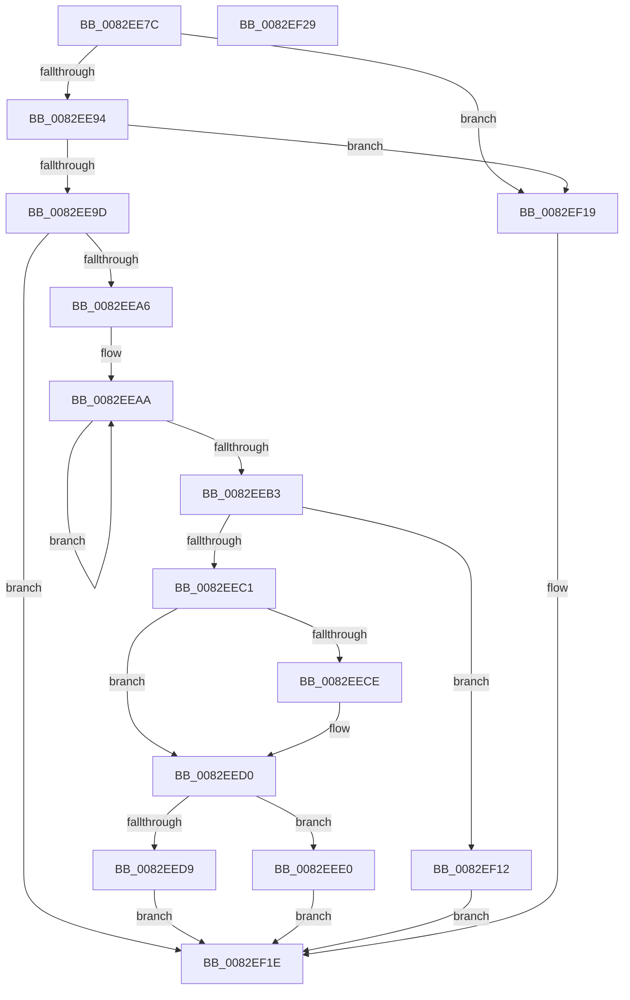

# CmGetDevicePanelRegKeyPath

- RVA: `0x0082EE7C`–`0x0082EF2A` (길이 `174` bytes)
- VA: `0x000000014082EE7C`
- 실행 섹션: `PAGE`
- PDB 이름 있음: `예`; PDB Function 태그: `아니요`
- unwind 정보 RVA: `0x00065960`
- 디코드: `46`개 명령, `174/174` bytes 표시
- 미해석 바이트: `0` (있으면 어셈블리에 `.byte`로 보존)

> 이 문서는 커널 이미지의 기계어와 PDB 기호를 분석해 생성했습니다. 4번과 5번은 함수 원형과 자료형을 바이너리 사용 방식에서 추정한 C 해석이며 원본 소스 복구 결과는 아닙니다.

## 1. Dependencies

- 직접 호출 지점: **2**; 고유 호출 대상: **2**
- 직접 호출자로 확인된 함수: **3**
- RIP 상대 이미지 참조: **1**

### Outgoing calls
- `0x0082EE9D` → [CmValidateDevicePanelName](CmValidateDevicePanelName_function_0082F65C.md) (function, `0x0082F65C`)
- `0x0082EF0B` → [RtlStringCchPrintfExW](../../text/42/RtlStringCchPrintfExW_function_0042B390.md) (function, `0x0042B390`)

### Direct callers
- [CmDeleteDevicePanelRegKeyWorker](CmDeleteDevicePanelRegKeyWorker_function_0082E554.md) at `0x0082E5EE`
- [sub_00B2BA5A](../B2/Unknown_function_00B2BA5A.md) at `0x00B2BA76`
- [sub_00B47E86](../B4/Unknown_function_00B47E86.md) at `0x00B47EA2`

### Static image references
- `0x0082EEE7` → RVA `0x00B0D810` (` ?? ::NNGAKEGL::`string'`; read)

## 2. Other-region calls and transfers

- 다른 실행 섹션으로 향하는 call: **1**
  - `0x0082EF0B` → [RtlStringCchPrintfExW](../../text/42/RtlStringCchPrintfExW_function_0042B390.md) (`PAGE` → `.text`)
- 별도 외부 분기/꼬리 이동을 확인하지 못했습니다.

## 3. Assembly (complete function range)

```asm
0082EE7C  48 89 5C 24 08                  mov qword ptr [rsp + 8], rbx
0082EE81  57                              push rdi
0082EE82  48 83 EC 40                     sub rsp, 0x40
0082EE86  33 FF                           xor edi, edi
0082EE88  48 8B DA                        mov rbx, rdx
0082EE8B  45 85 C0                        test r8d, r8d
0082EE8E  0F 84 85 00 00 00               je 0x14082ef19
0082EE94  41 F7 C0 9F FE FF FF            test r8d, 0xfffffe9f
0082EE9B  75 7C                           jne 0x14082ef19
0082EE9D  E8 BA 07 00 00                  call 0x14082f65c
0082EEA2  85 C0                           test eax, eax
0082EEA4  78 78                           js 0x14082ef1e
0082EEA6  48 83 C8 FF                     or rax, 0xffffffffffffffff
0082EEAA  48 FF C0                        inc rax
0082EEAD  66 39 3C 43                     cmp word ptr [rbx + rax*2], di
0082EEB1  75 F7                           jne 0x14082eeaa
0082EEB3  48 83 C0 2F                     add rax, 0x2f
0082EEB7  B9 FF FF FF FF                  mov ecx, 0xffffffff
0082EEBC  48 3B C1                        cmp rax, rcx
0082EEBF  77 51                           ja 0x14082ef12
0082EEC1  48 8B 8C 24 88 00 00 00         mov rcx, qword ptr [rsp + 0x88]
0082EEC9  48 85 C9                        test rcx, rcx
0082EECC  74 02                           je 0x14082eed0
0082EECE  89 01                           mov dword ptr [rcx], eax
0082EED0  3B 84 24 80 00 00 00            cmp eax, dword ptr [rsp + 0x80]
0082EED7  76 07                           jbe 0x14082eee0
0082EED9  B8 23 00 00 C0                  mov eax, 0xc0000023
0082EEDE  EB 3E                           jmp 0x14082ef1e
0082EEE0  8B 94 24 80 00 00 00            mov edx, dword ptr [rsp + 0x80]
0082EEE7  48 8D 05 22 E9 2D 00            lea rax, [rip + 0x2de922]
0082EEEE  48 8B 4C 24 78                  mov rcx, qword ptr [rsp + 0x78]
0082EEF3  45 33 C9                        xor r9d, r9d
0082EEF6  48 89 5C 24 30                  mov qword ptr [rsp + 0x30], rbx
0082EEFB  45 33 C0                        xor r8d, r8d
0082EEFE  48 89 44 24 28                  mov qword ptr [rsp + 0x28], rax
0082EF03  C7 44 24 20 00 08 00 00         mov dword ptr [rsp + 0x20], 0x800
0082EF0B  E8 80 C4 BF FF                  call 0x14042b390
0082EF10  EB 0C                           jmp 0x14082ef1e
0082EF12  B8 95 00 00 C0                  mov eax, 0xc0000095
0082EF17  EB 05                           jmp 0x14082ef1e
0082EF19  B8 0D 00 00 C0                  mov eax, 0xc000000d
0082EF1E  48 8B 5C 24 50                  mov rbx, qword ptr [rsp + 0x50]
0082EF23  48 83 C4 40                     add rsp, 0x40
0082EF27  5F                              pop rdi
0082EF28  C3                              ret
0082EF29  CC                              int3
```

## 4. C-style interpretation (structured pseudocode)

```c
__int64 __fastcall CmGetDevicePanelRegKeyPath(__int64 a1, __int64 a2, int a3, int a4, __int64 a5, __int64 a6, unsigned int a7, __int64 a8)
{
    __int64 result;
    __int64 v_rdi;
    __int64 v_rsp;
    unsigned __int64 v_stack_m18;
    unsigned __int64 v_stack_m20;
    unsigned int v_stack_m28;
    unsigned __int64 v_stack_p8;

    v_stack_p8 = v_rbx;
    v_rsp = (v_rsp) - (64);
    v_rdi = 0;
    if (a3 == 0) goto loc_0082EF19;
    if (((a3) & (0xFFFFFE9FULL)) != 0) goto loc_0082EF19;
    result = CmValidateDevicePanelName(a1, a2, a3, a4);
    if (sign_flag) goto loc_0082EF1E;
    result = (result) | (-1);
loc_0082EEAA:
    result = (result) + 1;
    if ((*(unsigned __int16 *)(a2 + result * 2)) != 0) goto loc_0082EEAA;
    result = (result) + (47);
    if (result > ((unsigned int)(0xFFFFFFFFULL))) goto loc_0082EF12;
    if (a8 != 0) {
        *(unsigned int *)(a8) = (unsigned int)(result);
    }
    if (((unsigned int)(result)) <= a7) goto loc_0082EEE0;
    goto loc_0082EF1E;
loc_0082EEE0:
    a4 = 0;
    v_stack_m18 = a2;
    a3 = 0;
    v_stack_m20 = v_rip + 3008802;
    v_stack_m28 = 0x800ULL;
    result = RtlStringCchPrintfExW(a6, (unsigned int)(a7), a3, a4);
    goto loc_0082EF1E;
loc_0082EF12:
    goto loc_0082EF1E;
loc_0082EF19:
loc_0082EF1E:
    v_rsp = (v_rsp) + (64);
    return (unsigned int)(0xC000000DULL);
}
```

## 5. (Beta) C Style

```c
int64_t CmGetDevicePanelRegKeyPath(int64_t Arg1, void *Arg2, int32_t Arg3, int32_t Arg4, uint64_t Arg5, int64_t Arg6, uint32_t Arg7, int64_t Arg8)
{
    uint8_t *arg2 = (uint8_t *)Arg2;

    int64_t result;
    int64_t local_rdi;
    int64_t local_rsp;
    uint64_t v_stack_m18;
    uint64_t v_stack_m20;
    uint32_t v_stack_m28;
    uint64_t v_stack_p8;

    v_stack_p8 = local_rbx;
    local_rsp = (local_rsp) - (64);
    local_rdi = 0;
    if (Arg3 == 0) goto loc_0082EF19;
    if (((Arg3) & (0xFFFFFE9FULL)) != 0) goto loc_0082EF19;
    result = CmValidateDevicePanelName(Arg1, Arg2, Arg3, Arg4);
    if (sign_flag) goto loc_0082EF1E;
    result = (result) | (-1);
loc_0082EEAA:
    result = (result) + 1;
    if ((*(uint16_t *)(arg2 + result * 2)) != 0) goto loc_0082EEAA;
    result = (result) + (47);
    if (result > ((uint32_t)(0xFFFFFFFFULL))) goto loc_0082EF12;
    if (Arg8 != 0) {
        *(uint32_t *)(Arg8) = (uint32_t)(result);
    }
    if (((uint32_t)(result)) <= Arg7) goto loc_0082EEE0;
    goto loc_0082EF1E;
loc_0082EEE0:
    Arg4 = 0;
    v_stack_m18 = Arg2;
    Arg3 = 0;
    v_stack_m20 = v_rip + 3008802;
    v_stack_m28 = 0x800ULL;
    result = RtlStringCchPrintfExW(Arg6, (uint32_t)(Arg7), Arg3, Arg4);
    goto loc_0082EF1E;
loc_0082EF12:
    goto loc_0082EF1E;
loc_0082EF19:
loc_0082EF1E:
    local_rsp = (local_rsp) + (64);
    return (uint32_t)(0xC000000DULL);
}
```

### 관측된 메모리 오프셋

구조체 형식이 확인되지 않은 접근은 인자 기준의 오프셋으로만 기록했습니다.

| 기준 인자 | 오프셋 표현 | 폭 (bit) | 접근 |
|---|---:|---:|---|
| `Arg2` | `+ 0x0 + rax*2` | `16` | `R` |

## 6. Execution-region graph

[열기: 2D/3D 그래프와 함수 탐색 컨트롤 패널](../../../control-panel.html?section=page&rva=0x0082EE7C&view=graph)

- 2D 그래프는 위에서 아래로 흐르고, 3D 그래프는 빈 공간을 드래그해 회전합니다. Shift+드래그는 이동, 휠은 확대·축소, 함수 노드 선택은 대상 보고서 이동입니다.

### Static fallback


