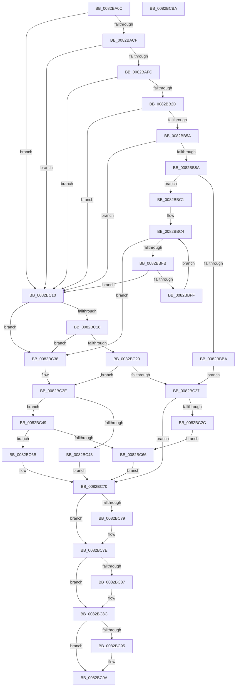

# CmGetDevicesInBaseContainerList

- RVA: `0x0082BA6C`–`0x0082BCBB` (길이 `591` bytes)
- VA: `0x000000014082BA6C`
- 실행 섹션: `PAGE`
- PDB 이름 있음: `예`; PDB Function 태그: `아니요`
- unwind 정보 RVA: `0x000AD928`
- 디코드: `166`개 명령, `591/591` bytes 표시
- 미해석 바이트: `0` (있으면 어셈블리에 `.byte`로 보존)

> 이 문서는 커널 이미지의 기계어와 PDB 기호를 분석해 생성했습니다. 4번과 5번은 함수 원형과 자료형을 바이너리 사용 방식에서 추정한 C 해석이며 원본 소스 복구 결과는 아닙니다.

## 1. Dependencies

- 직접 호출 지점: **12**; 고유 호출 대상: **7**
- 직접 호출자로 확인된 함수: **1**
- RIP 상대 이미지 참조: **1**

### Outgoing calls
- `0x0082BAC0` → [_PnpCtxGetCachedContextBaseKey](../8E/_PnpCtxGetCachedContextBaseKey_function_008EFB2C.md) (function, `0x008EFB2C`)
- `0x0082BAED` → [PnpCtxRegOpenKey](../8E/PnpCtxRegOpenKey_function_008EF7B8.md) (function, `0x008EF7B8`)
- `0x0082BB1E` → [PnpCtxRegOpenKey](../8E/PnpCtxRegOpenKey_function_008EF7B8.md) (function, `0x008EF7B8`)
- `0x0082BB4B` → [PnpCtxRegOpenKey](../8E/PnpCtxRegOpenKey_function_008EF7B8.md) (function, `0x008EF7B8`)
- `0x0082BB7B` → [PnpCtxRegQueryInfoKey](../99/PnpCtxRegQueryInfoKey_function_009945FC.md) (function, `0x009945FC`)
- `0x0082BBAA` → [ExAllocatePool2](../../poolcode/B8/ExAllocatePool2_function_00B820F0.md) (function, `0x00B820F0`)
- `0x0082BBED` → [PnpCtxRegEnumValue](../99/PnpCtxRegEnumValue_function_0099364C.md) (function, `0x0099364C`)
- `0x0082BC31` → [ExFreePoolWithTag](../../poolcode/B8/ExFreePoolWithTag_function_00B82870.md) (function, `0x00B82870`)
- `0x0082BC59` → [ExAllocatePool2](../../poolcode/B8/ExAllocatePool2_function_00B820F0.md) (function, `0x00B820F0`)
- `0x0082BC79` → [ZwClose](../../text/6A/ZwClose_function_006AD2B0.md) (function, `0x006AD2B0`)
- `0x0082BC87` → [ZwClose](../../text/6A/ZwClose_function_006AD2B0.md) (function, `0x006AD2B0`)
- `0x0082BC95` → [ZwClose](../../text/6A/ZwClose_function_006AD2B0.md) (function, `0x006AD2B0`)

### Direct callers
- [CmMoveBaseContainer](CmMoveBaseContainer_function_0082BE5C.md) at `0x0082BEA0`

### Static image references
- `0x0082BB09` → RVA `0x00B0D7D0` (` ?? ::NNGAKEGL::`string'`; read)

## 2. Other-region calls and transfers

- 다른 실행 섹션으로 향하는 call: **6**
  - `0x0082BBAA` → [ExAllocatePool2](../../poolcode/B8/ExAllocatePool2_function_00B820F0.md) (`PAGE` → `POOLCODE`)
  - `0x0082BC31` → [ExFreePoolWithTag](../../poolcode/B8/ExFreePoolWithTag_function_00B82870.md) (`PAGE` → `POOLCODE`)
  - `0x0082BC59` → [ExAllocatePool2](../../poolcode/B8/ExAllocatePool2_function_00B820F0.md) (`PAGE` → `POOLCODE`)
  - `0x0082BC79` → [ZwClose](../../text/6A/ZwClose_function_006AD2B0.md) (`PAGE` → `.text`)
  - `0x0082BC87` → [ZwClose](../../text/6A/ZwClose_function_006AD2B0.md) (`PAGE` → `.text`)
  - `0x0082BC95` → [ZwClose](../../text/6A/ZwClose_function_006AD2B0.md) (`PAGE` → `.text`)
- 별도 외부 분기/꼬리 이동을 확인하지 못했습니다.

## 3. Assembly (complete function range)

```asm
0082BA6C  48 89 5C 24 08                  mov qword ptr [rsp + 8], rbx
0082BA71  48 89 74 24 10                  mov qword ptr [rsp + 0x10], rsi
0082BA76  48 89 7C 24 18                  mov qword ptr [rsp + 0x18], rdi
0082BA7B  55                              push rbp
0082BA7C  41 54                           push r12
0082BA7E  41 55                           push r13
0082BA80  41 56                           push r14
0082BA82  41 57                           push r15
0082BA84  48 8B EC                        mov rbp, rsp
0082BA87  48 83 EC 70                     sub rsp, 0x70
0082BA8B  45 33 ED                        xor r13d, r13d
0082BA8E  4D 8B E0                        mov r12, r8
0082BA91  4C 8B FA                        mov r15, rdx
0082BA94  4C 89 6D F0                     mov qword ptr [rbp - 0x10], r13
0082BA98  4C 8D 45 F0                     lea r8, [rbp - 0x10]
0082BA9C  4C 89 6D E8                     mov qword ptr [rbp - 0x18], r13
0082BAA0  49 8B F1                        mov rsi, r9
0082BAA3  4C 89 6D E0                     mov qword ptr [rbp - 0x20], r13
0082BAA7  41 8D 55 0A                     lea edx, [r13 + 0xa]
0082BAAB  4C 89 6D D8                     mov qword ptr [rbp - 0x28], r13
0082BAAF  4C 8B F1                        mov r14, rcx
0082BAB2  44 89 6D D0                     mov dword ptr [rbp - 0x30], r13d
0082BAB6  41 8B FD                        mov edi, r13d
0082BAB9  44 89 6D 48                     mov dword ptr [rbp + 0x48], r13d
0082BABD  4D 89 29                        mov qword ptr [r9], r13
0082BAC0  E8 67 40 0C 00                  call 0x1408efb2c
0082BAC5  8B D8                           mov ebx, eax
0082BAC7  85 C0                           test eax, eax
0082BAC9  0F 88 41 01 00 00               js 0x14082bc10
0082BACF  48 8B 55 F0                     mov rdx, qword ptr [rbp - 0x10]
0082BAD3  48 8D 45 E8                     lea rax, [rbp - 0x18]
0082BAD7  48 89 44 24 28                  mov qword ptr [rsp + 0x28], rax
0082BADC  45 33 C9                        xor r9d, r9d
0082BADF  4D 8B C7                        mov r8, r15
0082BAE2  C7 44 24 20 01 00 00 00         mov dword ptr [rsp + 0x20], 1
0082BAEA  49 8B CE                        mov rcx, r14
0082BAED  E8 C6 3C 0C 00                  call 0x1408ef7b8
0082BAF2  8B D8                           mov ebx, eax
0082BAF4  85 C0                           test eax, eax
0082BAF6  0F 88 14 01 00 00               js 0x14082bc10
0082BAFC  48 8B 55 E8                     mov rdx, qword ptr [rbp - 0x18]
0082BB00  48 8D 45 E0                     lea rax, [rbp - 0x20]
0082BB04  48 89 44 24 28                  mov qword ptr [rsp + 0x28], rax
0082BB09  4C 8D 05 C0 1C 2E 00            lea r8, [rip + 0x2e1cc0]
0082BB10  45 33 C9                        xor r9d, r9d
0082BB13  C7 44 24 20 01 00 00 00         mov dword ptr [rsp + 0x20], 1
0082BB1B  49 8B CE                        mov rcx, r14
0082BB1E  E8 95 3C 0C 00                  call 0x1408ef7b8
0082BB23  8B D8                           mov ebx, eax
0082BB25  85 C0                           test eax, eax
0082BB27  0F 88 E3 00 00 00               js 0x14082bc10
0082BB2D  48 8B 55 E0                     mov rdx, qword ptr [rbp - 0x20]
0082BB31  48 8D 45 D8                     lea rax, [rbp - 0x28]
0082BB35  48 89 44 24 28                  mov qword ptr [rsp + 0x28], rax
0082BB3A  45 33 C9                        xor r9d, r9d
0082BB3D  4D 8B C4                        mov r8, r12
0082BB40  C7 44 24 20 03 00 00 00         mov dword ptr [rsp + 0x20], 3
0082BB48  49 8B CE                        mov rcx, r14
0082BB4B  E8 68 3C 0C 00                  call 0x1408ef7b8
0082BB50  8B D8                           mov ebx, eax
0082BB52  85 C0                           test eax, eax
0082BB54  0F 88 B6 00 00 00               js 0x14082bc10
0082BB5A  48 8B 55 D8                     mov rdx, qword ptr [rbp - 0x28]
0082BB5E  48 8D 45 48                     lea rax, [rbp + 0x48]
0082BB62  4C 89 6C 24 30                  mov qword ptr [rsp + 0x30], r13
0082BB67  45 33 C9                        xor r9d, r9d
0082BB6A  48 89 44 24 28                  mov qword ptr [rsp + 0x28], rax
0082BB6F  45 33 C0                        xor r8d, r8d
0082BB72  48 8D 45 D0                     lea rax, [rbp - 0x30]
0082BB76  48 89 44 24 20                  mov qword ptr [rsp + 0x20], rax
0082BB7B  E8 7C 8A 16 00                  call 0x1409945fc
0082BB80  8B D8                           mov ebx, eax
0082BB82  85 C0                           test eax, eax
0082BB84  0F 88 86 00 00 00               js 0x14082bc10
0082BB8A  44 8B 75 48                     mov r14d, dword ptr [rbp + 0x48]
0082BB8E  B9 00 01 00 00                  mov ecx, 0x100
0082BB93  41 FF C6                        inc r14d
0082BB96  41 B8 50 4E 50 52               mov r8d, 0x52504e50
0082BB9C  44 0F AF 75 D0                  imul r14d, dword ptr [rbp - 0x30]
0082BBA1  41 FF C6                        inc r14d
0082BBA4  41 8B D6                        mov edx, r14d
0082BBA7  48 03 D2                        add rdx, rdx
0082BBAA  E8 41 65 35 00                  call 0x140b820f0
0082BBAF  48 89 06                        mov qword ptr [rsi], rax
0082BBB2  48 8B F8                        mov rdi, rax
0082BBB5  48 85 C0                        test rax, rax
0082BBB8  75 07                           jne 0x14082bbc1
0082BBBA  BB 17 00 00 C0                  mov ebx, 0xc0000017
0082BBBF  EB 66                           jmp 0x14082bc27
0082BBC1  45 8B FD                        mov r15d, r13d
0082BBC4  48 8B 55 D8                     mov rdx, qword ptr [rbp - 0x28]
0082BBC8  41 8D 46 FF                     lea eax, [r14 - 1]
0082BBCC  4C 89 6C 24 38                  mov qword ptr [rsp + 0x38], r13
0082BBD1  4C 8B CF                        mov r9, rdi
0082BBD4  89 45 48                        mov dword ptr [rbp + 0x48], eax
0082BBD7  45 8B C7                        mov r8d, r15d
0082BBDA  48 8D 45 48                     lea rax, [rbp + 0x48]
0082BBDE  4C 89 6C 24 30                  mov qword ptr [rsp + 0x30], r13
0082BBE3  4C 89 6C 24 28                  mov qword ptr [rsp + 0x28], r13
0082BBE8  48 89 44 24 20                  mov qword ptr [rsp + 0x20], rax
0082BBED  E8 5A 7A 16 00                  call 0x14099364c
0082BBF2  8B D8                           mov ebx, eax
0082BBF4  3D 1A 00 00 80                  cmp eax, 0x8000001a
0082BBF9  74 3D                           je 0x14082bc38
0082BBFB  85 C0                           test eax, eax
0082BBFD  78 11                           js 0x14082bc10
0082BBFF  8B 4D 48                        mov ecx, dword ptr [rbp + 0x48]
0082BC02  FF C1                           inc ecx
0082BC04  44 2B F1                        sub r14d, ecx
0082BC07  41 FF C7                        inc r15d
0082BC0A  48 8D 3C 4F                     lea rdi, [rdi + rcx*2]
0082BC0E  EB B4                           jmp 0x14082bbc4
0082BC10  81 FB 34 00 00 C0               cmp ebx, 0xc0000034
0082BC16  74 20                           je 0x14082bc38
0082BC18  81 FB 7C 01 00 C0               cmp ebx, 0xc000017c
0082BC1E  74 18                           je 0x14082bc38
0082BC20  48 8B 06                        mov rax, qword ptr [rsi]
0082BC23  85 DB                           test ebx, ebx
0082BC25  79 17                           jns 0x14082bc3e
0082BC27  48 85 C0                        test rax, rax
0082BC2A  74 44                           je 0x14082bc70
0082BC2C  33 D2                           xor edx, edx
0082BC2E  48 8B C8                        mov rcx, rax
0082BC31  E8 3A 6C 35 00                  call 0x140b82870
0082BC36  EB 2E                           jmp 0x14082bc66
0082BC38  48 8B 06                        mov rax, qword ptr [rsi]
0082BC3B  41 8B DD                        mov ebx, r13d
0082BC3E  48 85 C0                        test rax, rax
0082BC41  74 06                           je 0x14082bc49
0082BC43  66 44 89 2F                     mov word ptr [rdi], r13w
0082BC47  EB 27                           jmp 0x14082bc70
0082BC49  BA 02 00 00 00                  mov edx, 2
0082BC4E  B9 00 01 00 00                  mov ecx, 0x100
0082BC53  41 B8 50 4E 50 52               mov r8d, 0x52504e50
0082BC59  E8 92 64 35 00                  call 0x140b820f0
0082BC5E  48 89 06                        mov qword ptr [rsi], rax
0082BC61  48 85 C0                        test rax, rax
0082BC64  74 05                           je 0x14082bc6b
0082BC66  4C 89 2E                        mov qword ptr [rsi], r13
0082BC69  EB 05                           jmp 0x14082bc70
0082BC6B  BB 17 00 00 C0                  mov ebx, 0xc0000017
0082BC70  48 8B 4D D8                     mov rcx, qword ptr [rbp - 0x28]
0082BC74  48 85 C9                        test rcx, rcx
0082BC77  74 05                           je 0x14082bc7e
0082BC79  E8 32 16 E8 FF                  call 0x1406ad2b0
0082BC7E  48 8B 4D E0                     mov rcx, qword ptr [rbp - 0x20]
0082BC82  48 85 C9                        test rcx, rcx
0082BC85  74 05                           je 0x14082bc8c
0082BC87  E8 24 16 E8 FF                  call 0x1406ad2b0
0082BC8C  48 8B 4D E8                     mov rcx, qword ptr [rbp - 0x18]
0082BC90  48 85 C9                        test rcx, rcx
0082BC93  74 05                           je 0x14082bc9a
0082BC95  E8 16 16 E8 FF                  call 0x1406ad2b0
0082BC9A  4C 8D 5C 24 70                  lea r11, [rsp + 0x70]
0082BC9F  8B C3                           mov eax, ebx
0082BCA1  49 8B 5B 30                     mov rbx, qword ptr [r11 + 0x30]
0082BCA5  49 8B 73 38                     mov rsi, qword ptr [r11 + 0x38]
0082BCA9  49 8B 7B 40                     mov rdi, qword ptr [r11 + 0x40]
0082BCAD  49 8B E3                        mov rsp, r11
0082BCB0  41 5F                           pop r15
0082BCB2  41 5E                           pop r14
0082BCB4  41 5D                           pop r13
0082BCB6  41 5C                           pop r12
0082BCB8  5D                              pop rbp
0082BCB9  C3                              ret
0082BCBA  CC                              int3
```

## 4. C-style interpretation (structured pseudocode)

```c
__int64 __fastcall CmGetDevicesInBaseContainerList(__int64 a1, __int64 a2, __int64 a3, __int64 a4)
{
    __int64 result;
    __int64 v_r13;
    __int64 v_r14;
    __int64 v_r15;
    __int64 v_rsp;
    unsigned __int64 v_stack_m28;
    unsigned __int64 v_stack_m38;
    unsigned __int64 v_stack_m40;
    unsigned __int64 v_stack_m48;
    unsigned __int64 v_stack_m50;
    unsigned int v_stack_m58;
    unsigned __int64 v_stack_m60;
    unsigned __int64 v_stack_m68;
    unsigned __int64 v_stack_m70;
    unsigned int v_stack_m78;
    unsigned __int64 v_stack_p10;
    unsigned __int64 v_stack_p18;
    unsigned int v_stack_p20;
    unsigned __int64 v_stack_p8;

    v_stack_p8 = v_rbx;
    v_stack_p10 = v_rsi;
    v_stack_p18 = v_rdi;
    v_rsp = (v_rsp) - (112);
    v_r13 = 0;
    v_stack_m38 = 0;
    v_stack_m40 = 0;
    v_stack_m48 = 0;
    v_stack_m50 = 0;
    v_stack_m58 = 0;
    v_stack_p20 = 0;
    *(unsigned __int64 *)(a4) = 0;
    result = _PnpCtxGetCachedContextBaseKey(a1, v_r13 + 10, v_stack_m38, a4);
    if (sign_flag) goto loc_0082BC10;
    v_stack_m70 = v_stack_m40;
    a4 = 0;
    v_stack_m78 = 1;
    result = PnpCtxRegOpenKey(a1, v_stack_m38, a2, a4);
    if (sign_flag) goto loc_0082BC10;
    v_stack_m70 = v_stack_m48;
    a4 = 0;
    v_stack_m78 = 1;
    result = PnpCtxRegOpenKey(a1, v_stack_m40, v_rip + 3022016, a4);
    if (sign_flag) goto loc_0082BC10;
    v_stack_m70 = v_stack_m50;
    a4 = 0;
    v_stack_m78 = 3;
    result = PnpCtxRegOpenKey(a1, v_stack_m48, a3, a4);
    if (sign_flag) goto loc_0082BC10;
    v_stack_m68 = 0;
    a4 = 0;
    v_stack_m70 = v_stack_p20;
    a3 = 0;
    v_stack_m78 = v_stack_m58;
    result = PnpCtxRegQueryInfoKey(a1, v_stack_m50, a3, a4);
    if (sign_flag) goto loc_0082BC10;
    v_r14 = (unsigned int)(((unsigned int)(v_stack_p20)) + 1);
    v_r14 = (unsigned int)((v_r14) * (v_stack_m58));
    v_r14 = (unsigned int)((v_r14) + 1);
    a2 = ((unsigned int)((unsigned int)(v_r14))) + ((unsigned int)((unsigned int)(v_r14)));
    result = ExAllocatePool2(256, a2, (unsigned int)(0x52504E50ULL), a4);
    *(unsigned __int64 *)(a4) = result;
    if (result != 0) goto loc_0082BBC1;
    goto loc_0082BC27;
loc_0082BBC1:
loc_0082BBC4:
    v_stack_m60 = 0;
    v_stack_p20 = (unsigned int)(v_r14 - 1);
    v_stack_m68 = 0;
    v_stack_m70 = 0;
    v_stack_m78 = v_stack_p20;
    result = PnpCtxRegEnumValue(256, v_stack_m50, 0, result);
    if (((unsigned int)(result)) == 0x8000001AULL) goto loc_0082BC38;
    if (sign_flag) goto loc_0082BC10;
    a1 = (unsigned int)(((unsigned int)(v_stack_p20)) + 1);
    v_r14 = (unsigned int)((v_r14) - ((unsigned int)(a1)));
    v_r15 = (unsigned int)((0) + 1);
    goto loc_0082BBC4;
loc_0082BC10:
    if (((unsigned int)((unsigned int)((unsigned int)(result)))) == 0xC0000034ULL) goto loc_0082BC38;
    if (((unsigned int)((unsigned int)((unsigned int)(result)))) == 0xC000017CULL) goto loc_0082BC38;
    if (!sign_flag) goto loc_0082BC3E;
loc_0082BC27:
    if (*(unsigned __int64 *)(a4) == 0) goto loc_0082BC70;
    a2 = 0;
    result = ExFreePoolWithTag(*(unsigned __int64 *)(a4), a2, 0, result);
    goto loc_0082BC66;
loc_0082BC38:
loc_0082BC3E:
    if (*(unsigned __int64 *)(a4) == 0) goto loc_0082BC49;
    *(unsigned __int16 *)(result + a1 * 2) = 0;
    goto loc_0082BC70;
loc_0082BC49:
    result = ExAllocatePool2(256, 2, (unsigned int)(0x52504E50ULL), result);
    *(unsigned __int64 *)(a4) = result;
    if (result == 0) goto loc_0082BC6B;
loc_0082BC66:
    *(unsigned __int64 *)(a4) = 0;
    goto loc_0082BC70;
loc_0082BC6B:
loc_0082BC70:
    if (v_stack_m50 != 0) {
        result = ZwClose(v_stack_m50, 2, (unsigned int)(0x52504E50ULL), result);
    }
    if (v_stack_m48 != 0) {
        result = ZwClose(v_stack_m48, 2, (unsigned int)(0x52504E50ULL), result);
    }
    if (v_stack_m40 != 0) {
        result = ZwClose(v_stack_m40, 2, (unsigned int)(0x52504E50ULL), result);
    }
    return (unsigned int)((unsigned int)((unsigned int)(0xC0000017ULL)));
}
```

## 5. (Beta) C Style

```c
int64_t CmGetDevicesInBaseContainerList(int64_t Arg1, int64_t Arg2, int64_t Arg3, void *Arg4)
{
    uint8_t *arg4 = (uint8_t *)Arg4;

    int64_t result;
    int64_t local_r13;
    int64_t local_r14;
    int64_t local_r15;
    int64_t local_rsp;
    uint64_t v_stack_m28;
    uint64_t v_stack_m38;
    uint64_t v_stack_m40;
    uint64_t v_stack_m48;
    uint64_t v_stack_m50;
    uint32_t v_stack_m58;
    uint64_t v_stack_m60;
    uint64_t v_stack_m68;
    uint64_t v_stack_m70;
    uint32_t v_stack_m78;
    uint64_t v_stack_p10;
    uint64_t v_stack_p18;
    uint32_t v_stack_p20;
    uint64_t v_stack_p8;

    v_stack_p8 = local_rbx;
    v_stack_p10 = local_rsi;
    v_stack_p18 = local_rdi;
    local_rsp = (local_rsp) - (112);
    local_r13 = 0;
    v_stack_m38 = 0;
    v_stack_m40 = 0;
    v_stack_m48 = 0;
    v_stack_m50 = 0;
    v_stack_m58 = 0;
    v_stack_p20 = 0;
    *(uint64_t *)(arg4) = 0;
    result = _PnpCtxGetCachedContextBaseKey(Arg1, local_r13 + 10, v_stack_m38, Arg4);
    if (sign_flag) goto loc_0082BC10;
    v_stack_m70 = v_stack_m40;
    Arg4 = 0;
    v_stack_m78 = 1;
    result = PnpCtxRegOpenKey(Arg1, v_stack_m38, Arg2, Arg4);
    if (sign_flag) goto loc_0082BC10;
    v_stack_m70 = v_stack_m48;
    Arg4 = 0;
    v_stack_m78 = 1;
    result = PnpCtxRegOpenKey(Arg1, v_stack_m40, v_rip + 3022016, Arg4);
    if (sign_flag) goto loc_0082BC10;
    v_stack_m70 = v_stack_m50;
    Arg4 = 0;
    v_stack_m78 = 3;
    result = PnpCtxRegOpenKey(Arg1, v_stack_m48, Arg3, Arg4);
    if (sign_flag) goto loc_0082BC10;
    v_stack_m68 = 0;
    Arg4 = 0;
    v_stack_m70 = v_stack_p20;
    Arg3 = 0;
    v_stack_m78 = v_stack_m58;
    result = PnpCtxRegQueryInfoKey(Arg1, v_stack_m50, Arg3, Arg4);
    if (sign_flag) goto loc_0082BC10;
    local_r14 = (uint32_t)(((uint32_t)(v_stack_p20)) + 1);
    local_r14 = (uint32_t)((local_r14) * (v_stack_m58));
    local_r14 = (uint32_t)((local_r14) + 1);
    Arg2 = ((uint32_t)((uint32_t)(local_r14))) + ((uint32_t)((uint32_t)(local_r14)));
    result = ExAllocatePool2(256, Arg2, (uint32_t)(0x52504E50ULL), Arg4);
    *(uint64_t *)(arg4) = result;
    if (result != 0) goto loc_0082BBC1;
    goto loc_0082BC27;
loc_0082BBC1:
loc_0082BBC4:
    v_stack_m60 = 0;
    v_stack_p20 = (uint32_t)(local_r14 - 1);
    v_stack_m68 = 0;
    v_stack_m70 = 0;
    v_stack_m78 = v_stack_p20;
    result = PnpCtxRegEnumValue(256, v_stack_m50, 0, result);
    if (((uint32_t)(result)) == 0x8000001AULL) goto loc_0082BC38;
    if (sign_flag) goto loc_0082BC10;
    Arg1 = (uint32_t)(((uint32_t)(v_stack_p20)) + 1);
    local_r14 = (uint32_t)((local_r14) - ((uint32_t)(Arg1)));
    local_r15 = (uint32_t)((0) + 1);
    goto loc_0082BBC4;
loc_0082BC10:
    if (((uint32_t)((uint32_t)((uint32_t)(result)))) == 0xC0000034ULL) goto loc_0082BC38;
    if (((uint32_t)((uint32_t)((uint32_t)(result)))) == 0xC000017CULL) goto loc_0082BC38;
    if (!sign_flag) goto loc_0082BC3E;
loc_0082BC27:
    if (*(uint64_t *)(arg4) == 0) goto loc_0082BC70;
    Arg2 = 0;
    result = ExFreePoolWithTag(*(uint64_t *)(arg4), Arg2, 0, result);
    goto loc_0082BC66;
loc_0082BC38:
loc_0082BC3E:
    if (*(uint64_t *)(arg4) == 0) goto loc_0082BC49;
    *(uint16_t *)(result + Arg1 * 2) = 0;
    goto loc_0082BC70;
loc_0082BC49:
    result = ExAllocatePool2(256, 2, (uint32_t)(0x52504E50ULL), result);
    *(uint64_t *)(arg4) = result;
    if (result == 0) goto loc_0082BC6B;
loc_0082BC66:
    *(uint64_t *)(arg4) = 0;
    goto loc_0082BC70;
loc_0082BC6B:
loc_0082BC70:
    if (v_stack_m50 != 0) {
        result = ZwClose(v_stack_m50, 2, (uint32_t)(0x52504E50ULL), result);
    }
    if (v_stack_m48 != 0) {
        result = ZwClose(v_stack_m48, 2, (uint32_t)(0x52504E50ULL), result);
    }
    if (v_stack_m40 != 0) {
        result = ZwClose(v_stack_m40, 2, (uint32_t)(0x52504E50ULL), result);
    }
    return (uint32_t)((uint32_t)((uint32_t)(0xC0000017ULL)));
}
```

### 관측된 메모리 오프셋

구조체 형식이 확인되지 않은 접근은 인자 기준의 오프셋으로만 기록했습니다.

| 기준 인자 | 오프셋 표현 | 폭 (bit) | 접근 |
|---|---:|---:|---|
| `Arg4` | `+ 0x0` | `64` | `R` |
| `Arg4` | `+ 0x0` | `64` | `W` |

## 6. Execution-region graph

[열기: 2D/3D 그래프와 함수 탐색 컨트롤 패널](../../../control-panel.html?section=page&rva=0x0082BA6C&view=graph)

- 2D 그래프는 위에서 아래로 흐르고, 3D 그래프는 빈 공간을 드래그해 회전합니다. Shift+드래그는 이동, 휠은 확대·축소, 함수 노드 선택은 대상 보고서 이동입니다.

### Static fallback


