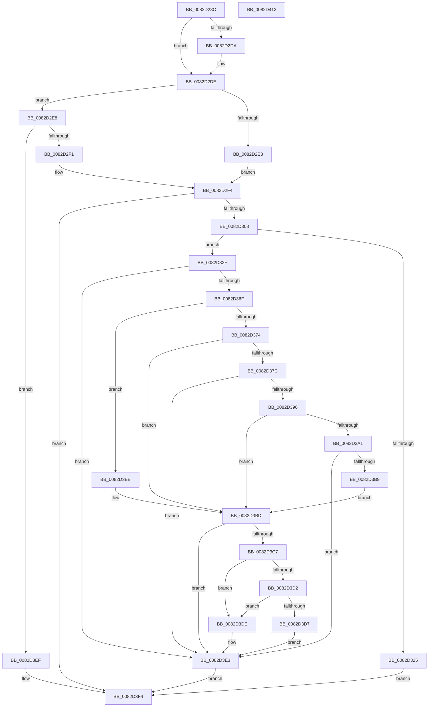

# CmGetMatchingCommonClassListWorker

- RVA: `0x0082D28C`–`0x0082D414` (길이 `392` bytes)
- VA: `0x000000014082D28C`
- 실행 섹션: `PAGE`
- PDB 이름 있음: `예`; PDB Function 태그: `아니요`
- unwind 정보 RVA: `0x000BEBA0`
- 디코드: `116`개 명령, `392/392` bytes 표시
- 미해석 바이트: `0` (있으면 어셈블리에 `.byte`로 보존)

> 이 문서는 커널 이미지의 기계어와 PDB 기호를 분석해 생성했습니다. 4번과 5번은 함수 원형과 자료형을 바이너리 사용 방식에서 추정한 C 해석이며 원본 소스 복구 결과는 아닙니다.

## 1. Dependencies

- 직접 호출 지점: **6**; 고유 호출 대상: **4**
- 직접 호출자로 확인된 함수: **1**
- RIP 상대 이미지 참조: **1**

### Outgoing calls
- `0x0082D2F9` → [_PnpCtxGetCachedContextBaseKey](../8E/_PnpCtxGetCachedContextBaseKey_function_008EFB2C.md) (function, `0x008EFB2C`)
- `0x0082D318` → [ExAllocatePool2](../../poolcode/B8/ExAllocatePool2_function_00B820F0.md) (function, `0x00B820F0`)
- `0x0082D364` → [PnpCtxRegEnumKeyWithCallback](../AA/PnpCtxRegEnumKeyWithCallback_function_00AA146C.md) (function, `0x00AA146C`)
- `0x0082D38B` → [_PnpCtxGetCachedContextBaseKey](../8E/_PnpCtxGetCachedContextBaseKey_function_008EFB2C.md) (function, `0x008EFB2C`)
- `0x0082D3AE` → [PnpCtxRegEnumKeyWithCallback](../AA/PnpCtxRegEnumKeyWithCallback_function_00AA146C.md) (function, `0x00AA146C`)
- `0x0082D3E8` → [ExFreePoolWithTag](../../poolcode/B8/ExFreePoolWithTag_function_00B82870.md) (function, `0x00B82870`)

### Direct callers
- [CmGetMatchingCommonClassList](CmGetMatchingCommonClassList_function_0082D120.md) at `0x0082D1FC`

### Static image references
- `0x0082D334` → RVA `0x0082C830` (`CmClassSubkeyCallback`; read)

## 2. Other-region calls and transfers

- 다른 실행 섹션으로 향하는 call: **2**
  - `0x0082D318` → [ExAllocatePool2](../../poolcode/B8/ExAllocatePool2_function_00B820F0.md) (`PAGE` → `POOLCODE`)
  - `0x0082D3E8` → [ExFreePoolWithTag](../../poolcode/B8/ExFreePoolWithTag_function_00B82870.md) (`PAGE` → `POOLCODE`)
- 별도 외부 분기/꼬리 이동을 확인하지 못했습니다.

## 3. Assembly (complete function range)

```asm
0082D28C  48 8B C4                        mov rax, rsp
0082D28F  48 89 58 08                     mov qword ptr [rax + 8], rbx
0082D293  48 89 68 10                     mov qword ptr [rax + 0x10], rbp
0082D297  48 89 70 20                     mov qword ptr [rax + 0x20], rsi
0082D29B  4C 89 40 18                     mov qword ptr [rax + 0x18], r8
0082D29F  57                              push rdi
0082D2A0  41 54                           push r12
0082D2A2  41 55                           push r13
0082D2A4  41 56                           push r14
0082D2A6  41 57                           push r15
0082D2A8  48 83 EC 30                     sub rsp, 0x30
0082D2AC  4C 8B BC 24 90 00 00 00         mov r15, qword ptr [rsp + 0x90]
0082D2B4  33 FF                           xor edi, edi
0082D2B6  44 8B A4 24 88 00 00 00         mov r12d, dword ptr [rsp + 0x88]
0082D2BE  4D 8B E9                        mov r13, r9
0082D2C1  4C 8B B4 24 80 00 00 00         mov r14, qword ptr [rsp + 0x80]
0082D2C9  8B F2                           mov esi, edx
0082D2CB  48 89 78 C8                     mov qword ptr [rax - 0x38], rdi
0082D2CF  48 8B E9                        mov rbp, rcx
0082D2D2  41 89 3F                        mov dword ptr [r15], edi
0082D2D5  45 85 E4                        test r12d, r12d
0082D2D8  74 04                           je 0x14082d2de
0082D2DA  66 41 89 3E                     mov word ptr [r14], di
0082D2DE  83 FE 02                        cmp esi, 2
0082D2E1  75 05                           jne 0x14082d2e8
0082D2E3  8D 56 05                        lea edx, [rsi + 5]
0082D2E6  EB 0C                           jmp 0x14082d2f4
0082D2E8  83 FE 04                        cmp esi, 4
0082D2EB  0F 85 FE 00 00 00               jne 0x14082d3ef
0082D2F1  8D 56 04                        lea edx, [rsi + 4]
0082D2F4  4C 8D 44 24 20                  lea r8, [rsp + 0x20]
0082D2F9  E8 2E 28 0C 00                  call 0x1408efb2c
0082D2FE  8B D8                           mov ebx, eax
0082D300  85 C0                           test eax, eax
0082D302  0F 88 EC 00 00 00               js 0x14082d3f4
0082D308  BA 30 00 00 00                  mov edx, 0x30
0082D30D  B9 00 01 00 00                  mov ecx, 0x100
0082D312  41 B8 50 4E 50 52               mov r8d, 0x52504e50
0082D318  E8 D3 4D 35 00                  call 0x140b820f0
0082D31D  48 8B F8                        mov rdi, rax
0082D320  48 85 C0                        test rax, rax
0082D323  75 0A                           jne 0x14082d32f
0082D325  BB 17 00 00 C0                  mov ebx, 0xc0000017
0082D32A  E9 C5 00 00 00                  jmp 0x14082d3f4
0082D32F  48 83 60 08 00                  and qword ptr [rax + 8], 0
0082D334  4C 8D 05 F5 F4 FF FF            lea r8, [rip - 0xb0b]
0082D33B  83 67 2C 00                     and dword ptr [rdi + 0x2c], 0
0082D33F  4C 8B CF                        mov r9, rdi
0082D342  4C 89 6F 18                     mov qword ptr [rdi + 0x18], r13
0082D346  48 8B CD                        mov rcx, rbp
0082D349  4C 8B 6C 24 20                  mov r13, qword ptr [rsp + 0x20]
0082D34E  89 30                           mov dword ptr [rax], esi
0082D350  49 8B D5                        mov rdx, r13
0082D353  48 8B 44 24 70                  mov rax, qword ptr [rsp + 0x70]
0082D358  48 89 47 10                     mov qword ptr [rdi + 0x10], rax
0082D35C  4C 89 77 20                     mov qword ptr [rdi + 0x20], r14
0082D360  44 89 67 28                     mov dword ptr [rdi + 0x28], r12d
0082D364  E8 03 41 27 00                  call 0x140aa146c
0082D369  8B D8                           mov ebx, eax
0082D36B  85 C0                           test eax, eax
0082D36D  78 74                           js 0x14082d3e3
0082D36F  83 FE 04                        cmp esi, 4
0082D372  75 47                           jne 0x14082d3bb
0082D374  33 F6                           xor esi, esi
0082D376  40 38 75 04                     cmp byte ptr [rbp + 4], sil
0082D37A  74 41                           je 0x14082d3bd
0082D37C  4C 8D 44 24 20                  lea r8, [rsp + 0x20]
0082D381  4C 89 6F 08                     mov qword ptr [rdi + 8], r13
0082D385  8D 56 09                        lea edx, [rsi + 9]
0082D388  48 8B CD                        mov rcx, rbp
0082D38B  E8 9C 27 0C 00                  call 0x1408efb2c
0082D390  8B D8                           mov ebx, eax
0082D392  85 C0                           test eax, eax
0082D394  78 4D                           js 0x14082d3e3
0082D396  48 8B 54 24 20                  mov rdx, qword ptr [rsp + 0x20]
0082D39B  48 3B 57 08                     cmp rdx, qword ptr [rdi + 8]
0082D39F  74 1C                           je 0x14082d3bd
0082D3A1  4C 8B CF                        mov r9, rdi
0082D3A4  4C 8D 05 85 F4 FF FF            lea r8, [rip - 0xb7b]
0082D3AB  48 8B CD                        mov rcx, rbp
0082D3AE  E8 B9 40 27 00                  call 0x140aa146c
0082D3B3  8B D8                           mov ebx, eax
0082D3B5  85 C0                           test eax, eax
0082D3B7  78 2A                           js 0x14082d3e3
0082D3B9  EB 02                           jmp 0x14082d3bd
0082D3BB  33 F6                           xor esi, esi
0082D3BD  8B 47 2C                        mov eax, dword ptr [rdi + 0x2c]
0082D3C0  41 89 07                        mov dword ptr [r15], eax
0082D3C3  85 C0                           test eax, eax
0082D3C5  74 1C                           je 0x14082d3e3
0082D3C7  8D 48 01                        lea ecx, [rax + 1]
0082D3CA  41 89 0F                        mov dword ptr [r15], ecx
0082D3CD  4D 85 F6                        test r14, r14
0082D3D0  74 0C                           je 0x14082d3de
0082D3D2  44 3B E1                        cmp r12d, ecx
0082D3D5  72 07                           jb 0x14082d3de
0082D3D7  66 41 89 34 46                  mov word ptr [r14 + rax*2], si
0082D3DC  EB 05                           jmp 0x14082d3e3
0082D3DE  BB 23 00 00 C0                  mov ebx, 0xc0000023
0082D3E3  33 D2                           xor edx, edx
0082D3E5  48 8B CF                        mov rcx, rdi
0082D3E8  E8 83 54 35 00                  call 0x140b82870
0082D3ED  EB 05                           jmp 0x14082d3f4
0082D3EF  BB 0D 00 00 C0                  mov ebx, 0xc000000d
0082D3F4  48 8B 6C 24 68                  mov rbp, qword ptr [rsp + 0x68]
0082D3F9  8B C3                           mov eax, ebx
0082D3FB  48 8B 5C 24 60                  mov rbx, qword ptr [rsp + 0x60]
0082D400  48 8B 74 24 78                  mov rsi, qword ptr [rsp + 0x78]
0082D405  48 83 C4 30                     add rsp, 0x30
0082D409  41 5F                           pop r15
0082D40B  41 5E                           pop r14
0082D40D  41 5D                           pop r13
0082D40F  41 5C                           pop r12
0082D411  5F                              pop rdi
0082D412  C3                              ret
0082D413  CC                              int3
```

## 4. C-style interpretation (structured pseudocode)

```c
__int64 __fastcall CmGetMatchingCommonClassListWorker(__int64 a1, int a2, __int64 a3, __int64 a4, __int64 a5, unsigned int a6, __int64 a7)
{
    __int64 result;
    __int64 v_rdi;
    __int64 v_rsi;
    __int64 v_rsp;
    unsigned __int64 v_stack_m38;
    unsigned __int64 v_stack_p10;
    unsigned __int64 v_stack_p18;
    unsigned __int64 v_stack_p20;
    unsigned __int64 v_stack_p8;

    *(unsigned __int64 *)(v_rsp + 8) = v_rbx;
    *(unsigned __int64 *)(v_rsp + 16) = v_rbp;
    *(unsigned __int64 *)(v_rsp + 32) = v_rsi;
    *(unsigned __int64 *)(v_rsp + 24) = a3;
    v_rsp = (v_rsp) - (48);
    v_rdi = 0;
    *(unsigned __int64 *)(v_rsp - 56) = 0;
    *(unsigned int *)(a7) = 0;
    if ((unsigned int)((unsigned int)(a6)) != 0) {
        *(unsigned __int16 *)(a5) = 0;
    }
    if (((unsigned int)((unsigned int)(a2))) != 2) goto loc_0082D2E8;
    goto loc_0082D2F4;
loc_0082D2E8:
    if (((unsigned int)((unsigned int)(a2))) != 4) goto loc_0082D3EF;
loc_0082D2F4:
    result = _PnpCtxGetCachedContextBaseKey(a1, (unsigned int)(a2) + 4, v_stack_m38, a4);
    if (sign_flag) goto loc_0082D3F4;
    result = ExAllocatePool2(256, 48, (unsigned int)(0x52504E50ULL), a4);
    if (result != 0) goto loc_0082D32F;
    goto loc_0082D3F4;
loc_0082D32F:
    *(unsigned __int64 *)(result + 24) = a4;
    *(unsigned int *)(result) = (unsigned int)((unsigned int)(a2));
    *(unsigned __int64 *)(result + 16) = v_stack_p18;
    *(unsigned __int64 *)(result + 32) = a5;
    *(unsigned int *)(result + 40) = (unsigned int)((unsigned int)(a6));
    result = PnpCtxRegEnumKeyWithCallback(a1, v_stack_m38, v_rip - 2827, result);
    if (sign_flag) goto loc_0082D3E3;
    if (((unsigned int)((unsigned int)(a2))) != 4) goto loc_0082D3BB;
    v_rsi = 0;
    if ((*(unsigned __int8 *)(a1 + 4)) == 0) goto loc_0082D3BD;
    *(unsigned __int64 *)(result + 8) = v_stack_m38;
    result = _PnpCtxGetCachedContextBaseKey(a1, v_rsi + 9, v_stack_m38, result);
    if (sign_flag) goto loc_0082D3E3;
    if (v_stack_m38 == (*(unsigned __int64 *)(result + 8))) goto loc_0082D3BD;
    result = PnpCtxRegEnumKeyWithCallback(a1, v_stack_m38, v_rip - 2939, result);
    if (sign_flag) goto loc_0082D3E3;
    goto loc_0082D3BD;
loc_0082D3BB:
    v_rsi = 0;
loc_0082D3BD:
    *(unsigned int *)(a7) = (unsigned int)((unsigned int)(*(unsigned int *)(result + 44)));
    if ((unsigned int)((unsigned int)(*(unsigned int *)(result + 44))) == 0) goto loc_0082D3E3;
    *(unsigned int *)(a7) = (unsigned int)((unsigned int)(*(unsigned int *)(result + 44)) + 1);
    if (a5 == 0) goto loc_0082D3DE;
    if (((unsigned int)((unsigned int)(a6))) < ((unsigned int)((unsigned int)(*(unsigned int *)(result + 44)) + 1))) goto loc_0082D3DE;
    *(unsigned __int16 *)(a5 + (unsigned int)(*(unsigned int *)(result + 44)) * 2) = 0;
    goto loc_0082D3E3;
loc_0082D3DE:
loc_0082D3E3:
    a2 = 0;
    result = ExFreePoolWithTag(result, a2, v_rip - 2939, result);
    goto loc_0082D3F4;
loc_0082D3EF:
loc_0082D3F4:
    v_rsp = (v_rsp) + (48);
    return (unsigned int)((unsigned int)((unsigned int)(0xC000000DULL)));
}
```

## 5. (Beta) C Style

```c
int64_t CmGetMatchingCommonClassListWorker(void *Arg1, int32_t Arg2, int64_t Arg3, int64_t Arg4, void *Arg5, uint32_t Arg6, void *Arg7)
{
    uint8_t *arg1 = (uint8_t *)Arg1;
    uint8_t *arg5 = (uint8_t *)Arg5;
    uint8_t *arg7 = (uint8_t *)Arg7;

    int64_t result;
    int64_t local_rdi;
    int64_t local_rsi;
    int64_t local_rsp;
    uint64_t v_stack_m38;
    uint64_t v_stack_p10;
    uint64_t v_stack_p18;
    uint64_t v_stack_p20;
    uint64_t v_stack_p8;

    *(uint64_t *)(local_rsp + 0x8) = local_rbx;
    *(uint64_t *)(local_rsp + 0x10) = local_rbp;
    *(uint64_t *)(local_rsp + 0x20) = local_rsi;
    *(uint64_t *)(local_rsp + 0x18) = Arg3;
    local_rsp = (local_rsp) - (48);
    local_rdi = 0;
    *(uint64_t *)(local_rsp - 0x38) = 0;
    *(uint32_t *)(arg7) = 0;
    if ((uint32_t)((uint32_t)(Arg6)) != 0) {
        *(uint16_t *)(arg5) = 0;
    }
    if (((uint32_t)((uint32_t)(Arg2))) != 2) goto loc_0082D2E8;
    goto loc_0082D2F4;
loc_0082D2E8:
    if (((uint32_t)((uint32_t)(Arg2))) != 4) goto loc_0082D3EF;
loc_0082D2F4:
    result = _PnpCtxGetCachedContextBaseKey(Arg1, (uint32_t)(Arg2) + 4, v_stack_m38, Arg4);
    if (sign_flag) goto loc_0082D3F4;
    result = ExAllocatePool2(256, 48, (uint32_t)(0x52504E50ULL), Arg4);
    if (result != 0) goto loc_0082D32F;
    goto loc_0082D3F4;
loc_0082D32F:
    *(uint64_t *)(result + 0x18) = Arg4;
    *(uint32_t *)(result) = (uint32_t)((uint32_t)(Arg2));
    *(uint64_t *)(result + 0x10) = v_stack_p18;
    *(void **)(result + 0x20) = Arg5;
    *(uint32_t *)(result + 0x28) = (uint32_t)((uint32_t)(Arg6));
    result = PnpCtxRegEnumKeyWithCallback(Arg1, v_stack_m38, v_rip - 2827, result);
    if (sign_flag) goto loc_0082D3E3;
    if (((uint32_t)((uint32_t)(Arg2))) != 4) goto loc_0082D3BB;
    local_rsi = 0;
    if ((*(uint8_t *)(arg1 + 0x4)) == 0) goto loc_0082D3BD;
    *(uint64_t *)(result + 0x8) = v_stack_m38;
    result = _PnpCtxGetCachedContextBaseKey(Arg1, local_rsi + 9, v_stack_m38, result);
    if (sign_flag) goto loc_0082D3E3;
    if (v_stack_m38 == (*(uint64_t *)(result + 0x8))) goto loc_0082D3BD;
    result = PnpCtxRegEnumKeyWithCallback(Arg1, v_stack_m38, v_rip - 2939, result);
    if (sign_flag) goto loc_0082D3E3;
    goto loc_0082D3BD;
loc_0082D3BB:
    local_rsi = 0;
loc_0082D3BD:
    *(uint32_t *)(arg7) = (uint32_t)((uint32_t)(*(uint32_t *)(result + 0x2C)));
    if ((uint32_t)((uint32_t)(*(uint32_t *)(result + 0x2C))) == 0) goto loc_0082D3E3;
    *(uint32_t *)(arg7) = (uint32_t)((uint32_t)(*(uint32_t *)(result + 0x2C)) + 1);
    if (Arg5 == NULL) goto loc_0082D3DE;
    if (((uint32_t)((uint32_t)(Arg6))) < ((uint32_t)((uint32_t)(*(uint32_t *)(result + 0x2C)) + 1))) goto loc_0082D3DE;
    *(uint16_t *)(arg5 + (uint32_t)(*(uint32_t *)(result + 0x2C)) * 2) = 0;
    goto loc_0082D3E3;
loc_0082D3DE:
loc_0082D3E3:
    Arg2 = 0;
    result = ExFreePoolWithTag(result, Arg2, v_rip - 2939, result);
    goto loc_0082D3F4;
loc_0082D3EF:
loc_0082D3F4:
    local_rsp = (local_rsp) + (48);
    return (uint32_t)((uint32_t)((uint32_t)(0xC000000DULL)));
}
```

### 관측된 메모리 오프셋

구조체 형식이 확인되지 않은 접근은 인자 기준의 오프셋으로만 기록했습니다.

| 기준 인자 | 오프셋 표현 | 폭 (bit) | 접근 |
|---|---:|---:|---|
| `Arg1` | `+ 0x4` | `8` | `R` |
| `Arg5` | `+ 0x0` | `16` | `W` |
| `Arg7` | `+ 0x0` | `32` | `W` |

## 6. Execution-region graph

[열기: 2D/3D 그래프와 함수 탐색 컨트롤 패널](../../../control-panel.html?section=page&rva=0x0082D28C&view=graph)

- 2D 그래프는 위에서 아래로 흐르고, 3D 그래프는 빈 공간을 드래그해 회전합니다. Shift+드래그는 이동, 휠은 확대·축소, 함수 노드 선택은 대상 보고서 이동입니다.

### Static fallback


