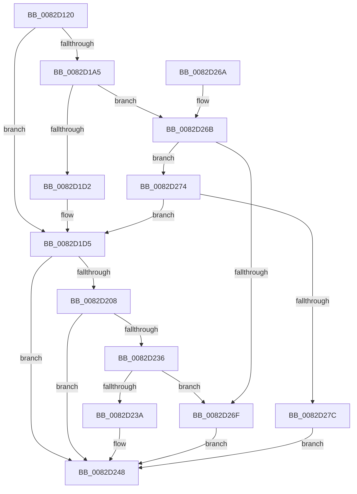

# CmGetMatchingCommonClassList

- RVA: `0x0082D120`–`0x0082D283` (길이 `355` bytes)
- VA: `0x000000014082D120`
- 실행 섹션: `PAGE`
- PDB 이름 있음: `예`; PDB Function 태그: `아니요`
- unwind 정보 RVA: `0x000DA9AC`
- 디코드: `106`개 명령, `355/355` bytes 표시
- 미해석 바이트: `0` (있으면 어셈블리에 `.byte`로 보존)

> 이 문서는 커널 이미지의 기계어와 PDB 기호를 분석해 생성했습니다. 4번과 5번은 함수 원형과 자료형을 바이너리 사용 방식에서 추정한 C 해석이며 원본 소스 복구 결과는 아닙니다.

## 1. Dependencies

- 직접 호출 지점: **5**; 고유 호출 대상: **4**
- 직접 호출자로 확인된 함수: **2**
- RIP 상대 이미지 참조: **1**

### Outgoing calls
- `0x0082D165` → [memset](../../text/6C/memset_function_006C6C40.md) (function, `0x006C6C40`)
- `0x0082D1C4` → [guard_dispatch_icall](../../text/6B/guard_dispatch_icall_function_006BAAD0.md) (function, `0x006BAAD0`)
- `0x0082D1FC` → [CmGetMatchingCommonClassListWorker](CmGetMatchingCommonClassListWorker_function_0082D28C.md) (function, `0x0082D28C`)
- `0x0082D22A` → [guard_dispatch_icall](../../text/6B/guard_dispatch_icall_function_006BAAD0.md) (function, `0x006BAAD0`)
- `0x0082D251` → [_security_check_cookie](../../text/6A/_security_check_cookie_function_006AC640.md) (function, `0x006AC640`)

### Direct callers
- [sub_00B2C010](../B2/Unknown_function_00B2C010.md) at `0x00B2C0C1`
- [sub_00B2F630](../B2/Unknown_function_00B2F630.md) at `0x00B2F6A0`

### Static image references
- `0x0082D139` → RVA `0x00E0A740` (`.data`; read)

## 2. Other-region calls and transfers

- 다른 실행 섹션으로 향하는 call: **4**
  - `0x0082D165` → [memset](../../text/6C/memset_function_006C6C40.md) (`PAGE` → `.text`)
  - `0x0082D1C4` → [guard_dispatch_icall](../../text/6B/guard_dispatch_icall_function_006BAAD0.md) (`PAGE` → `.text`)
  - `0x0082D22A` → [guard_dispatch_icall](../../text/6B/guard_dispatch_icall_function_006BAAD0.md) (`PAGE` → `.text`)
  - `0x0082D251` → [_security_check_cookie](../../text/6A/_security_check_cookie_function_006AC640.md) (`PAGE` → `.text`)
- 별도 외부 분기/꼬리 이동을 확인하지 못했습니다.

## 3. Assembly (complete function range)

```asm
0082D120  40 55                           push rbp
0082D122  53                              push rbx
0082D123  56                              push rsi
0082D124  57                              push rdi
0082D125  41 54                           push r12
0082D127  41 55                           push r13
0082D129  41 56                           push r14
0082D12B  41 57                           push r15
0082D12D  48 8D 6C 24 F9                  lea rbp, [rsp - 7]
0082D132  48 81 EC B8 00 00 00            sub rsp, 0xb8
0082D139  48 8B 05 00 D6 5D 00            mov rax, qword ptr [rip + 0x5dd600]
0082D140  48 33 C4                        xor rax, rsp
0082D143  48 89 45 EF                     mov qword ptr [rbp - 0x11], rax
0082D147  48 8B 5D 6F                     mov rbx, qword ptr [rbp + 0x6f]
0082D14B  44 8B E2                        mov r12d, edx
0082D14E  48 8B 7D 7F                     mov rdi, qword ptr [rbp + 0x7f]
0082D152  33 D2                           xor edx, edx
0082D154  49 8B F0                        mov rsi, r8
0082D157  4C 8B E9                        mov r13, rcx
0082D15A  48 8D 4D 8F                     lea rcx, [rbp - 0x71]
0082D15E  4D 8B F1                        mov r14, r9
0082D161  44 8D 42 58                     lea r8d, [rdx + 0x58]
0082D165  E8 D6 9A E9 FF                  call 0x1406c6c40
0082D16A  8B 45 77                        mov eax, dword ptr [rbp + 0x77]
0082D16D  4D 8B BD F8 01 00 00            mov r15, qword ptr [r13 + 0x1f8]
0082D174  89 45 B7                        mov dword ptr [rbp - 0x49], eax
0082D177  8B 85 87 00 00 00               mov eax, dword ptr [rbp + 0x87]
0082D17D  48 89 75 9F                     mov qword ptr [rbp - 0x61], rsi
0082D181  BE 04 00 00 00                  mov esi, 4
0082D186  4C 89 75 A7                     mov qword ptr [rbp - 0x59], r14
0082D18A  41 BE 02 00 00 C0               mov r14d, 0xc0000002
0082D190  48 89 7D BF                     mov qword ptr [rbp - 0x41], rdi
0082D194  BF 20 01 00 C0                  mov edi, 0xc0000120
0082D199  89 45 C7                        mov dword ptr [rbp - 0x39], eax
0082D19C  48 89 5D AF                     mov qword ptr [rbp - 0x51], rbx
0082D1A0  4D 85 FF                        test r15, r15
0082D1A3  74 30                           je 0x14082d1d5
0082D1A5  48 8D 45 8F                     lea rax, [rbp - 0x71]
0082D1A9  44 8B CE                        mov r9d, esi
0082D1AC  48 89 44 24 28                  mov qword ptr [rsp + 0x28], rax
0082D1B1  45 8B C4                        mov r8d, r12d
0082D1B4  49 8B C7                        mov rax, r15
0082D1B7  C7 44 24 20 01 00 00 00         mov dword ptr [rsp + 0x20], 1
0082D1BF  33 D2                           xor edx, edx
0082D1C1  49 8B CD                        mov rcx, r13
0082D1C4  E8 07 D9 E8 FF                  call 0x1406baad0
0082D1C9  41 3B C6                        cmp eax, r14d
0082D1CC  0F 85 99 00 00 00               jne 0x14082d26b
0082D1D2  45 33 FF                        xor r15d, r15d
0082D1D5  48 8B 45 BF                     mov rax, qword ptr [rbp - 0x41]
0082D1D9  41 8B D4                        mov edx, r12d
0082D1DC  4C 8B 4D A7                     mov r9, qword ptr [rbp - 0x59]
0082D1E0  49 8B CD                        mov rcx, r13
0082D1E3  4C 8B 45 9F                     mov r8, qword ptr [rbp - 0x61]
0082D1E7  48 89 44 24 30                  mov qword ptr [rsp + 0x30], rax
0082D1EC  8B 45 B7                        mov eax, dword ptr [rbp - 0x49]
0082D1EF  89 44 24 28                     mov dword ptr [rsp + 0x28], eax
0082D1F3  48 8B 45 AF                     mov rax, qword ptr [rbp - 0x51]
0082D1F7  48 89 44 24 20                  mov qword ptr [rsp + 0x20], rax
0082D1FC  E8 8B 00 00 00                  call 0x14082d28c
0082D201  8B D8                           mov ebx, eax
0082D203  4D 85 FF                        test r15, r15
0082D206  74 40                           je 0x14082d248
0082D208  89 45 8F                        mov dword ptr [rbp - 0x71], eax
0082D20B  44 8B CE                        mov r9d, esi
0082D20E  48 8D 45 8F                     lea rax, [rbp - 0x71]
0082D212  45 8B C4                        mov r8d, r12d
0082D215  48 89 44 24 28                  mov qword ptr [rsp + 0x28], rax
0082D21A  33 D2                           xor edx, edx
0082D21C  49 8B C7                        mov rax, r15
0082D21F  C7 44 24 20 02 00 00 00         mov dword ptr [rsp + 0x20], 2
0082D227  49 8B CD                        mov rcx, r13
0082D22A  E8 A1 D8 E8 FF                  call 0x1406baad0
0082D22F  8B C8                           mov ecx, eax
0082D231  41 3B C6                        cmp eax, r14d
0082D234  74 12                           je 0x14082d248
0082D236  3B C7                           cmp eax, edi
0082D238  74 35                           je 0x14082d26f
0082D23A  8B C3                           mov eax, ebx
0082D23C  85 C9                           test ecx, ecx
0082D23E  BB E5 00 00 C0                  mov ebx, 0xc00000e5
0082D243  0F 45 C3                        cmovne eax, ebx
0082D246  8B D8                           mov ebx, eax
0082D248  8B C3                           mov eax, ebx
0082D24A  48 8B 4D EF                     mov rcx, qword ptr [rbp - 0x11]
0082D24E  48 33 CC                        xor rcx, rsp
0082D251  E8 EA F3 E7 FF                  call 0x1406ac640
0082D256  48 81 C4 B8 00 00 00            add rsp, 0xb8
0082D25D  41 5F                           pop r15
0082D25F  41 5E                           pop r14
0082D261  41 5D                           pop r13
0082D263  41 5C                           pop r12
0082D265  5F                              pop rdi
0082D266  5E                              pop rsi
0082D267  5B                              pop rbx
0082D268  5D                              pop rbp
0082D269  C3                              ret
0082D26A  CC                              int3
0082D26B  3B C7                           cmp eax, edi
0082D26D  75 05                           jne 0x14082d274
0082D26F  8B 5D 8F                        mov ebx, dword ptr [rbp - 0x71]
0082D272  EB D4                           jmp 0x14082d248
0082D274  85 C0                           test eax, eax
0082D276  0F 84 59 FF FF FF               je 0x14082d1d5
0082D27C  BB E5 00 00 C0                  mov ebx, 0xc00000e5
0082D281  EB C5                           jmp 0x14082d248
```

## 4. C-style interpretation (structured pseudocode)

```c
__int64 __fastcall CmGetMatchingCommonClassList(__int64 a1, int a2, __int64 a3, __int64 a4, __int64 a5, unsigned int a6, __int64 a7, unsigned int a8)
{
    __int64 result;
    __int64 v_r15;
    __int64 v_rsp;
    unsigned __int64 v_stack_m47;
    unsigned __int64 v_stack_m58;
    unsigned int v_stack_m80;
    unsigned __int64 v_stack_m88;
    unsigned int v_stack_m90;
    unsigned __int64 v_stack_m98;
    unsigned __int64 v_stack_mA0;
    unsigned __int64 v_stack_mA8;
    unsigned __int64 v_stack_mB8;
    unsigned __int64 v_stack_mC8;
    unsigned __int64 v_stack_mD0;
    unsigned int v_stack_mD8;

    v_rsp = (v_rsp) - (184);
    result = (*(unsigned __int64 *)(v_rip + 6149632)) ^ (v_rsp);
    v_stack_m58 = result;
    a2 = 0;
    result = memset(v_stack_mB8, a2, a2 + 88, a4);
    v_stack_m90 = (unsigned int)((unsigned int)(a6));
    v_stack_mA8 = a3;
    v_stack_mA0 = a4;
    v_stack_m88 = a7;
    v_stack_m80 = (unsigned int)((unsigned int)(a8));
    v_stack_m98 = a5;
    if (*(unsigned __int64 *)(a1 + 504) == 0) goto loc_0082D1D5;
    v_stack_mD0 = v_stack_mB8;
    v_stack_mD8 = 1;
    a2 = 0;
    result = guard_dispatch_icall(a1, a2, (unsigned int)((unsigned int)((unsigned int)(a2))), 4);
    if (((unsigned int)(result)) != ((unsigned int)((unsigned int)(0xC0000002ULL)))) goto loc_0082D26B;
    v_r15 = 0;
loc_0082D1D5:
    v_stack_mC8 = v_stack_m88;
    v_stack_mD0 = (unsigned int)((unsigned int)(v_stack_m90));
    v_stack_mD8 = v_stack_m98;
    result = CmGetMatchingCommonClassListWorker(a1, (unsigned int)((unsigned int)((unsigned int)(a2))), v_stack_mA8, v_stack_mA0);
    if (0 == 0) goto loc_0082D248;
    v_stack_mB8 = (unsigned int)(result);
    v_stack_mD0 = v_stack_mB8;
    a2 = 0;
    v_stack_mD8 = 2;
    result = guard_dispatch_icall(a1, a2, (unsigned int)((unsigned int)((unsigned int)(a2))), 4);
    if (((unsigned int)(result)) == ((unsigned int)((unsigned int)(0xC0000002ULL)))) goto loc_0082D248;
    if (((unsigned int)(result)) == ((unsigned int)((unsigned int)(0xC0000120ULL)))) goto loc_0082D26F;
    result = (unsigned int)((unsigned int)((unsigned int)((unsigned int)(result))));
    if ((unsigned int)((unsigned int)((unsigned int)(result))) != 0) { result = (unsigned int)((unsigned int)(0xC00000E5ULL)); }
loc_0082D248:
    a1 = (v_stack_m58) ^ (v_rsp);
    result = _security_check_cookie(a1, a2, (unsigned int)((unsigned int)((unsigned int)(a2))), 4);
    v_rsp = (v_rsp) + (184);
    return result;
loc_0082D26B:
    if (((unsigned int)(result)) != ((unsigned int)((unsigned int)(0xC0000120ULL)))) goto loc_0082D274;
loc_0082D26F:
    goto loc_0082D248;
loc_0082D274:
    if ((unsigned int)(result) == 0) goto loc_0082D1D5;
    goto loc_0082D248;
}
```

## 5. (Beta) C Style

```c
int64_t CmGetMatchingCommonClassList(void *Arg1, int32_t Arg2, int64_t Arg3, int64_t Arg4, int64_t Arg5, uint32_t Arg6, int64_t Arg7, uint32_t Arg8)
{
    uint8_t *arg1 = (uint8_t *)Arg1;

    int64_t result;
    int64_t local_r15;
    int64_t local_rsp;
    uint64_t v_stack_m47;
    uint64_t v_stack_m58;
    uint32_t v_stack_m80;
    uint64_t v_stack_m88;
    uint32_t v_stack_m90;
    uint64_t v_stack_m98;
    uint64_t v_stack_mA0;
    uint64_t v_stack_mA8;
    uint64_t v_stack_mB8;
    uint64_t v_stack_mC8;
    uint64_t v_stack_mD0;
    uint32_t v_stack_mD8;

    local_rsp = (local_rsp) - (184);
    result = (*(uint64_t *)(v_rip + 0x5DD600)) ^ (local_rsp);
    v_stack_m58 = result;
    Arg2 = 0;
    result = memset(v_stack_mB8, Arg2, Arg2 + 88, Arg4);
    v_stack_m90 = (uint32_t)((uint32_t)(Arg6));
    v_stack_mA8 = Arg3;
    v_stack_mA0 = Arg4;
    v_stack_m88 = Arg7;
    v_stack_m80 = (uint32_t)((uint32_t)(Arg8));
    v_stack_m98 = Arg5;
    if (*(uint64_t *)(arg1 + 0x1F8) == 0) goto loc_0082D1D5;
    v_stack_mD0 = v_stack_mB8;
    v_stack_mD8 = 1;
    Arg2 = 0;
    result = guard_dispatch_icall(Arg1, Arg2, (uint32_t)((uint32_t)((uint32_t)(Arg2))), 4);
    if (((uint32_t)(result)) != ((uint32_t)((uint32_t)(0xC0000002ULL)))) goto loc_0082D26B;
    local_r15 = 0;
loc_0082D1D5:
    v_stack_mC8 = v_stack_m88;
    v_stack_mD0 = (uint32_t)((uint32_t)(v_stack_m90));
    v_stack_mD8 = v_stack_m98;
    result = CmGetMatchingCommonClassListWorker(Arg1, (uint32_t)((uint32_t)((uint32_t)(Arg2))), v_stack_mA8, v_stack_mA0);
    if (0 == 0) goto loc_0082D248;
    v_stack_mB8 = (uint32_t)(result);
    v_stack_mD0 = v_stack_mB8;
    Arg2 = 0;
    v_stack_mD8 = 2;
    result = guard_dispatch_icall(Arg1, Arg2, (uint32_t)((uint32_t)((uint32_t)(Arg2))), 4);
    if (((uint32_t)(result)) == ((uint32_t)((uint32_t)(0xC0000002ULL)))) goto loc_0082D248;
    if (((uint32_t)(result)) == ((uint32_t)((uint32_t)(0xC0000120ULL)))) goto loc_0082D26F;
    result = (uint32_t)((uint32_t)((uint32_t)((uint32_t)(result))));
    if ((uint32_t)((uint32_t)((uint32_t)(result))) != 0) { result = (uint32_t)((uint32_t)(0xC00000E5ULL)); }
loc_0082D248:
    Arg1 = (v_stack_m58) ^ (local_rsp);
    result = _security_check_cookie(Arg1, Arg2, (uint32_t)((uint32_t)((uint32_t)(Arg2))), 4);
    local_rsp = (local_rsp) + (184);
    return result;
loc_0082D26B:
    if (((uint32_t)(result)) != ((uint32_t)((uint32_t)(0xC0000120ULL)))) goto loc_0082D274;
loc_0082D26F:
    goto loc_0082D248;
loc_0082D274:
    if ((uint32_t)(result) == 0) goto loc_0082D1D5;
    goto loc_0082D248;
}
```

### 관측된 메모리 오프셋

구조체 형식이 확인되지 않은 접근은 인자 기준의 오프셋으로만 기록했습니다.

| 기준 인자 | 오프셋 표현 | 폭 (bit) | 접근 |
|---|---:|---:|---|
| `Arg1` | `+ 0x1F8` | `64` | `R` |

## 6. Execution-region graph

[열기: 2D/3D 그래프와 함수 탐색 컨트롤 패널](../../../control-panel.html?section=page&rva=0x0082D120&view=graph)

- 2D 그래프는 위에서 아래로 흐르고, 3D 그래프는 빈 공간을 드래그해 회전합니다. Shift+드래그는 이동, 휠은 확대·축소, 함수 노드 선택은 대상 보고서 이동입니다.

### Static fallback


