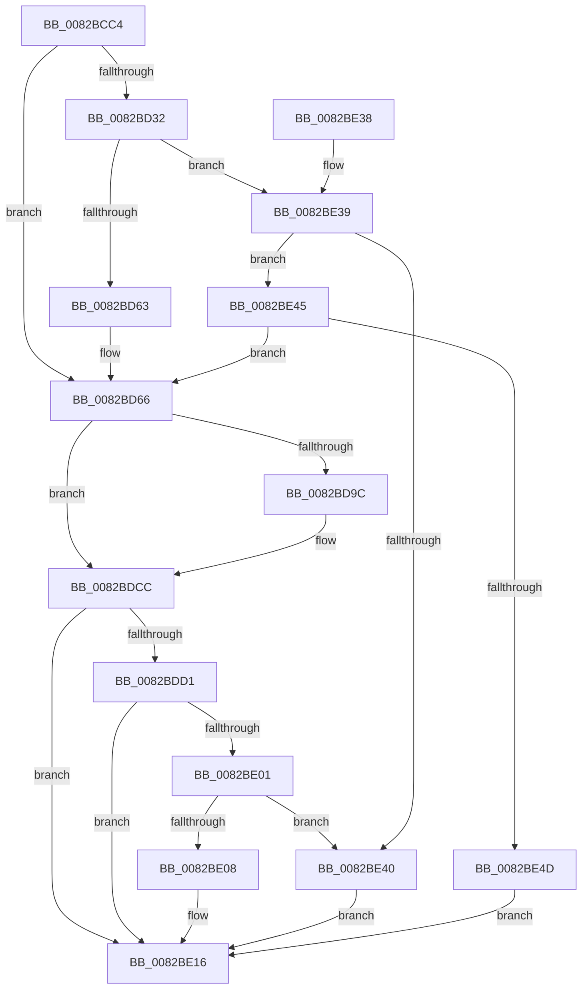

# CmGetMatchingDeviceContainerList

- RVA: `0x0082BCC4`–`0x0082BE54` (길이 `400` bytes)
- VA: `0x000000014082BCC4`
- 실행 섹션: `PAGE`
- PDB 이름 있음: `예`; PDB Function 태그: `아니요`
- unwind 정보 RVA: `0x000DA8A8`
- 디코드: `114`개 명령, `400/400` bytes 표시
- 미해석 바이트: `0` (있으면 어셈블리에 `.byte`로 보존)

> 이 문서는 커널 이미지의 기계어와 PDB 기호를 분석해 생성했습니다. 4번과 5번은 함수 원형과 자료형을 바이너리 사용 방식에서 추정한 C 해석이며 원본 소스 복구 결과는 아닙니다.

## 1. Dependencies

- 직접 호출 지점: **6**; 고유 호출 대상: **5**
- 직접 호출자로 확인된 함수: **1**
- RIP 상대 이미지 참조: **1**

### Outgoing calls
- `0x0082BD05` → [memset](../../text/6C/memset_function_006C6C40.md) (function, `0x006C6C40`)
- `0x0082BD53` → [guard_dispatch_icall](../../text/6B/guard_dispatch_icall_function_006BAAD0.md) (function, `0x006BAAD0`)
- `0x0082BD91` → [_PnpCtxGetCachedContextBaseKey](../8E/_PnpCtxGetCachedContextBaseKey_function_008EFB2C.md) (function, `0x008EFB2C`)
- `0x0082BDC5` → [PnpGetGenericObjectList](../83/PnpGetGenericObjectList_function_008322EC.md) (function, `0x008322EC`)
- `0x0082BDF5` → [guard_dispatch_icall](../../text/6B/guard_dispatch_icall_function_006BAAD0.md) (function, `0x006BAAD0`)
- `0x0082BE1F` → [_security_check_cookie](../../text/6A/_security_check_cookie_function_006AC640.md) (function, `0x006AC640`)

### Direct callers
- [sub_00B1EF02](../B1/Unknown_function_00B1EF02.md) at `0x00B1EF24`

### Static image references
- `0x0082BCDD` → RVA `0x00E0A740` (`.data`; read)

## 2. Other-region calls and transfers

- 다른 실행 섹션으로 향하는 call: **4**
  - `0x0082BD05` → [memset](../../text/6C/memset_function_006C6C40.md) (`PAGE` → `.text`)
  - `0x0082BD53` → [guard_dispatch_icall](../../text/6B/guard_dispatch_icall_function_006BAAD0.md) (`PAGE` → `.text`)
  - `0x0082BDF5` → [guard_dispatch_icall](../../text/6B/guard_dispatch_icall_function_006BAAD0.md) (`PAGE` → `.text`)
  - `0x0082BE1F` → [_security_check_cookie](../../text/6A/_security_check_cookie_function_006AC640.md) (`PAGE` → `.text`)
- 별도 외부 분기/꼬리 이동을 확인하지 못했습니다.

## 3. Assembly (complete function range)

```asm
0082BCC4  40 55                           push rbp
0082BCC6  53                              push rbx
0082BCC7  56                              push rsi
0082BCC8  57                              push rdi
0082BCC9  41 54                           push r12
0082BCCB  41 55                           push r13
0082BCCD  41 56                           push r14
0082BCCF  41 57                           push r15
0082BCD1  48 8D 6C 24 F9                  lea rbp, [rsp - 7]
0082BCD6  48 81 EC D8 00 00 00            sub rsp, 0xd8
0082BCDD  48 8B 05 5C EA 5D 00            mov rax, qword ptr [rip + 0x5dea5c]
0082BCE4  48 33 C4                        xor rax, rsp
0082BCE7  48 89 45 EF                     mov qword ptr [rbp - 0x11], rax
0082BCEB  48 8B 5D 77                     mov rbx, qword ptr [rbp + 0x77]
0082BCEF  48 8B FA                        mov rdi, rdx
0082BCF2  33 D2                           xor edx, edx
0082BCF4  49 8B F0                        mov rsi, r8
0082BCF7  4C 8B E9                        mov r13, rcx
0082BCFA  4D 8B F1                        mov r14, r9
0082BCFD  48 8D 4D 8F                     lea rcx, [rbp - 0x71]
0082BD01  44 8D 42 58                     lea r8d, [rdx + 0x58]
0082BD05  E8 36 AF E9 FF                  call 0x1406c6c40
0082BD0A  8B 45 6F                        mov eax, dword ptr [rbp + 0x6f]
0082BD0D  4D 8B BD F8 01 00 00            mov r15, qword ptr [r13 + 0x1f8]
0082BD14  89 45 B7                        mov dword ptr [rbp - 0x49], eax
0082BD17  8B 45 7F                        mov eax, dword ptr [rbp + 0x7f]
0082BD1A  89 45 C7                        mov dword ptr [rbp - 0x39], eax
0082BD1D  48 89 7D 9F                     mov qword ptr [rbp - 0x61], rdi
0082BD21  48 89 75 A7                     mov qword ptr [rbp - 0x59], rsi
0082BD25  4C 89 75 AF                     mov qword ptr [rbp - 0x51], r14
0082BD29  48 89 5D BF                     mov qword ptr [rbp - 0x41], rbx
0082BD2D  4D 85 FF                        test r15, r15
0082BD30  74 34                           je 0x14082bd66
0082BD32  33 D2                           xor edx, edx
0082BD34  48 8D 45 8F                     lea rax, [rbp - 0x71]
0082BD38  48 89 44 24 28                  mov qword ptr [rsp + 0x28], rax
0082BD3D  49 8B CD                        mov rcx, r13
0082BD40  49 8B C7                        mov rax, r15
0082BD43  C7 44 24 20 01 00 00 00         mov dword ptr [rsp + 0x20], 1
0082BD4B  44 8D 4A 04                     lea r9d, [rdx + 4]
0082BD4F  44 8D 42 05                     lea r8d, [rdx + 5]
0082BD53  E8 78 ED E8 FF                  call 0x1406baad0
0082BD58  3D 02 00 00 C0                  cmp eax, 0xc0000002
0082BD5D  0F 85 D6 00 00 00               jne 0x14082be39
0082BD63  45 33 FF                        xor r15d, r15d
0082BD66  48 8B 45 9F                     mov rax, qword ptr [rbp - 0x61]
0082BD6A  4C 8D 44 24 40                  lea r8, [rsp + 0x40]
0082BD6F  48 8B 7D BF                     mov rdi, qword ptr [rbp - 0x41]
0082BD73  BA 0A 00 00 00                  mov edx, 0xa
0082BD78  8B 75 B7                        mov esi, dword ptr [rbp - 0x49]
0082BD7B  49 8B CD                        mov rcx, r13
0082BD7E  4C 8B 75 AF                     mov r14, qword ptr [rbp - 0x51]
0082BD82  4C 8B 65 A7                     mov r12, qword ptr [rbp - 0x59]
0082BD86  48 83 64 24 40 00               and qword ptr [rsp + 0x40], 0
0082BD8C  48 89 44 24 48                  mov qword ptr [rsp + 0x48], rax
0082BD91  E8 96 3D 0C 00                  call 0x1408efb2c
0082BD96  8B D8                           mov ebx, eax
0082BD98  85 C0                           test eax, eax
0082BD9A  78 30                           js 0x14082bdcc
0082BD9C  48 8B 44 24 48                  mov rax, qword ptr [rsp + 0x48]
0082BDA1  4C 8D 4C 24 50                  lea r9, [rsp + 0x50]
0082BDA6  48 8B 54 24 40                  mov rdx, qword ptr [rsp + 0x40]
0082BDAB  49 8B CD                        mov rcx, r13
0082BDAE  48 89 7C 24 30                  mov qword ptr [rsp + 0x30], rdi
0082BDB3  89 74 24 28                     mov dword ptr [rsp + 0x28], esi
0082BDB7  48 89 44 24 50                  mov qword ptr [rsp + 0x50], rax
0082BDBC  4C 89 74 24 20                  mov qword ptr [rsp + 0x20], r14
0082BDC1  4C 89 65 87                     mov qword ptr [rbp - 0x79], r12
0082BDC5  E8 22 65 00 00                  call 0x1408322ec
0082BDCA  8B D8                           mov ebx, eax
0082BDCC  4D 85 FF                        test r15, r15
0082BDCF  74 45                           je 0x14082be16
0082BDD1  33 D2                           xor edx, edx
0082BDD3  89 5D 8F                        mov dword ptr [rbp - 0x71], ebx
0082BDD6  48 8D 45 8F                     lea rax, [rbp - 0x71]
0082BDDA  49 8B CD                        mov rcx, r13
0082BDDD  48 89 44 24 28                  mov qword ptr [rsp + 0x28], rax
0082BDE2  49 8B C7                        mov rax, r15
0082BDE5  C7 44 24 20 02 00 00 00         mov dword ptr [rsp + 0x20], 2
0082BDED  44 8D 4A 04                     lea r9d, [rdx + 4]
0082BDF1  44 8D 42 05                     lea r8d, [rdx + 5]
0082BDF5  E8 D6 EC E8 FF                  call 0x1406baad0
0082BDFA  3D 02 00 00 C0                  cmp eax, 0xc0000002
0082BDFF  74 15                           je 0x14082be16
0082BE01  3D 20 01 00 C0                  cmp eax, 0xc0000120
0082BE06  74 38                           je 0x14082be40
0082BE08  8B CB                           mov ecx, ebx
0082BE0A  85 C0                           test eax, eax
0082BE0C  BB E5 00 00 C0                  mov ebx, 0xc00000e5
0082BE11  0F 45 CB                        cmovne ecx, ebx
0082BE14  8B D9                           mov ebx, ecx
0082BE16  8B C3                           mov eax, ebx
0082BE18  48 8B 4D EF                     mov rcx, qword ptr [rbp - 0x11]
0082BE1C  48 33 CC                        xor rcx, rsp
0082BE1F  E8 1C 08 E8 FF                  call 0x1406ac640
0082BE24  48 81 C4 D8 00 00 00            add rsp, 0xd8
0082BE2B  41 5F                           pop r15
0082BE2D  41 5E                           pop r14
0082BE2F  41 5D                           pop r13
0082BE31  41 5C                           pop r12
0082BE33  5F                              pop rdi
0082BE34  5E                              pop rsi
0082BE35  5B                              pop rbx
0082BE36  5D                              pop rbp
0082BE37  C3                              ret
0082BE38  CC                              int3
0082BE39  3D 20 01 00 C0                  cmp eax, 0xc0000120
0082BE3E  75 05                           jne 0x14082be45
0082BE40  8B 5D 8F                        mov ebx, dword ptr [rbp - 0x71]
0082BE43  EB D1                           jmp 0x14082be16
0082BE45  85 C0                           test eax, eax
0082BE47  0F 84 19 FF FF FF               je 0x14082bd66
0082BE4D  BB E5 00 00 C0                  mov ebx, 0xc00000e5
0082BE52  EB C2                           jmp 0x14082be16
```

## 4. C-style interpretation (structured pseudocode)

```c
__int64 __fastcall CmGetMatchingDeviceContainerList(__int64 a1, __int64 a2, __int64 a3, __int64 a4, unsigned int a5, __int64 a6, unsigned int a7)
{
    __int64 result;
    __int64 v_r15;
    __int64 v_rbx;
    __int64 v_rsp;
    unsigned __int64 v_stack_m47;
    unsigned __int64 v_stack_m58;
    unsigned int v_stack_m80;
    unsigned __int64 v_stack_m88;
    unsigned int v_stack_m90;
    unsigned __int64 v_stack_m98;
    unsigned __int64 v_stack_mA0;
    unsigned __int64 v_stack_mA8;
    unsigned __int64 v_stack_mB8;
    unsigned __int64 v_stack_mC0;
    unsigned __int64 v_stack_mC8;
    unsigned __int64 v_stack_mD0;
    unsigned __int64 v_stack_mD8;
    unsigned __int64 v_stack_mE8;
    unsigned __int64 v_stack_mF0;
    unsigned int v_stack_mF8;

    v_rsp = (v_rsp) - (216);
    result = (*(unsigned __int64 *)(v_rip + 6154844)) ^ (v_rsp);
    v_stack_m58 = result;
    a2 = 0;
    result = memset(v_stack_mB8, a2, a2 + 88, a4);
    v_stack_m90 = (unsigned int)((unsigned int)(a5));
    v_stack_m80 = (unsigned int)((unsigned int)(a7));
    v_stack_mA8 = 0;
    v_stack_mA0 = a3;
    v_stack_m98 = a4;
    v_stack_m88 = a6;
    if (*(unsigned __int64 *)(a1 + 504) == 0) goto loc_0082BD66;
    a2 = 0;
    v_stack_mF0 = v_stack_mB8;
    v_stack_mF8 = 1;
    result = guard_dispatch_icall(a1, a2, a2 + 5, a2 + 4);
    if (((unsigned int)(result)) != 0xC0000002ULL) goto loc_0082BE39;
    v_r15 = 0;
loc_0082BD66:
    v_stack_mD0 = v_stack_mA8;
    result = _PnpCtxGetCachedContextBaseKey(a1, 10, v_stack_mD8, a2 + 4);
    v_rbx = (unsigned int)((unsigned int)(result));
    if (!(sign_flag)) {
        result = v_stack_mD0;
        a4 = v_stack_mC8;
        a2 = v_stack_mD8;
        a1 = a1;
        v_stack_mE8 = v_stack_m88;
        v_stack_mF0 = (unsigned int)((unsigned int)(v_stack_m90));
        v_stack_mC8 = result;
        v_stack_mF8 = v_stack_m98;
        v_stack_mC0 = v_stack_mA0;
        result = PnpGetGenericObjectList(a1, a2, v_stack_mD8, a4);
        v_rbx = (unsigned int)(result);
    }
    if (0 == 0) goto loc_0082BE16;
    a2 = 0;
    v_stack_mB8 = (unsigned int)(v_rbx);
    v_stack_mF0 = v_stack_mB8;
    v_stack_mF8 = 2;
    result = guard_dispatch_icall(a1, a2, a2 + 5, a2 + 4);
    if (((unsigned int)(result)) == 0xC0000002ULL) goto loc_0082BE16;
    if (((unsigned int)(result)) == 0xC0000120ULL) goto loc_0082BE40;
    a1 = (unsigned int)((unsigned int)(v_rbx));
    if ((unsigned int)(result) != 0) { a1 = (unsigned int)((unsigned int)(0xC00000E5ULL)); }
loc_0082BE16:
    a1 = (v_stack_m58) ^ (v_rsp);
    result = _security_check_cookie(a1, a2, a2 + 5, a2 + 4);
    v_rsp = (v_rsp) + (216);
    return result;
loc_0082BE39:
    if (((unsigned int)(result)) != 0xC0000120ULL) goto loc_0082BE45;
loc_0082BE40:
    goto loc_0082BE16;
loc_0082BE45:
    if ((unsigned int)(result) == 0) goto loc_0082BD66;
    goto loc_0082BE16;
}
```

## 5. (Beta) C Style

```c
int64_t CmGetMatchingDeviceContainerList(void *Arg1, int64_t Arg2, int64_t Arg3, int64_t Arg4, uint32_t Arg5, int64_t Arg6, uint32_t Arg7)
{
    uint8_t *arg1 = (uint8_t *)Arg1;

    int64_t result;
    int64_t local_r15;
    int64_t local_rbx;
    int64_t local_rsp;
    uint64_t v_stack_m47;
    uint64_t v_stack_m58;
    uint32_t v_stack_m80;
    uint64_t v_stack_m88;
    uint32_t v_stack_m90;
    uint64_t v_stack_m98;
    uint64_t v_stack_mA0;
    uint64_t v_stack_mA8;
    uint64_t v_stack_mB8;
    uint64_t v_stack_mC0;
    uint64_t v_stack_mC8;
    uint64_t v_stack_mD0;
    uint64_t v_stack_mD8;
    uint64_t v_stack_mE8;
    uint64_t v_stack_mF0;
    uint32_t v_stack_mF8;

    local_rsp = (local_rsp) - (216);
    result = (*(uint64_t *)(v_rip + 0x5DEA5C)) ^ (local_rsp);
    v_stack_m58 = result;
    Arg2 = 0;
    result = memset(v_stack_mB8, Arg2, Arg2 + 88, Arg4);
    v_stack_m90 = (uint32_t)((uint32_t)(Arg5));
    v_stack_m80 = (uint32_t)((uint32_t)(Arg7));
    v_stack_mA8 = 0;
    v_stack_mA0 = Arg3;
    v_stack_m98 = Arg4;
    v_stack_m88 = Arg6;
    if (*(uint64_t *)(arg1 + 0x1F8) == 0) goto loc_0082BD66;
    Arg2 = 0;
    v_stack_mF0 = v_stack_mB8;
    v_stack_mF8 = 1;
    result = guard_dispatch_icall(Arg1, Arg2, Arg2 + 5, Arg2 + 4);
    if (((uint32_t)(result)) != 0xC0000002ULL) goto loc_0082BE39;
    local_r15 = 0;
loc_0082BD66:
    v_stack_mD0 = v_stack_mA8;
    result = _PnpCtxGetCachedContextBaseKey(Arg1, 10, v_stack_mD8, Arg2 + 4);
    local_rbx = (uint32_t)((uint32_t)(result));
    if (!(sign_flag)) {
        result = v_stack_mD0;
        Arg4 = v_stack_mC8;
        Arg2 = v_stack_mD8;
        Arg1 = Arg1;
        v_stack_mE8 = v_stack_m88;
        v_stack_mF0 = (uint32_t)((uint32_t)(v_stack_m90));
        v_stack_mC8 = result;
        v_stack_mF8 = v_stack_m98;
        v_stack_mC0 = v_stack_mA0;
        result = PnpGetGenericObjectList(Arg1, Arg2, v_stack_mD8, Arg4);
        local_rbx = (uint32_t)(result);
    }
    if (0 == 0) goto loc_0082BE16;
    Arg2 = 0;
    v_stack_mB8 = (uint32_t)(local_rbx);
    v_stack_mF0 = v_stack_mB8;
    v_stack_mF8 = 2;
    result = guard_dispatch_icall(Arg1, Arg2, Arg2 + 5, Arg2 + 4);
    if (((uint32_t)(result)) == 0xC0000002ULL) goto loc_0082BE16;
    if (((uint32_t)(result)) == 0xC0000120ULL) goto loc_0082BE40;
    Arg1 = (uint32_t)((uint32_t)(local_rbx));
    if ((uint32_t)(result) != 0) { Arg1 = (uint32_t)((uint32_t)(0xC00000E5ULL)); }
loc_0082BE16:
    Arg1 = (v_stack_m58) ^ (local_rsp);
    result = _security_check_cookie(Arg1, Arg2, Arg2 + 5, Arg2 + 4);
    local_rsp = (local_rsp) + (216);
    return result;
loc_0082BE39:
    if (((uint32_t)(result)) != 0xC0000120ULL) goto loc_0082BE45;
loc_0082BE40:
    goto loc_0082BE16;
loc_0082BE45:
    if ((uint32_t)(result) == 0) goto loc_0082BD66;
    goto loc_0082BE16;
}
```

### 관측된 메모리 오프셋

구조체 형식이 확인되지 않은 접근은 인자 기준의 오프셋으로만 기록했습니다.

| 기준 인자 | 오프셋 표현 | 폭 (bit) | 접근 |
|---|---:|---:|---|
| `Arg1` | `+ 0x1F8` | `64` | `R` |

## 6. Execution-region graph

[열기: 2D/3D 그래프와 함수 탐색 컨트롤 패널](../../../control-panel.html?section=page&rva=0x0082BCC4&view=graph)

- 2D 그래프는 위에서 아래로 흐르고, 3D 그래프는 빈 공간을 드래그해 회전합니다. Shift+드래그는 이동, 휠은 확대·축소, 함수 노드 선택은 대상 보고서 이동입니다.

### Static fallback


