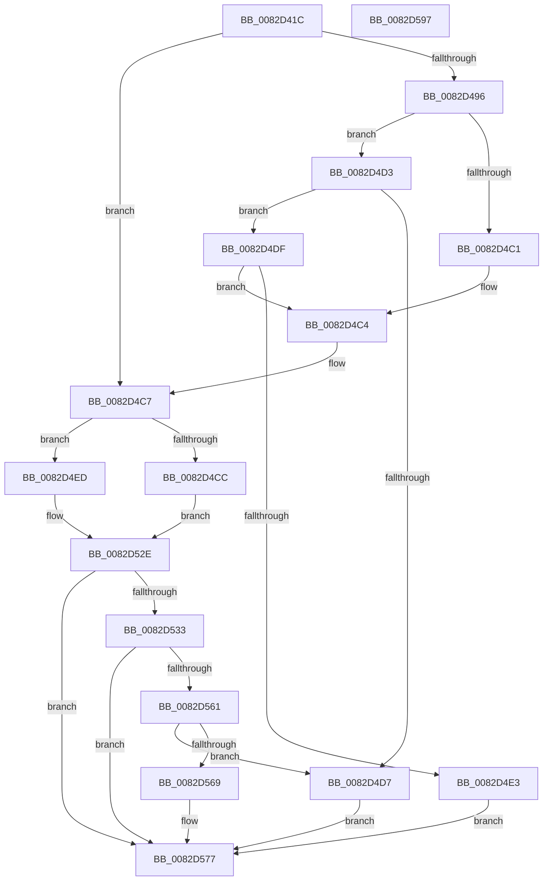

# CmGetMatchingDeviceInterfaceList

- RVA: `0x0082D41C`–`0x0082D598` (길이 `380` bytes)
- VA: `0x000000014082D41C`
- 실행 섹션: `PAGE`
- PDB 이름 있음: `예`; PDB Function 태그: `아니요`
- unwind 정보 RVA: `0x000DA988`
- 디코드: `112`개 명령, `380/380` bytes 표시
- 미해석 바이트: `0` (있으면 어셈블리에 `.byte`로 보존)

> 이 문서는 커널 이미지의 기계어와 PDB 기호를 분석해 생성했습니다. 4번과 5번은 함수 원형과 자료형을 바이너리 사용 방식에서 추정한 C 해석이며 원본 소스 복구 결과는 아닙니다.

## 1. Dependencies

- 직접 호출 지점: **5**; 고유 호출 대상: **4**
- 직접 호출자로 확인된 함수: **1**
- RIP 상대 이미지 참조: **1**

### Outgoing calls
- `0x0082D45B` → [memset](../../text/6C/memset_function_006C6C40.md) (function, `0x006C6C40`)
- `0x0082D4B5` → [guard_dispatch_icall](../../text/6B/guard_dispatch_icall_function_006BAAD0.md) (function, `0x006BAAD0`)
- `0x0082D527` → [_CmGetMatchingFilteredDeviceInterfaceList](../A0/_CmGetMatchingFilteredDeviceInterfaceList_function_00A09610.md) (function, `0x00A09610`)
- `0x0082D555` → [guard_dispatch_icall](../../text/6B/guard_dispatch_icall_function_006BAAD0.md) (function, `0x006BAAD0`)
- `0x0082D580` → [_security_check_cookie](../../text/6A/_security_check_cookie_function_006AC640.md) (function, `0x006AC640`)

### Direct callers
- [sub_00B1D0AA](../B1/Unknown_function_00B1D0AA.md) at `0x00B1D0CF`

### Static image references
- `0x0082D433` → RVA `0x00E0A740` (`.data`; read)

## 2. Other-region calls and transfers

- 다른 실행 섹션으로 향하는 call: **4**
  - `0x0082D45B` → [memset](../../text/6C/memset_function_006C6C40.md) (`PAGE` → `.text`)
  - `0x0082D4B5` → [guard_dispatch_icall](../../text/6B/guard_dispatch_icall_function_006BAAD0.md) (`PAGE` → `.text`)
  - `0x0082D555` → [guard_dispatch_icall](../../text/6B/guard_dispatch_icall_function_006BAAD0.md) (`PAGE` → `.text`)
  - `0x0082D580` → [_security_check_cookie](../../text/6A/_security_check_cookie_function_006AC640.md) (`PAGE` → `.text`)
- 별도 외부 분기/꼬리 이동을 확인하지 못했습니다.

## 3. Assembly (complete function range)

```asm
0082D41C  40 55                           push rbp
0082D41E  53                              push rbx
0082D41F  56                              push rsi
0082D420  57                              push rdi
0082D421  41 55                           push r13
0082D423  41 56                           push r14
0082D425  41 57                           push r15
0082D427  48 8D 6C 24 F1                  lea rbp, [rsp - 0xf]
0082D42C  48 81 EC C0 00 00 00            sub rsp, 0xc0
0082D433  48 8B 05 06 D3 5D 00            mov rax, qword ptr [rip + 0x5dd306]
0082D43A  48 33 C4                        xor rax, rsp
0082D43D  48 89 45 FF                     mov qword ptr [rbp - 1], rax
0082D441  48 8B 5D 77                     mov rbx, qword ptr [rbp + 0x77]
0082D445  48 8B FA                        mov rdi, rdx
0082D448  33 D2                           xor edx, edx
0082D44A  49 8B F0                        mov rsi, r8
0082D44D  4C 8B E9                        mov r13, rcx
0082D450  4D 8B F1                        mov r14, r9
0082D453  48 8D 4D 9F                     lea rcx, [rbp - 0x61]
0082D457  44 8D 42 58                     lea r8d, [rdx + 0x58]
0082D45B  E8 E0 97 E9 FF                  call 0x1406c6c40
0082D460  4D 8B BD F8 01 00 00            mov r15, qword ptr [r13 + 0x1f8]
0082D467  8B 45 6F                        mov eax, dword ptr [rbp + 0x6f]
0082D46A  8B 4D 7F                        mov ecx, dword ptr [rbp + 0x7f]
0082D46D  48 89 75 B7                     mov qword ptr [rbp - 0x49], rsi
0082D471  BE 04 00 00 00                  mov esi, 4
0082D476  48 89 7D AF                     mov qword ptr [rbp - 0x51], rdi
0082D47A  BF 20 01 00 C0                  mov edi, 0xc0000120
0082D47F  4C 89 75 BF                     mov qword ptr [rbp - 0x41], r14
0082D483  89 45 C7                        mov dword ptr [rbp - 0x39], eax
0082D486  48 89 5D CF                     mov qword ptr [rbp - 0x31], rbx
0082D48A  44 8D 76 FF                     lea r14d, [rsi - 1]
0082D48E  89 4D D7                        mov dword ptr [rbp - 0x29], ecx
0082D491  4D 85 FF                        test r15, r15
0082D494  74 31                           je 0x14082d4c7
0082D496  48 8D 45 9F                     lea rax, [rbp - 0x61]
0082D49A  44 8B CE                        mov r9d, esi
0082D49D  48 89 44 24 28                  mov qword ptr [rsp + 0x28], rax
0082D4A2  45 8B C6                        mov r8d, r14d
0082D4A5  49 8B C7                        mov rax, r15
0082D4A8  C7 44 24 20 01 00 00 00         mov dword ptr [rsp + 0x20], 1
0082D4B0  33 D2                           xor edx, edx
0082D4B2  49 8B CD                        mov rcx, r13
0082D4B5  E8 16 D6 E8 FF                  call 0x1406baad0
0082D4BA  3D 02 00 00 C0                  cmp eax, 0xc0000002
0082D4BF  75 12                           jne 0x14082d4d3
0082D4C1  45 33 FF                        xor r15d, r15d
0082D4C4  8B 4D D7                        mov ecx, dword ptr [rbp - 0x29]
0082D4C7  66 85 C9                        test cx, cx
0082D4CA  74 21                           je 0x14082d4ed
0082D4CC  BB 0D 00 00 C0                  mov ebx, 0xc000000d
0082D4D1  EB 5B                           jmp 0x14082d52e
0082D4D3  3B C7                           cmp eax, edi
0082D4D5  75 08                           jne 0x14082d4df
0082D4D7  8B 5D 9F                        mov ebx, dword ptr [rbp - 0x61]
0082D4DA  E9 98 00 00 00                  jmp 0x14082d577
0082D4DF  85 C0                           test eax, eax
0082D4E1  74 E1                           je 0x14082d4c4
0082D4E3  BB E5 00 00 C0                  mov ebx, 0xc00000e5
0082D4E8  E9 8A 00 00 00                  jmp 0x14082d577
0082D4ED  48 8B 45 CF                     mov rax, qword ptr [rbp - 0x31]
0082D4F1  45 33 C9                        xor r9d, r9d
0082D4F4  89 4C 24 48                     mov dword ptr [rsp + 0x48], ecx
0082D4F8  45 33 C0                        xor r8d, r8d
0082D4FB  48 89 44 24 40                  mov qword ptr [rsp + 0x40], rax
0082D500  33 D2                           xor edx, edx
0082D502  8B 45 C7                        mov eax, dword ptr [rbp - 0x39]
0082D505  49 8B CD                        mov rcx, r13
0082D508  89 44 24 38                     mov dword ptr [rsp + 0x38], eax
0082D50C  48 8B 45 BF                     mov rax, qword ptr [rbp - 0x41]
0082D510  48 89 44 24 30                  mov qword ptr [rsp + 0x30], rax
0082D515  48 8B 45 B7                     mov rax, qword ptr [rbp - 0x49]
0082D519  48 89 44 24 28                  mov qword ptr [rsp + 0x28], rax
0082D51E  48 8B 45 AF                     mov rax, qword ptr [rbp - 0x51]
0082D522  48 89 44 24 20                  mov qword ptr [rsp + 0x20], rax
0082D527  E8 E4 C0 1D 00                  call 0x140a09610
0082D52C  8B D8                           mov ebx, eax
0082D52E  4D 85 FF                        test r15, r15
0082D531  74 44                           je 0x14082d577
0082D533  48 8D 45 9F                     lea rax, [rbp - 0x61]
0082D537  89 5D 9F                        mov dword ptr [rbp - 0x61], ebx
0082D53A  48 89 44 24 28                  mov qword ptr [rsp + 0x28], rax
0082D53F  44 8B CE                        mov r9d, esi
0082D542  49 8B C7                        mov rax, r15
0082D545  C7 44 24 20 02 00 00 00         mov dword ptr [rsp + 0x20], 2
0082D54D  45 8B C6                        mov r8d, r14d
0082D550  33 D2                           xor edx, edx
0082D552  49 8B CD                        mov rcx, r13
0082D555  E8 76 D5 E8 FF                  call 0x1406baad0
0082D55A  3D 02 00 00 C0                  cmp eax, 0xc0000002
0082D55F  74 16                           je 0x14082d577
0082D561  3B C7                           cmp eax, edi
0082D563  0F 84 6E FF FF FF               je 0x14082d4d7
0082D569  8B CB                           mov ecx, ebx
0082D56B  85 C0                           test eax, eax
0082D56D  BB E5 00 00 C0                  mov ebx, 0xc00000e5
0082D572  0F 45 CB                        cmovne ecx, ebx
0082D575  8B D9                           mov ebx, ecx
0082D577  8B C3                           mov eax, ebx
0082D579  48 8B 4D FF                     mov rcx, qword ptr [rbp - 1]
0082D57D  48 33 CC                        xor rcx, rsp
0082D580  E8 BB F0 E7 FF                  call 0x1406ac640
0082D585  48 81 C4 C0 00 00 00            add rsp, 0xc0
0082D58C  41 5F                           pop r15
0082D58E  41 5E                           pop r14
0082D590  41 5D                           pop r13
0082D592  5F                              pop rdi
0082D593  5E                              pop rsi
0082D594  5B                              pop rbx
0082D595  5D                              pop rbp
0082D596  C3                              ret
0082D597  CC                              int3
```

## 4. C-style interpretation (structured pseudocode)

```c
__int64 __fastcall CmGetMatchingDeviceInterfaceList(__int64 a1, __int64 a2, __int64 a3, __int64 a4, unsigned int a5, __int64 a6, unsigned int a7)
{
    __int64 result;
    __int64 v_r15;
    __int64 v_rsp;
    unsigned __int64 v_stack_m47;
    unsigned __int64 v_stack_m48;
    unsigned int v_stack_m70;
    unsigned __int64 v_stack_m78;
    unsigned int v_stack_m80;
    unsigned __int64 v_stack_m88;
    unsigned __int64 v_stack_m90;
    unsigned __int64 v_stack_m98;
    unsigned __int64 v_stack_mA8;
    unsigned int v_stack_mB0;
    unsigned __int64 v_stack_mB8;
    unsigned int v_stack_mC0;
    unsigned __int64 v_stack_mC8;
    unsigned __int64 v_stack_mD0;
    unsigned int v_stack_mD8;

    v_rsp = (v_rsp) - (192);
    result = (*(unsigned __int64 *)(v_rip + 6148870)) ^ (v_rsp);
    v_stack_m48 = result;
    a2 = 0;
    result = memset(v_stack_mA8, a2, a2 + 88, a4);
    v_stack_m90 = a3;
    v_stack_m98 = 0;
    v_stack_m88 = a4;
    v_stack_m80 = (unsigned int)((unsigned int)(a5));
    v_stack_m78 = a6;
    v_stack_m70 = (unsigned int)((unsigned int)(a7));
    if (*(unsigned __int64 *)(a1 + 504) == 0) goto loc_0082D4C7;
    v_stack_mD0 = v_stack_mA8;
    v_stack_mD8 = 1;
    a2 = 0;
    result = guard_dispatch_icall(a1, a2, (unsigned int)((unsigned int)(4 - 1)), 4);
    if (((unsigned int)(result)) != 0xC0000002ULL) goto loc_0082D4D3;
    v_r15 = 0;
loc_0082D4C4:
loc_0082D4C7:
    if ((unsigned __int16)((unsigned int)(v_stack_m70)) == 0) goto loc_0082D4ED;
    goto loc_0082D52E;
loc_0082D4D3:
    if (((unsigned int)(result)) != ((unsigned int)((unsigned int)(0xC0000120ULL)))) goto loc_0082D4DF;
loc_0082D4D7:
    goto loc_0082D577;
loc_0082D4DF:
    if ((unsigned int)(result) == 0) goto loc_0082D4C4;
    goto loc_0082D577;
loc_0082D4ED:
    a4 = 0;
    v_stack_mB0 = (unsigned int)((unsigned int)(v_stack_m70));
    a3 = 0;
    v_stack_mB8 = v_stack_m78;
    a2 = 0;
    v_stack_mC0 = (unsigned int)((unsigned int)(v_stack_m80));
    v_stack_mC8 = v_stack_m88;
    v_stack_mD0 = v_stack_m90;
    v_stack_mD8 = v_stack_m98;
    result = _CmGetMatchingFilteredDeviceInterfaceList(a1, a2, a3, a4);
loc_0082D52E:
    if (0 == 0) goto loc_0082D577;
    v_stack_mA8 = (unsigned int)((unsigned int)((unsigned int)(result)));
    v_stack_mD0 = v_stack_mA8;
    v_stack_mD8 = 2;
    a2 = 0;
    result = guard_dispatch_icall(a1, a2, (unsigned int)((unsigned int)(4 - 1)), 4);
    if (((unsigned int)(result)) == 0xC0000002ULL) goto loc_0082D577;
    if (((unsigned int)(result)) == ((unsigned int)((unsigned int)(0xC0000120ULL)))) goto loc_0082D4D7;
    a1 = (unsigned int)((unsigned int)((unsigned int)((unsigned int)(result))));
    if ((unsigned int)(result) != 0) { a1 = (unsigned int)((unsigned int)(0xC00000E5ULL)); }
loc_0082D577:
    a1 = (v_stack_m48) ^ (v_rsp);
    result = _security_check_cookie(a1, a2, (unsigned int)((unsigned int)(4 - 1)), 4);
    v_rsp = (v_rsp) + (192);
    return result;
}
```

## 5. (Beta) C Style

```c
int64_t CmGetMatchingDeviceInterfaceList(void *Arg1, int64_t Arg2, int64_t Arg3, int64_t Arg4, uint32_t Arg5, int64_t Arg6, uint32_t Arg7)
{
    uint8_t *arg1 = (uint8_t *)Arg1;

    int64_t result;
    int64_t local_r15;
    int64_t local_rsp;
    uint64_t v_stack_m47;
    uint64_t v_stack_m48;
    uint32_t v_stack_m70;
    uint64_t v_stack_m78;
    uint32_t v_stack_m80;
    uint64_t v_stack_m88;
    uint64_t v_stack_m90;
    uint64_t v_stack_m98;
    uint64_t v_stack_mA8;
    uint32_t v_stack_mB0;
    uint64_t v_stack_mB8;
    uint32_t v_stack_mC0;
    uint64_t v_stack_mC8;
    uint64_t v_stack_mD0;
    uint32_t v_stack_mD8;

    local_rsp = (local_rsp) - (192);
    result = (*(uint64_t *)(v_rip + 0x5DD306)) ^ (local_rsp);
    v_stack_m48 = result;
    Arg2 = 0;
    result = memset(v_stack_mA8, Arg2, Arg2 + 88, Arg4);
    v_stack_m90 = Arg3;
    v_stack_m98 = 0;
    v_stack_m88 = Arg4;
    v_stack_m80 = (uint32_t)((uint32_t)(Arg5));
    v_stack_m78 = Arg6;
    v_stack_m70 = (uint32_t)((uint32_t)(Arg7));
    if (*(uint64_t *)(arg1 + 0x1F8) == 0) goto loc_0082D4C7;
    v_stack_mD0 = v_stack_mA8;
    v_stack_mD8 = 1;
    Arg2 = 0;
    result = guard_dispatch_icall(Arg1, Arg2, (uint32_t)((uint32_t)(4 - 1)), 4);
    if (((uint32_t)(result)) != 0xC0000002ULL) goto loc_0082D4D3;
    local_r15 = 0;
loc_0082D4C4:
loc_0082D4C7:
    if ((uint16_t)((uint32_t)(v_stack_m70)) == 0) goto loc_0082D4ED;
    goto loc_0082D52E;
loc_0082D4D3:
    if (((uint32_t)(result)) != ((uint32_t)((uint32_t)(0xC0000120ULL)))) goto loc_0082D4DF;
loc_0082D4D7:
    goto loc_0082D577;
loc_0082D4DF:
    if ((uint32_t)(result) == 0) goto loc_0082D4C4;
    goto loc_0082D577;
loc_0082D4ED:
    Arg4 = 0;
    v_stack_mB0 = (uint32_t)((uint32_t)(v_stack_m70));
    Arg3 = 0;
    v_stack_mB8 = v_stack_m78;
    Arg2 = 0;
    v_stack_mC0 = (uint32_t)((uint32_t)(v_stack_m80));
    v_stack_mC8 = v_stack_m88;
    v_stack_mD0 = v_stack_m90;
    v_stack_mD8 = v_stack_m98;
    result = _CmGetMatchingFilteredDeviceInterfaceList(Arg1, Arg2, Arg3, Arg4);
loc_0082D52E:
    if (0 == 0) goto loc_0082D577;
    v_stack_mA8 = (uint32_t)((uint32_t)((uint32_t)(result)));
    v_stack_mD0 = v_stack_mA8;
    v_stack_mD8 = 2;
    Arg2 = 0;
    result = guard_dispatch_icall(Arg1, Arg2, (uint32_t)((uint32_t)(4 - 1)), 4);
    if (((uint32_t)(result)) == 0xC0000002ULL) goto loc_0082D577;
    if (((uint32_t)(result)) == ((uint32_t)((uint32_t)(0xC0000120ULL)))) goto loc_0082D4D7;
    Arg1 = (uint32_t)((uint32_t)((uint32_t)((uint32_t)(result))));
    if ((uint32_t)(result) != 0) { Arg1 = (uint32_t)((uint32_t)(0xC00000E5ULL)); }
loc_0082D577:
    Arg1 = (v_stack_m48) ^ (local_rsp);
    result = _security_check_cookie(Arg1, Arg2, (uint32_t)((uint32_t)(4 - 1)), 4);
    local_rsp = (local_rsp) + (192);
    return result;
}
```

### 관측된 메모리 오프셋

구조체 형식이 확인되지 않은 접근은 인자 기준의 오프셋으로만 기록했습니다.

| 기준 인자 | 오프셋 표현 | 폭 (bit) | 접근 |
|---|---:|---:|---|
| `Arg1` | `+ 0x1F8` | `64` | `R` |

## 6. Execution-region graph

[열기: 2D/3D 그래프와 함수 탐색 컨트롤 패널](../../../control-panel.html?section=page&rva=0x0082D41C&view=graph)

- 2D 그래프는 위에서 아래로 흐르고, 3D 그래프는 빈 공간을 드래그해 회전합니다. Shift+드래그는 이동, 휠은 확대·축소, 함수 노드 선택은 대상 보고서 이동입니다.

### Static fallback


