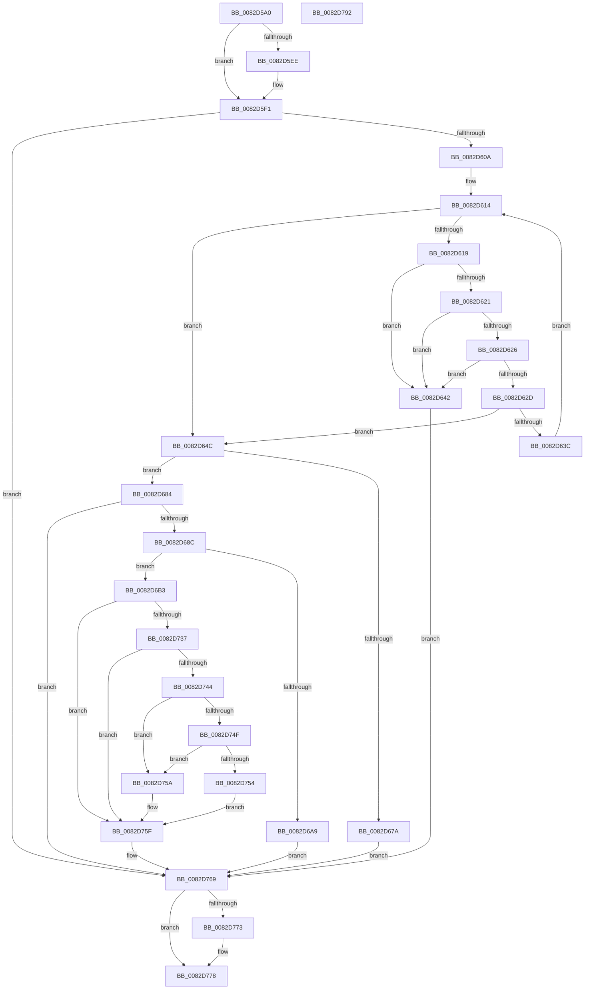

# CmGetMatchingDeviceListForSubkey

- RVA: `0x0082D5A0`–`0x0082D793` (길이 `499` bytes)
- VA: `0x000000014082D5A0`
- 실행 섹션: `PAGE`
- PDB 이름 있음: `예`; PDB Function 태그: `아니요`
- unwind 정보 RVA: `0x000AFEC4`
- 디코드: `135`개 명령, `499/499` bytes 표시
- 미해석 바이트: `0` (있으면 어셈블리에 `.byte`로 보존)

> 이 문서는 커널 이미지의 기계어와 PDB 기호를 분석해 생성했습니다. 4번과 5번은 함수 원형과 자료형을 바이너리 사용 방식에서 추정한 C 해석이며 원본 소스 복구 결과는 아닙니다.

## 1. Dependencies

- 직접 호출 지점: **8**; 고유 호출 대상: **8**
- 직접 호출자로 확인된 함수: **2**
- RIP 상대 이미지 참조: **1**

### Outgoing calls
- `0x0082D5FB` → [_PnpCtxGetCachedContextBaseKey](../8E/_PnpCtxGetCachedContextBaseKey_function_008EFB2C.md) (function, `0x008EFB2C`)
- `0x0082D632` → [wcschr](../../text/50/wcschr_function_00501A60.md) (function, `0x00501A60`)
- `0x0082D66C` → [PnpCtxRegOpenKey](../8E/PnpCtxRegOpenKey_function_008EF7B8.md) (function, `0x008EF7B8`)
- `0x0082D69C` → [ExAllocatePool2](../../poolcode/B8/ExAllocatePool2_function_00B820F0.md) (function, `0x00B820F0`)
- `0x0082D6D6` → [RtlStringCchCopyExW](../../text/41/RtlStringCchCopyExW_function_0041E1C0.md) (function, `0x0041E1C0`)
- `0x0082D72C` → [PnpCtxRegEnumKeyWithCallback](../AA/PnpCtxRegEnumKeyWithCallback_function_00AA146C.md) (function, `0x00AA146C`)
- `0x0082D764` → [ExFreePoolWithTag](../../poolcode/B8/ExFreePoolWithTag_function_00B82870.md) (function, `0x00B82870`)
- `0x0082D773` → [ZwClose](../../text/6A/ZwClose_function_006AD2B0.md) (function, `0x006AD2B0`)

### Direct callers
- [CmGetMatchingFilteredDeviceListWorker](../A2/CmGetMatchingFilteredDeviceListWorker_function_00A2C2BC.md) at `0x00A2C36E`
- [CmGetMatchingFilteredDeviceListWorker](../A2/CmGetMatchingFilteredDeviceListWorker_function_00A2C2BC.md) at `0x00A2C3D3`
- [sub_00B34A28](../B3/Unknown_function_00B34A28.md) at `0x00B34A56`

### Static image references
- `0x0082D6E2` → RVA `0x0082CE50` (`CmEnumSubkeyCallback`; read)

## 2. Other-region calls and transfers

- 다른 실행 섹션으로 향하는 call: **5**
  - `0x0082D632` → [wcschr](../../text/50/wcschr_function_00501A60.md) (`PAGE` → `.text`)
  - `0x0082D69C` → [ExAllocatePool2](../../poolcode/B8/ExAllocatePool2_function_00B820F0.md) (`PAGE` → `POOLCODE`)
  - `0x0082D6D6` → [RtlStringCchCopyExW](../../text/41/RtlStringCchCopyExW_function_0041E1C0.md) (`PAGE` → `.text`)
  - `0x0082D764` → [ExFreePoolWithTag](../../poolcode/B8/ExFreePoolWithTag_function_00B82870.md) (`PAGE` → `POOLCODE`)
  - `0x0082D773` → [ZwClose](../../text/6A/ZwClose_function_006AD2B0.md) (`PAGE` → `.text`)
- 별도 외부 분기/꼬리 이동을 확인하지 못했습니다.

## 3. Assembly (complete function range)

```asm
0082D5A0  48 8B C4                        mov rax, rsp
0082D5A3  48 89 58 08                     mov qword ptr [rax + 8], rbx
0082D5A7  4C 89 48 20                     mov qword ptr [rax + 0x20], r9
0082D5AB  44 88 40 18                     mov byte ptr [rax + 0x18], r8b
0082D5AF  55                              push rbp
0082D5B0  56                              push rsi
0082D5B1  57                              push rdi
0082D5B2  41 54                           push r12
0082D5B4  41 55                           push r13
0082D5B6  41 56                           push r14
0082D5B8  41 57                           push r15
0082D5BA  48 83 EC 40                     sub rsp, 0x40
0082D5BE  4C 8B B4 24 B8 00 00 00         mov r14, qword ptr [rsp + 0xb8]
0082D5C6  33 FF                           xor edi, edi
0082D5C8  44 8B BC 24 B0 00 00 00         mov r15d, dword ptr [rsp + 0xb0]
0082D5D0  4C 8B E2                        mov r12, rdx
0082D5D3  48 8B B4 24 A8 00 00 00         mov rsi, qword ptr [rsp + 0xa8]
0082D5DB  4C 8B E9                        mov r13, rcx
0082D5DE  48 89 78 C0                     mov qword ptr [rax - 0x40], rdi
0082D5E2  41 89 3E                        mov dword ptr [r14], edi
0082D5E5  48 89 78 B8                     mov qword ptr [rax - 0x48], rdi
0082D5E9  45 85 FF                        test r15d, r15d
0082D5EC  74 03                           je 0x14082d5f1
0082D5EE  66 89 3E                        mov word ptr [rsi], di
0082D5F1  4C 8D 44 24 38                  lea r8, [rsp + 0x38]
0082D5F6  BA 05 00 00 00                  mov edx, 5
0082D5FB  E8 2C 25 0C 00                  call 0x1408efb2c
0082D600  8B D8                           mov ebx, eax
0082D602  85 C0                           test eax, eax
0082D604  0F 88 5F 01 00 00               js 0x14082d769
0082D60A  49 8B C4                        mov rax, r12
0082D60D  8B EF                           mov ebp, edi
0082D60F  BB 5C 00 00 00                  mov ebx, 0x5c
0082D614  48 85 C0                        test rax, rax
0082D617  74 33                           je 0x14082d64c
0082D619  0F B7 08                        movzx ecx, word ptr [rax]
0082D61C  66 85 C9                        test cx, cx
0082D61F  74 21                           je 0x14082d642
0082D621  66 3B CB                        cmp cx, bx
0082D624  74 1C                           je 0x14082d642
0082D626  FF C5                           inc ebp
0082D628  83 FD 02                        cmp ebp, 2
0082D62B  77 15                           ja 0x14082d642
0082D62D  8B D3                           mov edx, ebx
0082D62F  48 8B C8                        mov rcx, rax
0082D632  E8 29 44 CD FF                  call 0x140501a60
0082D637  48 85 C0                        test rax, rax
0082D63A  74 10                           je 0x14082d64c
0082D63C  48 83 C0 02                     add rax, 2
0082D640  EB D2                           jmp 0x14082d614
0082D642  BB 0D 00 00 C0                  mov ebx, 0xc000000d
0082D647  E9 1D 01 00 00                  jmp 0x14082d769
0082D64C  48 8B 54 24 38                  mov rdx, qword ptr [rsp + 0x38]
0082D651  48 8D 44 24 30                  lea rax, [rsp + 0x30]
0082D656  48 89 44 24 28                  mov qword ptr [rsp + 0x28], rax
0082D65B  45 33 C9                        xor r9d, r9d
0082D65E  4D 8B C4                        mov r8, r12
0082D661  C7 44 24 20 08 00 00 00         mov dword ptr [rsp + 0x20], 8
0082D669  49 8B CD                        mov rcx, r13
0082D66C  E8 47 21 0C 00                  call 0x1408ef7b8
0082D671  8B D8                           mov ebx, eax
0082D673  3D 7C 01 00 C0                  cmp eax, 0xc000017c
0082D678  75 0A                           jne 0x14082d684
0082D67A  BB E5 00 00 C0                  mov ebx, 0xc00000e5
0082D67F  E9 E5 00 00 00                  jmp 0x14082d769
0082D684  85 C0                           test eax, eax
0082D686  0F 88 DD 00 00 00               js 0x14082d769
0082D68C  BA B8 01 00 00                  mov edx, 0x1b8
0082D691  B9 00 01 00 00                  mov ecx, 0x100
0082D696  41 B8 50 4E 50 52               mov r8d, 0x52504e50
0082D69C  E8 4F 4A 35 00                  call 0x140b820f0
0082D6A1  48 8B F8                        mov rdi, rax
0082D6A4  48 85 C0                        test rax, rax
0082D6A7  75 0A                           jne 0x14082d6b3
0082D6A9  BB 17 00 00 C0                  mov ebx, 0xc0000017
0082D6AE  E9 B6 00 00 00                  jmp 0x14082d769
0082D6B3  8D 45 01                        lea eax, [rbp + 1]
0082D6B6  C7 44 24 28 00 09 00 00         mov dword ptr [rsp + 0x28], 0x900
0082D6BE  33 ED                           xor ebp, ebp
0082D6C0  89 07                           mov dword ptr [rdi], eax
0082D6C2  48 8D 4F 04                     lea rcx, [rdi + 4]
0082D6C6  48 89 6C 24 20                  mov qword ptr [rsp + 0x20], rbp
0082D6CB  45 33 C9                        xor r9d, r9d
0082D6CE  4D 8B C4                        mov r8, r12
0082D6D1  BA C8 00 00 00                  mov edx, 0xc8
0082D6D6  E8 E5 0A BF FF                  call 0x14041e1c0
0082D6DB  8A 84 24 90 00 00 00            mov al, byte ptr [rsp + 0x90]
0082D6E2  4C 8D 05 67 F7 FF FF            lea r8, [rip - 0x899]
0082D6E9  88 87 94 01 00 00               mov byte ptr [rdi + 0x194], al
0082D6EF  4C 8B CF                        mov r9, rdi
0082D6F2  48 8B 84 24 98 00 00 00         mov rax, qword ptr [rsp + 0x98]
0082D6FA  49 8B CD                        mov rcx, r13
0082D6FD  48 89 87 98 01 00 00            mov qword ptr [rdi + 0x198], rax
0082D704  48 8B 84 24 A0 00 00 00         mov rax, qword ptr [rsp + 0xa0]
0082D70C  48 89 87 A0 01 00 00            mov qword ptr [rdi + 0x1a0], rax
0082D713  48 89 B7 A8 01 00 00            mov qword ptr [rdi + 0x1a8], rsi
0082D71A  44 89 BF B0 01 00 00            mov dword ptr [rdi + 0x1b0], r15d
0082D721  89 AF B4 01 00 00               mov dword ptr [rdi + 0x1b4], ebp
0082D727  48 8B 54 24 30                  mov rdx, qword ptr [rsp + 0x30]
0082D72C  E8 3B 3D 27 00                  call 0x140aa146c
0082D731  8B D8                           mov ebx, eax
0082D733  85 C0                           test eax, eax
0082D735  78 28                           js 0x14082d75f
0082D737  8B 87 B4 01 00 00               mov eax, dword ptr [rdi + 0x1b4]
0082D73D  41 89 06                        mov dword ptr [r14], eax
0082D740  85 C0                           test eax, eax
0082D742  74 1B                           je 0x14082d75f
0082D744  8D 48 01                        lea ecx, [rax + 1]
0082D747  41 89 0E                        mov dword ptr [r14], ecx
0082D74A  48 85 F6                        test rsi, rsi
0082D74D  74 0B                           je 0x14082d75a
0082D74F  44 3B F9                        cmp r15d, ecx
0082D752  72 06                           jb 0x14082d75a
0082D754  66 89 2C 46                     mov word ptr [rsi + rax*2], bp
0082D758  EB 05                           jmp 0x14082d75f
0082D75A  BB 23 00 00 C0                  mov ebx, 0xc0000023
0082D75F  33 D2                           xor edx, edx
0082D761  48 8B CF                        mov rcx, rdi
0082D764  E8 07 51 35 00                  call 0x140b82870
0082D769  48 8B 4C 24 30                  mov rcx, qword ptr [rsp + 0x30]
0082D76E  48 85 C9                        test rcx, rcx
0082D771  74 05                           je 0x14082d778
0082D773  E8 38 FB E7 FF                  call 0x1406ad2b0
0082D778  8B C3                           mov eax, ebx
0082D77A  48 8B 9C 24 80 00 00 00         mov rbx, qword ptr [rsp + 0x80]
0082D782  48 83 C4 40                     add rsp, 0x40
0082D786  41 5F                           pop r15
0082D788  41 5E                           pop r14
0082D78A  41 5D                           pop r13
0082D78C  41 5C                           pop r12
0082D78E  5F                              pop rdi
0082D78F  5E                              pop rsi
0082D790  5D                              pop rbp
0082D791  C3                              ret
0082D792  CC                              int3
```

## 4. C-style interpretation (structured pseudocode)

```c
__int64 __fastcall CmGetMatchingDeviceListForSubkey(__int64 a1, __int64 a2, unsigned __int8 a3, __int64 a4, __int64 a5, __int64 a6, unsigned int a7, __int64 a8)
{
    __int64 result;
    __int64 v_rbp;
    __int64 v_rdi;
    __int64 v_rsp;
    unsigned __int64 v_stack_m40;
    unsigned __int64 v_stack_m48;
    unsigned __int64 v_stack_m50;
    unsigned int v_stack_m58;
    unsigned __int8 v_stack_p18;
    unsigned __int64 v_stack_p20;
    unsigned __int64 v_stack_p8;

    *(unsigned __int64 *)(v_rsp + 8) = v_rbx;
    *(unsigned __int64 *)(v_rsp + 32) = a4;
    *(unsigned __int8 *)(v_rsp + 24) = a3;
    v_rsp = (v_rsp) - (64);
    v_rdi = 0;
    *(unsigned __int64 *)(v_rsp - 64) = 0;
    *(unsigned int *)(a8) = 0;
    *(unsigned __int64 *)(v_rsp - 72) = 0;
    if ((unsigned int)((unsigned int)(a7)) != 0) {
        *(unsigned __int16 *)(a6) = 0;
    }
    result = _PnpCtxGetCachedContextBaseKey(a1, 5, v_stack_m40, a4);
    if (sign_flag) goto loc_0082D769;
loc_0082D614:
    if (a2 == 0) goto loc_0082D64C;
    if ((unsigned __int16)(*(unsigned __int16 *)(a2)) == 0) goto loc_0082D642;
    if (((unsigned __int16)(*(unsigned __int16 *)(a2))) == 92) goto loc_0082D642;
    v_rbp = (unsigned int)((0) + 1);
    if (((unsigned int)(v_rbp)) > 2) goto loc_0082D642;
    result = wcschr(a2, 92, v_stack_m40, a4);
    if (result == 0) goto loc_0082D64C;
    result = (result) + (2);
    goto loc_0082D614;
loc_0082D642:
    goto loc_0082D769;
loc_0082D64C:
    v_stack_m50 = v_stack_m48;
    a4 = 0;
    v_stack_m58 = 8;
    result = PnpCtxRegOpenKey(a1, v_stack_m40, a2, a4);
    if (((unsigned int)(result)) != 0xC000017CULL) goto loc_0082D684;
    goto loc_0082D769;
loc_0082D684:
    if (sign_flag) goto loc_0082D769;
    result = ExAllocatePool2(256, 440, (unsigned int)(0x52504E50ULL), a4);
    if (result != 0) goto loc_0082D6B3;
    goto loc_0082D769;
loc_0082D6B3:
    v_stack_m50 = 0x900ULL;
    v_rbp = 0;
    *(unsigned int *)(result) = (unsigned int)(v_rbp + 1);
    v_stack_m58 = 0;
    a4 = 0;
    result = RtlStringCchCopyExW(result + 4, 200, a2, a4);
    *(unsigned __int8 *)(result + 404) = (unsigned __int8)(v_stack_p18);
    *(unsigned __int64 *)(result + 408) = v_stack_p20;
    *(unsigned __int64 *)(result + 416) = a5;
    *(unsigned __int64 *)(result + 424) = a6;
    *(unsigned int *)(result + 432) = (unsigned int)((unsigned int)(a7));
    *(unsigned int *)(result + 436) = 0;
    result = PnpCtxRegEnumKeyWithCallback(a1, v_stack_m48, v_rip - 2201, result);
    if (sign_flag) goto loc_0082D75F;
    *(unsigned int *)(a8) = (unsigned int)((unsigned int)(*(unsigned int *)(result + 436)));
    if ((unsigned int)((unsigned int)(*(unsigned int *)(result + 436))) == 0) goto loc_0082D75F;
    *(unsigned int *)(a8) = (unsigned int)((unsigned int)(*(unsigned int *)(result + 436)) + 1);
    if (a6 == 0) goto loc_0082D75A;
    if (((unsigned int)((unsigned int)(a7))) < ((unsigned int)((unsigned int)(*(unsigned int *)(result + 436)) + 1))) goto loc_0082D75A;
    *(unsigned __int16 *)(a6 + (unsigned int)(*(unsigned int *)(result + 436)) * 2) = 0;
    goto loc_0082D75F;
loc_0082D75A:
loc_0082D75F:
    a2 = 0;
    result = ExFreePoolWithTag(result, a2, v_rip - 2201, result);
loc_0082D769:
    if (v_stack_m48 != 0) {
        result = ZwClose(v_stack_m48, a2, v_rip - 2201, result);
    }
    v_rsp = (v_rsp) + (64);
    return (unsigned int)((unsigned int)((unsigned int)(0xC0000023ULL)));
}
```

## 5. (Beta) C Style

```c
int64_t CmGetMatchingDeviceListForSubkey(int64_t Arg1, int64_t Arg2, uint8_t Arg3, int64_t Arg4, int64_t Arg5, void *Arg6, uint32_t Arg7, void *Arg8)
{
    uint8_t *arg6 = (uint8_t *)Arg6;
    uint8_t *arg8 = (uint8_t *)Arg8;

    int64_t result;
    int64_t local_rbp;
    int64_t local_rdi;
    int64_t local_rsp;
    uint64_t v_stack_m40;
    uint64_t v_stack_m48;
    uint64_t v_stack_m50;
    uint32_t v_stack_m58;
    uint8_t v_stack_p18;
    uint64_t v_stack_p20;
    uint64_t v_stack_p8;

    *(uint64_t *)(local_rsp + 0x8) = local_rbx;
    *(uint64_t *)(local_rsp + 0x20) = Arg4;
    *(uint8_t *)(local_rsp + 0x18) = Arg3;
    local_rsp = (local_rsp) - (64);
    local_rdi = 0;
    *(uint64_t *)(local_rsp - 0x40) = 0;
    *(uint32_t *)(arg8) = 0;
    *(uint64_t *)(local_rsp - 0x48) = 0;
    if ((uint32_t)((uint32_t)(Arg7)) != 0) {
        *(uint16_t *)(arg6) = 0;
    }
    result = _PnpCtxGetCachedContextBaseKey(Arg1, 5, v_stack_m40, Arg4);
    if (sign_flag) goto loc_0082D769;
loc_0082D614:
    if (Arg2 == 0) goto loc_0082D64C;
    if ((uint16_t)(*(uint16_t *)(Arg2)) == 0) goto loc_0082D642;
    if (((uint16_t)(*(uint16_t *)(Arg2))) == 92) goto loc_0082D642;
    local_rbp = (uint32_t)((0) + 1);
    if (((uint32_t)(local_rbp)) > 2) goto loc_0082D642;
    result = wcschr(Arg2, 92, v_stack_m40, Arg4);
    if (result == 0) goto loc_0082D64C;
    result = (result) + (2);
    goto loc_0082D614;
loc_0082D642:
    goto loc_0082D769;
loc_0082D64C:
    v_stack_m50 = v_stack_m48;
    Arg4 = 0;
    v_stack_m58 = 8;
    result = PnpCtxRegOpenKey(Arg1, v_stack_m40, Arg2, Arg4);
    if (((uint32_t)(result)) != 0xC000017CULL) goto loc_0082D684;
    goto loc_0082D769;
loc_0082D684:
    if (sign_flag) goto loc_0082D769;
    result = ExAllocatePool2(256, 440, (uint32_t)(0x52504E50ULL), Arg4);
    if (result != 0) goto loc_0082D6B3;
    goto loc_0082D769;
loc_0082D6B3:
    v_stack_m50 = 0x900ULL;
    local_rbp = 0;
    *(uint32_t *)(result) = (uint32_t)(local_rbp + 1);
    v_stack_m58 = 0;
    Arg4 = 0;
    result = RtlStringCchCopyExW(result + 4, 200, Arg2, Arg4);
    *(uint8_t *)(result + 0x194) = (uint8_t)(v_stack_p18);
    *(uint64_t *)(result + 0x198) = v_stack_p20;
    *(uint64_t *)(result + 0x1A0) = Arg5;
    *(void **)(result + 0x1A8) = Arg6;
    *(uint32_t *)(result + 0x1B0) = (uint32_t)((uint32_t)(Arg7));
    *(uint32_t *)(result + 0x1B4) = 0;
    result = PnpCtxRegEnumKeyWithCallback(Arg1, v_stack_m48, v_rip - 2201, result);
    if (sign_flag) goto loc_0082D75F;
    *(uint32_t *)(arg8) = (uint32_t)((uint32_t)(*(uint32_t *)(result + 0x1B4)));
    if ((uint32_t)((uint32_t)(*(uint32_t *)(result + 0x1B4))) == 0) goto loc_0082D75F;
    *(uint32_t *)(arg8) = (uint32_t)((uint32_t)(*(uint32_t *)(result + 0x1B4)) + 1);
    if (Arg6 == NULL) goto loc_0082D75A;
    if (((uint32_t)((uint32_t)(Arg7))) < ((uint32_t)((uint32_t)(*(uint32_t *)(result + 0x1B4)) + 1))) goto loc_0082D75A;
    *(uint16_t *)(arg6 + (uint32_t)(*(uint32_t *)(result + 0x1B4)) * 2) = 0;
    goto loc_0082D75F;
loc_0082D75A:
loc_0082D75F:
    Arg2 = 0;
    result = ExFreePoolWithTag(result, Arg2, v_rip - 2201, result);
loc_0082D769:
    if (v_stack_m48 != 0) {
        result = ZwClose(v_stack_m48, Arg2, v_rip - 2201, result);
    }
    local_rsp = (local_rsp) + (64);
    return (uint32_t)((uint32_t)((uint32_t)(0xC0000023ULL)));
}
```

### 관측된 메모리 오프셋

구조체 형식이 확인되지 않은 접근은 인자 기준의 오프셋으로만 기록했습니다.

| 기준 인자 | 오프셋 표현 | 폭 (bit) | 접근 |
|---|---:|---:|---|
| `Arg6` | `+ 0x0` | `16` | `W` |
| `Arg8` | `+ 0x0` | `32` | `W` |

## 6. Execution-region graph

[열기: 2D/3D 그래프와 함수 탐색 컨트롤 패널](../../../control-panel.html?section=page&rva=0x0082D5A0&view=graph)

- 2D 그래프는 위에서 아래로 흐르고, 3D 그래프는 빈 공간을 드래그해 회전합니다. Shift+드래그는 이동, 휠은 확대·축소, 함수 노드 선택은 대상 보고서 이동입니다.

### Static fallback


