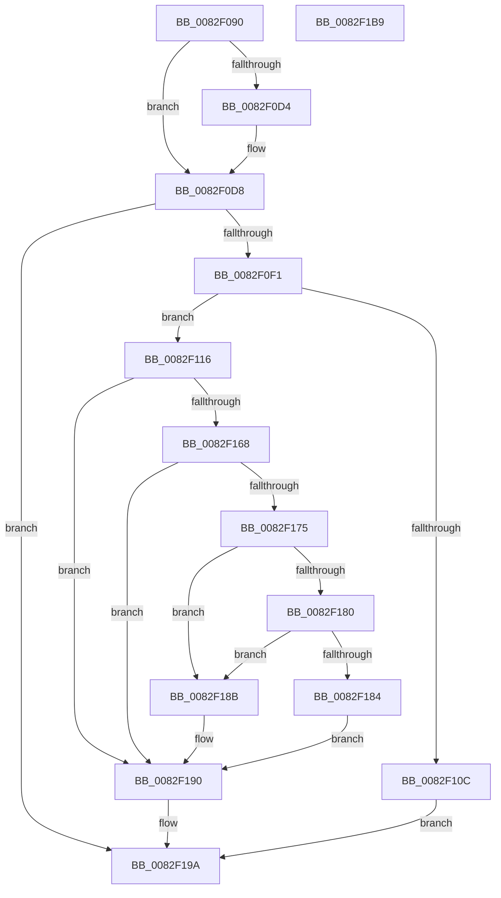

# CmGetMatchingDevicePanelListWorker

- RVA: `0x0082F090`–`0x0082F1BA` (길이 `298` bytes)
- VA: `0x000000014082F090`
- 실행 섹션: `PAGE`
- PDB 이름 있음: `예`; PDB Function 태그: `아니요`
- unwind 정보 RVA: `0x0008C20C`
- 디코드: `82`개 명령, `298/298` bytes 표시
- 미해석 바이트: `0` (있으면 어셈블리에 `.byte`로 보존)

> 이 문서는 커널 이미지의 기계어와 PDB 기호를 분석해 생성했습니다. 4번과 5번은 함수 원형과 자료형을 바이너리 사용 방식에서 추정한 C 해석이며 원본 소스 복구 결과는 아닙니다.

## 1. Dependencies

- 직접 호출 지점: **4**; 고유 호출 대상: **4**
- 직접 호출자로 확인된 함수: **1**
- RIP 상대 이미지 참조: **1**

### Outgoing calls
- `0x0082F0E2` → [_PnpCtxGetCachedContextBaseKey](../8E/_PnpCtxGetCachedContextBaseKey_function_008EFB2C.md) (function, `0x008EFB2C`)
- `0x0082F0FF` → [ExAllocatePool2](../../poolcode/B8/ExAllocatePool2_function_00B820F0.md) (function, `0x00B820F0`)
- `0x0082F15D` → [PnpCtxRegEnumKeyWithCallback](../AA/PnpCtxRegEnumKeyWithCallback_function_00AA146C.md) (function, `0x00AA146C`)
- `0x0082F195` → [ExFreePoolWithTag](../../poolcode/B8/ExFreePoolWithTag_function_00B82870.md) (function, `0x00B82870`)

### Direct callers
- [CmGetMatchingDevicePanelList](CmGetMatchingDevicePanelList_function_0082EF30.md) at `0x0082F002`

### Static image references
- `0x0082F11B` → RVA `0x0082E9B0` (`CmDevicePanelEnumSubkeyCallback`; read)

## 2. Other-region calls and transfers

- 다른 실행 섹션으로 향하는 call: **2**
  - `0x0082F0FF` → [ExAllocatePool2](../../poolcode/B8/ExAllocatePool2_function_00B820F0.md) (`PAGE` → `POOLCODE`)
  - `0x0082F195` → [ExFreePoolWithTag](../../poolcode/B8/ExFreePoolWithTag_function_00B82870.md) (`PAGE` → `POOLCODE`)
- 별도 외부 분기/꼬리 이동을 확인하지 못했습니다.

## 3. Assembly (complete function range)

```asm
0082F090  48 8B C4                        mov rax, rsp
0082F093  48 89 58 08                     mov qword ptr [rax + 8], rbx
0082F097  48 89 68 10                     mov qword ptr [rax + 0x10], rbp
0082F09B  48 89 70 18                     mov qword ptr [rax + 0x18], rsi
0082F09F  57                              push rdi
0082F0A0  41 54                           push r12
0082F0A2  41 55                           push r13
0082F0A4  41 56                           push r14
0082F0A6  41 57                           push r15
0082F0A8  48 83 EC 30                     sub rsp, 0x30
0082F0AC  4C 8B B4 24 88 00 00 00         mov r14, qword ptr [rsp + 0x88]
0082F0B4  33 FF                           xor edi, edi
0082F0B6  8B AC 24 80 00 00 00            mov ebp, dword ptr [rsp + 0x80]
0082F0BD  49 8B F1                        mov rsi, r9
0082F0C0  48 89 78 C8                     mov qword ptr [rax - 0x38], rdi
0082F0C4  4D 8B E0                        mov r12, r8
0082F0C7  4C 8B EA                        mov r13, rdx
0082F0CA  4C 8B F9                        mov r15, rcx
0082F0CD  41 89 3E                        mov dword ptr [r14], edi
0082F0D0  85 ED                           test ebp, ebp
0082F0D2  74 04                           je 0x14082f0d8
0082F0D4  66 41 89 39                     mov word ptr [r9], di
0082F0D8  4C 8D 44 24 20                  lea r8, [rsp + 0x20]
0082F0DD  BA 0B 00 00 00                  mov edx, 0xb
0082F0E2  E8 45 0A 0C 00                  call 0x1408efb2c
0082F0E7  8B D8                           mov ebx, eax
0082F0E9  85 C0                           test eax, eax
0082F0EB  0F 88 A9 00 00 00               js 0x14082f19a
0082F0F1  BA A0 00 00 00                  mov edx, 0xa0
0082F0F6  41 B8 50 4E 50 52               mov r8d, 0x52504e50
0082F0FC  8D 4A 60                        lea ecx, [rdx + 0x60]
0082F0FF  E8 EC 2F 35 00                  call 0x140b820f0
0082F104  48 8B F8                        mov rdi, rax
0082F107  48 85 C0                        test rax, rax
0082F10A  75 0A                           jne 0x14082f116
0082F10C  BB 17 00 00 C0                  mov ebx, 0xc0000017
0082F111  E9 84 00 00 00                  jmp 0x14082f19a
0082F116  48 8B 54 24 20                  mov rdx, qword ptr [rsp + 0x20]
0082F11B  4C 8D 05 8E F8 FF FF            lea r8, [rip - 0x772]
0082F122  4C 89 A0 80 00 00 00            mov qword ptr [rax + 0x80], r12
0082F129  4C 8B CF                        mov r9, rdi
0082F12C  C7 00 01 00 00 00               mov dword ptr [rax], 1
0082F132  45 33 E4                        xor r12d, r12d
0082F135  44 89 A0 94 00 00 00            mov dword ptr [rax + 0x94], r12d
0082F13C  49 8B CF                        mov rcx, r15
0082F13F  4C 89 68 78                     mov qword ptr [rax + 0x78], r13
0082F143  48 89 B0 88 00 00 00            mov qword ptr [rax + 0x88], rsi
0082F14A  89 A8 90 00 00 00               mov dword ptr [rax + 0x90], ebp
0082F150  8B 84 24 90 00 00 00            mov eax, dword ptr [rsp + 0x90]
0082F157  89 87 98 00 00 00               mov dword ptr [rdi + 0x98], eax
0082F15D  E8 0A 23 27 00                  call 0x140aa146c
0082F162  8B D8                           mov ebx, eax
0082F164  85 C0                           test eax, eax
0082F166  78 28                           js 0x14082f190
0082F168  8B 87 94 00 00 00               mov eax, dword ptr [rdi + 0x94]
0082F16E  41 89 06                        mov dword ptr [r14], eax
0082F171  85 C0                           test eax, eax
0082F173  74 1B                           je 0x14082f190
0082F175  8D 48 01                        lea ecx, [rax + 1]
0082F178  41 89 0E                        mov dword ptr [r14], ecx
0082F17B  48 85 F6                        test rsi, rsi
0082F17E  74 0B                           je 0x14082f18b
0082F180  3B E9                           cmp ebp, ecx
0082F182  72 07                           jb 0x14082f18b
0082F184  66 44 89 24 46                  mov word ptr [rsi + rax*2], r12w
0082F189  EB 05                           jmp 0x14082f190
0082F18B  BB 23 00 00 C0                  mov ebx, 0xc0000023
0082F190  33 D2                           xor edx, edx
0082F192  48 8B CF                        mov rcx, rdi
0082F195  E8 D6 36 35 00                  call 0x140b82870
0082F19A  48 8B 6C 24 68                  mov rbp, qword ptr [rsp + 0x68]
0082F19F  8B C3                           mov eax, ebx
0082F1A1  48 8B 5C 24 60                  mov rbx, qword ptr [rsp + 0x60]
0082F1A6  48 8B 74 24 70                  mov rsi, qword ptr [rsp + 0x70]
0082F1AB  48 83 C4 30                     add rsp, 0x30
0082F1AF  41 5F                           pop r15
0082F1B1  41 5E                           pop r14
0082F1B3  41 5D                           pop r13
0082F1B5  41 5C                           pop r12
0082F1B7  5F                              pop rdi
0082F1B8  C3                              ret
0082F1B9  CC                              int3
```

## 4. C-style interpretation (structured pseudocode)

```c
__int64 __fastcall CmGetMatchingDevicePanelListWorker(__int64 a1, __int64 a2, __int64 a3, __int64 a4, unsigned int a5, __int64 a6, unsigned int a7)
{
    __int64 result;
    __int64 v_r12;
    __int64 v_rdi;
    __int64 v_rsp;
    unsigned __int64 v_stack_m38;
    unsigned __int64 v_stack_p10;
    unsigned __int64 v_stack_p18;
    unsigned __int64 v_stack_p8;

    *(unsigned __int64 *)(v_rsp + 8) = v_rbx;
    *(unsigned __int64 *)(v_rsp + 16) = v_rbp;
    *(unsigned __int64 *)(v_rsp + 24) = v_rsi;
    v_rsp = (v_rsp) - (48);
    v_rdi = 0;
    *(unsigned __int64 *)(v_rsp - 56) = 0;
    *(unsigned int *)(a6) = 0;
    if ((unsigned int)((unsigned int)(a5)) != 0) {
        *(unsigned __int16 *)(a4) = 0;
    }
    result = _PnpCtxGetCachedContextBaseKey(a1, 11, v_stack_m38, a4);
    if (sign_flag) goto loc_0082F19A;
    result = ExAllocatePool2(160 + 96, 160, (unsigned int)(0x52504E50ULL), a4);
    if (result != 0) goto loc_0082F116;
    goto loc_0082F19A;
loc_0082F116:
    *(unsigned __int64 *)(result + 128) = a3;
    *(unsigned int *)(result) = 1;
    v_r12 = 0;
    *(unsigned int *)(result + 148) = 0;
    *(unsigned __int64 *)(result + 120) = a2;
    *(unsigned __int64 *)(result + 136) = a4;
    *(unsigned int *)(result + 144) = (unsigned int)((unsigned int)(a5));
    *(unsigned int *)(result + 152) = (unsigned int)((unsigned int)(a7));
    result = PnpCtxRegEnumKeyWithCallback(a1, v_stack_m38, v_rip - 1906, result);
    if (sign_flag) goto loc_0082F190;
    *(unsigned int *)(a6) = (unsigned int)((unsigned int)(*(unsigned int *)(result + 148)));
    if ((unsigned int)((unsigned int)(*(unsigned int *)(result + 148))) == 0) goto loc_0082F190;
    *(unsigned int *)(a6) = (unsigned int)((unsigned int)(*(unsigned int *)(result + 148)) + 1);
    if (a4 == 0) goto loc_0082F18B;
    if (((unsigned int)((unsigned int)(a5))) < ((unsigned int)((unsigned int)(*(unsigned int *)(result + 148)) + 1))) goto loc_0082F18B;
    *(unsigned __int16 *)(a4 + (unsigned int)(*(unsigned int *)(result + 148)) * 2) = 0;
    goto loc_0082F190;
loc_0082F18B:
loc_0082F190:
    a2 = 0;
    result = ExFreePoolWithTag(result, a2, v_rip - 1906, result);
loc_0082F19A:
    v_rsp = (v_rsp) + (48);
    return (unsigned int)((unsigned int)((unsigned int)(0xC0000023ULL)));
}
```

## 5. (Beta) C Style

```c
int64_t CmGetMatchingDevicePanelListWorker(int64_t Arg1, int64_t Arg2, int64_t Arg3, void *Arg4, uint32_t Arg5, void *Arg6, uint32_t Arg7)
{
    uint8_t *arg4 = (uint8_t *)Arg4;
    uint8_t *arg6 = (uint8_t *)Arg6;

    int64_t result;
    int64_t local_r12;
    int64_t local_rdi;
    int64_t local_rsp;
    uint64_t v_stack_m38;
    uint64_t v_stack_p10;
    uint64_t v_stack_p18;
    uint64_t v_stack_p8;

    *(uint64_t *)(local_rsp + 0x8) = local_rbx;
    *(uint64_t *)(local_rsp + 0x10) = local_rbp;
    *(uint64_t *)(local_rsp + 0x18) = local_rsi;
    local_rsp = (local_rsp) - (48);
    local_rdi = 0;
    *(uint64_t *)(local_rsp - 0x38) = 0;
    *(uint32_t *)(arg6) = 0;
    if ((uint32_t)((uint32_t)(Arg5)) != 0) {
        *(uint16_t *)(arg4) = 0;
    }
    result = _PnpCtxGetCachedContextBaseKey(Arg1, 11, v_stack_m38, Arg4);
    if (sign_flag) goto loc_0082F19A;
    result = ExAllocatePool2(160 + 96, 160, (uint32_t)(0x52504E50ULL), Arg4);
    if (result != 0) goto loc_0082F116;
    goto loc_0082F19A;
loc_0082F116:
    *(uint64_t *)(result + 0x80) = Arg3;
    *(uint32_t *)(result) = 1;
    local_r12 = 0;
    *(uint32_t *)(result + 0x94) = 0;
    *(uint64_t *)(result + 0x78) = Arg2;
    *(void **)(result + 0x88) = Arg4;
    *(uint32_t *)(result + 0x90) = (uint32_t)((uint32_t)(Arg5));
    *(uint32_t *)(result + 0x98) = (uint32_t)((uint32_t)(Arg7));
    result = PnpCtxRegEnumKeyWithCallback(Arg1, v_stack_m38, v_rip - 1906, result);
    if (sign_flag) goto loc_0082F190;
    *(uint32_t *)(arg6) = (uint32_t)((uint32_t)(*(uint32_t *)(result + 0x94)));
    if ((uint32_t)((uint32_t)(*(uint32_t *)(result + 0x94))) == 0) goto loc_0082F190;
    *(uint32_t *)(arg6) = (uint32_t)((uint32_t)(*(uint32_t *)(result + 0x94)) + 1);
    if (Arg4 == NULL) goto loc_0082F18B;
    if (((uint32_t)((uint32_t)(Arg5))) < ((uint32_t)((uint32_t)(*(uint32_t *)(result + 0x94)) + 1))) goto loc_0082F18B;
    *(uint16_t *)(arg4 + (uint32_t)(*(uint32_t *)(result + 0x94)) * 2) = 0;
    goto loc_0082F190;
loc_0082F18B:
loc_0082F190:
    Arg2 = 0;
    result = ExFreePoolWithTag(result, Arg2, v_rip - 1906, result);
loc_0082F19A:
    local_rsp = (local_rsp) + (48);
    return (uint32_t)((uint32_t)((uint32_t)(0xC0000023ULL)));
}
```

### 관측된 메모리 오프셋

구조체 형식이 확인되지 않은 접근은 인자 기준의 오프셋으로만 기록했습니다.

| 기준 인자 | 오프셋 표현 | 폭 (bit) | 접근 |
|---|---:|---:|---|
| `Arg4` | `+ 0x0` | `16` | `W` |
| `Arg6` | `+ 0x0` | `32` | `W` |

## 6. Execution-region graph

[열기: 2D/3D 그래프와 함수 탐색 컨트롤 패널](../../../control-panel.html?section=page&rva=0x0082F090&view=graph)

- 2D 그래프는 위에서 아래로 흐르고, 3D 그래프는 빈 공간을 드래그해 회전합니다. Shift+드래그는 이동, 휠은 확대·축소, 함수 노드 선택은 대상 보고서 이동입니다.

### Static fallback


