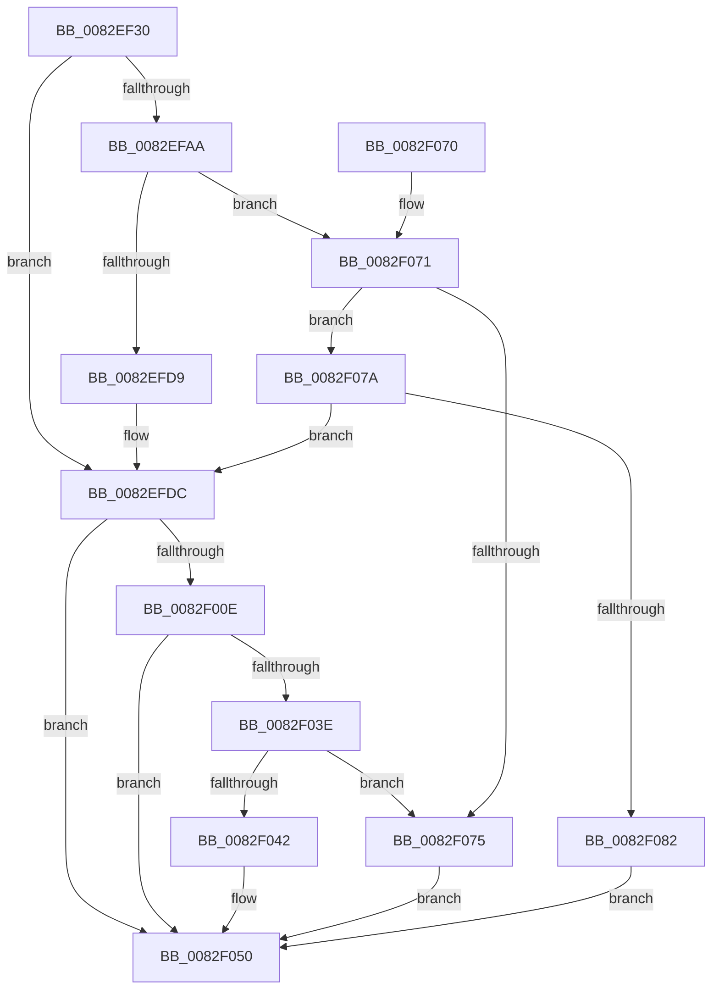

# CmGetMatchingDevicePanelList

- RVA: `0x0082EF30`–`0x0082F089` (길이 `345` bytes)
- VA: `0x000000014082EF30`
- 실행 섹션: `PAGE`
- PDB 이름 있음: `예`; PDB Function 태그: `아니요`
- unwind 정보 RVA: `0x000DAA08`
- 디코드: `103`개 명령, `345/345` bytes 표시
- 미해석 바이트: `0` (있으면 어셈블리에 `.byte`로 보존)

> 이 문서는 커널 이미지의 기계어와 PDB 기호를 분석해 생성했습니다. 4번과 5번은 함수 원형과 자료형을 바이너리 사용 방식에서 추정한 C 해석이며 원본 소스 복구 결과는 아닙니다.

## 1. Dependencies

- 직접 호출 지점: **5**; 고유 호출 대상: **4**
- 직접 호출자로 확인된 함수: **1**
- RIP 상대 이미지 참조: **1**

### Outgoing calls
- `0x0082EF6F` → [memset](../../text/6C/memset_function_006C6C40.md) (function, `0x006C6C40`)
- `0x0082EFC9` → [guard_dispatch_icall](../../text/6B/guard_dispatch_icall_function_006BAAD0.md) (function, `0x006BAAD0`)
- `0x0082F002` → [CmGetMatchingDevicePanelListWorker](CmGetMatchingDevicePanelListWorker_function_0082F090.md) (function, `0x0082F090`)
- `0x0082F030` → [guard_dispatch_icall](../../text/6B/guard_dispatch_icall_function_006BAAD0.md) (function, `0x006BAAD0`)
- `0x0082F059` → [_security_check_cookie](../../text/6A/_security_check_cookie_function_006AC640.md) (function, `0x006AC640`)

### Direct callers
- [PnpDispatchDevicePanel](../83/PnpDispatchDevicePanel_function_00831830.md) at `0x00831A08`

### Static image references
- `0x0082EF47` → RVA `0x00E0A740` (`.data`; read)

## 2. Other-region calls and transfers

- 다른 실행 섹션으로 향하는 call: **4**
  - `0x0082EF6F` → [memset](../../text/6C/memset_function_006C6C40.md) (`PAGE` → `.text`)
  - `0x0082EFC9` → [guard_dispatch_icall](../../text/6B/guard_dispatch_icall_function_006BAAD0.md) (`PAGE` → `.text`)
  - `0x0082F030` → [guard_dispatch_icall](../../text/6B/guard_dispatch_icall_function_006BAAD0.md) (`PAGE` → `.text`)
  - `0x0082F059` → [_security_check_cookie](../../text/6A/_security_check_cookie_function_006AC640.md) (`PAGE` → `.text`)
- 별도 외부 분기/꼬리 이동을 확인하지 못했습니다.

## 3. Assembly (complete function range)

```asm
0082EF30  40 55                           push rbp
0082EF32  53                              push rbx
0082EF33  56                              push rsi
0082EF34  57                              push rdi
0082EF35  41 55                           push r13
0082EF37  41 56                           push r14
0082EF39  41 57                           push r15
0082EF3B  48 8D 6C 24 F1                  lea rbp, [rsp - 0xf]
0082EF40  48 81 EC B0 00 00 00            sub rsp, 0xb0
0082EF47  48 8B 05 F2 B7 5D 00            mov rax, qword ptr [rip + 0x5db7f2]
0082EF4E  48 33 C4                        xor rax, rsp
0082EF51  48 89 45 FF                     mov qword ptr [rbp - 1], rax
0082EF55  48 8B 5D 77                     mov rbx, qword ptr [rbp + 0x77]
0082EF59  48 8B FA                        mov rdi, rdx
0082EF5C  33 D2                           xor edx, edx
0082EF5E  49 8B F0                        mov rsi, r8
0082EF61  4C 8B E9                        mov r13, rcx
0082EF64  4D 8B F1                        mov r14, r9
0082EF67  48 8D 4D 9F                     lea rcx, [rbp - 0x61]
0082EF6B  44 8D 42 58                     lea r8d, [rdx + 0x58]
0082EF6F  E8 CC 7C E9 FF                  call 0x1406c6c40
0082EF74  8B 45 6F                        mov eax, dword ptr [rbp + 0x6f]
0082EF77  4D 8B BD F8 01 00 00            mov r15, qword ptr [r13 + 0x1f8]
0082EF7E  48 89 75 B7                     mov qword ptr [rbp - 0x49], rsi
0082EF82  BE 04 00 00 00                  mov esi, 4
0082EF87  89 45 C7                        mov dword ptr [rbp - 0x39], eax
0082EF8A  8B 45 7F                        mov eax, dword ptr [rbp + 0x7f]
0082EF8D  48 89 7D AF                     mov qword ptr [rbp - 0x51], rdi
0082EF91  BF 20 01 00 C0                  mov edi, 0xc0000120
0082EF96  4C 89 75 BF                     mov qword ptr [rbp - 0x41], r14
0082EF9A  44 8D 76 02                     lea r14d, [rsi + 2]
0082EF9E  48 89 5D CF                     mov qword ptr [rbp - 0x31], rbx
0082EFA2  89 45 D7                        mov dword ptr [rbp - 0x29], eax
0082EFA5  4D 85 FF                        test r15, r15
0082EFA8  74 32                           je 0x14082efdc
0082EFAA  48 8D 45 9F                     lea rax, [rbp - 0x61]
0082EFAE  44 8B CE                        mov r9d, esi
0082EFB1  48 89 44 24 28                  mov qword ptr [rsp + 0x28], rax
0082EFB6  45 8B C6                        mov r8d, r14d
0082EFB9  49 8B C7                        mov rax, r15
0082EFBC  C7 44 24 20 01 00 00 00         mov dword ptr [rsp + 0x20], 1
0082EFC4  33 D2                           xor edx, edx
0082EFC6  49 8B CD                        mov rcx, r13
0082EFC9  E8 02 BB E8 FF                  call 0x1406baad0
0082EFCE  3D 02 00 00 C0                  cmp eax, 0xc0000002
0082EFD3  0F 85 98 00 00 00               jne 0x14082f071
0082EFD9  45 33 FF                        xor r15d, r15d
0082EFDC  8B 45 D7                        mov eax, dword ptr [rbp - 0x29]
0082EFDF  49 8B CD                        mov rcx, r13
0082EFE2  4C 8B 4D BF                     mov r9, qword ptr [rbp - 0x41]
0082EFE6  4C 8B 45 B7                     mov r8, qword ptr [rbp - 0x49]
0082EFEA  48 8B 55 AF                     mov rdx, qword ptr [rbp - 0x51]
0082EFEE  89 44 24 30                     mov dword ptr [rsp + 0x30], eax
0082EFF2  48 8B 45 CF                     mov rax, qword ptr [rbp - 0x31]
0082EFF6  48 89 44 24 28                  mov qword ptr [rsp + 0x28], rax
0082EFFB  8B 45 C7                        mov eax, dword ptr [rbp - 0x39]
0082EFFE  89 44 24 20                     mov dword ptr [rsp + 0x20], eax
0082F002  E8 89 00 00 00                  call 0x14082f090
0082F007  8B D8                           mov ebx, eax
0082F009  4D 85 FF                        test r15, r15
0082F00C  74 42                           je 0x14082f050
0082F00E  89 45 9F                        mov dword ptr [rbp - 0x61], eax
0082F011  44 8B CE                        mov r9d, esi
0082F014  48 8D 45 9F                     lea rax, [rbp - 0x61]
0082F018  45 8B C6                        mov r8d, r14d
0082F01B  48 89 44 24 28                  mov qword ptr [rsp + 0x28], rax
0082F020  33 D2                           xor edx, edx
0082F022  49 8B C7                        mov rax, r15
0082F025  C7 44 24 20 02 00 00 00         mov dword ptr [rsp + 0x20], 2
0082F02D  49 8B CD                        mov rcx, r13
0082F030  E8 9B BA E8 FF                  call 0x1406baad0
0082F035  8B C8                           mov ecx, eax
0082F037  3D 02 00 00 C0                  cmp eax, 0xc0000002
0082F03C  74 12                           je 0x14082f050
0082F03E  3B C7                           cmp eax, edi
0082F040  74 33                           je 0x14082f075
0082F042  8B C3                           mov eax, ebx
0082F044  85 C9                           test ecx, ecx
0082F046  BB E5 00 00 C0                  mov ebx, 0xc00000e5
0082F04B  0F 45 C3                        cmovne eax, ebx
0082F04E  8B D8                           mov ebx, eax
0082F050  8B C3                           mov eax, ebx
0082F052  48 8B 4D FF                     mov rcx, qword ptr [rbp - 1]
0082F056  48 33 CC                        xor rcx, rsp
0082F059  E8 E2 D5 E7 FF                  call 0x1406ac640
0082F05E  48 81 C4 B0 00 00 00            add rsp, 0xb0
0082F065  41 5F                           pop r15
0082F067  41 5E                           pop r14
0082F069  41 5D                           pop r13
0082F06B  5F                              pop rdi
0082F06C  5E                              pop rsi
0082F06D  5B                              pop rbx
0082F06E  5D                              pop rbp
0082F06F  C3                              ret
0082F070  CC                              int3
0082F071  3B C7                           cmp eax, edi
0082F073  75 05                           jne 0x14082f07a
0082F075  8B 5D 9F                        mov ebx, dword ptr [rbp - 0x61]
0082F078  EB D6                           jmp 0x14082f050
0082F07A  85 C0                           test eax, eax
0082F07C  0F 84 5A FF FF FF               je 0x14082efdc
0082F082  BB E5 00 00 C0                  mov ebx, 0xc00000e5
0082F087  EB C7                           jmp 0x14082f050
```

## 4. C-style interpretation (structured pseudocode)

```c
__int64 __fastcall CmGetMatchingDevicePanelList(__int64 a1, __int64 a2, __int64 a3, __int64 a4, unsigned int a5, __int64 a6, unsigned int a7)
{
    __int64 result;
    __int64 v_r15;
    __int64 v_rsp;
    unsigned __int64 v_stack_m47;
    unsigned __int64 v_stack_m48;
    unsigned int v_stack_m70;
    unsigned __int64 v_stack_m78;
    unsigned int v_stack_m80;
    unsigned __int64 v_stack_m88;
    unsigned __int64 v_stack_m90;
    unsigned __int64 v_stack_m98;
    unsigned __int64 v_stack_mA8;
    unsigned int v_stack_mB8;
    unsigned __int64 v_stack_mC0;
    unsigned int v_stack_mC8;

    v_rsp = (v_rsp) - (176);
    result = (*(unsigned __int64 *)(v_rip + 6141938)) ^ (v_rsp);
    v_stack_m48 = result;
    a2 = 0;
    result = memset(v_stack_mA8, a2, a2 + 88, a4);
    v_stack_m90 = a3;
    v_stack_m80 = (unsigned int)((unsigned int)(a5));
    v_stack_m98 = 0;
    v_stack_m88 = a4;
    v_stack_m78 = a6;
    v_stack_m70 = (unsigned int)((unsigned int)(a7));
    if (*(unsigned __int64 *)(a1 + 504) == 0) goto loc_0082EFDC;
    v_stack_mC0 = v_stack_mA8;
    v_stack_mC8 = 1;
    a2 = 0;
    result = guard_dispatch_icall(a1, a2, (unsigned int)((unsigned int)(4 + 2)), 4);
    if (((unsigned int)(result)) != 0xC0000002ULL) goto loc_0082F071;
    v_r15 = 0;
loc_0082EFDC:
    v_stack_mB8 = (unsigned int)((unsigned int)(v_stack_m70));
    v_stack_mC0 = v_stack_m78;
    v_stack_mC8 = (unsigned int)((unsigned int)(v_stack_m80));
    result = CmGetMatchingDevicePanelListWorker(a1, v_stack_m98, v_stack_m90, v_stack_m88);
    if (0 == 0) goto loc_0082F050;
    v_stack_mA8 = (unsigned int)(result);
    v_stack_mC0 = v_stack_mA8;
    a2 = 0;
    v_stack_mC8 = 2;
    result = guard_dispatch_icall(a1, a2, (unsigned int)((unsigned int)(4 + 2)), 4);
    if (((unsigned int)(result)) == 0xC0000002ULL) goto loc_0082F050;
    if (((unsigned int)(result)) == ((unsigned int)((unsigned int)(0xC0000120ULL)))) goto loc_0082F075;
    result = (unsigned int)((unsigned int)((unsigned int)((unsigned int)(result))));
    if ((unsigned int)((unsigned int)((unsigned int)(result))) != 0) { result = (unsigned int)((unsigned int)(0xC00000E5ULL)); }
loc_0082F050:
    a1 = (v_stack_m48) ^ (v_rsp);
    result = _security_check_cookie(a1, a2, (unsigned int)((unsigned int)(4 + 2)), 4);
    v_rsp = (v_rsp) + (176);
    return result;
loc_0082F071:
    if (((unsigned int)(result)) != ((unsigned int)((unsigned int)(0xC0000120ULL)))) goto loc_0082F07A;
loc_0082F075:
    goto loc_0082F050;
loc_0082F07A:
    if ((unsigned int)(result) == 0) goto loc_0082EFDC;
    goto loc_0082F050;
}
```

## 5. (Beta) C Style

```c
int64_t CmGetMatchingDevicePanelList(void *Arg1, int64_t Arg2, int64_t Arg3, int64_t Arg4, uint32_t Arg5, int64_t Arg6, uint32_t Arg7)
{
    uint8_t *arg1 = (uint8_t *)Arg1;

    int64_t result;
    int64_t local_r15;
    int64_t local_rsp;
    uint64_t v_stack_m47;
    uint64_t v_stack_m48;
    uint32_t v_stack_m70;
    uint64_t v_stack_m78;
    uint32_t v_stack_m80;
    uint64_t v_stack_m88;
    uint64_t v_stack_m90;
    uint64_t v_stack_m98;
    uint64_t v_stack_mA8;
    uint32_t v_stack_mB8;
    uint64_t v_stack_mC0;
    uint32_t v_stack_mC8;

    local_rsp = (local_rsp) - (176);
    result = (*(uint64_t *)(v_rip + 0x5DB7F2)) ^ (local_rsp);
    v_stack_m48 = result;
    Arg2 = 0;
    result = memset(v_stack_mA8, Arg2, Arg2 + 88, Arg4);
    v_stack_m90 = Arg3;
    v_stack_m80 = (uint32_t)((uint32_t)(Arg5));
    v_stack_m98 = 0;
    v_stack_m88 = Arg4;
    v_stack_m78 = Arg6;
    v_stack_m70 = (uint32_t)((uint32_t)(Arg7));
    if (*(uint64_t *)(arg1 + 0x1F8) == 0) goto loc_0082EFDC;
    v_stack_mC0 = v_stack_mA8;
    v_stack_mC8 = 1;
    Arg2 = 0;
    result = guard_dispatch_icall(Arg1, Arg2, (uint32_t)((uint32_t)(4 + 2)), 4);
    if (((uint32_t)(result)) != 0xC0000002ULL) goto loc_0082F071;
    local_r15 = 0;
loc_0082EFDC:
    v_stack_mB8 = (uint32_t)((uint32_t)(v_stack_m70));
    v_stack_mC0 = v_stack_m78;
    v_stack_mC8 = (uint32_t)((uint32_t)(v_stack_m80));
    result = CmGetMatchingDevicePanelListWorker(Arg1, v_stack_m98, v_stack_m90, v_stack_m88);
    if (0 == 0) goto loc_0082F050;
    v_stack_mA8 = (uint32_t)(result);
    v_stack_mC0 = v_stack_mA8;
    Arg2 = 0;
    v_stack_mC8 = 2;
    result = guard_dispatch_icall(Arg1, Arg2, (uint32_t)((uint32_t)(4 + 2)), 4);
    if (((uint32_t)(result)) == 0xC0000002ULL) goto loc_0082F050;
    if (((uint32_t)(result)) == ((uint32_t)((uint32_t)(0xC0000120ULL)))) goto loc_0082F075;
    result = (uint32_t)((uint32_t)((uint32_t)((uint32_t)(result))));
    if ((uint32_t)((uint32_t)((uint32_t)(result))) != 0) { result = (uint32_t)((uint32_t)(0xC00000E5ULL)); }
loc_0082F050:
    Arg1 = (v_stack_m48) ^ (local_rsp);
    result = _security_check_cookie(Arg1, Arg2, (uint32_t)((uint32_t)(4 + 2)), 4);
    local_rsp = (local_rsp) + (176);
    return result;
loc_0082F071:
    if (((uint32_t)(result)) != ((uint32_t)((uint32_t)(0xC0000120ULL)))) goto loc_0082F07A;
loc_0082F075:
    goto loc_0082F050;
loc_0082F07A:
    if ((uint32_t)(result) == 0) goto loc_0082EFDC;
    goto loc_0082F050;
}
```

### 관측된 메모리 오프셋

구조체 형식이 확인되지 않은 접근은 인자 기준의 오프셋으로만 기록했습니다.

| 기준 인자 | 오프셋 표현 | 폭 (bit) | 접근 |
|---|---:|---:|---|
| `Arg1` | `+ 0x1F8` | `64` | `R` |

## 6. Execution-region graph

[열기: 2D/3D 그래프와 함수 탐색 컨트롤 패널](../../../control-panel.html?section=page&rva=0x0082EF30&view=graph)

- 2D 그래프는 위에서 아래로 흐르고, 3D 그래프는 빈 공간을 드래그해 회전합니다. Shift+드래그는 이동, 휠은 확대·축소, 함수 노드 선택은 대상 보고서 이동입니다.

### Static fallback


