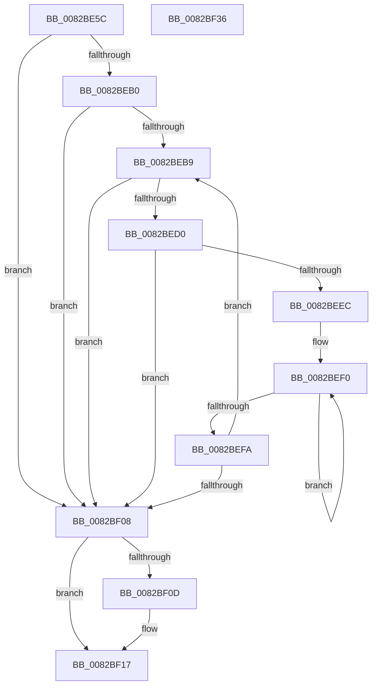

# CmMoveBaseContainer

- RVA: `0x0082BE5C`–`0x0082BF37` (길이 `219` bytes)
- VA: `0x000000014082BE5C`
- 실행 섹션: `PAGE`
- PDB 이름 있음: `예`; PDB Function 태그: `아니요`
- unwind 정보 RVA: `0x000C4928`
- 디코드: `71`개 명령, `219/219` bytes 표시
- 미해석 바이트: `0` (있으면 어셈블리에 `.byte`로 보존)

> 이 문서는 커널 이미지의 기계어와 PDB 기호를 분석해 생성했습니다. 4번과 5번은 함수 원형과 자료형을 바이너리 사용 방식에서 추정한 C 해석이며 원본 소스 복구 결과는 아닙니다.

## 1. Dependencies

- 직접 호출 지점: **4**; 고유 호출 대상: **4**
- 직접 호출자로 확인된 함수: **1**
- RIP 상대 이미지 참조: **1**

### Outgoing calls
- `0x0082BEA0` → [CmGetDevicesInBaseContainerList](CmGetDevicesInBaseContainerList_function_0082BA6C.md) (function, `0x0082BA6C`)
- `0x0082BEC5` → [CmRemoveDeviceFromContainer](CmRemoveDeviceFromContainer_function_0082BF40.md) (function, `0x0082BF40`)
- `0x0082BEE1` → [CmAddDeviceToContainer](../8F/CmAddDeviceToContainer_function_008FF190.md) (function, `0x008FF190`)
- `0x0082BF12` → [ExFreePoolWithTag](../../poolcode/B8/ExFreePoolWithTag_function_00B82870.md) (function, `0x00B82870`)

### Direct callers
- [sub_00B266CA](../B2/Unknown_function_00B266CA.md) at `0x00B268B1`
- [sub_00B266CA](../B2/Unknown_function_00B266CA.md) at `0x00B26916`

### Static image references
- `0x0082BE7C` → RVA `0x00E66398` (`.data`; read)

## 2. Other-region calls and transfers

- 다른 실행 섹션으로 향하는 call: **1**
  - `0x0082BF12` → [ExFreePoolWithTag](../../poolcode/B8/ExFreePoolWithTag_function_00B82870.md) (`PAGE` → `POOLCODE`)
- 별도 외부 분기/꼬리 이동을 확인하지 못했습니다.

## 3. Assembly (complete function range)

```asm
0082BE5C  48 8B C4                        mov rax, rsp
0082BE5F  48 89 58 10                     mov qword ptr [rax + 0x10], rbx
0082BE63  48 89 68 18                     mov qword ptr [rax + 0x18], rbp
0082BE67  48 89 70 20                     mov qword ptr [rax + 0x20], rsi
0082BE6B  48 89 48 08                     mov qword ptr [rax + 8], rcx
0082BE6F  57                              push rdi
0082BE70  41 54                           push r12
0082BE72  41 55                           push r13
0082BE74  41 56                           push r14
0082BE76  41 57                           push r15
0082BE78  48 83 EC 30                     sub rsp, 0x30
0082BE7C  4C 8B 35 15 A5 63 00            mov r14, qword ptr [rip + 0x63a515]
0082BE83  4D 8B F8                        mov r15, r8
0082BE86  4C 8B C2                        mov r8, rdx
0082BE89  4D 8B E1                        mov r12, r9
0082BE8C  48 8B EA                        mov rbp, rdx
0082BE8F  4C 8D 48 08                     lea r9, [rax + 8]
0082BE93  45 33 ED                        xor r13d, r13d
0082BE96  49 8B D7                        mov rdx, r15
0082BE99  49 8B CE                        mov rcx, r14
0082BE9C  4C 89 68 08                     mov qword ptr [rax + 8], r13
0082BEA0  E8 C7 FB FF FF                  call 0x14082ba6c
0082BEA5  48 8B 7C 24 60                  mov rdi, qword ptr [rsp + 0x60]
0082BEAA  8B F0                           mov esi, eax
0082BEAC  85 C0                           test eax, eax
0082BEAE  78 58                           js 0x14082bf08
0082BEB0  48 8B DF                        mov rbx, rdi
0082BEB3  66 44 39 2F                     cmp word ptr [rdi], r13w
0082BEB7  74 4F                           je 0x14082bf08
0082BEB9  4C 8B CB                        mov r9, rbx
0082BEBC  4C 8B C5                        mov r8, rbp
0082BEBF  49 8B D7                        mov rdx, r15
0082BEC2  49 8B CE                        mov rcx, r14
0082BEC5  E8 76 00 00 00                  call 0x14082bf40
0082BECA  8B F0                           mov esi, eax
0082BECC  85 C0                           test eax, eax
0082BECE  78 38                           js 0x14082bf08
0082BED0  4C 8B CB                        mov r9, rbx
0082BED3  4C 89 6C 24 20                  mov qword ptr [rsp + 0x20], r13
0082BED8  4C 8B C5                        mov r8, rbp
0082BEDB  49 8B D4                        mov rdx, r12
0082BEDE  49 8B CE                        mov rcx, r14
0082BEE1  E8 AA 32 0D 00                  call 0x1408ff190
0082BEE6  8B F0                           mov esi, eax
0082BEE8  85 C0                           test eax, eax
0082BEEA  78 1C                           js 0x14082bf08
0082BEEC  48 83 C8 FF                     or rax, 0xffffffffffffffff
0082BEF0  48 FF C0                        inc rax
0082BEF3  66 44 39 2C 43                  cmp word ptr [rbx + rax*2], r13w
0082BEF8  75 F6                           jne 0x14082bef0
0082BEFA  48 8D 1C 43                     lea rbx, [rbx + rax*2]
0082BEFE  48 83 C3 02                     add rbx, 2
0082BF02  66 44 39 2B                     cmp word ptr [rbx], r13w
0082BF06  75 B1                           jne 0x14082beb9
0082BF08  48 85 FF                        test rdi, rdi
0082BF0B  74 0A                           je 0x14082bf17
0082BF0D  33 D2                           xor edx, edx
0082BF0F  48 8B CF                        mov rcx, rdi
0082BF12  E8 59 69 35 00                  call 0x140b82870
0082BF17  48 8B 5C 24 68                  mov rbx, qword ptr [rsp + 0x68]
0082BF1C  8B C6                           mov eax, esi
0082BF1E  48 8B 74 24 78                  mov rsi, qword ptr [rsp + 0x78]
0082BF23  48 8B 6C 24 70                  mov rbp, qword ptr [rsp + 0x70]
0082BF28  48 83 C4 30                     add rsp, 0x30
0082BF2C  41 5F                           pop r15
0082BF2E  41 5E                           pop r14
0082BF30  41 5D                           pop r13
0082BF32  41 5C                           pop r12
0082BF34  5F                              pop rdi
0082BF35  C3                              ret
0082BF36  CC                              int3
```

## 4. C-style interpretation (structured pseudocode)

```c
__int64 __fastcall CmMoveBaseContainer(__int64 a1, __int64 a2, __int64 a3, __int64 a4)
{
    __int64 result;
    __int64 v_r13;
    __int64 v_rbx;
    __int64 v_rsp;
    unsigned __int64 v_stack_m38;
    unsigned __int64 v_stack_p10;
    unsigned __int64 v_stack_p18;
    unsigned __int64 v_stack_p20;
    unsigned __int64 v_stack_p8;

    *(unsigned __int64 *)(v_rsp + 16) = v_rbx;
    *(unsigned __int64 *)(v_rsp + 24) = v_rbp;
    *(unsigned __int64 *)(v_rsp + 32) = v_rsi;
    *(unsigned __int64 *)(v_rsp + 8) = a1;
    v_rsp = (v_rsp) - (48);
    v_r13 = 0;
    *(unsigned __int64 *)(v_rsp + 8) = 0;
    result = CmGetDevicesInBaseContainerList(*(unsigned __int64 *)(v_rip + 6530325), a3, a2, v_rsp + 8);
    if (sign_flag) goto loc_0082BF08;
    if ((*(unsigned __int16 *)(v_stack_p8)) == 0) goto loc_0082BF08;
loc_0082BEB9:
    result = CmRemoveDeviceFromContainer(*(unsigned __int64 *)(v_rip + 6530325), a3, a2, v_stack_p8);
    if (sign_flag) goto loc_0082BF08;
    v_stack_m38 = 0;
    result = CmAddDeviceToContainer(*(unsigned __int64 *)(v_rip + 6530325), a4, a2, v_stack_p8);
    if (sign_flag) goto loc_0082BF08;
    result = (result) | (-1);
loc_0082BEF0:
    result = (result) + 1;
    if ((*(unsigned __int16 *)(v_stack_p8 + result * 2)) != 0) goto loc_0082BEF0;
    v_rbx = (v_stack_p8 + result * 2) + (2);
    if ((*(unsigned __int16 *)(v_rbx)) != 0) goto loc_0082BEB9;
loc_0082BF08:
    if (v_stack_p8 != 0) {
        a2 = 0;
        a1 = v_stack_p8;
        result = ExFreePoolWithTag(a1, a2, a2, v_stack_p8);
    }
    v_rsp = (v_rsp) + (48);
    return (unsigned int)((unsigned int)((unsigned int)((unsigned int)(result))));
}
```

## 5. (Beta) C Style

```c
int64_t CmMoveBaseContainer(int64_t Arg1, int64_t Arg2, int64_t Arg3, int64_t Arg4)
{
    int64_t result;
    int64_t local_r13;
    int64_t local_rbx;
    int64_t local_rsp;
    uint64_t v_stack_m38;
    uint64_t v_stack_p10;
    uint64_t v_stack_p18;
    uint64_t v_stack_p20;
    uint64_t v_stack_p8;

    *(uint64_t *)(local_rsp + 0x10) = local_rbx;
    *(uint64_t *)(local_rsp + 0x18) = local_rbp;
    *(uint64_t *)(local_rsp + 0x20) = local_rsi;
    *(uint64_t *)(local_rsp + 0x8) = Arg1;
    local_rsp = (local_rsp) - (48);
    local_r13 = 0;
    *(uint64_t *)(local_rsp + 0x8) = 0;
    result = CmGetDevicesInBaseContainerList(*(uint64_t *)(v_rip + 0x63A515), Arg3, Arg2, local_rsp + 8);
    if (sign_flag) goto loc_0082BF08;
    if ((*(uint16_t *)(v_stack_p8)) == 0) goto loc_0082BF08;
loc_0082BEB9:
    result = CmRemoveDeviceFromContainer(*(uint64_t *)(v_rip + 0x63A515), Arg3, Arg2, v_stack_p8);
    if (sign_flag) goto loc_0082BF08;
    v_stack_m38 = 0;
    result = CmAddDeviceToContainer(*(uint64_t *)(v_rip + 0x63A515), Arg4, Arg2, v_stack_p8);
    if (sign_flag) goto loc_0082BF08;
    result = (result) | (-1);
loc_0082BEF0:
    result = (result) + 1;
    if ((*(uint16_t *)(v_stack_p8 + result * 2)) != 0) goto loc_0082BEF0;
    local_rbx = (v_stack_p8 + result * 2) + (2);
    if ((*(uint16_t *)(local_rbx)) != 0) goto loc_0082BEB9;
loc_0082BF08:
    if (v_stack_p8 != 0) {
        Arg2 = 0;
        Arg1 = v_stack_p8;
        result = ExFreePoolWithTag(Arg1, Arg2, Arg2, v_stack_p8);
    }
    local_rsp = (local_rsp) + (48);
    return (uint32_t)((uint32_t)((uint32_t)((uint32_t)(result))));
}
```

## 6. Execution-region graph

[열기: 2D/3D 그래프와 함수 탐색 컨트롤 패널](../../../control-panel.html?section=page&rva=0x0082BE5C&view=graph)

- 2D 그래프는 위에서 아래로 흐르고, 3D 그래프는 빈 공간을 드래그해 회전합니다. Shift+드래그는 이동, 휠은 확대·축소, 함수 노드 선택은 대상 보고서 이동입니다.

### Static fallback


