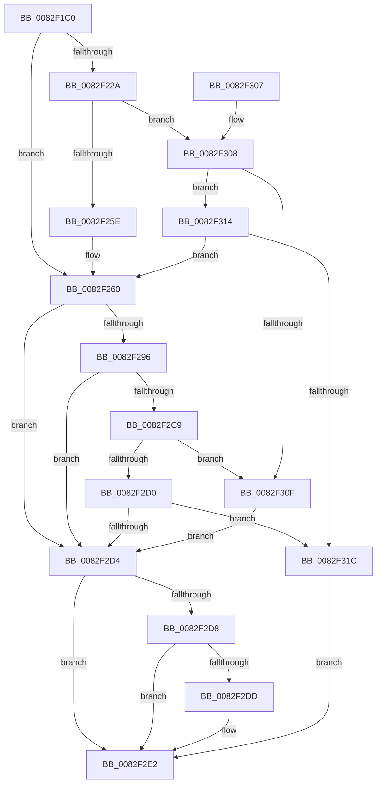

# CmOpenDevicePanelRegKey

- RVA: `0x0082F1C0`–`0x0082F323` (길이 `355` bytes)
- VA: `0x000000014082F1C0`
- 실행 섹션: `PAGE`
- PDB 이름 있음: `예`; PDB Function 태그: `아니요`
- unwind 정보 RVA: `0x000DAA4C`
- 디코드: `99`개 명령, `355/355` bytes 표시
- 미해석 바이트: `0` (있으면 어셈블리에 `.byte`로 보존)

> 이 문서는 커널 이미지의 기계어와 PDB 기호를 분석해 생성했습니다. 4번과 5번은 함수 원형과 자료형을 바이너리 사용 방식에서 추정한 C 해석이며 원본 소스 복구 결과는 아닙니다.

## 1. Dependencies

- 직접 호출 지점: **5**; 고유 호출 대상: **4**
- 직접 호출자로 확인된 함수: **2**
- RIP 상대 이미지 참조: **1**

### Outgoing calls
- `0x0082F1FE` → [memset](../../text/6C/memset_function_006C6C40.md) (function, `0x006C6C40`)
- `0x0082F24E` → [guard_dispatch_icall](../../text/6B/guard_dispatch_icall_function_006BAAD0.md) (function, `0x006BAAD0`)
- `0x0082F28A` → [_CmOpenDevicePanelRegKeyWorker](../A9/_CmOpenDevicePanelRegKeyWorker_function_00A98434.md) (function, `0x00A98434`)
- `0x0082F2BD` → [guard_dispatch_icall](../../text/6B/guard_dispatch_icall_function_006BAAD0.md) (function, `0x006BAAD0`)
- `0x0082F2EB` → [_security_check_cookie](../../text/6A/_security_check_cookie_function_006AC640.md) (function, `0x006AC640`)

### Direct callers
- [CmCreateDevicePanelWorker](CmCreateDevicePanelWorker_function_0082E240.md) at `0x0082E29A`
- [PnpDispatchDevicePanel](../83/PnpDispatchDevicePanel_function_00831830.md) at `0x00831A43`

### Static image references
- `0x0082F1D8` → RVA `0x00E0A740` (`.data`; read)

## 2. Other-region calls and transfers

- 다른 실행 섹션으로 향하는 call: **4**
  - `0x0082F1FE` → [memset](../../text/6C/memset_function_006C6C40.md) (`PAGE` → `.text`)
  - `0x0082F24E` → [guard_dispatch_icall](../../text/6B/guard_dispatch_icall_function_006BAAD0.md) (`PAGE` → `.text`)
  - `0x0082F2BD` → [guard_dispatch_icall](../../text/6B/guard_dispatch_icall_function_006BAAD0.md) (`PAGE` → `.text`)
  - `0x0082F2EB` → [_security_check_cookie](../../text/6A/_security_check_cookie_function_006AC640.md) (`PAGE` → `.text`)
- 별도 외부 분기/꼬리 이동을 확인하지 못했습니다.

## 3. Assembly (complete function range)

```asm
0082F1C0  48 89 5C 24 18                  mov qword ptr [rsp + 0x18], rbx
0082F1C5  55                              push rbp
0082F1C6  56                              push rsi
0082F1C7  57                              push rdi
0082F1C8  41 56                           push r14
0082F1CA  41 57                           push r15
0082F1CC  48 8D 6C 24 E9                  lea rbp, [rsp - 0x17]
0082F1D1  48 81 EC B0 00 00 00            sub rsp, 0xb0
0082F1D8  48 8B 05 61 B5 5D 00            mov rax, qword ptr [rip + 0x5db561]
0082F1DF  48 33 C4                        xor rax, rsp
0082F1E2  48 89 45 07                     mov qword ptr [rbp + 7], rax
0082F1E6  48 8B 5D 77                     mov rbx, qword ptr [rbp + 0x77]
0082F1EA  4C 8B FA                        mov r15, rdx
0082F1ED  48 8B 75 7F                     mov rsi, qword ptr [rbp + 0x7f]
0082F1F1  33 D2                           xor edx, edx
0082F1F3  4C 8B F1                        mov r14, rcx
0082F1F6  48 8D 4D A7                     lea rcx, [rbp - 0x59]
0082F1FA  44 8D 42 58                     lea r8d, [rdx + 0x58]
0082F1FE  E8 3D 7A E9 FF                  call 0x1406c6c40
0082F203  8B 45 67                        mov eax, dword ptr [rbp + 0x67]
0082F206  49 8B BE F8 01 00 00            mov rdi, qword ptr [r14 + 0x1f8]
0082F20D  83 65 BB 00                     and dword ptr [rbp - 0x45], 0
0082F211  89 45 BF                        mov dword ptr [rbp - 0x41], eax
0082F214  8A 45 6F                        mov al, byte ptr [rbp + 0x6f]
0082F217  88 45 C3                        mov byte ptr [rbp - 0x3d], al
0082F21A  C7 45 B7 60 00 00 00            mov dword ptr [rbp - 0x49], 0x60
0082F221  48 89 5D C7                     mov qword ptr [rbp - 0x39], rbx
0082F225  48 85 FF                        test rdi, rdi
0082F228  74 36                           je 0x14082f260
0082F22A  41 B9 0B 00 00 00               mov r9d, 0xb
0082F230  48 8D 45 A7                     lea rax, [rbp - 0x59]
0082F234  48 89 44 24 28                  mov qword ptr [rsp + 0x28], rax
0082F239  49 8B D7                        mov rdx, r15
0082F23C  49 8B CE                        mov rcx, r14
0082F23F  C7 44 24 20 01 00 00 00         mov dword ptr [rsp + 0x20], 1
0082F247  48 8B C7                        mov rax, rdi
0082F24A  45 8D 41 FB                     lea r8d, [r9 - 5]
0082F24E  E8 7D B8 E8 FF                  call 0x1406baad0
0082F253  3D 02 00 00 C0                  cmp eax, 0xc0000002
0082F258  0F 85 AA 00 00 00               jne 0x14082f308
0082F25E  33 FF                           xor edi, edi
0082F260  44 8B 45 B7                     mov r8d, dword ptr [rbp - 0x49]
0082F264  48 8D 45 CF                     lea rax, [rbp - 0x31]
0082F268  48 89 44 24 38                  mov qword ptr [rsp + 0x38], rax
0082F26D  49 8B D7                        mov rdx, r15
0082F270  48 8B 45 C7                     mov rax, qword ptr [rbp - 0x39]
0082F274  49 8B CE                        mov rcx, r14
0082F277  48 89 44 24 30                  mov qword ptr [rsp + 0x30], rax
0082F27C  8A 45 C3                        mov al, byte ptr [rbp - 0x3d]
0082F27F  88 44 24 28                     mov byte ptr [rsp + 0x28], al
0082F283  8B 45 BF                        mov eax, dword ptr [rbp - 0x41]
0082F286  89 44 24 20                     mov dword ptr [rsp + 0x20], eax
0082F28A  E8 A5 91 26 00                  call 0x140a98434
0082F28F  8B D8                           mov ebx, eax
0082F291  48 85 FF                        test rdi, rdi
0082F294  74 3E                           je 0x14082f2d4
0082F296  89 45 A7                        mov dword ptr [rbp - 0x59], eax
0082F299  41 B9 0B 00 00 00               mov r9d, 0xb
0082F29F  48 8D 45 A7                     lea rax, [rbp - 0x59]
0082F2A3  49 8B D7                        mov rdx, r15
0082F2A6  48 89 44 24 28                  mov qword ptr [rsp + 0x28], rax
0082F2AB  49 8B CE                        mov rcx, r14
0082F2AE  48 8B C7                        mov rax, rdi
0082F2B1  C7 44 24 20 02 00 00 00         mov dword ptr [rsp + 0x20], 2
0082F2B9  45 8D 41 FB                     lea r8d, [r9 - 5]
0082F2BD  E8 0E B8 E8 FF                  call 0x1406baad0
0082F2C2  3D 02 00 00 C0                  cmp eax, 0xc0000002
0082F2C7  74 0B                           je 0x14082f2d4
0082F2C9  3D 20 01 00 C0                  cmp eax, 0xc0000120
0082F2CE  74 3F                           je 0x14082f30f
0082F2D0  85 C0                           test eax, eax
0082F2D2  75 48                           jne 0x14082f31c
0082F2D4  85 DB                           test ebx, ebx
0082F2D6  78 0A                           js 0x14082f2e2
0082F2D8  48 85 F6                        test rsi, rsi
0082F2DB  74 05                           je 0x14082f2e2
0082F2DD  8B 45 CF                        mov eax, dword ptr [rbp - 0x31]
0082F2E0  89 06                           mov dword ptr [rsi], eax
0082F2E2  8B C3                           mov eax, ebx
0082F2E4  48 8B 4D 07                     mov rcx, qword ptr [rbp + 7]
0082F2E8  48 33 CC                        xor rcx, rsp
0082F2EB  E8 50 D3 E7 FF                  call 0x1406ac640
0082F2F0  48 8B 9C 24 F0 00 00 00         mov rbx, qword ptr [rsp + 0xf0]
0082F2F8  48 81 C4 B0 00 00 00            add rsp, 0xb0
0082F2FF  41 5F                           pop r15
0082F301  41 5E                           pop r14
0082F303  5F                              pop rdi
0082F304  5E                              pop rsi
0082F305  5D                              pop rbp
0082F306  C3                              ret
0082F307  CC                              int3
0082F308  3D 20 01 00 C0                  cmp eax, 0xc0000120
0082F30D  75 05                           jne 0x14082f314
0082F30F  8B 5D A7                        mov ebx, dword ptr [rbp - 0x59]
0082F312  EB C0                           jmp 0x14082f2d4
0082F314  85 C0                           test eax, eax
0082F316  0F 84 44 FF FF FF               je 0x14082f260
0082F31C  BB E5 00 00 C0                  mov ebx, 0xc00000e5
0082F321  EB BF                           jmp 0x14082f2e2
```

## 4. C-style interpretation (structured pseudocode)

```c
__int64 __fastcall CmOpenDevicePanelRegKey(__int64 a1, __int64 a2, __int64 a3, __int64 a4, unsigned int a5, unsigned __int8 a6, __int64 a7, __int64 a8)
{
    __int64 result;
    __int64 v_rdi;
    __int64 v_rsp;
    unsigned __int64 v_stack_m38;
    unsigned __int64 v_stack_m3F;
    unsigned __int64 v_stack_m70;
    unsigned __int64 v_stack_m78;
    unsigned __int8 v_stack_m7C;
    unsigned int v_stack_m80;
    unsigned int v_stack_m84;
    unsigned int v_stack_m88;
    unsigned __int64 v_stack_m98;
    unsigned __int64 v_stack_mA0;
    unsigned __int64 v_stack_mA8;
    unsigned __int64 v_stack_mB0;
    unsigned int v_stack_mB8;
    unsigned __int64 v_stack_p18;

    v_stack_p18 = v_rbx;
    v_rsp = (v_rsp) - (176);
    result = (*(unsigned __int64 *)(v_rip + 6141281)) ^ (v_rsp);
    v_stack_m38 = result;
    a2 = 0;
    result = memset(v_stack_m98, a2, a2 + 88, a4);
    v_stack_m80 = (unsigned int)((unsigned int)(a5));
    v_stack_m7C = a6;
    v_stack_m88 = 96;
    v_stack_m78 = a7;
    if (*(unsigned __int64 *)(a1 + 504) == 0) goto loc_0082F260;
    v_stack_mB0 = v_stack_m98;
    v_stack_mB8 = 1;
    result = guard_dispatch_icall(a1, 0, 11 - 5, 11);
    if (((unsigned int)(result)) != 0xC0000002ULL) goto loc_0082F308;
    v_rdi = 0;
loc_0082F260:
    v_stack_mA0 = v_stack_m70;
    v_stack_mA8 = v_stack_m78;
    v_stack_mB0 = (unsigned __int8)(v_stack_m7C);
    v_stack_mB8 = (unsigned int)((unsigned int)(v_stack_m80));
    result = _CmOpenDevicePanelRegKeyWorker(a1, 0, (unsigned int)(v_stack_m88), 11);
    if (0 == 0) goto loc_0082F2D4;
    v_stack_m98 = (unsigned int)(result);
    v_stack_mB0 = v_stack_m98;
    v_stack_mB8 = 2;
    result = guard_dispatch_icall(a1, 0, 11 - 5, 11);
    if (((unsigned int)(result)) == 0xC0000002ULL) goto loc_0082F2D4;
    if (((unsigned int)(result)) == 0xC0000120ULL) goto loc_0082F30F;
    if ((unsigned int)(result) != 0) goto loc_0082F31C;
loc_0082F2D4:
    if (sign_flag) goto loc_0082F2E2;
    if (a8 != 0) {
        result = v_stack_m70;
        *(unsigned int *)(a8) = (unsigned int)(result);
    }
    a1 = (v_stack_m38) ^ (v_rsp);
    result = _security_check_cookie(a1, 0, 11 - 5, 11);
    v_rsp = (v_rsp) + (176);
    return result;
loc_0082F308:
    if (((unsigned int)(result)) != 0xC0000120ULL) goto loc_0082F314;
loc_0082F30F:
    goto loc_0082F2D4;
loc_0082F314:
    if ((unsigned int)(result) == 0) goto loc_0082F260;
loc_0082F31C:
    goto loc_0082F2E2;
}
```

## 5. (Beta) C Style

```c
int64_t CmOpenDevicePanelRegKey(void *Arg1, int64_t Arg2, int64_t Arg3, int64_t Arg4, uint32_t Arg5, uint8_t Arg6, int64_t Arg7, int64_t Arg8)
{
    uint8_t *arg1 = (uint8_t *)Arg1;

    int64_t result;
    int64_t local_rdi;
    int64_t local_rsp;
    uint64_t v_stack_m38;
    uint64_t v_stack_m3F;
    uint64_t v_stack_m70;
    uint64_t v_stack_m78;
    uint8_t v_stack_m7C;
    uint32_t v_stack_m80;
    uint32_t v_stack_m84;
    uint32_t v_stack_m88;
    uint64_t v_stack_m98;
    uint64_t v_stack_mA0;
    uint64_t v_stack_mA8;
    uint64_t v_stack_mB0;
    uint32_t v_stack_mB8;
    uint64_t v_stack_p18;

    v_stack_p18 = local_rbx;
    local_rsp = (local_rsp) - (176);
    result = (*(uint64_t *)(v_rip + 0x5DB561)) ^ (local_rsp);
    v_stack_m38 = result;
    Arg2 = 0;
    result = memset(v_stack_m98, Arg2, Arg2 + 88, Arg4);
    v_stack_m80 = (uint32_t)((uint32_t)(Arg5));
    v_stack_m7C = Arg6;
    v_stack_m88 = 96;
    v_stack_m78 = Arg7;
    if (*(uint64_t *)(arg1 + 0x1F8) == 0) goto loc_0082F260;
    v_stack_mB0 = v_stack_m98;
    v_stack_mB8 = 1;
    result = guard_dispatch_icall(Arg1, 0, 11 - 5, 11);
    if (((uint32_t)(result)) != 0xC0000002ULL) goto loc_0082F308;
    local_rdi = 0;
loc_0082F260:
    v_stack_mA0 = v_stack_m70;
    v_stack_mA8 = v_stack_m78;
    v_stack_mB0 = (uint8_t)(v_stack_m7C);
    v_stack_mB8 = (uint32_t)((uint32_t)(v_stack_m80));
    result = _CmOpenDevicePanelRegKeyWorker(Arg1, 0, (uint32_t)(v_stack_m88), 11);
    if (0 == 0) goto loc_0082F2D4;
    v_stack_m98 = (uint32_t)(result);
    v_stack_mB0 = v_stack_m98;
    v_stack_mB8 = 2;
    result = guard_dispatch_icall(Arg1, 0, 11 - 5, 11);
    if (((uint32_t)(result)) == 0xC0000002ULL) goto loc_0082F2D4;
    if (((uint32_t)(result)) == 0xC0000120ULL) goto loc_0082F30F;
    if ((uint32_t)(result) != 0) goto loc_0082F31C;
loc_0082F2D4:
    if (sign_flag) goto loc_0082F2E2;
    if (Arg8 != 0) {
        result = v_stack_m70;
        *(uint32_t *)(Arg8) = (uint32_t)(result);
    }
    Arg1 = (v_stack_m38) ^ (local_rsp);
    result = _security_check_cookie(Arg1, 0, 11 - 5, 11);
    local_rsp = (local_rsp) + (176);
    return result;
loc_0082F308:
    if (((uint32_t)(result)) != 0xC0000120ULL) goto loc_0082F314;
loc_0082F30F:
    goto loc_0082F2D4;
loc_0082F314:
    if ((uint32_t)(result) == 0) goto loc_0082F260;
loc_0082F31C:
    goto loc_0082F2E2;
}
```

### 관측된 메모리 오프셋

구조체 형식이 확인되지 않은 접근은 인자 기준의 오프셋으로만 기록했습니다.

| 기준 인자 | 오프셋 표현 | 폭 (bit) | 접근 |
|---|---:|---:|---|
| `Arg1` | `+ 0x1F8` | `64` | `R` |

## 6. Execution-region graph

[열기: 2D/3D 그래프와 함수 탐색 컨트롤 패널](../../../control-panel.html?section=page&rva=0x0082F1C0&view=graph)

- 2D 그래프는 위에서 아래로 흐르고, 3D 그래프는 빈 공간을 드래그해 회전합니다. Shift+드래그는 이동, 휠은 확대·축소, 함수 노드 선택은 대상 보고서 이동입니다.

### Static fallback


